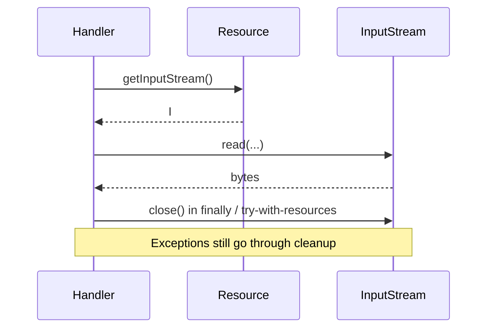
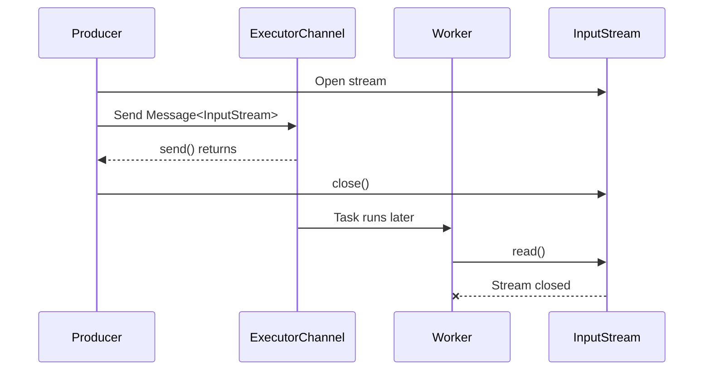
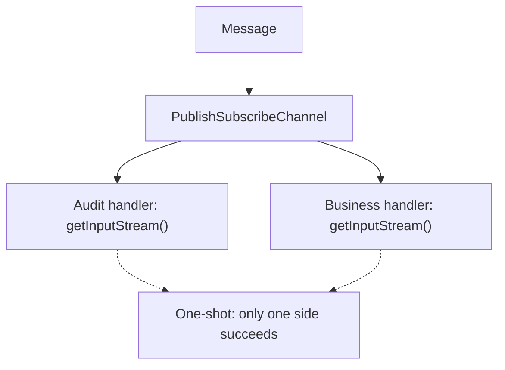

# Single-Read Streams and Closing Resources in Spring Integration

## 1. Real-world problem: Resource found, yet stream cannot be read a second time

A Spring Integration service periodically scans `.properties` configuration files from the classpath/JAR and reads them to update order-processing rules. Initial flow:

```text
Resource inbound adapter
    → Message<Resource[]>
    → Splitter
    → Message<Resource>
    → handler reads content
```

One day, a developer adds a step to log `contentLength()` and an independent parsing step. Some resources still work; others throw `IllegalStateException` on the second open or report "stream closed." With async consumers, the resource may even be closed prematurely before the worker actually reads it.

Not every `Resource` shares the same **re-readability**:

- `ClassPathResource`, `FileSystemResource`, and `ByteArrayResource` normally can **open a fresh `InputStream` on each call**.
- `InputStreamResource` is a descriptor for **a stream accessed only once**, including the variant supplied with an `InputStreamSource` for lazy opening (Spring Framework 6.1.7+).
- Even if a resource allows reopening, data on the filesystem or at a URL can still **change** between two reads; "repeatable" does not mean "immutable snapshot."

This is the **"Single-read streams and closing resources"** lesson in the **Adapter Resource** chapter of the **SPRING_INTEGRATION_ADAPTERS** module. The module teaches connecting external systems via inbound/outbound adapters, gateways, pollers, and `MessageChannel` while controlling message contracts, errors, and lifecycles. This topic dives into **`InputStream` lifecycles**, how to ensure proper reading/closing in handlers, and the boundaries among Resource inbound, splitters, transformers, and consumers.

### Learning objectives

After this lesson, you will be able to:

1. Explain `Resource`, `InputStreamSource`, `InputStreamResource`, and `Resource#isOpen()`.
2. Distinguish **one-shot streams**, **re-openable Resources**, and **immutable snapshots**.
3. Assign stream-closing responsibility via `try-with-resources` and avoid closing before downstream uses it.
4. Understand why `InputStreamResource#contentLength()` and careless metadata reads can **consume the stream**.
5. Convert `Message<Resource[]>` into `Message<Resource>`, and then into a DTO/`byte[]` with clear ownership.
6. Write bounded readers, and handle I/O errors, retries, async boundaries, fan-out, and transactions.
7. Test closing streams exactly once, detect double-reads, and evaluate real lifecycle failures.

## 2. First rule: close the stream, not the Resource object

`Resource` is a **handle** describing a data source, not an `InputStream`. The `Resource` interface extends `InputStreamSource`:

```java
public interface InputStreamSource {
    InputStream getInputStream() throws IOException;
}
```

To read content:

```java
Resource resource = ...;

try (InputStream input = resource.getInputStream()) {
    byte[] firstBytes = input.readNBytes(1024);
    // Process bytes...
} // Closes InputStream, even if an exception is thrown.
```

**There is no `resource.close()` method in the standard `Resource` contract.** `Resource` is not `AutoCloseable`. The phrase "closing resources" in the title practically means **closing the streams and I/O resources opened by the handler**, such as file descriptors, network connections, or decoder wrappers.

### Ownership rule

> Whichever component **opens** the stream must usually make clear **who is responsible for closing it**. In a synchronous read flow, the handler typically opens and closes within the same `try-with-resources` scope; do not pass a live stream to another component without an explicit ownership agreement.

Correct handler example:

```java
public byte[] read(Resource resource) throws IOException {
    try (InputStream input = resource.getInputStream()) {
        return input.readNBytes(128);
    }
}
```

Wrong example:

```java
public InputStream unsafe(Resource resource) throws IOException {
    try (InputStream input = resource.getInputStream()) {
        return input; // WRONG: stream is closed before caller reads it.
    }
}
```

Another wrong example:

```java
public byte[] leaking(Resource resource) throws IOException {
    InputStream input = resource.getInputStream();
    return input.readNBytes(128); // WRONG: missing close on completion/error.
}
```

The point is not calling `close()` as often as possible. **Correct** means closing at the **moment ownership ends**, in the right component, even when code fails.

## 3. Resource#getInputStream() and three commonly conflated concepts

### 3.1. Re-openable: a fresh stream can be opened

Per the Spring Framework Reference, ordinary `Resource` implementations are expected to return **a fresh `InputStream`** on each `getInputStream()` call; the caller must close the stream it receives.

```java
Resource fileResource = new FileSystemResource(
    Path.of("/opt/app/rules/default.properties")
);

try (InputStream first = fileResource.getInputStream()) {
    // Read #1.
}

try (InputStream second = fileResource.getInputStream()) {
    // Read #2, a fresh stream.
}
```

However, if the file changes between the two calls, `first` and `second` **are not guaranteed to contain the same bytes**.

### 3.2. One-shot: the stream can only be obtained once

`InputStreamResource` holds an already-opened stream or a source producing a stream **for single use**. Spring Framework explicitly states not to use `InputStreamResource` when you need to retain a descriptor long-term or read multiple times.

```java
byte[] content = "hello".getBytes(StandardCharsets.UTF_8);
Resource oneShot = new InputStreamResource(
    new ByteArrayInputStream(content)
);

try (InputStream input = oneShot.getInputStream()) {
    System.out.println(new String(
        input.readAllBytes(),
        StandardCharsets.UTF_8
    ));
}

// Calling oneShot.getInputStream() again:
// typically throws IllegalStateException per InputStreamResource contract.
```

For `InputStreamResource`, **`isOpen() == true`** and `getInputStream()` is not meant for repeated reads. Spring Framework further recommends preferring `ByteArrayResource` or file-based implementations whenever possible.

### 3.3. Snapshot: content already pinned as bytes

`ByteArrayResource` holds bytes in RAM and normally creates a fresh `ByteArrayInputStream` on each open. It is suitable for **small snapshots** and testing:

```java
byte[] bytes =
    "rule.id=shipping\n".getBytes(StandardCharsets.UTF_8);
Resource snapshot = new ByteArrayResource(bytes);

try (InputStream a = snapshot.getInputStream();
     InputStream b = snapshot.getInputStream()) {
    assert Arrays.equals(a.readAllBytes(), b.readAllBytes());
}
```

This example uses Java's `assert` for illustration; in unit tests use JUnit assertions. `ByteArrayResource` retains a reference to the provided array, so **do not mutate `bytes` after creation** if you want a truly immutable snapshot at the application level. Use `byte[] copy = bytes.clone()` before constructing the `Resource` and never share that array with mutating code.

### Comparison

| Resource | Typical `isOpen()` | Re-openable stream? | Content guaranteed immutable? |
| --- | --- | --- | --- |
| `InputStreamResource` | **true** | **No**, one-shot | Not guaranteed |
| `ByteArrayResource` | false | Usually **yes** | Only if the bytes are not mutated later |
| `ClassPathResource` | false | Usually **yes** | JARs are typically immutable for app lifetime, though not an interface promise |
| `FileSystemResource` | false | Usually **yes** | **No**; file can change or be deleted |
| `UrlResource` | false | Can open new requests/connections | **No**; response/URL can change |
| Custom `Resource` | Implementation-defined | Per implementation contract | Must be verified |

**`isOpen() == false` does not guarantee "replaying the exact same bytes."** It only indicates the resource does not currently represent an already-open stream; re-openability, content stability, and lifetime still depend on the implementation and external source.

## 4. Lifecycle of a single read



The proper workflow is typically:

1. Handler receives `Resource`.
2. Handler establishes the read contract: max bytes, charset/format, timeout, source identity.
3. Handler calls `getInputStream()` **at the exact moment** reading is needed.
4. Reader consumes the stream within the same ownership scope.
5. Stream is closed when finished or on error.
6. Handler passes **bytes/DTO/snapshot** downstream; never keep a closed stream as a payload.

### Must close the stream even when reading only partially

```java
try (InputStream input = resource.getInputStream()) {
    byte[] header = input.readNBytes(16);
    if (!looksValid(header)) {
        throw new IllegalArgumentException("Invalid header");
    }
    // ...
} // Opened once, closed even if only 16 bytes were read.
```

`looksValid` is an application-defined validation method. Rejecting immediately after reading a header is a reasonable choice, though for HTTP/SFTP/remote resources consider the effect of closing connections before draining the response and connection-pooling behavior of the client library.

## 5. InputStreamResource: a special case to remember

Spring Framework Javadoc describes `InputStreamResource` as a `Resource` for an **already-opened `InputStream`**. Since Spring Framework 6.1.7, there is also a constructor taking an `InputStreamSource` for lazy opening, **yet the descriptor remains one-shot**.

### 5.1. Creating from an already-opened InputStream

```java
InputStream opened = Files.newInputStream(
    Path.of("/opt/app/exports/large.txt")
);
Resource oneShot = new InputStreamResource(
    opened, "one-shot-export"
);

// Only use inside a synchronous scope with a clear owner.
try (InputStream input = oneShot.getInputStream()) {
    byte[] prefix = input.readNBytes(64);
}
```

**Lifecycle flaw here:** the `opened` stream is already open **before** downstream receives the resource. If the flow is canceled, there is no subscriber, an exception happens before `getInputStream()`, or the message is dropped, the stream may never be closed. Therefore **do not create batches of `InputStreamResource(opened)` to enqueue and forget**.

### 5.2. Lazy InputStreamSource is still single-use (Spring 6.1.7+)

```java
Resource lazyOneShot = new InputStreamResource(
    () -> Files.newInputStream(Path.of("/opt/app/exports/large.txt")),
    "lazy-one-shot-export"
);
```

The lazy version opens the stream only on the first `getInputStream()` call. That **reduces how long the file descriptor is held** while waiting, but:

- It does not make the Resource re-readable.
- Races still exist: the file may vanish before the stream is opened.
- You still must close the obtained stream.
- Do not pass one-shot handles through durable message stores/brokers expecting the receiver to open them.
- This constructor **does not exist** in older Spring Framework versions; match your dependency/BOM before using it.

If you need **multiple reads**, use `FileSystemResource`, `ClassPathResource`, `ByteArrayResource`, or a custom `AbstractResource` whose `getInputStream()` opens a fresh stream each time—**never use `InputStreamResource` expecting replay**.

## 6. Avoiding contentLength() accidentally consuming the stream

This is the biggest trap with `InputStreamResource`.

```java
Resource oneShot = new InputStreamResource(
    new ByteArrayInputStream(new byte[] { 1, 2, 3 })
);

long n = oneShot.contentLength(); // DANGEROUS for one-shot.

// Subsequent getInputStream call is no longer valid.
// oneShot.getInputStream() -> IllegalStateException.
```

Spring Framework Javadoc warns that `InputStreamResource` **has no independent `contentLength()` implementation**; `AbstractResource#contentLength()` may **read the entire `InputStream`** to count bytes. Thus a seemingly harmless "check metadata before reading content" step actually consumes the source.

### Do not perform operations that pre-read a full pass

Before passing a one-shot `Resource` to a parser, avoid carelessly calling:

- `resource.contentLength()` when the implementation may read the stream to measure size.
- `resource.getContentAsByteArray()` or `getContentAsString(...)` followed by `getInputStream()`.
- `resource.getInputStream().readAllBytes()` to log/debug and then passing the same resource to a handler.
- Multiple `@Transformer`/`@ServiceActivator`/subscribers all opening the same `InputStreamResource`.
- A checksum step opening the stream, followed by a parser **opening the same one-shot again**.

`exists()` also **does not guarantee** content will be readable, and `isReadable()` does not confirm valid data. On `InputStreamResource`, `exists()` may always return true by implementation without inspecting bytes or the remote origin.

### How to measure actual size without losing the chance to parse

Read **once**, bound the bytes, and get both the snapshot and exact length:

```java
int maxBytes = 128 * 1024;
byte[] raw;

try (InputStream input = resource.getInputStream()) {
    raw = input.readNBytes(maxBytes + 1);
}
if (raw.length > maxBytes) {
    throw new IOException("Resource exceeds 128 KiB");
}

int actualLength = raw.length; // No contentLength() needed.
// Parse from raw in the next step.
```

This example intentionally keeps bytes in RAM because of the 128 KiB cap. For large resources, use a **streaming parser with a byte budget** or copy to a staging file/object store and parse from staging per contract, never unbounded `readAllBytes()`.

## 7. Try-with-resources for Readers and multi-layered stream wrappers

A Resource containing UTF-8 text:

```java
try (Reader reader = new InputStreamReader(
        resource.getInputStream(),
        StandardCharsets.UTF_8)) {
    Properties props = new Properties();
    props.load(reader);
}
```

When `InputStreamReader` closes, the underlying `InputStream` is also closed. Therefore you only need one owner of the wrapper chain; you do not have to put `try-with-resources` on every individual layer at all costs.

An example including `BufferedReader`:

```java
try (BufferedReader reader = new BufferedReader(
        new InputStreamReader(
            resource.getInputStream(), StandardCharsets.UTF_8
        ))) {
    for (String line; (line = reader.readLine()) != null; ) {
        // Process line-by-line without holding the entire file.
    }
}
```

`BufferedReader.close()` closes `InputStreamReader`, which closes `InputStream`. However, this is only correct when **processing completes inside the same try block**; never return `reader` outside.

### When using GZIPInputStream

```java
try (InputStream decompressed = new GZIPInputStream(
        resource.getInputStream())) {
    // Read decompressed data with a decompressed byte limit.
}
```

`GZIPInputStream.close()` closes the underlying stream. **Security note:** bound the **decompressed size**, not only the raw compressed file size, to guard against decompression bombs.

### Handling exceptions during close

With `try-with-resources`, if processing throws an exception and `close()` also throws an exception, Java preserves the primary exception and attaches the close failure to `suppressed exceptions`. Never swallow all I/O errors just to "ensure closing works": `close()` can surface flush/connection failures that affect correctness.

```java
try (InputStream input = resource.getInputStream()) {
    parse(input);
} catch (IOException error) {
    for (Throwable suppressed : error.getSuppressed()) {
        // Observe/record stream close errors if needed.
    }
    throw error;
}
```

`parse(InputStream)` is an application-defined method that **does not close the stream itself** in this ownership model; the `try` block is the sole owner. Never log full file contents or secrets when inspecting exceptions.

## 8. Open once, yet usable across multiple business steps

Wrong:

```java
// One-shot resource:
String checksum = sha256(resource.getInputStream()); // read #1
Rule rule = parse(resource.getInputStream());         // read #2
```

The broken snippet also leaks the streams. The right approach is **one read pass → produce safe content → multiple operations on the snapshot**:

```java
byte[] snapshot;
try (InputStream input = resource.getInputStream()) {
    snapshot = input.readNBytes(64 * 1024 + 1);
}
if (snapshot.length > 64 * 1024) {
    throw new IOException("Oversized rule");
}

String checksum = sha256(snapshot);
Rule rule = parse(snapshot);
```

`sha256(byte[])` and `parse(byte[])` are application-defined methods; both operate on the snapshot without **reopening the source**. For large input files, either hash and parse in a single streaming pass or spool to temporary storage and reread from that staging storage.

### Single-pass streaming and checksums

For large files, if you need to compute a hash while parsing, one option is `DigestInputStream`:

```java
MessageDigest digest = MessageDigest.getInstance("SHA-256");
try (InputStream input = new DigestInputStream(
        resource.getInputStream(), digest)) {
    parseStreamUntilEof(input);
}
byte[] sha256 = digest.digest();
```

**Critical warning:** the digest represents the **entire resource** only if `parseStreamUntilEof` **actually reads through EOF**. If the parser stops early upon finding the target element, the digest reflects only the bytes read so far. For full-file checksums, drain to EOF or stage the file using a bounded/reconciled design.

## 9. Resource inbound adapter and message payloads

Spring Integration Resource support provides a **polling inbound channel adapter** using `ResourceRetrievingMessageSource` to resolve a location pattern such as `classpath*:rules/*.properties`. It emits **a single Spring message whose payload is `Resource[]`**.


### Resource[] does not mean one file per message

```text
Poll #1:
  resolver finds 3 resources
  filter accepts 3
  source emits 1 Message<Resource[3]>

After splitter:
  Message<Resource>(A)
  Message<Resource>(B)
  Message<Resource>(C)
```

`maxMessagesPerPoll="1"` only limits the number of **message** receives from the source per cycle; it does **not** cap the `Resource[]` payload to one element.

### The adapter does not open or close content streams

`ResourceRetrievingMessageSource` builds messages containing **resource handles**. Returning `Message<Resource[]>` from `receive()` does not prove files were opened, parsed, written to the DB, or had streams closed; actual responsibility lies with the transformer/handler **when calling `getInputStream()`**.

With `AcceptOnceCollectionFilter`, the source may not re-emit a resource once accepted, even if the downstream handler fails reading it. **Filter state does not roll back with I/O or DB transactions.** For critical content, design separate ledgers/checkpoints and retries.

## 10. Java configuration: poller → Resource[] → Resource

### 10.1. Dependencies

With a Spring Boot BOM compatible with Spring Integration:

```xml
<dependencies>
    <dependency>
        <groupId>org.springframework.boot</groupId>
        <artifactId>spring-boot-starter-integration</artifactId>
    </dependency>
</dependencies>
```

The example uses Java 17+ and Spring Integration Core. It does not need a separate File adapter just to discover `Resource` objects.

Place the files:

```text
src/main/resources/rules/
  shipping.properties
  discount.properties
```

Contents:

```properties
rule.id=shipping-express
rule.version=1
rule.label=Free shipping
```

Input contract: each `.properties` file is UTF-8, max 128 KiB, with required `rule.id`/`rule.version` fields. This is an application-defined contract, **not** a format Spring Integration parses automatically.

### 10.2. Creating ResourceRetrievingMessageSource and channels

```java
package com.example.resourcestream;

import org.springframework.context.annotation.Bean;
import org.springframework.context.annotation.Configuration;
import org.springframework.core.io.Resource;
import org.springframework.integration.annotation.InboundChannelAdapter;
import org.springframework.integration.annotation.Poller;
import org.springframework.integration.channel.DirectChannel;
import org.springframework.integration.config.EnableIntegration;
import org.springframework.integration.core.MessageSource;
import org.springframework.integration.resource.ResourceRetrievingMessageSource;
import org.springframework.integration.util.AcceptOnceCollectionFilter;
import org.springframework.messaging.MessageChannel;

@Configuration
@EnableIntegration
public class ResourceStreamConfiguration {

    @Bean
    public MessageChannel resourceBatches() {
        return new DirectChannel();
    }

    @Bean
    public MessageChannel individualResources() {
        return new DirectChannel();
    }

    @Bean
    public MessageChannel ruleSnapshots() {
        return new DirectChannel();
    }

    @Bean
    @InboundChannelAdapter(
        channel = "resourceBatches",
        poller = @Poller(
            fixedDelay = "5000",
            maxMessagesPerPoll = "1"
        )
    )
    public MessageSource<Resource[]> ruleResourceSource() {
        ResourceRetrievingMessageSource source =
            new ResourceRetrievingMessageSource(
                "classpath*:rules/*.properties"
            );
        source.setFilter(new AcceptOnceCollectionFilter<>());
        return source;
    }
}
```

`@EnableIntegration` activates Spring Integration infrastructure. `@InboundChannelAdapter` creates the polling endpoint, not a stream reader. `ResourceRetrievingMessageSource` returns `Resource[]`, and downstream must decide how to read and close each stream.

### 10.3. Splitting the batch

```java
package com.example.resourcestream;

import org.springframework.core.io.Resource;
import org.springframework.integration.annotation.Splitter;
import org.springframework.stereotype.Component;

@Component
public class ResourceArraySplitter {

    @Splitter(
        inputChannel = "resourceBatches",
        outputChannel = "individualResources"
    )
    public Resource[] split(Resource[] batch) {
        return batch;
    }
}
```

After the splitter, the next consumer receives **`Resource`**, not `Resource[]`. If a source returns hundreds of resources, the splitter processes hundreds of items; batching/ordering/backpressure must be designed explicitly.

## 11. BoundedResourceReader: read once, close stream, and create snapshot

To prevent double reads, we build a component handling **all I/O**:

1. Open `InputStream` **once**.
2. Enforce a 128 KiB limit (read at most 128 KiB + 1 byte).
3. Close the stream even on error.
4. Decode UTF-8 strictly so no data is silently lost on corrupted bytes.
5. Compute SHA-256 **over the exact read bytes**.
6. Return an immutable DTO with metadata usable downstream.

### 11.1. Output DTO

```java
package com.example.resourcestream;

public record RuleSnapshot(
    String sourceName,
    String text,
    int byteCount,
    String sha256
) {}
```

`sourceName` is for display only, not a unique business key. Two JARs can contain resources with the same filename. For idempotency, extract a logical rule ID/version from content paired with a backend-determined source identity.

### 11.2. Reader implementation

```java
package com.example.resourcestream;

import java.io.IOException;
import java.io.InputStream;
import java.nio.ByteBuffer;
import java.nio.charset.CodingErrorAction;
import java.nio.charset.StandardCharsets;
import java.security.MessageDigest;
import java.security.NoSuchAlgorithmException;
import java.util.HexFormat;

import org.springframework.core.io.Resource;
import org.springframework.stereotype.Component;

@Component
public class BoundedResourceReader {

    public static final int MAX_BYTES = 128 * 1024;

    public RuleSnapshot read(Resource resource) throws IOException {
        if (resource == null) {
            throw new IllegalArgumentException("Resource is null");
        }

        byte[] bytes;
        try (InputStream input = resource.getInputStream()) {
            bytes = input.readNBytes(MAX_BYTES + 1);
        }
        if (bytes.length > MAX_BYTES) {
            throw new IOException("Resource exceeds 128 KiB");
        }

        var decoder = StandardCharsets.UTF_8
            .newDecoder()
            .onMalformedInput(CodingErrorAction.REPORT)
            .onUnmappableCharacter(CodingErrorAction.REPORT);

        String text =
            decoder.decode(ByteBuffer.wrap(bytes)).toString();

        byte[] hash;
        try {
            hash = MessageDigest
                .getInstance("SHA-256").digest(bytes);
        } catch (NoSuchAlgorithmException ex) {
            throw new IllegalStateException("SHA-256 unavailable", ex);
        }

        String displayName = resource.getFilename();
        if (displayName == null || displayName.isBlank()) {
            displayName = "unnamed-resource";
        }

        return new RuleSnapshot(
            displayName,
            text,
            bytes.length,
            HexFormat.of().formatHex(hash)
        );
    }
}
```

**Key points:**

- `getInputStream()` appears **only once** in the read path.
- `try-with-resources` closes the stream before returning the DTO.
- Downstream works on `RuleSnapshot.text()` and `sha256()`, not on an open stream.
- `CharsetDecoder` is created per call, not shared across threads.
- `readNBytes(MAX_BYTES + 1)` avoids loading huge files onto the heap, though timeouts and batch resource count limits are still needed.
- `sha256` reflects raw bytes rather than normalized text; this is appropriate for auditing **the exact data read**.
- If a source has a UTF-8 BOM and the contract requires stripping it, handle the BOM explicitly before decoding/parsing. This reader **does not strip BOMs** so the example stays focused on stream lifecycle; for `.properties` files with a BOM, the first key might not match.

### 11.3. When holding all bytes in RAM must be avoided

A 10 GiB input file does not fit `readNBytes(MAX+1)` into an in-memory DTO, even with a higher MAX. In that case choose streaming:

```text
Resource (one-shot or reopenable)
    → InputStream (open once)
    → byte limit, chunked parsing
    → checksum/validation
    → commit results per unit-of-work
    → close
```

If a parser needs to **rewind** to read from the beginning, spool to a temporary file/object store **with explicit permissions and quotas**, and reopen that **new staging source** rather than trying to reopen the original `InputStreamResource`.

## 12. Transformer and handler: downstream does not hold streams

### 12.1. Converting Resource to RuleSnapshot

```java
package com.example.resourcestream;

import java.io.IOException;

import org.springframework.core.io.Resource;
import org.springframework.integration.annotation.Transformer;
import org.springframework.stereotype.Component;

@Component
public class ResourceSnapshotTransformer {

    private final BoundedResourceReader reader;

    public ResourceSnapshotTransformer(BoundedResourceReader reader) {
        this.reader = reader;
    }

    @Transformer(
        inputChannel = "individualResources",
        outputChannel = "ruleSnapshots"
    )
    public RuleSnapshot transform(Resource resource)
            throws IOException {
        return reader.read(resource);
    }
}
```

In this model, each `Resource` is **opened and closed inside the transformer**. Once `transform(...)` returns `RuleSnapshot`, downstream no longer depends on file handles or `InputStreamResource`; it has text and a checksum matching those exact bytes.

### 12.2. Business parsing handler

```java
package com.example.resourcestream;

import java.io.StringReader;
import java.util.Properties;

import org.springframework.integration.annotation.ServiceActivator;
import org.springframework.stereotype.Component;

@Component
public class RuleSnapshotHandler {

    @ServiceActivator(inputChannel = "ruleSnapshots")
    public void apply(RuleSnapshot snapshot) throws Exception {
        Properties props = new Properties();
        try (StringReader characters =
                new StringReader(snapshot.text())) {
            props.load(characters);
        }

        String id = props.getProperty("rule.id");
        String versionText =
            props.getProperty("rule.version", "0");

        if (id == null || id.isBlank()) {
            throw new IllegalArgumentException("Missing rule.id");
        }
        int version = Integer.parseInt(versionText);
        if (version <= 0) {
            throw new IllegalArgumentException(
                "rule.version must be positive"
            );
        }

        // In production: apply rule with a transaction and
        // idempotency key (logical rule ID + version/checksum).
        System.out.printf(
            "Validated rule %s v%d, bytes=%d%n",
            id, version, snapshot.byteCount()
        );
    }
}
```

`StringReader` reads from in-memory data and never reopens the source stream. Note that `RuleSnapshotHandler` only performs example validation; it **does not yet** write to a DB or create a durable transaction/ledger.

### Why separate the reader from the business handler?

| Component | Responsibility | Should not do |
| --- | --- | --- |
| `BoundedResourceReader` | Open stream, bound bytes, decode, hash, close | Write to business DB, expose raw streams |
| `ResourceSnapshotTransformer` | Convert `Resource` into an in-message snapshot | Call `getInputStream()` a second time for logging |
| `RuleSnapshotHandler` | Parse schema, validate business rules, commit | Arbitrarily reopen source or use `Resource#getFilename` as unique key |

If parsing/validation fails **after the stream has closed**, you can retry processing **`RuleSnapshot`** without touching the original resource, provided the snapshot/command was durably persisted and the business effect is idempotent. However, if the app crashes while the snapshot only lives in `DirectChannel`/RAM, there is no automatic recovery guarantee.

## 13. A subtle bug: parsing and passing a closed stream downstream

Wrong example:

```java
@Transformer(
    inputChannel = "individualResources",
    outputChannel = "resourceStreams"
)
public InputStream transformWrong(Resource resource)
        throws IOException {
    try (InputStream stream = resource.getInputStream()) {
        return stream; // Already closed before downstream receives it.
    }
}
```

This is an **ownership** bug. `InputStream` is stateful I/O, not an immutable value.

### Right approach 1: return bytes with a size limit

```java
@Transformer(
    inputChannel = "individualResources",
    outputChannel = "resourceBytes"
)
public byte[] transformToBytes(Resource resource)
        throws IOException {
    final int limit = 64 * 1024;
    try (InputStream stream = resource.getInputStream()) {
        byte[] bytes = stream.readNBytes(limit + 1);
        if (bytes.length > limit) {
            throw new IOException("Resource too large");
        }
        return bytes;
    }
}
```

`resourceBytes` is a channel that must be declared alongside a consumer when using this example. It is an **alternative** to the `RuleSnapshot` transformer in section 12, not code to enable in parallel on the same `DirectChannel` expecting every message to run through both.

### Right approach 2: pass the parsed result

If downstream only needs a few fields, parse the stream into a DTO/business record and return the DTO. This is usually the cleanest solution because it reduces memory, avoids leaking resource handles, and makes code easy to test.

### Conditional approach 3: explicit stream ownership transfer

Some streaming APIs genuinely accept an `InputStream` and **guarantee** they will close it after reading. Only use this when the receiver's contract explicitly defines:

- Who closes the stream and when.
- Whether the sender may continue touching the stream (usually **no**).
- How failures are handled if the receiver never starts reading or is canceled.
- Timeout/byte limits and cancellation controls.
- That the stream is never shared among multiple consumers.

In Spring Integration flows across queues or brokers, **never implicitly transfer `InputStream` ownership** without an explicit protocol; prefer `byte[]`/DTOs or versioned object keys.

## 14. Async boundaries: an early-opened stream can expire before being read



You cannot fix this by "never closing," because that leaks file descriptors and network connections if the worker never runs.

### Safer design

```text
Source Resource
  -> bounded read + close (sync)
  -> Message<byte[]> or Message<RuleSnapshot>
  -> ExecutorChannel / bounded queue
  -> async downstream
```

When large files must be handled:

```text
Source Resource
  -> copy to versioned staging / object store
  -> close source stream
  -> Message<StagedObjectReference>
  -> queue / durable transport
  -> worker opens fresh stream from staging
  -> close worker stream
```

`StagedObjectReference` should carry object key, checksum/version, size, expiry, and application-checked access rights. Never just pass sensitive raw URLs or local paths unreachable by another worker.

### DirectChannel, ExecutorChannel, QueueChannel

| Channel | When does `send` complete? | Who closes the source stream? |
| --- | --- | --- |
| Synchronous `DirectChannel` | After handler returns or throws | Handler opens and closes within the sync call stack |
| `ExecutorChannel` | Potentially right after executor accepts the task, **before worker runs** | Worker if worker opens it; never have producer open and close early |
| `QueueChannel` | After message is enqueued, not when processed | Polling consumer when actually opened; requires expiry/failure cleanup |
| Durable broker | Per broker producer ACK semantics, not business completion | Never send raw streams; send bytes/object keys per schema |

**Important:** a `Message<Resource>` sent over `QueueChannel` has not opened its stream yet, so when the worker opens it, the content may **differ** from resolution time. With an already-opened `InputStreamResource`, there is also the risk of stale connections and I/O leaks while queued.

## 15. Fan-out, logging/checksums, and the risk of reading the same stream twice

A `PublishSubscribeChannel` or multiple handlers may all receive **the exact same `Resource` payload object**:



If the payload is `InputStreamResource`:

- The first handler consumes the stream.
- The second handler hits `IllegalStateException`.
- If two handlers run concurrently on **one `InputStream`**, they race on reads and corrupt data integrity.
- Even on `FileSystemResource`, two opens can observe **two different file versions** if the file changes.

### Fixing the topology

**Read once before fan-out**:

```text
Resource
  -> BoundedResourceReader
  -> RuleSnapshot (immutable business data)
  -> PublishSubscribeChannel
      -> Audit(snapshot.sha256, id)
      -> Business(snapshot.text)
```

Never share a single mutable `CharsetDecoder`, `InputStream`, or `MessageDigest` instance across multiple workers without synchronization. In `BoundedResourceReader`, each call creates a fresh decoder and hash instance.

## 16. Error handling: does a failed read automatically retry?

### Stages where failures occur

| Stage | Example error | Consequence |
| --- | --- | --- |
| Resolve resource | Class loader misses JAR, bad pattern | No batch created or mandatory data missing |
| Open stream | `FileNotFoundException`, permissions, remote timeout | Bytes not yet read |
| Read stream | Mid-stream `IOException`, byte limit | Incomplete or rejected snapshot |
| Decode | `MalformedInputException` on bad UTF-8 | I/O-valid bytes violate text contract |
| Close | Network close/flush exception | Must record suppressed/close failure |
| Parse schema | Missing `rule.id`, invalid version | Must not count as business commit |
| Commit DB | Timeout/unique conflict/deadlock | Can roll back DB, does not roll back source filter |
| Async worker | Exception after producer send succeeded | Requires separate error flow/completion |

### One-shot streams cannot self-replay

An already-consumed `InputStreamResource` **cannot be reopened to retry on the same instance**. If I/O fails mid-way, you must:

- Obtain a **new source** from the external system if supported (e.g., new request/file).
- Or retry from a **complete snapshot/staging copy persisted earlier**.
- Or accept failure, record a checkpoint, and ask upstream to replay.

**Never retry infinitely on the same consumed `InputStreamResource`.** Even if code catches `IOException` and calls `getInputStream()` again, it will keep throwing `IllegalStateException`.

### Re-openable Resources do not guarantee identical retry data

With `FileSystemResource` or `UrlResource`, opening a second stream usually succeeds, yet bytes can change. When exact version consistency is required, verify checksum/ETag/version before accepting a retry; never rely on filename alone.

### AcceptOnceCollectionFilter and post-error impact

In Resource inbound, an `AcceptOnceCollectionFilter<Resource>` marks resources as **already seen** before the transformer begins reading. If the transformer fails:

```text
Poll #1:
  filter accepts A
  Source sends Resource A
  Transformer reads A → IOException

Poll #2:
  filter may drop A as already seen
  => A is not automatically retried
```

The filter is not a transaction manager. To guarantee processing, design **checkpoints/replay/idempotency** keyed by logical source ID and content version; source filter state does not represent `BUSINESS_COMMITTED`.

## 17. Transactions, checkpoints, and exactly-one business effects

Once a stream finishes reading, at least two milestones remain:

```text
RESOURCE_OPENED
  -> BYTES_READ
  -> SNAPSHOT_VALIDATED
  -> BUSINESS_COMMITTED
```

Reading successfully and closing the stream **does not mean** data has been written to the DB.

### Business keys

A ledger/inbox can store:

| Field | Meaning |
| --- | --- |
| `sourceId` | Stable source identifier (not just filename) |
| `logicalRuleId` | ID extracted from payload after validation |
| `contentVersion` / `checksum` | Specific content version processed |
| `status` | `PENDING`, `PROCESSED`, `FAILED`, `QUARANTINED` |
| `lastErrorCategory` | I/O, encoding, parse, DB |
| `processedAt` | Timestamp of business commit |

In the DB:

```text
BEGIN TRANSACTION
  claim UNIQUE(sourceId, logicalRuleId, version)
  update domain records
  mark PROCESSED
COMMIT
```

This is a **recommended pattern**, not automatic behavior enabled by `@Transactional`. A JDBC transaction cannot "reopen" a consumed `InputStreamResource` or roll back an in-memory `AcceptOnceCollectionFilter`.

### Retries require deterministic data

- For **immutable classpath JAR** sources, reprocessing via `ClassPathResource` after a restart is possible, though idempotency is still required if effects must not repeat.
- For **mutable file/URL** sources, use versioned snapshots/staging to reproduce identical bytes.
- For **one-shot HTTP uploads**, receive and temporarily persist the full payload with checksum **before** acknowledging the business layer if replay is needed.
- For inputs containing PII, staged/quarantined storage requires encryption, ACLs, and retention policies.

## 18. Safety when opening streams: files, JARs, HTTP, and data bounds

| Source | Things to watch out for |
| --- | --- |
| `ClassPathResource` in JAR | Use `getInputStream()`; `getFile()` may fail |
| `FileSystemResource` | File may change/vanish between `exists()` and `getInputStream()` |
| `UrlResource` | Network timeouts, DNS, redirects, SSRF, and response size |
| `InputStreamResource` | Already-open/one-shot stream; never call `contentLength()` casually |
| `ByteArrayResource` | Suits small snapshots; manage count and RAM |
| Gzip/binary files | Avoid decoding as UTF-8 if non-text; bound decompressed bytes |

### Security checklist

1. Never let HTTP clients pass raw locations like `file:/**` or arbitrary URLs to the resolver.
2. Use location patterns with explicit roots; do not scan the entire classpath to find one file.
3. For URLs/network sources, allowlist protocols/hosts and block unauthorized redirects and private IPs per your security model.
4. Configure connect/read timeouts on the real HTTP/SFTP client; **do not** expect `Resource` to apply a universal timeout.
5. Bound resources per batch, bytes per resource, total bytes, and concurrency.
6. Never log full `Resource#getDescription()` if it contains sensitive tokens/paths.
7. For one-shot uploads, explicitly decide ownership and who closes the stream when a request cancels.
8. Never freely deserialize Java objects from untrusted inputs; parse strictly by schema.
9. Never keep raw payloads containing secrets/PII in logs or error messages.
10. If staging files need cleanup, record ownership, expiry, and quotas.

## 19. XML: Resource inbound does not manage the handler's streams

Resource inbound can be configured via XML namespace:

```xml
<?xml version="1.0" encoding="UTF-8"?>
<beans xmlns="http://www.springframework.org/schema/beans"
       xmlns:xsi="http://www.w3.org/2001/XMLSchema-instance"
       xmlns:int="http://www.springframework.org/schema/integration"
       xsi:schemaLocation="
           http://www.springframework.org/schema/beans
           https://www.springframework.org/schema/beans/spring-beans.xsd
           http://www.springframework.org/schema/integration
           https://www.springframework.org/schema/integration/spring-integration.xsd">

    <int:channel id="resourceBatches"/>

    <int:resource-inbound-channel-adapter
            id="resourceInbound"
            channel="resourceBatches"
            pattern="classpath*:rules/*.properties">
        <int:poller
                fixed-delay="5000"
                max-messages-per-poll="1"/>
    </int:resource-inbound-channel-adapter>
</beans>
```

This is an **alternative** to the annotation source in section 10; do not run two sources with the same pattern simultaneously unless double-reading is intended. XML Resource inbound uses `AcceptOnceCollectionFilter` by default when `filter` is omitted. Whether using XML or Java:

- The payload remains a **collection of `Resource` / `Resource[]`**.
- Whoever calls `getInputStream()` still must close the stream.
- XML `<int:poller>` does not automatically roll back `InputStream`/filter state on parser failure.
- A dedicated splitter/handler or transformer is needed to enforce proper ownership.

## 20. Testing with JUnit 5: closing the stream exactly once

Close-counting tests are a practical way to protect the contract.

### 20.1. CountingInputStream to track close()

```java
package com.example.resourcestream;

import java.io.FilterInputStream;
import java.io.IOException;
import java.io.InputStream;
import java.util.concurrent.atomic.AtomicInteger;

final class CountingInputStream extends FilterInputStream {

    private final AtomicInteger closes = new AtomicInteger();

    CountingInputStream(InputStream input) {
        super(input);
    }

    @Override
    public void close() throws IOException {
        closes.incrementAndGet();
        super.close();
    }

    int closeCount() {
        return closes.get();
    }
}
```

This is a test double. In practice, some streams allow calling `close()` multiple times, yet **you should not design contracts assuming every stream tolerates repeated closes**.

### 20.2. Testing InputStreamResource reads only once

```java
package com.example.resourcestream;

import static org.junit.jupiter.api.Assertions.*;

import java.io.ByteArrayInputStream;
import java.nio.charset.StandardCharsets;

import org.junit.jupiter.api.Test;
import org.springframework.core.io.InputStreamResource;

class OneShotResourceTest {

    @Test
    void closesAfterReadAndCannotOpenAgain() throws Exception {
        byte[] data = "rule.id=test\n".getBytes(
            StandardCharsets.UTF_8
        );
        CountingInputStream stream =
            new CountingInputStream(new ByteArrayInputStream(data));
        InputStreamResource oneShot = new InputStreamResource(stream);

        RuleSnapshot snapshot =
            new BoundedResourceReader().read(oneShot);

        assertEquals("rule.id=test\n", snapshot.text());
        assertEquals(data.length, snapshot.byteCount());
        assertEquals(1, stream.closeCount());
        assertTrue(oneShot.isOpen());
        assertThrows(
            IllegalStateException.class,
            oneShot::getInputStream
        );
    }
}
```

This test **does not** call `contentLength()` before reading; it proves the reader opens once, reads successfully, and closes the stream. The second `getInputStream()` failing is the expected `InputStreamResource` contract behavior.

### 20.3. Testing the stream still closes when UTF-8 is broken

```java
package com.example.resourcestream;

import static org.junit.jupiter.api.Assertions.*;

import java.io.ByteArrayInputStream;
import java.nio.charset.MalformedInputException;

import org.junit.jupiter.api.Test;
import org.springframework.core.io.InputStreamResource;

class ResourceReadFailureTest {

    @Test
    void closesInputWhenDecodeFails() {
        CountingInputStream stream = new CountingInputStream(
            new ByteArrayInputStream(new byte[] {
                (byte) 0xc3, (byte) 0x28
            })
        );
        InputStreamResource oneShot = new InputStreamResource(stream);

        assertThrows(
            MalformedInputException.class,
            () -> new BoundedResourceReader().read(oneShot)
        );

        assertEquals(1, stream.closeCount());
    }

    @Test
    void closesInputWhenSizeLimitIsExceeded() {
        CountingInputStream stream = new CountingInputStream(
            new ByteArrayInputStream(
                new byte[BoundedResourceReader.MAX_BYTES + 1]
            )
        );
        InputStreamResource oneShot = new InputStreamResource(stream);

        assertThrows(
            java.io.IOException.class,
            () -> new BoundedResourceReader().read(oneShot)
        );

        assertEquals(1, stream.closeCount());
    }
}
```

These tests prove `try-with-resources` closes the stream even when the decoder throws or the byte limit is exceeded. They do not prove every HTTP client releases network connections properly—integration tests against real transport are needed for network Resources.

## 21. Testing re-readability and content consistency

### 21.1. ByteArrayResource allows reopening

```java
import static org.junit.jupiter.api.Assertions.*;

import java.nio.charset.StandardCharsets;
import org.junit.jupiter.api.Test;
import org.springframework.core.io.ByteArrayResource;

class RepeatableResourceTest {

    @Test
    void opensFreshStreamsForSmallSnapshot() throws Exception {
        byte[] snapshot = "hello".getBytes(StandardCharsets.UTF_8);
        ByteArrayResource resource =
            new ByteArrayResource(snapshot.clone());

        byte[] first;
        byte[] second;
        try (var a = resource.getInputStream()) {
            first = a.readAllBytes();
        }
        try (var b = resource.getInputStream()) {
            second = b.readAllBytes();
        }
        assertArrayEquals(first, second);
        assertFalse(resource.isOpen());
    }
}
```

Do not assume `ByteArrayResource` deep-copies input arrays in its constructor. Whenever preventing mutation is important, **clone bytes yourself and never share the backing array** with code that can mutate it.

### 21.2. FileSystemResource is re-openable, yet the file can change

```java
import static org.junit.jupiter.api.Assertions.*;

import java.nio.charset.StandardCharsets;
import java.nio.file.Files;
import java.nio.file.Path;
import org.junit.jupiter.api.Test;
import org.junit.jupiter.api.io.TempDir;
import org.springframework.core.io.FileSystemResource;

class MutableFileResourceTest {

    @TempDir
    Path tempDir;

    @Test
    void secondOpenCanReadNewFileVersion() throws Exception {
        Path path = tempDir.resolve("current.txt");
        Files.writeString(path, "old", StandardCharsets.UTF_8);
        FileSystemResource resource = new FileSystemResource(path);

        String first;
        try (var in = resource.getInputStream()) {
            first = new String(
                in.readAllBytes(), StandardCharsets.UTF_8
            );
        }

        Files.writeString(path, "new", StandardCharsets.UTF_8);

        String second;
        try (var in = resource.getInputStream()) {
            second = new String(
                in.readAllBytes(), StandardCharsets.UTF_8
            );
        }

        assertEquals("old", first);
        assertEquals("new", second);
    }
}
```

This test distinguishes a **re-openable handle** from an **immutable snapshot**. An application requiring identical bytes across retries must track versions/hashes or store a dedicated copy rather than trusting two file opens to yield the same version.

## 22. Integration testing: boundaries to verify

Beyond reader unit tests, test the Spring Integration topology:

1. Place fixtures under `src/test/resources/rules/`; run `SourcePollingChannelAdapter` with an isolated pattern to avoid external files.
2. Verify the source emits `Message<Resource[]>`, not a direct `Message<Resource>`.
3. Splitter emits individual `Message<Resource>` messages, and the transformer calls `getInputStream()` once.
4. Handler receives `RuleSnapshot` with the source stream already closed.
5. Exercise a one-shot `InputStreamResource` in a test **without the Resource inbound resolver** to isolate one-shot behavior.
6. Use `ByteArrayResource` and `FileSystemResource` to verify re-openability while demonstrating it is not synonymous with an immutable snapshot.
7. With an accept-once source, simulate a parse error and observe the resource may not be re-emitted.
8. Switch `DirectChannel` to `ExecutorChannel` after the **snapshot transformer** and verify downstream does not depend on a closed stream.
9. If using `PublishSubscribeChannel`, fan out **DTOs/snapshots**, never a one-shot stream.
10. Verify files inside a **packaged executable JAR** open via `getInputStream()`, without relying on `getFile()`.
11. Test HTTP/network timeouts/cancellations and verify connections are released in the real HTTP client.
12. Test byte limits, total batch size, queue depth, and error metrics.
13. Restart the application and verify the ledger/checkpoint blocks duplicate business effects.
14. If using staged files, test crash/recovery and temporary file cleanup.

For polling/async tests, do not assert the scheduler fires at exact millisecond N; await with a timeout and check outcomes. **Never run a Spring context with two adapters scanning the same pattern** when intending to test a single pipeline.

## 23. Monitoring and troubleshooting

| Symptom | Possible cause | How to investigate |
| --- | --- | --- |
| `IllegalStateException` on second `getInputStream()` | One-shot `InputStreamResource` already consumed | Check whether metadata/logging/parser opened the stream earlier |
| "Stream closed" when worker reads | Upstream opened and closed before async handoff | Convert to bytes/DTO before queue or let worker open it |
| Parser fails right after `contentLength()` | `InputStreamResource` uses default `contentLength` which consumes stream | Stop calling `contentLength()`; do one bounded read |
| FDs or HTTP connections climb continuously | Handler missed close on success or error | Use try-with-resources, close-count tests, connection metrics |
| One subscriber succeeds, another fails | Fanned out the same one-shot `Resource` | Snapshot before fan-out |
| Second poll does not re-emit after handler error | `AcceptOnceCollectionFilter` already accepted resource | Use ledger/replay policy rather than treating filter as ACK |
| File bytes changed between two reads | `FileSystemResource`/URL is a handle to a mutable source | Compute checksums/snapshots/versions |
| JAR file fails to open via `getFile()` | Entry is not a physical file | Use `getInputStream()` |
| Checksum differs between parser and audit | Two components opened separate streams or parser stopped before EOF | Single read/snapshot; hash raw bytes |
| Hash reflects only a prefix | Streaming parser stopped early | Drain to EOF or separate checksum pass |
| Stream closed twice | Multiple owners closing the same object | Assign one clear owner; do not pass raw streams carelessly |
| Async send succeeds, DB not committed | Executor/QueueChannel has not processed yet | Completion/error flows and outboxes |
| OOM when using `readAllBytes()` | Unbounded large input | Bounded reads, staging, streaming parsers |
| Error logs contain URL tokens | Logged raw `Resource.getDescription()` | Sanitize metadata; never expose credentials |

### Suggested metrics

| Application-defined metric | Meaning |
| --- | --- |
| `resource_stream_open_total` | Number of times `InputStream` was actually opened |
| `resource_stream_close_total` | Number of successful/invoked closes |
| `resource_read_bytes_total` | Total bytes read |
| `resource_read_duration` | Read latency |
| `resource_read_failure_total{category}` | Open/read/decode/size failures |
| `resource_snapshot_created_total` | Snapshots ready to pass downstream |
| `resource_business_committed_total` | Versions committed to business state |
| `resource_one_shot_reuse_total` | Attempts to reread a one-shot stream (if instrumented) |
| `resource_batch_size` | Distribution of resource counts per poll |
| `resource_async_queue_depth` | Worker-side backpressure |

These metric names are **suggestions**, not metrics exported verbatim by Spring Integration. Never equate `stream_close_total` with `business_committed_total`.

## 24. Hands-on exercises with answers

**Exercise 1 — Resource.close().** Does the `Resource` interface mandate a `close()` method?

**Answer:** No. The caller must close the `InputStream` or wrapper it opened.

**Exercise 2 — Ownership.** Is a method returning an `InputStream` from inside a `try-with-resources` block safe?

**Answer:** No, the stream is closed before the caller receives it. Process within the `try` block or establish an explicit ownership transfer contract.

**Exercise 3 — One-shot.** Can `InputStreamResource` be read multiple times?

**Answer:** No. Per Javadoc, `getInputStream()` is single-use and can throw `IllegalStateException` if called again.

**Exercise 4 — isOpen.** What does `InputStreamResource#isOpen()` normally return?

**Answer:** `true`, indicating it represents an already-opened stream or single-use descriptor.

**Exercise 5 — contentLength.** Why can calling `contentLength()` before parsing break a one-shot resource?

**Answer:** The default `AbstractResource#contentLength()` can read through the entire stream to count bytes.

**Exercise 6 — ByteArrayResource.** For a small snapshot whose stream must be opened twice, which `Resource` should you pick?

**Answer:** `ByteArrayResource` or a re-openable file-based `Resource`; ensure snapshot bytes are not mutated.

**Exercise 7 — Immutable?** Does `FileSystemResource` being re-openable mean it always returns the same content?

**Answer:** No. The source file can change or be deleted between two opens.

**Exercise 8 — Reader.** Does closing a `BufferedReader` wrapping an `InputStreamReader` close the underlying stream?

**Answer:** Yes, wrapper `close()` methods close underlying streams per contract.

**Exercise 9 — Parser exceptions.** Does `try-with-resources` close the input when the parser throws `IOException`?

**Answer:** Yes, Java invokes `close()` upon exiting the block; any close error attaches as a suppressed exception.

**Exercise 10 — Stream closed.** A producer opens a stream, sends it into `ExecutorChannel`, and closes it immediately. What error can the worker hit?

**Answer:** Stream closed, because the worker runs later; snapshot before queuing or transfer ownership properly.

**Exercise 11 — Fan-out.** Is it safe for two subscribers to open the same `InputStreamResource`?

**Answer:** No. It is one-shot and stateful, causing incomplete reads or collisions.

**Exercise 12 — Resource inbound.** What payload type does `ResourceRetrievingMessageSource` emit?

**Answer:** `Resource[]` inside a single Spring message.

**Exercise 13 — Poller.** Does `maxMessagesPerPoll="1"` guarantee only one resource per poll?

**Answer:** No. A single message can contain many resources.

**Exercise 14 — Filter.** The handler fails reading after AcceptOnce accepted the resource. Will the next poll definitely retry?

**Answer:** No. Filter state does not roll back on downstream errors.

**Exercise 15 — getFile.** Should a resource inside an executable JAR be read using `getFile()`?

**Answer:** Not by default. `getInputStream()` works properly with JAR entries.

**Exercise 16 — Bounded read.** Why call `readNBytes(MAX+1)` instead of `readAllBytes()`?

**Answer:** To detect exceeding the limit without loading a huge resource into RAM.

**Exercise 17 — Digest.** Does a hash computed on `DigestInputStream` represent the full file if the parser reads the first 100 bytes and stops?

**Answer:** No. The digest covers only bytes read through the stream; to hash the whole file, drain to EOF or use snapshot/staging.

**Exercise 18 — Lazy InputStreamResource.** Does the constructor taking `InputStreamSource` (Spring 6.1.7+) make the resource re-readable?

**Answer:** No. It only defers opening; it remains one-shot.

**Exercise 19 — Reading metadata.** Does `exists() == true` guarantee `getInputStream()` will read successfully afterward?

**Answer:** No, permissions/files/network can change; on `InputStreamResource`, `exists()` does not prove bytes are present.

**Exercise 20 — HTTP resources.** When a remote stream is closed before being fully read, what should be checked?

**Answer:** Connection release/reuse behavior in the HTTP client, timeouts, and response cancellation policies.

**Exercise 21 — Close & commit.** Does closing a stream successfully mean the DB transaction committed?

**Answer:** No. Those are two independent milestones; use dedicated transactions and checkpoints.

**Exercise 22 — Retrying one-shot.** Can an `InputStreamResource` that failed reading be retried using the exact same instance?

**Answer:** Not per contract. Obtain a fresh source or replay from a durable snapshot/staging copy.

**Exercise 23 — Testing.** Which wrapper can count `close()` calls in JUnit?

**Answer:** You can create a `CountingInputStream extends FilterInputStream` that increments a counter inside `close()`.

**Exercise 24 — Size.** Is a large decompressed resource safe if you only bound the input gzip file size?

**Answer:** No. You must bound **decompressed bytes** and resource counts.

**Exercise 25 — Security.** Should clients be allowed to pass raw locations like `file:/**` to the resolver?

**Answer:** No. Restrict prefixes/roots and permissions to prevent unauthorized scanning and data leaks.

**Exercise 26 — Multi-JVM.** Should you send a raw `InputStreamResource` over Kafka expecting another consumer to open it?

**Answer:** No. Send encoded DTOs/bytes or an object key/version with proper access control and checksums.

**Exercise 27 — Snapshot & identity.** Does a `RuleSnapshot` with `sourceName` and `sha256` automatically prevent duplicate business processing?

**Answer:** No. You need logical rule IDs/source IDs/versions, unique constraints, and transactions/ledgers.

**Exercise 28 — Design.** You need to load 3 files from the classpath and feed them to 2 downstream services. Choose the topology.

**Answer:** Resource inbound → `Resource[]` → splitter → bounded reader opening/closing each `Resource` → DTO/snapshot → publish-subscribe to both services. Never fan out a one-shot stream.

## 25. Key takeaways

**A `Resource` is a descriptor; the actual objects to close are the `InputStream`/Reader opened from it.** Spring Framework expects `getInputStream()` to normally yield a fresh stream for common `Resource` types, but **`InputStreamResource` is a single-read exception** with `isOpen()==true` that can be **consumed by calling `contentLength()`**. To prevent failures, assign a clear owner and close streams via **`try-with-resources` in the same read scope**, never return a closed stream, and never pre-read to log/hash and then reopen a one-shot resource. In Spring Integration, Resource inbound emits **`Message<Resource[]>`** on a poller; use a splitter for individual Resources, then **read once with bounds, close the stream, and emit a DTO/byte snapshot** before async queues or fan-out. Closing a stream does not mean DB commit; `AcceptOnceCollectionFilter` does not replace retries/checkpoints. When replay is required, use a versioned re-openable source or **durable staging**, combined with idempotency and clear error flows.

## References

- [Spring Framework — Resources: Resource interface, getInputStream, and isOpen](https://docs.spring.io/spring-framework/reference/core/resources.html)
- [Spring Framework API — Resource](https://docs.spring.io/spring-framework/docs/current/javadoc-api/org/springframework/core/io/Resource.html)
- [Spring Framework API — InputStreamSource](https://docs.spring.io/spring-framework/docs/current/javadoc-api/org/springframework/core/io/InputStreamSource.html)
- [Spring Framework API — InputStreamResource: single-use, contentLength, and lazy source](https://docs.spring.io/spring-framework/docs/current/javadoc-api/org/springframework/core/io/InputStreamResource.html)
- [Spring Framework API — ByteArrayResource](https://docs.spring.io/spring-framework/docs/current/javadoc-api/org/springframework/core/io/ByteArrayResource.html)
- [Spring Framework API — ClassPathResource](https://docs.spring.io/spring-framework/docs/current/javadoc-api/org/springframework/core/io/ClassPathResource.html)
- [Spring Framework API — FileSystemResource](https://docs.spring.io/spring-framework/docs/current/javadoc-api/org/springframework/core/io/FileSystemResource.html)
- [Spring Integration Reference — Resource Support](https://docs.spring.io/spring-integration/reference/resource.html)
- [Spring Integration API — ResourceRetrievingMessageSource](https://docs.spring.io/spring-integration/api/org/springframework/integration/resource/ResourceRetrievingMessageSource.html)
- [Spring Integration Reference — Polling Consumer](https://docs.spring.io/spring-integration/reference/endpoint/polling-consumer.html)
- [Java SE 17 — InputStream](https://docs.oracle.com/en/java/javase/17/docs/api/java.base/java/io/InputStream.html)
- [Java SE 17 — try-with-resources](https://docs.oracle.com/javase/tutorial/essential/exceptions/tryResourceClose.html)
