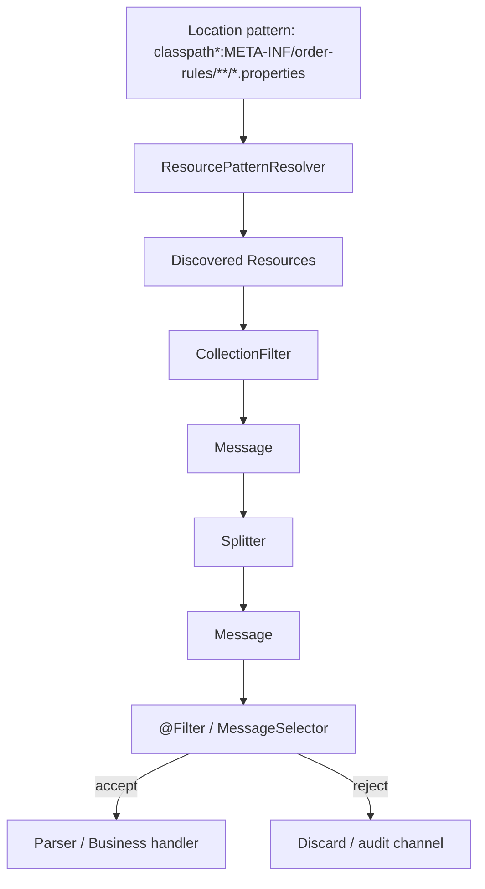
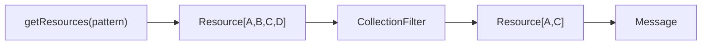
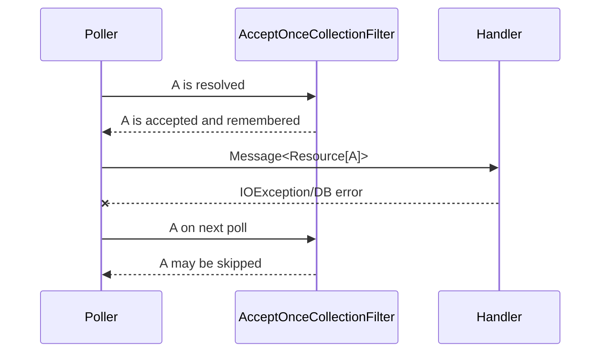
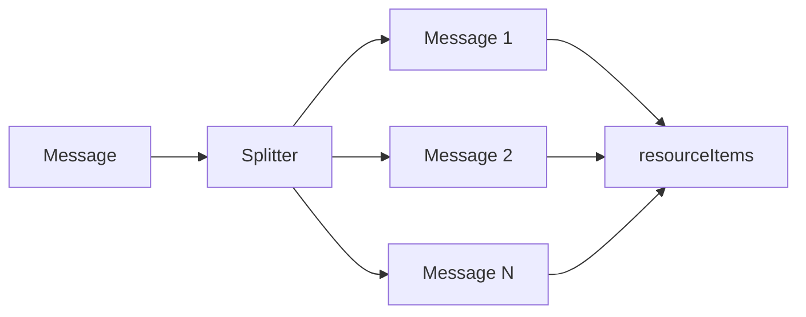
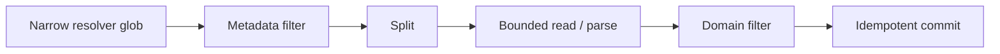
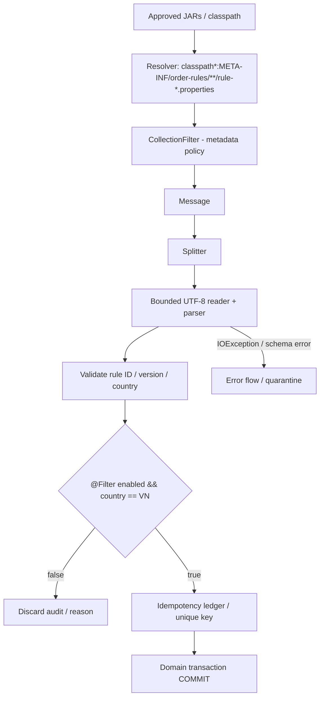

# Pattern-Based Resource Filtering in Spring Integration

## 1. Problem statement: letting only the necessary resources into the processing flow

An order-processing system needs to periodically discover shipping fee, discount, and tax rules packaged on the classpath/JAR. Libraries from multiple teams contribute files:

```text
order-app.jar
  META-INF/order-rules/common/rule-tax.properties
  META-INF/order-rules/common/rule-shipping.properties

pricing-extension.jar
  META-INF/order-rules/vi/rule-discount.properties
  META-INF/order-rules/vi/rule-summer.properties
  META-INF/order-rules/vi/readme.txt

shipping-extension.jar
  META-INF/order-rules/us/rule-express.properties
  META-INF/order-rules/us/rule-legacy.bak
```

The application needs to **select only `rule-*.properties` files**, optionally restrict by region, drop invalid files, and avoid reprocessing already-committed versions. Simply scanning `classpath*:META-INF/order-rules/**/*` wastes I/O and risks bringing `readme.txt`, backup files, or out-of-scope rules into the same batch.

In the **Adapter Resource** chapter of the **SPRING_INTEGRATION_ADAPTERS** module, systems connect external sources via inbound/outbound adapters, gateways, pollers, and `MessageChannel`. The topic **"Pattern-based resource filtering"** focuses on designing **the right resource-selection boundaries**, covering Spring Framework patterns, Resource inbound adapter collection filters, and downstream message filters. These choices impact reliability, performance, security, and replayability—not merely filename matching.

### Objectives

After this lesson, you will be able to:

1. Use `ResourcePatternResolver#getResources` with `classpath:`, `classpath*:`, `file:`, and Ant-style patterns.
2. Distinguish `*`, `?`, `**`; understand the fixed-root requirement when scanning inside JARs.
3. Distinguish **pattern filtering**, **`CollectionFilter<Resource>`**, and **Spring Integration `@Filter`**.
4. Configure `ResourceRetrievingMessageSource`, `@InboundChannelAdapter`, `@Poller`, and custom filters.
5. Use `AcceptOnceCollectionFilter`, and combine stateful and stateless filters in the proper order.
6. Understand that the payload is **`Message<Resource[]>`** after the source, distinct from **`Message<Resource>`** after a splitter.
7. Choose policies for filenames, metadata, identity/version, duplicate names, replay, and checkpoints.
8. Test multiple classpath roots/JARs, empty filters, repeated polls, mutable sources, and handler errors.

## 2. Three distinct filtering layers: do not collapse them into one



| Layer | Input | Output | Typical rules |
| --- | --- | --- | --- |
| **1. Location pattern** | Location string, e.g. `classpath*:.../*.properties` | Discovered `Resource[]` | Type/path, filename, directory, wildcards |
| **2. `CollectionFilter<Resource>`** | Resolved `Collection<Resource>` | Subset `Collection<Resource>` | Name prefix/suffix, metadata policy, accept-once |
| **3. Message filter** | A single `Message<?>` in the flow | Keep or discard the **message** | Headers, parsed payload, tenant, rule version |

**Key point:** placing `@Filter` directly after the Resource inbound adapter means the filter sees **the entire `Resource[]` batch**, not individual resources. If you want to filter individual files after the adapter, **split first** or use `CollectionFilter<Resource>` at the source.

### Pattern filtering vs. content filtering

- The pattern `rule-*.properties` checks **location/name**, without decoding bytes.
- `Resource#getFilename()` only returns the filename; it does not check `rule.enabled` or `tenantId` inside the file.
- To filter based on `rule.enabled=true`, you must **open the stream, parse, and validate** per charset/schema, then use a domain filter or router.
- To select "only new uncommitted versions," you need an **identity/version store**, not merely in-memory `AcceptOnceCollectionFilter`.

## 3. ResourcePatternResolver: start with the narrowest pattern

Spring Framework defines:

```java
public interface ResourcePatternResolver extends ResourceLoader {
    String CLASSPATH_ALL_URL_PREFIX = "classpath*:";

    Resource[] getResources(String locationPattern)
            throws IOException;
}
```

`PathMatchingResourcePatternResolver` is the standard implementation supporting Ant-style wildcards. A standard `ApplicationContext` also implements `ResourcePatternResolver`, so you can call `applicationContext.getResources(...)`.

### 3.1. Comparing classpath and filesystem

| Location | Purpose | Things to remember |
| --- | --- | --- |
| `classpath:META-INF/order-rules/base.properties` | One specific resource on the classpath | Not "retrieve every copy" |
| `classpath*:META-INF/order-rules/base.properties` | Find all copies at the same relative path across visible classpath roots/JARs | Can return multiple `Resource` objects sharing a filename |
| `classpath:META-INF/order-rules/*.properties` | Wildcard from one classpath root chosen by the resolver | May miss sources in other JARs with the same root |
| `classpath*:META-INF/order-rules/*.properties` | Multiple classpath roots + wildcard | Usually appropriate when libraries contribute shared rules |
| `classpath*:META-INF/order-rules/**/*.properties` | Recursive scan under a fixed root | Deeper scan, higher cost |
| `file:/opt/app/rules/*.properties` | Scan a filesystem directory outside classpath | Suited for mutable file sources |

`classpath*:` uses class loader/module path mechanisms to find **multiple** sources. It does not mean every library on the machine is found: the resolver only sees resources accessible to the active class loader/module layer.

### 3.2. Ant-style patterns

| Pattern | Meaning | Example |
| --- | --- | --- |
| `*.properties` | Filenames in one directory level | `rule-tax.properties` |
| `rule-*.properties` | Names starting with `rule-` and ending in `.properties` | `rule-shipping.properties` |
| `rule-?.yml` | `?` matches exactly one character | `rule-a.yml` |
| `**/*.properties` | Multiple directory levels | `vi/rule-tax.properties` and `common/rule-x.properties` |
| `**/rule-*.properties` | Recursive + filename constraint | `us/rule-express.properties` |

This is **Ant-style path matching**, not Java regular expressions. `*` is normally bounded to one path segment; `**` spans multiple directories. Do not write regex like `rule-.*\\.properties` expecting the resolver to interpret it like `Pattern.compile(...)`.

### 3.3. Be careful with wildcards directly at JAR roots

Spring Framework warns:

```text
DO NOT RELY ON:
classpath*:*.xml
classpath*:**/*.properties

PREFER:
classpath*:META-INF/order-rules/*.properties
classpath*:META-INF/order-rules/**/*.properties
```

When combining `classpath*:` with wildcards, **having a concrete root directory before the wildcard** makes JAR scanning much more reliable. Class loaders are not required to enumerate empty roots across every JAR, so a pattern beginning with a wildcard might work in an IDE yet miss resources in a packaged JAR.

If files span multiple JARs under the same base directory, use `classpath*:` rather than `classpath:`; if using nested JARs or container class loaders, **test under the exact packaged runtime**.

## 4. Discovering Resources in Java without a poller

Before configuring Spring Integration, test the resolver independently:

```java
package com.example.resourcefilters;

import java.io.IOException;
import java.util.Arrays;

import org.springframework.core.io.Resource;
import org.springframework.core.io.support.PathMatchingResourcePatternResolver;
import org.springframework.core.io.support.ResourcePatternResolver;

public final class RuleDiscovery {

    private RuleDiscovery() {}

    public static Resource[] discover() throws IOException {
        ResourcePatternResolver resolver =
            new PathMatchingResourcePatternResolver();

        return resolver.getResources(
            "classpath*:META-INF/order-rules/**/*.properties"
        );
    }

    public static void main(String[] args) throws IOException {
        Resource[] matches = discover();

        // For observation only; returned order is not business priority.
        Arrays.stream(matches)
            .map(Resource::getFilename)
            .forEach(System.out::println);
    }
}
```

### Observations

1. If no resources match, the resolver may return an empty array; if any rule is mandatory, **the application must check**.
2. `Resource#getFilename()` can be `null` for some `Resource` implementations.
3. Two libraries may both include `rule-default.properties` in two different JARs; **filename is not a unique identity**.
4. `getResources` returns `Resource` handles, **not already-read bytes**. `exists()` or `isReadable()` returning true does not guarantee `getInputStream()` will succeed later.
5. Never use `getFile()` to read JAR entries; use `getInputStream()` with try-with-resources when actually parsing.
6. Never rely on array order to pick the highest-priority file.

### Broader patterns increase runtime pressure

`classpath*:META-INF/order-rules/**/*` may cause the resolver to scan many entries only to filter them afterward. If you already know you only need `rule-*.properties`, choose `classpath*:META-INF/order-rules/**/rule-*.properties`. **Pushing conditions into the pattern early** narrows the search scope, though recursive wildcards still require measuring actual JAR scan costs.

## 5. Not every filter criterion works without reading content

A location pattern handles **discovery**, not content search:

```text
classpath*:META-INF/order-rules/**/*.properties
```

You cannot accurately express these in that pattern:

```properties
rule.enabled=true
rule.country=VN
rule.priority=100
```

To filter on those three properties, parse the resource downstream or build a **content-reading filter** with explicit lifecycle, byte limits, and error policies. In a Resource inbound adapter, `CollectionFilter<Resource>` should usually stick to **cheap metadata** (filename/location/allowlist); opening and parsing bytes for business decisions should live in a transformer + domain filter after creating a snapshot.

### Why not read content inside a filename filter?

- `Resource` may point to a URL/network source; every read incurs I/O.
- `InputStreamResource` may be **one-shot**; if the filter reads first, downstream handlers have no stream left.
- Input can change between filter read time and handler read time.
- Filters run on the poller path; reading hundreds of files inside the filter easily stalls the poller.
- Parse failures need quarantine/retry policies rather than silently looking like "did not match."

## 6. CollectionFilter<Resource>: filtering after resolver, before message

Spring Integration defines the contract:

```java
public interface CollectionFilter<T> {
    Collection<T> filter(Collection<T> unfilteredElements);
}
```

In Resource inbound, `T` is `Resource`. After the resolver finds candidates, the filter receives the **collection** and returns the **collection of retained `Resource` objects**.



**This filter processes multiple elements in a collection**, unlike a `MessageSelector` receiving a single `Message<?>`.

### 6.1. A simple filename filter

Requirement: filename must start with `rule-`, end with `.properties`, and not contain `-backup`.

```java
package com.example.resourcefilters;

import java.util.ArrayList;
import java.util.Collection;
import java.util.List;

import org.springframework.core.io.Resource;
import org.springframework.integration.util.CollectionFilter;

public final class RuleFilenameFilter
        implements CollectionFilter<Resource> {

    @Override
    public Collection<Resource> filter(
            Collection<Resource> candidates) {

        List<Resource> accepted = new ArrayList<>();

        for (Resource resource : candidates) {
            String name = resource.getFilename();
            if (name == null) {
                continue;
            }
            boolean match = name.startsWith("rule-")
                && name.endsWith(".properties")
                && !name.contains("-backup");
            if (match) {
                accepted.add(resource);
            }
        }
        return accepted;
    }
}
```

This filter **does not open streams** and **holds no state**. The same resource will keep getting accepted on every filter run. Nor does it know which tenant or version the rule belongs to: it strictly enforces the stated filename policy.

**Distinguishing the two pattern styles:** `RuleFilenameFilter` evaluates Java conditions on filenames, whereas `ResourcePatternResolver` uses path patterns to determine initial candidates. In most cases, you can write `**/rule-*.properties` directly in the pattern and reserve custom filters for policies not concisely expressible in globs.

### 6.2. Using regex Patterns only when truly needed

```java
import java.util.regex.Pattern;

Pattern approved = Pattern.compile(
    "rule-(tax|shipping|discount)-[a-z0-9-]+\\.properties"
);

String filename = "rule-shipping-v2.properties";
boolean allowed = approved.matcher(filename).matches();
```

Java regex and Ant-style wildcards **are different**. When using regex, bound input filename/pattern lengths if taking external input; never accept raw untrusted regexes due to ReDoS risk. For a fixed set of names, an allowlist/equality check is usually simpler.

## 7. AcceptOnceCollectionFilter: avoiding re-emission, yet not a checkpoint

Spring Integration provides `org.springframework.integration.util.AcceptOnceCollectionFilter<T>`, a stateful `CollectionFilter`. It remembers elements passed in prior invocations to avoid returning them again according to element comparison semantics.

```java
import org.springframework.core.io.Resource;
import org.springframework.integration.util.AcceptOnceCollectionFilter;
import org.springframework.integration.util.CollectionFilter;

CollectionFilter<Resource> once =
    new AcceptOnceCollectionFilter<>();
```

### Poll-cycle illustration

| Poll | Resolver returns | Accept-once filter keeps (illustrative) |
| --- | --- | --- |
| 1 | A, B, C | A, B, C |
| 2 | A, B, C | No new elements |
| 3 | A, B, C, D | D |
| 4 | A, B, C, D, but B's bytes changed | **Not guaranteed to re-emit B** |

**AcceptOnce does not mean "once per content version."** It does not compute SHA-256, track ETag/lastModified, or verify DB commits.

### 7.1. What is remembered?

The filter relies on **elements `T` according to their comparison/`equals()` identity semantics**, not a business key you define. Across `Resource` implementations, `equals()` may depend on location/implementation; **do not assume the filter knows when a `Resource`'s bytes changed**.

If you need a policy of "same file, new version must be reprocessed," compute `sourceId + version/checksum` at ingestion and manage state in a durable ledger. Do not treat `AcceptOnceCollectionFilter` as a transaction manager.

### 7.2. Handler failures do not undo the filter



Thus, **source accepted resource ≠ handler finished processing**. `@Transactional` on the handler does not roll back `AcceptOnceCollectionFilter` state. If business requirements demand retrying until success, choose appropriate checkpointing/replay/outbox/ledger mechanisms.

## 8. Composition: filter by name first, then accept-once

`ResourceRetrievingMessageSource#setFilter(...)` accepts **one** `CollectionFilter<Resource>`. Calling the setter sets the source's filter strategy; calling it twice does not chain filters automatically.

Wrong:

```java
source.setFilter(new RuleFilenameFilter());
source.setFilter(new AcceptOnceCollectionFilter<>());
// The last filter replaces the previous one; name filtering is lost.
```

Right: combine conditions into an explicit composite filter:

```java
import java.util.Collection;
import org.springframework.core.io.Resource;
import org.springframework.integration.util.CollectionFilter;
import org.springframework.integration.util.AcceptOnceCollectionFilter;

CollectionFilter<Resource> byName = new RuleFilenameFilter();
CollectionFilter<Resource> once = new AcceptOnceCollectionFilter<>();

CollectionFilter<Resource> combined =
    candidates -> once.filter(byName.filter(candidates));

source.setFilter(combined);
```

**Order matters:**

1. `byName.filter(...)` filters out out-of-scope files first.
2. `once.filter(...)` only remembers candidates that passed the naming check.

If you reverse the order, accept-once may remember invalid files before the naming policy blocks them. Later, if policies change or the app upgrades, remembered state can cause confusing results.

**In real apps**, create **one composite filter instance per source** during bean configuration—never construct a new `AcceptOnceCollectionFilter` on **every poll**. Creating a fresh filter on each receive resets accept-once state and renders it useless.

## 9. Metadata filters, business filters, and I/O boundaries

There are three "pattern-based" filtering cases:

| Condition | Where to place | Reason |
| --- | --- | --- |
| Path `META-INF/order-rules/vi/...` | `ResourcePatternResolver` | Exclude at discovery time |
| Filename `rule-*.properties` | Pattern or `CollectionFilter<Resource>` | Cheap metadata; no content reading needed |
| `rule.enabled=true` | Transformer parse + downstream `@Filter` | Must decode content per schema |
| `rule.country=VN` | Domain filter after parsing | Cannot be reliably inferred from filename unless contract guarantees it |
| `resource.size < 64 KiB` | Bounded reader/size policy | `contentLength()` can trigger I/O or consume one-shot `Resource` |
| Process only if checksum uncommitted | Ledger/idempotency after reading | Requires durable versioning/transactions |
| Only sources from approved modules | Resolver allowlist + provenance validation | Filenames can collide across different JARs |

### Do not treat contentLength() as a safe metadata filter

With `InputStreamResource`, `contentLength()` can read the entire stream to count bytes, preventing downstream handlers from **reading a second time**. For single-use stream resources or URLs, enforce byte limits **while reading** or rely on metadata from a storage API with an explicit contract.

For high-risk sources, filtering on raw `Resource#getDescription()` is also insufficient: descriptions can contain URL tokens, sensitive paths, or unnormalized provider strings.

## 10. Java config: filtering Resources right at the inbound source

Example using Java 17+, Spring Boot + Spring Integration Core. Resource directory:

```text
src/main/resources/META-INF/order-rules/vi/
  rule-tax.properties
  rule-shipping.properties
  rule-shipping-backup.properties
  readme.txt
```

### 10.1. Dependency

With versions managed by the Spring Boot BOM:

```xml
<dependencies>
    <dependency>
        <groupId>org.springframework.boot</groupId>
        <artifactId>spring-boot-starter-integration</artifactId>
    </dependency>
</dependencies>
```

**Resource inbound is part of Spring Integration Core**; no dedicated SFTP, JMS, or File module is needed just to resolve `Resource` objects. If downstream writes files or sends to Kafka, add the corresponding adapter dependency.

### 10.2. Configuration with name filter + accept-once

```java
package com.example.resourcefilters;

import org.springframework.context.ApplicationContext;
import org.springframework.context.annotation.Bean;
import org.springframework.context.annotation.Configuration;
import org.springframework.core.io.Resource;
import org.springframework.integration.annotation.InboundChannelAdapter;
import org.springframework.integration.annotation.Poller;
import org.springframework.integration.channel.DirectChannel;
import org.springframework.integration.config.EnableIntegration;
import org.springframework.integration.core.MessageSource;
import org.springframework.integration.resource.ResourceRetrievingMessageSource;
import org.springframework.integration.util.AcceptOnceCollectionFilter;
import org.springframework.integration.util.CollectionFilter;
import org.springframework.messaging.MessageChannel;

@Configuration
@EnableIntegration
public class RuleResourceInboundConfiguration {

    @Bean
    public MessageChannel resourceBatches() {
        return new DirectChannel();
    }

    @Bean
    public MessageChannel resourceItems() {
        return new DirectChannel();
    }

    @Bean
    @InboundChannelAdapter(
        channel = "resourceBatches",
        poller = @Poller(
            fixedDelay = "10000",
            initialDelay = "1000",
            maxMessagesPerPoll = "1"
        )
    )
    public MessageSource<Resource[]> resourceSource(
            ApplicationContext applicationContext) {

        ResourceRetrievingMessageSource source =
            new ResourceRetrievingMessageSource(
                "classpath*:META-INF/order-rules/**/*.properties"
            );

        // ApplicationContext implements ResourcePatternResolver.
        source.setPatternResolver(applicationContext);

        CollectionFilter<Resource> byName =
            new RuleFilenameFilter();
        CollectionFilter<Resource> once =
            new AcceptOnceCollectionFilter<>();
        source.setFilter(
            candidates -> once.filter(byName.filter(candidates))
        );
        return source;
    }
}
```

**Explanation:**

1. `@EnableIntegration` activates Spring Integration infrastructure.
2. `ResourceRetrievingMessageSource` takes **one location pattern** to find candidates.
3. `setPatternResolver(...)` specifies the resolver explicitly; the current context implements this interface.
4. `setFilter(...)` takes the composite `CollectionFilter<Resource>`.
5. `@InboundChannelAdapter` connects the source to `resourceBatches`.
6. `@Poller` controls the poll schedule; `maxMessagesPerPoll=1` caps **the number of messages** received from the source in one poll, not the number of resources in the payload.
7. `DirectChannel` sends messages synchronously to subscribers; it does not create a durable queue or automatic DB transaction.

**Do not wire the same `ResourceRetrievingMessageSource` through two poller endpoints unless you intentionally want two independent consumption flows.** Partition the source or use one inbound flow and fan out parsed DTOs instead.

### 10.3. One poll can emit a message containing multiple resources

```text
Resolver:        [rule-tax, rule-shipping, rule-shipping-backup]
Filter name:     [rule-tax, rule-shipping]
Accept-once:     [rule-tax, rule-shipping]
Source payload:  Resource[2]
Channel:         1 Message<Resource[2]>
```

Note that `readme.txt` **is absent from the resolver output** for `*.properties`; this illustrates early exclusion at the pattern layer before reaching the collection filter. Verify real behavior against your classpath fixtures and deployment packaging.

## 11. If each resource needs its own message: use a Splitter

`ResourceRetrievingMessageSource` advertises payload type `Resource[]`. A `@ServiceActivator` directly expecting `Resource` from `resourceBatches` without a splitter violates the contract.



```java
package com.example.resourcefilters;

import org.springframework.core.io.Resource;
import org.springframework.integration.annotation.Splitter;
import org.springframework.stereotype.Component;

@Component
public class ResourceBatchSplitter {

    @Splitter(
        inputChannel = "resourceBatches",
        outputChannel = "resourceItems"
    )
    public Resource[] split(Resource[] resources) {
        return resources;
    }
}
```

After the splitter, you can place `@Filter` to decide on **each individual `Resource` message**, or use a transformer to parse into a DTO and filter on its data.

## 12. @Filter in Spring Integration is not CollectionFilter

In Spring Integration, a **message filter** takes a single `Message<?>` and decides whether that message **continues or is discarded**, via a `MessageSelector` or a `boolean`-returning method.

### 12.1. @Filter on Resource name after the splitter

```java
package com.example.resourcefilters;

import org.springframework.core.io.Resource;
import org.springframework.integration.annotation.Filter;
import org.springframework.stereotype.Component;

@Component
public class ResourceMessageSelector {

    @Filter(
        inputChannel = "resourceItems",
        outputChannel = "approvedResources"
    )
    public boolean accept(Resource resource) {
        String name = resource.getFilename();
        return name != null
            && name.startsWith("rule-")
            && name.endsWith(".properties");
    }
}
```

To run this example, declare an `approvedResources` channel and a consumer. If `RuleFilenameFilter` is already applied at the source, a post-splitter filter may **duplicate the same condition** with little benefit. It remains useful when downstream needs dynamic policies or when contrasting the two mechanisms.

### 12.2. @Filter on parsed content

More appropriate for business policies:

```java
package com.example.resourcefilters;

public record ParsedRule(
    String ruleId,
    String country,
    boolean enabled,
    int version
) {}
```

Assuming an upstream transformer read and parsed the `Resource`, emitting `Message<ParsedRule>` to `parsedRules`:

```java
import org.springframework.integration.annotation.Filter;
import org.springframework.stereotype.Component;

@Component
public class EnabledVietnamRuleFilter {

    @Filter(
        inputChannel = "parsedRules",
        outputChannel = "approvedRules",
        discardChannel = "rejectedRules"
    )
    public boolean accept(ParsedRule rule) {
        return rule.enabled()
            && "VN".equals(rule.country())
            && rule.version() > 0;
    }
}
```

**Important:** `@Filter` on messages does not parse `Resource` itself. `ParsedRule` is an application-defined DTO; appropriate channels/transformers/handlers must exist. `discardChannel` receives rejected messages for auditing/observability if subscribed, but does not automatically create a durable dead-letter queue.

### Quick comparison

| Question | `CollectionFilter<Resource>` | Spring Integration `@Filter` |
| --- | --- | --- |
| When does it run? | Inside `ResourceRetrievingMessageSource`, **before** message creation | When a message reaches the filter endpoint |
| What does it receive? | `Collection<Resource>` | Payload or a `Message<?>` |
| Can it drop one element from `Resource[]`? | **Yes** | Only after a splitter or custom transformation |
| Can it use headers or parsed DTOs? | No Spring Message exists at this step | **Yes**, depending on method signature |
| Default on XML Resource inbound? | `AcceptOnceCollectionFilter` if unspecified | No filter endpoint unless configured |
| Good for content-based rule selection? | Not ideal if it must read streams | Often **yes**, after parsing/validation |

## 13. XML namespace: patterns, custom filters, and disabling filtering

Spring Integration's Resource inbound channel adapter has an XML namespace under `int`. In a Spring context with matching beans and schema:

```xml
<?xml version="1.0" encoding="UTF-8"?>
<beans xmlns="http://www.springframework.org/schema/beans"
       xmlns:xsi="http://www.w3.org/2001/XMLSchema-instance"
       xmlns:int="http://www.springframework.org/schema/integration"
       xsi:schemaLocation="
          http://www.springframework.org/schema/beans
          https://www.springframework.org/schema/beans/spring-beans.xsd
          http://www.springframework.org/schema/integration
          https://www.springframework.org/schema/integration/spring-integration.xsd">

    <int:channel id="resourceBatches"/>

    <bean id="ruleFilenameFilter"
          class="com.example.resourcefilters.RuleFilenameFilter"/>

    <int:resource-inbound-channel-adapter
            id="ruleResourceInbound"
            channel="resourceBatches"
            pattern="classpath*:META-INF/order-rules/**/*.properties"
            filter="ruleFilenameFilter">
        <int:poller fixed-delay="10000"
                    max-messages-per-poll="1"/>
    </int:resource-inbound-channel-adapter>
</beans>
```

In the XML above:

- `pattern` determines the candidate resources found by the resolver.
- `filter="ruleFilenameFilter"` references a bean implementing `CollectionFilter<Resource>`.
- Because a filter is specified, it acts as a **custom filter**; **do not assume `AcceptOnceCollectionFilter` is added on top** just because the XML adapter has a default when omitted.
- `fixed-delay` controls the poller cadence; when scanning many JARs, measure resolve costs.

### 13.1. XML default: AcceptOnceCollectionFilter

If you **omit the `filter` attribute**:

```xml
<int:resource-inbound-channel-adapter
        id="ruleResourceInbound"
        channel="resourceBatches"
        pattern="classpath*:META-INF/order-rules/**/rule-*.properties">
    <int:poller fixed-delay="10000"/>
</int:resource-inbound-channel-adapter>
```

The Spring Integration docs specify that the XML Resource inbound adapter **uses `AcceptOnceCollectionFilter` by default** when no custom filter is declared.

### 13.2. Disabling filtering completely

If you want every poll to be able to emit matching resources, configure:

```xml
<int:resource-inbound-channel-adapter
        id="unfilteredResources"
        channel="resourceBatches"
        pattern="classpath*:META-INF/order-rules/**/rule-*.properties"
        filter="">
    <int:poller fixed-delay="10000"/>
</int:resource-inbound-channel-adapter>
```

`filter=""` means **disable the default `CollectionFilter`**, **not** "only take empty-named resources," and it does not affect `pattern` wildcard rules.

**These three XML snippets are three alternatives**—do not run all three with the same pattern/channel unless you intentionally want parallel pollers. When filtering is disabled, resources remaining on later polls can be reprocessed; downstream needs version checks/idempotency if reloading causes side effects.

### 13.3. Custom ResourcePatternResolver

If you need a dedicated resolver, configure:

```xml
<bean id="approvedPatternResolver"
      class="org.springframework.core.io.support.PathMatchingResourcePatternResolver"/>

<int:resource-inbound-channel-adapter
        id="resourcesWithExplicitResolver"
        channel="resourceBatches"
        pattern="classpath*:META-INF/order-rules/**/*.properties"
        pattern-resolver="approvedPatternResolver">
    <int:poller fixed-delay="10000"/>
</int:resource-inbound-channel-adapter>
```

Spring Integration **by default** can use `ApplicationContext` as the `ResourcePatternResolver` in the XML adapter. Only define a separate resolver bean for specific requirements (class loader, policy, instrumentation). `pattern-resolver` **does not replace `filter`**: the resolver determines candidates, and the filter narrows the subset afterward.

## 14. Java DSL: filtering after splitting Resource[]

Java DSL is useful when you want to see the whole chain in one place. This is an **alternative** to the `@InboundChannelAdapter` configuration in section 10:

```java
package com.example.resourcefilters;

import org.springframework.context.annotation.Bean;
import org.springframework.context.annotation.Configuration;
import org.springframework.core.io.Resource;
import org.springframework.integration.dsl.IntegrationFlow;
import org.springframework.integration.dsl.Pollers;
import org.springframework.integration.resource.ResourceRetrievingMessageSource;
import org.springframework.integration.util.AcceptOnceCollectionFilter;
import org.springframework.integration.util.CollectionFilter;

@Configuration
public class ResourceFilterDslConfiguration {

    @Bean
    public ResourceRetrievingMessageSource dslResourceSource() {
        ResourceRetrievingMessageSource source =
            new ResourceRetrievingMessageSource(
                "classpath*:META-INF/order-rules/**/*.properties"
            );

        CollectionFilter<Resource> named =
            new RuleFilenameFilter();
        CollectionFilter<Resource> once =
            new AcceptOnceCollectionFilter<>();

        source.setFilter(
            candidates -> once.filter(named.filter(candidates))
        );
        return source;
    }

    @Bean
    public IntegrationFlow resourceFilterFlow(
            ResourceRetrievingMessageSource dslResourceSource,
            ResourceRuleService resourceRuleService) {

        return IntegrationFlow
            .from(
                dslResourceSource,
                spec -> spec.poller(
                    Pollers.fixedDelay(10000)
                        .maxMessagesPerPoll(1)
                )
            )
            .split()
            .filter(
                Resource.class,
                resource -> resource.getFilename() != null
            )
            .handle((payload, headers) -> {
                resourceRuleService.process((Resource) payload);
                return null; // One-way handler.
            })
            .get();
    }
}
```

`ResourceRuleService` is an **application-implemented interface/service**, for example:

```java
import java.io.IOException;
import org.springframework.core.io.Resource;

public interface ResourceRuleService {
    void process(Resource resource) throws IOException;
}
```

This flow uses two filter layers:

1. `ResourceRetrievingMessageSource#setFilter` retains candidates by name + accept-once.
2. After `.split()`, DSL `.filter(...)` selects **each `Message<Resource>`** based on the defined predicate.

The DSL condition above is illustrative (`getFilename()!=null`), since the source already has a name filter. In a real system, put **incremental value** here—such as verified source classification or a DTO parsed by a transformer.

**Do not enable both** Java DSL `IntegrationFlow.from(source, ...)` and `@InboundChannelAdapter` for the same source in one context expecting a single polling endpoint.

## 15. Content-based filtering: adding a parser before the business filter

Suppose `rule-tax.properties` contains:

```properties
rule.id=tax-vn
rule.country=VN
rule.version=2
rule.enabled=true
```

To accept only rules with `enabled=true` and `country=VN`, you must **decode and parse**. Add a transformer after the splitter, then use `@Filter` on the DTO.

### 15.1. Reader with a 64 KiB limit

```java
package com.example.resourcefilters;

import java.io.IOException;
import java.io.InputStream;
import java.nio.charset.CodingErrorAction;
import java.nio.charset.StandardCharsets;
import java.util.Properties;

import org.springframework.core.io.Resource;
import org.springframework.stereotype.Component;

@Component
public class ParsedRuleReader {

    private static final int MAX_BYTES = 64 * 1024;

    public ParsedRule read(Resource resource) throws IOException {
        byte[] bytes;
        try (InputStream stream = resource.getInputStream()) {
            bytes = stream.readNBytes(MAX_BYTES + 1);
        }
        if (bytes.length > MAX_BYTES) {
            throw new IOException("Rule file exceeds 64 KiB");
        }

        var decoder = StandardCharsets.UTF_8
            .newDecoder()
            .onMalformedInput(CodingErrorAction.REPORT)
            .onUnmappableCharacter(CodingErrorAction.REPORT);

        String content = decoder.decode(
            java.nio.ByteBuffer.wrap(bytes)
        ).toString();

        Properties properties = new Properties();
        try (java.io.StringReader reader =
                new java.io.StringReader(content)) {
            properties.load(reader);
        }

        String id = properties.getProperty("rule.id");
        String country = properties.getProperty("rule.country");
        String versionText =
            properties.getProperty("rule.version", "0");
        String enabledText =
            properties.getProperty("rule.enabled");

        if (id == null || id.isBlank()) {
            throw new IllegalArgumentException("Missing rule.id");
        }
        if (country == null || country.isBlank()) {
            throw new IllegalArgumentException(
                "Missing rule.country"
            );
        }
        if (!"true".equals(enabledText)
                && !"false".equals(enabledText)) {
            throw new IllegalArgumentException(
                "Invalid rule.enabled"
            );
        }

        int version = Integer.parseInt(versionText);
        if (version < 1) {
            throw new IllegalArgumentException(
                "Invalid rule.version"
            );
        }

        return new ParsedRule(
            id, country, Boolean.parseBoolean(enabledText), version
        );
    }
}
```

**Scope note for this example:** this parser avoids `Resource#contentLength()`, avoids `getFile()`, and closes `InputStream` right after reading. It assumes UTF-8 **without a BOM**; if the data contract allows BOMs, detect and strip the BOM before parsing. Never parse via `Properties.load(InputStream)` assuming UTF-8, because that Java API overload uses ISO-8859-1.

### 15.2. Converting Resource to ParsedRule

```java
package com.example.resourcefilters;

import java.io.IOException;
import org.springframework.core.io.Resource;
import org.springframework.integration.annotation.Transformer;
import org.springframework.stereotype.Component;

@Component
public class ParsedRuleTransformer {

    private final ParsedRuleReader reader;

    public ParsedRuleTransformer(ParsedRuleReader reader) {
        this.reader = reader;
    }

    @Transformer(
        inputChannel = "approvedResources",
        outputChannel = "parsedRules"
    )
    public ParsedRule transform(Resource resource)
            throws IOException {
        return reader.read(resource);
    }
}
```

With this architecture:

```text
Source: Message<Resource[]>
    -> Splitter
    -> Message<Resource>
    -> @Filter filename (or source CollectionFilter)
    -> @Transformer parser
    -> Message<ParsedRule>
    -> @Filter enabled && country == VN
    -> Processed Message<ParsedRule>
```

To wire and run this in practice, declare the `approvedResources`, `parsedRules`, `approvedRules`, and `rejectedRules` channels and attach an output consumer. The individual snippets in this lesson illustrate **composable options**, not a single pre-bootstrapped application.

### 15.3. Why parse before filtering by country?

- If `rule.country` is missing, that is a **schema error**, not something to silently treat as "not VN."
- If UTF-8 is invalid, data must go to the **encoding-error flow** rather than "pattern did not match."
- If a remote source hits an I/O error, trigger retries or infrastructure alerts rather than concluding the file was filtered out by business logic.
- After parsing, `enabled/country` logic runs on an immutable DTO, is easy to unit test, and never reopens streams.

## 16. No single pattern automatically handles multiple pattern strings

Constructor:

```java
new ResourceRetrievingMessageSource(
    "classpath*:META-INF/order-rules/**/*.properties"
);
```

Accepts **one location pattern**. Do not assume `"patternA;patternB"` or `"patternA,patternB"` is standard syntax for two patterns without version documentation confirming it.

If you need to select simultaneously:

```text
classpath*:META-INF/order-rules/vi/*.properties
file:/opt/app/rule-overrides/*.properties
```

You can:

1. Use **two `ResourceRetrievingMessageSource` beans / two inbound endpoints**, feeding one channel/flow carrying provenance metadata, and handle merging and retries separately.
2. Write a custom `MessageSource<Resource[]>` calling the resolver across each approved pattern and building one batch per an explicit policy.
3. Use a custom `ResourcePatternResolver` with an application-specific syntax, ensuring full `ResourceLoader` contract compliance and tests.

An illustrative helper demonstrating multi-pattern discovery (not yet a `MessageSource`):

```java
import java.io.IOException;
import java.util.ArrayList;
import java.util.List;
import org.springframework.core.io.Resource;
import org.springframework.core.io.support.ResourcePatternResolver;

public static List<Resource> discoverMany(
        ResourcePatternResolver resolver,
        List<String> approvedPatterns) throws IOException {

    List<Resource> results = new ArrayList<>();
    for (String pattern : approvedPatterns) {
        for (Resource resource : resolver.getResources(pattern)) {
            results.add(resource);
        }
    }
    return results;
}
```

This is an **illustrative method belonging inside a utility class**; when copying into an app, place it in an appropriate class. If two patterns overlap, one resource can appear twice. Do not deduplicate solely by filename when two JARs share a filename with different content/sources.

## 17. Duplicate filenames, resource ordering, and business priority

When multiple JARs contribute rules:

```text
pricing.jar!/META-INF/order-rules/vi/rule-tax.properties
shipping.jar!/META-INF/order-rules/vi/rule-tax.properties
```

Both may return `getFilename() == "rule-tax.properties"`. If filtered with:

```java
Map<String, Resource> byName = new HashMap<>();
for (Resource resource : resources) {
    byName.put(resource.getFilename(), resource);
}
```

One copy can **silently overwrite the other without warning**. Array order returned by the resolver must never be treated as business priority order.

### Policies you can choose

| Need | Policy |
| --- | --- |
| Disallow duplicate logical rule IDs | Parse rule ID and **fail fast** on duplicates, reporting sources |
| Allow modules to override default rules | Explicit priority/version in contract; resolve conflicts explicitly |
| Multiple modules contribute independently | Key by `moduleId + logicalId` |
| Deduplicate identical content | Hash bytes + logical context per policy |
| Reprocess when content changes | Version-aware ledger, not just AcceptOnce |

**Never rely on `Resource#getDescription()` as a long-lived business key**: URLs can vary by launcher, container, or build version, and descriptions may contain paths/credentials. For auditing, keep a verified source ID, logical rule ID, and content version/checksum.

## 18. When should you disable AcceptOnce?

For resources inside immutable packaged JARs, accept-once usually suffices for loading once after startup. When dynamic filesystem configuration or versioned rule updates are needed, consider:

| Use case | Option | Mandatory condition |
| --- | --- | --- |
| Load classpath rules only at startup | Load-once or Resource inbound with accept-once | Validate inputs and fail fast on missing rules |
| Scan mutable directory, processing once per version | Version-aware scanner/ledger | Stable identity + checksum/version |
| Reconcile full state every 10 minutes | Disable accept-once or custom policy | **Idempotent** handler comparing state before writing |
| Re-read after config changes | Suitable event/file adapter + content hash | Ensure replay/retry and no missed updates |
| Only scan a local folder, one `File` per message | File inbound adapter may fit better | `FileListFilter` and File adapter semantics |

### Disabling the filter does not remove the pattern

XML `filter=""` still evaluates `pattern="classpath*:.../*.properties"`. "No filter" here only removes **`CollectionFilter<Resource>`**; it does not turn the source into "read every file on the machine."

### Impact of a pass-through filter

A Java source can set:

```java
source.setFilter(candidates -> candidates);
```

This is an **identity collection filter**: on every resolution, it returns all candidates matching the pattern. If downstream performs "insert new row" DB writes instead of upserts/idempotent commits, every poll can create duplicates.

## 19. Distinguishing CollectionFilter and FileListFilter

Many developers moving from File inbound to Resource inbound mistakenly use the wrong filter type:

| Feature | Resource inbound | File inbound |
| --- | --- | --- |
| Primary source | `ResourcePatternResolver` | Filesystem scanner / `FileReadingMessageSource` |
| Source output | `Message<Resource[]>` | Typically `Message<File>` |
| Collection filter | `CollectionFilter<Resource>` | `FileListFilter<File>` (on scanner components) |
| Typical accept-once | `AcceptOnceCollectionFilter<Resource>` | `AcceptOnceFileListFilter` or adapter persistent file filters |
| One message per file | Requires splitter | Usually default |
| JAR/classpath globs | Resource resolver is suited | File adapter is not aimed at JAR entries |

**Never pass `FileListFilter<File>` directly into `ResourceRetrievingMessageSource#setFilter(...)`**; that is a different contract. When shared checkpoints across instances are required, use persistent storage/ledgers keyed by Resource business identity rather than copying a File-module filter API.

## 20. Errors, retries, and resource acceptance ordering

To diagnose issues, distinguish **4 milestones**:

```text
DISCOVERED
  → ACCEPTED_BY_COLLECTION_FILTER
  → MESSAGE_DELIVERED
  → BUSINESS_COMMITTED
```

A resource accepted by the filter may **not yet** be parsed or committed. With a multi-resource batch, processing can partially succeed.

### 20.1. Layer-by-layer error table

| Layer | Example error | What to do? |
| --- | --- | --- |
| Resolver/pattern | Invalid pattern, class loader misses JAR, `IOException` | Verify deployment, root/wildcards, fail fast if data is mandatory |
| `CollectionFilter` | Wrong policy, missing items or name collisions | Unit-test contract and instrument before/after filter |
| Filter metadata | `getFilename()==null`, unknown source | Reject/quarantine per schema; never fabricate filenames for security keys |
| Splitter | Huge batch, partial item failure | Measure batch size, bound sources, per-item metrics |
| Read/parse | `getInputStream()` failure, broken charset, invalid JSON/Properties | Bounded I/O retries or quarantine permanently broken data |
| Message `@Filter` | Disabled rule or non-VN rule | Route to discard/audit channel as needed; do not turn every `false` into an exception |
| Business DB | Deadlock, unique conflict, rollback | Transaction + idempotency, error-type-aware retries |
| Async worker | Handler throws after source sent successfully | Error flows / worker completion; do not watch only the poller |

### 20.2. false vs. exception

In `@Filter`:

```java
return false;
```

means **the message is rejected by policy**, normally dropped or routed to `discardChannel` if configured. Meanwhile:

```java
throw new IllegalArgumentException("Invalid rule schema");
```

means the processing step **failed**, potentially routing a `MessagingException` to an error flow. Never catch all parser errors and `return false`, as that turns data or infrastructure failures into legitimate filter rejections and obscures root causes.

### 20.3. Retries must account for filter state

```text
Poll #1:
    resolver -> A, B
    accept-once -> A, B
    parser A -> OK
    parser B -> IOException

Poll #2:
    resolver -> A, B
    accept-once -> may return empty collection

Result:
    B is not automatically re-emitted just because the previous run failed.
```

If reliable retries are required, maintain a processing ledger per **`sourceId + logicalId + contentVersion`**, track `PENDING/PROCESSED/FAILED` states, and design a way to re-drive uncommitted items. `AcceptOnceCollectionFilter` deduplicates at the **discovery layer**, not act as an ACK/NACK or durable inbox.

### 20.4. Transactions do not roll back the filter

`@Transactional` on the handler can roll back **the participating DB transaction**, but cannot make the Java collection filter "forget" an accepted `Resource`. A file can be treated as seen even though the DB never persisted it. For critical side effects like creating payments, use an idempotent processor/outbox rather than treating accept-once as exactly-once.

## 21. Immutable sources, mutable sources, and change-detection strategies

### 21.1. Classpath/JAR is usually not a live configuration store

Packaged classpath/JAR contents are usually **stable for the application's lifetime**. Polling every 100 ms will not cause a JAR to load new rules from a source repository automatically. If hot reload from the filesystem is needed, consider File inbound, watch/event integrations, or a configuration source with versioning APIs.

### 21.2. lastModified metadata is insufficient

`Resource#lastModified()` can help on some filesystem resources, though not all resources support consistent semantics. Timestamps can:

- Be absent or unreliable for URLs/JARs.
- Have coarse granularity, causing two rapid edits to share the same timestamp.
- Update without byte changes, or remain unchanged despite byte edits.
- Shift during copy/deploy or clock skew.

Thus, **if exact versioning is a business requirement**, use a reliable ETag/version source or hash the bytes after reading. Never open an `InputStreamResource` just to call `contentLength()` before parsing: some implementations **consume the stream** when computing length.

### 21.3. A testable policy

```text
1. Resolve candidates using approved location pattern.
2. Filter metadata (filename/path allowlist).
3. Bounded read + parse/validate, compute checksum.
4. Build stable business key:
      (sourceModule, logicalRuleId, checksum/version)
5. BEGIN DB
      claim key via UNIQUE constraint
      apply business update
      mark PROCESSED
   COMMIT
6. On I/O/parse error, record FAILED/QUARANTINED with proper retry mechanism.
```

If two pods process a resource concurrently, `existsByKey()` before `save()` alone cannot prevent races. A shared **unique constraint/transaction/claim** establishes proper coordination.

## 22. Performance: place cheap checks before expensive ones

An efficient flow typically follows this order:



| Technique | Benefit | Risk if misapplied |
| --- | --- | --- |
| Concrete directory prefix in glob | Reduces scan scope, improves JAR portability | Overly narrow pattern can miss needed resources |
| `**/rule-*.properties` | Excludes mismatched names/extensions early | Recursive globs still need I/O measurement |
| Filename-only `CollectionFilter` | Cheap, does not consume `InputStream` | Ignorant of content, version, or tenant |
| `AcceptOnce` | Fewer duplicate emissions within one instance | Failed items are not retried by default |
| `Splitter` | Independent per-item processing and granular logging | Large batches produce many messages |
| Bounded reader | Prevents oversized files from causing memory pressure | Must handle partial reads/quarantine cleanly |
| DTO before async | Avoids stale `Resource` handles/one-shot streams | Large DTOs/bytes still need queue/backpressure caps |
| Load-once classpath | Eliminates wasted periodic JAR scans | Unsuitable for frequently updated sources |

### maxMessagesPerPoll does not limit resource counts

```java
@Poller(maxMessagesPerPoll = "1", fixedDelay = "10000")
```

only caps how many **messages** the poller receives from the source per cycle. Because `ResourceRetrievingMessageSource` emits `Resource[]`, a single message can hold **thousands of elements** if the resolver/filter returns many resources. If a hard cap is required, implement segmentation/partitioning or a custom source instead of expecting poller parameters to chunk automatically.

### How much scanning should you watch?

Classpaths in packaged JARs are usually immutable. If configuration only needs loading at startup, a one-time `ApplicationContext.getResources(...)` call can be easier to manage than a continuous poller. If scheduled scanning is required, increase `fixedDelay`, cache appropriately, and measure **resolver duration** on production executable JARs.

## 23. Security: globs can also become an attack surface

**Never let an untrusted HTTP request populate `pattern`** to be executed by the resolver under backend privileges.

### Risks

| Dangerous input | Risk |
| --- | --- |
| `file:/**` or arbitrary absolute paths | Scanning/reading sensitive filesystem areas |
| Unbounded `classpath*:**/*` | CPU/IO exhaustion, metadata exposure, slow startup |
| User-supplied `https://internal-host/...` | SSRF when opening URLs, accessing internal services |
| Arbitrary regex from untrusted input | Regex denial-of-service on complex patterns |
| Trusting filename to verify module identity | Other libraries can contribute files with the same name |
| Logging full `Resource` descriptions | Leaking paths, internal hostnames, or URL tokens |

### Defense principles

1. Location prefixes/base directories are backend-configured, never raw client inputs.
2. Allowlist patterns; forbid/guard wildcards scanning unknown roots.
3. Avoid applying arbitrary `ResourcePatternResolver` globs to URL endpoints lacking listing APIs; HTTP URLs do not imply directory glob support.
4. Verify source module/provenance via packaging or authenticated metadata; never treat filenames as credentials.
5. Enforce practical limits on file counts, bytes, directory depth, and processing time.
6. Read content once via `getInputStream()`, close streams, check charsets/schemas, and avoid arbitrary Java deserialization.
7. In multi-tenant setups, verify rule scope after parsing and before writing to business DBs.
8. Log sanitized IDs/metadata; never log raw resource contents, credentials, or PII.
9. For `file:` and mutable directories, address symlinks/path traversal and enforce least-privilege read access.
10. Document behavior when resources are added/modified/deleted between resolver and reader (TOCTOU).

## 24. Observability: count before and after each layer

A flow is hard to troubleshoot if it only logs "no rules." Collect:

| Suggested application metric | Meaning |
| --- | --- |
| `resource_resolver_candidates_total` | Candidates found by resolver |
| `resource_collection_filter_accepted_total` | Resources passing `CollectionFilter` |
| `resource_collection_filter_rejected_total` | Resources dropped at collection layer |
| `resource_batches_emitted_total` | Emitted `Resource[]` messages |
| `resource_batch_size` | Distribution of resources per message |
| `resource_split_items_total` | `Resource` items after splitter |
| `resource_message_filter_accepted_total` | Messages kept by `@Filter` |
| `resource_message_filter_discarded_total` | Discarded messages |
| `resource_read_failure_total{reason}` | I/O, charset, oversize, or schema failures |
| `resource_rule_commit_total` | Business-committed rules |
| `resource_rule_duplicate_total` | Duplicate versions/IDs detected |
| `resource_poll_duration` | Resolve/filter latency |

**These metric names are application-instrumented suggestions**, not default meters exported by Spring Integration. Separate **resolved**, **accepted**, **delivered**, and **committed** rather than collapsing all milestones into one counter.

### Proportional diagnostics

Compact audit log example:

```text
component=rule-resource-poller
locationKind=classpath
patternId=order-rules-vn
candidates=18
accepted=12
emittedBatchSize=12
pollDurationMs=48
```

Never log raw `Resource.getDescription()` when it contains URLs with credentials; never write payloads containing personal data into INFO logs.

## 25. Unit testing: patterns and filters are independent contracts

Examples use **JUnit Jupiter**, Java 17+, and compatible Spring Framework/Spring Integration dependencies. Testing each layer directly avoids starting schedulers for every case.

### 25.1. Testing RuleFilenameFilter with FileSystemResource

```java
package com.example.resourcefilters;

import static org.junit.jupiter.api.Assertions.assertEquals;

import java.nio.file.Path;
import java.util.List;
import java.util.Set;
import java.util.stream.Collectors;

import org.junit.jupiter.api.Test;
import org.junit.jupiter.api.io.TempDir;
import org.springframework.core.io.FileSystemResource;
import org.springframework.core.io.Resource;

class RuleFilenameFilterTest {

    @TempDir
    Path tempDir;

    @Test
    void acceptsOnlyApprovedRuleFilenames() {
        Resource tax = new FileSystemResource(
            tempDir.resolve("rule-tax.properties")
        );
        Resource shipping = new FileSystemResource(
            tempDir.resolve("rule-shipping.properties")
        );
        Resource backup = new FileSystemResource(
            tempDir.resolve("rule-tax-backup.properties")
        );
        Resource readme = new FileSystemResource(
            tempDir.resolve("readme.txt")
        );

        var accepted = new RuleFilenameFilter().filter(
            List.of(tax, shipping, backup, readme)
        );
        Set<String> filenames = accepted.stream()
            .map(Resource::getFilename)
            .collect(Collectors.toSet());

        assertEquals(
            Set.of("rule-tax.properties", "rule-shipping.properties"),
            filenames
        );
    }
}
```

Because the filter only reads filenames, the files do not actually need to exist on disk. `@TempDir` creates valid OS-structured paths; this test **does not** prove the resolver finds files inside JARs.

### 25.2. Testing AcceptOnceCollectionFilter with the same Resource instance

```java
package com.example.resourcefilters;

import static org.junit.jupiter.api.Assertions.*;

import java.nio.file.Path;
import java.util.List;

import org.junit.jupiter.api.Test;
import org.junit.jupiter.api.io.TempDir;
import org.springframework.core.io.FileSystemResource;
import org.springframework.core.io.Resource;
import org.springframework.integration.util.AcceptOnceCollectionFilter;

class AcceptOnceResourceFilterTest {

    @TempDir
    Path tempDir;

    @Test
    void remembersPreviouslyAcceptedElements() {
        Resource tax = new FileSystemResource(
            tempDir.resolve("rule-tax.properties")
        );
        AcceptOnceCollectionFilter<Resource> once =
            new AcceptOnceCollectionFilter<>();

        assertEquals(1, once.filter(List.of(tax)).size());
        assertTrue(once.filter(List.of(tax)).isEmpty());
    }
}
```

This test only verifies state **within one filter instance** and the same `Resource`; it does not prove reload behavior after restarts, metadata/version tracking, or business commits.

### 25.3. Testing composite filter order

```java
package com.example.resourcefilters;

import static org.junit.jupiter.api.Assertions.*;

import java.nio.file.Path;
import java.util.List;

import org.junit.jupiter.api.Test;
import org.junit.jupiter.api.io.TempDir;
import org.springframework.core.io.FileSystemResource;
import org.springframework.core.io.Resource;
import org.springframework.integration.util.AcceptOnceCollectionFilter;
import org.springframework.integration.util.CollectionFilter;

class CompositeResourceFilterTest {

    @TempDir
    Path tempDir;

    @Test
    void filtersByFilenameThenOnlyOnce() {
        Resource valid = new FileSystemResource(
            tempDir.resolve("rule-tax.properties")
        );
        Resource rejected = new FileSystemResource(
            tempDir.resolve("rule-tax-backup.properties")
        );
        var candidates = List.of(valid, rejected);

        CollectionFilter<Resource> name = new RuleFilenameFilter();
        CollectionFilter<Resource> once =
            new AcceptOnceCollectionFilter<>();
        CollectionFilter<Resource> composite =
            resources -> once.filter(name.filter(resources));

        var first = composite.filter(candidates);
        var second = composite.filter(candidates);

        assertEquals(1, first.size());
        assertEquals("rule-tax.properties",
            first.iterator().next().getFilename());
        assertTrue(second.isEmpty());
    }
}
```

**Meaning:** when a source holds **one composite instance**, the first poll accepts valid files and subsequent polls do not re-emit already-seen objects. If you accidentally instantiate `new AcceptOnceCollectionFilter<>()` inside a per-poll callback, this test will expose the missing state.

## 26. Unit testing downstream message filters

`EnabledVietnamRuleFilter` can be tested directly without a Spring context:

```java
package com.example.resourcefilters;

import static org.junit.jupiter.api.Assertions.*;

import org.junit.jupiter.api.Test;

class EnabledVietnamRuleFilterTest {

    private final EnabledVietnamRuleFilter selector =
        new EnabledVietnamRuleFilter();

    @Test
    void acceptsEnabledVietnameseRule() {
        assertTrue(selector.accept(
            new ParsedRule("tax-vn", "VN", true, 2)
        ));
    }

    @Test
    void rejectsOtherCountryOrDisabledRule() {
        assertFalse(selector.accept(
            new ParsedRule("tax-us", "US", true, 2)
        ));
        assertFalse(selector.accept(
            new ParsedRule("tax-vn", "VN", false, 2)
        ));
        assertFalse(selector.accept(
            new ParsedRule("tax-vn", "VN", true, 0)
        ));
    }
}
```

`accept(ParsedRule)` on a `@Filter`-annotated class is a **plain Java method**, making business policies easy to test. Integration tests are still needed to verify message routing/discard/error channels, since unit tests do not prove endpoints are wired properly in the flow.

### Testing that invalid data raises errors instead of being silently dropped

```java
import static org.junit.jupiter.api.Assertions.*;

import java.nio.charset.StandardCharsets;
import org.junit.jupiter.api.Test;
import org.springframework.core.io.ByteArrayResource;

class ParsedRuleReaderTest {

    private final ParsedRuleReader reader = new ParsedRuleReader();

    @Test
    void rejectsMalformedRuleSchema() {
        byte[] bad = "rule.country=VN\n".getBytes(
            StandardCharsets.UTF_8
        );

        assertThrows(
            IllegalArgumentException.class,
            () -> reader.read(new ByteArrayResource(bad))
        );
    }

    @Test
    void parsesRuleBeforeBusinessFilter() throws Exception {
        byte[] data = (
            "rule.id=discount-vn\n"
            + "rule.country=VN\n"
            + "rule.version=1\n"
            + "rule.enabled=true\n"
        ).getBytes(StandardCharsets.UTF_8);

        ParsedRule rule = reader.read(new ByteArrayResource(data));
        assertEquals("discount-vn", rule.ruleId());
        assertTrue(new EnabledVietnamRuleFilter().accept(rule));
    }
}
```

`ByteArrayResource` works here because the reader only calls `getInputStream()`. If logic needs filenames, `ByteArrayResource#getFilename()` may return `null`; use a test file in `@TempDir` or a custom `Resource` with explicit metadata.

## 27. Integration tests: packaged JARs, pollers, and replay

Unit tests alone cannot verify the entire Spring Integration flow. An integration test suite should cover:

| Test case | What to verify |
| --- | --- |
| Resolver with `classpath*:META-INF/order-rules/**/rule-*.properties` | Receives all matching resources across roots/JARs |
| Resolver with `classpath:` and same pattern | May miss other classpath roots; do not rely on it across all JARs |
| `classpath*:*.properties` at JAR root | Not considered portable; test flags improper dependency |
| Unmatched pattern | Produces no business updates; alerts/fails fast if data is mandatory |
| `CollectionFilter` dropping backups | `Resource[]` payload contains no `-backup` entries |
| `AcceptOnce` after first poll | Does not re-emit the same resources under current state |
| Disabled filter `filter=""` | Can re-emit resources on subsequent polls |
| Custom filter + `AcceptOnce` | Proper composition order and preserved state |
| Splitter | One `Message<Resource[]>` becomes individual `Message<Resource>` items |
| `@Filter` after parsing | `enabled=false` rules go to discard, not treated as parser errors |
| Parser throws exception | Error flow records failure, not treated as filter `false` |
| Handler fails after filter accepts | Retry policy/ledger does not lose uncommitted resources |
| Duplicate filenames across two JARs | No silent overwrites when merging by logical rule ID |
| Context restart | Understand in-memory filter state reset and idempotency ledger |
| Multiple pods | DB unique constraints/claims prevent duplicate business effects |
| Mutable Resource changes bytes | Version-aware processing distinguishes new versions |
| Resource inside executable JAR | Opens via `getInputStream()` under the real launcher |
| Async message channel | Completion/error tracking does not rely solely on `send() == true` |

In poller tests, use await/timeouts on outcomes instead of asserting exact millisecond scheduler firing times. Place fixtures under a **dedicated root** so similarly named files from test dependencies do not accidentally match the pattern.

## 28. Quick troubleshooting when filtering yields unexpected results

| Symptom | Common cause | Resolution |
| --- | --- | --- |
| Only sees resources from one JAR | Used `classpath:` instead of `classpath*:` | Use multi-root prefix and check class loader |
| Seen in IDE, missing in packaged JAR | Empty-root wildcard, different nested JAR/launcher | Use concrete root; test the executable JAR |
| Pattern fails to exclude `enabled=false` | Globs only inspect paths/names | Parse then apply `@Filter` on DTO |
| Backup files slip through | Broad pattern; missing `RuleFilenameFilter` | Use `**/rule-*.properties` and exclusion policy |
| After editing Java filter, old files stay missing | `AcceptOnce` already remembered them | Reset/configure appropriate replay/ledger policy |
| Files reprocessed after restart | Filter state lives in single-instance RAM | Durable idempotency keys/transactions |
| `maxMessagesPerPoll=1` yet batch has many files | Source payload is `Resource[]` | Split or implement custom batch limits |
| `@Filter` before splitter drops whole batch | Filter sees one `Message<Resource[]>` | Split first or use `CollectionFilter` at source |
| `FileListFilter<File>` rejected | Confused File adapter API with Resource adapter | Use `CollectionFilter<Resource>` |
| Filtering by `getFilename()` drops a rule | Two JARs share filename; wrong deduplication | Logical ID + source provenance + conflict policy |
| Filter reading content breaks handler stream | One-shot `InputStreamResource` consumed | Move I/O to a single transformer |
| Handler fails yet poll does not retry | `AcceptOnce` accepted before business commit | Checkpoint/ledger and re-drive |
| `filter=""` set yet files still excluded | Pattern resolver excluded them earlier | Distinguish pattern filters from collection filters |
| HTTP URL with wildcard returns nothing | HTTP lacks standard directory listings | Use a listing API or dedicated adapter |
| Duplicates appear after scaling pods | Per-JVM filter state | Centralized ledger/claims/unique constraints |

## 29. Comprehensive case study: loading rules by region and status

### Requirements

A multinational order service wants to:

- Load rules from valid extension JARs at `META-INF/order-rules/`.
- Accept only files named `rule-*.properties`.
- Require `enabled=true` and `country=VN`.
- Never reprocess an already-committed `(sourceId, ruleId, version/hash)`.
- Never lose a rule when a parser/DB error occurs, even if the source uses accept-once.
- Avoid loading full contents of `readme.txt`/`*.bak` files.
- Trace why any rule was discarded.

### Proposed architecture



### Responsibilities by layer

| Layer | Case study rule | Notes |
| --- | --- | --- |
| Resolver | `classpath*:META-INF/order-rules/**/rule-*.properties` | Narrows scope; still test on JAR launcher |
| `CollectionFilter` | Exclusion by filename / approved source metadata | Do not read/parse bytes here |
| Splitter | One `Resource[]` into individual `Resource` items | Enables per-item checkpointing |
| Parser | Strict UTF-8, max 64 KiB, full schema | Returns DTO, closes stream |
| `@Filter` | `enabled && country.equals("VN")` | Schema-invalid rules must error before filtering |
| Ledger | Unique `(sourceId, ruleId, contentVersion)` | Repeated processing of same content must be safe |
| Error/quarantine | Retains cause, attempt, necessary payload snapshot | Never treat errors as "unmatched" |
| Metrics | Separate candidate/accepted/parsed/committed | Separates resolver issues from filter issues |

### Why might you avoid AcceptOnce in production?

In a case study requiring **retry until commit**, accept-once at the source only records that a resource was **discovered**, out of sync with `COMMITTED` state in the DB. Two options:

1. **Keep AcceptOnce** to avoid rescanning within the same process, while ensuring a durable job/ledger is saved **before** considering an item done, paired with a re-drive worker for `PENDING/FAILED` items.
2. **Disable AcceptOnce** for mutable sources so every poll can re-emit resources, while downstream checks version/ledger **before side effects**; bound polling cadence and load.

The right choice depends on SLAs, data sources, version-change policies, replica counts, and "at-least-once"/idempotent effect requirements. **Never claim exactly-once** merely because you combined a filter and a separate transaction.

### Diagnostic checklist when rules are missing

1. Does the resolver see the resource inside the real packaged JAR?
2. Does the pattern properly use `classpath*:`, a fixed root, and file extensions?
3. Does the resource filename satisfy the contract, or did the collection filter drop it?
4. Did the source already accept-once it on an earlier poll?
5. Are the expected number of messages emitted after the splitter?
6. Did the parser hit encoding/schema/I/O errors?
7. Did `@Filter` drop the rule due to `enabled=false` or `country != VN`?
8. Did the ledger recognize an already-committed version and skip side effects?
9. For retries, are `PENDING/FAILED` items stuck in a worker/outbox?
10. Are multiple pods holding separate filter states or hitting unique key conflicts?

Answering all ten questions clearly **matters more** than merely counting `.properties` files in a folder.

## 30. Hands-on exercises and answers

**Exercise 1 — Filter placement.** What does `ResourcePatternResolver#getResources` decide?

**Answer:** It finds `Resource[]` matching a location/path pattern without reading each `Resource`'s content.

**Exercise 2 — API distinction.** How do `ResourceLoader#getResource` and `ResourcePatternResolver#getResources` differ?

**Answer:** `getResource` returns one `Resource` handle for a location; `getResources` can return multiple `Resource` handles matching a pattern.

**Exercise 3 — Multi-library classpath.** Two JARs both contain `META-INF/order-rules/rule-tax.properties`. Which prefix finds all copies?

**Answer:** `classpath*:META-INF/order-rules/rule-tax.properties`, assuming the class loader/packaging actually sees both.

**Exercise 4 — JAR root wildcards.** Why shouldn't `classpath*:*.properties` be relied upon across all executable JARs?

**Answer:** Wildcards without a preceding fixed root hit class loader/JAR enumeration limits; provide an explicit directory prefix.

**Exercise 5 — Ant patterns.** Do `**/rule-*.properties` and `rule-.*\\.properties` share the same syntax?

**Answer:** No. The first is an Ant-style path pattern; the second looks like a Java regex, which the resolver does not interpret that way.

**Exercise 6 — Roots.** Why is `classpath*:META-INF/order-rules/**/*.properties` more reliable than `classpath*:**/*.properties` when scanning JARs?

**Answer:** It has a non-wildcard root `META-INF/order-rules/` and narrows the search scope.

**Exercise 7 — Filenames.** Is `Resource#getFilename()` always non-`null`?

**Answer:** No. Some `Resource` implementations have no filename; filters must handle `null`.

**Exercise 8 — Content.** Does a `rule-*.properties` glob guarantee `rule.enabled=true`?

**Answer:** No. You must read/parse according to schema and then filter by domain conditions.

**Exercise 9 — CollectionFilter.** Does `CollectionFilter<Resource>` receive `Message<Resource>` or a collection?

**Answer:** It receives `Collection<Resource>` and returns a subset `Collection<Resource>` before the source creates a message.

**Exercise 10 — @Filter.** Does a `@Filter` placed directly after `ResourceRetrievingMessageSource` filter individual files or a `Resource[]` batch?

**Answer:** It receives the message carrying the entire batch; to filter individual files, split first or use `CollectionFilter` at the source.

**Exercise 11 — Splitter.** After splitting `Message<Resource[]>`, what is each output message's payload typically?

**Answer:** One `Resource` per element.

**Exercise 12 — XML default.** When XML Resource inbound omits the `filter` attribute, what is used by default?

**Answer:** `AcceptOnceCollectionFilter`, per the Spring Integration reference.

**Exercise 13 — Disabling filter.** Does `filter=""` in XML disable the resolver pattern as well?

**Answer:** No. It only disables the default `CollectionFilter`; the resolver still searches by `pattern`.

**Exercise 14 — Custom filter.** When XML sets `filter="ruleFilenameFilter"`, is default `AcceptOnce` automatically added?

**Answer:** Do not assume so. That configures a custom `CollectionFilter`; if accept-once is needed, compose explicitly.

**Exercise 15 — Calling setFilter twice.** Does calling `source.setFilter(nameFilter)` followed by `source.setFilter(onceFilter)` build a two-filter pipeline?

**Answer:** No. The second call replaces the first strategy; supply a single composite filter.

**Exercise 16 — Composition order.** Why filter by name before accept-once?

**Answer:** So accept-once only remembers resources truly within scope, avoiding holding state for excluded files.

**Exercise 17 — Polling.** `maxMessagesPerPoll=1` and the resolver finds 100 resources; can the first message contain all 100 elements?

**Answer:** Yes. One Spring message can carry a multi-element `Resource[]`.

**Exercise 18 — Byte updates.** A Resource's content changes while its filename/location stays the same. Does AcceptOnce guarantee emitting the new version?

**Answer:** No. It is not a content hash/version tracker; a version-aware policy is required.

**Exercise 19 — Handler errors.** A resource passed accept-once, and the handler throws `IOException`. Is the next poll guaranteed to retry it?

**Answer:** No. Filter state does not roll back on downstream exceptions.

**Exercise 20 — DB transactions.** Does `@Transactional` on the handler make `AcceptOnceCollectionFilter` forget a Resource when the DB rolls back?

**Answer:** No. Those are two separate state/transaction boundaries.

**Exercise 21 — File adapter.** Why not pass `FileListFilter<File>` directly to `ResourceRetrievingMessageSource#setFilter(...)`?

**Answer:** The Resource source expects `CollectionFilter<Resource>`, distinct from `FileListFilter<File>` for the File adapter/scanner.

**Exercise 22 — Duplicate names.** Two JARs contain `rule-tax.properties`. Is deduplicating by `getFilename()` safe?

**Answer:** No. They can be two different resources and two different logical rules; use source/ID/version policies.

**Exercise 23 — Priority.** Can you treat `resources[0]` as the highest-priority rule?

**Answer:** No. Resolver result order carries no business priority semantics.

**Exercise 24 — Metadata I/O.** Should you call `contentLength()` on every `Resource` before filtering assuming no side effects?

**Answer:** No. Some implementations, notably `InputStreamResource`, can consume the stream when computing length.

**Exercise 25 — Parse failures.** Should malformed UTF-8 be handled by `@Filter` returning `false` or by exception/quarantine?

**Answer:** Exception/quarantine per error policy. That is a data error, not a normal business predicate returning `false`.

**Exercise 26 — Regex.** Why never accept arbitrary unbounded regexes from users to filter filenames?

**Answer:** Risk of ReDoS and filter-scope abuse; use backend-controlled allowlists/policies.

**Exercise 27 — File scope.** Does an HTTP API returning a directory URL automatically support `*.properties` like a filesystem?

**Answer:** No. HTTP URLs are not required to provide directory listings; use a listing API or dedicated adapter.

**Exercise 28 — Mutable sources.** When rule files change frequently, should you rely solely on timestamps to determine versions?

**Answer:** No when high accuracy is required. Timestamps can be missing or coarse; use contract-backed versions/ETags or byte checksums.

**Exercise 29 — Exactly-once.** Do an accept-once filter and a JDBC unique constraint serve the same role?

**Answer:** No. The filter reduces duplicate candidates within one instance; unique constraints/transactions provide durable protection against duplicate business effects.

**Exercise 30 — Nothing found.** The resolver returns an empty collection when the system requires a mandatory rule. Should that always be treated as "no work to do"?

**Answer:** No. If the rule is mandatory, fail fast / raise a readiness error or alert so the system does not run missing policies.

**Exercise 31 — Async.** Does `ExecutorChannel.send()==true` prove the rule was committed to the DB?

**Answer:** No. It may only confirm the task was accepted; use completion/ledger/error flows.

**Exercise 32 — Choosing topology.** You need `enabled=true` rules for `VN` across multiple JARs without reprocessing committed versions. State the recommended order.

**Answer:** Approved `classpath*:` pattern → metadata `CollectionFilter<Resource>` → `Resource[]` batch → splitter → bounded parser/validation → DTO `@Filter` on `enabled/country` → ledger unique key/version → transaction commit; with quarantine/re-drive for errors.

## 31. Key takeaways

**Pattern-based resource filtering has three distinct layers.** (1) **`ResourcePatternResolver`** selects candidates using `classpath:`/`classpath*:`/`file:` and Ant-style wildcards; across multiple JARs, prefer `classpath*:` with a **fixed root directory before wildcards**. (2) **`CollectionFilter<Resource>`** screens a set of Resources before `ResourceRetrievingMessageSource` emits **`Message<Resource[]>`**; XML Resource inbound defaults to **`AcceptOnceCollectionFilter`** when `filter` is omitted, and can be customized or disabled via `filter=""`. (3) **Spring Integration `@Filter`** keeps/drops **messages**; to filter individual files, **split `Resource[]` into `Resource`**, and to filter by `enabled/country`, **parse into a DTO** before applying business predicates.

**Never treat accept-once as a version tracker, ACK, or DB transaction.** It does not automatically retry resources after handler errors, does not guarantee immutable data, and resets on restarts. To stay safe in production, use narrow patterns, lightweight metadata filters, bounded readers that close streams, explicit source/duplicate/priority policies, error/quarantine flows, versioned idempotency keys, and real packaged-JAR + multi-instance testing.

## References

- [Spring Integration Reference — Resource Support (pattern, CollectionFilter, AcceptOnce, filter="")](https://docs.spring.io/spring-integration/reference/resource.html)
- [Spring Integration Reference — Message Filter (MessageSelector, discard channel)](https://docs.spring.io/spring-integration/reference/filter.html)
- [Spring Integration API — ResourceRetrievingMessageSource](https://docs.spring.io/spring-integration/api/org/springframework/integration/resource/ResourceRetrievingMessageSource.html)
- [Spring Integration API — AcceptOnceCollectionFilter](https://docs.spring.io/spring-integration/api/org/springframework/integration/util/AcceptOnceCollectionFilter.html)
- [Spring Integration API — CollectionFilter](https://docs.spring.io/spring-integration/api/org/springframework/integration/util/CollectionFilter.html)
- [Spring Integration Reference — Polling Consumer](https://docs.spring.io/spring-integration/reference/endpoint/polling-consumer.html)
- [Spring Integration Reference — Splitter](https://docs.spring.io/spring-integration/reference/splitter.html)
- [Spring Framework Reference — Resources (classpath:, classpath*:, Ant patterns)](https://docs.spring.io/spring-framework/reference/core/resources.html)
- [Spring Framework API — ResourcePatternResolver](https://docs.spring.io/spring-framework/docs/current/javadoc-api/org/springframework/core/io/support/ResourcePatternResolver.html)
- [Spring Framework API — PathMatchingResourcePatternResolver](https://docs.spring.io/spring-framework/docs/current/javadoc-api/org/springframework/core/io/support/PathMatchingResourcePatternResolver.html)
- [Spring Framework API — Resource](https://docs.spring.io/spring-framework/docs/current/javadoc-api/org/springframework/core/io/Resource.html)
- [Java SE 17 API — Properties](https://docs.oracle.com/en/java/javase/17/docs/api/java.base/java/util/Properties.html)
