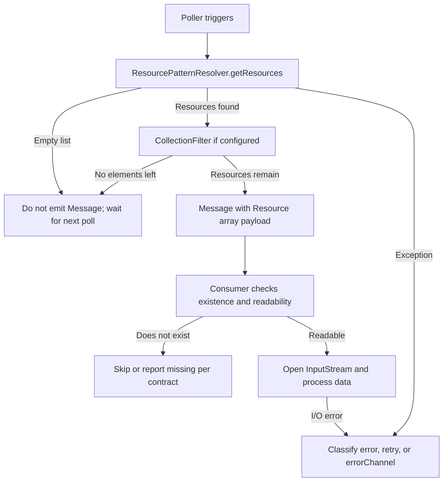

# Handling Nonexistent Resources

## 1. Context and objectives

In **Spring Integration Adapters**, the `Resource Inbound Channel Adapter` periodically polls resources represented by `org.springframework.core.io.Resource`: files on disk, classpath resources, URLs, or other `Resource` types. The adapter uses `ResourcePatternResolver` to resolve a `pattern`, then emits a `Message` with a **`Resource[]` array** payload onto a `MessageChannel`. Unlike the File Inbound Adapter, which typically emits one `File` at a time, the Resource Adapter works with a collection of resources per poll.

A common scenario is an application starting before files arrive, configuration pointing to the wrong classpath, an empty input directory, or a file being deleted after the adapter discovers it. You should not treat all of those cases as the exact same "file not found" error.

After this lesson, you will be able to:

- Distinguish **no matching resources found** from **having a `Resource` object whose target does not exist**.
- Check `exists()` and `isReadable()`, and handle resources vanishing between checking and reading.
- Design skip, wait-for-next-poll, error-reporting, or fail-startup behaviors according to your data contract.
- Understand the impact of `AcceptOnceCollectionFilter`, `errorChannel`, retries, and operational monitoring.

## 2. What does a nonexistent Resource mean?

A `Resource` is a **descriptor representing an access location**, not a guarantee that real content exists at creation time. For example, `ResourceLoader.getResource("classpath:config/missing.properties")` can still return a `Resource` object; the application must call `exists()` to know whether the target currently exists.

The Resource Inbound Adapter relies on `ResourcePatternResolver.getResources(pattern)`, so three outcome classes must be separated:

| Symptom | Example | Meaning and how to handle |
| --- | --- | --- |
| Pattern matches no resources | `file:/data/import/*.csv` before any CSV file arrives | Resolver usually returns an empty array; source has no payload to emit, and poller continues on schedule. This can be a normal state. |
| Have a `Resource` handle yet `exists() == false` | `classpath:config/missing.properties` without wildcards | Resolver for a fixed path can return a handle even when the file does not exist yet; check before using. |
| Resource existed at check time, unreadable later | File deleted, read permission lost, mount disconnected, URL returns 404 | `getInputStream()` can throw `IOException` even though `exists()` previously returned `true`. |
| Error while resolving pattern | Remote source unreachable, I/O error, invalid pattern or resolver config | Can throw an exception during listing; classify the cause and route into error handling. |
| Resource exists but data is invalid | Empty file, invalid JSON/properties structure | This is a **content error** requiring separate validation, not "nonexistent." |

> **Note:** With wildcard patterns, an empty result is common, yet you must not infer that *every* pattern or *every* `ResourcePatternResolver` returns an empty array when targets are missing. In particular, non-wildcard patterns can yield a handle that does not exist yet, while errors accessing a root directory can cause the resolver to throw an exception.

You can observe the difference directly in Spring Framework:

```java
import org.springframework.core.io.Resource;
import org.springframework.core.io.support.PathMatchingResourcePatternResolver;
import org.springframework.core.io.support.ResourcePatternResolver;

import java.io.IOException;

public class ResourceLookupDemo {
    public static void main(String[] args) throws IOException {
        ResourcePatternResolver resolver =
                new PathMatchingResourcePatternResolver();

        // Fixed path: returns a Resource handle that may not exist.
        Resource single =
                resolver.getResource("classpath:config/not-found.properties");
        System.out.println("exists = " + single.exists());

        // Wildcard: retrieves Resources actually matching the pattern.
        Resource[] matches =
                resolver.getResources("classpath*:config/*.properties");
        System.out.println("matched resources = " + matches.length);
    }
}
```

The `exists` value in the example depends on actual classpath contents. `matched resources = 0` only occurs if no resources match, not as a mandatory outcome on every run.

## 3. Resource Inbound Adapter flow when there are no results



With `ResourceRetrievingMessageSource`, an empty result list or one emptied by the filter means `receive()` produces no `Message`. Hence a downstream `@ServiceActivator` **does not receive an "empty message" just to signal that no files exist yet**. If business rules require alerting when resources are missing past a deadline, implement separate monitoring (such as a scheduled status check measuring time since the last successful run).

## 4. Configuring the adapter to wait for resources to appear

Suppose a system ingests `.properties` configuration files from `/data/import`. New files are placed into the directory after the application has started. Spring Integration XML configuration can be written as:

```xml
<!-- Placed inside Spring configuration with the "int" namespace declared. -->
<int:channel id="configResources"/>

<int:resource-inbound-channel-adapter
        id="configResourceAdapter"
        channel="configResources"
        pattern="file:/data/import/*.properties">
    <int:poller fixed-delay="5000"
                max-messages-per-poll="1"/>
</int:resource-inbound-channel-adapter>
```

Expected progression:

1. `/data/import` has no matching files yet: that poll produces no message to process.
2. An `app.properties` file is created and ready for reading: a subsequent poll can emit a `Message<Resource[]>` containing the matching resource.
3. The handler reads the resource, validates it, and applies business logic.
4. If the file is deleted right before opening the stream, the handler must handle the read-time error.

Note `fixed-delay="5000"` specifies the delay in milliseconds between executions per poller configuration; it does not guarantee files are processed the exact instant they appear. For multi-step file writes, writers should write to a temporary name and **atomically rename after writing finishes** (when the filesystem supports it), or use a "ready marker" convention so readers never see half-written data.

### Why avoid fixed paths for late-arriving sources?

If you replace the pattern above with `file:/data/import/app.properties` (no wildcard), the resolver can keep returning a handle for that path even before the file exists. When declaring the Resource Inbound Adapter in XML without specifying a filter, the adapter uses `AcceptOnceCollectionFilter` by default to prevent re-emitting already-seen resources. Consequently, the nonexistent file's handle may be counted as "already seen" on the first poll; when the file appears later, it may not be emitted again.

For dynamically arriving file sources, the simple approach is a wildcard matching existing files. If business rules **require rescanning the exact same resource on every poll**, configure `filter=""` in XML to disable the default filter while enforcing deduplication/idempotency at the processing layer. For scenarios needing reprocessing when file content changes, choose a filter strategy based on version, modification time, or business processing markers rather than filename alone.

## 5. Checking before reading and guarding against race conditions

The following handler accepts the adapter's `Resource[]` payload, skips resources that have vanished, closes `InputStream` properly, and rethrows other I/O errors so the integration flow's error handling can catch them:

```java
import java.io.FileNotFoundException;
import java.io.IOException;
import java.io.InputStream;
import java.io.UncheckedIOException;
import java.nio.file.NoSuchFileException;
import java.util.Properties;

import org.slf4j.Logger;
import org.slf4j.LoggerFactory;
import org.springframework.core.io.Resource;
import org.springframework.integration.annotation.ServiceActivator;
import org.springframework.stereotype.Component;

@Component
public class ResourceConfigConsumer {
    private static final Logger log =
            LoggerFactory.getLogger(ResourceConfigConsumer.class);

    @ServiceActivator(inputChannel = "configResources")
    public void consume(Resource[] resources) {
        for (Resource resource : resources) {
            String location = resource.getDescription();

            // Resource is a handle; verify the current target.
            if (!resource.exists()) {
                log.info("Skipping nonexistent resource: {}", location);
                continue;
            }
            if (!resource.isReadable()) {
                log.warn("Resource exists but is not readable: {}", location);
                continue;
            }

            try (InputStream input = resource.getInputStream()) {
                Properties properties = new Properties();
                properties.load(input);

                // Replace with validation and business config application.
                log.info("Loaded {} properties from {}",
                        properties.size(), location);
            }
            catch (FileNotFoundException | NoSuchFileException missing) {
                // File may vanish between exists()/isReadable() and open().
                log.info("Resource vanished before reading: {}", location);
            }
            catch (IOException io) {
                // Do not turn another read error into a "missing file" state.
                throw new UncheckedIOException("Cannot read " + location, io);
            }
        }
    }
}
```

Here, using `continue` when a resource is missing is a **business decision** for optional files. If the file is mandatory for system correctness, replace that branch with an appropriate exception or explicit error-reporting mechanism. Nor should you automatically skip every `isReadable() == false` case: an existing file with bad read permissions is fundamentally different from an empty input directory.

Checking `exists()` followed by `getInputStream()` is not an atomic operation; the file can still be deleted, replaced, or lose permissions in between. Therefore **catching exceptions during the read operation is mandatory**, even after checking existence. For URL resources, the check can also cost an extra network call and yield a point-in-time result; weigh timeout and access-count policies accordingly.

> **Retry caveat:** The adapter may already have recorded the resource in the "accept once" filter before the handler finishes successfully. If the handler fails, waiting for the next poll **does not guarantee** that resource will be emitted again automatically. When guaranteed processing is required, manage retries/recovery and idempotency markers at the business layer; do not rely on a poll schedule as a guaranteed delivery queue.

## 6. Choosing behavior when resources are absent

| Data contract | Appropriate policy | Example |
| --- | --- | --- |
| **Optional**: process when data is present | Emit no message on empty match; record metrics without erroring on every poll | Periodic document import directory |
| **Late-arriving**: may be absent for a window | Poll on schedule; alert if SLA is breached, avoid log spam | Partner files delivered each morning |
| **Mandatory at startup** | Verify `exists()` and `isReadable()` before serving traffic; fail fast clearly naming the location | Required schema or mapping table on classpath |
| **Mandatory within a transaction** | Report contextual error, do not mark complete; bounded retry for transient errors | Required template for invoice rendering |
| **Target exists yet is inaccessible** | Classify permission/I/O error, check mounts and credentials; route to error channel | Unmounted volume or object store error |

Example checking a mandatory resource at startup with Spring Boot:

```java
import org.springframework.boot.ApplicationArguments;
import org.springframework.boot.ApplicationRunner;
import org.springframework.core.io.Resource;
import org.springframework.core.io.ResourceLoader;
import org.springframework.stereotype.Component;

@Component
public class RequiredConfigCheck implements ApplicationRunner {
    private final ResourceLoader resourceLoader;

    public RequiredConfigCheck(ResourceLoader resourceLoader) {
        this.resourceLoader = resourceLoader;
    }

    @Override
    public void run(ApplicationArguments args) {
        Resource required =
                resourceLoader.getResource("classpath:config/schema.json");

        if (!required.exists() || !required.isReadable()) {
            throw new IllegalStateException(
                    "Missing required resource: classpath:config/schema.json");
        }
    }
}
```

Use fail-fast like this only for configuration that is truly mandatory and expected immediately at startup. If the resource is scheduled data that may arrive late, attach wait bounds and alerts instead of preventing the entire service from starting.

## 7. Distinguishing "no message" from errors routed to errorChannel

In Spring Integration, message-based error handling and `errorChannel` depend on where and in which execution thread an exception occurs:

- **No matching resources**: `MessageSource.receive()` returns no message for that poll; this is not an exception and does not automatically generate an `ErrorMessage`.
- **Resolver fails during poll**: exceptions thrown inside a poll task are converted by the appropriate scheduler/error handler into an `ErrorMessage` on `errorChannel` (by default in standard poller configurations). Inspect causes to classify `IOException`, permission issues, misconfiguration, or network failures.
- **Handler fails while reading**: if an exception occurs within a poll task and propagates up, the poller's error handler may publish an `ErrorMessage`; behavior also depends on channel type, executors, and error-handler configuration. Do not assume every exception on every synchronous flow automatically goes to `errorChannel`.
- **Handler catches and skips**: the system will not automatically know a resource was skipped. To measure this event, emit logs/metrics or publish an explicit status notification.

Do not enable infinite retries for "wrong path" or "missing classpath file" errors. Retries only help recoverable causes such as transient network drops, recovering mounts, or unfinished file writes. For permanent errors, clearly report the pattern, resource origin, and cause so operators can fix configuration.

One operational way to monitor is measuring these signals:

- `resource_poll_empty_total`: number of polls yielding no results; track over time windows rather than treating each empty poll as an incident.
- `resource_missing_at_read_total`: count of handles received whose files vanished before opening the stream.
- `resource_read_failure_total`: I/O/parse failures needing attention, tagged by cause.
- `last_resource_processed_timestamp`: timestamp of last successful processing to evaluate late-data SLAs.

These metric names are **custom suggestions**, not default metrics exported by Spring Integration. Avoid putting URL tokens or credentials into logs or metric labels.

## 8. Scenarios to test

| Scenario | Action | Expectation |
| --- | --- | --- |
| Empty directory | Start adapter with `file:/data/import/*.properties` and no files | No valid messages sent to consumer; poller keeps running. |
| Late-arriving file | Create a matching file after a few poll cycles | Next eligible poll can emit a payload containing the new resource. |
| Wrong fixed path | Call `getResource("classpath:config/absent.properties")` | May return a `Resource` handle, yet `exists()` returns `false`. |
| File deleted before read | Create file, let resolver detect it, delete before `getInputStream()` | Handler records "vanished" via `FileNotFoundException`/`NoSuchFileException` catch when thrown. |
| Unreadable file | Remove read permissions (OS-dependent) | Do not equate permission errors with missing files; log/metric and apply policy. |
| Malformed file | Supply a matching file with invalid content | Report validation/parse error; do not treat as nonexistent resource. |
| Already processed | Leave file unchanged across multiple poll cycles | Verify filter prevents re-emission per contract. |
| Read failure then recovery | Induce I/O error, then restore source | Verify retry/recovery strategy actually reprocesses; do not assume next poll auto-redelivers. |

In integration tests, replace fixed `Thread.sleep()` waits with conditional timeout waits (e.g., counting messages received on a test channel). That cleanly tests "no message" cases too and avoids tying tests to machine speed.

## 9. Common implementation mistakes

1. **Treating `getResource() != null` as "file exists."** `Resource` is a handle; check `exists()`, `isReadable()`, and handle stream-open errors.
2. **Treating an empty match array as a system error.** If the source is allowed to be empty, that is normal operation; alert only on SLA breaches.
3. **Using a fixed filename with `AcceptOnceCollectionFilter` for late-arriving sources.** A nonexistent handle can be marked seen, preventing the file from being emitted when it later appears.
4. **Treating `exists()` as a read guarantee.** Race conditions can always occur between check and access.
5. **Catching and ignoring all `IOException`s.** This hides mount, permission, and network failures; classify or route to error flows.
6. **Retrying without idempotency.** After a partial failure, reprocessing can create duplicate data. Use success tracking or proper deduplication.
7. **Relying solely on `errorChannel` to report missing files.** Empty polls raise no exceptions; monitoring missing data needs its own logic.

## 10. Self-check questions

1. Why might `getResources("file:/data/import/*.csv")` return zero elements while `getResource("file:/data/import/a.csv")` still returns an object? For those two results, which processing branch runs?
2. A file only appears after 10 minutes, yet the adapter uses a fixed pattern and the default filter. Explain why the system might miss the file and propose an appropriate configuration.
3. If `exists()` returns `true` yet `getInputStream()` throws `FileNotFoundException`, what should the handler do when the file is optional data? How does that policy change if the file is mandatory?
4. Why does increasing poll frequency fail to recover a message already dropped by the filter or a handler that partially processed and then failed?

## References

- [Spring Integration Reference — Resource Support](https://docs.spring.io/spring-integration/reference/resource.html): how the Resource Inbound Channel Adapter resolves patterns, emits `Resource[]`, and uses `CollectionFilter`.
- [Spring Framework Reference — Resources](https://docs.spring.io/spring-framework/reference/core/resources.html): contracts for `Resource.exists()`, `isReadable()`, and `getInputStream()`.
- [Spring Framework — PathMatchingResourcePatternResolver API](https://docs.spring.io/spring-framework/docs/current/javadoc-api/org/springframework/core/io/support/PathMatchingResourcePatternResolver.html): differences between fixed locations and wildcard patterns.
- [Spring Integration Reference — Error Handling](https://docs.spring.io/spring-integration/reference/error-handling.html): behavior of `ErrorMessage` and `errorChannel` in polling tasks.
