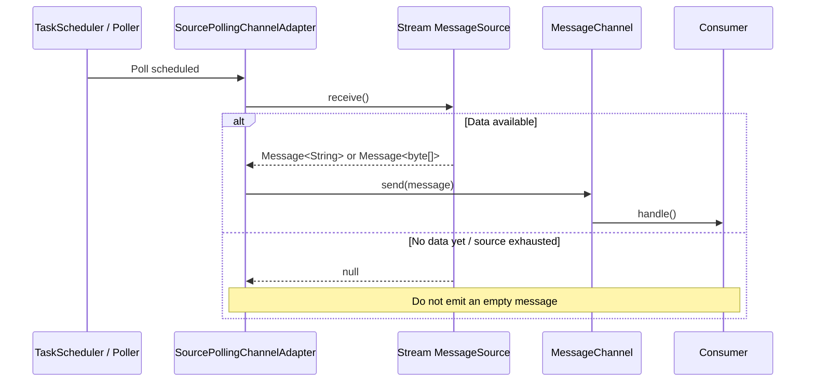
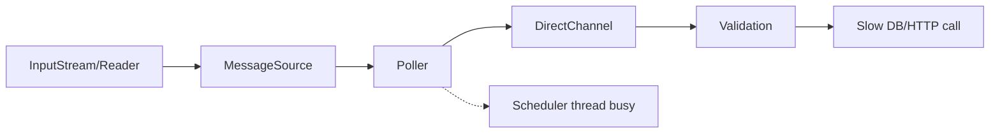

# Stream inbound channel adapter

## 1. Context: receiving data from an open stream

In the **SPRING_INTEGRATION_ADAPTERS** module, Spring Integration connects external systems using **inbound/outbound adapters, gateways, pollers, and `MessageChannel`**; practicing exchanges over files, SFTP, HTTP, JMS, AMQP, Kafka, databases, as well as handling message contracts, errors, and connection lifecycles. The **Adapter Stream** chapter focuses on data sources/targets based on Java I/O interfaces: `InputStream`, `OutputStream`, `Reader`, and `Writer`.

Suppose an event-processing tool is run from the terminal and receives lines of standard input:

```bash
printf 'ORDER,1001,CREATED\nORDER,1002,PAID\n' | java -jar integration-app.jar
```

The application needs to convert each line into a Spring `Message<String>`, then validate, transform, and send it into a `MessageChannel` for another service or adapter to process. You should not send **the `InputStream`/`Reader` object itself** as the payload and force consumers to read from a shared source: a stream has a read cursor, a closed state, and is generally not safe when multiple consumers access it concurrently.

```text
  Terminal / pipe / Reader / InputStream
                  |
                  v
  Stream reading MessageSource
                  |
          poller calls receive()
                  |
                  v
      SourcePollingChannelAdapter
                  |
                  v
         MessageChannel
                  |
          +-------+--------+
          |                |
     Validator         Transformer
          |                |
          +-------+--------+
                  |
         Business consumer
```

A **stream inbound channel adapter** is the starting point of the flow: it takes data read from a stream, wraps it into a Spring message, and sends it through a channel. It does **not** automatically turn bytes into business JSON, generate ACKs, manage durable offsets, or guarantee exactly-once processing.

After this lesson, you will be able to:

1. Distinguish between `ByteStreamReadingMessageSource` and `CharacterStreamReadingMessageSource`.
2. Understand `byte[]` and `String` payloads, message framing, encoding, and size limits.
3. Configure pollers via Java DSL and XML; distinguish `null` when no data is available yet from EOF.
4. Use `stdin()`/`stdinPipe()`, and handle `StreamClosedEvent` when the stream ends.
5. Control blocking I/O, thread pools, backpressure, error handling, and shutdown.
6. Design terminal-independent tests using `ByteArrayInputStream`/`StringReader`.
7. Know when to switch to File, SFTP, TCP, HTTP, or JMS/AMQP/Kafka instead of using stream adapters.

## 2. Architecture: MessageSource + poller + channel

Spring Integration defines `MessageSource<T>` with the `receive()` operation. Both stream reading sources implement this contract:



| Component | Responsibility | Does not do automatically |
| --- | --- | --- |
| `InputStream` / `Reader` | Provides bytes/characters and read state | Define transactions, ACKs, event IDs |
| `MessageSource` | Reads data and creates a Spring message | Schedule calls to itself |
| `SourcePollingChannelAdapter` | Invokes the source on schedule, sends to channel | Recover already-read data after a crash |
| `PollerMetadata` / `Pollers` | Configures fixed delay/rate, messages per poll | Generate new data if the stream has none |
| `MessageChannel` | Transports messages to consumers | Persist automatically when the JVM stops |
| Consumer/transformer | Validates, parses, filters, and runs business logic | Guarantee input is always valid |

### Inbound vs. outbound

- **Inbound**: `InputStream`/`Reader` → Spring `Message<?>` → `MessageChannel`.
- **Outbound**: Spring `Message<?>` → `ByteStreamWritingMessageHandler`/`CharacterStreamWritingMessageHandler` → `OutputStream`/`Writer`.

These are **one-way** data directions, with no reply channel implying that the data source has been committed. If a business workflow requires request–reply, consider a gateway or a dedicated ACK design.

### A stream is not a queue

An ordinary byte stream tracks state as **wherever the read cursor has advanced**. By default, there is no seek, rewind, partition, consumer group, or replay. When a consumer fails after the source has read, those bytes or lines may already have been consumed at the source.

| Goal | Available out of the box with stream inbound? | What else is needed? |
| --- | --- | --- |
| Read from standard input | Yes | Charset, poller, consumer |
| Receive text line by line | Yes, with character source | Newline convention, validation |
| Read byte chunks | Yes, with byte source | Appropriate framing and parser |
| Watch a directory with multiple files | No | File inbound adapter |
| Sync files from SFTP | No | SFTP inbound adapter |
| Read messages with offset/ACK | No | JMS/AMQP/Kafka depending on requirements |
| Resume at a byte offset after restart | Not built-in | Custom-designed checkpoint/seek |

## 3. Two key MessageSource implementations

Spring Integration Stream provides two main sources:

| Class | Java input | Spring payload | Read unit |
| --- | --- | --- | --- |
| `CharacterStreamReadingMessageSource` | `java.io.Reader` | `String` | Text line as handled by a buffered reader |
| `ByteStreamReadingMessageSource` | `java.io.InputStream` | `byte[]` | Byte block, capped by `bytesPerMessage` |

**Version note:** This lesson uses **Spring Integration 6.5.x** and imports from package `org.springframework.integration.stream`. In **7.x** documentation, the two reading sources were moved to package `org.springframework.integration.stream.inbound`. Do not mix 7.x imports with 6.5.x dependencies and assume the framework is missing a class.

### 3.1. Character stream: when data is text

`CharacterStreamReadingMessageSource` accepts a `Reader` and wraps it in a `BufferedReader` if it is not already wrapped. It reads text line by line, making it suitable for:

- Terminal input: each line is a command or event.
- Pipes feeding small CSV/NDJSON lines into the application.
- Text sources with standardized encoding and newline-delimited records.

Example:

```text
ORDER,1001,CREATED\n
ORDER,1002,PAID\n
```

With proper newline conventions, the consumer receives **two separate `String` payloads**, without having to decode bytes manually. Do not use this source when the protocol carries arbitrary binary data or when records contain unescaped newlines.

### 3.2. Byte stream: when data is binary

`ByteStreamReadingMessageSource` accepts an `InputStream` and produces a `byte[]` payload. The `bytesPerMessage` property determines the **maximum number of bytes each read attempts to put into one message**, defaulting to **1024**.

```java
ByteStreamReadingMessageSource source =
        new ByteStreamReadingMessageSource(inputStream);
source.setBytesPerMessage(2048);
```

The `inputStream` variable is an already-opened `InputStream` with proper access permissions. This snippet only configures the **source**; it has not created a poller or wired a channel yet.

**Important warning:** `bytesPerMessage=2048` does not mean every payload is always exactly 2048 bytes and **does not automatically create record boundaries**. A read may return fewer bytes because the source is at the end or only partial data is available.

### 3.3. shouldTruncate

The byte source also has `setShouldTruncate(boolean)`. When you want the message to contain **only the exact number of bytes actually read**, especially in the final chunk or on streams with short reads, enable it:

```java
source.setShouldTruncate(true);
```

Without truncating to the actual number of bytes read, the remainder of the buffer may remain padded with default byte values. That is dangerous if downstream code treats the full array length as valid payload. Verify the exact behavior on your version and write tests with a final chunk shorter than `bytesPerMessage`.

## 4. Is a poller required?

**Yes**, for a stream reading `MessageSource` used as a standard inbound adapter: the framework needs a poller to periodically call `receive()`. This differs from **event-driven inbound adapters** such as certain JMS/AMQP listeners or XMPP listeners.

```text
fixedDelay = 250 ms
maxMessagesPerPoll = 1

t=0        receive() -> data #1
t=250 ms   receive() -> data #2
t=500 ms   receive() -> null
t=750 ms   receive() -> data #3
```

The timeline is illustrative only; with `fixedDelay`, actual timing also depends on the execution duration of the previous poll, the scheduler, and consumer load.

### Properties to understand

| Setting | Role | Risk if chosen poorly |
| --- | --- | --- |
| `fixedDelay` | Pause after a poll cycle finishes | Too short causes frequent empty polls |
| `fixedRate` | Schedule poll starts at a fixed cadence | Slow work can cause delays/overlapping schedules depending on the scheduler |
| `maxMessagesPerPoll` | Limits how many times the source is called in one poll | Too large can monopolize a thread, especially with a blocking source |
| `TaskScheduler` | Executes the poller | Too few threads can starve other pollers |
| `errorChannel`/error handling | Handles exceptions when the source/consumer fails | Uncontrolled swallowing of errors causes data loss |

`receive()` returning `null` signals **not to emit a message in that cycle**, not a message with a null payload. It is also **not sufficient to conclude EOF** in a character source configuration where EOF detection is disabled.

### A poller can block

With `blockToDetectEOF=true`, `CharacterStreamReadingMessageSource.receive()` can **block the poller thread** until data or EOF arrives. The poller remains scheduled, but the executing thread does not return to the scheduler immediately while there is no input. Consider a dedicated task scheduler, thread quotas, and a shutdown path when running multiple adapters.

## 5. Reader.ready() and the “no data” vs. EOF problem

This is the most important distinction when working with character streams.

### 5.1. Default mode: do not block to detect EOF

`CharacterStreamReadingMessageSource(reader)` or the two-argument constructor defaults to **`blockToDetectEOF=false`**. Before reading, the source checks `BufferedReader.ready()`:

- If `ready()==false`, `receive()` returns `null`.
- It does not necessarily read up to EOF to detect that the source has closed.
- `ready()==false` **does not mean** “the stream has ended”.

This mode suits interactive terminals, where the user may not have typed anything yet while the application still wants the scheduler to continue serving other tasks.

### 5.2. Enabling EOF detection

Three-argument constructor:

```java
import java.io.Reader;
import org.springframework.integration.stream.CharacterStreamReadingMessageSource;

Reader reader = /* Reader provided by the application */;
CharacterStreamReadingMessageSource source =
        new CharacterStreamReadingMessageSource(
                reader,
                8192,
                true
        );
```

`true` is `blockToDetectEOF`. In this mode, `receive()` **blocks** until data arrives or the reader reports EOF. When EOF is detected, Spring Integration publishes **`StreamClosedEvent`** in the ApplicationContext.

### 5.3. StreamClosedEvent is an ApplicationEvent, not a Message payload

| Mechanism | Form | Consumer |
| --- | --- | --- |
| Text line read | Spring `Message<String>` on channel | `@ServiceActivator`/DSL handler |
| EOF detected | Spring `StreamClosedEvent` | `ApplicationListener<StreamClosedEvent>` or `@EventListener` |

**Do not wait for a `Message<String>` carrying the string `EOF`.** EOF itself is a state of the source, not a line in the stream.

### 5.4. Risk of repeated EOF events

As described in the reference documentation: if the adapter keeps running after EOF has been detected, the poller can **continue publishing `StreamClosedEvent` on subsequent poll cycles**. You should stop the adapter or close the application according to policy.

Do not synchronously call `stop()` and then perform another blocking/interruptible operation on the **same poller thread** that is publishing the event; stopping may interrupt that very thread. If additional post-EOF work is required, complete what must be sent first, or coordinate stopping/cleanup on a separate managed worker ensuring no race conditions.

## 6. Factory methods for stdin

Spring Integration provides four convenience methods on `CharacterStreamReadingMessageSource`:

| Factory method | Charset | EOF |
| --- | --- | --- |
| `stdin()` | Default charset of the factory method | Does not actively detect EOF |
| `stdin("UTF-8")` | UTF-8 | Does not actively detect EOF |
| `stdinPipe()` | Default charset of the factory method | Detects EOF, supports closing context |
| `stdinPipe("UTF-8")` | UTF-8 | Detects EOF, supports closing context |

`stdinPipe(...)` is designed for **piped or redirected stdin**, with a mechanism to detect EOF and close the application context when the pipe ends per the API documentation. It is useful for batch CLIs. For long-running interactive terminals, consider `stdin(...)` so the program does not shut down automatically when there is no input.

Examples on Unix/Linux shells:

```bash
cat events.txt | java -jar integration-app.jar
java -jar integration-app.jar < events.txt
```

In **Windows PowerShell 5.1**, the `<` stdin redirection operator is not supported as in POSIX shells. You can use `cmd /c "java -jar integration-app.jar < events.txt"` or prepare a compatible pipe. Do not conclude there is a Java application bug if the shell does not support redirection.

### Charset must be consistent

If the producer emits UTF-8 while the reader decodes with a different charset, accented Vietnamese payloads can become corrupted. For text pipelines, set the charset explicitly:

```java
CharacterStreamReadingMessageSource source =
        CharacterStreamReadingMessageSource.stdinPipe("UTF-8");
```

For byte streams, **no decoding is performed**: the payload is `byte[]`. If downstream converts to `String`, it must choose an explicit `Charset` and be careful with multibyte characters split across two chunks.

## 7. Java DSL: Spring Boot example reading stdin line by line

### 7.1. Dependencies

With Java 17+, Spring Boot, and compatible Spring Integration 6.5.x, Maven:

```xml
<dependencies>
    <dependency>
        <groupId>org.springframework.boot</groupId>
        <artifactId>spring-boot-starter-integration</artifactId>
    </dependency>
    <dependency>
        <groupId>org.springframework.integration</groupId>
        <artifactId>spring-integration-stream</artifactId>
    </dependency>
</dependencies>
```

The version of `spring-integration-stream` can be managed by the Spring Boot BOM if compatible. Without a BOM, declare a version aligned with Spring Integration core. **Do not copy a `7.1.x` version directly from the current Reference page into a project using Spring Integration `6.5.x`** without upgrading everything in sync.

### 7.2. Java program

The following example defines an inbound adapter polling `System.in`, sending `Message<String>` over `stdinLinesChannel`, and a service activator printing parse results. Each line has the format `ORDER,<id>,<status>`.

```java
import java.util.Set;

import org.springframework.boot.SpringApplication;
import org.springframework.boot.autoconfigure.SpringBootApplication;
import org.springframework.context.annotation.Bean;
import org.springframework.context.annotation.Configuration;
import org.springframework.integration.annotation.ServiceActivator;
import org.springframework.integration.channel.DirectChannel;
import org.springframework.integration.config.EnableIntegration;
import org.springframework.integration.dsl.IntegrationFlow;
import org.springframework.integration.dsl.Pollers;
import org.springframework.integration.stream.CharacterStreamReadingMessageSource;
import org.springframework.messaging.Message;
import org.springframework.messaging.MessageChannel;

@SpringBootApplication
public class StreamInboundApplication {

    public static void main(String[] args) {
        SpringApplication.run(StreamInboundApplication.class, args);
    }
}

@Configuration
@EnableIntegration
class StreamInboundConfig {

    @Bean
    MessageChannel stdinLinesChannel() {
        return new DirectChannel();
    }

    @Bean
    IntegrationFlow stdinInboundFlow() {
        return IntegrationFlow
                .from(
                    CharacterStreamReadingMessageSource.stdinPipe("UTF-8"),
                    endpoint -> endpoint
                        .id("stdinStreamAdapter")
                        .poller(Pollers
                            .fixedDelay(250)
                            .maxMessagesPerPoll(1))
                )
                .channel("stdinLinesChannel")
                .get();
    }

    @ServiceActivator(inputChannel = "stdinLinesChannel")
    public void consumeOrderLine(Message<String> message) {
        String line = message.getPayload();
        if (line.isBlank()) {
            return;
        }

        String[] parts = line.split(",", -1);
        Set<String> allowed = Set.of("CREATED", "PAID", "CANCELLED");

        if (parts.length != 3
                || !parts[0].equals("ORDER")
                || !parts[1].matches("[0-9]{1,12}")
                || !allowed.contains(parts[2])) {
            // Demo article: print to stderr and skip invalid records.
            // Production: send to an audited quarantine.
            System.err.println("Rejected input line");
            return;
        }

        System.out.printf(
                "Accepted orderId=%s status=%s%n",
                parts[1],
                parts[2]
        );
    }
}
```

**Execution prerequisites:** A Spring Boot project with complete dependency configuration, build plugin, and Java 17 or higher; the example shows two illustrative classes that can be placed in the same package. When running, use the built application JAR. This example was not executed in a runtime environment while writing this Knowledge article.

### 7.3. Running with stdin redirection

UTF-8 input file:

```text
ORDER,1001,CREATED
ORDER,1002,PAID
ORDER,999,UNKNOWN
```

POSIX command example:

```bash
java -jar integration-app.jar < events.txt
```

Expected output log:

```text
Accepted orderId=1001 status=CREATED
Accepted orderId=1002 status=PAID
Rejected input line
```

This is the **expected output from the example logic**, not an actual executed output. Files with a trailing newline, character representation, and event timing depend on the shell/OS. When the pipe signals EOF, `stdinPipe("UTF-8")` supports closing the context; process exit also depends on other non-daemon threads/resources.

### 7.4. Explaining the key lines

| Component | Effect |
| --- | --- |
| `stdinPipe("UTF-8")` | Creates a character message source from `System.in` with EOF detection |
| `IntegrationFlow.from(source, endpoint -> ...)` | Creates a `SourcePollingChannelAdapter` for the source |
| `Pollers.fixedDelay(250)` | Sets the poll schedule, in milliseconds |
| `maxMessagesPerPoll(1)` | Each poll cycle processes at most one successful read |
| `.channel("stdinLinesChannel")` | Sends the Spring message to the channel |
| `@ServiceActivator` | Consumer that receives `Message<String>` and validates its contents |
| `DirectChannel` | Invokes the consumer synchronously on the dispatch thread, with no persistence |

**Important note:** `stdinPipe` can **block the poller thread** while waiting for a line/EOF. Allocate appropriate scheduler resources and do not configure a stream poller as if it were a purely non-blocking task.

## 8. Java DSL: standalone byte stream example

For binary data, use `ByteStreamReadingMessageSource` and `byte[]` instead of assuming each chunk is a UTF-8 line.

This is an **alternative flow** with a deterministic `ByteArrayInputStream` input; no terminal user input is required. You can place it in a separate test configuration and avoid enabling it concurrently with the `stdinPipe` flow unless intentional.

```java
import java.io.ByteArrayInputStream;
import java.util.HexFormat;

import org.springframework.context.annotation.Bean;
import org.springframework.context.annotation.Configuration;
import org.springframework.integration.config.EnableIntegration;
import org.springframework.integration.dsl.IntegrationFlow;
import org.springframework.integration.dsl.Pollers;
import org.springframework.integration.stream.ByteStreamReadingMessageSource;

@Configuration
@EnableIntegration
public class BinaryStreamInboundConfig {

    @Bean
    public IntegrationFlow binaryInboundFlow() {
        byte[] fixture = new byte[] {
                0x01, 0x02, 0x03, 0x04, 0x05, 0x06, 0x07
        };

        ByteStreamReadingMessageSource source =
                new ByteStreamReadingMessageSource(
                    new ByteArrayInputStream(fixture)
                );
        source.setBytesPerMessage(4);
        source.setShouldTruncate(true);

        return IntegrationFlow
                .from(source, endpoint -> endpoint
                        .id("binaryStreamAdapter")
                        .poller(Pollers
                            .fixedDelay(300)
                            .maxMessagesPerPoll(1)))
                .handle(message -> {
                    byte[] chunk = (byte[]) message.getPayload();
                    System.out.printf(
                        "chunkLength=%d hex=%s%n",
                        chunk.length,
                        HexFormat.of().formatHex(chunk)
                    );
                })
                .get();
    }
}
```

### Expected output

With an in-memory `ByteArrayInputStream` holding all 7 bytes and a chunk size of 4, the reads typically yield:

```text
chunkLength=4 hex=01020304
chunkLength=3 hex=050607
```

This is an **illustrative result with an in-memory fixture**. With an `InputStream` backed by a real socket/pipe, the number of bytes received per read depends on available data and `read()` behavior; you cannot always assume the first payload is exactly 4 bytes.

### What happens when the byte stream ends?

With a byte `MessageSource`, polls without data typically return `null`; **there is no default `StreamClosedEvent` like a character source with `blockToDetectEOF` enabled**. A poller over a `ByteArrayInputStream` can keep running and receiving null after the data is exhausted if the application does not manage stopping the endpoint.

For batch usage, coordinate the lifecycle or switch to a source mechanism with an explicit completion concept rather than relying solely on `null` to close the context automatically.

## 9. XML configuration: stream namespace and general adapter

Spring Integration provides the `int-stream` namespace for stdin/stdout/stderr, and sources can also be configured via the general `int` namespace.

### 9.1. stdin-channel-adapter

XML example for an application receiving UTF-8 text from stdin:

```xml
<beans:beans
    xmlns:beans="http://www.springframework.org/schema/beans"
    xmlns:xsi="http://www.w3.org/2001/XMLSchema-instance"
    xmlns:int="http://www.springframework.org/schema/integration"
    xmlns:int-stream="http://www.springframework.org/schema/integration/stream"
    xsi:schemaLocation="
        http://www.springframework.org/schema/beans
        https://www.springframework.org/schema/beans/spring-beans.xsd
        http://www.springframework.org/schema/integration
        https://www.springframework.org/schema/integration/spring-integration.xsd
        http://www.springframework.org/schema/integration/stream
        https://www.springframework.org/schema/integration/stream/spring-integration-stream.xsd">

    <int:channel id="stdinMessages"/>

    <int-stream:stdin-channel-adapter
            id="stdinAdapter"
            channel="stdinMessages"
            charset="UTF-8"
            detect-eof="true">
        <int:poller fixed-delay="250" max-messages-per-poll="1"/>
    </int-stream:stdin-channel-adapter>

    <!-- Declare the Service Activator/Consumer for stdinMessages here. -->
</beans:beans>
```

The `detect-eof` attribute was added in Spring Integration **5.0** and applies to `blockToDetectEOF` on the character source. If a specific XML parser/version has different constraints, check the XSD matching the actual library.

**Do not enable both a Java `stdinPipe` flow and an XML `stdin-channel-adapter` reading `System.in`** in the same application unless you have an explicit coordination mechanism. Two readers competing on the same stdin can split input unpredictably.

### 9.2. Creating a byte source and wiring it into inbound-channel-adapter

`int:inbound-channel-adapter` can reference a `MessageSource` bean:

To provide a real binary source, create the `InputStream` via a Java bean with an explicit lifecycle and reference it from XML:

```xml
<!-- binaryInputStream is provided by a Java @Bean returning InputStream. -->
<beans:bean id="binarySource"
            class="org.springframework.integration.stream.ByteStreamReadingMessageSource">
    <beans:constructor-arg ref="binaryInputStream"/>
    <beans:property name="bytesPerMessage" value="2048"/>
    <beans:property name="shouldTruncate" value="true"/>
</beans:bean>

<int:channel id="binaryMessages"/>

<int:inbound-channel-adapter id="binaryInbound"
                             ref="binarySource"
                             channel="binaryMessages">
    <int:poller fixed-delay="500" max-messages-per-poll="1"/>
</int:inbound-channel-adapter>
```

This XML snippet is **not a complete standalone runnable configuration** because `binaryInputStream` and the consumer of `binaryMessages` must be provided by the application context. For binary input, the Java DSL in section 8 is a self-contained example that is easier to verify.

### Configuration selection rules

| Need | Configuration approach |
| --- | --- |
| Read text from stdin quickly | `int-stream:stdin-channel-adapter` |
| Control reader/EOF/charset programmatically | Java DSL + `CharacterStreamReadingMessageSource` |
| Read a dedicated managed `InputStream` | Java bean/DSL or `int:inbound-channel-adapter` |
| Listen on a TCP socket with specialized framing | Spring Integration TCP adapter, not the stdin adapter |
| Safely receive files from a directory | File inbound adapter, with filter/accept-once |

## 10. Message boundaries: newlines vs. byte chunks

A stream is a **sequence of bytes/characters**, whereas a message is a **logical business unit**. Message boundaries do not appear automatically in a byte stream.

### Character stream

`CharacterStreamReadingMessageSource` works well with **line-oriented** data. If the body is NDJSON, each line can be a JSON object:

```text
{"eventId":"evt-1","type":"PAID"}
{"eventId":"evt-2","type":"CANCELLED"}
```

However, if a JSON record spans multiple lines without clear framing rules, the adapter may send each line separately to the consumer, causing the JSON parser to fail. You need a protocol defining lines, escaping, and maximum line length.

### Byte stream

`ByteStreamReadingMessageSource` slices by **bytes read** and does not understand records. For example, a frame consisting of a 2-byte length and a body:

```text
00 05 48 45 4C 4C 4F  00 03 42 59 45
|len| H  E  L  L  O  |len| B  Y  E
```

If `bytesPerMessage=4`, a `receive()` call may stop in the middle of the header or in the middle of the body. **Do not pass each chunk directly to a JSON/UTF-8 parser as a complete record.** You must have a **stateful reassembler/decoder**, with frame length limits, timeouts, EOF handling, and backpressure.

### UTF-8 characters can also be split across two chunks

For example, the character “đ” is encoded across multiple bytes. One chunk can end on the first byte of this character while the next chunk holds the rest. Decoding each `byte[]` separately with `new String(chunk, UTF_8)` can produce the replacement character `U+FFFD`.

When text is needed, choose a `Reader` or a `CharsetDecoder` capable of preserving state across chunks. Do not simply raise `bytesPerMessage` to a large number and hope characters will never be split.

## 11. Blocking I/O, schedulers, and backpressure

Stream inbound uses a poller, so read duration directly affects the processing schedule.

### The difference between “not ready” and “waiting for newline”

- `ready()==false` is not EOF.
- `ready()==true` also does not guarantee that a complete record with a newline is already present.
- When EOF detection is enabled, `receive()` can block until data or EOF arrives.
- A slow `DirectChannel` consumer can extend the poll cycle after the source has already read data.



### If the consumer processes slowly

| Strategy | Pros | Limitations |
| --- | --- | --- |
| `DirectChannel` | Simple, natural synchronous backpressure | Consumer execution time adds to the poll duration |
| `ExecutorChannel` | Decouples threads | Internal queue can fill up; not durable |
| `QueueChannel` | Buffers between source and consumer | In-memory is not durable; requires a consumer poller |
| Durable JMS/AMQP/Kafka | Dedicated storage/reader mechanism | Higher complexity, different ACK/transaction semantics |

Do not configure unbounded queues for untrusted data. When the source produces faster than downstream can process, you need **bounded buffers, rate limits, admission control, retry policies, and latency observability**.

If a message is read from the stream and then rejected by the consumer, **there is no automatic rewind mechanism**. For critical data, persist messages to a durable inbox/broker before complex business processing.

## 12. Error handling and errorChannel

Stream errors can occur at several points:

| Failure point | Example | Handling approach |
| --- | --- | --- |
| Source read | `IOException`, unexpected stream close | Monitor source, classify transient/permanent errors |
| Decode | Wrong charset, malformed input | Reject/quarantine or explicit decoder policy |
| Validate | CSV missing fields, invalid JSON schema | Do not write directly to DB; store in audit |
| Channel send | No subscriber, queue full | Alert/backpressure, no default replay |
| Consumer | DB timeout, HTTP error | Retry with idempotency or outbox |
| EOF | Reader ended | `StreamClosedEvent`, cleanup/lifecycle |

Spring Integration provides **`errorChannel`** and `ErrorMessage` when errors in certain processing paths are caught and routed by the framework. However, **do not assume every `IOException` or `MessagingException` automatically becomes a message on the global error channel** in every configuration: it depends on the poller, endpoint, channel, and thread.

### Distinguishing three states

```text
receive() -> null                 No message yet (not automatically an error)
receive() -> Message<String>      Message created
receive() -> throws exception     Error in source or flow processing
```

With `CharacterStreamReadingMessageSource` configured to detect EOF, the stream-close event arrives via a **Spring ApplicationEvent**, not a Java exception by default. Do not send every EOF to a DLQ as an error record.

### Error metadata worth keeping

```text
sourceName       = stdin-orders
ingestEpoch      = 2026-11-23-run-01
receivedAt       = 2026-11-23T09:00:00Z
recordNumber     = 123
errorCategory    = VALIDATION
errorCode        = INVALID_STATUS
payloadHash      = ...
```

These fields are **application-defined metadata**, not headers provided automatically by the stream adapter. If replay is needed, hashes and line numbers alone **cannot recover** lost payloads; the original payload must be retained in an access-controlled store with retention limits and security controls.

## 13. Lifecycle and I/O resource management

A `Reader`/`InputStream` can represent a file, pipe, socket, or application-created source. **Whoever opens it must clearly define who is responsible for closing it**, especially for `System.in`:

1. With `System.in`, do not let another bean close it prematurely while readers are still using it.
2. With streams opened from files, close them when the application context stops or the source finishes.
3. Do not create multiple sources reading the same `InputStream` unless a dedicated sharing/fan-out mechanism is designed.
4. After EOF, avoid leaving the poller running indefinitely producing repeated events or empty polls.
5. If the poller task is blocking, shutdown must be verified with the exact `InputStream`/`Reader` type in use.

### Do not open a new file on every poll if you want to continue reading one stream

Example of creating a file source **once**:

```java
// Create the stream once in configuration; do not repeat on every poll.
InputStream input = new java.io.FileInputStream("events.txt");
ByteStreamReadingMessageSource source =
        new ByteStreamReadingMessageSource(input);
```

This snippet is valid when the source is created once and the application manages closing the file; it is not a complete class because `IOException` handling and registering the source with a poller/channel are still needed. **What is wrong is repeating the entire file-opening code on every poll cycle**, causing the file to be read from the beginning every time. For an inbound flow, create the source once according to the lifecycle and let the poller call `receive()` on that same source. If you need to scan directories/new files, use the **File inbound adapter**.

### Test resources

`ByteArrayInputStream` and `StringReader` are useful in-memory sources for tests, without network file descriptors. A `PipedInputStream/PipedOutputStream` or `PipedReader/PipedWriter` can simulate a pipe, but you must guard the writer thread and EOF/close handling so tests do not deadlock.

## 14. Terminal-independent testing

### 14.1. Unit testing a character source

You can create a source from `StringReader`:

```java
import java.io.StringReader;
import org.springframework.integration.stream.CharacterStreamReadingMessageSource;
import org.springframework.messaging.Message;

StringReader reader = new StringReader(
        "ORDER,1,CREATED\nORDER,2,PAID\n"
);

CharacterStreamReadingMessageSource source =
        new CharacterStreamReadingMessageSource(reader);

Message<String> first = source.receive();
Message<String> second = source.receive();

System.out.println(first == null ? null : first.getPayload());
System.out.println(second == null ? null : second.getPayload());
```

This is an **illustrative** test snippet; it can be placed in a JUnit method with appropriate assertions. The `StringReader` input already has data available, so lines can be read per the source's mechanism; it does not replace real tests with pipes/blocking and EOF events.

### 14.2. Unit testing a byte source

```java
import java.io.ByteArrayInputStream;
import org.springframework.integration.stream.ByteStreamReadingMessageSource;
import org.springframework.messaging.Message;

ByteStreamReadingMessageSource source =
        new ByteStreamReadingMessageSource(
            new ByteArrayInputStream(new byte[] {1, 2, 3, 4, 5})
        );
source.setBytesPerMessage(4);
source.setShouldTruncate(true);

Message<byte[]> first = source.receive();
Message<byte[]> second = source.receive();

System.out.println(first.getPayload().length);
System.out.println(second.getPayload().length);
```

With a fixture holding all bytes up front, the expected payload lengths are 4 on the first read and 1 on the second. With a real network source, also test short reads and do not rely on a single `read()` returning a full `bytesPerMessage` bytes.

### 14.3. Poller integration tests

Verify the following scenarios:

- Source returns `null`: the channel receives **no** new message.
- Source reads one line: the message has the expected text payload.
- Consumer throws an exception: verify whether the error goes through the error channel/log as configured.
- EOF when `blockToDetectEOF=true`: `StreamClosedEvent` is published and lifecycle is handled properly.
- UTF-8 input with Vietnamese characters: data suffers no charset corruption.
- Slow consumer: poller delay and backlog are bounded without exhausting RAM.
- Shutdown while `read()` is blocking: the application stops according to timeout policy with no hung threads.

You do not need a real SFTP/JMS/Kafka server to test a plain stream inbound source; integration tests with external systems are only needed when the flow actually uses those endpoints.

## 15. Comparing data ingestion options in the module

| Requirement | More suitable adapter | Reason |
| --- | --- | --- |
| Read line by line from CLI or pipe | **Stream inbound** | Built-in `stdin` and character source |
| Read an already-open custom `InputStream` | **Stream inbound byte** | Produces `Message<byte[]>` in chunks |
| Watch a directory for new files | **File inbound** | Scanner/filter/accept-once |
| Sync files on an SSH server | **SFTP inbound** | Session, remote file filter, local sync |
| Receive HTTP requests | **HTTP inbound gateway** | Request/response, status, timeout |
| Receive TCP with framing/connections | **TCP inbound adapter/gateway** | Connection factory, serializer/deserializer |
| Receive JMS/AMQP | **Broker inbound** | ACK, redelivery, queue semantics |
| Receive Kafka records | **Kafka inbound** | Topic/partition/offset |
| Listen for database changes | **JDBC inbound** or CDC pipeline | Polling/cursor/transaction depending on tool |

Stream adapter is not another name for **Kafka Streams** or the **Java Stream API** (`java.util.stream.Stream`). It is an adapter for **I/O streams**, which typically carry less metadata about origin, position, and reliability than specialized adapters.

### When you need to “read a file”

- If the file is fed into **stdin** by the shell and processed in a single pass, stream inbound is a reasonable choice.
- If the app needs to detect multiple new files, ignore files still being written, or prevent duplicate reads, use the File inbound adapter.
- If you need to resume after a restart at the exact position, you must design checkpoint/seek or choose a tool with explicit offsets/cursors.

## 16. Security and operability

A stream may come from a terminal, pipe, file, or external library. Data inside it is still **untrusted input**:

1. **Size limits:** set a max line length or max record size in the parser/source; never accept unbounded strings into memory.
2. **Schema validation:** CSV field count, enums, numeric types, and lengths; never treat a line of text as an already-authenticated command.
3. **Never execute shell commands from payloads:** inputs like `DELETE`, URLs, or paths are data, not privileged commands.
4. **Explicit charset:** UTF-8 or the contract charset, avoiding decoding errors that corrupt data.
5. **Do not log secrets:** stdin may contain tokens/passwords; log metadata/hashes according to policy.
6. **Do not print sensitive data** to stdout/stderr in production; stdout is a channel that may be collected by log aggregation.
7. **Resource ownership:** do not let multiple threads/adapters read from an unsafe shared stream.
8. **Backpressure:** maintain bounded buffers, timeouts, and shutdown/load-shedding strategies when downstream is busy.
9. **Durability:** if events are critical, build a durable inbox/outbox and idempotent consumers before business ACK.
10. **Observability:** count of lines/chunks received, byte count, null polls, error count, EOF, latency, and backlog.

### Suggested metrics

| Metric | Meaning | Note |
| --- | --- | --- |
| `stream_inbound_messages_total` | Total messages read | Distinguish by source/channel |
| `stream_inbound_bytes_total` | Total payload bytes | Not enough to infer business record count |
| `stream_inbound_null_polls_total` | Polls with no message | Can be high for interactive sources |
| `stream_inbound_read_errors_total` | Read/decode errors | Tag with low-cardinality error groups |
| `stream_inbound_eof_total` | Observed EOF events | Can repeat if the adapter is not stopped |
| `stream_inbound_processing_seconds` | Downstream latency | Compare against polling interval |
| `stream_inbound_queue_depth` | Handoff backlog | Meaningful only when using a queue |

These are **application-suggested example metric names**, not Spring Integration's default metric set. Avoid using payloads, event IDs, or sensitive paths as metric labels.

## 17. Troubleshooting

| Symptom | Possible cause | What to check |
| --- | --- | --- |
| No messages from stdin | No input/pipe, poller not running | Check `stdin`, channel, endpoint running state |
| Java DSL fails to compile stream source import | Using `.stream.inbound` import on SI 6.5 or vice versa | Match version/package |
| CLI runs but receives no lines | Input lacks newline, reader is waiting | Check line framing, producer flush |
| Many polls return `null` | `Reader.ready()==false` | Do not conclude EOF if detection is not enabled |
| No `StreamClosedEvent` | `blockToDetectEOF=false` or using byte source | Enable EOF detection for character source |
| Repeated `StreamClosedEvent` | Adapter keeps polling after EOF | Stop adapter/context cleanly |
| Application hangs when stdin has no data | `stdinPipe` blocks the poller thread | Use the right mode or dedicate a scheduler |
| App exits immediately when file ends | `stdinPipe` detects EOF and closes context | This may be intended behavior; switch mode to run long-term |
| Vietnamese accents corrupted in text payload | Input charset mismatch | UTF-8 end-to-end, check shell |
| Last byte chunk has trailing 0 bytes | Buffer not truncated | `setShouldTruncate(true)` and test |
| Every chunk breaks the JSON parser | Chunk does not align with record boundaries | Reassembler/framing |
| Data processed twice after restart | Stream reopened from the start | Durable checkpoint or idempotency |
| Message lost after consumer error | Stream already advanced its offset | Durable inbox or replay from original source |
| Slow consumer, poller lag | `DirectChannel` doing slow DB/HTTP calls | Bounded handoff or broker |
| Source errors missing from errorChannel | Poller/error flow configured differently than expected | Test the actual exception path |
| Two readers receive incomplete lines | Both reading the same `System.in` | Single owner/ingress reader only |
| PowerShell errors on `<` operator | Windows PowerShell 5.1 does not support this redirection | Use `cmd /c` or an appropriate pipe |

## 18. Practice exercises

1. **Character source:** run `StringReader` with two lines and confirm `String` payload types.
2. **Byte source:** run `ByteArrayInputStream` with 7 bytes and `bytesPerMessage=4`; observe the chunks.
3. **Truncate:** toggle `setShouldTruncate`, compare the payload length of the final chunk.
4. **stdinPipe:** run the application with file redirection, verify lines received before EOF closes the context.
5. **Interactive stdin:** replace `stdinPipe()` with `stdin()`; explain the different behavior when no data is present.
6. **EOF event:** create a `StreamClosedEvent` listener, verify the event is handled only once at the business layer.
7. **Poller:** change `fixedDelay` from 250 ms to 1000 ms; measure throughput and latency.
8. **maxMessagesPerPoll:** increase from 1 to 10, measure how many lines are processed per poll when the source already has plenty of data.
9. **Charset:** pass Vietnamese lines over UTF-8 and then try another charset; observe decoding errors.
10. **Framing:** send NDJSON with one object spanning two lines; propose how to redesign the format.
11. **Binary framing:** write a length-prefixed decoder across multiple `byte[]` chunks without losing bytes.
12. **Backpressure:** make the consumer sleep 500 ms, measure poller timing and compare `DirectChannel` against a bounded queue.
13. **Source failure:** create a test `InputStream` that throws `IOException` mid-stream, verify error handling.
14. **Shutdown:** interrupt the reader/pipe while the poller is blocking, observe events and thread lifecycle.
15. **Idempotency:** run the same stdin file twice, using `eventId` to avoid duplicate database writes.
16. **Adapter choice:** explain why you should not use the stdin adapter to monitor an SFTP directory with many files.

### Self-check questions

**Q1. What are the two inbound stream reading classes?**  
`CharacterStreamReadingMessageSource` for `Reader` and `ByteStreamReadingMessageSource` for `InputStream`.

**Q2. How do the payloads of character source and byte source differ?**  
Character source provides `String`; byte source provides `byte[]`.

**Q3. Why is a poller needed?**  
Because it is a `MessageSource` called periodically by `SourcePollingChannelAdapter`; it is not an event-driven listener.

**Q4. Does `Reader.ready()==false` mean EOF?**  
No. It only means the reader is not ready for a non-blocking read; the source may still have data in the future.

**Q5. What is the difference between `stdin()` and `stdinPipe()`?**  
`stdin()` does not actively detect EOF; `stdinPipe()` supports EOF detection and closing the context for pipe/redirection streams.

**Q6. When is `StreamClosedEvent` emitted?**  
When a character source is configured to detect EOF and the reader actually reaches the end of the stream.

**Q7. What is the default `bytesPerMessage` of the byte source?**  
1024 bytes; this limit does not guarantee each read returns a full 1024 bytes.

**Q8. Can each byte chunk be deserialized into a separate JSON record?**  
Only if the protocol already guarantees record boundaries match chunks; by default, **no**.

**Q9. Does reconnecting or re-polling the stream automatically recover a message that failed processing?**  
No. A separate replay/checkpoint mechanism or durable store is needed.

**Q10. Does importing `org.springframework.integration.stream.inbound.*` work on SI 6.5.x?**  
Not per the 6.5 API package layout: use `org.springframework.integration.stream.*`. Check the Javadoc for your actual version.

**Q11. Is `null` from `receive()` sent as a message payload?**  
No; the poller does not emit a message when there is no data.

**Q12. Does the stream inbound adapter replace File/SFTP/JMS/Kafka adapters?**  
No. Those adapters add dedicated semantics for sources, sessions, ACKs, offsets, and error handling.

## 19. Takeaways

The **stream inbound channel adapter** turns content from a `Reader` or `InputStream` into Spring `Message`s instead of passing the stream object for consumers to read themselves. **`CharacterStreamReadingMessageSource`** serves line-based text with `String` payloads; **`ByteStreamReadingMessageSource`** serves binary data with `byte[]` payloads, configurable via `bytesPerMessage` and `shouldTruncate`. Both operate via **`MessageSource` + poller + `MessageChannel`**.

A key point to remember is that **`null` does not automatically mean EOF**, especially when `Reader.ready()==false`. Using `blockToDetectEOF=true` or `stdinPipe()` enables EOF detection via `StreamClosedEvent`, but it can **block the poller thread** and requires proper shutdown management. Byte chunks are also **not business records on their own**; you need framing/decoders, schemas, security, and idempotency for important data.

Stream adapters fit **stdin, pipes, or already-managed Java I/O streams**. When you need directory scanning, SFTP sessions, TCP framing, HTTP request/response, or broker ACK/offsets, use the dedicated adapter from the **SPRING_INTEGRATION_ADAPTERS** module instead of assuming a stream provides that level of reliability.

### References

- [Spring Integration Reference 6.5 — Stream Support](https://docs.spring.io/spring-integration/reference/6.5/stream.html)
- [Spring Integration API 6.5 — CharacterStreamReadingMessageSource](https://docs.spring.io/spring-integration/docs/6.5.0/api/org/springframework/integration/stream/CharacterStreamReadingMessageSource.html)
- [Spring Integration API 6.5 — ByteStreamReadingMessageSource](https://docs.spring.io/spring-integration/docs/6.5.0/api/org/springframework/integration/stream/ByteStreamReadingMessageSource.html)
- [Spring Integration API 6.5 — StreamClosedEvent](https://docs.spring.io/spring-integration/docs/6.5.0/api/org/springframework/integration/stream/StreamClosedEvent.html)
- [Spring Integration Reference — Inbound Channel Adapters (Java DSL)](https://docs.spring.io/spring-integration/reference/dsl/java-inbound-adapters.html)
- [Spring Integration Reference — Channel Adapter](https://docs.spring.io/spring-integration/reference/channel-adapter.html)
- [Java SE API — Reader](https://docs.oracle.com/en/java/javase/17/docs/api/java.base/java/io/Reader.html)
- [Java SE API — InputStream](https://docs.oracle.com/en/java/javase/17/docs/api/java.base/java/io/InputStream.html)
