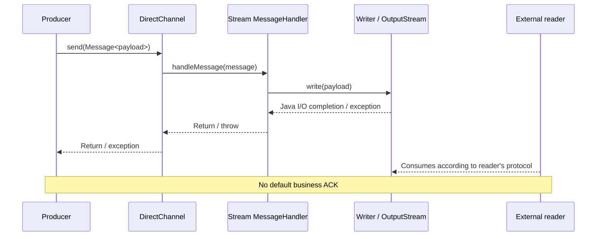

# Stream outbound channel adapter

## 1. Context: writing a Spring Message out to an I/O stream

In the **SPRING_INTEGRATION_ADAPTERS** module, Spring Integration connects external systems using inbound/outbound adapters, gateways, pollers, and `MessageChannel`. Learners practice exchanging data via files, SFTP, HTTP, JMS, AMQP, Kafka, and databases while also understanding message contracts, errors, and connection lifecycles. The **Adapter Stream** chapter provides a simpler option: turning the payload of a Spring message into content written to a Java `OutputStream` or `Writer`.

For example, an ingestion service receives an event from JMS, normalizes it into an NDJSON line, and writes it to **standard output** for another process to consume:

```text
JMS / HTTP / SFTP / Database
                |
                v
       Business event
                |
          Transformer
                |
      Spring Message<String>
                |
                v
       outboundChannel
                |
                v
 CharacterStreamWritingMessageHandler
                |
                v
          System.out
                |
        shell pipe / log collector
```

Another flow may send encoded bytes to a `ByteArrayOutputStream` in a test or an application-owned `OutputStream`. An **outbound stream adapter** is a one-way endpoint at the end of a flow: it receives messages from a channel and writes the payload to the destination stream, **without automatically generating a confirmation reply from the reading side**.

### Learning objectives

After this lesson, you will be able to:

1. Distinguish between `CharacterStreamWritingMessageHandler` and `ByteStreamWritingMessageHandler`.
2. Choose the right `String`/`char[]` or `byte[]` payload, and convert encoding explicitly.
3. Use `stdout()`, `stderr()`, `appendNewLine(true)`, and the XML stream namespace.
4. Configure Java/Spring Boot with `DirectChannel`, `@ServiceActivator`, or Integration DSL.
5. Explain why **outbound handlers do not require a poller** when consumers receive directly from a channel.
6. Manage `Writer`/`OutputStream`, buffering, flush, close, stream ownership, and concurrency.
7. Distinguish between **sending to a channel**, **writing at the Java layer**, **being consumed by the reader**, and **business commit**.
8. Design in-memory tests, error handling, retry/idempotency, security, and observability.

## 2. Outbound vs. inbound: reversing data direction

| Criterion | Stream inbound adapter | Stream outbound adapter |
| --- | --- | --- |
| Role | **Source** at the start of a flow | **Handler** at the end of a flow |
| Source/target | `InputStream` or `Reader` | `OutputStream` or `Writer` |
| Common APIs | `ByteStreamReadingMessageSource`, `CharacterStreamReadingMessageSource` | `ByteStreamWritingMessageHandler`, `CharacterStreamWritingMessageHandler` |
| Payload passing through channel | `byte[]` or `String` | `byte[]`, `String`, or types supported by the handler |
| Trigger mechanism | Poller calls `receive()` | Channel dispatch calls `handleMessage()` |
| EOF | Character inbound may need `StreamClosedEvent` | EOF is not an outbound trigger condition |
| Reply | None by default | None by default |

**Do not configure a poller just because the component name contains the word stream.** With `DirectChannel`, the outbound handler is invoked immediately when the producer sends a message. Only when a producer sends to a `QueueChannel` is a **consumer poller** or queue-receiving flow needed to fetch waiting messages; the poller does not belong to `ByteStreamWritingMessageHandler` or `CharacterStreamWritingMessageHandler` itself.



The diagram shows the data direction and responsibility boundaries. The reader may be a shell pipe, another Java program, a logging system, or a device; **no final step is automatically acknowledged by Spring Integration**.

## 3. Two outbound handlers and payload types

Spring Integration Stream provides two main `MessageHandler` implementations:

| Handler | Target object | Safe payload contract | Purpose |
| --- | --- | --- | --- |
| `CharacterStreamWritingMessageHandler` | `java.io.Writer` | `String` or `char[]` | Text, console, NDJSON/CSV lines |
| `ByteStreamWritingMessageHandler` | `java.io.OutputStream` | `byte[]` | Binary bytes, encoded data, binary protocols |

In **Spring Integration 6.5.x**, both classes belong to the **`org.springframework.integration.stream`** package. In **Spring Integration 7.x**, stream-writing handlers moved to the **`org.springframework.integration.stream.outbound`** package. **Do not mix 7.x imports with 6.5.x dependencies** when copying examples.

### 3.1. CharacterStreamWritingMessageHandler

Constructor:

```java
import java.io.Writer;
import org.springframework.integration.stream.CharacterStreamWritingMessageHandler;

Writer target = /* Writer provided by the application */;
CharacterStreamWritingMessageHandler handler =
        new CharacterStreamWritingMessageHandler(target);
handler.setShouldAppendNewLine(true);
```

`Writer` can be a `StringWriter`, `OutputStreamWriter`, `FileWriter`, or another writer managed by the application. The optional `bufferSize` parameter in the two-argument constructor is used for buffering.

Per the Javadoc, the handler can process `String`, `char[]`, and `byte[]`; for other objects, it relies on string representation. However, **you should not send arbitrary DTO/JSON objects and rely on `toString()`**: the representation can change, leak sensitive data, or violate the schema. Use a transformer to produce a `String` matching a concrete contract before sending.

### 3.2. ByteStreamWritingMessageHandler

Constructor:

```java
import java.io.OutputStream;
import org.springframework.integration.stream.ByteStreamWritingMessageHandler;

OutputStream target = /* OutputStream provided by the application */;
ByteStreamWritingMessageHandler handler =
        new ByteStreamWritingMessageHandler(target, 1024);
```

This handler writes **`byte[]`** to an `OutputStream`. If the source is a `String`, encode it beforehand with `getBytes(StandardCharsets.UTF_8)` or a transformer with an explicit charset. **Do not expect `ByteStreamWritingMessageHandler` to serialize a POJO, JSON, or `File` object automatically.**

`bufferSize=1024` in the constructor does not mean every message is always 1024 bytes, does not define framing, and **does not turn the stream into a durable queue**. `byte[]` payloads can vary in length; bytes are written across handler invocations.

### 3.3. Which handler to choose?

| Requirement | Recommended choice |
| --- | --- |
| Each event as a UTF-8 line on stdout | `CharacterStreamWritingMessageHandler.stdout("UTF-8")` |
| Write text error messages to stderr | `CharacterStreamWritingMessageHandler.stderr("UTF-8")` |
| Write to a `StringWriter` in a unit test | Character handler with `StringWriter` |
| Write encoded binary chunks | Byte handler with `OutputStream` |
| Write protobuf/CBOR/images | Serializer → `byte[]` → Byte handler |
| Read stdin, pipe, or files | **Inbound** adapter, not outbound |
| Write files with names, suffixes, atomic rename | File outbound adapter |
| Send data over a socket with framing/reconnect | TCP outbound adapter/gateway |

## 4. Newlines: one message is not necessarily one line

By default, `CharacterStreamWritingMessageHandler` **does not append a newline character** after each write. If a producer sends:

```text
{"id":"evt-1","state":"CREATED"}
{"id":"evt-2","state":"PAID"}
```

you only get two proper lines when the payloads already carry a delimiter or the handler is configured:

```java
CharacterStreamWritingMessageHandler handler =
        CharacterStreamWritingMessageHandler
                .stdout("UTF-8")
                .appendNewLine(true);
```

`appendNewLine(true)` is the fluent API equivalent to `setShouldAppendNewLine(true)` (available since Spring Integration 5.4).

### Pitfall when there is no delimiter

```text
payload 1 = "ORDER,1001,CREATED"
payload 2 = "ORDER,1002,PAID"

appendNewLine=false
  -> ORDER,1001,CREATEDORDER,1002,PAID

appendNewLine=true
  -> ORDER,1001,CREATED\n
     ORDER,1002,PAID\n
```

This is a **framing illustration**, not output from a real run. If the producer already appended `\n` to the payload and you also enable `appendNewLine(true)`, the stream can contain **blank lines**. Choose **a single place responsible for creating delimiters**.

### Platform-dependent newlines

`Writer` newline characters can depend on the platform; in many line-oriented systems, Unix uses LF while Windows often uses CRLF. If a reader requires **exact LF** regardless of OS, construct payloads with explicit `\n` and disable `appendNewLine`, or use a byte handler with explicit framing conventions.

### One line is not automatically a JSON record

With NDJSON, each record must serialize to **one JSON object on one line**; escape newlines inside string values. Never use a DTO's `Object.toString()` as JSON. If binary data contains `0x0A`, newline cannot be used as a generic delimiter without escaping/framing.

## 5. Stdout and stderr are two different targets

`CharacterStreamWritingMessageHandler` provides these factory methods:

| API | Target | Charset |
| --- | --- | --- |
| `stdout()` | `System.out` | Environment/factory default |
| `stdout("UTF-8")` | `System.out` | UTF-8 |
| `stderr()` | `System.err` | Default |
| `stderr("UTF-8")` | `System.err` | UTF-8 |

The two streams serve different purposes:

- **stdout**: finished data output for a shell pipeline or downstream reader program.
- **stderr**: diagnostics or operational errors; separate logging/masking rules apply.

Unix/Linux example:

```bash
java -jar integration-app.jar > orders.ndjson 2> errors.log
```

When stdout is a **structured data** channel, prevent the Spring Boot banner, `System.out.println` debug statements, or loggers from writing to stdout; they can interleave text between NDJSON records and break the reader's parser. Configure the logger to write to stderr or a dedicated channel, and consider disabling the banner for data-piping processes.

### stdout/stderr is not a queue with ACK

The operating system can redirect a standard stream to a file or pipe; the handler does not know whether a downstream program has parsed and committed the data. `System.out` can be closed by the reader, or the stream can fail during output; error-handling behavior also depends on the underlying Java writer/print stream class.

**Do not close `System.out` or `System.err` from a handler running in the shared JVM**, because many other components still use them. For application-opened file/network streams, define explicit lifecycle/ownership.

## 6. Complete Spring Boot example: writing to two text channels

The following example uses **Java 17+**, Spring Boot, and Spring Integration 6.5.x. A Spring flow sends business events to stdout and error lines to stderr. Both use `DirectChannel` and **do not use a poller**.

### 6.1. Maven dependencies

```xml
<dependencies>
    <dependency>
        <groupId>org.springframework.boot</groupId>
        <artifactId>spring-boot-starter-integration</artifactId>
    </dependency>
    <dependency>
        <groupId>org.springframework.integration</groupId>
        <artifactId>spring-integration-stream</artifactId>
    </dependency>
</dependencies>
```

When using the Spring Boot BOM, dependency versions must be managed consistently. Without a BOM, select compatible Spring Integration Core/Stream versions. Do not merely switch package imports to 7.x in an application still using 6.5.x.

### 6.2. Java configuration and producer

```java
import org.springframework.beans.factory.annotation.Qualifier;
import org.springframework.boot.ApplicationRunner;
import org.springframework.boot.SpringApplication;
import org.springframework.boot.autoconfigure.SpringBootApplication;
import org.springframework.context.annotation.Bean;
import org.springframework.integration.annotation.ServiceActivator;
import org.springframework.integration.channel.DirectChannel;
import org.springframework.integration.config.EnableIntegration;
import org.springframework.integration.stream.CharacterStreamWritingMessageHandler;
import org.springframework.messaging.MessageChannel;
import org.springframework.messaging.support.MessageBuilder;

@SpringBootApplication
@EnableIntegration
public class StreamOutboundApplication {

    public static void main(String[] args) {
        SpringApplication.run(StreamOutboundApplication.class, args);
    }

    @Bean
    public MessageChannel businessOutputChannel() {
        return new DirectChannel();
    }

    @Bean
    public MessageChannel diagnosticsOutputChannel() {
        return new DirectChannel();
    }

    @Bean
    @ServiceActivator(inputChannel = "businessOutputChannel")
    public CharacterStreamWritingMessageHandler writeToStdout() {
        return CharacterStreamWritingMessageHandler
                .stdout("UTF-8")
                .appendNewLine(true);
    }

    @Bean
    @ServiceActivator(inputChannel = "diagnosticsOutputChannel")
    public CharacterStreamWritingMessageHandler writeToStderr() {
        return CharacterStreamWritingMessageHandler
                .stderr("UTF-8")
                .appendNewLine(true);
    }

    @Bean
    public ApplicationRunner publishDemo(
            @Qualifier("businessOutputChannel") MessageChannel business,
            @Qualifier("diagnosticsOutputChannel") MessageChannel diagnostics) {

        return args -> {
            boolean first = business.send(
                    MessageBuilder.withPayload(
                        "{\"eventId\":\"evt-1\",\"state\":\"CREATED\"}"
                    ).build()
            );
            boolean second = business.send(
                    MessageBuilder.withPayload(
                        "{\"eventId\":\"evt-2\",\"state\":\"PAID\"}"
                    ).build()
            );
            boolean error = diagnostics.send(
                    MessageBuilder.withPayload(
                        "WARN: input record has invalid status"
                    ).build()
            );

            if (!(first && second && error)) {
                throw new IllegalStateException(
                        "One outbound channel rejected a message"
                );
            }
        };
    }
}
```

### 6.3. Flow explanation

1. `ApplicationRunner` creates `Message<String>` instances with `MessageBuilder`.
2. `businessOutputChannel` routes text to `writeToStdout()`.
3. `diagnosticsOutputChannel` routes diagnostic messages to `writeToStderr()`.
4. `CharacterStreamWritingMessageHandler` writes payloads using the configured encoding.
5. `appendNewLine(true)` adds a delimiter after each message.
6. `DirectChannel` dispatches synchronously; the handler can throw an exception on write failure, but that **does not produce a downstream ACK**.

**There is only one `@SpringBootApplication` Java component in the main example.** Place the Java file in an appropriate package, with Java 17+ installed and Spring Boot/Spring Integration libraries available. You must build the application yourself and run the resulting JAR; this Knowledge article **has not executed the program**.

### 6.4. Expected output

On stdout, aside from logs/banners if not separated by configuration, the expected **NDJSON** payloads are:

```text
{"eventId":"evt-1","state":"CREATED"}
{"eventId":"evt-2","state":"PAID"}
```

On stderr:

```text
WARN: input record has invalid status
```

**This is the expected output**, not an actual runtime log. If you want stdout to contain only the two JSON lines, configure logging/banner/diagnostics not to write to stdout and avoid calling `System.out.println` from other beans.

## 7. Terminal-independent: writing to a custom Writer

In tests, `StringWriter` lets you inspect text output without touching `System.out`:

```java
import java.io.StringWriter;

import org.springframework.integration.stream.CharacterStreamWritingMessageHandler;
import org.springframework.messaging.support.MessageBuilder;

StringWriter buffer = new StringWriter();
CharacterStreamWritingMessageHandler writer =
        new CharacterStreamWritingMessageHandler(buffer);
writer.setShouldAppendNewLine(true);

writer.handleMessage(
        MessageBuilder.withPayload("ALPHA").build()
);
writer.handleMessage(
        MessageBuilder.withPayload("BETA").build()
);

String result = buffer.toString();
```

This is an **illustrative test snippet** calling the handler directly; when placing it in a JUnit/Spring test, initialize lifecycle according to the `AbstractMessageHandler` contract and assert results **after the writer has been flushed**. Do not test raw `System.out` by replacing the global JVM stream when other tests run in parallel.

### If you need to wire to a channel instead of calling the handler directly

```java
@Bean
public MessageChannel textOut() {
    return new DirectChannel();
}

@Bean
@ServiceActivator(inputChannel = "textOut")
public CharacterStreamWritingMessageHandler sink(StringWriter target) {
    return new CharacterStreamWritingMessageHandler(target)
            .appendNewLine(true);
}
```

The snippet above is a **configuration fragment**, assuming a `StringWriter target` bean is already provided. Place it in a separate `@Configuration` so it does not create a competing consumer alongside the main example's stdout handler.

## 8. byte[] example: do not turn binary into text

If the source already has `byte[]` from a serializer, you can write it directly through `ByteStreamWritingMessageHandler`.

### 8.1. Dedicated Java configuration for byte data

This is an **alternative approach** independent of stdout text. In a Spring Boot test, use `ByteArrayOutputStream`:

```java
import java.io.ByteArrayOutputStream;
import org.springframework.beans.factory.annotation.Qualifier;
import org.springframework.context.annotation.Bean;
import org.springframework.context.annotation.Configuration;
import org.springframework.integration.annotation.ServiceActivator;
import org.springframework.integration.channel.DirectChannel;
import org.springframework.integration.config.EnableIntegration;
import org.springframework.integration.stream.ByteStreamWritingMessageHandler;
import org.springframework.messaging.MessageChannel;

@Configuration
@EnableIntegration
public class BinaryStreamOutboundConfig {

    @Bean
    public MessageChannel binaryOutputChannel() {
        return new DirectChannel();
    }

    @Bean
    public ByteArrayOutputStream binaryCaptureStream() {
        return new ByteArrayOutputStream();
    }

    @Bean
    @ServiceActivator(inputChannel = "binaryOutputChannel")
    public ByteStreamWritingMessageHandler binaryWriter(
            @Qualifier("binaryCaptureStream")
            ByteArrayOutputStream target) {
        return new ByteStreamWritingMessageHandler(target, 1024);
    }
}
```

### 8.2. Producer sending bytes

```java
import org.springframework.messaging.support.MessageBuilder;

byte[] first = new byte[] {0x01, 0x02, 0x03};
byte[] second = new byte[] {0x04, 0x05};

binaryOutputChannel.send(
        MessageBuilder.withPayload(first).build()
);
binaryOutputChannel.send(
        MessageBuilder.withPayload(second).build()
);
```

This is a **producer snippet**: the `binaryOutputChannel` variable is the `MessageChannel` bean from the configuration above. Once data is fully written/flushed to `ByteArrayOutputStream` with no interleaved writes, the expected bytes are `01 02 03 04 05`, **with no automatic delimiter**, length prefix, or newline character.

### 8.3. Binary analysis

| Concern | What to understand |
| --- | --- |
| `byte[]` payload | Preserves exact byte contents per the encoder contract |
| Two sends | Does not create two "records" in the stream if the reader has no framing |
| `bufferSize` | I/O write buffer, not bytes per message |
| `OutputStream.flush()` | Can matter to push data through buffer layers; does not guarantee disk fsync |
| `ByteArrayOutputStream` | In-memory test sink, not durable across JVM stops |
| Concurrent consumers | Must control ordering and boundaries across writes |

**Do not convert binary to `String` to call `CharacterStreamWritingMessageHandler`** unless the protocol specifies a text encoding such as Base64/hex. Applying an arbitrary charset can alter bytes or corrupt data.

## 9. Charset and payload conversion

`CharacterStreamWritingMessageHandler.stdout("UTF-8")` selects the charset when creating the writer over standard output. If the target is an externally supplied `Writer`, its charset (if applicable) was already decided **when the writer was created** and cannot be overridden by an arbitrary Spring `charset` header.

### Text → bytes

```java
import java.nio.charset.StandardCharsets;
import org.springframework.messaging.support.MessageBuilder;

String line = "{\"eventId\":\"evt-42\",\"status\":\"PAID\"}\n";
byte[] utf8 = line.getBytes(StandardCharsets.UTF_8);

binaryOutputChannel.send(
        MessageBuilder.withPayload(utf8).build()
);
```

This snippet is valid for the byte handler because the producer explicitly UTF-8 encoded the string. It does not require the handler to understand JSON.

### Bytes → text

If the producer holds a byte array while the target requires text, decode it using the right charset:

```java
import java.nio.charset.StandardCharsets;

byte[] payload = /* bytes verified to be UTF-8 */;
String text = new String(payload, StandardCharsets.UTF_8);
```

This is an illustrative snippet; you must validate input data and handle malformed encoding. Do not decode chunk by chunk when a UTF-8 character might be split across chunks; use a stateful decoder or reassembler.

### Why avoid the default charset?

| Environment | Risk |
| --- | --- |
| Developer laptop | Terminal and JVM may use different settings |
| Linux container | Locale/JVM options differ from local machines |
| Windows PowerShell | Console, redirection, and pipe encodings can differ |
| Process-to-process integration | The reader may mandate UTF-8 or a custom binary format |

In machine-to-machine communication, specify the **charset in the contract**—for example UTF-8 + LF + NDJSON + schema version—so all parties parse consistently.

## 10. XML namespace: stdout and stderr channel adapters

Spring Integration supports the `int-stream` namespace to declare stdout/stderr outbound adapters:

```xml
<?xml version="1.0" encoding="UTF-8"?>
<beans:beans
    xmlns:beans="http://www.springframework.org/schema/beans"
    xmlns:xsi="http://www.w3.org/2001/XMLSchema-instance"
    xmlns:int="http://www.springframework.org/schema/integration"
    xmlns:int-stream="http://www.springframework.org/schema/integration/stream"
    xsi:schemaLocation="
        http://www.springframework.org/schema/beans
        https://www.springframework.org/schema/beans/spring-beans.xsd
        http://www.springframework.org/schema/integration
        https://www.springframework.org/schema/integration/spring-integration.xsd
        http://www.springframework.org/schema/integration/stream
        https://www.springframework.org/schema/integration/stream/spring-integration-stream.xsd">

    <int:channel id="stdoutEvents"/>
    <int:channel id="stderrEvents"/>

    <int-stream:stdout-channel-adapter
        id="stdoutWriter"
        channel="stdoutEvents"
        charset="UTF-8"
        append-newline="true"/>

    <int-stream:stderr-channel-adapter
        id="stderrWriter"
        channel="stderrEvents"
        charset="UTF-8"/>

    <!-- Producers/routers send String payloads to these channels. -->
</beans:beans>
```

This is the **XML alternative to the Java configuration** in section 6. The XML does not yet include an actual producer; an upstream `MessageHandler` or gateway must send to the two channels. If using both Java and XML in the same context with two consumers subscribed to the same channel, check dispatch semantics; do not let output become inconsistent.

### Common attributes

| Attribute | Meaning |
| --- | --- |
| `channel` | Spring channel that the outbound adapter subscribes to |
| `charset` | Charset for the stdout/stderr writer |
| `append-newline` | Whether to append a newline after each message |
| `id` | Bean/endpoint ID for lifecycle and observability |

The Spring Integration 6.5 Reference gives explicit examples for `stdout-channel-adapter` with `charset` and `append-newline`, and `stderr-channel-adapter` for stderr.

### XML with a custom OutputStream

If the destination is not stdout/stderr, declare a handler bean and an `int:outbound-channel-adapter` referencing it:

```xml
<!-- outputStream is an OutputStream bean managed by the application. -->
<beans:bean id="binaryWritingHandler"
            class="org.springframework.integration.stream.ByteStreamWritingMessageHandler">
    <beans:constructor-arg ref="outputStream"/>
    <beans:constructor-arg value="1024"/>
</beans:bean>

<int:channel id="binaryEvents"/>

<int:outbound-channel-adapter
    id="binaryStreamAdapter"
    channel="binaryEvents"
    ref="binaryWritingHandler"/>
```

The second snippet is a **configuration fragment**, not standalone XML: you must declare the `outputStream` bean and a `byte[]` producer separately. For targets with complex lifecycles, Java configuration usually expresses resource ownership and cleanup more clearly.

## 11. Integration Java DSL: concise alternative configuration

`@ServiceActivator` is not mandatory; since the handler implements `MessageHandler`, it can be plugged into Integration DSL:

```java
import org.springframework.context.annotation.Bean;
import org.springframework.context.annotation.Configuration;
import org.springframework.integration.config.EnableIntegration;
import org.springframework.integration.dsl.IntegrationFlow;
import org.springframework.integration.stream.CharacterStreamWritingMessageHandler;

@Configuration
@EnableIntegration
public class StdoutDslConfig {

    @Bean
    public IntegrationFlow stdoutFlow() {
        return IntegrationFlow
                .from("textOutboundInput")
                .handle(
                    CharacterStreamWritingMessageHandler
                        .stdout("UTF-8")
                        .appendNewLine(true)
                )
                .get();
    }
}
```

This is an **alternative configuration style** to section 6's Java config; deploy only one handler responsible for writing stdout for the same flow. If `textOutboundInput` does not exist yet, Java DSL may register a default channel depending on context, though managing channel/producer names explicitly is better in larger applications.

**Do not declare a poller in a flow that only uses `DirectChannel` to pass messages to an outbound handler.** Only when the input is a `PollableChannel` does the consuming side need a poller per DSL/framework mechanics.

## 12. Buffering, flush, and content visibility

Writing to a stream can pass through multiple layers:

```text
Message payload
      |
      v
WritingMessageHandler
      |
 Java BufferedWriter / BufferedOutputStream
      |
 OS kernel buffer / pipe / filesystem
      |
 Reader process or device
```

### Buffer size is not batch size

The constructor `(Writer, int bufferSize)` or `(OutputStream, int bufferSize)` configures I/O-level buffering. It does **not** mean:

- The handler waits for `N` Spring messages before writing.
- Each message is automatically padded/sliced into exact `N`-byte records.
- A message is atomically committed once the buffer is full.
- Flushing means data has been durably written to disk.

Flush behavior can depend on **the underlying stream/writer classes and how the handler writes in the running version**. Test with a real target sink in your environment; do not treat `channel.send()` returning `true` as proof that the remote reader received the data.

### Flush and durability are different

| Event | Maximum conclusion you can draw |
| --- | --- |
| Producer creates `Message<?>` | Event exists in memory |
| `DirectChannel.send()` succeeds | Message was dispatched per channel semantics |
| Handler calls `write(...)` without error | Java write call completed within the wrapper |
| `flush()` succeeds | Data was pushed through some writer buffer layers |
| Reader reads bytes | Reading side received bytes |
| Reader sends business ACK | Can confirm processing per contract |
| Database fsync/transaction commit | Durability from the storage system, not from the stream handler |

For files requiring **atomic visibility**, choose the File outbound adapter + temporary suffix/rename or `Files.move(ATOMIC_MOVE)` when supported by the filesystem. Stream outbound does not package records into atomically published files.

### Broken pipe and stream-closing scenarios

If the pipe-receiving process terminates early, a write operation may:

- Throw `IOException` (in the corresponding writer/stream class).
- Be buffered and only report the error on flush/close.
- Be masked/flagged as an error state according to `PrintStream` behavior.

**Test with an actually closed sink or a reader disconnecting mid-stream.** Do not claim that every stdout/stderr failure always becomes a Spring `MessagingException` or always surfaces immediately in the producer.

## 13. Concurrency: multiple producers writing to one stream

`DirectChannel` invokes the handler on the sending thread. If multiple threads send to the channel concurrently, you must define **serialization/ordering**, especially if multiple channels/handlers write to one `Writer`:

```text
Thread A -> Message "BEGIN-A\n"
Thread B -> Message "BEGIN-B\n"
Thread A -> Message "END-A\n"
Thread B -> Message "END-B\n"
```

Even without corrupting individual characters, **record order** may not match business event order. If two components own two separate writers both wrapping `System.out`, output can interleave.

### Recommended rules

1. Use **a single write owner** per destination stream or enforce explicit synchronization/serialization.
2. If ordering by `orderId`/`tenantId` is needed, use an appropriate dispatcher/partition key; `ExecutorChannel` can reorder messages.
3. Choose buffer/queue bounds and how to react when downstream is slow.
4. Do not write one transaction across multiple messages and assume it is an atomic record.
5. Stop producers first, let handlers finish, and only then flush/close application-owned destinations.

### Writing multiple messages does not create a transaction

Two `send()` calls can cause downstream to see one message even if the second fails. If two events must commit together, use an acknowledged protocol/transaction at the destination layer rather than just the Stream outbound adapter.

## 14. Error handling: distinguishing synchronous and asynchronous paths

Stream write errors can stem from invalid payloads, closed writers/streams, broken pipes, full filesystems, or consumers lacking capacity.

| Scenario | Symptom | Handling approach |
| --- | --- | --- |
| Sending `String` to byte handler | Payload contract violation | Transform to `byte[]` |
| Incompatible charset | Corrupted/replacement characters | Consistent UTF-8, encoding validation |
| Destination stream already closed | `IOException` or error on flush | Recreate resource per lifecycle |
| Receiving pipe terminated | Broken pipe/IO error | Stop producer or controlled fallback |
| Disk full/quota exceeded | Write/flush failure | Health/alert, no infinite retry |
| Slow writer/consumer | Send thread blocked/backlog | Bounded queue, backpressure |
| Two handlers writing one stream | Interleaved content | Single owner, serialize |
| Retry after mid-record failure | Can produce partial duplicates | Framing + receiver idempotency |
| stdout mixed with logs | Invalid NDJSON | Separate logging from data stream |

### With DirectChannel

When a producer sends to a `DirectChannel`, execution typically happens **synchronously on the producer thread**. Exceptions from the handler can propagate back to the sender via Spring Messaging mechanics; handle them at the caller or via configured advice/error strategies. **Do not assume all synchronous errors are automatically sent to the global `errorChannel`.**

### With ExecutorChannel/QueueChannel

When writing is handed off to another thread or queue, errors may route through **`ErrorMessage`/`errorChannel` depending on the endpoint, scheduler, and framework configuration**. A producer may already receive `send=true` before the handler actually calls `write(...)`. Write integration tests to verify exact semantics.

### Error channel is not a reader ACK

An `ErrorMessage` represents an exception in the Spring processing path; it does not cover whether the reader parsed successfully or committed to a database. To confirm processing, you need a **separate business ACK** with event ID and correlation.

## 15. Retries, data loss, and partial duplicates

A stream writer is an endpoint **with side effects**: once a write has pushed some bytes and then fails, it generally cannot be "undone".

```text
eventId=evt-42
  -> write 20 bytes
  -> pipe breaks / exception
  -> retry same event

Reader may have received:
  prefix(evt-42) + full(evt-42)
```

Therefore:

- Do not automatically retry `write()` indefinitely when you do not know how much already went out on the stream.
- For text, design **explicit framing** (for example, one NDJSON object per line).
- For binary, use length prefixes, checksums, and event IDs or an equivalent protocol.
- Keep **event IDs stable across retries**, with idempotent consumer processing.
- For critical data, persist source events in a durable outbox/broker before writing to the stream.
- When the reader can return ACKs, use a separate confirmation channel; one-way standard output **provides no ACK**.
- If stdout only serves best-effort telemetry, you can drop per an explicit policy instead of building a complex ACK system.

### Specific files vs. the file outbound adapter

You can wrap a file in a `FileOutputStream` and send bytes through Stream outbound. But when the application needs to:

- Create new files named from `FileHeaders.FILENAME`.
- Write into a directory following a `FileExistsMode` policy.
- Use a temporary suffix and rename/publish atomically.
- Manage each file as a business unit.

then the **File outbound channel adapter/gateway** is a better fit. The stream adapter only knows **one already-provided `OutputStream`/`Writer`**.

## 16. Resource lifecycle: who closes the OutputStream?

A `Writer`/`OutputStream` can be:

- `System.out` / `System.err`: JVM-wide resources.
- `ByteArrayOutputStream` / `StringWriter`: in-memory buffers.
- `FileOutputStream`: file descriptors.
- Pipe/socket outputs supplied by a library or infrastructure.

### Ownership rules

| Resource | Who should own it? | Note |
| --- | --- | --- |
| `System.out`/`System.err` | JVM/runtime | Do not close from a handler |
| Stream opened by `@Bean` | Application context/bean lifecycle | Plan flush/close on stop |
| `ByteArrayOutputStream`/`StringWriter` | Test or application | Not durable, easy to snapshot |
| Socket output | Connection manager | Needs timeouts/reconnect; avoid reusing stale streams |
| Output file | Application resource manager | Flush/close, handle crashes/atomic publication |

The handler is not necessarily responsible for closing every stream; check the Javadoc/lifecycle of the version in use, the constructor, and the wrapped stream class. **Do not call `close()` multiple times from uncoordinated beans.**

### Recommended shutdown sequence

```text
1. Stop accepting new events
2. Stop producer/dispatcher
3. Drain pending messages with a time limit
4. Wait for handler write/flush to finish per policy
5. Close application-owned resources
6. Record error/timeout metrics and terminate
```

If the process is killed abruptly or loses power, none of the steps above are guaranteed to run. For zero-data-loss requirements, you need **durable storage upstream of the stream writer**.

## 17. Testing: in-memory, console, and failure cases

You do not need a real JMS/SFTP/Kafka broker to test stream handlers on their own. You can use `StringWriter` and `ByteArrayOutputStream` at the unit/integration level.

### 17.1. Testing characters and newlines

Create a `StringWriter`, send two `Message<String>` items through a character handler with `appendNewLine(true)` enabled, and verify the string after handling/flushing contains **two separated records**. Repeat with `appendNewLine(false)` to observe the two payloads concatenated directly.

### 17.2. Testing binary payloads

With `ByteArrayOutputStream`:

```java
byte[] bytes = new byte[] {0x10, 0x11, 0x12};
ByteStreamWritingMessageHandler handler =
        new ByteStreamWritingMessageHandler(output);

handler.handleMessage(
        MessageBuilder.withPayload(bytes).build()
);
```

`output` is a `ByteArrayOutputStream` created in the test. Place this snippet inside a test class with proper imports and lifecycle; read `output.toByteArray()` **after the handler finishes and any required buffers are flushed**. The expected bytes correspond to `10 11 12` in hex. This is not a test that was executed in this article.

### 17.3. Testing write failures

Create a test `OutputStream` that throws `IOException` after accepting a few bytes:

```java
import java.io.IOException;
import java.io.OutputStream;

public class FailingOutputStream extends OutputStream {

    private int remaining = 2;

    @Override
    public void write(int value) throws IOException {
        if (remaining-- <= 0) {
            throw new IOException("Simulated sink failure");
        }
    }
}
```

`FailingOutputStream` is a test fixture you can save as a separate file when implementing JUnit tests. It simulates a **partial write**: the first two bytes can be accepted before the exception is thrown.

When wiring this fixture into the byte handler, verify the exact Spring Messaging exception type observed by the producer in **the actual channel configuration**. Do not hard-code a single assumed exception type; the framework and wrappers may vary it.

### 17.4. Testing concurrency and ordering

- Send 100 messages concurrently from multiple threads to the same channel; verify all records appear and inspect their order.
- Enable `ExecutorChannel` and compare with `DirectChannel` regarding ordering and which thread surfaces errors.
- Add a bounded queue and a slow consumer; record `send` latency or queue depth.
- Shut down the application while 10 messages are still pending, and verify the drain/drop policy.

### 17.5. Testing stdout/stderr pipes

- Run a test build on Unix/Linux with redirection to a file; verify stdout contains only valid NDJSON.
- Close the reader side of the pipe early; observe the runtime's broken pipe/flush behavior.
- Compare UTF-8 with other charsets using accented Vietnamese text and emoji.
- Never send real secrets to stdout/stderr during tests.

## 18. Observability and security

### Metrics to observe

| Suggested metric | Meaning | Limitation |
| --- | --- | --- |
| `stream_outbound_messages_total` | Number of Spring messages passing through the handler | Does not mean the reader processed them |
| `stream_outbound_bytes_total` | Estimated bytes actually requested for writing | Needs consistent counting across retries |
| `stream_outbound_write_errors_total` | Errors during write/flush | Some `PrintStream` errors are reported differently |
| `stream_outbound_queue_depth` | Backlog when using a bounded queue | Not applicable with `DirectChannel` alone |
| `stream_outbound_processing_seconds` | Latency from dispatch to handler completion | Does not measure receiver ACK |
| `stream_outbound_retries_total` | Retries after failure | Need to classify retry-safe vs. uncertain |
| `stream_outbound_dropped_total` | Messages dropped per policy | Must have audit/alerting |

These are **application-suggested metric names**, not all emitted automatically by Spring Integration.

### Output security

1. **Do not log secrets:** payloads may contain tokens, customer details, or internal paths.
2. **Keep data/log boundaries clean:** stdout used for machine-to-machine protocols must stay clean, while stderr holds controlled logs.
3. **Validate data before writing:** JSON/CSV/schema, size, newline injection, and inappropriate content.
4. **Escape contextually:** terminal control codes/ANSI escapes from untrusted input can manipulate display/logs.
5. **Limit rate and size:** a producer can fill up a pipe, disk, or RAM.
6. **Manage file/pipe permissions:** never write private data to a public destination.
7. **Never execute commands automatically:** stream payloads are always data, never shell commands.
8. **Do not dump raw binary bytes** into logs unless strictly required and backed by retention/access controls.
9. **Use TLS on an appropriate network protocol:** the stream adapter does not add TLS onto an `OutputStream`.
10. **Audit failure states:** distinguish accepted into channel, written in Java, ACKed, and committed.

## 19. When should you NOT use stream outbound?

| Requirement | More suitable adapter/tool |
| --- | --- |
| Write files by name/temp suffix/rename | File outbound adapter |
| Upload files to SFTP/FTP/SMB | Remote file outbound adapter |
| Send HTTP requests and expect response/status | HTTP outbound gateway |
| Send to a queue with ACK/transactions | JMS or AMQP outbound |
| Publish events to a topic with partitions/offsets | Kafka outbound |
| TCP communication needing framing/reconnect | TCP adapter/gateway |
| Write data to a database | JDBC outbound adapter/gateway |
| Structured logging with rotation and retention | Appropriate logging framework/appender |
| Pipe text for CLIs and scripts | **Stream outbound** |
| Write bytes into a stream provided by another Java SDK | **Stream outbound byte** |

Stream outbound is a good fit when the destination is genuinely represented as an **`OutputStream` or `Writer`**, not when you merely want a generic name for Kafka Streams, Java `Stream<T>`, or another system's streaming API.

## 20. Troubleshooting

| Symptom | Possible cause | Remediation |
| --- | --- | --- |
| `ByteStreamWritingMessageHandler` throws type error | Sending `String`/POJO instead of `byte[]` | Encode via charset/serializer |
| Java imports fail to compile | Using SI 7.x `.stream.outbound` package with SI 6.5 | Fix imports to match version |
| Two messages appear concatenated | `appendNewLine=false` or payload lacks delimiter | Enable newline or add delimiter in one place |
| Extra blank lines | Payload contains `\n` and handler also appends newline | Create delimiter only once |
| Emoji/Vietnamese accents corrupted | Writer charset differs from consumer | Use UTF-8 end-to-end |
| stdout NDJSON fails to parse | Logs/banner mixed into data stream | Route logs to stderr, disable banner |
| stderr has no line breaks | Append newline not enabled / payload lacks newline | Configure delimiter |
| No data appears in file/pipe immediately | Buffer not flushed, slow/closed sink | Check writer, flush/lifecycle, reader |
| `channel.send()` returns true but receiver sees nothing | No ACK; async buffering or reader hasn't read yet | Measure end-to-end, correlation |
| Duplicates after retry | Partial write, resending same message | Framing/event ID/idempotency |
| Consumer blocks | Slow pipe or writer, synchronous `DirectChannel` | Backpressure/bounded queue/timeout |
| Interleaved data | Multiple threads/handlers writing to one stream | Assign a single writer owner, serialize |
| Exception missing from `errorChannel` | Error on sync caller path or masked by `PrintStream` | Check routing/error strategy/runtime |
| App closes stdout unexpectedly | A bean explicitly closed the standard stream | Never close `System.out`/`System.err` |
| File has incomplete data on crash | Stream has no atomic publication | File outbound temporary suffix/rename |
| Out of memory | Unbounded queue, slow writer | Bounded buffer and admission control |

### Quick diagnostic workflow

1. Check that the channel has a consumer handler and the producer sends to the right channel.
2. Check that the payload type matches the handler contract.
3. Check newlines, charset, and framing.
4. Check that the target stream is open/managed properly by lifecycle and whether the reader already closed.
5. Check threads, `DirectChannel`/`ExecutorChannel`/`QueueChannel`, and where exceptions arise.
6. Check whether a logger/banner or another writer is interleaving into the output.
7. If reliability is required, verify event IDs, retry state, queues, and business ACKs.

## 21. Practice exercises

1. **Stdout:** write an application that creates two Spring `Message<String>` items and sends them through `stdout("UTF-8")`.
2. **Newline:** measure output with `appendNewLine(false)` and `appendNewLine(true)`.
3. **Stderr:** route validation errors to a separate stderr channel to avoid mixing them into NDJSON data.
4. **Charset:** output a line with accented Vietnamese text and emoji in UTF-8, and read it back as UTF-8.
5. **StringWriter:** replace stdout with `StringWriter` and verify both messages are written per contract.
6. **ByteArrayOutputStream:** send 3 bytes then 2 bytes through the byte handler; inspect the bytes after flush.
7. **Wrong payload:** send a `String` into the byte handler; verify the error in a flow test.
8. **Serializer:** convert a DTO into JSON text before the character handler.
9. **NDJSON:** emit ten events, one per line, with no logs or banners interleaved.
10. **Binary framing:** design a length-prefix header before each `byte[]` so the reader can distinguish records.
11. **Partial write:** use `FailingOutputStream` and determine which bytes escaped before the exception.
12. **Retry:** resend an event with the same `eventId` after failure; design an idempotent consumer.
13. **Concurrency:** have two producers write to stdout simultaneously; measure ordering and interleaving.
14. **Backpressure:** replace `DirectChannel` with a bounded queue and make the writer slow.
15. **ErrorChannel:** compare the exception seen by the caller on `DirectChannel` with the `ErrorMessage` in an async flow.
16. **Shutdown:** send multiple messages and then stop the application; verify the drain/flush/close order.
17. **Security:** inject a payload containing ANSI escape/control characters and design a sanitizer.
18. **Adapter choice:** explain why SFTP uploads should use the SFTP outbound adapter instead of a plain stream writer.

### Self-check questions

**Q1. What are the two main Spring Integration stream outbound handlers?**  
`ByteStreamWritingMessageHandler` and `CharacterStreamWritingMessageHandler`.

**Q2. What is the safe payload type for `ByteStreamWritingMessageHandler`?**  
`byte[]` encoded/serialized according to the contract.

**Q3. Which factory methods exist for a handler writing text to stdout?**  
`CharacterStreamWritingMessageHandler.stdout()` or `stdout("UTF-8")`.

**Q4. What is the default value of `appendNewLine`?**  
`false`; if you want each message on its own line, add a delimiter explicitly.

**Q5. Does an outbound stream handler strictly require a poller?**  
No. With `DirectChannel` it is invoked when the producer sends a message; a poller only applies when the upstream flow uses a `PollableChannel` or a polling source.

**Q6. Does `bufferSize=1024` mean each message is 1024 bytes?**  
No. That is an I/O buffer setting, not message framing.

**Q7. Why might a byte payload not represent a single record?**  
Because a stream is a continuous sequence of bytes; you need framing/delimiters/length prefixes.

**Q8. Should you send a POJO to the character handler and rely on `toString()`?**  
No, if schema, compatibility, and security matter; serialize explicitly.

**Q9. Does `channel.send()` returning `true` mean the reader committed to the database?**  
No. There is no default business ACK.

**Q10. When should you use the File outbound adapter instead of stream outbound?**  
When you need filenames, file-existence control, temporary suffixes, and atomic publication.

**Q11. What should you do when retries risk partial duplicate writes?**  
Use framing, event IDs, state persistence, and idempotent consumers; distinguish uncertain outcomes.

**Q12. Should you close `System.out` from a stream handler?**  
No. It is a JVM-wide stream that other components may still be using.

## 22. Takeaways

The **stream outbound channel adapter** turns a **Spring `Message<?>` payload** into data written to a `Writer` or `OutputStream`. `CharacterStreamWritingMessageHandler` fits text/stdout/stderr and offers `appendNewLine(true)`, while `ByteStreamWritingMessageHandler` is meant for `byte[]`. In Spring Integration **6.5**, both classes live in `org.springframework.integration.stream`; use the package matching your dependency version.

Unlike an inbound `MessageSource`, an outbound handler **does not need a poller** when receiving from a `DirectChannel`. However, you must still manage **charset, delimiters/framing, buffering/flush, concurrency, lifecycle, and write failures**. Success on a channel send or Java write does not confirm that the reader processed the data; for critical data, you need an ACK contract, event IDs, controlled retries, and idempotency. When the target requires managing files, SFTP, TCP, HTTP, or brokers, pick the specialized adapter instead of trying to layer full reliability semantics onto a one-way stream.

### References

- [Spring Integration Reference 6.5 — Stream Support](https://docs.spring.io/spring-integration/reference/6.5/stream.html)
- [Spring Integration API 6.5 — CharacterStreamWritingMessageHandler](https://docs.spring.io/spring-integration/docs/6.5.0/api/org/springframework/integration/stream/CharacterStreamWritingMessageHandler.html)
- [Spring Integration API 6.5 — ByteStreamWritingMessageHandler](https://docs.spring.io/spring-integration/docs/6.5.0/api/org/springframework/integration/stream/ByteStreamWritingMessageHandler.html)
- [Spring Integration Reference — Channel Adapter](https://docs.spring.io/spring-integration/reference/channel-adapter.html)
- [Spring Integration Reference — Java DSL](https://docs.spring.io/spring-integration/reference/dsl.html)
- [Spring Integration API 6.5 — Stream Package](https://docs.spring.io/spring-integration/docs/6.5.0/api/org/springframework/integration/stream/package-summary.html)
- [Java SE 17 — OutputStream](https://docs.oracle.com/en/java/javase/17/docs/api/java.base/java/io/OutputStream.html)
- [Java SE 17 — Writer](https://docs.oracle.com/en/java/javase/17/docs/api/java.base/java/io/Writer.html)
