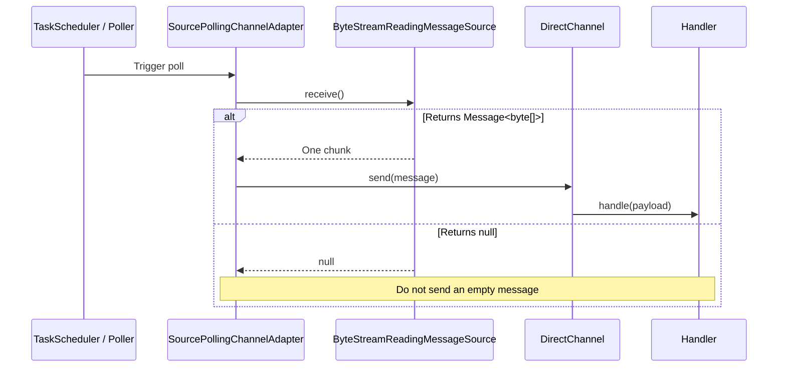

# InputStream as a message source

## 1. Problem: from a byte stream to a Spring Message

In the **SPRING_INTEGRATION_ADAPTERS** module, Spring Integration connects external systems using inbound/outbound adapters, gateways, pollers, and `MessageChannel`. Flows can exchange data with files, SFTP, HTTP, JMS, AMQP, Kafka, and databases; when designing them, you must consider **message contracts, errors, reliability, and connection lifecycles**. In the **Adapter Stream** chapter, this lesson focuses on one concrete idea: using **`java.io.InputStream` as a source for creating Spring messages**.

Suppose a Java SDK hands the application an `InputStream` containing binary data from a device export record. The application wants to read bytes incrementally, bring them into Spring Integration, then identify frames, validate them, and write events to a database or broker:

```text
        Java SDK / file / pipe / InputStream
                       |
                       v
             ByteStreamReadingMessageSource
                       |
              receive(): Message<byte[]>
                       ^
                       |
                 Spring poller
                       |
                       v
            SourcePollingChannelAdapter
                       |
                       v
                 MessageChannel
                       |
             Decoder / validator
                       |
             Durable inbox / broker
                       |
                Business consumer
```

The key point is that **`InputStream` is not a business payload**. It is a **stateful** I/O source: each read advances its position in the byte sequence. Spring Integration recommends creating `Message`s from the **read data**, rather than passing the stream reference to consumers and letting multiple handlers contend to read from it.

After this lesson, you will be able to:

1. Explain the `MessageSource<T>` contract and the role of `ByteStreamReadingMessageSource`.
2. Turn data from an `InputStream` into `Message<byte[]>` using a poller and `MessageChannel`.
3. Choose `bytesPerMessage`, `bufferSize`, and `shouldTruncate`; understand why a byte chunk is not a record.
4. Distinguish between `receive()==null`, a source with no data yet, EOF, and `IOException` errors.
5. Design a **custom EOF-aware source** when the application needs to know when completion occurs.
6. Use Java DSL, XML, and in-memory testing with `ByteArrayInputStream`.
7. Manage `InputStream` ownership/closing, poller threads, backpressure, retries, and idempotency.
8. Pick a different adapter when you need file scanning, SFTP sessions, TCP framing, or durable offsets/ACKs.

## 2. How do `InputStream` and `MessageSource<byte[]>` differ?

Java `InputStream` provides low-level operations such as:

- `read()`: reads a single byte, returning a value from 0 to 255 or `-1` at EOF.
- `read(byte[], offset, length)`: reads bytes into a buffer and returns the **actual number of bytes read**, not necessarily equal to the requested length.
- `available()`: estimates how many bytes can be read without blocking per the stream's contract; **it is not an EOF flag**.
- `close()`: releases resources according to the implementation class.

In Spring Integration, `MessageSource<T>` defines `receive()`, returning a Spring `Message<T>` or `null` if no message was produced in that cycle.

| API | Return value | Meaning |
| --- | --- | --- |
| `InputStream.read(buffer)` | `int` byte count | A single I/O operation; may read fewer bytes than requested |
| `InputStream.read()` | One byte or `-1` | No message structure |
| `MessageSource<byte[]>.receive()` | `Message<byte[]>` or `null` | Spring Integration source produces a message |
| `MessageChannel.send(message)` | `boolean` or exception | Transports the message to the next endpoint |

**Do not confuse return values**:

- `InputStream.read()==-1`: the Java stream has reached EOF.
- `MessageSource.receive()==null`: that poll cycle **did not produce a message**. It **does not by itself prove** the source has reached EOF.
- `Message<byte[]>`: has a byte array payload, with no built-in guarantee that "this is a complete record".

### Why not send InputStream as the payload?

```java
// Do not pass InputStream directly into a business channel:
Message<InputStream> bad =
        MessageBuilder.withPayload(inputStream).build();
```

If consumer A reads 100 bytes and consumer B reads next, B never sees the first 100 bytes. If one handler closes the stream, other handlers may fail; if the connection needs to be recreated, consumers end up knowing too many I/O details. A better approach is:

```java
Message<byte[]> good =
        MessageBuilder.withPayload(
            new byte[] {0x01, 0x02, 0x03}
        ).build();
```

Both snippets above are **illustrative snippets**, where `inputStream` is an existing `InputStream` variable and `Message`/`MessageBuilder` are Spring Messaging APIs. In a real application, `ByteStreamReadingMessageSource` handles reading data and building messages for you.

## 3. `ByteStreamReadingMessageSource` is the default source adapter

In **Spring Integration 6.5.x**, `org.springframework.integration.stream.ByteStreamReadingMessageSource` extends `AbstractMessageSource<byte[]>` and accepts an `InputStream` via its constructor:

```java
import java.io.InputStream;
import org.springframework.integration.stream.ByteStreamReadingMessageSource;

InputStream stream = /* stream provided by the application */;

ByteStreamReadingMessageSource source =
        new ByteStreamReadingMessageSource(stream);
source.setBytesPerMessage(4096);
source.setShouldTruncate(true);
```

`ByteStreamReadingMessageSource` also has a `(InputStream, int bufferSize)` constructor. Below is the meaning of each parameter:

| Setting | Meaning | Should not be misunderstood as |
| --- | --- | --- |
| `InputStream stream` | An already-open byte source | A new file opened on every poll |
| `bufferSize` | Internal reader buffering size | Business record size |
| `bytesPerMessage` | Max bytes the source attempts to read per message, **default 1024** | Every message guaranteed to be N bytes |
| `shouldTruncate` | Trims payload to actual bytes read when shorter than expected buffer | Automatically fixing framing or decoding errors |

**Recommended practice for binary data:** explicitly set `shouldTruncate(true)` and test short reads as well. Without truncation, the unwritten tail of the target array can hold default padding bytes, causing downstream code to treat them as valid data.

### 3.1. Final chunk example

With an in-memory source:

```text
Byte input:      01 02 03 04 05 06 07
bytesPerMessage: 4
shouldTruncate:  true

Message 1:       01 02 03 04  (4 bytes)
Message 2:       05 06 07     (3 bytes)
```

This is the **expected output with a `ByteArrayInputStream` containing 7 bytes**. With a pipe/socket, `InputStream.read(...)` can return fewer bytes even before EOF, so the actual number of chunks and split points may vary.

### 3.2. Buffers are not message boundaries

If a file contains multiple records, the source **does not automatically parse** records. For example, a 500-byte event with `bytesPerMessage=1024` may share a payload with the next event, or a 5000-byte event may be split across multiple payloads. In such cases, the consumer needs **framing/a reassembler** rather than treating each `byte[]` as a business unit.

### 3.3. API package differences across versions

| Spring Integration line | Reading source package |
| --- | --- |
| 6.5.x | `org.springframework.integration.stream.ByteStreamReadingMessageSource` |
| 7.x | `org.springframework.integration.stream.inbound.ByteStreamReadingMessageSource` |

Current Reference documentation may show the 7.x package. When a project uses a Spring Boot BOM with Spring Integration 6.5.x, **import according to the 6.5.x Javadoc**—do not combine 7.x code with older dependencies.

## 4. Why is a poller required?

`ByteStreamReadingMessageSource` is a **pollable source**, not an event listener that automatically fires notifications when new bytes arrive. To run it in Spring Integration, you need:

1. An `InputStream` and a `ByteStreamReadingMessageSource` reading that stream.
2. A `SourcePollingChannelAdapter` calling `source.receive()` on schedule.
3. A `MessageChannel` receiving each created message.
4. A consumer (service activator, transformer, or other endpoint).



### Poller settings to understand

| Setting | Impact | Note |
| --- | --- | --- |
| `fixedDelay` | Pauses for an interval after the previous poll | Not a guarantee of exact frequency |
| `fixedRate` | Schedules periodically from start times | Does not fix a blocking source |
| `maxMessagesPerPoll` | Limits how many messages are received per poll | Too high can monopolize threads |
| `TaskScheduler` | Threads running the polls | A blocking source can tie up resources |
| `DirectChannel` | Consumer is invoked synchronously | Slow consumers lengthen the poll cycle |

A poller **does not create durability**: if bytes are read from the stream and then the consumer fails, the source does not rewind automatically, and there is no ACK/redelivery like JMS/AMQP/Kafka.

### `available()` and the risk of no data yet

Some `InputStream`s (such as files or `ByteArrayInputStream`) report a relatively useful count of available bytes. By contrast, for sockets/pipes or custom streams, `available()==0` **does not prove EOF**. `read(...)` itself may block if no data is ready yet, depending on the `InputStream` class and how the source reads.

Therefore, never write logic like:

```java
// Wrong: available() == 0 does NOT mean EOF.
if (stream.available() == 0) {
    closeSourceAndMarkCompleted();
}
```

This is an **anti-pattern of flawed reasoning**, not a complete method. When the source is a network stream, you need timeouts, connection lifecycle management, and a protocol-level completion signal; for files/pipes, you must know the exact behavior of the stream in use.

## 5. Dependencies and a complete Spring Boot example

This example uses **Java 17+**, Spring Boot with a BOM managing compatible **6.5.x** Spring Integration dependencies. If using another version, verify packages/APIs before copying.

### 5.1. Maven

```xml
<dependencies>
    <dependency>
        <groupId>org.springframework.boot</groupId>
        <artifactId>spring-boot-starter-integration</artifactId>
    </dependency>
    <dependency>
        <groupId>org.springframework.integration</groupId>
        <artifactId>spring-integration-stream</artifactId>
    </dependency>
</dependencies>
```

### 5.2. Application configuration

The application reads an existing binary file at the configured path. **This is an example of a single-open `InputStream`**, not a File inbound adapter detecting new files.

```yaml
app:
  stream:
    input-path: ${STREAM_INPUT_PATH:./sample-input.bin}
    bytes-per-message: ${STREAM_BYTES_PER_MESSAGE:4096}
```

Place `sample-input.bin` in the process's working directory when running, or set `STREAM_INPUT_PATH` to a test file. Use allowlisted paths when accepting configuration from untrusted environments; never let an HTTP request choose arbitrary secret paths.

### 5.3. Java configuration

```java
import java.io.IOException;
import java.io.InputStream;
import java.nio.file.Files;
import java.nio.file.Path;
import java.time.Duration;
import java.util.HexFormat;

import org.springframework.beans.factory.annotation.Qualifier;
import org.springframework.beans.factory.annotation.Value;
import org.springframework.boot.SpringApplication;
import org.springframework.boot.autoconfigure.SpringBootApplication;
import org.springframework.context.annotation.Bean;
import org.springframework.integration.annotation.ServiceActivator;
import org.springframework.integration.channel.DirectChannel;
import org.springframework.integration.config.EnableIntegration;
import org.springframework.integration.dsl.IntegrationFlow;
import org.springframework.integration.dsl.Pollers;
import org.springframework.integration.stream.ByteStreamReadingMessageSource;
import org.springframework.messaging.Message;
import org.springframework.messaging.MessageChannel;

@SpringBootApplication
@EnableIntegration
public class InputStreamSourceApplication {

    public static void main(String[] args) {
        SpringApplication.run(InputStreamSourceApplication.class, args);
    }

    @Bean(name = "sourceInputStream", destroyMethod = "close")
    public InputStream sourceInputStream(
            @Value("${app.stream.input-path}") String configuredPath)
            throws IOException {

        Path path = Path.of(configuredPath)
                .toAbsolutePath()
                .normalize();
        // Production: restrict root path, check permissions and symlinks.
        return Files.newInputStream(path);
    }

    @Bean
    public MessageChannel rawByteChunksChannel() {
        return new DirectChannel();
    }

    @Bean
    public IntegrationFlow byteStreamInboundFlow(
            @Qualifier("sourceInputStream") InputStream input,
            @Value("${app.stream.bytes-per-message:4096}") int chunkSize) {

        if (chunkSize < 1 || chunkSize > 1024 * 1024) {
            throw new IllegalArgumentException("Invalid chunk size");
        }

        ByteStreamReadingMessageSource source =
                new ByteStreamReadingMessageSource(input);
        source.setBytesPerMessage(chunkSize);
        source.setShouldTruncate(true);

        return IntegrationFlow
                .from(source, endpoint -> endpoint
                        .id("byteStreamInputAdapter")
                        .poller(Pollers
                                .fixedDelay(Duration.ofMillis(200))
                                .maxMessagesPerPoll(1)))
                .channel("rawByteChunksChannel")
                .get();
    }

    @ServiceActivator(inputChannel = "rawByteChunksChannel")
    public void inspectByteChunk(Message<byte[]> message) {
        byte[] bytes = message.getPayload();

        System.out.printf(
                "chunk size=%d preview=%s%n",
                bytes.length,
                HexFormat.of().formatHex(
                    bytes, 0, Math.min(bytes.length, 16)
                )
        );

        // Production: decoder/framing, schema, eventId,
        // authorization, and durable inbox before business side effects.
    }
}
```

### 5.4. What the example actually does

1. Spring creates **one `InputStream` bean** from the configured file.
2. `ByteStreamReadingMessageSource` reuses that same instance across `receive()` calls.
3. The poller calls the source on schedule; each message has a `byte[]` payload.
4. `DirectChannel` forwards messages synchronously to `inspectByteChunk(...)`.
5. The consumer prints **up to the first 16 bytes** of each chunk for easy inspection in tests, without dumping the entire file.
6. When the ApplicationContext closes, the `sourceInputStream` bean is closed via `destroyMethod="close"`.

**Important limitation:** the configuration above does not automatically close the ApplicationContext when the byte source reaches EOF. Once `receive()` has no more messages, the poller may keep running and returning `null`. Production applications must coordinate stop/lifecycle or use a source with an explicit EOF signal. The `System.out` output is purely illustrative—do not log raw sensitive data in production.

This is a self-contained example at the Spring Boot configuration level, excluding an actual binary file, parent build configuration, or test execution; learners should supply the file and build the project accordingly.

### 5.5. Why not call `Files.newInputStream(...)` on every poll?

```text
CORRECT:
  InputStream bean created once
        -> poll 1: read bytes 0..4095
        -> poll 2: read next bytes
        -> poll 3: continue until EOF

WRONG:
  Create a new FileInputStream on every poll
        -> always resets to byte 0
        -> repeatedly reads the start of the file
```

`ByteStreamReadingMessageSource` must be used with a source that has **clear ownership**; if you want to process multiple newly arriving files in a directory, use the **File inbound adapter** instead of turning every poll into "reopen file from the beginning".

## 6. XML configuration: InputStream bean + inbound-channel-adapter

Spring Integration lets you declare a `MessageSource` as a bean and reference it from `<int:inbound-channel-adapter>`:

```xml
<beans:beans
    xmlns:beans="http://www.springframework.org/schema/beans"
    xmlns:xsi="http://www.w3.org/2001/XMLSchema-instance"
    xmlns:int="http://www.springframework.org/schema/integration"
    xsi:schemaLocation="
        http://www.springframework.org/schema/beans
        https://www.springframework.org/schema/beans/spring-beans.xsd
        http://www.springframework.org/schema/integration
        https://www.springframework.org/schema/integration/spring-integration.xsd">

    <!-- This InputStream bean is provided by a Java @Bean or the context. -->
    <beans:bean id="byteSource"
                class="org.springframework.integration.stream.ByteStreamReadingMessageSource">
        <beans:constructor-arg ref="sourceInputStream"/>
        <beans:property name="bytesPerMessage" value="4096"/>
        <beans:property name="shouldTruncate" value="true"/>
    </beans:bean>

    <int:channel id="rawChunks"/>

    <int:inbound-channel-adapter
        id="byteInputAdapterXml"
        ref="byteSource"
        channel="rawChunks">
        <int:poller fixed-delay="200" max-messages-per-poll="1"/>
    </int:inbound-channel-adapter>

    <!-- Declare the consumer for rawChunks in the application context. -->
</beans:beans>
```

This is an **intentional XML configuration fragment**: the Spring context must also provide the `sourceInputStream` bean of type `InputStream` and a consumer receiving from `rawChunks`. Do not enable both the section 5 Java flow and this XML flow to **read the same `InputStream` concurrently** unless you have designed explicit ownership. Two adapters competing for one source can split bytes unpredictably.

### Reading the XML components

| Attribute/bean | Function |
| --- | --- |
| `ref="sourceInputStream"` | The managed Java I/O source |
| `ByteStreamReadingMessageSource` | Reads bytes and builds messages |
| `bytesPerMessage` | Desired chunk limit |
| `shouldTruncate` | Keeps array sized to actual bytes read |
| `int:inbound-channel-adapter` | Turns the source into a polling endpoint |
| `int:poller` | Schedules `receive()` |
| `rawChunks` | Channel handing off byte payloads to downstream |

## 7. Types of `InputStream` commonly supplied to the source

Not all streams share the same I/O characteristics, EOF behavior, or replayability:

| InputStream | Example source | Characteristics |
| --- | --- | --- |
| `ByteArrayInputStream` | In-memory test fixture | Data immediately available, easy to verify |
| `FileInputStream` / `Files.newInputStream` | Existing binary file | Finite EOF; can be reopened, but no automatic checkpointing |
| `BufferedInputStream` | Wrapper for read efficiency | Buffering; does not alter framing |
| `PipedInputStream` | Producer and consumer threads in same JVM | Can block; requires pipe close lifecycle |
| `Socket.getInputStream()` | TCP connection | Can block; depends on connection/timeout/reconnect |
| `SequenceInputStream` | Concatenates multiple streams | Child stream EOF does not automatically emit a message |
| `InputStream` from a Java SDK | HTTP object store, zip entry, device | Lifecycle, retry/seek depend on the SDK |

### Files and seekable sources

A file can be reopened from the beginning or paired with `FileChannel.position(...)` to build byte-offset checkpoints, but **`ByteStreamReadingMessageSource` does not maintain durable offsets**. If crash recovery is required:

- Persist the **business-committed** position in a durable store.
- Advance the checkpoint only after the associated data has been successfully processed.
- Check file identity/version/size so a stale offset is never applied to a modified file.
- Reopen/seek to the right position in a custom-designed source; do not assume restarting a Spring bean handles that automatically.

### Sockets and reconnecting sources

When a socket drops, the old socket's `InputStream` does not automatically become the new socket's stream. For real TCP protocols, using the **Spring Integration TCP adapter/gateway** with a connection factory and serializer/deserializer is usually much better than cobbling together `InputStream` + poller + reconnect logic manually.

### Compressed data

`GZIPInputStream` and `ZipInputStream` can be used as byte sources, where contents are decompressed/entry-extracted according to the wrapper's semantics; guard against **zip bombs**, decompressed size limits, entry counts, and path traversal if extracting to a filesystem. A single byte chunk from `ZipInputStream` does not automatically correspond to one ZIP entry.

## 8. A byte chunk is not a record

Suppose a protocol has two records:

```text
Record A = 00 03 41 42 43
           |len| A  B  C

Record B = 00 04 44 45 46 47
           |len| D  E  F  G
```

With `bytesPerMessage=4`, the stream may be split as:

```text
Chunk 1 = 00 03 41 42
Chunk 2 = 43 00 04 44
Chunk 3 = 45 46 47
```

One record is split across multiple chunks, and chunk 2 contains **the end of A and the start of B**. Therefore, **you cannot invoke a business handler per chunk and treat each chunk as a complete event**.

### 8.1. Common framing approaches

| Framing | Analysis | Limitation |
| --- | --- | --- |
| LF delimiter | Searches for newlines outside escaped content | Arbitrary binary data can contain LF bytes |
| Length-prefix | Reads length bytes followed by body | Requires a max frame limit |
| Fixed-length | Every record is exactly N bytes | Contract cannot vary across versions |
| Protocol-specific | Delimited Protobuf, HTTP/TCP codecs | Needs a protocol-compliant decoder |

### 8.2. Stateful decoder example for arbitrary chunk lengths

Suppose each frame has a **2-byte unsigned big-endian length**, followed by payload. The decoder below buffers incomplete frame bytes in RAM and emits payloads only when a full frame has arrived:

```java
import java.io.ByteArrayOutputStream;
import java.util.ArrayList;
import java.util.Arrays;
import java.util.List;

public final class LengthPrefixedDecoder {

    private static final int MAX_FRAME = 65535;
    private final ByteArrayOutputStream pending =
            new ByteArrayOutputStream();

    public synchronized List<byte[]> accept(byte[] chunk) {
        if (chunk == null || chunk.length == 0) {
            return List.of();
        }

        pending.write(chunk, 0, chunk.length);
        byte[] bytes = pending.toByteArray();
        int cursor = 0;
        List<byte[]> ready = new ArrayList<>();

        while (bytes.length - cursor >= 2) {
            int length =
                    ((bytes[cursor] & 0xFF) << 8)
                    | (bytes[cursor + 1] & 0xFF);

            if (length < 1 || length > MAX_FRAME) {
                throw new IllegalArgumentException(
                        "Invalid frame size: " + length
                );
            }
            if (bytes.length - cursor - 2 < length) {
                break;
            }

            ready.add(Arrays.copyOfRange(
                    bytes, cursor + 2, cursor + 2 + length
            ));
            cursor += 2 + length;
        }

        pending.reset();
        pending.write(bytes, cursor, bytes.length - cursor);

        if (pending.size() > MAX_FRAME + 2) {
            throw new IllegalStateException("Frame buffer exceeded");
        }
        return ready;
    }

    public synchronized int pendingBytes() {
        return pending.size();
    }
}
```

This is an **illustrative decoder for a simple protocol**. It separates chunks from frames and retains incomplete bytes, but lacks production features such as stream epochs, header checksums, corrupt-frame recovery, per-frame deadlines, backpressure, or durable storage; if the protocol can receive malicious input, enforce limits **before copying chunks** into the buffer and apply total quotas.

### 8.3. Integrating with Spring Integration

The consumer of `rawByteChunksChannel` can call `decoder.accept(message.getPayload())` and then forward **each complete frame** to another `MessageChannel`:

```java
for (byte[] frame : decoder.accept(message.getPayload())) {
    boolean delivered = decodedFramesChannel.send(
            MessageBuilder.withPayload(frame).build()
    );
    if (!delivered) {
        throw new IllegalStateException(
                "Decoded frame was not accepted"
        );
    }
}
```

This is a **consumer logic snippet**, assuming `decoder` is a `LengthPrefixedDecoder` instance, `decodedFramesChannel` is a `MessageChannel` bean, and `message` is of type `Message<byte[]>`. Use a separate decoder per **independent source/session**; do not share one decoder across sockets or files with separate byte streams.

**Note:** frames are emitted after the source has already read the bytes; if the consumer fails to process a frame, resending it requires its own contract. In-memory `pending` bytes do not survive a restart.

## 9. Text and UTF-8: do not decode each chunk arbitrarily

When an `InputStream` contains text, the byte source payload is still `byte[]`. If each chunk is decoded independently using:

```java
String text = new String(chunk, java.nio.charset.StandardCharsets.UTF_8);
```

multibyte characters such as “đ”, “ệ”, or emoji can be split across two chunks and turned into replacement characters. For line-oriented text streams, prefer **`CharacterStreamReadingMessageSource` + `InputStreamReader` with UTF-8** instead of stitching fragments yourself:

```java
import java.io.InputStream;
import java.io.InputStreamReader;
import java.nio.charset.StandardCharsets;
import org.springframework.integration.stream.CharacterStreamReadingMessageSource;

InputStream input = /* source stream */;
CharacterStreamReadingMessageSource textSource =
        new CharacterStreamReadingMessageSource(
                new InputStreamReader(input, StandardCharsets.UTF_8)
        );
```

This is an **alternative solution** using the same `InputStream` for text purposes; do not declare both a byte source and a character source reading the same stream simultaneously. For text sources with embedded newlines inside records or NDJSON with complex escaping, appropriate validation/framing is still required.

If the protocol requires streaming UTF-8 decoding without being line-oriented, use a **stateful** `CharsetDecoder` and handle leftover bytes across `receive()` calls instead of calling `new String` per chunk.

## 10. `null`, EOF, `available()`, and start/stop

A common misconception is: "a poll returning `null` means the source has closed". With `InputStream`, that is not true in every situation.

| Condition | `InputStream` | What can the Spring source do? |
| --- | --- | --- |
| Readable bytes available | `read(...)` returns `n>0` | Return `Message<byte[]>` |
| No bytes immediately ready | `available()` may be 0 | Return `null` or wait, depending on source |
| True EOF reached | `read(...)` returns `-1` | Return `null`; needs a separate EOF signal to know for sure |
| I/O error | `read(...)` throws `IOException` | Throw/wrap exception for error handling |
| Stream closed by another bean | Reads may fail or hit EOF | Fix ownership/lifecycle |

**Do not treat `available()` as a heartbeat, EOF condition, or remaining bytes of the entire stream.** The Java API only provides an estimate of bytes readable immediately without blocking per the implementation class's semantics; `0` can still appear on an unfinished source.

### Does `StreamClosedEvent` belong to the byte source?

Spring Integration documentation describes `StreamClosedEvent` when **`CharacterStreamReadingMessageSource` with `blockToDetectEOF=true`** detects EOF. Do not automatically assume `ByteStreamReadingMessageSource` publishes **the same event** when a byte source hits EOF. If batch completion is a business event, you need an explicit approach:

- Know the total file/source length and count read bytes, verifying file identity/version.
- Use a protocol with explicit end-of-stream markers or complete length prefixes.
- Use a custom `MessageSource` that detects EOF and emits a dedicated signal.
- Manage lifecycle via a scheduler/Job with a reliable completion condition.

### Avoiding infinite polling after EOF

If the source is a `ByteArrayInputStream` or a finite file, the source may keep returning `null` on subsequent polls after exhaustion. In short-lived batch jobs, design a clear condition to **stop the adapter and close the context** as needed. For long-lived open pipes, `null` may merely mean no data has arrived yet, so **do not auto-close**.

## 11. Custom source when explicit EOF detection is needed

When the application genuinely needs to know when `read(...)==-1` occurs, you can write a custom `AbstractMessageSource<byte[]>`. The small example below tracks EOF state and operates on **a single-owner `InputStream`**:

```java
import java.io.IOException;
import java.io.InputStream;
import java.util.Arrays;
import java.util.Objects;

import org.springframework.integration.endpoint.AbstractMessageSource;
import org.springframework.messaging.MessagingException;

public final class EofAwareInputStreamSource
        extends AbstractMessageSource<byte[]> implements AutoCloseable {

    private final InputStream input;
    private final byte[] buffer;
    private volatile boolean eof;

    public EofAwareInputStreamSource(InputStream input, int chunkSize) {
        this.input = Objects.requireNonNull(input);
        if (chunkSize < 1 || chunkSize > 1024 * 1024) {
            throw new IllegalArgumentException("chunkSize");
        }
        this.buffer = new byte[chunkSize];
    }

    @Override
    protected synchronized byte[] doReceive() {
        if (eof) {
            return null;
        }
        try {
            int n = input.read(buffer, 0, buffer.length);
            if (n == -1) {
                eof = true;
                return null;
            }
            return n == 0 ? null : Arrays.copyOf(buffer, n);
        }
        catch (IOException ex) {
            throw new MessagingException("InputStream read failed", ex);
        }
    }

    public boolean isEof() {
        return eof;
    }

    @Override
    public String getComponentType() {
        return "custom:eof-aware-input-stream";
    }

    @Override
    public void close() throws IOException {
        input.close();
    }
}
```

### 11.1. Differences from the built-in source

- `doReceive()` calls `InputStream.read(...)` and checks `-1` directly.
- Once EOF is seen, `isEof()==true`; subsequent polls return `null` immediately.
- `Arrays.copyOf(...)` retains **only the actual bytes read**.
- `synchronized` prevents concurrent `doReceive()` calls on the same instance, though it **does not turn the source into a replayable queue**.
- `AutoCloseable` delegates stream closing to the application/bean lifecycle.

### 11.2. Important trade-offs

**This source can block inside `read(...)`**, even when no data is present. With sockets/pipes, the poller thread may be held for a long time; configure socket timeouts or use a dedicated thread with proper interrupt/close handling. Do not use this custom source for non-interruptible/unclosable inputs if you expect instant shutdown.

This custom source also **does not automatically publish Spring's `StreamClosedEvent`, does not automatically stop `SourcePollingChannelAdapter`**, and has no durable checkpoint. A coordinator/Job must monitor `isEof()` and stop the endpoint **outside the blocked poll execution path**; avoid calling `stop()` directly from the callback itself, which can cause deadlocks or races.

If your goal is simply to read a complete file once, evaluate whether the **File inbound adapter/gateway** with explicit file handling is a better fit.

## 12. Managing an InputStream with proper lifecycle

When using a stream as a source, ownership decisions must be documented explicitly in the design.

### Operational rules

1. **Only one reader owner** per `InputStream`, unless you build an explicit coordination/fan-out mechanism.
2. Open the stream **once** per bean/job/connection lifecycle and close it at the right time.
3. If an SDK manages the stream, do not close it prematurely if the SDK contract expects it to stay open.
4. For `System.in`, prevent auxiliary beans from unintentionally closing the JVM's standard input.
5. Do not attach two `SourcePollingChannelAdapter`s to the same stream unless you intend for bytes to be split between them.
6. For finite-EOF sources, design an explicit **completion signal**.
7. On shutdown, stop accepting new jobs, allow in-flight messages to finish, and close owned streams.

| Source | Recommended owner | Key note |
| --- | --- | --- |
| `Files.newInputStream(...)` in `@Bean` | Spring context/bean lifecycle | Use `destroyMethod="close"` |
| Test `ByteArrayInputStream` | Test fixture | No OS resource to release |
| `System.in` | JVM / input process | Avoid closing from a module |
| `Socket.getInputStream()` | Connection manager | On reconnect, obtain a new stream |
| `InputStream` from object store SDK | SDK/client request object | Follow SDK docs and URL/session lifetimes |

### Shutdown while blocked scenario

```text
Poller thread -> source.read(...) [blocked]
Spring context stop()
                    |
                    v
          Request adapter stop
                    |
         Can read() be interrupted?
               /          \\
             YES          NO
              |            |
        Finish safely   Close stream / timeout
```

Some `InputStream` implementations do not respond promptly to `Thread.interrupt()`. For network I/O, use read timeouts; for pipes and custom sources, a managing thread may need to close the stream to unblock the reader. Always test shutdown against the exact production source type.

## 13. Blocking I/O and backpressure

The poller reads a chunk and forwards it to `MessageChannel`. When using `DirectChannel` with slow database processing in the consumer, the poller thread must wait for downstream to finish before the next cycle.


| Architecture | Benefit | Issue to address |
| --- | --- | --- |
| `DirectChannel` | Simple synchronous backpressure | Slow consumer slows down the poller |
| `ExecutorChannel` | Decouples processing threads | Queue can fill up; ordering can change |
| `QueueChannel` | Buffers between source and consumer | In-memory is not durable; requires a consumer poller |
| Durable JMS/AMQP/Kafka | Stronger message persistence when configured properly | Separate ACK/offset/retry/transaction semantics |

**Never use an unbounded queue** for fast-producing binary sources. If an `InputStream` was already read before messages were durably persisted, a full queue or consumer failure can make the data unrecoverable.

### `maxMessagesPerPoll` and fairness

A poller configured with `maxMessagesPerPoll(1000)` can read many chunks back-to-back in one cycle, boosting throughput on finite streams while occupying the scheduler thread longer. Pick a value balancing latency, fairness, and resources for other pollers.

### A blocking source does not become non-blocking on its own

`fixedDelay(200)` only controls **when to invoke** `receive()`; it does not set a timeout on `InputStream.read(...)`. If `read` blocks for five minutes, that poll can still block for five minutes. Timeouts/close must be configured at the source and lifecycle layers.

## 14. Errors, retries, idempotency, and durable sources

### Error classes to separate

| Situation | Symptom | Response |
| --- | --- | --- |
| Missing file/permissions | Error creating stream bean | Fail startup/job, fix path/ACL |
| `IOException` while reading | Exception in `receive()` | Classify transient/permanent, cleanup |
| `receive()==null` | No message | Do not trigger business retry or assume EOF |
| Incomplete chunk data | Insufficient bytes for frame | Reassembler retains remainder |
| Invalid schema/event | Decoder/validator rejects | Quarantine/audit |
| Channel has no subscriber | Dispatch failure | Fix wiring; do not assume byte replay |
| Downstream timeout | DB/HTTP/broker failure | Durable inbox, retry/idempotent consumer |
| JVM crash after reading | Source position changed | Requires checkpoint or replay from durable source |

### Spring Integration error paths

A polling endpoint can use a configured error handler/`errorChannel`; depending on the execution path, a `MessagingException` may be emitted as an `ErrorMessage`. However, **do not assume every `IOException` or synchronous exception automatically routes to a global error channel in every configuration**. Test the flow with an error-simulating `InputStream` to confirm where exceptions surface.

### No transaction spans a stream and a database

```text
read 4096 bytes  ->  create Message<byte[]>
                         |
                         v
                 decoder + DB write
                         |
                 DB transaction fails
                         |
          InputStream has already advanced its read cursor
```

Even when the database rolls back, **the `InputStream` has already consumed the bytes**. To prevent data loss:

1. Ensure original data can be replayed or persist it to a **durable inbox** before side effects.
2. Design a stable **eventId** per contract after the framing stage.
3. In the database, use unique constraints/transactions to avoid processing the same event twice.
4. Track checkpoints by **committed position**, not the position read into RAM.
5. If replay is impossible, explicitly document that only **best-effort ingestion** is supported.

Do not use Spring's `MessageHeaders.ID` as a durable idempotency key: it can change every time a new message is created. A chunk can also hold **half an event**, making it unsuitable as a commit unit.

## 15. Security: source bounds and binary data

For any `InputStream` coming from a file, pipe, SDK, or network, always treat incoming bytes as **untrusted data**:

- **Path validation:** if the file source comes from configuration, normalize/allowlist the root directory; never let HTTP requests read `/etc`, private keys, or secrets.
- **Size limits:** cap `bytesPerMessage`, max frame size, max pending bytes, and total job data volume.
- **Framing:** validate length prefixes before allocating buffers; never trust length numbers declared by the input.
- **Decompression:** if using `GZIPInputStream`/`ZipInputStream`, guard against zip bombs and limit decompressed output.
- **Serialization:** if payloads are JSON/protobuf/CBOR, validate schema/version/enums and field lengths.
- **No command execution:** bytes must never pass directly into shell commands, SQL, paths, or callback URLs.
- **Charset:** for text, enforce UTF-8/decoder policies consistently; do not turn malformed bytes into valid-looking input unintentionally.
- **Error handling:** bound retries/quarantine; never dump full binary payloads into logs.
- **Access control:** authenticate/authorize the data source identity before allowing database writes.
- **Resources:** limit threads/blocking, file descriptors, and memory to prevent denial-of-service.

### Metadata you may need, but is not provided automatically

`ByteStreamReadingMessageSource` creates messages from bytes; it **does not automatically know business filenames, tenants, record lengths, or eventIds** unless you attach that metadata in the pipeline.

Example of attaching **application-defined metadata** after receiving a chunk:

```java
Message<byte[]> enriched = MessageBuilder
        .withPayload(message.getPayload())
        .copyHeaders(message.getHeaders())
        .setHeader("streamSource", "daily-device-export")
        .setHeader("ingestRunId", "run-20261123-01")
        .build();
```

This is an **illustrative code snippet**, where `message` has type `Message<byte[]>`. Headers `streamSource` and `ingestRunId` are application-defined, **not `FileHeaders` constants**. Do not place tokens or secret paths into headers if they might propagate to other systems.

## 16. Direct testing without external servers

With `ByteArrayInputStream`, you can test the source against deterministic data before integrating a Spring Context.

### 16.1. JUnit 5: 4-byte chunks, truncate

```java
import static org.junit.jupiter.api.Assertions.*;

import java.io.ByteArrayInputStream;

import org.junit.jupiter.api.Test;
import org.springframework.integration.stream.ByteStreamReadingMessageSource;
import org.springframework.messaging.Message;

class ByteStreamSourceTest {

    @Test
    void splitsInputIntoByteMessages() {
        byte[] fixture = new byte[] {
                1, 2, 3, 4, 5, 6, 7
        };
        ByteStreamReadingMessageSource source =
                new ByteStreamReadingMessageSource(
                        new ByteArrayInputStream(fixture)
                );
        source.setBytesPerMessage(4);
        source.setShouldTruncate(true);

        Message<byte[]> first = source.receive();
        Message<byte[]> second = source.receive();

        assertNotNull(first);
        assertNotNull(second);
        assertArrayEquals(new byte[] {1, 2, 3, 4},
                first.getPayload());
        assertArrayEquals(new byte[] {5, 6, 7},
                second.getPayload());
        assertNull(source.receive());
    }
}
```

Example using JUnit 5. This is a **suggested test, not executed in STEP 4**. Results with in-memory `ByteArrayInputStream` are predictable; if replaced with a socket, never assume every `read` returns the full requested byte count.

### 16.2. Testing partial-read InputStreams

Create a test `InputStream` that intentionally returns very few bytes per `read(byte[],off,len)` call. Then verify:

- The source does not treat a short chunk as EOF.
- `shouldTruncate(true)` yields a payload length matching actual bytes read.
- The reassembler combines fragments into valid frames.
- Once the stream actually returns `-1`, application completion logic fires exactly once.

Do not hard-code an assumption that **each `source.receive()` invokes `InputStream.read(...)` once**: buffering layers may call underlying reads differently. Tests should assert the **combined byte sequence and contract**, not wrapper-specific read counts.

### 16.3. Testing source failures

Fixture:

```java
import java.io.IOException;
import java.io.InputStream;

public final class FailingInputStream extends InputStream {

    private int bytesLeft = 2;

    @Override
    public int read() throws IOException {
        if (bytesLeft-- <= 0) {
            throw new IOException("Simulated read failure");
        }
        return 0x41;
    }
}
```

This standalone test class simulates an I/O error after partial bytes have been read. When wired into the source, exceptions may be wrapped by the framework. Test **where exceptions are observed** in the Java DSL flow rather than assuming an `errorChannel` catches everything.

### 16.4. Poller and lifecycle integration tests

| Scenario | Observation |
| --- | --- |
| Source has 7 bytes and chunkSize 4 | Total payload bytes equal 7 |
| Source returns `null` | No `Message` with null payload is emitted |
| Consumer takes 500 ms | Next poll is delayed if using `DirectChannel` |
| Byte stream exhausted | Poller may keep running; needs separate completion signal |
| Mid-stream I/O error | Follows error strategy, not silently treated as EOF |
| Context shutdown | App-opened stream closes and poller stops |
| Two adapters reading one stream | Configuration rejected unless coordinated |
| Input is split-chunk UTF-8 | No lost characters after stateful decoder |
| Restart mid-event | Checkpoints and idempotency prevent duplicate processing |

## 17. Observability and troubleshooting

### Suggested metrics

| Metric | Meaning | Note |
| --- | --- | --- |
| `stream_input_bytes_total` | Total bytes pulled from source | Does not mean business events completed |
| `stream_input_chunks_total` | Total `Message<byte[]>` items | A chunk is not a frame |
| `stream_input_null_polls_total` | Polls returning no message | Does not mean EOF |
| `stream_input_read_errors_total` | Read errors | Group by root cause |
| `stream_input_processing_seconds` | Downstream processing time | Can slow down the poller |
| `stream_input_reassembly_bytes` | Incomplete frame bytes held in decoder | Enforce capacity limits |
| `stream_input_committed_events_total` | Business-processed events | Requires database/ACK correlation |
| `stream_input_eof_total` | Times the app detected EOF | Available only if a custom signal is built |

These are **suggested metrics**, not built-in Spring Integration defaults. Never use payloads, sensitive raw paths, or high-cardinality event IDs as labels.

### Common issues table

| Symptom | Possible cause | How to check |
| --- | --- | --- |
| No messages seen | Poller not running, stream has no data | Endpoint running state, channel, input path |
| `ClassNotFoundException` on reading source | Using 7.x import with SI 6.5.x | Match version and package |
| Message has trailing 0 bytes | Not truncated on short read | `setShouldTruncate(true)` |
| Final chunk shorter than `bytesPerMessage` | End of data or short read | May be valid behavior |
| JSON/protobuf decoder fails randomly | Chunk split mid-frame | Use a stateful decoder |
| Vietnamese text renders as `U+FFFD` | Split UTF-8 or wrong charset | Stateful `Reader`/`CharsetDecoder` |
| `receive()==null` while socket still alive | No bytes available yet | Do not infer EOF from null |
| Poller hangs | Blocking `read()` or slow downstream | Timeouts/scheduler/lifecycle |
| Restart re-reads from byte 0 | File reopened without checkpointing | Use event IDs and durable checkpoints |
| Bytes cannot be re-read after consumer error | `InputStream` already advanced | Durable inbox/replay |
| Source reads but channel has no consumer | Missing `@ServiceActivator` wiring | Check channel names and flow |
| Two flows see randomly missing data | Two readers sharing one stream | Single owner only |
| Continuous `IOException` | Stream closed or broken source | Classify errors; avoid tight hot retries |
| JVM fails to exit after reading file | Poller still running post-EOF | Explicit completion/coordinator |
| Reading unintended file outside allowed area | Arbitrary path or symlink | Allowlist root/permissions |

### Diagnostic sequence

1. Identify the **actual `InputStream` source**: file, pipe, socket, or SDK.
2. Verify the source opens cleanly, checking path/ACL and ownership.
3. Verify Spring version, package imports, and source bean.
4. Check poller `fixedDelay`/`maxMessagesPerPoll` and confirm the channel has a consumer.
5. Measure actual received byte payload sizes and check truncation.
6. Check framing, charset, and max record limits.
7. Check exceptions, backpressure, and when the source closes.
8. If reliability is required, audit checkpoints, durable inbox, and event IDs.

## 18. Comparison with other adapters

| Requirement | Option to consider |
| --- | --- |
| An app-opened `InputStream`, reading binary chunks | **ByteStreamReadingMessageSource** |
| Line-based text `Reader` | `CharacterStreamReadingMessageSource` |
| CLI stdin with EOF | `CharacterStreamReadingMessageSource.stdinPipe(...)` |
| Directory with multiple new files | File inbound adapter |
| Remote SFTP and file metadata | SFTP inbound adapter |
| HTTP request body / status | HTTP inbound gateway |
| TCP connections, framing, reconnect | TCP inbound adapter/gateway |
| JMS/AMQP queues, ACK and redelivery | JMS/AMQP inbound |
| Kafka topics, partitions/offsets | Kafka inbound |
| Database polling/cursors | JDBC inbound or dedicated CDC solution |

An `InputStream` is a **low-level I/O** abstraction. It typically knows nothing about filenames, ACKs, offset commits, partitions, tenants, or business IDs. Specialized adapters provide richer semantics; never use the stream adapter and expect it to behave like a Kafka consumer group or SFTP file synchronizer.

## 19. Practice exercises

1. **ByteArrayInputStream:** create 7 bytes, `bytesPerMessage=4`, verify both payloads after truncation.
2. **Default chunk:** omit `bytesPerMessage`, explain the default value of 1024.
3. **Buffer:** change the constructor `bufferSize` and prove it is not the business event size.
4. **Short read:** use an `InputStream` returning few bytes per call, observe why a short chunk is not EOF.
5. **Null poll:** check `receive()==null` after exhausting `ByteArrayInputStream`; explain why that does not prove EOF on a socket.
6. **Java DSL:** run the app with a small file, observe `Message<byte[]>` via `rawByteChunksChannel`.
7. **XML:** define a source bean and `int:inbound-channel-adapter` with a poller without duplicating consumers.
8. **File ownership:** create an `InputStream` bean with `destroyMethod="close"` and verify cleanup on context close.
9. **Framing:** split two length-prefixed frames across three chunks; the decoder must reassemble two events.
10. **UTF-8:** pass multibyte characters across a chunk boundary; use a `Reader` or stateful `CharsetDecoder`.
11. **Custom EOF:** use `EofAwareInputStreamSource`, verify `isEof()` turns true only after `read==-1`.
12. **Blocking:** simulate `PipedInputStream` or socket timeout; inspect the poller thread when no data is available.
13. **Slow consumer:** add a simulated 500 ms DB/HTTP call, measure the impact with `DirectChannel`.
14. **Backpressure:** test a bounded `QueueChannel`, observe behavior when the queue fills up.
15. **I/O failure:** use `FailingInputStream` and determine the actual error path.
16. **Crash/restart:** simulate consumer failure after read, describe durable checkpointing and replay.
17. **Security:** test a file path outside the allowed root, verify validation.
18. **Adapter choice:** explain why multiple SFTP files should use the SFTP adapter rather than one long-lived stream.

### Self-check questions

**Q1. Why not send the `InputStream` itself as the payload?**  
Because it has a read cursor, lifecycle, and risk of contention across consumers. Send the **read data** as Spring messages instead.

**Q2. Which Spring Integration 6.5 class acts as an InputStream message source?**  
`org.springframework.integration.stream.ByteStreamReadingMessageSource`.

**Q3. What is the source's payload?**  
`byte[]` wrapped in a `Message<byte[]>`.

**Q4. What is the default `bytesPerMessage`?**  
1024 bytes, the maximum number of bytes the source tries to read for one message.

**Q5. Why set `shouldTruncate(true)`?**  
So the payload contains only actual bytes read on short reads, without unintended padding bytes.

**Q6. Does this inbound source require a poller?**  
Yes. It is a `MessageSource` called on schedule by `SourcePollingChannelAdapter`.

**Q7. Does `receive()==null` definitely mean EOF?**  
No. It only says that poll cycle did not produce a message.

**Q8. Why not decode each `byte[]` straight to a UTF-8 String?**  
Because a multibyte character or a frame can be split across chunks.

**Q9. Can two adapters read the same InputStream concurrently without coordination?**  
They should not; bytes can be split between them and there is no automatic broadcast.

**Q10. After reading from a stream and rolling back the DB, do bytes return to the stream?**  
No. You need a replayable source/checkpoint or a durable inbox.

**Q11. Does `InputStream.available()==0` prove the stream is closed?**  
No. That is not an EOF-detection API.

**Q12. When should you write a custom source?**  
When you need explicit EOF signals, timeouts, checkpoints, or semantics not offered by the built-in source, and accept responsibility for lifecycle/blocking I/O.

## 20. Takeaways

Using an **InputStream as a message source** means turning an I/O byte stream into Spring `Message<byte[]>` items via `ByteStreamReadingMessageSource`. A **`SourcePollingChannelAdapter`** with a poller calls `receive()`, then passes payloads to a `MessageChannel`. In Spring Integration **6.5.x**, this class lives in `org.springframework.integration.stream`; it defaults `bytesPerMessage` to 1024 and supports `shouldTruncate(true)` to retain only actual bytes read.

Always distinguish between a **byte chunk** and a **business record**, **`receive()==null`** and **EOF**, **buffering** and **framing**, and **reading bytes** and **business commit**. An `InputStream` has a lifecycle, can block, and does not natively support replay. For critical data, you need stateful decoders, resource limits, cleanup, durable inboxes/checkpoints, retries/idempotency, and tests for real failures and EOF. When the source requires managing files, SFTP sessions, TCP connections, or broker ACKs/offsets, use the module's specialized adapter instead of expecting those semantics from a one-way stream.

### References

- [Spring Integration Reference 6.5 — Stream Support](https://docs.spring.io/spring-integration/reference/6.5/stream.html)
- [Spring Integration API 6.5 — ByteStreamReadingMessageSource](https://docs.spring.io/spring-integration/docs/6.5.0/api/org/springframework/integration/stream/ByteStreamReadingMessageSource.html)
- [Spring Integration API 6.5 — CharacterStreamReadingMessageSource](https://docs.spring.io/spring-integration/docs/6.5.0/api/org/springframework/integration/stream/CharacterStreamReadingMessageSource.html)
- [Spring Integration API 6.5 — AbstractMessageSource](https://docs.spring.io/spring-integration/docs/6.5.0/api/org/springframework/integration/endpoint/AbstractMessageSource.html)
- [Spring Integration Reference — Polling Consumer](https://docs.spring.io/spring-integration/reference/endpoint.html#polling-consumer)
- [Spring Integration Reference — Java DSL Inbound Adapters](https://docs.spring.io/spring-integration/reference/dsl/java-inbound-adapters.html)
- [Java SE 17 — InputStream](https://docs.oracle.com/en/java/javase/17/docs/api/java.base/java/io/InputStream.html)
- [Java SE 17 — BufferedInputStream](https://docs.oracle.com/en/java/javase/17/docs/api/java.base/java/io/BufferedInputStream.html)
- [Java SE 17 — CharsetDecoder](https://docs.oracle.com/en/java/javase/17/docs/api/java.base/java/nio/charset/CharsetDecoder.html)
