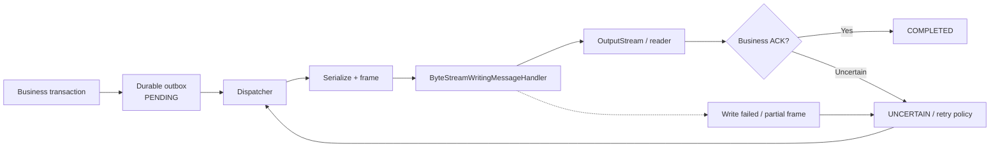
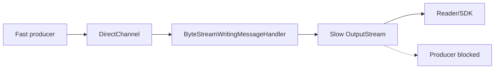

# OutputStream as a message destination

## 1. Problem: writing payloads from Spring Integration to a byte stream

In the **SPRING_INTEGRATION_ADAPTERS** module, applications connect external systems using inbound/outbound adapters, gateways, pollers, and `MessageChannel`, practicing data exchange over files, SFTP, HTTP, JMS, AMQP, Kafka, and databases as well as message contracts, errors, and connection lifecycles. In the **Adapter Stream** chapter, **OutputStream as a message destination** focuses on an important case: **an application-provided `java.io.OutputStream` serving as the target sink of an outbound flow**.

Suppose a system receives an event from JMS, serializes it into a binary frame, and writes it to an `OutputStream` provided by a device Java SDK. Spring Integration orchestrates the message flow, while the stream object delivers bytes to the destination at the I/O layer.

```text
 JMS / AMQP / Kafka / HTTP / Database
                  |
                  v
           Business event
                  |
         Validate + Serialize
                  |
          Spring Message<byte[]>
                  |
                  v
        binaryOutboundChannel
                  |
                  v
     ByteStreamWritingMessageHandler
                  |
                  v
    OutputStream (file / pipe / SDK)
                  |
                  v
            External reader
```

**Do not send an `OutputStream` as the payload for a downstream handler to write to arbitrarily.** The target stream is a **stateful resource with a lifecycle**; the content transported through Spring Messaging is the **serialized `byte[]` data**. This is also the role of the stream outbound channel adapter in Spring Integration: receive payloads sequentially and write them to the target stream.

After this lesson, you will be able to:

1. Explain the `MessageHandler` role of `ByteStreamWritingMessageHandler` and how it differs from an `InputStream` message source.
2. Configure an application-owned `OutputStream`, wire it to an outbound `MessageChannel`, and send `byte[]` payloads.
3. Build Java/Spring Boot, Java DSL, and XML configurations aligned with the Spring Integration 6.5 API.
4. Design **length-prefixes**, delimiters, checksums, charsets, and reading rules: **a single `send()` does not automatically create a record** on the stream.
5. Distinguish between **write, buffering, flush, close, fsync, and business ACK**.
6. Handle broken streams, partial writes, uncertain outcomes, retries/idempotency, and backpressure.
7. Manage single-owner resources, write ordering, concurrency, restarts, and shutdown.
8. Write tests with `ByteArrayOutputStream` and fault-injecting sinks, and choose specialized adapters when file/SFTP/TCP/JMS/Kafka semantics are required.

## 2. Destination is a stream, payload is bytes

The word "stream" is easily confused among **Java I/O streams**, **Spring Integration message flows**, **Kafka Streams**, and **Java `Stream<T>`**. In this lesson, stream means **Java's `OutputStream`**, an abstraction with these operations:

```java
// Abbreviated form of the java.io.OutputStream API.
import java.io.Closeable;
import java.io.Flushable;
import java.io.IOException;

public abstract class OutputStream implements Closeable, Flushable {
    public abstract void write(int b) throws IOException;
    public void write(byte[] b) throws IOException;
    public void write(byte[] b, int off, int len)
            throws IOException;
    public void flush() throws IOException;
    public void close() throws IOException;
}
```

The snippet above is merely an **abbreviated description of Java's standard API**, not code to define a new `OutputStream` class. `OutputStream` knows nothing about Spring messages, filenames, JSON schemas, event IDs, or database transactions.

### Three layers to separate

| Layer | Component | Responsibility |
| --- | --- | --- |
| Business | `OrderEvent` or DTO | Business semantics, event ID, schema version |
| Spring Integration | `Message<byte[]>`, `MessageChannel`, `ByteStreamWritingMessageHandler` | Orchestration, routing messages to the handler |
| Java I/O | `OutputStream` and wrappers | Writing bytes, buffering, flushing, closing |

A `Message<?>` may carry headers like `id`, `timestamp`, or `traceId`. These headers are **not automatically serialized** into bytes by the byte handler. If the receiver needs `eventId` or `tenantId`, the application must embed them **in the payload/frame per contract**.

### Inbound and outbound are asymmetric regarding pollers

| Aspect | Inbound stream | Outbound stream |
| --- | --- | --- |
| API | `ByteStreamReadingMessageSource` | `ByteStreamWritingMessageHandler` |
| I/O | `InputStream.read(...)` | `OutputStream.write(...)` |
| Trigger | `SourcePollingChannelAdapter` + poller | Channel dispatch to `MessageHandler` |
| Payload | `byte[]` after reading | `byte[]` to be written |
| EOF | Source can reach end of stream | No EOF event produced by normal writes |
| Reply contract | None by default | None by default |

With `DirectChannel`, the outbound handler is invoked **synchronously** when the producer sends a message; **no poller is required**. If a `QueueChannel` is used, the consumer behind the queue needs a polling mechanism; that is not an intrinsic requirement of `OutputStream`.

## 3. Spring Integration 6.5 API: ByteStreamWritingMessageHandler

Per the Spring Integration Stream Reference 6.5:

- Primary class: `org.springframework.integration.stream.ByteStreamWritingMessageHandler`.
- Created via a constructor accepting `OutputStream` or `(OutputStream, int bufferSize)`.
- Extends `AbstractMessageHandler` and implements the `MessageHandler` contract.
- Wired via `@ServiceActivator`, `IntegrationFlow.handle(...)`, or XML `outbound-channel-adapter`.
- Dedicated to writing **byte arrays** to an `OutputStream`.

```java
import java.io.OutputStream;
import org.springframework.integration.stream.ByteStreamWritingMessageHandler;

OutputStream destination = /* application stream */;

ByteStreamWritingMessageHandler handler =
        new ByteStreamWritingMessageHandler(destination, 8192);
```

This is a **handler initialization snippet** and does not yet declare `destination`, the message channel, or lifecycle. `bufferSize=8192` configures the buffering layer; it does **not** mean each Spring message is 8192 bytes, nor does it create an 8192-byte frame.

### Imports change across versions

| Framework line | Byte writing handler package |
| --- | --- |
| Spring Integration 6.5.x | `org.springframework.integration.stream.ByteStreamWritingMessageHandler` |
| Spring Integration 7.x | `org.springframework.integration.stream.outbound.ByteStreamWritingMessageHandler` |

Let the Spring Boot BOM manage compatible versions or align versions manually if no BOM is used; avoid mixing 7.x package classes with 6.5.x dependencies.

### How does CharacterStreamWritingMessageHandler relate?

`CharacterStreamWritingMessageHandler` accepts a `Writer` and suits `String`/`char[]` or console text. `ByteStreamWritingMessageHandler` accepts an `OutputStream` and expects a `byte[]` payload. If the data is UTF-8 text and the target genuinely requires bytes, serialize to `byte[]` **before sending into the channel**. If the target simply needs text lines on stdout, the character handler's `stdout("UTF-8")` factory and `appendNewLine(true)` are more convenient.

Do not use `OutputStream.toString()` as content to send. It typically only describes the object rather than containing the written data.

## 4. Common types of OutputStream

`OutputStream` is an abstraction; operational characteristics vary by sink.

| Implementation | Example usage | Ownership and risks |
| --- | --- | --- |
| `ByteArrayOutputStream` | Unit/integration tests, RAM buffer | Data disappears when the JVM exits; easy to inspect bytes |
| `Files.newOutputStream(...)` / `FileOutputStream` | Writing to a specific file | File descriptors, write permissions, close/flush, crashes, truncate/append |
| `BufferedOutputStream` | Reducing syscalls when writing many small messages | Bytes may sit in RAM before flush |
| `PipedOutputStream` | Pipe to an in-JVM reader | Blocking, dead reader, buffer bounds |
| `Socket.getOutputStream()` | Writing to a TCP connection | Timeouts, disconnects, reconnects, and framing |
| Stream from a Java SDK | Writing to a device, object store, or remote API | Must follow the SDK's close/commit contract |
| `System.out` | stdout is typically a `PrintStream` | Can mix logs/charsets, and errors do not always throw like ordinary sinks |

Maintain **a single write owner** per stream unless the application has explicit synchronization and coordination. Two handlers sharing one `OutputStream` can interleave writes and break record order or the reader's protocol.

### Do not reopen the file on every send

```text
CORRECT:
  application startup
      -> open OutputStream once
      -> message #1: write bytes
      -> message #2: append more bytes to the same stream
      -> application shutdown: flush/close per policy

WRONG:
  every message:
      -> open file with TRUNCATE_EXISTING
      -> write bytes
      -> close
  ==> previous message is overwritten
```

In this chapter, the destination is an **already-open stream**. When you need **one file per event**, filenames from message headers, temporary suffixes/atomic renames, or file-existence controls, use the **File outbound channel adapter/gateway**.

## 5. Payload: send serialized bytes, not arbitrary DTOs

The byte handler only knows how to **write byte arrays**. It does not serialize an `OrderEvent`, nor does it understand `ObjectMapper`, protobuf schemas, or `FileHeaders`.

Example of a business event:

```java
public record OrderEvent(String eventId, long orderId, String state) {
}
```

To send UTF-8 JSON, the producer/transformer must produce bytes:

```java
import java.nio.charset.StandardCharsets;
import org.springframework.messaging.Message;
import org.springframework.messaging.support.MessageBuilder;

String json =
        "{\"eventId\":\"evt-1001\",\"orderId\":1001,\"state\":\"PAID\"}";

byte[] utf8 = json.getBytes(StandardCharsets.UTF_8);

Message<byte[]> outbound =
        MessageBuilder.withPayload(utf8)
                .setHeader("businessEventId", "evt-1001")
                .build();
```

**The `businessEventId` header only exists on the Spring message.** If the receiver over a pipe/SDK needs the ID, the byte content itself must carry it. With JSON, the example above includes `eventId` in the body; with a binary protocol, the ID can go into the frame header.

Do not do this:

```java
// Violates ByteStreamWritingMessageHandler contract:
Message<OrderEvent> invalid =
        MessageBuilder.withPayload(
                new OrderEvent("evt-1001", 1001, "PAID")
        ).build();
```

Sending an `OrderEvent` does not magically teach the byte handler to encode UTF-8, protobuf, or JSON. If Spring has a converter/transformer in the flow, **declare it explicitly** and test the `byte[]` output before the handler.

### Charset does not belong to OutputStream

`OutputStream` accepts **bytes**; charset only matters when converting `String` to `byte[]`. Specify `StandardCharsets.UTF_8` in the producer/serializer so behavior never depends on JVM/container locale:

```java
byte[] data = "Hello".getBytes(StandardCharsets.UTF_8);
```

If the reader expects UTF-8, it must decode with **the same charset**. Do not expect a Spring header named `charset` to alter how `ByteStreamWritingMessageHandler` writes bytes.

### JSON records vs. stream chunks

Two calls to `MessageChannel.send(Message<byte[]>)` **do not create two self-delimiting records** in a byte stream: the reader only sees a **contiguous sequence of bytes**. If you want NDJSON, you must include newline delimiters; if you want binary records, you need a parseable framing protocol.

## 6. Framing: a message must be separable from the stream

Example of sending two strings:

```text
Spring message #1 payload: 41 42 43       ("ABC")
Spring message #2 payload: 44 45          ("DE")

OutputStream bytes:          41 42 43 44 45

Reader sees:                "ABCDE"
```

The reader cannot tell the boundary between `ABC` and `DE` unless the protocol defines one.

| Protocol | Example | When suitable |
| --- | --- | --- |
| LF line | `record1\\nrecord2\\n` | Text/NDJSON; must escape internal newlines |
| Fixed length | Each frame 128 bytes | Records of fixed size |
| Length-prefix | 4-byte length + payload | Variable-length binary |
| Delimiter + escaping | Separator character and escape rules | Specific text protocols |
| SDK protocol | Header/checksum/sequence | Defined by device or library |

### 6.1. 4-byte big-endian length-prefix

Suppose each record uses a **4-byte signed big-endian length**, followed by the payload bytes. The contract accepts lengths from 1 byte up to 1 MiB:

```text
Payload "ABC": 41 42 43

Frame:
00 00 00 03  41 42 43
|  length |  | payload |

Payload "DE": 44 45
Frame:
00 00 00 02  44 45
```

Frame encoder:

```java
import java.nio.ByteBuffer;
import java.nio.ByteOrder;
import java.util.Objects;

public final class FrameEncoder {

    public static final int MAX_PAYLOAD_BYTES = 1024 * 1024;

    private FrameEncoder() {
    }

    public static byte[] encode(byte[] payload) {
        Objects.requireNonNull(payload, "payload");
        if (payload.length == 0
                || payload.length > MAX_PAYLOAD_BYTES) {
            throw new IllegalArgumentException(
                    "Invalid payload length: " + payload.length);
        }

        return ByteBuffer.allocate(4 + payload.length)
                .order(ByteOrder.BIG_ENDIAN)
                .putInt(payload.length)
                .put(payload)
                .array();
    }
}
```

This is a **standalone Java class** you can place in `FrameEncoder.java`. It produces a complete `byte[]`, so the handler simply writes **one already-framed payload**. The receiving side must have a decoder following the same contract, handling consecutive frames, short reads, and frames split across chunks.

### 6.2. The reader must use readFully or a stateful decoder

**`InputStream.read(byte[])` does not guarantee returning all requested bytes**. If the reader writes:

```java
byte[] header = new byte[4];
input.read(header);  // Does NOT guarantee a 4-byte header!
```

it may receive only a partial header. For finite synchronous streams, `DataInputStream.readFully(...)` can be used:

```java
import java.io.DataInputStream;
import java.io.InputStream;

public final class FrameDecoder {

    private FrameDecoder() {
    }

    public static byte[] readOne(InputStream input)
            throws java.io.IOException {
        DataInputStream data = new DataInputStream(input);
        int length = data.readInt(); // 4 bytes, big-endian

        if (length < 1 || length > FrameEncoder.MAX_PAYLOAD_BYTES) {
            throw new java.io.IOException(
                    "Invalid frame length: " + length);
        }

        byte[] payload = new byte[length];
        data.readFully(payload);
        return payload;
    }
}
```

`FrameDecoder` requires `FrameEncoder` in the same package and **does not automatically generate an ACK**. It fits an open `InputStream` in a test/destination environment; if the source ends, `readInt()` may throw `EOFException`. For network data, add timeouts, validate lengths before allocation, and handle protocol interruptions.

**Failures when a record has been partially written** are not solved automatically by length-prefixing. The decoder can detect missing bytes, but you still need a strategy to discard partial frames, resynchronize, retry, and track event IDs.

## 7. Spring Boot: an application-owned OutputStream

This example uses **Java 17+** and Spring Boot compatible with Spring Integration 6.5.x. It opens an `OutputStream` for **a binary file**, binds it to `ByteStreamWritingMessageHandler`, and sends two serialized frames. This demonstrates a **fixed destination**, not an outbound File adapter selecting filenames per message.

### 7.1. Maven dependencies

```xml
<dependencies>
    <dependency>
        <groupId>org.springframework.boot</groupId>
        <artifactId>spring-boot-starter-integration</artifactId>
    </dependency>
    <dependency>
        <groupId>org.springframework.integration</groupId>
        <artifactId>spring-integration-stream</artifactId>
    </dependency>
</dependencies>
```

Use the Spring Boot BOM to manage versions or align Spring Integration artifacts manually if there is no BOM. Avoid combining core from one version with stream from another.

### 7.2. Configuration

```yaml
app:
  stream:
    output-path: ${STREAM_OUTPUT_PATH:./build/output/events.bin}
    io-buffer-size: ${STREAM_IO_BUFFER_SIZE:8192}
```

`STREAM_OUTPUT_PATH` in the example is an **operator-trusted path**. Production setups must restrict root directories, control symlinks/permissions, enforce quotas, and never allow user requests to pick arbitrary system paths.

### 7.3. Java configuration + producer

```java
import java.io.IOException;
import java.io.OutputStream;
import java.nio.charset.StandardCharsets;
import java.nio.file.Files;
import java.nio.file.Path;
import java.nio.file.StandardOpenOption;

import org.springframework.beans.factory.annotation.Qualifier;
import org.springframework.beans.factory.annotation.Value;
import org.springframework.boot.ApplicationRunner;
import org.springframework.boot.SpringApplication;
import org.springframework.boot.autoconfigure.SpringBootApplication;
import org.springframework.context.annotation.Bean;
import org.springframework.integration.annotation.ServiceActivator;
import org.springframework.integration.channel.DirectChannel;
import org.springframework.integration.config.EnableIntegration;
import org.springframework.integration.stream.ByteStreamWritingMessageHandler;
import org.springframework.messaging.MessageChannel;
import org.springframework.messaging.support.MessageBuilder;

@SpringBootApplication
@EnableIntegration
public class OutputStreamDestinationApplication {

    public static void main(String[] args) {
        SpringApplication.run(
                OutputStreamDestinationApplication.class, args);
    }

    @Bean(name = "destinationOutputStream", destroyMethod = "close")
    public OutputStream destinationOutputStream(
            @Value("${app.stream.output-path}") String configuredPath)
            throws IOException {

        Path output = Path.of(configuredPath)
                .toAbsolutePath()
                .normalize();
        Path parent = output.getParent();
        if (parent != null) {
            Files.createDirectories(parent);
        }

        // Demo: recreate file contents on each startup.
        return Files.newOutputStream(
                output,
                StandardOpenOption.CREATE,
                StandardOpenOption.TRUNCATE_EXISTING,
                StandardOpenOption.WRITE
        );
    }

    @Bean
    public MessageChannel deviceBinaryOutboundChannel() {
        return new DirectChannel();
    }

    @Bean
    @ServiceActivator(inputChannel = "deviceBinaryOutboundChannel")
    public ByteStreamWritingMessageHandler destinationWriter(
            @Qualifier("destinationOutputStream")
            OutputStream destination,
            @Value("${app.stream.io-buffer-size:8192}") int bufferSize) {

        if (bufferSize < 1 || bufferSize > 1024 * 1024) {
            throw new IllegalArgumentException(
                    "Invalid OutputStream buffer size");
        }
        return new ByteStreamWritingMessageHandler(
                destination, bufferSize);
    }

    @Bean
    public ApplicationRunner sendDemoFrames(
            @Qualifier("deviceBinaryOutboundChannel")
            MessageChannel channel) {

        return args -> {
            send(channel, "evt-1001", "ORDER:1001:CREATED");
            send(channel, "evt-1002", "ORDER:1002:PAID");
        };
    }

    private static void send(
            MessageChannel channel, String eventId, String content) {

        byte[] payload = content.getBytes(StandardCharsets.UTF_8);
        byte[] frame = FrameEncoder.encode(payload);

        boolean accepted = channel.send(
                MessageBuilder.withPayload(frame)
                        .setHeader("businessEventId", eventId)
                        .build()
        );

        if (!accepted) {
            throw new IllegalStateException(
                    "Outbound channel rejected " + eventId);
        }
    }
}
```

`FrameEncoder` from section 6 must reside in the same package or be imported from where it is defined. The example also assumes standard Spring Boot build configuration and JVM 17+.

### 7.4. Step-by-step walkthrough

1. Spring creates **one `OutputStream` bean** pointing to the target file.
2. `destroyMethod="close"` delegates stream closing when the bean is destroyed.
3. `ByteStreamWritingMessageHandler` receives that bean via its constructor.
4. `@ServiceActivator(inputChannel = "...")` registers the handler as the channel consumer.
5. `ApplicationRunner` builds UTF-8 data, wraps it in length-prefixed frames, and sends two `Message<byte[]>` items.
6. `DirectChannel` invokes the consumer synchronously on the sending path.
7. The file receives the frames **back-to-back**, with no separation other than the length prefix generated by `FrameEncoder`.

In this example, every **restart** uses `TRUNCATE_EXISTING` and can erase old data. This suits test/batch files meant to be overwritten intentionally; it is **not** a durable outbox.

### 7.5. Expected output

The first payload has content `ORDER:1001:CREATED` and the second is `ORDER:1002:PAID`. The file will contain:

```text
00 00 00 12 | 4F 52 44 45 52 3A 31 30 30 31 3A 43 52 45 41 54 45 44
00 00 00 0F | 4F 52 44 45 52 3A 31 30 30 32 3A 50 41 49 44
```

This is an **expected hex representation**, not output from an actual run. The two frames have payload lengths of **18 and 15 bytes**, respectively. In the actual file, bytes are contiguous with no `|` or space characters. To verify, read sequentially with `FrameDecoder` and compare strings after UTF-8 decoding.

**Do not equate this example with safe file publishing:** the application does not implement temporary files, atomic renames, CRCs, resume, fsync, or recovery if the process crashes mid-frame. Choose the File outbound adapter or design another storage protocol if those guarantees are mandatory.

## 8. Java DSL: configuring without @ServiceActivator

A `ByteStreamWritingMessageHandler` is a `MessageHandler`, so it can be plugged directly into `IntegrationFlow.handle(...)`.

```java
import java.io.OutputStream;
import org.springframework.beans.factory.annotation.Qualifier;
import org.springframework.context.annotation.Bean;
import org.springframework.context.annotation.Configuration;
import org.springframework.integration.config.EnableIntegration;
import org.springframework.integration.dsl.IntegrationFlow;
import org.springframework.integration.stream.ByteStreamWritingMessageHandler;

@Configuration
@EnableIntegration
public class ByteDestinationDslConfig {

    @Bean
    public IntegrationFlow deviceByteFlow(
            @Qualifier("destinationOutputStream") OutputStream destination) {

        return IntegrationFlow
                .from("deviceFramesInput")
                .handle(new ByteStreamWritingMessageHandler(
                        destination, 8192))
                .get();
    }
}
```

This is an **alternative configuration approach** to `@ServiceActivator` in section 7. If deployed in the same context, pick **one** flow/handler to own the stream to avoid two consumers competing to write. Producers must send `Message<byte[]>` to `deviceFramesInput`.

`IntegrationFlow.from("deviceFramesInput")` receives messages from the channel per DSL wiring. No poller is needed if it is a `SubscribableChannel` such as `DirectChannel`. If the upstream channel is a `PollableChannel`, that consumption stage may need a poller.

## 9. XML: defining an OutputStream bean and outbound-channel-adapter

XML can reference a handler bean. The illustrative example **requires an existing `destinationOutputStream` bean** created in Java configuration or an appropriate bean factory:

```xml
<beans:beans
    xmlns:beans="http://www.springframework.org/schema/beans"
    xmlns:xsi="http://www.w3.org/2001/XMLSchema-instance"
    xmlns:int="http://www.springframework.org/schema/integration"
    xsi:schemaLocation="
        http://www.springframework.org/schema/beans
        https://www.springframework.org/schema/beans/spring-beans.xsd
        http://www.springframework.org/schema/integration
        https://www.springframework.org/schema/integration/spring-integration.xsd">

    <!-- destinationOutputStream: OutputStream bean managed by the app. -->
    <beans:bean
        id="binaryStreamHandler"
        class="org.springframework.integration.stream.ByteStreamWritingMessageHandler">
        <beans:constructor-arg ref="destinationOutputStream"/>
        <beans:constructor-arg value="8192"/>
    </beans:bean>

    <int:channel id="deviceFrames"/>

    <int:outbound-channel-adapter
        id="binaryOutboundAdapter"
        channel="deviceFrames"
        ref="binaryStreamHandler"/>

</beans:beans>
```

This is an **illustrative XML fragment**, not a standalone complete file, because `destinationOutputStream` and the producer for `deviceFrames` must be supplied. Do not register both the Java `@ServiceActivator` from section 7 and this XML handler writing to the same stream without a shared serialization mechanism.

### If the destination is stdout/stderr

`ByteStreamWritingMessageHandler` does not provide the `stdout("UTF-8")`/`stderr("UTF-8")` factories that the character handler has. If you want **text** on the console with a newline per message, use the namespace:

```xml
<int-stream:stdout-channel-adapter
    id="stdoutLines"
    channel="textOutputChannel"
    charset="UTF-8"
    append-newline="true"/>
```

The snippet above requires the `int-stream` namespace and XSD on the appropriate XML root. It creates a **character stream** adapter, **not** a binary-framed byte handler. Keep data stdout separate from log stdout so downstream parsers are not disrupted.

## 10. Testing OutputStream with ByteArrayOutputStream

`ByteArrayOutputStream` is a convenient destination when you want to verify **actual bytes** without opening files or connecting to devices. It lets you compare frames, byte order, and multi-message handling accurately.

### 10.1. JUnit 5: two consecutive frames

The example below uses the same `FrameEncoder` from section 6 and `FrameDecoder` in the same package. The handler is instantiated and called directly; no full `ApplicationContext` is required:

```java
import static org.junit.jupiter.api.Assertions.assertArrayEquals;
import static org.junit.jupiter.api.Assertions.assertEquals;

import java.io.ByteArrayInputStream;
import java.io.ByteArrayOutputStream;
import java.nio.charset.StandardCharsets;

import org.junit.jupiter.api.Test;
import org.springframework.integration.stream.ByteStreamWritingMessageHandler;
import org.springframework.messaging.support.MessageBuilder;

class OutputStreamDestinationTest {

    @Test
    void writesTwoLengthPrefixedMessages() throws Exception {
        ByteArrayOutputStream destination =
                new ByteArrayOutputStream();
        ByteStreamWritingMessageHandler handler =
                new ByteStreamWritingMessageHandler(destination, 16);

        handler.afterPropertiesSet();

        byte[] first = "ABC".getBytes(StandardCharsets.UTF_8);
        byte[] second = "DE".getBytes(StandardCharsets.UTF_8);

        handler.handleMessage(MessageBuilder
                .withPayload(FrameEncoder.encode(first)).build());
        handler.handleMessage(MessageBuilder
                .withPayload(FrameEncoder.encode(second)).build());

        byte[] actual = destination.toByteArray();

        byte[] expected = new byte[] {
                0, 0, 0, 3, 65, 66, 67,
                0, 0, 0, 2, 68, 69
        };
        assertArrayEquals(expected, actual);

        ByteArrayInputStream source =
                new ByteArrayInputStream(actual);
        assertEquals("ABC", new String(
                FrameDecoder.readOne(source), StandardCharsets.UTF_8));
        assertEquals("DE", new String(
                FrameDecoder.readOne(source), StandardCharsets.UTF_8));
        assertEquals(0, source.available());
    }
}
```

**Expected result:** **13 bytes** total: frame `ABC` is `4+3=7` bytes and frame `DE` is `4+2=6` bytes. The `expected` array has exactly 13 elements; the test compares the raw bytes directly and reads both frames back through the decoder. This example **was not executed in STEP 4**.

With a given buffering configuration, verify the handler's flush behavior on your runtime version. If bytes are not immediately visible on the target because they sit in a wrapper, tests should coordinate flushing/lifecycle appropriately rather than assuming every `write(...)` bypasses all buffer layers.

### 10.2. Testing without abusing System.out

Do not swap `System.out` JVM-wide during parallel tests just to capture output: Spring Boot banners, logging, and other tests can interfere. `ByteArrayOutputStream` is a dedicated, deterministic sink that is easy to assert in binary. For logging/console testing, use an appropriate logger test facility or an isolated capture stream.

### 10.3. Verifying decoder behavior when the stream ends

With a complete `ByteArrayInputStream`, the decoder reads both frames cleanly. If a file or pipe holds only **half a frame**, `DataInputStream.readFully(...)` throws `EOFException` instead of returning a complete record. This detects framing corruption; never turn a partial frame into a business event.

## 11. Write, buffer, flush, close, and data durability

This is the most critical area when using `OutputStream` as a destination. The following actions mean **different things**:

| Action | Meaning | Does NOT guarantee |
| --- | --- | --- |
| `channel.send(message)` | Sends a Spring message into the channel per channel semantics | That the reader received or committed it |
| `OutputStream.write(bytes)` | Asks the stream/wrapper to write data | That bytes were fsynced to disk |
| `OutputStream.flush()` | Pushes bytes from Java buffers to the underlying layer (if any) | That the remote consumer processed it; that a file survives power loss |
| `OutputStream.close()` | Ends the stream, possibly flushing and releasing resources | That a distributed transaction committed |
| `FileChannel.force(true)` | Requests metadata/data sync on a file channel per OS/filesystem semantics | Automatic atomic rename or business ACK |
| Application ACK | Receiver confirms per a dedicated protocol | That receiver fsynced, unless the contract specifies it |

### 11.1. Flush is not fsync

`BufferedOutputStream` may hold bytes in application memory; `flush()` pushes them to the underlying `OutputStream`. When the destination is a file, the OS kernel may still cache them. When the destination is a pipe/socket, bytes may sit in the kernel buffer while **the reader has not processed them yet**.

Do not claim durability simply by calling `flush()`. If the destination requires crash-safe files, use a solution with file descriptor/fsync strategies, temporary files + atomic publication, and filesystem limit checks. The Spring Stream outbound adapter **does not provide that entire workflow on its own**.

### 11.2. Wrappers add extra buffer layers

```java
import java.io.BufferedOutputStream;
import java.io.OutputStream;

OutputStream raw = /* application destination */;
BufferedOutputStream buffered =
        new BufferedOutputStream(raw, 8192);
```

This is a wrapper snippet, **not placed in a bean yet**. If the handler already creates its own buffer via its constructor, wrapping with another `BufferedOutputStream` creates **two buffering layers**. That is not necessarily wrong, but you must know who flushes/closes which layer and whether bytes reach the target within latency requirements.

### 11.3. Do not generalize PrintStream auto-flush to every stream

`System.out` is normally a `PrintStream`, which has its own error handling and auto-flush behavior. However, a `FileOutputStream`, `BufferedOutputStream`, or SDK stream **does not necessarily behave like `PrintStream`**. Therefore:

- Do not assume that because `System.out.println(...)` works, `ByteStreamWritingMessageHandler` on a pipe shares the same semantics.
- Do not assume `channel.send()` returning `true` means all I/O errors have been observed.
- Test short messages, large messages, closing, and broken sinks explicitly.

### 11.4. Partial frame writes are a hazard

`OutputStream` has no `rollback()` command. If a partial write occurs:

```text
frame = [length=00000012][payload 18 bytes]

write header + first 7 payload bytes
            |
        I/O failure
            |
        retry entire frame
            |
reader sees: partial frame + duplicate/retry bytes
```

If the reader lacks a way to discard incomplete frames or recover transactions, it may mis-decode after a retry. **Framing is a necessary condition, not a sufficient condition** for safe delivery.

## 12. Retries and uncertain send outcomes

With an outbound stream, possible outcomes include:

1. **Zero bytes written** and an error is detected: safe to retry once the destination is repaired.
2. **Partially written** and then failed: the reader may hold fragmented data.
3. **Write succeeded at the Java layer** without an ACK: unclear whether the receiver committed.
4. **Destination committed** but the ACK was lost: retrying can cause duplicate processing.

Retry design should rely on a **stable event ID** and a two-sided contract, not `MessageHeaders.ID` which is newly generated each time.

### 12.1. Durable outbox upstream of the stream writer



| State field | Example | Purpose |
| --- | --- | --- |
| `eventId` | `evt-1001` | Business identity across retries |
| `attempt` | `3` | Tracks attempt count |
| `frameVersion` | `1` | Decoding rules |
| `destinationId` | `sdk-device-7` | Intended target of the event |
| `status` | `UNCERTAIN` | Unknown whether receiver completed |
| `nextRetryAt` | Policy timestamp | Backoff |
| `lastFailure` | `BROKEN_PIPE` | Error classification |

These fields are **application-designed metadata**, not Spring headers emitted automatically on the wire. If the reader needs the event ID, the serializer/frame must include it.

### 12.2. Idempotent consumer

The remote reader must:

1. Accept **complete frames**; reject partial, oversized, or wrong-version frames.
2. Authenticate/authorize the source and validate content.
3. Extract the stable `eventId`.
4. Insert into an **inbox table with a unique constraint on `eventId`** in the same business transaction.
5. If the event was already processed, skip side effects; optionally re-send the ACK per contract.

If a stream/SDK provides no feedback from the reader, it may only offer **best-effort** delivery or at-least-once with deduplication in the target system (if possible). **Never claim exactly-once solely on top of an `OutputStream`.**

### 12.3. Backoff and error classification

| Error | Retry immediately? | Recommendation |
| --- | --- | --- |
| Broken pipe | No hot retry | Reinitialize destination, inspect reader and framing |
| Disk full | No | Free space/quota, alert |
| Destination closed | No | Fix lifecycle/ownership first |
| Transient network failure | Possibly | Reconnect in connection manager, backoff, event ID |
| Invalid encoding/schema | No | Fix serialization and versioning |
| Timeout with uncertain receipt | Per policy | Durable state, ACK, idempotency |
| Unauthorized destination | No | Fix ACLs/credentials |

Do not write a `while(true) write(...)` loop inside `@ServiceActivator` when a sink fails: it blocks the sending thread, triggers retry storms, and exhausts resources.

## 13. Concurrency and ordering when multiple producers share an OutputStream

`DirectChannel` does not automatically turn **all producers** into a single sequential worker. If two threads call `send()` concurrently, the handler may be invoked from both execution paths. Even if an implementation uses an internal lock around a single write, **it does not turn multiple messages into a business-ordered transaction**.

```text
Thread A -> event A1 -> OutputStream
Thread B -> event B1 -> OutputStream
Thread A -> event A2 -> OutputStream

Reader may see A1, B1, A2; not guaranteed to be A1, A2, B1.
```

### Different levels of ordering

| Ordering level | Guaranteed automatically? |
| --- | --- |
| Byte order within a single `byte[]` | Relies on `OutputStream` write contract |
| No interleaving between two concurrent handler calls | Must verify implementation/synchronization |
| Message order from one sequential producer | Easier to control, still depends on channel/flow |
| Global order across multiple producers | No; requires a sequencer/owner |
| Business order across restarts | Requires durable sequences, checkpoints/leases |

**Safe pattern when strict ordering is required:** route all frames bound for **one destination** through a single dispatcher/writer owner, with a bounded queue and explicit ownership rules.

### When running multiple instances

Two pods cannot safely write concurrently to **the same file/pipe/SDK stream** without an explicit protocol or coordination. Some filesystems guarantee atomicity only under narrow conditions; the stream API does not act as a distributed lock.

Possible solutions:

- Partition destinations by tenant/key so each stream has a single owner.
- Send messages to a broker; a single designated consumer writes to the destination.
- Use leases/locks with timeouts and fencing tokens when multiple workers contend for ownership.
- If writing multiple independent files, design filenames/atomic publication using the File adapter.

Do not assume `QueueChannel` provides durability on its own: an in-memory queue is still lost when the JVM dies unless configured with a durable message store.

## 14. Backpressure: when the reader consumes slowly

An `OutputStream.write(...)` call can **block**:

- In-JVM pipes have finite capacity.
- TCP sockets stall when the receive window shrinks or the network is slow.
- File I/O slows down on heavily loaded storage.
- The target SDK enforces rate limits or waits for its own network ACK.



If the producer runs on an HTTP request thread or a message listener, a blocking write increases latency and ties up transaction/consumer threads for too long.

### Architectural options

| Option | Benefit | Risk / what to add |
| --- | --- | --- |
| `DirectChannel` | Easy to set up, synchronous feedback | Blocks producer when output is slow |
| `ExecutorChannel` | Offloads I/O to workers | Queue and ordering must be controlled |
| `QueueChannel` + polling consumer | Bounded buffer | In-memory is not durable; needs queue-full policy |
| Durable JMS/AMQP/Kafka handoff | Enables recovery when configured properly | Separate ACK, transaction, offset, and ordering |
| Dedicated writer process | Manages a single `OutputStream` owner | Needs IPC protocol and restart handling |

**Do not use an unbounded queue** as a "fix" for a slow sink: it merely shifts the failure to out-of-memory errors. Measure `queueDepth`, latency, throughput, and error rates, and define block/drop/retry/dead-letter policies.

### Timeouts must be placed at the right layer

`MessageChannel.send(message, timeout)` applies according to the **channel type** and send semantics; it **does not set a timeout on an `OutputStream.write(...)` that has already started**. For sockets, configure timeouts/connection management at that layer; if an SDK cannot cancel a blocked write, design worker isolation and close/abandon policies.

## 15. Proper lifecycle and shutdown

`OutputStream` can be a shared resource; define clearly who is responsible for closing it:

| Destination | Owner | Recommendation |
| --- | --- | --- |
| `ByteArrayOutputStream` | Test fixture | Safe to read bytes after writes complete |
| `Files.newOutputStream` created via `@Bean` | Spring context | `destroyMethod="close"`; prevent other beans from closing early |
| `System.out` and `System.err` | JVM/runtime | **Do not close** from a handler |
| `Socket.getOutputStream` | Connection manager | Close per connection lifecycle; reconnect creates a new stream |
| `PipedOutputStream` | Producer/pipe coordinator | Reader and writer must stop in coordinated order |
| SDK `OutputStream` | SDK/client/transaction | Consult SDK contract for flush, close, abort, commit |

### Recommended stop sequence

```text
1. Stop accepting or creating new business events.
2. Stop the dispatcher from accepting additional messages.
3. Drain the bounded queue up to an explicit deadline.
4. Finish write/flush as required by the destination.
5. Close application-owned OutputStream.
6. Save UNCERTAIN state for events without an ACK.
7. Exit process and emit metrics/audit.
```

This is a **design procedure**, not an automatic shutdown order for every Spring context. If the JVM is killed or loses power, cleanup steps may not run. Therefore, for high-reliability events, place a durable outbox **before** the outbound stream.

### A closed stream cannot revive itself

`ByteStreamWritingMessageHandler` is constructed with a specific `OutputStream`. Once that stream breaks or closes, the handler **does not switch to a new stream automatically**. If a socket or remote SDK session must reconnect, you need a **destination manager** to open a new session/stream, transfer ownership state, and decide how to handle pending messages.

Do not swap the `OutputStream` inside a handler from another thread without understanding the handler's synchronization/lifecycle. For specialized network protocols, consider the TCP outbound adapter/gateway with a connection factory.

### File append vs. truncate: different policies

`StandardOpenOption.TRUNCATE_EXISTING` in section 7 suits test files rewritten from scratch. If using `APPEND`:

```java
OutputStream appendSink = Files.newOutputStream(
        path,
        StandardOpenOption.CREATE,
        StandardOpenOption.APPEND,
        StandardOpenOption.WRITE
);
```

that is merely a **code snippet demonstrating file options** (assuming `path` is a valid `Path`); it does not mean a crashed partial trailing frame repairs itself, nor does it prevent interleaved appends from multiple processes. Resuming after restart requires file integrity/frame boundary checks and event deduplication.

## 16. Security and output data governance

Message sources may be HTTP, Kafka, JMS, or user input. Data sent to an `OutputStream` still requires strict controls:

1. **Trusted destinations:** allowlist valid configured paths/streams; never let arbitrary input write to secret files or system devices.
2. **Schema validation:** verify DTOs, enums, versions, and event IDs **before serialization**.
3. **Max frame length:** bound bytes, depth, and field counts before allocating large `ByteBuffer`s or arrays.
4. **Explicit charset:** UTF-8 when encoding text; never rely on the default charset.
5. **No secret leaks:** payloads and headers may contain credentials, tokens, or PII. Never dump raw bytes into logs or uncontrolled stdout.
6. **Integrity/authentication:** `OutputStream` only writes bytes; it **does not automatically add TLS, MACs, digital signatures, or receiver authentication**.
7. **No automatic execution of content:** bytes are data, never trusted shell scripts or SQL commands.
8. **File and directory permissions:** enforce least-privilege permissions, quotas/disk limits, and symlink checks.
9. **Do not use streams to bypass SDK APIs:** if an SDK requires explicit commit/abort calls, invoke them per contract instead of merely closing the Java stream.
10. **Retention and auditing:** define who reads the output, how long it is kept, how sensitive data is purged, and how events are reconciled.

### Binary logs and leakage risk

For instance, calling `System.out.write(frame)` in a containerized service can push **binary payloads** into a log-collection pipeline, breaking text parsers and leaking data. Keep data pipes separate from logging, and prefer an explicit destination instead of writing raw bytes to stdout unless the runtime supports controlled binary transport.

## 17. Observability and metrics to track

| Suggested metric | Meaning | Alerting / caveat |
| --- | --- | --- |
| `stream_destination_messages_total` | Messages delivered to handler | Not yet the count of committed events |
| `stream_destination_bytes_total` | Total bytes requested to write | Count retries explicitly |
| `stream_destination_write_errors_total` | Observed write/flush errors | Categorize by I/O, schema, destination |
| `stream_destination_partial_write_total` | Sends with unknown bytes written | Not always measurable precisely |
| `stream_destination_pending_events` | Outbox events awaiting ACK | Requires a state store |
| `stream_destination_queue_depth` | Backlog ahead of writer | Present only if a queue is used |
| `stream_destination_write_duration_seconds` | Handler write duration | Measure tail latency too |
| `stream_destination_retries_total` | Retry attempts | Group by error and attempt |
| `stream_destination_uncertain_total` | Events with unknown outcome | Requires reconciliation |

These are **suggested metric names**, not Spring Integration's default metric set. Never put `eventId`, full filesystem paths, tokens, or raw payloads into metric labels to avoid high cardinality and data leaks.

### Questions your dashboard should answer

- Is the destination still open and writable?
- What is the average frame byte size? What is P99 write latency?
- Is the bounded queue full, and how long have producers been blocked?
- How many events are currently `UNCERTAIN`/`FAILED`?
- Was the data ACKed by the reader or only passed to `write()`?
- Were any events retried with the same ID after the receiver had already committed once?

## 18. Comparison with other adapters in the module

| Requirement | Better choice | Why? |
| --- | --- | --- |
| Write to an SDK-provided `OutputStream` | **ByteStreamWritingMessageHandler** | Destination is genuinely a Java I/O stream |
| Write to `StringWriter`, stdout text | `CharacterStreamWritingMessageHandler` | Encoding/newline support and `Writer` |
| Write each event as a separate file | File outbound adapter | Filenames, `FileExistsMode`, temp suffixes |
| Upload files to SFTP/FTP/SMB | Remote file outbound adapter | Sessions, authentication, directory/file semantics |
| Send a request and need HTTP status/body | HTTP outbound gateway | Request–reply and timeouts |
| Send TCP with framing/reconnect | TCP outbound adapter/gateway | Connection factory, serializer/deserializer |
| Send to a queue with ACK/transactions | JMS or AMQP outbound | Broker and redelivery semantics |
| Publish events by partition/offset | Kafka outbound adapter | Topics, partitions, producer acknowledgements |
| Write a record to a database | JDBC outbound adapter/gateway | Transaction/query semantics |
| Manage rotation/logging/retention | Logging framework/appender | Should not be reinvented on top of raw `OutputStream` |

### When is a stream writer the right choice?

When the destination is an **existing `OutputStream`**, the data is already serialized, and the application clearly owns the stream. It fits thin **Java SDK** integration adapters, binary pipes, or in-memory tests well. It does not replace higher-level protocol adapters when you need ACKs, broker retries, remote sessions, or multi-file management.

## 19. End-to-end testing checklist

Use `ByteArrayOutputStream` for unit tests, test file sinks or `PipedOutputStream` for integration tests; never disrupt production connections.

| Scenario | Test case | Expected result |
| --- | --- | --- |
| Single message | Contract-compliant `Message<byte[]>` | Bytes emitted in exact order |
| Two frames | Send framed `ABC` and `DE` | Decoder reads both frames completely |
| String payload | Send straight to byte handler | Rejected or type error at runtime; must encode first |
| Oversized record | Frame encoder given > 1 MiB | Rejected before allocation/send |
| Zero-length payload | Frame encoder given empty array | Rejected per example protocol |
| Charset | UTF-8 Vietnamese text/emoji | Decoded back with no character corruption |
| Partial write | Sink throws `IOException` after N bytes | Event not marked completed; recorded as uncertain |
| Closed stream | Call write after close | Error handled appropriately for sink type |
| Buffering | Small write then flush | Verify bytes actually appear at sink |
| Restart | File truncated or appended | Follows policy with no unintended data loss |
| Concurrency | Multiple producers writing together | No violation of ordering/framing contract |
| Slow reader | Pipe full or sink blocks | Bounded queue and backpressure engage |
| Shutdown | Stop while events are pending | Drain/close policy and uncertain states recorded |
| Lost reader ACK | Retry with same event ID | Receiver does not execute side effects twice |

### 19.1. Fixture simulating partial writes

A test `OutputStream` can deliberately throw an error after a few bytes:

```java
import java.io.IOException;
import java.io.OutputStream;

public final class FailingOutputStream extends OutputStream {

    private int remaining = 5;

    @Override
    public void write(int value) throws IOException {
        if (remaining-- <= 0) {
            throw new IOException("Simulated partial write");
        }
    }
}
```

This class deliberately **writes to no real sink**, simply simulating successful acceptance of the first five bytes before throwing `IOException`. In tests, you can delegate to an inner `ByteArrayOutputStream` to inspect the exact prefix received. After an error, mark the message status as **uncertain** rather than blindly retrying forever.

### 19.2. Verifying output with the frame decoder

Use `FrameDecoder.readOne(...)` from section 6 to decode output using the **same length-prefix protocol**. When two messages are sent to an `OutputStream`, the reader must recover both records and detect any leftover/truncated bytes.

If the real target is an SDK or network stream, also test:

- Flush/commit semantics of the SDK.
- Failures after partial writes.
- Close/disconnect while a write is blocking.
- Reconnecting with a new stream and recovering pending events.
- Permissions, quotas, timeouts, and message size limits.

## 20. Troubleshooting

| Symptom | Possible cause | How to resolve |
| --- | --- | --- |
| No file/output created | Bean not created, wrong channel, or handler not subscribed | Check `@ServiceActivator`, channel, path |
| Handler receives DTO/`String` and fails | Byte handler requires `byte[]` | Serialize/encode beforehand |
| `ByteStreamWritingMessageHandler` import fails to compile | Using 7.x `.stream.outbound` package with SI 6.5 | Align BOM and Javadoc |
| Frames run together | Missing framing | Appropriate length-prefix/delimiter |
| Decoder reads incomplete header | Single `read(...)` assumed to return 4 bytes | `readFully(...)` or stateful decoder |
| Decoder hangs on huge frame | Corrupted/malicious length header | Max frame limit and timeout |
| UTF-8 character corruption | Producer/reader use different charsets | UTF-8 end-to-end |
| Write succeeded but data not visible yet | Buffer not flushed or slow reader | Check flush/layers and sink |
| File loses prior content on restart | `TRUNCATE_EXISTING` at startup | Pick proper append/publish policy |
| File ends with an incomplete trailing frame | JVM crash or partial write | Integrity checks and recovery |
| `channel.send()` returns true but receiver has nothing | No ACK; buffering or wrong destination | Correlation and ACK if needed |
| I/O error does not reach `errorChannel` | Synchronous `DirectChannel`, exception returns to producer | Test the actual error path |
| App hangs inside `write()` | Slow or full pipe/socket/file | Bounded workers, timeouts/close at target layer |
| Out-of-order messages | Multiple producers/async channel | Single writer owner and sequencing |
| Duplicates after retry | Uncertain outcome; reader already committed | `eventId` and idempotency |
| Stream closed prematurely | Two beans sharing stream ownership or bad shutdown | Single owner, explicit lifecycle |
| Disk full / permission denied | Quota, ACL, or wrong path | Fix target; do not hot-retry |
| Binary data leaks into stdout logs | Writing raw bytes to `System.out` | Use a dedicated file/pipe with proper permissions |

### Diagnostic workflow

1. **Check wiring:** is the producer sending `Message<byte[]>` to the channel subscribed by `ByteStreamWritingMessageHandler`?
2. **Check destination:** is there an open `OutputStream` with proper permissions and ownership?
3. **Check payload:** is it serialized, with frame headers/delimiters and size limits?
4. **Check buffering:** are bytes sitting in buffers or flushed to the destination?
5. **Check concurrency:** are multiple handlers/threads writing to the stream concurrently?
6. **Check errors:** do exceptions surface synchronously to the producer, on an async error channel, or get swallowed by the sink?
7. **Check end-to-end:** is there an ACK from the reader and a committed status?
8. **Check recovery:** can the same event ID be retried without creating duplicate side effects?

## 21. Practice exercises

1. Create a `ByteArrayOutputStream` and `ByteStreamWritingMessageHandler`; send a `Message<byte[]>` and inspect the bytes.
2. Review `ByteStreamWritingMessageHandler(OutputStream, int)` and explain why `bufferSize` is not the message size.
3. Run `FrameEncoder.encode("ABC".getBytes(StandardCharsets.UTF_8))` and verify the bytes `00 00 00 03 41 42 43`.
4. Send two consecutive frames and read both records back using `FrameDecoder`.
5. Deliberately send a `Message<String>` to the byte handler, then fix it with `StandardCharsets.UTF_8`.
6. Replace `ByteArrayOutputStream` with `Files.newOutputStream` targeting a safe test path.
7. Restart with `TRUNCATE_EXISTING` vs. `APPEND` and explain the impact on existing data.
8. Configure `@ServiceActivator` on `DirectChannel` and compare it with Java DSL `handle(...)`.
9. Write an XML `int:outbound-channel-adapter` referencing a handler bean.
10. Use `FailingOutputStream` to trigger a partial write and handle the `UNCERTAIN` event.
11. Write to a `BufferedOutputStream` and distinguish when data sits in RAM versus when it is flushed.
12. Design a protocol supporting checksums, schema version, and business `eventId`.
13. Create two concurrent producers, observe ordering, and propose a single-writer dispatcher.
14. Use `PipedInputStream/PipedOutputStream` to simulate a slow reader and measure block time.
15. Add a bounded queue ahead of the writer and describe behavior when the queue is full.
16. Explain how to avoid closing `System.out` even when the handler stops.
17. Design a durable outbox + idempotent inbox for a critical event.
18. Distinguish between `write()` succeeding, `flush()`, fsync, and a business ACK.
19. List sensitive data that should never be written straight to stdout/logs.
20. Choose among stream outbound, File outbound, SFTP outbound, TCP outbound, and JMS/Kafka for a real use case.

### Self-check questions

**Q1. Which class writes `Message<byte[]>` to an `OutputStream` in Spring Integration 6.5?**  
`org.springframework.integration.stream.ByteStreamWritingMessageHandler`.

**Q2. Does a byte outbound handler wired to a `DirectChannel` need a poller?**  
No; the handler is dispatched by the channel when the producer sends.

**Q3. Should `OutputStream` be sent as the message payload?**  
No. The destination is the `OutputStream`; the payload is serialized `byte[]` data.

**Q4. Is `bufferSize` a fixed byte size for each record?**  
No. It is a buffering option, not framing.

**Q5. Do two `send()` calls automatically become two records on an OutputStream?**  
No. You need an explicit delimiter, length prefix, or protocol frame.

**Q6. When sending text through a byte handler, where is the charset applied?**  
When encoding `String` into `byte[]` at the producer or transformer.

**Q7. Does `flush()` prove data was committed to the receiver's database?**  
No. A separate business ACK is required.

**Q8. Why is `TRUNCATE_EXISTING` dangerous on restarts?**  
It can erase/overwrite previous file contents as soon as the sink opens.

**Q9. If a frame is partially written and times out, is retrying completely safe?**  
No. You need framing recovery, event IDs, and an idempotent consumer.

**Q10. Should a handler bean close `System.out` during shutdown?**  
No. It belongs to the JVM/runtime and may still be used by other components.

**Q11. What is `ByteArrayOutputStream` best suited to test?**  
Verifying bytes, frames, and write order in RAM without relying on the filesystem or terminal.

**Q12. When is the File outbound adapter better than a `FileOutputStream`?**  
When each message needs a filename, `FileExistsMode`, temporary suffixes, atomic publication, and file metadata.

## 22. Takeaways

Using an **OutputStream as a message destination** means sending Spring `Message` `byte[]` payloads to an application-owned Java `OutputStream` via **`ByteStreamWritingMessageHandler`**. With `DirectChannel`, this is an outbound endpoint **requiring no poller**. The handler takes the target stream and an optional `bufferSize`, but **does not automatically serialize DTOs, add framing, write Spring headers into bytes, or provide business ACKs or transactions**.

To design it cleanly, serialize and bound sizes before sending, define **frame boundary** rules, apply explicit charsets, coordinate **a single writer owner**, and manage **buffering/flush/close** and partial-write failures. **A successful `write()` does not mean the reader committed; retrying after a partial write can cause duplicates.** For critical events, use a durable outbox, correlation, stable event IDs, and idempotent consumers. When you need file publication, SFTP sessions, TCP framing/reconnects, HTTP responses, or broker ACKs/offsets, choose the specialized adapter from the **SPRING_INTEGRATION_ADAPTERS** module.

### References

- [Spring Integration Reference 6.5 — Stream Support](https://docs.spring.io/spring-integration/reference/6.5/stream.html)
- [Spring Integration API 6.5 — ByteStreamWritingMessageHandler](https://docs.spring.io/spring-integration/docs/6.5.0/api/org/springframework/integration/stream/ByteStreamWritingMessageHandler.html)
- [Spring Integration API 6.5 — CharacterStreamWritingMessageHandler](https://docs.spring.io/spring-integration/docs/6.5.0/api/org/springframework/integration/stream/CharacterStreamWritingMessageHandler.html)
- [Spring Integration Reference — Channel Adapter](https://docs.spring.io/spring-integration/reference/channel-adapter.html)
- [Spring Integration Reference — Java DSL](https://docs.spring.io/spring-integration/reference/dsl.html)
- [Java SE 17 — OutputStream](https://docs.oracle.com/en/java/javase/17/docs/api/java.base/java/io/OutputStream.html)
- [Java SE 17 — BufferedOutputStream](https://docs.oracle.com/en/java/javase/17/docs/api/java.base/java/io/BufferedOutputStream.html)
- [Java SE 17 — DataInputStream](https://docs.oracle.com/en/java/javase/17/docs/api/java.base/java/io/DataInputStream.html)
- [Java SE 17 — FileChannel.force](https://docs.oracle.com/en/java/javase/17/docs/api/java.base/java/nio/channels/FileChannel.html#force(boolean))
