# Reader, writer, and charset

## 1. Context: text data must cross the byte–character boundary

In the **SPRING_INTEGRATION_ADAPTERS** module, we use inbound/outbound adapters, gateways, pollers, and `MessageChannel` to connect external systems. File systems, SFTP, HTTP, JMS, AMQP, Kafka, and databases each have their own data contracts, encodings, timeouts, errors, and connection lifecycles. In the **Adapter Stream** chapter, **Reader, writer, and charset** explains how to turn **byte data** into **Java characters**, bring text into Spring Integration, and write text back out to an external destination.

Suppose a program receives an order file containing Vietnamese text via stdin or a UTF-8 file:

```text
orderId,status,note
1001,PAID,Đã thanh toán
1002,CREATED,Chờ xử lý
```

If different charsets are used on the reading and writing sides, “Đã” can turn into corrupted accented characters. If read as byte chunks and each chunk is decoded independently, a multibyte Unicode character can be split in half. If newlines are not normalized, two messages can be concatenated or the output file can contain blank lines.

```text
                       Byte world
       UTF-8 bytes: C4 90 C3 A3 ... 0A
                         |
                    InputStream
                         |
            InputStreamReader + CharsetDecoder
                         |
                  Reader (characters)
                         |
       CharacterStreamReadingMessageSource
                         |
        poller -> MessageChannel -> validation
                         |
            Spring Message<String>
                         |
       CharacterStreamWritingMessageHandler
                         |
                  Writer (characters)
                         |
            OutputStreamWriter + CharsetEncoder
                         |
                    OutputStream
                         |
              UTF-8 bytes at destination
```

**Readers/Writers work with characters; InputStreams/OutputStreams work with bytes.** A charset is the conversion contract between the two worlds. Spring Integration transports **messages**, but **does not automatically determine the right encoding** for a misconfigured source.

### Learning objectives

After this lesson, you will be able to:

1. Distinguish `InputStream`/`OutputStream` from `Reader`/`Writer`, `String`, and `char[]`.
2. Use `InputStreamReader`, `OutputStreamWriter`, `StandardCharsets.UTF_8`, and `CharsetDecoder`/`CharsetEncoder`.
3. Explain UTF-8, Unicode code points, UTF-16 in Java, surrogate pairs, BOMs, and newlines.
4. Configure `CharacterStreamReadingMessageSource` with a poller to produce `Message<String>`.
5. Configure `CharacterStreamWritingMessageHandler` via `MessageChannel` to write text, charsets, and newlines accurately.
6. Handle `Reader.ready()`, EOF, `StreamClosedEvent`, blocking I/O, and shutdown.
7. Build a Spring Boot flow of **Reader → validate/transform → Writer**, with illustrative Java DSL and XML.
8. Test round-trips of Vietnamese text, multibyte characters, malformed bytes, delimiters, backpressure, and error routing.
9. Choose specialized adapters when you need file publication, SFTP, HTTP, TCP, JMS/AMQP, or Kafka semantics.

## 2. Four I/O abstractions and Spring Message

| Object | Data unit | Common APIs | Example |
| --- | --- | --- | --- |
| `InputStream` | Byte | `read()`, `read(byte[])` | File, pipe, socket |
| `OutputStream` | Byte | `write(byte[])`, `flush()` | Binary file, pipe, SDK |
| `Reader` | Java character (UTF-16 code unit) | `read()`, `read(char[])` | Decoded text |
| `Writer` | Java character | `write(String)`, `append(...)` | Text before encoding |
| `Message<String>` | Text string with headers | `getPayload()`, `getHeaders()` | Event line already read |

A single `InputStream.read(byte[])` call can return **fewer bytes** than the buffer size. Likewise, `Reader.read(char[])` does not automatically correspond to a line or a record. When you want a line of text, `BufferedReader.readLine()` or `CharacterStreamReadingMessageSource` provides higher-level abstractions.

### Where does Spring Integration sit?

```mermaid
flowchart LR
    A["InputStream"] --> B["InputStreamReader<br/>UTF-8 decoder"]
    B --> C["CharacterStreamReadingMessageSource"]
    C --> D["SourcePollingChannelAdapter"]
    D --> E["MessageChannel<br/>String payload"]
    E --> F["Transform/Validate"]
    F --> G["MessageChannel"]
    G --> H["CharacterStreamWritingMessageHandler"]
    H --> I["OutputStreamWriter<br/>UTF-8 encoder"]
    I --> J["OutputStream"]
```



Do not pass the `Reader`/`InputStream` itself into a business channel expecting multiple consumers to read independently: a stream has a shared read cursor and tricky lifecycle coordination. Create `Message<String>` from the read text and send that message into the channel.

### Inbound uses a poller, outbound does not necessarily need one

| Mechanism | Endpoint | Who actively triggers it? |
| --- | --- | --- |
| Inbound | `CharacterStreamReadingMessageSource` | `SourcePollingChannelAdapter` + poller calls `receive()` |
| Outbound | `CharacterStreamWritingMessageHandler` | `SubscribableChannel` such as `DirectChannel` dispatches to `handleMessage(...)` |
| Queue in between | `QueueChannel` | Separate consumer/poller depending on the flow |

An outbound handler does not become a "source" just because it writes to a stream. With `DirectChannel`, do not configure a separate poller for the text-writing handler.

## 3. Charset, Unicode, and text representation in Java

**Unicode** assigns code points to characters; a **charset/encoding** defines how characters map to bytes. Java `String` uses UTF-16 code units internally (how the JVM optimizes storage is an implementation detail), whereas files/pipes/sockets transport **bytes**.

### 3.1. An example with accents and emoji

```java
import java.nio.charset.StandardCharsets;

String value = "đệ🚀";

System.out.println(value.length());                    // 4 UTF-16 units
System.out.println(value.codePointCount(0, value.length())); // 3 code points
System.out.println(value.getBytes(StandardCharsets.UTF_8).length); // 9 bytes
```

Here:

- `đ` has code point `U+0111`, taking 2 bytes in UTF-8.
- `ệ` is `U+1EC7`, taking 3 bytes in UTF-8.
- `🚀` is `U+1F680`, taking 4 bytes in UTF-8, while Java `String.length()` counts **2 UTF-16 code units** for the surrogate pair.

Therefore `String.length()`, code point count, and `byte[].length` are **not always equal**. Never use `String.length()` as the UTF-8 packet size or assume one `char` is always a standalone displayable character.

### 3.2. UTF-8, UTF-16, ISO-8859-1, and Windows-1258

| Charset | Characteristics | Risk |
| --- | --- | --- |
| **UTF-8** | Uses 1–4 bytes/code point; ASCII-compatible in the basic range | Can be split across byte chunks |
| UTF-16LE / UTF-16BE | Explicit byte order; most characters take 2 or 4 bytes | Wrong endianness/BOM corrupts text |
| ISO-8859-1 | Single-byte encoding for a limited character set | Cannot represent full Vietnamese/emoji |
| Windows-1258 | Legacy Vietnamese code page in some systems | Mapping/normalization differs from modern standard Unicode |

For new systems, **prefer UTF-8**, declared explicitly in the contract and on both input and output. For legacy data, use the exact charset confirmed by metadata or specification—**do not guess from country or language**.

### 3.3. Mojibake: how “Đã” becomes garbled characters

```text
Original string:      Đã thanh toán
Encoded as:           UTF-8 bytes
Decoded wrongly as:   a different charset
Result:               corrupted characters (mojibake)
```

If input was already decoded wrongly into a `String`, writing it out as UTF-8 **does not fix** the original content. You must locate the boundary where it went wrong and decode the original bytes with the right charset; if bytes were replaced with `U+FFFD`, enough information to recover may no longer exist.

### 3.4. Charset is a conversion policy, not an intrinsic Spring Message property

Setting a Spring header `contentType=text/plain;charset=UTF-8` only describes metadata; it **does not make an already-created `Reader` with another charset switch its decoder**. Similarly, `OutputStreamWriter` uses the encoder chosen **when constructing the writer**. To transcode properly, configure conversion where the bridge or transformer is created.

## 4. Bridging bytes and characters: InputStreamReader / OutputStreamWriter

### 4.1. Reading UTF-8 bytes as characters

`InputStreamReader` takes an `InputStream` and a charset, decoding bytes into Java characters:

```java
import java.io.BufferedReader;
import java.io.InputStream;
import java.io.InputStreamReader;
import java.nio.charset.StandardCharsets;

InputStream source = /* byte stream provided by the application */;
BufferedReader reader = new BufferedReader(
        new InputStreamReader(source, StandardCharsets.UTF_8),
        8192
);

String line = reader.readLine();
```

This is a **snippet**, not a standalone method: `source` must exist, and an owner must handle closing it. `BufferedReader` supports line-by-line reading; `readLine()` strips the line-ending characters from the returned string.

**One read on a `Reader` can consume multiple bytes from the underlying `InputStream`** due to buffering/decoding. Never interleave `InputStreamReader` and direct `source.read()` calls on the same stream expecting byte boundaries to remain intact.

### 4.2. Writing characters as UTF-8 bytes

`OutputStreamWriter` works in reverse, encoding text into bytes:

```java
import java.io.BufferedWriter;
import java.io.OutputStream;
import java.io.OutputStreamWriter;
import java.nio.charset.StandardCharsets;

OutputStream destination = /* byte stream provided by the application */;
BufferedWriter writer = new BufferedWriter(
        new OutputStreamWriter(destination, StandardCharsets.UTF_8),
        8192
);
writer.write("Đã thanh toán");
writer.write("\n");       // LF per example contract
writer.flush();
```

`flush()` pushes data out of Java-layer buffers; it **does not** prove the reader committed the data to a database or fsynced it to disk.

### 4.3. Do not close streams you do not own

| Input/output | Who usually owns it? | Note |
| --- | --- | --- |
| `System.in` | JVM / CLI runtime | Do not close if other components still need it |
| `System.out` / `System.err` | JVM / logging runtime | Do not close inside a service activator |
| `Files.newInputStream(...)` | Bean/Job creating the stream | Close when the job/context finishes |
| `Files.newOutputStream(...)` | Bean/Job creating the stream | Flush/close per policy |
| Stream provided by Java SDK | Client/SDK contract | Check commit/abort/close APIs |
| `StringReader` / `StringWriter` | Test fixture | In-memory, no file descriptor |

When `BufferedReader.close()` or `BufferedWriter.close()` is called, the underlying stream/reader/writer is typically closed too. Never hand both a wrapper and the raw stream to two beans with independent close lifecycles without coordination.

## 5. Spring Integration: CharacterStreamReadingMessageSource

For **Spring Integration 6.5**, use:

```java
import org.springframework.integration.stream.CharacterStreamReadingMessageSource;
```

This class implements `MessageSource<String>`, accepts a `Reader`, wraps it in a `BufferedReader` if needed, and turns each line into a `Message<String>`. It does not automatically know business filenames, schemas, event IDs, or transactions.

### 5.1. Constructors

| Constructor | Meaning |
| --- | --- |
| `new CharacterStreamReadingMessageSource(reader)` | Uses the given reader; by default does not block to actively detect EOF |
| `new CharacterStreamReadingMessageSource(reader, bufferSize)` | Specifies the buffer size for `BufferedReader` |
| `new CharacterStreamReadingMessageSource(reader, bufferSize, blockToDetectEOF)` | Controls blocking/EOF detection mode |

`bufferSize` is the reader's buffer size, **not** a per-line UTF-8 byte cap and **not** a maximum record length. When accepting untrusted data, you still must enforce record length limits in the parser or guard against DoS inputs.

### 5.2. Distinguishing no data from EOF

- By default (`blockToDetectEOF=false`), the source checks `BufferedReader.ready()`; if not ready, `receive()` can return `null` **without confirming EOF**.
- With `blockToDetectEOF=true`, the poller thread can block waiting for input or EOF. When EOF is detected, a `StreamClosedEvent` is published via Spring's `ApplicationEventPublisher`.
- Per Reference 6.5, if the adapter keeps polling after EOF, this event can **repeat on subsequent cycles**; a lifecycle coordinator must decide when to stop the adapter.

```java
import java.io.Reader;
import org.springframework.integration.stream.CharacterStreamReadingMessageSource;

Reader inputReader = /* Reader managed by the application */;
CharacterStreamReadingMessageSource source =
        new CharacterStreamReadingMessageSource(
                inputReader,
                8192,
                true
        );
```

This snippet is for **batch/pipe flows needing EOF**. If the source is interactive `System.in`, blocking the poller until a line/EOF arrives may not be desirable; consider the default mode or a dedicated scheduler.

### 5.3. Four stdin factory methods

```java
CharacterStreamReadingMessageSource.stdin();
CharacterStreamReadingMessageSource.stdin("UTF-8");
CharacterStreamReadingMessageSource.stdinPipe();
CharacterStreamReadingMessageSource.stdinPipe("UTF-8");
```

| Factory | Charset | EOF |
| --- | --- | --- |
| `stdin()` | Factory/runtime default | Does not actively detect EOF |
| `stdin("UTF-8")` | Explicit UTF-8 | Does not actively detect EOF |
| `stdinPipe()` | Factory/runtime default | Detects EOF and supports closing context |
| `stdinPipe("UTF-8")` | Explicit UTF-8 | Detects EOF and supports closing context |

`stdinPipe` fits programs receiving piped/redirected input from the shell. It is **not** a replay system; once the source ends and a job needs to run again from the start, you must reopen the source or launch a new process intentionally.

### 5.4. Threading and StreamClosedEvent caveats

`StreamClosedEvent` is an **application event**, not a `Message<String>` containing payload `"EOF"`. A listener can request stopping the adapter, but the event is published on the poller thread; do not run complex blocking operations on that same thread after requesting `stop()`, as stopping may interrupt it. To handle completion, finish any required work first or hand off stop coordination to a separate thread with a clear lifecycle.

## 6. Spring Integration: CharacterStreamWritingMessageHandler

For **Spring Integration 6.5**, use:

```java
import org.springframework.integration.stream.CharacterStreamWritingMessageHandler;
```

This class is a `MessageHandler` that writes text to a `Writer`. It normally accepts `Message<String>` or `Message<char[]>`, and per the API also has a path for `byte[]`; however, for text contracts, **convert all payloads to `String` beforehand** rather than relying on a DTO's `toString()` or implicit conversions that may change.

### 6.1. Constructor and newline

```java
import java.io.Writer;

Writer targetWriter = /* Writer of the application */;
CharacterStreamWritingMessageHandler handler =
        new CharacterStreamWritingMessageHandler(targetWriter, 8192);
handler.setShouldAppendNewLine(true);
```

`setShouldAppendNewLine(true)` appends a newline after each message; the default is `false`. Equivalent fluent API:

```java
handler.appendNewLine(true);
```

When payloads already include a newline, enabling `appendNewLine` can produce **blank lines**. Choose a single place responsible for delimiters: either the **serializer** or the **handler**, not both.

### 6.2. stdout/stderr and charset

```java
CharacterStreamWritingMessageHandler stdout =
        CharacterStreamWritingMessageHandler
                .stdout("UTF-8")
                .appendNewLine(true);

CharacterStreamWritingMessageHandler stderr =
        CharacterStreamWritingMessageHandler
                .stderr("UTF-8")
                .appendNewLine(true);
```

These are two independent handlers and should not subscribe to the same channel unless you want every message written to both stdout and stderr. When stdout serves as an NDJSON/CSV pipeline, route Spring Boot banners/logs to another channel so machine-to-machine data is not corrupted.

**A `Writer`'s charset is fixed when the writer is constructed.** If a bean receives a `Writer` configured with Windows-1258, setting a UTF-8 header on the Spring message **does not change the writer's decoder/encoder**.

### 6.3. OS effects on newlines

| Symbol | Bytes in UTF-8 | Typical usage |
| --- | --- | --- |
| LF (`\n`) | `0A` | Unix/Linux, NDJSON |
| CR (`\r`) | `0D` | Legacy convention |
| CRLF (`\r\n`) | `0D 0A` | Many Windows files |

`BufferedReader.readLine()` accepts LF, CR, and CRLF and **strips the delimiter** from the payload. When writing, if the protocol mandates **exact LF** on every OS, explicitly append `"\n"` to the payload and **disable `appendNewLine`**, or use a specialized writer/serializer that enforces LF. Do not guess exact newline bytes from the developer machine.

## 7. An explicit text contract before writing code

Suppose the system needs to read a simple CSV:

```text
1001,PAID,Đã thanh toán
1002,CREATED,Chờ xử lý
```

The application converts each line into a normalized text record for a downstream reader:

```text
ORDER|1001|PAID|Đã thanh toán
ORDER|1002|CREATED|Chờ xử lý
```

Minimum contract to document:

| Attribute | Example decision |
| --- | --- |
| Inbound/outbound encoding | UTF-8 |
| Inbound delimiter | LF or CRLF, one record per line |
| Outbound delimiter | LF, one record per line |
| Schema | `orderId,status,note` |
| Valid statuses | `CREATED`, `PAID`, `CANCELLED` |
| Character length limit | Max 4096 characters per line |
| Blank line handling | Skip and record metric |
| Schema errors | Reject/quarantine, do not write to destination |
| Idempotency | Business `eventId` when writing to database/broker |

Note: `String.split(",")` is only suitable when the contract **forbids commas inside fields**. Real-world CSV with commas, quotes, and newlines inside quoted fields requires an **RFC 4180 CSV parser or equivalent contract**, not simple string splitting.

One `Message<String>` from the stream reader corresponds to **one line**, not automatically to one order if the format allows multiline records. Define framing before coding the flow.

## 8. Dependencies and Spring Boot Reader → Writer code

The example below uses **Java 17+**, Spring Boot, and aligned Spring Integration 6.5.x versions. It reads **an existing UTF-8 text file**, transforms data per a simple contract, and writes **another UTF-8 text file**. Its goal is teaching the **Reader/Writer bridge**, not building File inbound/outbound adapters with new-file detection or renames.

### 8.1. Maven

```xml
<dependencies>
    <dependency>
        <groupId>org.springframework.boot</groupId>
        <artifactId>spring-boot-starter-integration</artifactId>
    </dependency>
    <dependency>
        <groupId>org.springframework.integration</groupId>
        <artifactId>spring-integration-stream</artifactId>
    </dependency>
</dependencies>
```

Without a compatible Spring Boot BOM, manage Spring Integration Core/Stream versions together. In **6.5**, import from `org.springframework.integration.stream`; from **7.x**, sources/handlers live in `.stream.inbound` and `.stream.outbound` subpackages. Never mix imports and dependencies from two different major versions.

### 8.2. application.yml

```yaml
app:
  text-stream:
    input-path: ${TEXT_INPUT_PATH:./data/orders-in.csv}
    output-path: ${TEXT_OUTPUT_PATH:./data/orders-out.txt}
    charset: UTF-8
```

The example fixes UTF-8 in Java so an environment variable cannot accidentally alter the protocol. `input-path` and `output-path` should only come from **trusted operators**, never allowing HTTP requests to pick arbitrary filesystem files.

### 8.3. Complete Java code for the flow

```java
import java.io.BufferedReader;
import java.io.BufferedWriter;
import java.io.IOException;
import java.io.InputStreamReader;
import java.io.OutputStreamWriter;
import java.io.Reader;
import java.io.Writer;
import java.nio.charset.CodingErrorAction;
import java.nio.charset.StandardCharsets;
import java.nio.file.Files;
import java.nio.file.Path;
import java.nio.file.StandardOpenOption;
import java.time.Duration;
import java.util.Set;

import org.springframework.beans.factory.annotation.Qualifier;
import org.springframework.beans.factory.annotation.Value;
import org.springframework.boot.SpringApplication;
import org.springframework.boot.autoconfigure.SpringBootApplication;
import org.springframework.context.annotation.Bean;
import org.springframework.integration.annotation.ServiceActivator;
import org.springframework.integration.channel.DirectChannel;
import org.springframework.integration.config.EnableIntegration;
import org.springframework.integration.dsl.IntegrationFlow;
import org.springframework.integration.dsl.Pollers;
import org.springframework.integration.stream.CharacterStreamReadingMessageSource;
import org.springframework.integration.stream.CharacterStreamWritingMessageHandler;
import org.springframework.messaging.Message;
import org.springframework.messaging.MessageChannel;
import org.springframework.messaging.MessageHandler;
import org.springframework.messaging.support.MessageBuilder;

@SpringBootApplication
@EnableIntegration
public class ReaderWriterCharsetApplication {

    public static void main(String[] args) {
        SpringApplication.run(ReaderWriterCharsetApplication.class, args);
    }

    @Bean(name = "textInputReader", destroyMethod = "close")
    public Reader textInputReader(
            @Value("${app.text-stream.input-path}") String filename)
            throws IOException {

        Path input = Path.of(filename).toAbsolutePath().normalize();
        var decoder = StandardCharsets.UTF_8.newDecoder()
                .onMalformedInput(CodingErrorAction.REPORT)
                .onUnmappableCharacter(CodingErrorAction.REPORT);

        return new BufferedReader(
                new InputStreamReader(Files.newInputStream(input), decoder),
                8192
        );
    }

    @Bean(name = "textOutputWriter", destroyMethod = "close")
    public Writer textOutputWriter(
            @Value("${app.text-stream.output-path}") String filename)
            throws IOException {

        Path output = Path.of(filename).toAbsolutePath().normalize();
        if (output.getParent() != null) {
            Files.createDirectories(output.getParent());
        }

        var encoder = StandardCharsets.UTF_8.newEncoder()
                .onMalformedInput(CodingErrorAction.REPORT)
                .onUnmappableCharacter(CodingErrorAction.REPORT);

        return new BufferedWriter(
                new OutputStreamWriter(
                    Files.newOutputStream(
                        output,
                        StandardOpenOption.CREATE,
                        StandardOpenOption.TRUNCATE_EXISTING,
                        StandardOpenOption.WRITE),
                    encoder),
                8192
        );
    }

    @Bean
    public MessageChannel rawTextLinesChannel() {
        return new DirectChannel();
    }

    @Bean
    public MessageChannel normalizedTextLinesChannel() {
        return new DirectChannel();
    }

    @Bean
    public IntegrationFlow readTextLinesFlow(
            @Qualifier("textInputReader") Reader reader) {

        CharacterStreamReadingMessageSource source =
                new CharacterStreamReadingMessageSource(reader);

        return IntegrationFlow.from(
                source,
                spec -> spec.id("readerTextInbound")
                        .poller(Pollers.fixedDelay(Duration.ofMillis(200))
                                .maxMessagesPerPoll(1)))
                .channel("rawTextLinesChannel")
                .get();
    }

    @Bean
    @ServiceActivator(inputChannel = "normalizedTextLinesChannel")
    public CharacterStreamWritingMessageHandler textWriterHandler(
            @Qualifier("textOutputWriter") Writer writer) {

        // Only the producer adds the LF delimiter; the handler does not append newlines.
        return new CharacterStreamWritingMessageHandler(writer);
    }

    @Bean
    @ServiceActivator(inputChannel = "rawTextLinesChannel")
    public MessageHandler transformLineHandler(
            @Qualifier("normalizedTextLinesChannel")
            MessageChannel outputChannel) {

        return message -> {
            String input = (String) message.getPayload();
            if (input.isBlank()) {
                return;
            }
            if (input.length() > 4096) {
                throw new IllegalArgumentException("Input line too long");
            }

            // Deliberately simplified example: no CSV quoting.
            String[] fields = input.split(",", 3);
            Set<String> allowed = Set.of("CREATED", "PAID", "CANCELLED");

            if (fields.length != 3
                    || !fields[0].matches("[0-9]{1,12}")
                    || !allowed.contains(fields[1])) {
                throw new IllegalArgumentException(
                        "Invalid order input line");
            }

            String note = fields[2].strip();
            // Output delimiters are pipe and LF.
            if (note.indexOf('|') >= 0
                    || note.indexOf('\r') >= 0
                    || note.indexOf('\n') >= 0) {
                throw new IllegalArgumentException(
                        "Unexpected output delimiter in note");
            }

            String normalized = "ORDER|" + fields[0] + "|"
                    + fields[1] + "|" + note + "\n";

            boolean sent = outputChannel.send(
                    MessageBuilder.withPayload(normalized).build()
            );
            if (!sent) {
                throw new IllegalStateException(
                        "Writer channel rejected the message");
            }
        };
    }
}
```

**Example notes:** the application requires a real input file and standard Spring Boot build configuration; the code was not compiled/run while writing this Knowledge article. `split(",", 3)` only fits schemas **without CSV escaping**. A leading header line `orderId,status,note` must be skipped by a preprocessing step, or the demo input file should **have no header**. For real CSV data, replace it with an appropriate parser.

### 8.4. Test data lines

```text
1001,PAID,Đã thanh toán
1002,CREATED,Chờ xử lý
1003,CANCELLED,Khách hủy
```

Expected output file:

```text
ORDER|1001|PAID|Đã thanh toán
ORDER|1002|CREATED|Chờ xử lý
ORDER|1003|CANCELLED|Khách hủy
```

This is the **expected result from the code**, not an executed run. Each output payload includes an explicit `"\n"` to produce byte-exact LF after UTF-8 encoding. Do not also enable `appendNewLine(true)` on the writer handler, as that would insert alternating blank lines.

### 8.5. Lifecycle and limitations explained

1. Spring creates one `Reader` from a UTF-8 file and one UTF-8 `Writer`; both are singleton beans closed when the context ends.
2. Decoder/encoder use `CodingErrorAction.REPORT` to catch invalid encoding data instead of silently substituting characters.
3. The poller invokes `CharacterStreamReadingMessageSource.receive()` on schedule.
4. `DirectChannel` dispatches each text line to the transformer.
5. The transformer `MessageHandler` checks the basic contract, adds the `ORDER` prefix and LF delimiter, and sends a new `Message<String>`.
6. `CharacterStreamWritingMessageHandler` writes the string to the writer.
7. When the context stops, the writer/reader beans are closed; in production, verify drain/flush per policy before shutdown.

**Warning:** because the source uses the default constructor, `receive()==null` after reaching the end of the file **does not automatically stop the application**. This example illustrates the flow, not a production batch job. For batch jobs, you need a completion coordinator or a source mechanism with explicit EOF/lifecycle handling. `TRUNCATE_EXISTING` also **overwrites output contents on every startup**; do not apply it as-is where persistence is required.

**A transformer error** can make a message unreplayable because the reader has already advanced; if crash recovery is required, use a File inbound adapter with proper semantics or persist inputs to a durable inbox before side effects.

## 9. Concise Java DSL: stdin → stdout with UTF-8

If the goal is simply reading text from stdin and printing lines to stdout, an `IntegrationFlow` can be simpler. This is an **alternative** to the file flow in section 8; do not enable both in the same application unless you intentionally want two separate sources/targets.

```java
import java.time.Duration;

import org.springframework.context.annotation.Bean;
import org.springframework.context.annotation.Configuration;
import org.springframework.integration.config.EnableIntegration;
import org.springframework.integration.dsl.IntegrationFlow;
import org.springframework.integration.dsl.Pollers;
import org.springframework.integration.stream.CharacterStreamReadingMessageSource;
import org.springframework.integration.stream.CharacterStreamWritingMessageHandler;

@Configuration
@EnableIntegration
public class StdinStdoutUtf8Config {

    @Bean
    public IntegrationFlow stdinToStdoutFlow() {
        return IntegrationFlow.from(
                    CharacterStreamReadingMessageSource.stdinPipe("UTF-8"),
                    spec -> spec.poller(
                            Pollers.fixedDelay(Duration.ofMillis(250))
                                    .maxMessagesPerPoll(1)))
                .handle(
                    CharacterStreamWritingMessageHandler
                            .stdout("UTF-8")
                            .appendNewLine(true))
                .get();
    }
}
```

Example:

```bash
printf 'Đã thanh toán\nChờ xử lý\n' | java -jar integration-app.jar
```

**Flow properties:**

- `stdinPipe("UTF-8")` sets the decoding charset explicitly and enables EOF detection.
- The reading source builds messages per line, **stripping the delimiter** when reading.
- The writing handler outputs each string and **appends a newline**.
- The poller invokes the inbound source; the outbound handler receives messages **without a separate poller**.
- When the pipe closes, `stdinPipe` supports closing the context per the API; full JVM exit still depends on other resources/threads.

For long-running interactive terminals, consider `stdin("UTF-8")` instead of `stdinPipe`. If stdout must contain only data, disable the banner or redirect logs to stderr: a logger writing to stdout can inject non-protocol text.

### stdin/stderr data on Windows

The `printf` command is a POSIX shell example. Windows PowerShell and consoles have different encoding/pipe rules; inspect actual input bytes, not just what appears on screen. In Windows PowerShell 5.1, the `<` stdin redirection operator does not work like Bash; you can use `cmd /c` or a compatible pipeline, and must confirm the producer's encoding.

## 10. XML configuration: stream namespace and custom Reader/Writer

### 10.1. UTF-8 stdin and stdout

Spring Integration provides the `int-stream` namespace for stdin/stdout/stderr. XML example:

```xml
<?xml version="1.0" encoding="UTF-8"?>
<beans:beans
    xmlns:beans="http://www.springframework.org/schema/beans"
    xmlns:xsi="http://www.w3.org/2001/XMLSchema-instance"
    xmlns:int="http://www.springframework.org/schema/integration"
    xmlns:int-stream="http://www.springframework.org/schema/integration/stream"
    xsi:schemaLocation="
        http://www.springframework.org/schema/beans
        https://www.springframework.org/schema/beans/spring-beans.xsd
        http://www.springframework.org/schema/integration
        https://www.springframework.org/schema/integration/spring-integration.xsd
        http://www.springframework.org/schema/integration/stream
        https://www.springframework.org/schema/integration/stream/spring-integration-stream.xsd">

    <int:channel id="inputLines"/>

    <int-stream:stdin-channel-adapter
        id="stdinUtf8Adapter"
        channel="inputLines"
        charset="UTF-8"
        detect-eof="true">
        <int:poller fixed-delay="250" max-messages-per-poll="1"/>
    </int-stream:stdin-channel-adapter>

    <int-stream:stdout-channel-adapter
        id="stdoutUtf8Adapter"
        channel="inputLines"
        charset="UTF-8"
        append-newline="true"/>

</beans:beans>
```

This is an **alternative configuration to Java DSL**; do not register both at once so two adapters compete to read `System.in`. `detect-eof` controls EOF behavior on the character source. `append-newline` is an outbound setting and does not alter what was read.

### 10.2. Application-supplied Reader and Writer as beans

When `sourceReader` (`Reader`) and `targetWriter` (`Writer`) beans are already managed by the application:

```xml
<beans:bean id="characterSource"
            class="org.springframework.integration.stream.CharacterStreamReadingMessageSource">
    <beans:constructor-arg ref="sourceReader"/>
</beans:bean>

<int:channel id="textLines"/>

<int:inbound-channel-adapter
        id="customReaderInbound"
        ref="characterSource"
        channel="textLines">
    <int:poller fixed-delay="300" max-messages-per-poll="1"/>
</int:inbound-channel-adapter>

<beans:bean id="characterSink"
            class="org.springframework.integration.stream.CharacterStreamWritingMessageHandler">
    <beans:constructor-arg ref="targetWriter"/>
    <beans:property name="shouldAppendNewLine" value="true"/>
</beans:bean>

<int:outbound-channel-adapter
        id="customWriterOutbound"
        channel="textLines"
        ref="characterSink"/>
```

The snippet above is a **configuration fragment inside an XML root declaring `beans` and `int` namespaces**, not a standalone file. Both `sourceReader` and `targetWriter` beans must be created (typically via Java `@Bean`) with explicit charsets and lifecycles. `CharacterStreamWritingMessageHandler` has no `charset` property for a supplied `Writer`: encoding was already fixed when creating `OutputStreamWriter`.

**Do not simply slap `charset="UTF-8"` onto every bean assuming it changes encoding.** The stdin/stdout XML namespace knows how to build the byte-stream bridge; custom Readers/Writers must set up the right bridge beforehand.

## 11. Encoding errors: REPORT, REPLACE, and IGNORE

Not every byte sequence is valid UTF-8. Java `CharsetDecoder` and `CharsetEncoder` define policies for malformed or unmappable input:

| `CodingErrorAction` | Action | When appropriate |
| --- | --- | --- |
| `REPORT` | Reports decoding/encoding error | Business data ingestion requiring accuracy |
| `REPLACE` | Replaces unconvertible chars/bytes with a replacement value | Best-effort display; never use as comparison keys |
| `IGNORE` | Drops unconvertible parts | Rarely appropriate; risks silent data loss |

### 11.1. Strict UTF-8 decoder

```java
import java.io.InputStreamReader;
import java.io.Reader;
import java.nio.charset.CodingErrorAction;
import java.nio.charset.StandardCharsets;

Reader strictReader = new InputStreamReader(
        inputStream,
        StandardCharsets.UTF_8.newDecoder()
                .onMalformedInput(CodingErrorAction.REPORT)
                .onUnmappableCharacter(CodingErrorAction.REPORT)
);
```

`inputStream` is an application-provided source. If input bytes are invalid, reading can throw `MalformedInputException` or `UnmappableCharacterException` (subclasses of `IOException`), depending on the error and decoder. This is **not** a Spring `Message` containing error text; the flow needs an appropriate error strategy.

### 11.2. Strict UTF-8 encoder

```java
import java.io.OutputStreamWriter;
import java.io.Writer;
import java.nio.charset.CodingErrorAction;
import java.nio.charset.StandardCharsets;

Writer strictWriter = new OutputStreamWriter(
        outputStream,
        StandardCharsets.UTF_8.newEncoder()
                .onMalformedInput(CodingErrorAction.REPORT)
                .onUnmappableCharacter(CodingErrorAction.REPORT)
);
```

In UTF-8, valid Unicode characters can always be encoded, but a `String` containing **an unpaired/invalid surrogate** can still fail. `REPORT` surfaces it instead of silently turning it into question marks or replacement sequences.

### 11.3. Preserving raw bytes for investigation

When decoding fails, handle data per an explicit policy:

1. Mark the source/job/event as failed and **do not forward corrupted data downstream**.
2. If allowed by permissions and policy, save the **raw original bytes** to a size-bounded, encrypted, retention-controlled quarantine.
3. Record metadata such as `sourceId`, `ingestRunId`, declared charset, error, and offset if identifiable by the source.
4. Once the charset or source file is fixed, reprocess from the original bytes; never rely on a `String` already altered with `U+FFFD`.
5. For non-replayable sources (stdin/sockets), document potential data loss explicitly; never auto-retry a reader that has already advanced.

Never use `CodingErrorAction.IGNORE` merely to make errors vanish in financial, order, or authorization ingestion paths.

## 12. BOM, CRLF/LF, Unicode normalization, and text bounds

### 12.1. Leading BOM

Some UTF-8 files start with a three-byte **byte order mark** `EF BB BF`. After decoding, this mark may appear as code point `U+FEFF` depending on the source/decoder; **do not assume every `Reader` strips it automatically**.

```text
Bytes:       EF BB BF 31 30 30 31 2C 50 41 49 44 0A
UTF-8 text:  [BOM]1001,PAID\n
```

If the file protocol specifies an "optional BOM", handle it **strictly at the start of the file / first line**:

```java
String firstLine = reader.readLine();
if (firstLine != null && firstLine.startsWith("\uFEFF")) {
    firstLine = firstLine.substring(1);
}
```

This is a **logic fragment**, where `reader` is an existing `BufferedReader`. Do not strip `U+FEFF` everywhere in the payload if the contract forbids it: it can carry data meaning, and modifying the whole input erases original evidence. If the format forbids a BOM, the right action is to **reject** it rather than silently removing it.

### 12.2. Newlines and blank lines

`BufferedReader.readLine()` recognizes `\n`, `\r`, and `\r\n`, returning strings **without the delimiter**. Given input:

```text
alpha\r\n
beta\n
\n
gamma\r
```

The reader can return `"alpha"`, `"beta"`, `""`, `"gamma"` (matching actual lines in the file). **A blank line is a valid empty payload at the I/O layer**, not automatically EOF; business logic must decide whether to skip, store, or reject it. EOF on a Java `Reader` is reported via `read()==-1`, not via blank lines.

When generating NDJSON/CSV output with LF, pick exactly one place to add `\n`. Both adding a newline to the `String` and enabling `appendNewLine(true)` will insert blank lines.

### 12.3. Unicode normalization

Identical-looking text can have different code point representations:

- `é` can be a single precomposed code point `U+00E9`.
- Or `e` followed by combining accent `U+0301`.

When comparing text keys, you can use:

```java
import java.text.Normalizer;

String normalized =
        Normalizer.normalize(input, Normalizer.Form.NFC);
```

`input` is a `String`. **NFC does not fix a wrong charset**, and must never be applied blindly to passwords, digital signatures, signed payloads, or fields required to preserve exact bytes unless contracted. Normalization can change the encoded string/bytes; all parties must agree on it.

### 12.4. Size limits and dangerous content

`BufferedReader`'s `bufferSize=8192` **is not a maximum line length**. A source could send tens of MB on a single line without a newline, causing `readLine()` to allocate a massive `String`. Enforce a bound **before unbounded accumulation** when input is untrusted: use a bounded line reader/parser, cap total request/file bytes, and apply appropriate timeouts.

Never pass untrusted text into shells, dynamic SQL, XML parsers with external entities, template engines, or SpEL evaluation. Input text is **data**, not a privileged command.

## 13. Testing with StringReader / StringWriter

`StringReader` and `StringWriter` operate on characters in RAM, fitting **line-based** flow tests without needing a filesystem or console.

### 13.1. JUnit 5: each line becomes a Message<String>

```java
import static org.junit.jupiter.api.Assertions.*;

import java.io.StringReader;
import org.junit.jupiter.api.Test;
import org.springframework.integration.stream.CharacterStreamReadingMessageSource;
import org.springframework.messaging.Message;

class CharacterSourceTest {

    @Test
    void readsVietnameseLines() {
        CharacterStreamReadingMessageSource source =
                new CharacterStreamReadingMessageSource(
                        new StringReader(
                            "Đã thanh toán\nChờ xử lý\n"));

        Message<String> first = source.receive();
        Message<String> second = source.receive();

        assertNotNull(first);
        assertNotNull(second);
        assertEquals("Đã thanh toán", first.getPayload());
        assertEquals("Chờ xử lý", second.getPayload());
        assertNull(source.receive());
    }
}
```

This is a **suggested** test, not executed in STEP 4. Because `StringReader` already supplies all characters, the outcome is deterministic. This test **does not test byte charsets** because the data is already a `String` before entering the source; add separate `InputStreamReader` tests with raw bytes.

### 13.2. JUnit 5: Writer with handler newline disabled

```java
import static org.junit.jupiter.api.Assertions.*;

import java.io.StringWriter;
import org.junit.jupiter.api.Test;
import org.springframework.integration.stream.CharacterStreamWritingMessageHandler;
import org.springframework.messaging.support.MessageBuilder;

class CharacterSinkTest {

    @Test
    void writesTextMessages() {
        StringWriter destination = new StringWriter();
        CharacterStreamWritingMessageHandler handler =
                new CharacterStreamWritingMessageHandler(destination);
        handler.setShouldAppendNewLine(false);
        handler.afterPropertiesSet();

        handler.handleMessage(MessageBuilder
                .withPayload("Đã thanh toán\n").build());
        handler.handleMessage(MessageBuilder
                .withPayload("Chờ xử lý\n").build());

        assertEquals(
                "Đã thanh toán\nChờ xử lý\n",
                destination.toString());
    }
}
```

Here, **the producer owns the LF delimiter** and the handler appends no newline. `StringWriter` has no charset/bytes; the test only verifies the character sequence. When testing `OutputStreamWriter`, inspect bytes after flushing.

### 13.3. JUnit 5: real UTF-8 round-trip

```java
import static org.junit.jupiter.api.Assertions.assertEquals;

import java.io.ByteArrayInputStream;
import java.io.ByteArrayOutputStream;
import java.io.InputStreamReader;
import java.io.OutputStreamWriter;
import java.io.Reader;
import java.io.Writer;
import java.nio.charset.StandardCharsets;
import org.junit.jupiter.api.Test;

class Utf8BridgeTest {

    @Test
    void preservesAccentsAndEmoji() throws Exception {
        String original = "Đã thanh toán 🚀\n";
        ByteArrayOutputStream destination =
                new ByteArrayOutputStream();

        try (Writer writer = new OutputStreamWriter(
                destination, StandardCharsets.UTF_8)) {
            writer.write(original);
            writer.flush();
        }

        StringBuilder actual = new StringBuilder();
        try (Reader reader = new InputStreamReader(
                new ByteArrayInputStream(destination.toByteArray()),
                StandardCharsets.UTF_8)) {
            char[] chars = new char[8];
            int n;
            while ((n = reader.read(chars)) != -1) {
                actual.append(chars, 0, n);
            }
        }
        assertEquals(original, actual.toString());
    }
}
```

This test uses **real bytes in RAM**: text → `OutputStreamWriter` → UTF-8 bytes → `InputStreamReader` → text. Accumulating into `StringBuilder` **preserves surrogate pairs** even when a Unicode character is split across `Reader.read(char[])` calls. If converting individual `char[]` chunks to `String` separately, you must still preserve protocol code-point boundaries.

### 13.4. JUnit 5: malformed UTF-8 must be detected

```java
import static org.junit.jupiter.api.Assertions.assertThrows;

import java.io.ByteArrayInputStream;
import java.io.InputStreamReader;
import java.io.Reader;
import java.nio.charset.CodingErrorAction;
import java.nio.charset.MalformedInputException;
import java.nio.charset.StandardCharsets;
import org.junit.jupiter.api.Test;

class StrictUtf8Test {

    @Test
    void rejectsInvalidUtf8Byte() throws Exception {
        byte[] invalid = new byte[] {(byte) 0xFF};

        var decoder = StandardCharsets.UTF_8.newDecoder()
                .onMalformedInput(CodingErrorAction.REPORT);

        try (Reader reader = new InputStreamReader(
                new ByteArrayInputStream(invalid), decoder)) {
            assertThrows(
                    MalformedInputException.class,
                    () -> reader.read());
        }
    }
}
```

This is a suggested test using byte `FF`, which is invalid in UTF-8. With a default decoder from another constructor or a `REPLACE` policy, the outcome can be a replacement character instead of an exception. Therefore, **do not test only valid Unicode inputs**; also test invalid inputs, BOMs, and large sizes.

## 14. Real-world testing needs more than two Strings

### Encoding test matrix

| Case | Test input | What to verify |
| --- | --- | --- |
| ASCII | `ORDER,1,PAID` | Bytes and String match |
| Vietnamese | `Đã thanh toán` | UTF-8 round-trip |
| Emoji | `🚀` | Surrogate pair not dropped |
| Invalid UTF-8 byte | `FF` | `REPORT` raises the expected exception |
| UTF-8 BOM | `EF BB BF` at start of file | Accepted/stripped/rejected per policy |
| CRLF | `\r\n` | Reader reads exact line count |
| LF | `\n` | Writer emits contract-compliant delimiter |
| Blank lines | `\n\n` | Not mistaken for EOF |
| Very long line | Megabytes with no newline | Source/parsing bounds hold |
| Legacy charset | Windows-1258 or ISO-8859-1 | Not misdecoded as UTF-8 |
| Unicode NFC/NFD | Visually identical strings with different code points | Normalization policy |
| Closed output writer | Write after close | Classified as I/O/lifecycle error |
| Slow consumer | Blocked DB/HTTP call | Backpressure, scheduler, queue |
| Crash before flush | Stop with buffered data | No false durability guarantees |

### Byte-level checks

When verifying that an output file uses exact UTF-8/LF, inspect the **raw bytes**:

```text
LF  = 0A
CR  = 0D
CRLF = 0D 0A
UTF-8 BOM = EF BB BF
```

Do not just open the file in an editor and trust what is displayed: many editors auto-detect/hide BOMs, normalize newlines, or fall back to another charset.

## 15. Error handling, retries, and `errorChannel`

### 15.1. Different failure categories

| Failure | Example | Recommended response |
| --- | --- | --- |
| Decode | Input has malformed UTF-8 | Quarantine raw bytes / reject |
| Reader | `IOException` reading pipe/file | Classify transient vs. permanent |
| Parse | CSV missing fields, invalid JSON | Validate schema |
| Business | Duplicate event ID, invalid state | Idempotency and business rules |
| Channel | No subscriber, bounded queue full | Fix wiring/backpressure |
| Writer | Sink closed, disk full, broken pipe | Recreate destination per policy |
| Charset encode | String has broken surrogate or legacy target cannot represent char | Report/fix schema |
| Shutdown | Poller blocked or writer not flushed | Lifecycle/timeouts/cleanup |

`StreamClosedEvent` emitted when a reader detects EOF **is not an encoding error**; do not send normal EOFs to a dead-letter queue as bad messages.

### 15.2. Where do exceptions go?

A polling endpoint can forward errors to Spring Integration's `errorChannel` based on the configured error strategy, but **there is no guarantee every exception automatically lands on the global error channel**. With `DirectChannel`, exceptions from a downstream handler can propagate back to the **poller/producer thread**; in async flows, error routing depends on the endpoint, channel, and scheduler.

Example error consumer per Spring's contract:

```java
import org.springframework.integration.annotation.ServiceActivator;
import org.springframework.messaging.support.ErrorMessage;

@ServiceActivator(inputChannel = "errorChannel")
public void onFlowError(ErrorMessage errorMessage) {
    Throwable failure = errorMessage.getPayload();
    System.err.println(
            "Integration error: "
                    + failure.getClass().getSimpleName());
    // Production: metrics, correlation, quarantine, retry policy.
}
```

This is an **illustrative method**, to be placed inside a `@Component` or `@Configuration` bean. Never log raw input containing PII or uncontrolled full `Throwable` stack traces. **Real integration tests are required** to see whether exceptions in your flow reach the error channel or are thrown straight to the caller.

### 15.3. The Reader already consumed the line: where to replay from?

```text
Reader.readLine() -> message "1002,PAID,..."
                    |
                validate OK
                    |
                 DB write
                    |
                 DB timeout
                    |
       Reader has already passed line 1002!
```

A database rollback **does not rewind the `Reader`**. For critical messages:

1. Pick a replayable source (original file with managed identity/offset, JMS/AMQP/Kafka with ACK/offset, or durable staging).
2. Use a stable business `eventId`, not Spring's generated `MessageHeaders.ID`.
3. Persist events to a durable inbox/outbox **before performing side effects**.
4. Retry with backoff/budgets, idempotent consumers, and dead-letter/manual review.
5. Ensure charset errors are never silently coerced into valid-looking data and committed.

**Readers/Writers are purely I/O**; they do not share a transaction with databases, Kafka, or remote services.

## 16. Blocking I/O, buffering, and resource ownership

### 16.1. Blocking reads from a Reader

`Reader.ready()==false` does not prove the stream is closed. `BufferedReader.readLine()` can also wait when no delimiter has arrived yet; with pipes/terminals, the poller thread can block. `fixedDelay(200)` **is not a timeout** for `readLine()`.

In a system with multiple inbound adapters, a blocking reader can occupy a task scheduler thread. Consider a dedicated scheduler, deadlines, and the source's actual interrupt/close behavior.

### 16.2. A slow Writer slows down upstream

With `DirectChannel`:

```text
Reader -> poller -> DirectChannel -> transformer
                              |
                              v
                       Writer.write()
                              |
                       slow disk/pipe
                              |
                   poller has to wait
```

This is a form of synchronous backpressure. With `ExecutorChannel` or `QueueChannel`, you can decouple threads, but you must enforce a **bounded queue**, preserve record order per protocol, and handle queue-full states. An in-memory queue **is not durable** across JVM crashes.

### 16.3. Buffering is not framing

| Property | What it actually does |
| --- | --- |
| `BufferedReader` buffer | Reduces read syscalls on the source |
| `BufferedWriter` buffer | Reduces write syscalls on the destination |
| Spring handler `bufferSize` | Controls buffering in the handler/wrapper |
| LF delimiter | Marks the end of a line per protocol |
| JSON/CSV schema | Defines a business record |
| Application ACK | Confirms receiver processing per contract |

**Buffer size does not cap record size.** A massive line can still cause `readLine()` to accumulate a huge `String`. A single `Writer.write(...)` call is not automatically an atomically published record.

### 16.4. Flush, close, fsync, and ACK

- `Writer.flush()`: pushes buffered characters down to the underlying `Writer/OutputStream`.
- `Writer.close()`: ends usage, potentially flushing/closing the underlying stream.
- `OutputStreamWriter`: encodes characters to bytes per charset; it does not confirm the reader saw them.
- `FileChannel.force(...)`: file storage durability mechanism per OS/filesystem semantics.
- Business ACK: defined by the **receiving party**, completely distinct from flushing.

Never claim data was processed end-to-end just because `writer.write(...)` did not throw `IOException`.

### 16.5. Never create two Readers reading the same InputStream

If two beans share `System.in`, input can be split randomly between them. If two beans write to `System.out`, text can interleave and corrupt NDJSON. Designate **one read/write owner** per stream or enforce explicit coordination/serialization.

## 17. Security and observability

### 17.1. Text data security

1. **Set charset explicitly**; never use mojibake-corrupted values as database keys or identities.
2. **Validate both bytes and schema** as needed: malformed UTF-8, BOM, line length, delimiters/escaping.
3. **Never treat text as commands**: never pass directly into SQL/shell/SpEL/template engines.
4. **Prevent log injection:** CR/LF characters, ANSI escapes, or control characters can forge log lines.
5. **Limit personal data:** inputs/outputs may contain names, addresses, phone numbers; minimize logging and apply masking/retention.
6. **Never guess charset from country:** legacy data must have explicit contracts and test fixtures.
7. **Proper file source permissions:** restrict root directories, check symlinks, and never let users route reads to secret files.
8. **Proper file target permissions:** never write sensitive text to public directories/pipes.
9. **Durability:** pick a durable broker/file workflow if losing lines on crash is unacceptable.
10. **Do not disable TLS checks** on HTTP/SFTP/TCP/SDKs just while debugging charset issues; those are separate layers.

### 17.2. Suggested metrics

| Metric | Meaning | Note |
| --- | --- | --- |
| `stream_text_lines_read_total` | Lines received | Not synonymous with business events |
| `stream_text_lines_written_total` | Text messages written | Not a receiver ACK |
| `stream_text_decoding_errors_total` | Malformed/unmappable input | Group by error type |
| `stream_text_encoding_errors_total` | Output encoding failures | Check charset/input |
| `stream_text_validation_rejects_total` | Schema-invalid lines | Do not count as EOF |
| `stream_text_eof_total` | EOF events | May repeat if adapter keeps polling |
| `stream_text_write_seconds` | Writer/handler duration | Watch tail latency |
| `stream_text_queue_depth` | Buffer backlog (if used) | Enforce capacity limits |
| `stream_text_bytes_output_total` | Encoded/written bytes | Do not infer from `String.length()` |

These are **application-suggested metric names**, not Spring Integration defaults. Never use raw payloads, customer names, full paths, or message IDs as high-cardinality labels.

## 18. Comparison with other adapters in the module

| Requirement | Appropriate choice |
| --- | --- |
| Read line-oriented text from a `Reader` | **CharacterStreamReadingMessageSource** |
| Write text to a `Writer` | **CharacterStreamWritingMessageHandler** |
| Read stdin from terminal/pipe | `stdin()/stdinPipe("UTF-8")` |
| Write stdout/stderr with a charset | `stdout("UTF-8")` / `stderr("UTF-8")` |
| Transfer binary without text semantics | Byte stream source/handler |
| Multiple new files in a directory | File inbound adapter with scanner/filter |
| Remote SFTP files | SFTP adapter, sessions, and file sync |
| TCP with framing/connection lifecycle | TCP adapter/gateway |
| HTTP request/response/status | HTTP inbound/outbound gateway |
| Queues with ACK/redelivery | JMS/AMQP adapter |
| Topics with offsets/partitions | Kafka adapter |
| Database queries and transactions | JDBC adapter/gateway |

**Reader/Writer are not the Java Stream API `java.util.stream.Stream`, nor are they Kafka Streams.** They are Java I/O character streams; suitable when you already own a character source/target, but offering no automatic ACKs, offsets, transactions, or filename metadata.

## 19. Troubleshooting

| Symptom | Possible cause | Remediation |
| --- | --- | --- |
| Corrupted Vietnamese accents | Decoder and encoder use different charsets | Inspect source bytes; use UTF-8 on both ends |
| `U+FFFD` appears in strings | Decoder replaced malformed bytes with `U+FFFD` | Use `REPORT` and inspect raw bytes |
| No lines received | Reader not ready, wrong poller/channel | Check `ready()`, endpoint running state, poller |
| `receive()==null` while pipe is open | `Reader.ready()==false` | Do not treat `null` as EOF |
| No `StreamClosedEvent` | EOF detection disabled | Use 3-arg constructor or `stdinPipe` |
| Repeated `StreamClosedEvent` | Adapter keeps polling after EOF | Coordinator stops cleanly per lifecycle |
| Poller thread hangs | `readLine()` waiting for newline/EOF | Scheduler, timeouts/close source |
| Writer output not visible immediately | Buffer not flushed or slow sink | Check flush and latency |
| Extra blank lines in output | Payload has LF and `appendNewLine=true` | Add newline in only one place |
| Output has CRLF when LF is expected | Platform newline or different serializer | Emit LF explicitly |
| Strange character on first line | `U+FEFF` BOM | Apply reject/strip policy strictly at start of file |
| Large file causes `OutOfMemoryError` | `readLine()` accumulates huge record | Max line length / streaming parser |
| CSV splits wrong field count | Quotes, delimiters, escapes inside fields | Schema-compliant CSV parser |
| Java imports do not exist | Mixing SI 6.5 and 7.x packages | Check version Javadoc |
| `MalformedInputException` on read | Invalid bytes for charset | Quarantine or fix charset/source |
| Writer throws `UnmappableCharacterException` | Charset cannot represent character | Choose proper charset; do not blindly `IGNORE` |
| Restart wipes output file | Example's `TRUNCATE_EXISTING` | Use proper file publication/recovery |
| Retries create duplicates | Reader already advanced, no `eventId` | Durable inbox and idempotency |
| Console NDJSON mixed with logs | Banner/logger sharing stdout | Separate data stdout and stderr logs |
| Two flows miss lines | Both reading one `InputStream` | Single owner/reader only |
| Errors missing from `errorChannel` | Sync exception or different endpoint routing | Integration test the real error path |

## 20. Practice exercises

1. Explain `InputStream`, `Reader`, `Writer`, and `OutputStream` in terms of bytes vs. characters.
2. Count `String.length()`, code points, and UTF-8 bytes for `"đệ🚀"`.
3. Use `InputStreamReader(..., UTF_8)` to read a line with Vietnamese accents.
4. Use `OutputStreamWriter(..., UTF_8)` to write the line back and assert the bytes.
5. Compare `CharacterStreamReadingMessageSource` with `ByteStreamReadingMessageSource`.
6. Run a two-line `StringReader` through the source and inspect `Message<String>`.
7. Use `StringWriter` as a sink and test `appendNewLine(false)` vs. `true`.
8. Design an NDJSON contract requiring exact LF regardless of OS.
9. Test input with a UTF-8 BOM and handle it per start-of-file rules.
10. Feed invalid UTF-8 byte `0xFF` and compare `REPORT` vs. `REPLACE`.
11. Create an unpaired surrogate in a `String` and test the strict encoder.
12. Test UTF-8 containing emoji split across multiple byte chunks and decoded via `Reader`.
13. Compare `stdin("UTF-8")` and `stdinPipe("UTF-8")` when receiving EOF.
14. Design a `StreamClosedEvent` listener and a non-blocking poller stop rule.
15. Test mixed CRLF and LF inputs and verify record counts.
16. Replace simple CSV splitting with a parser supporting quoted fields and embedded delimiters.
17. Test a `note` field containing `|` and verify output validation/escaping.
18. Trigger a writer failure using a closed sink and observe synchronous exceptions from `DirectChannel`.
19. Slow the consumer down by 500 ms and compare poller latency against a bounded queue.
20. Describe replay/durable inbox handling after a DB rollback when the reader already read the line.
21. Design a charset/normalization policy for a legacy data ingestion system.
22. Explain why a File inbound adapter can be better than polling a `Reader` when monitoring a directory.

### Self-check questions

**Q1. Do Reader and Writer handle bytes or characters?**  
They handle Java characters; `InputStream` and `OutputStream` handle bytes.

**Q2. Which class converts UTF-8 bytes into text in Java?**  
`InputStreamReader` with `StandardCharsets.UTF_8` or an appropriate `CharsetDecoder`.

**Q3. Which class converts text into UTF-8 bytes?**  
`OutputStreamWriter`, or `String.getBytes(StandardCharsets.UTF_8)` when a byte array is needed.

**Q4. In Spring Integration 6.5, which class reads a Reader as a MessageSource?**  
`org.springframework.integration.stream.CharacterStreamReadingMessageSource`.

**Q5. Which class writes text to a Writer?**  
`CharacterStreamWritingMessageHandler`.

**Q6. Does a source reading from a Reader need a poller?**  
Yes, `SourcePollingChannelAdapter` calls `receive()` on schedule.

**Q7. Does an outbound character writer handler need a poller when using DirectChannel?**  
No. The handler receives synchronous dispatches from the channel.

**Q8. Does `Reader.ready()==false` definitely mean EOF?**  
No. Not having data immediately ready does not mean the stream has ended.

**Q9. When is `StreamClosedEvent` emitted?**  
When the character source is configured to detect EOF and actually reads up to EOF.

**Q10. How do you detect malformed UTF-8 instead of silently replacing characters?**  
Use a `CharsetDecoder` with `CodingErrorAction.REPORT`.

**Q11. Why is `String.length()` not the UTF-8 byte size?**  
It counts UTF-16 code units; UTF-8 uses a variable number of bytes per code point.

**Q12. Does `flush()` prove the downstream database committed?**  
No. It only pertains to buffering at the I/O layer.

**Q13. Can you read a stream and retry business messages indefinitely?**  
It is unsafe; the reader has already advanced, so you need a replayable source or durable inbox and idempotency.

**Q14. When must you use a CSV parser instead of `String.split(",")`?**  
When the format allows delimiters, quoted fields, or newlines inside fields.

## 21. Takeaways

**Reader, writer, and charset** address **bytes ↔ characters** conversion at the I/O boundary. `InputStreamReader` and `OutputStreamWriter` perform decoding/encoding per charset; for new systems, explicitly choose **UTF-8**. In Spring Integration **6.5**, `CharacterStreamReadingMessageSource` reads a `Reader` to produce `Message<String>` via a **poller**, while `CharacterStreamWritingMessageHandler` receives messages and writes to a `Writer` via a channel **without needing a separate poller** on `DirectChannel`.

Never treat `Reader.ready()==false` as EOF, never treat `String.length()` as UTF-8 byte length, never confuse **buffer size** with **max line length**, and never let both serializer and writer append newlines. For critical data, handle malformed bytes with `CodingErrorAction.REPORT`, control BOMs/CRLF/LF, schemas, and Unicode normalization if contracted, along with source bounds, lifecycle, retries/idempotency, and dedicated business acknowledgements.

If your problem involves multiple new files, SFTP sessions, TCP framing/reconnects, HTTP request–reply, or broker ACKs/offsets, use the specialized adapter in **SPRING_INTEGRATION_ADAPTERS** instead of assuming a `Reader`/`Writer` carries all those semantics.

### References

- [Spring Integration Reference 6.5 — Stream Support](https://docs.spring.io/spring-integration/reference/6.5/stream.html)
- [Spring Integration API 6.5 — CharacterStreamReadingMessageSource](https://docs.spring.io/spring-integration/docs/6.5.0/api/org/springframework/integration/stream/CharacterStreamReadingMessageSource.html)
- [Spring Integration API 6.5 — CharacterStreamWritingMessageHandler](https://docs.spring.io/spring-integration/docs/6.5.0/api/org/springframework/integration/stream/CharacterStreamWritingMessageHandler.html)
- [Spring Integration API 6.5 — StreamClosedEvent](https://docs.spring.io/spring-integration/docs/6.5.0/api/org/springframework/integration/stream/StreamClosedEvent.html)
- [Java SE 17 — InputStreamReader](https://docs.oracle.com/en/java/javase/17/docs/api/java.base/java/io/InputStreamReader.html)
- [Java SE 17 — OutputStreamWriter](https://docs.oracle.com/en/java/javase/17/docs/api/java.base/java/io/OutputStreamWriter.html)
- [Java SE 17 — CharsetDecoder](https://docs.oracle.com/en/java/javase/17/docs/api/java.base/java/nio/charset/CharsetDecoder.html)
- [Java SE 17 — CharsetEncoder](https://docs.oracle.com/en/java/javase/17/docs/api/java.base/java/nio/charset/CharsetEncoder.html)
- [Java SE 17 — CodingErrorAction](https://docs.oracle.com/en/java/javase/17/docs/api/java.base/java/nio/charset/CodingErrorAction.html)
- [Java SE 17 — BufferedReader](https://docs.oracle.com/en/java/javase/17/docs/api/java.base/java/io/BufferedReader.html)
- [Java SE 17 — BufferedWriter](https://docs.oracle.com/en/java/javase/17/docs/api/java.base/java/io/BufferedWriter.html)
- [Java SE 17 — Normalizer](https://docs.oracle.com/en/java/javase/17/docs/api/java.base/java/text/Normalizer.html)
