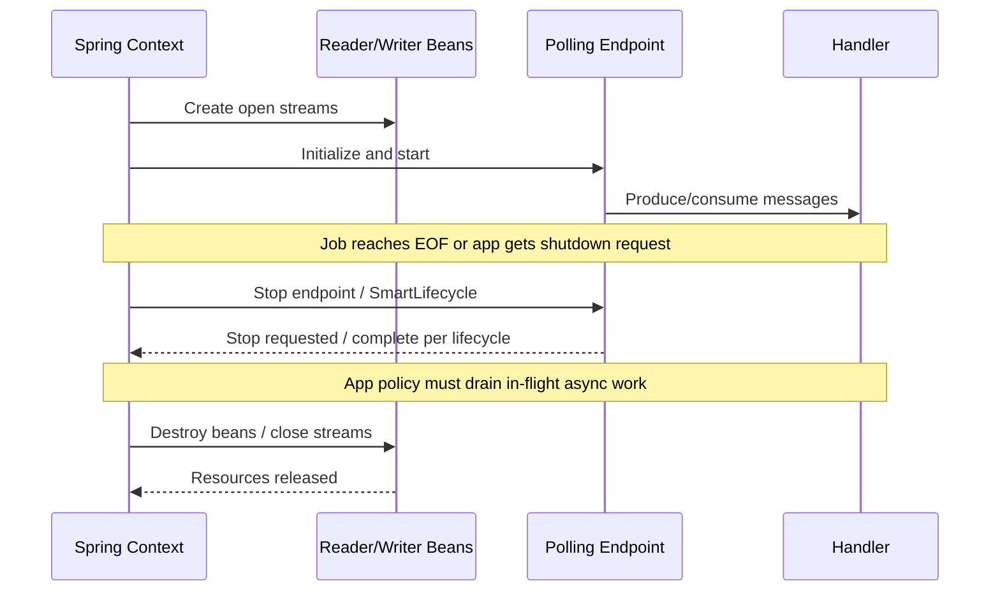
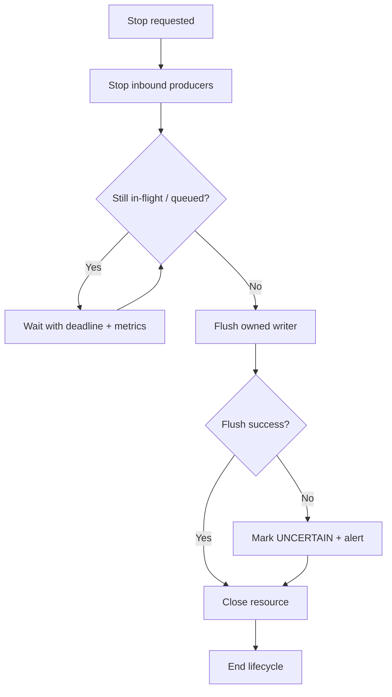
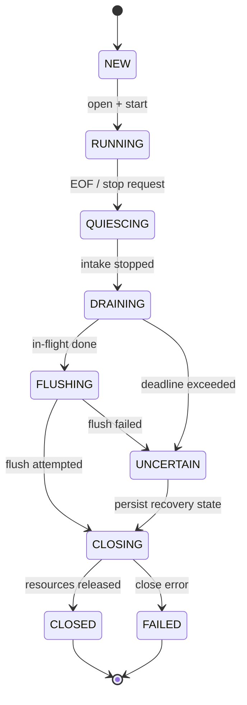

# Closing streams by lifecycle

## 1. Problem: stopping an adapter does not mean data is safe

In the **SPRING_INTEGRATION_ADAPTERS** module, Spring Integration connects external systems through inbound/outbound adapters, gateways, pollers, and `MessageChannel`. Systems can receive/send data via files, SFTP, HTTP, JMS, AMQP, Kafka, databases, and I/O streams that each have their own message contracts, errors, and lifecycles.

In the **Adapter Stream** chapter, **Closing streams by lifecycle** answers the question: *When a flow finishes, who stops receiving messages, who waits for consumers to finish, who flushes buffered data, and who actually closes `InputStream`, `OutputStream`, `Reader`, and `Writer`?*

Consider a job reading UTF-8 order lines from a file via `Reader`, turning them into Spring `Message<String>` items, and writing results via `Writer`:

```text
                ApplicationContext
                        |
             +----------+-----------+
             |                      |
         Input Reader           Output Writer
             |                      ^
             v                      |
    CharacterStreamReading          |
       MessageSource                |
             |                      |
        Polling Endpoint            |
             |                      |
             v                      |
         DirectChannel              |
             |                      |
             v                      |
           Consumer ----------> WritingMessageHandler
             |
        EOF / exception
             |
        Lifecycle coordinator
             |
      1. Stop intake / poller
      2. Drain in-flight / queue
      3. Flush writer
      4. Close owned resources
```

If you close the `Reader` while the poller is still inside `readLine()`, the task may throw `IOException` or remain blocked depending on the stream type. If you close the `Writer` before the consumer finishes, the last messages can be lost. If you only call `stop()` and leave file descriptors open, the application leaks resources. If you only call `flush()`, you still have **no** ACK or durability guarantee from the reader.

### Expected outcomes

After this lesson, you will be able to:

1. Distinguish between **endpoint running/stopped**, **stream open/closed**, **EOF**, and **business processing complete**.
2. Understand Spring Integration's `SmartLifecycle` and Spring's `DisposableBean`/`@PreDestroy`/`@Bean(destroyMethod = "close")` responsibilities.
3. Analyze why `StreamClosedEvent` can repeat and why calling `stop()` directly on the poller thread requires caution.
4. Build a stream reading and writing flow with managed resource ownership, cleanup, and event listeners.
5. Design graceful shutdown with **stop intake → drain → flush → close**, explicit deadlines, and partial-failure handling.
6. Know when **never to close** `System.in`, `System.out`, `System.err`, or streams owned by an SDK/connection manager.
7. Handle EOF, network disconnects, blocked reads/writes, timeouts, retries, idempotency, and restarts.
8. Write tests verifying that `close()` is called at the right time, with no double-close and no dangling threads or in-flight messages.

## 2. Four independent states to track

### 2.1. Is the adapter running or stopped?

`SourcePollingChannelAdapter` manages a `MessageSource<?>`. While running, the poller can invoke `receive()`. When you call `stop()` on the endpoint, at the lifecycle level you ask it to **stop triggering/polling**. This **does not automatically call `InputStream.close()`**, and an in-progress task may not terminate immediately if I/O or a handler does not respond to interruption.

### 2.2. Are the Reader/Writer closed yet?

A `Reader` or `Writer` is a Java resource. It can still be open when the endpoint has stopped, or be closed by another party while the endpoint is still running—the latter easily causes errors. Closing a wrapper like `BufferedReader`/`OutputStreamWriter` normally closes the underlying resource; therefore **there must be a single closing owner**.

### 2.3. Have we reached EOF or is there simply no data yet?

`EOF` means the data source has ended per the stream's contract. With default `CharacterStreamReadingMessageSource`, `Reader.ready()==false` causes `receive()` to return `null`; it is **not** an EOF event. Only when `blockToDetectEOF=true` is enabled does the character source actively read up to EOF and publish `StreamClosedEvent`.

### 2.4. Have business events been durably processed?

Reading a file to completion does not mean the database committed; calling `Writer.flush()` does not prove the receiver ACKed. If downstream has asynchronous queues, the program can hit EOF **before the queue drains**.

| Signal | Signal source | What it proves | What it does NOT prove |
| --- | --- | --- | --- |
| `adapter.isRunning()==false` | Spring `SmartLifecycle` | Endpoint is no longer in running state | Stream is closed, in-flight work committed |
| `receive()==null` | `MessageSource` | That poll produced no message | EOF, or no more messages ever |
| `StreamClosedEvent` | Character source with EOF detection enabled | Reader detected EOF | Output flushed, downstream committed |
| `InputStream.read()==-1` | Java I/O | Byte source reached EOF | Poller stopped |
| `Writer.flush()` succeeded | Java I/O | Java buffers pushed per contract | fsync / remote ACK / transaction |
| `close()` completed | Resource owner | Resource went through close | All business work finished |
| Business ACK | Application protocol | Condition confirmed by receiver | Sufficient on its own if ACK is too weak |

**Rule:** verify **completion signals** at every layer; never let one signal stand in for all other layers.

## 3. Spring lifecycle and Java stream lifecycle

Spring manages bean and endpoint lifecycles. Java manages resources through `Closeable`, `AutoCloseable`, and I/O wrappers.

### 3.1. Two different API groups

| Group | API | Responsibility |
| --- | --- | --- |
| Endpoint | `org.springframework.context.SmartLifecycle` | `start()`, `stop()`, `isRunning()`, phase, and stop callback |
| Polling endpoint | `SourcePollingChannelAdapter` | Triggers scheduled calls to `MessageSource.receive()` |
| Bean cleanup | `DisposableBean.destroy()` | Bean destruction hook when the container shuts down |
| Bean cleanup | `@Bean(destroyMethod="close")` | Spring calls `close()` when destroying the bean |
| Bean cleanup | `@PreDestroy` | Cleanup hook on a bean when the container closes |
| Java I/O | `InputStream.close()`/`Reader.close()` | Releases reading resources |
| Java I/O | `OutputStream.flush()/close()` | Pushes buffers / releases writing resources |

`stop()` and `close()` **are not synonymous**. A bean implementing `DisposableBean` also **does not guarantee** it will call `close()` on every I/O source or target you passed to its constructor; read each bean's contract, or assign ownership explicitly to an application-created resource bean.

### 3.2. Typical startup/shutdown sequence



When `ApplicationContext` closes cleanly, Spring runs the cycle of stopping lifecycle beans and then destroying beans. However, **not all in-flight I/O automatically waits until durable completion**: safety depends on actual threads, timeouts, channels, transactions, and handlers. When a process is killed abruptly, cleanup hooks may never run.

### 3.3. Stopping one adapter while keeping the ApplicationContext alive

A long-running application may stop **just one inbound adapter** for maintenance:

```java
import org.springframework.context.SmartLifecycle;

SmartLifecycle inboundAdapter = /* properly named endpoint bean */;

inboundAdapter.stop();
boolean stopped = !inboundAdapter.isRunning();
```

This is an **illustrative code snippet**, not a complete Spring bean. Stopping an adapter does not require closing the entire context. After stopping, the `Reader` may remain open for a subsequent `start()`—unless the source already hit EOF or was closed by its resource owner. **Do not call `start()` again on an already-closed source expecting it to reopen itself.**

## 4. Ownership: whoever opens a resource defines who closes it

There is no single "Spring closes everything automatically" answer. Each resource needs a **single owner**:

| Resource | Appropriate owner | Closing policy |
| --- | --- | --- |
| `Files.newInputStream(path)` in a bean | Application resource bean | `@Bean(destroyMethod="close")` |
| `Files.newBufferedReader(path, UTF_8)` | Application Reader bean | Close only the Reader wrapper; do not close raw stream twice |
| `Files.newBufferedWriter(path, UTF_8)` | Application Writer bean | Flush/drain then close per lifecycle |
| `ByteArrayInputStream` / `StringReader` | Test fixture | Closing may not hold OS resources; still test ownership |
| `System.in` | JVM or CLI runtime | Do not close from a feature sharing the JVM |
| `System.out` / `System.err` | JVM/logging runtime | Do not close from a stream handler |
| `Socket.getInputStream()` | Socket/connection manager | Close connection per session lifecycle |
| `Socket.getOutputStream()` | Socket/connection manager | Broken stream → needs a new connection |
| Stream from SDK/object store | SDK or transaction/upload session | Follow SDK's commit/abort/close contract |
| `GZIPInputStream` wrapping `FileInputStream` | Bean owning the outermost wrapper | Closing the wrapper closes the inner source |

### 4.1. Closing the outermost wrapper

```java
import java.io.BufferedReader;
import java.io.InputStreamReader;
import java.io.Reader;
import java.nio.charset.StandardCharsets;
import java.nio.file.Files;
import java.nio.file.Path;

Reader reader = new BufferedReader(
        new InputStreamReader(
            Files.newInputStream(Path.of("data/in.txt")),
            StandardCharsets.UTF_8
        ),
        8192
);
// When done: reader.close() closes the whole chain owned by the app.
```

If you also register the inner `InputStream` as a separate bean with `destroyMethod="close"`, and register the `Reader` wrapper with `destroyMethod="close"`, the container may call close **twice** on the same underlying resource. Many Java streams tolerate repeated close calls, but **never assume custom SDKs/sessions are idempotent**.

A cleaner design: expose only the **outermost wrapper** bean as the owner. If beans must be separated across layers, document one closing owner and ensure other beans **do not** close or pass a non-closing wrapper per contract.

### 4.2. try-with-resources and @Bean are two different lifecycles

`try (InputStream in = ...)` fits a **synchronous** method/job that creates and consumes a source within the same scope. Never wrap a stream returned as a singleton bean in `try-with-resources` where it goes out of scope before Spring Integration polls:

```java
// ANTI-PATTERN - do not do this:
@Bean
InputStream wrongInputStream() throws Exception {
    try (InputStream input = Files.newInputStream(
            Path.of("data/in.bin"))) {
        return input;  // already closed at the end of the try block!
    }
}
```

For Spring-managed beans, use a factory that returns an **open resource** and configure cleanup when the context closes:

```java
@Bean(destroyMethod = "close")
InputStream inputStream() throws Exception {
    return Files.newInputStream(Path.of("data/in.bin"));
}
```

Both snippets are **configuration fragments** to place in `@Configuration` with proper imports. The second snippet does not start a poller on its own; another `MessageSource` and inbound adapter must read from this stream.

### 4.3. Double-close and exceptions during close

`close()` can throw `IOException` or an SDK exception. Never assume closing always "succeeds silently". When cleaning up multiple resources, do not let the first exception prevent remaining resources from closing; use try-with-resources in synchronous jobs or a coordinator that catches and records each shutdown error.

For critical resources, guard against repeated closes with state/`AtomicBoolean`, but **place the guard on the proper owner**, not as a bandage hiding a multi-owner bug.

## 5. Stop intake → drain → flush → close

### 5.1. Standard sequence

```text
T0  Receive SIGTERM / admin stop / batch EOF
T1  Mark application NOT READY for new work
T2  Stop inbound poller / listener / producer
T3  Wait for in-flight work + bounded queue (deadline)
T4  Persist/reconcile pending or uncertain events
T5  Flush output buffers
T6  Close owned Writer/OutputStream and Reader/InputStream
T7  Destroy context / exit process
```

This is an **application design**, not a single Spring Integration API that performs every step automatically. In a simple `DirectChannel` flow, message processing is usually synchronous; in flows with `ExecutorChannel`/`QueueChannel`, pending messages may remain after the adapter stops.

### 5.2. Why does order matter?

| Closing at the wrong time | Possible consequence |
| --- | --- |
| Close `Reader` while poller is blocking | `IOException`, aborted job, or thread misses deadline |
| Close `Writer` while queue still has messages | `IOException` / loss of final messages |
| Flush before producers/consumers stop | New data can still arrive after flush |
| Stop poller but forget to close resource | File/socket descriptor leak |
| Close stream then call `start()` on old adapter | Immediate `IOException`/EOF or invalid state |
| Close `System.out` from one adapter | Logging and other components lose stdout |
| Call `ApplicationContext.close()` uncontrolled from poller callback | Interrupt/race/deadlock during shutdown and next tasks |

### 5.3. Deadlines and behavior when draining misses the cutoff

Do not wait forever. Pick a `shutdownDeadline`, such as 30 seconds, and distinguish:

- **Completed:** all messages requiring commit have contract-compliant ACKs.
- **Temporarily unfinished:** in-flight/queue not empty when the deadline expires.
- **Uncertain outcome:** the writer may have partially written, or an ACK may have been lost.

For critical events, persist `PENDING`/`UNCERTAIN` state **durably before closing** and recover via event IDs/idempotency. Never call `close()` early and report all events as `COMPLETED` merely because the process exited.

## 6. Character stream EOF and StreamClosedEvent

Spring Integration 6.5 provides `CharacterStreamReadingMessageSource` (package `org.springframework.integration.stream`). This is a pollable source for `Reader`:

```java
import java.io.Reader;
import org.springframework.integration.stream.CharacterStreamReadingMessageSource;

Reader reader = /* reader managed by the application */;
CharacterStreamReadingMessageSource source =
        new CharacterStreamReadingMessageSource(reader, 8192, true);
```

The third parameter `true` is **`blockToDetectEOF`**:

1. The poller calls `receive()`.
2. The source may **block during reading** waiting for data or EOF.
3. Once EOF is detected, it publishes **`StreamClosedEvent`** via Spring's `ApplicationEventPublisher`.
4. An application handler can receive the event to coordinate stopping.
5. If the poller keeps running, the source can **keep emitting the event on subsequent polls**.

### 6.1. Default does not detect EOF

With the default constructor or `blockToDetectEOF=false`, the source can check `BufferedReader.ready()`; `receive()==null` when no data is ready **does not mean EOF**. An interactive terminal should not shut itself down just because the user has not typed a new line yet.

### 6.2. An Event differs from a Spring Message

```text
Message<String>("ORDER,1001,PAID")
  -> via MessageChannel -> ServiceActivator

StreamClosedEvent
  -> via ApplicationEventPublisher -> ApplicationListener
```

`StreamClosedEvent` is **not** a `Message<String>` with payload `"EOF"`. Do not wire a Service Activator to listen for it on a business channel expecting the adapter to send it there.

### 6.3. Events are published on the poller thread

The Reference documentation warns that `StreamClosedEvent` is published on the **poller thread**. If a listener calls `stop()` synchronously, stopping the endpoint can interrupt that very thread. If you need to send a message to a `QueueChannel` after stopping, that send can be interrupted because the operation is interruptible.

**Safer pattern:** have the listener record EOF **once**, send any truly required completion information *before* stopping if the contract demands it, and hand off stop/cleanup to a **separate lifecycle executor** with a timeout.

### 6.4. stdin factory methods

| Factory | EOF mode | When to use |
| --- | --- | --- |
| `stdin()` / `stdin("UTF-8")` | Does not actively detect EOF | Interactive terminal |
| `stdinPipe()` / `stdinPipe("UTF-8")` | Detects EOF, supports closing application context | CLI/batch pipe and redirection |

`stdinPipe(...)` already includes EOF detection/context-closing mechanics per Javadoc. **Do not enable `stdinPipe` auto-close and also attach another listener closing the same context twice** unless you know exact ownership and coordination. Never use `stdinPipe` in a long-running service if a short stdin session is expected to end while the rest of the service must stay alive.

## 7. Byte streams have EOF but not the same event mechanism

`ByteStreamReadingMessageSource` accepts an `InputStream`, emits `byte[]` payloads, and defaults `bytesPerMessage` to **1024**. When `InputStream.read(...)` returns `-1`, the byte source may simply have no more messages to emit; **do not assume it publishes `StreamClosedEvent` like a character source with `blockToDetectEOF` enabled**.

| Situation | Observable behavior | Action |
| --- | --- | --- |
| Finite byte file exhausted | `receive()==null` | Confirm EOF via a separate contract if completion is needed |
| TCP stream has no bytes yet | `available()==0` or read blocks | Do not treat `available()==0` as EOF |
| SDK stream closed by server | `IOException` or `read()==-1` depending on SDK | Connection/session lifecycle |
| Text reader with EOF detection | `StreamClosedEvent` | Stop adapter cleanly |
| App initiates shutdown | Context lifecycle hooks | Stop intake, drain, close owned streams |

If a binary job needs **exact EOF**, you can write a custom `MessageSource` checking `read()==-1`, use protocol counts/lengths, or switch to the File adapter which understands complete files. Never rely solely on `receive()==null` to close a socket that might still receive data later.

## 8. Spring Boot example: Reader/Writer closed when the context ends

This sample application uses **Java 17+** and Spring Integration **6.5.x**. It reads a finite UTF-8 file, writes each line to another UTF-8 file through Spring Integration, emits `StreamClosedEvent` on EOF, and **stops the inbound endpoint using a separate executor**. Spring closes the `Reader`/`Writer` when the context is actually destroyed.

### 8.1. Dependencies

```xml
<dependencies>
    <dependency>
        <groupId>org.springframework.boot</groupId>
        <artifactId>spring-boot-starter-integration</artifactId>
    </dependency>
    <dependency>
        <groupId>org.springframework.integration</groupId>
        <artifactId>spring-integration-stream</artifactId>
    </dependency>
</dependencies>
```

Let the Spring Boot BOM manage versions where compatible. If managing versions manually, keep Spring Integration artifacts aligned. In 6.5, import stream classes from `org.springframework.integration.stream`; in 7.x, source/handler imports live in subpackages. Do not mix 6.5 with 7.x.

### 8.2. application.yml

```yaml
app:
  stream-lifecycle:
    input-path: ${STREAM_INPUT_PATH:./data/batch-in.txt}
    output-path: ${STREAM_OUTPUT_PATH:./data/batch-out.txt}
```

The example accepts paths from a **trusted operator**, never arbitrary paths from HTTP requests. The input file must exist before the application starts. The output file is created/truncated when the bean initializes; **do not** use `TRUNCATE_EXISTING` for production data requiring crash/restart recovery.

### 8.3. Complete Spring Boot configuration

```java
import java.io.IOException;
import java.io.Reader;
import java.io.Writer;
import java.nio.charset.StandardCharsets;
import java.nio.file.Files;
import java.nio.file.Path;
import java.nio.file.StandardOpenOption;
import java.time.Duration;
import java.util.concurrent.ExecutorService;
import java.util.concurrent.Executors;
import java.util.concurrent.atomic.AtomicBoolean;

import org.springframework.beans.factory.annotation.Qualifier;
import org.springframework.beans.factory.annotation.Value;
import org.springframework.boot.SpringApplication;
import org.springframework.boot.autoconfigure.SpringBootApplication;
import org.springframework.context.ApplicationContext;
import org.springframework.context.ApplicationListener;
import org.springframework.context.SmartLifecycle;
import org.springframework.context.annotation.Bean;
import org.springframework.integration.annotation.ServiceActivator;
import org.springframework.integration.channel.DirectChannel;
import org.springframework.integration.config.EnableIntegration;
import org.springframework.integration.dsl.IntegrationFlow;
import org.springframework.integration.dsl.Pollers;
import org.springframework.integration.stream.CharacterStreamReadingMessageSource;
import org.springframework.integration.stream.CharacterStreamWritingMessageHandler;
import org.springframework.integration.stream.StreamClosedEvent;
import org.springframework.messaging.MessageChannel;

@SpringBootApplication
@EnableIntegration
public class StreamLifecycleApplication {

    public static void main(String[] args) {
        SpringApplication.run(StreamLifecycleApplication.class, args);
    }

    @Bean(name = "batchReader", destroyMethod = "close")
    public Reader batchReader(
            @Value("${app.stream-lifecycle.input-path}") String filename)
            throws IOException {

        Path input = Path.of(filename).toAbsolutePath().normalize();
        return Files.newBufferedReader(input, StandardCharsets.UTF_8);
    }

    @Bean(name = "batchWriter", destroyMethod = "close")
    public Writer batchWriter(
            @Value("${app.stream-lifecycle.output-path}") String filename)
            throws IOException {

        Path output = Path.of(filename).toAbsolutePath().normalize();
        if (output.getParent() != null) {
            Files.createDirectories(output.getParent());
        }
        return Files.newBufferedWriter(
                output,
                StandardCharsets.UTF_8,
                StandardOpenOption.CREATE,
                StandardOpenOption.TRUNCATE_EXISTING,
                StandardOpenOption.WRITE);
    }

    @Bean(name = "batchCharacterSource")
    public CharacterStreamReadingMessageSource batchCharacterSource(
            @Qualifier("batchReader") Reader reader) {

        return new CharacterStreamReadingMessageSource(
                reader, 8192, true);
    }

    @Bean
    public MessageChannel batchLines() {
        return new DirectChannel();
    }

    @Bean
    public IntegrationFlow batchReadFlow(
            @Qualifier("batchCharacterSource")
            CharacterStreamReadingMessageSource source) {

        return IntegrationFlow
                .from(source, endpoint -> endpoint
                        .id("batchStreamInbound")
                        .poller(Pollers.fixedDelay(
                                        Duration.ofMillis(200))
                                .maxMessagesPerPoll(1)))
                .channel("batchLines")
                .get();
    }

    @Bean
    @ServiceActivator(inputChannel = "batchLines")
    public CharacterStreamWritingMessageHandler batchWriteHandler(
            @Qualifier("batchWriter") Writer writer) {

        return new CharacterStreamWritingMessageHandler(writer)
                .appendNewLine(true);
    }

    @Bean(name = "streamLifecycleExecutor",
            destroyMethod = "shutdown")
    public ExecutorService streamLifecycleExecutor() {
        // Demo: a dedicated worker for lifecycle operations.
        // Production: manage a bounded task queue and shutdown deadline.
        return Executors.newSingleThreadExecutor();
    }

    @Bean
    public ApplicationListener<StreamClosedEvent> batchEofListener(
            ApplicationContext context,
            @Qualifier("streamLifecycleExecutor")
            ExecutorService lifecycleExecutor) {

        AtomicBoolean once = new AtomicBoolean();

        return event -> {
            // This example has only one CharacterStreamReadingMessageSource.
            // With multiple sources, correlate the event with the right source.
            if (!once.compareAndSet(false, true)) {
                return;
            }

            // Do NOT stop synchronously inside the poller thread.
            lifecycleExecutor.execute(() -> {
                SmartLifecycle endpoint =
                        context.getBean(
                                "batchStreamInbound",
                                SmartLifecycle.class);
                endpoint.stop();
                System.err.println(
                        "EOF observed: inbound poller stopped");
                // Streams are not closed here.
                // When the Spring context actually closes,
                // batchReader/batchWriter will be destroyed.
            });
        };
    }
}
```

**Scope:** this is a configuration/orchestration example, not a batch engine with exactly-once guarantees. It does not call `ApplicationContext.close()` at EOF: **the adapter stops, while the context and `Reader`/`Writer` may still remain open**. Close the context via the application's management/shutdown path after verifying downstream work has completed. When multiple stream sources share a context, filter events by source; this example has *only one source* so it uses `AtomicBoolean` to deduplicate the event.

### 8.4. Flow explanation

1. Spring creates `batchReader` and `batchWriter` beans from files; the wrapper beans themselves own the resources.
2. `CharacterStreamReadingMessageSource(reader, 8192, true)` can block to detect EOF.
3. The `SourcePollingChannelAdapter` named `batchStreamInbound` calls `receive()` via its poller.
4. `DirectChannel` passes each `Message<String>` synchronously to the writer handler.
5. The handler appends a newline after each payload and writes to `batchWriter`.
6. When the reader reaches EOF, the source emits `StreamClosedEvent`.
7. The listener uses `AtomicBoolean` to avoid duplicate handling and dispatches `stop()` to a separate executor, **not executing it directly on the poller thread**.
8. When the context closes, Spring destroys `batchReader`/`batchWriter`; the writer's `close()` may flush remaining buffered bytes.

`@Bean(destroyMethod="close")` establishes a clear cleanup boundary; it does not replace **the drain and business-acknowledgement sequence**. In production, if async executors/queues exist, the coordinator must wait for them to finish before closing the writer.

### 8.5. Expected input/output

```text
Input file:
ORDER,1001,CREATED
ORDER,1002,PAID

Output file after context stop/close:
ORDER,1001,CREATED
ORDER,1002,PAID
```

This is an **illustrative result**, not executed in STEP 4. When verifying, read the output **after the context has closed or the writer has flushed per policy**; do not inspect the file too early and conclude data was lost while still buffered.

### 8.6. Why not let the listener call context.close() immediately?

`StreamClosedEvent` fires on the poller thread. Even if `context.close()` runs on another thread, closing the **entire context** also stops other flows and destroys non-stream beans. If the application also serves HTTP/JMS/Kafka, EOF on one file is **not a sufficient signal** to shut down the whole service.

In a multi-source application, let a **job coordinator** decide:

```text
EOF input A ----+
                +--> Job state ---> Drain ---> Flush ---> Close job resources
EOF input B ----+                 |
                                  +--> Keep other service flows alive
```

Never let a listener for source A close shared Kafka/JMS connections or the entire application context while source B is still running.

## 9. Distinguishing endpoint stop from context close

### Stopping a single endpoint

If you only want to stop a source from ingesting more messages while the app stays up:

```java
import org.springframework.context.ApplicationContext;
import org.springframework.context.SmartLifecycle;

ApplicationContext context = /* Spring context */;

SmartLifecycle inbound = context.getBean(
        "batchStreamInbound", SmartLifecycle.class);
inbound.stop();
```

This is a **code fragment** and takes effect when the endpoint bean exists with the ID assigned in the DSL. After stopping, `batchReader` may still be open and the output writer bean can still serve another flow. If a `read()` call is blocking, verify actual stop timing with that source type.

### Closing the entire context

When you truly want to shut down:

```java
import org.springframework.context.ConfigurableApplicationContext;

ConfigurableApplicationContext context =
        /* context returned by SpringApplication.run(...) */;

context.close();
```

`close()` runs the stop and destruction cycle for Spring beans per contract. It **does not guarantee** that every external service committed business state or that async workers wait indefinitely. Define shutdown phases/deadlines and handle incomplete states.

### @PreDestroy or destroyMethod?

```java
import java.io.IOException;
import java.io.OutputStream;

public final class OwnedOutput implements AutoCloseable {
    private final OutputStream output;

    public OwnedOutput(OutputStream output) {
        this.output = output;
    }

    @Override
    public void close() throws IOException {
        output.flush();
        output.close();
    }
}
```

An output-owning wrapper can be registered as:

```java
@Bean(destroyMethod = "close")
OwnedOutput ownedOutput() throws IOException {
    return new OwnedOutput(
            Files.newOutputStream(Path.of("data/result.bin")));
}
```

Place both snippets in an appropriate Java file with full imports. This is **one way** to create a dedicated resource bean; not every stream handler must wrap with `OwnedOutput`. If you use both `@PreDestroy` **and** `@Bean(destroyMethod="close")` on **the same bean** closing the same stream, guard carefully against double-close; better yet, choose **a single owner hook** for closing.

## 10. XML: managing resources and lifecycle outside DSL

An XML configuration can wire a source/handler with application-supplied `Reader`/`Writer` beans:

```xml
<beans:beans
    xmlns:beans="http://www.springframework.org/schema/beans"
    xmlns:xsi="http://www.w3.org/2001/XMLSchema-instance"
    xmlns:int="http://www.springframework.org/schema/integration"
    xsi:schemaLocation="
        http://www.springframework.org/schema/beans
        https://www.springframework.org/schema/beans/spring-beans.xsd
        http://www.springframework.org/schema/integration
        https://www.springframework.org/schema/integration/spring-integration.xsd">

    <!-- batchReader / batchWriter: two resource beans
         provided by Java config or another bean factory. -->

    <beans:bean id="batchSource"
                class="org.springframework.integration.stream.CharacterStreamReadingMessageSource">
        <beans:constructor-arg ref="batchReader"/>
        <beans:constructor-arg value="8192"/>
        <beans:constructor-arg value="true"/>
    </beans:bean>

    <int:channel id="batchInputLines"/>

    <int:inbound-channel-adapter
            id="batchStreamInboundXml"
            ref="batchSource"
            channel="batchInputLines"
            auto-startup="true">
        <int:poller fixed-delay="250"
                    max-messages-per-poll="1"/>
    </int:inbound-channel-adapter>

    <beans:bean id="batchSink"
                class="org.springframework.integration.stream.CharacterStreamWritingMessageHandler">
        <beans:constructor-arg ref="batchWriter"/>
        <beans:property name="shouldAppendNewLine"
                        value="true"/>
    </beans:bean>

    <int:outbound-channel-adapter
            id="batchStreamOutboundXml"
            channel="batchInputLines"
            ref="batchSink"/>
</beans:beans>
```

This is a **configuration fragment**, since `batchReader`/`batchWriter` must be defined separately. Providing them via Java `@Bean(destroyMethod="close")` or a controlled owner bean is recommended. XML **does not automatically generate a cleanup method for an external resource just because it is passed to a handler**. Attach a `StreamClosedEvent` listener / lifecycle coordinator if the job needs to stop right after EOF.

Do not enable both this XML flow and the Java DSL flow from section 8 if they read/write **the same** stream: two readers will split lines and two writers will interleave output.

## 11. Using stdinPipe for standalone CLIs

For an application acting **strictly as a CLI batch job** that should terminate when the pipe finishes, `stdinPipe("UTF-8")` provides EOF detection and context closing.

```java
import org.springframework.integration.stream.CharacterStreamReadingMessageSource;

CharacterStreamReadingMessageSource source =
        CharacterStreamReadingMessageSource.stdinPipe("UTF-8");
```

POSIX shell examples:

```bash
cat events.txt | java -jar stream-cli.jar
java -jar stream-cli.jar < events.txt
```

This is an **illustrative CLI snippet**, not executed. Do not blindly enable `stdinPipe` auto-close inside a multi-purpose service, because EOF on stdin does not necessarily mean HTTP/JMS/Kafka flows should stop. For interactive terminals, `stdin("UTF-8")` may be a better fit.

### Do not close System.in/System.out arbitrarily

- `System.in` is typically shared across the process; closing it from one feature can block other CLI features from reading input.
- `System.out`/`System.err` are standard streams shared by logging/console and libraries; closing them early can lose logs.
- `stdinPipe` can trigger **context lifecycle** on EOF per contract; this is **different** from application code calling `System.in.close()` inside a consumer.
- If you are a dedicated standalone CLI process designed to own stdin/stdout completely, rules may differ; document ownership explicitly rather than applying it to shared-JVM apps.

## 12. Blocked InputStream/Reader: how to stop?

One of the hardest operational bugs is **requesting stop while the thread refuses to stop**:

```text
Poller Thread
     |
     v
InputStream.read(...) / Reader.readLine()
     |
     v
BLOCKED until data / EOF / IOException
     ^
     |
SmartLifecycle.stop() on another thread
     |
     v
Not every InputStream exits immediately on interrupt
```

### 12.1. Interrupt, close, and timeout are three distinct mechanisms

| Mechanism | Possible effect | Limitation |
| --- | --- | --- |
| `Thread.interrupt()` | Sets interrupt flag; some blocking APIs abort | `InputStream.read()` often depends on implementation |
| `InputStream.close()` from a manager thread | Some streams unblock a waiting read | Not all stream types behave or respond with the same latency |
| `Socket.setSoTimeout(...)` | Bounds blocking socket read duration | Not a general `OutputStream.write()` timeout |
| SDK/client timeout | Aborts request/connection per SDK contract | May require session abort/cancel |
| End producer / close pipe | Reader sees EOF | Must avoid deadlocks between producer and consumer |

`fixedDelay(200)` only sets the **poll schedule**, not a 200 ms read timeout. If a `receive()` blocks, the poller cannot return the thread to the scheduler in time.

### 12.2. Shutdown by specific source type

| Source | Recommended coordination |
| --- | --- |
| `ByteArrayInputStream` | Finite in RAM, EOF by data length |
| `StringReader` | Finite by string, convenient for tests |
| `FileInputStream` | Stop poller, wait for in-flight, close file via owner |
| `PipedInputStream` | Let producer stop, close write/read ends in order; test deadlines |
| `Socket.getInputStream()` | Connection manager handles timeouts/disconnects, may close socket |
| SDK network input | Use abort/cancel/close APIs defined by SDK |
| `System.in` | Do not close from a module; shut down via CLI runtime |

**Do not create a new `InputStream` on every poll to "fix" a deadlock**: doing so causes duplicate reads or state loss. When reconnect or reopen is required, use a **source manager** with explicit state transitions.

## 13. Writing OutputStream/Writer: drain and flush on time

A stream-writing handler may block inside `write(...)` or retain data in buffers. With `DirectChannel`, the consumer normally runs synchronously on the sending path. With `ExecutorChannel`/`QueueChannel`, the producer may finish `send()` before the writer **finishes writing**.



### 13.1. Stop producers before the writer

If the context has HTTP inbound, a JMS listener, and a stream writer, stopping only stream inbound **does not stop** HTTP/JMS from pushing messages to the writer. The job coordinator must know **all producers** capable of feeding that sink before allowing close.

### 13.2. Flush and close

`Writer.flush()`/`OutputStream.flush()` pushes data out of buffering layers per contract; `close()` terminates the resource and typically flushes first. However:

- `flush()` succeeding **does not mean fsync** to storage hardware.
- `close()` succeeding **does not mean the receiver parsed/committed**.
- `close()` can throw `IOException` after partial writes; never swallow the error and delete the pending outbox.
- If a writer wraps an `OutputStream`, **closing the outermost wrapper** is the standard rule—do not also close the raw stream from another bean.

### 13.3. Atomic file publication vs. stream close

Closing a `FileOutputStream` does not turn the file being written into an **atomically published file**. If a consumer watches the file while the writer is writing, it can read an incomplete file. When you need a file to "appear only once finished", use the File outbound adapter with a temporary suffix/rename or a temp-file + fsync/atomic-move workflow supported by the filesystem.

### 13.4. Pipes and broken pipes

If the reader closes first, the writer may encounter `IOException`, `Broken pipe`, or an error observable only on flush/close depending on the sink. With `System.out` (typically a `PrintStream`), error tracking has its own semantics; **do not assume every stdout failure immediately becomes a Spring `MessagingException` during `send()`**.

## 14. A testable lifecycle state machine

Do not model lifecycle as a single `closed=true/false` boolean. A stream job goes through distinct states:



### 14.1. Key invariants

1. **No new reads** after transitioning to `QUIESCING`.
2. **Do not close the writer** while any producer can still send new messages.
3. **Do not report `COMPLETED`** merely because the endpoint stopped.
4. If draining exceeds the deadline, **persist uncertain state** instead of discarding events.
5. **Idempotent close** at the resource owner; concurrent EOF/SIGTERM callbacks must not race to close.
6. **Do not restart the endpoint** on a closed or EOF-exhausted stream without creating a new source.
7. Metrics and logs must record why close occurred: normal EOF, administrative stop, timeout, read/write error, or crash recovery.

### 14.2. Why stop then start is not reconnect

`SmartLifecycle.start()`/`stop()` controls the endpoint; it does not replace a broken `Socket` or `OutputStream`. To reopen:

```text
RUNNING old stream
       |
 disconnect / fatal I/O
       v
QUIESCING -> DRAIN/UNCERTAIN
       |
close old stream
       |
connection manager creates NEW stream
       |
new source / handler wiring or a managed delegation layer
       |
start NEW lifecycle epoch
```

Simply assigning a new stream to the same Java variable is not enough; check thread safety, which references the source/handler holds, event correlation, and pending messages from the old session. For real TCP/HTTP/SFTP, specialized adapters and connection/session factories are much safer than swapping raw streams manually.

### 14.3. Combining with Spring Boot graceful shutdown

Setting `server.shutdown=graceful` primarily coordinates the **web server** via Spring Boot's mechanism. It **does not automatically turn custom `InputStream.read()`, `OutputStream.write()`, and internal queues into a complete batch drain**. For flows using JMS/Kafka/AMQP/HTTP or long-lived I/O, define per-endpoint shutdown policies and an application-wide deadline.

## 15. Graceful shutdown and idempotency for critical data

Consider a service turning file lines into inventory update commands:

```text
Reader.readLine() -> OrderEvent -> Database transaction
                         |
                 DB commit succeeds
                         |
                 ACK / checkpoint
```

If the `Reader` read a line and the DB transaction rolled back, **the `Reader` does not rewind itself**. If the flow shuts down immediately, the message may be lost. If the file is reopened from the start and replayed completely, duplicates may be processed.

### 15.1. Safer processing pattern

```text
Source file / stream
        |
        v
Validate + parse complete record
        |
        v
Durable inbox with eventId
        |
        v
Business consumer + unique constraint
        |
        v
Business commit / ACK
        |
        v
Update checkpoint / job status
```

| Business state | Meaning | Action on shutdown |
| --- | --- | --- |
| `PENDING` | Not processed yet | Retain for replay |
| `PROCESSING` | In progress, outcome uncertain | Wait up to deadline or mark `UNCERTAIN` |
| `COMPLETED` | Fully confirmed per contract | Do not reprocess |
| `FAILED` | Retry budget exhausted / permanent error | Quarantine/alert |
| `UNCERTAIN` | Unclear whether receiver committed | Reconcile / idempotent retry |

These are **application states**, not built-in states of `CharacterStreamReadingMessageSource` or `SmartLifecycle`.

### 15.2. Checkpoint principles

- Checkpoint at the **committed data position**, not bytes merely read into a buffer.
- Store file/source identity (name, size, version/hash) to avoid applying an old offset to a new file.
- Do not use Spring's regenerated `MessageHeaders.ID` as a durable event ID.
- If the source is non-seekable/non-replayable (stdin/sockets), persist to durable staging before side effects whenever event loss is unacceptable.

### 15.3. Never promise exactly-once from close()

`close()` only releases I/O resources. It does not create a distributed transaction across `Reader`/`Writer` and a database/JMS/Kafka. Reliability requires broker ACKs, idempotent consumers, durable inboxes/outboxes, or an appropriate acknowledgement protocol.

## 16. Cleanup errors and observing ErrorMessage

### 16.1. Distinguishing I/O errors from completion signals

| Situation | Error or normal? | Recommended handling |
| --- | --- | --- |
| Character source hits EOF | Normal in finite batch | Stop and clean up |
| `Reader.ready()==false` | No data yet | Do not auto-shutdown |
| `IOException` while reading | I/O error | Classify source, retry if safe |
| `IOException` during flush/close | Output/cleanup error | Report uncertain state, audit |
| `NotConnectedException` from another SDK | Connection error | Dedicated connection lifecycle |
| Repeated `StreamClosedEvent` | Post-EOF polling effect | Dedup, stop adapter |
| Queue not drained at deadline | Incomplete shutdown | Persist pending/uncertain |
| `close()` called twice | Ownership bug or callback race | Review owner/hooks, idempotent guard |

### 16.2. Spring errorChannel does not mean "every close error"

Spring Integration's `errorChannel` and `ErrorMessage` are normally used when the framework catches errors along supported message-processing paths. However, an error from `@PreDestroy`, `destroyMethod`, or a lifecycle callback **does not necessarily** get converted into an `ErrorMessage` on the global channel.

**Do not rely on `errorChannel` to know whether a file closed safely.** The cleanup coordinator must record flush/close outcomes directly into metrics, audits, and job state; integration tests must verify where exceptions actually surface.

### 16.3. Do not mask the primary exception with a cleanup exception

In synchronous batch methods, `try-with-resources` preserves the primary exception and records close errors under **suppressed exceptions**:

```java
import java.io.IOException;
import java.io.Reader;
import java.nio.charset.StandardCharsets;
import java.nio.file.Files;
import java.nio.file.Path;

public final class CharacterCountJob {

    public long countCharacters(Path input) throws IOException {
        try (Reader reader = Files.newBufferedReader(
                input, StandardCharsets.UTF_8)) {
            long count = 0;
            char[] buffer = new char[4096];
            int n;
            while ((n = reader.read(buffer)) != -1) {
                count += n;
            }
            return count;
        }
    }
}
```

This is an **illustrative class** you can save as `CharacterCountJob.java`; `count` counts UTF-16 code units, not code points. When both the body and `close()` throw, try-with-resources keeps the primary exception and attaches the close exception via `getSuppressed()`. For streams outliving a single method, do not use try-with-resources where it would close the resource before Spring beans use it.

## 17. Testing lifecycle: counting closes and verifying EOF

### 17.1. Testing that Spring calls close on a resource bean

This is a simple test requiring only Spring Context + JUnit 5; it **does not need to run a poller**. The `Reader` bean with `destroyMethod="close"` is closed when the context terminates:

```java
import static org.junit.jupiter.api.Assertions.assertEquals;

import java.io.StringReader;
import java.util.concurrent.atomic.AtomicInteger;

import org.junit.jupiter.api.Test;
import org.springframework.context.annotation.AnnotationConfigApplicationContext;
import org.springframework.context.annotation.Bean;
import org.springframework.context.annotation.Configuration;

class ManagedReaderLifecycleTest {

    @Configuration
    static class ResourceConfig {
        static final AtomicInteger closes = new AtomicInteger();

        @Bean(destroyMethod = "close")
        StringReader trackedReader() {
            return new StringReader("one\ntwo\n") {
                @Override
                public void close() {
                    closes.incrementAndGet();
                    super.close();
                }
            };
        }
    }

    @Test
    void closesReaderWhenContextEnds() {
        ResourceConfig.closes.set(0);

        try (AnnotationConfigApplicationContext context =
                new AnnotationConfigApplicationContext(
                        ResourceConfig.class)) {
            StringReader reader =
                    context.getBean(StringReader.class);
            assertEquals(0, ResourceConfig.closes.get());
        }

        assertEquals(1, ResourceConfig.closes.get());
    }
}
```

This is a **suggested test, not run in STEP 4**. Using a static `AtomicInteger` suits sequential test runs; for parallel tests, use per-test fixture instances to avoid shared mutable state.

### 17.2. Testing the difference between stop and close

An integration test for a polled flow:

1. Start `ApplicationContext` with a `Reader` fixture and an endpoint with a fixed `id`.
2. Assert `isRunning()==true` after the flow starts.
3. Call `endpoint.stop()`, verify the adapter stops within the deadline.
4. Assert the `Reader` **was not closed by `stop()` alone**, per the test's bean-owner policy.
5. Call `context.close()`, verify the `Reader`/`Writer` `close()` hook is invoked.
6. Attempt calling `start()` when the source is closed and verify the application **does not treat it as a successful reopen**.

Do not assert that all `start()` APIs throw the exact same exception: behavior depends on the source/sink and may surface as EOF/null, `IOException`, or another error.

### 17.3. Testing that the EOF listener does not process duplicates

Create `StringReader("alpha\nbeta\n")` and a source with `blockToDetectEOF=true`, register a test `ApplicationEventPublisher`, and invoke `receive()`:

```text
receive #1 -> "alpha"
receive #2 -> "beta"
receive #3 -> null + StreamClosedEvent
receive #4 -> possibly null + another StreamClosedEvent
```

Expect an application using `AtomicBoolean` to record **only one completion** even if the technical event fires multiple times. In test publishers, avoid calling stop/close directly on the simulated poll thread so lifecycle issues are not masked.

### 17.4. Testing a blocked reader

With `PipedReader`/`PipedWriter`:

1. Create a slow producer thread, open the pipe, and let the poller block on read.
2. Send a stop request from another thread.
3. Close the appropriate pipe end per policy, with a deadline and cleanup.
4. Verify the poller thread finishes within an acceptable timeframe.
5. Repeat with a simulated SDK/socket source that ignores interrupts.

**Do not rely solely on fixed `Thread.sleep()` calls**; tests should await state conditions/`CountDownLatch` with an overall timeout.

## 18. Testing Writer flush/close and partial failures

### 18.1. Unflushed BufferedWriter

```java
import java.io.BufferedWriter;
import java.io.ByteArrayOutputStream;
import java.io.OutputStreamWriter;
import java.nio.charset.StandardCharsets;

ByteArrayOutputStream sink = new ByteArrayOutputStream();
BufferedWriter writer = new BufferedWriter(
        new OutputStreamWriter(sink, StandardCharsets.UTF_8),
        8192);

writer.write("ORDER,1001,PAID\n");
writer.flush();
byte[] written = sink.toByteArray();
writer.close();
```

This is a **test snippet** to place inside a JUnit method with assertions. Once `writer.flush()` completes, bytes reside in `ByteArrayOutputStream`. For files/sockets/SDKs, flush **does not prove remote ACK or fsync**—it only proves buffers in the relevant layers were pushed per contract.

### 18.2. Tracking OutputStream

A test double detecting double-close or write-after-close:

```java
import java.io.ByteArrayOutputStream;
import java.io.IOException;
import java.io.OutputStream;
import java.util.concurrent.atomic.AtomicBoolean;
import java.util.concurrent.atomic.AtomicInteger;

public final class TrackingOutputStream extends OutputStream {

    private final ByteArrayOutputStream delegate =
            new ByteArrayOutputStream();
    private final AtomicBoolean closed = new AtomicBoolean();
    private final AtomicInteger closes = new AtomicInteger();

    @Override
    public synchronized void write(int value) throws IOException {
        if (closed.get()) {
            throw new IOException("write after close");
        }
        delegate.write(value);
    }

    @Override
    public synchronized void flush() throws IOException {
        if (closed.get()) {
            throw new IOException("flush after close");
        }
    }

    @Override
    public synchronized void close() {
        closes.incrementAndGet();
        closed.set(true);
    }

    public int closeCount() {
        return closes.get();
    }

    public synchronized byte[] snapshot() {
        return delegate.toByteArray();
    }
}
```

In tests, pass it as the `OutputStream` to the byte writer handler or wrap it in `OutputStreamWriter`. After the Spring context closes, assert `closeCount()==1` (when you designed a single owner); test writing after close to confirm the expected error. This is a **suggested fixture**, not an executed test.

### 18.3. Flush failure differs from close failure

A sink may:

- Accept partial bytes and then throw `IOException` inside `write()`.
- Fail only inside `flush()`.
- Write cleanly yet fail inside `close()`.
- Close cleanly while the receiver still has not committed.

Test each scenario separately. After a partial write failure, never blindly resend the same frame without an **event ID**, framing recovery, and reader-side idempotency.

### 18.4. When close throws, still attempt to release resources

A thorough owner must report **both flush and close failures** rather than swallowing one:

```java
import java.io.IOException;
import java.io.OutputStream;
import java.util.concurrent.atomic.AtomicBoolean;

public final class SingleCloseOutputOwner implements AutoCloseable {

    private final OutputStream output;
    private final AtomicBoolean closeRequested = new AtomicBoolean();

    public SingleCloseOutputOwner(OutputStream output) {
        this.output = output;
    }

    @Override
    public void close() throws IOException {
        if (!closeRequested.compareAndSet(false, true)) {
            return;
        }

        IOException failure = null;
        try {
            output.flush();
        }
        catch (IOException ex) {
            failure = ex;
        }

        try {
            output.close();
        }
        catch (IOException ex) {
            if (failure == null) {
                failure = ex;
            }
            else {
                failure.addSuppressed(ex);
            }
        }

        if (failure != null) {
            throw failure;
        }
    }
}
```

This is an **illustrative Java class**. `AtomicBoolean` prevents concurrent threads from calling physical close twice; it does not make the output thread-safe for **concurrent writes**, nor does it prove close succeeded if the first call threw an exception. On error, the owner must record `FAILED/UNCERTAIN` state and operators must inspect the sink; do not call `close()` in an infinite retry loop.

## 19. Production application shutdown runbook

Suppose a service has three flows:

```text
SFTP inbound ---> transform ----+
                               |
HTTP inbound ---> validate ----+---> Queue/Broker ---> Writer
                               |
Stream stdin ---> parse -------+
```

EOF on stdin only ends **one source**. If the `Writer` is shared by SFTP/HTTP, you cannot close the `Writer` yet. Runbook:

### 19.1. Before shutdown

1. Identify **resource owners** and every endpoint still able to send to the `Writer`.
2. Flip application readiness so unnecessary new jobs are not accepted.
3. Stop each inbound endpoint/lifecycle group in policy order.
4. Wait for blocked sources to exit; if they do not, use the transport's own timeout/abort.
5. Monitor `inFlight`, queue depth, writer latency, and unacknowledged events.

### 19.2. During drain

6. Wait for consumers to finish up to the deadline, never indefinitely.
7. For unfinished events, persist `PENDING/UNCERTAIN` to a durable store.
8. Reject new messages to the sink once closing begins.
9. Flush per contract and classify any errors.
10. Close resources at the **single owner** and record the close status.

### 19.3. After shutdown

11. Verify open file descriptors/sockets do not grow across job runs.
12. Check committed messages and `UNCERTAIN` events needing reconciliation.
13. Verify output files have the right encoding, framing, record count, and no partial trailing frames.
14. On restart, **create fresh streams**—never reuse closed instances.
15. Ensure startup does not accidentally truncate or overwrite durable data.

### 19.4. SIGTERM and container orchestrators

When a container receives SIGTERM, the runtime typically grants a **finite grace period** before sending SIGKILL. A process terminated by SIGKILL or power loss **cannot run `@PreDestroy` or `destroyMethod`**. Design under the assumption that cleanup can be skipped: use durable staging, idempotency, recovery, and atomic publication where needed.

## 20. Observability, security, and resource limits

### 20.1. Suggested metrics

| Metric | Meaning | Note |
| --- | --- | --- |
| `stream_lifecycle_open_resources` | Open `Reader`/`Writer`/`InputStream`/`OutputStream` count | Break down by owner type |
| `stream_lifecycle_close_total` | Total close attempts requested | Distinguish success vs. failure |
| `stream_lifecycle_eof_events_total` | Count of `StreamClosedEvent`s | Can repeat per poll |
| `stream_lifecycle_eof_jobs_total` | Deduplicated EOF-completed jobs | Distinct from raw technical events |
| `stream_lifecycle_inflight` | In-flight messages | Determines whether draining is clear |
| `stream_lifecycle_queue_depth` | Unprocessed buffer backlog | Applicable only when queued |
| `stream_lifecycle_shutdown_seconds` | Latency from stop request to closed | Compare against deadline |
| `stream_lifecycle_shutdown_timeout_total` | Drain/close deadline timeouts | Alert operator |
| `stream_lifecycle_read_errors_total` | Input errors | Do not lump together with EOF |
| `stream_lifecycle_flush_errors_total` | Flush/output errors | Can leave outcomes uncertain |
| `stream_lifecycle_uncertain_events` | Events with unknown outcome | Reconcile outbox/inbox |

These are **application-suggested metrics**, not all provided by Spring Integration out of the box. Never attach full filenames, unbounded tenant IDs, payloads, or secrets as metric labels to avoid high cardinality and data leaks.

### 20.2. Resource leaks

Signals to watch for:

- File descriptor/socket counts climbing after each job run.
- Poller or executor threads lingering after a job reports completed.
- `System.out` losing logs after a stream handler stops.
- `Writer` still holding buffered data when a job reports completed.
- `ApplicationContext` closes while an SDK session remains alive because the resource was not registered for cleanup.

Load/soak tests must run **multiple start–stop cycles**; testing a single shutdown misses many leaks.

### 20.3. Permissions and sensitive data

- **Never dump raw streams** for debugging if they contain PII, tokens, credentials, or internal system details.
- **Never close another component's stream**: doing so can cause data loss or denial-of-service.
- **Bound sizes** of lines/chunks/frames and blocking durations to prevent exhaustion.
- **Restrict file paths** for input/output to allowlisted roots; check symlinks and permissions.
- **Never execute shell, SQL, or SpEL** from stream text.
- **Never disable TLS/hostname validation** for SDK/SFTP/HTTP just to work around stream issues.
- **Manage transport secrets** with a secret manager; never print them in cleanup logs.
- **Explicit retention** for error/quarantine stores and unfinished business state.

## 21. Troubleshooting

| Symptom | Possible cause | What to check |
| --- | --- | --- |
| Adapter stopped but file descriptor still open | Called `stop()` only, resource bean not destroyed | Check owner/destroy hook |
| File fully read yet app keeps running | Default source does not detect EOF; poller keeps running | `blockToDetectEOF`/`stdinPipe`/coordinator |
| `StreamClosedEvent` fires continuously | Poller not stopped after EOF | Dedup + stop outside poller thread |
| EOF listener interrupts thread | Synchronous `stop()` on poller thread | Lifecycle executor; order post-stop work |
| stdin EOF shuts down HTTP/JMS too | Using `stdinPipe` auto-close in multi-flow service | Separate CLI or per-source coordinator |
| Reader closed while poller reads | Premature cleanup | Stop intake and await I/O or controlled abort |
| Writer reports closed while draining queue | Writer closed before draining | Wait for in-flight/queue |
| SDK session still alive after `context.close()` | SDK stream not tied to lifecycle | Resource owner invokes SDK close API per contract |
| `System.out` stops logging | Handler accidentally closed standard stream | Never close JVM-owned stdout/stderr |
| `Reader.ready()==false` treated as EOF | Confusing null/ready with EOF | Use proper EOF-detecting source |
| Byte source emits no `StreamClosedEvent` | Only character source has that built-in mechanism | Custom EOF tracking for binary |
| Poller takes very long to stop | Blocking `read()`/`write()` ignores interrupt | Timeouts, close/cancel at source |
| Close hook runs twice | Both wrapper and raw bean or multiple callbacks closing | Single owner; inspect hooks |
| Flush succeeded but events lost | Missing ACK/durable staging | Outbox/inbox, checkpoints |
| Restart wipes output data | `TRUNCATE_EXISTING` on file open | Use appropriate append/publish policy |
| Retries create duplicate records | Missing event ID/idempotency | Business IDs and deduplication |
| `errorChannel` empty when close fails | Cleanup exceptions do not traverse message flow | Audits/metrics from resource owner |
| Output file truncated after SIGKILL | Cleanup never ran | Atomic publish/recovery; do not rely on close |
| Queue depth never hits 0 | Slow consumer, missing drain policy | Deadlines, bounded queues, metrics |
| Memory grows when pipeline stops | Buffers/queues unreleased or leaked | Lifecycle ownership, heap/thread dumps |

### Quick diagnostic workflow

1. Is this **EOF**, a **stop request**, or an **`IOException`**?
2. What is the endpoint's `isRunning()` state? Is the poller blocked?
3. Who owns the stream? Is `destroyMethod="close"` or an equivalent hook configured?
4. Are multiple wrappers/beans closing the same raw stream?
5. Have queues/in-flight work drained? Do other producers still feed the writer?
6. Did `flush()`/`close()` fail or never get called?
7. Is there a business ACK/checkpoint, or was the message merely sent to a Spring channel?
8. On restart, are sources/targets recreated according to policy?

## 22. Comparing stream lifecycle with specialized adapters

| Problem | Choice | Why? |
| --- | --- | --- |
| Finite line-based `Reader` | Stream inbound character | Detects EOF via `StreamClosedEvent` |
| SDK-provided `InputStream` | Stream inbound byte | Needs dedicated source owner and EOF/timeouts |
| Fixed `Writer`/`OutputStream` | Stream outbound handler | Needs flush/close managed at resource owner |
| Multiple new files in a directory | File inbound | Scanner/filter/file-completion semantics |
| Writing files with temp suffixes and renames | File outbound | Atomic publication per filesystem support |
| SFTP/FTP/SMB sessions | Remote file adapters | Session factories, remote file semantics |
| TCP sockets, reconnects, framing | TCP adapters/gateways | Connection factories, serialization |
| HTTP request–reply | HTTP gateway | Status/responses/timeouts |
| JMS/AMQP messages with ACK | JMS/AMQP adapters | Broker ACK/redelivery, dedicated transactions |
| Kafka records/offsets | Kafka inbound/outbound | Partitions, consumer offsets/producer ACKs |
| Database transactions | JDBC adapter/gateway | Connection/transaction semantics |

`Reader`/`Writer` are **Java I/O character streams**, not Java `Stream<T>` or Kafka Streams. Raw streams are great as lightweight bridges, but do not automatically provide the ACK/offset/transaction/reconnect semantics of specialized adapters.

## 23. Practice exercises

1. Distinguish `SourcePollingChannelAdapter.stop()` from `InputStream.close()` with an example.
2. Build an ownership table for `System.in`, `System.out`, `FileInputStream`, `BufferedReader`, and an SDK stream.
3. Explain why `Writer.flush()` alone is insufficient to mark an event `COMPLETED`.
4. Create a `Reader` bean with `@Bean(destroyMethod="close")` and verify close runs when the context closes.
5. Deliberately put try-with-resources around a returned `InputStream` bean and explain why the bean closes prematurely.
6. Create a `CharacterStreamReadingMessageSource` with `blockToDetectEOF=true` and observe `StreamClosedEvent`.
7. Write a listener using `AtomicBoolean` to process completion only once.
8. Move endpoint `stop()` to a separate executor instead of running it synchronously on the poller thread.
9. Compare `stdin("UTF-8")` and `stdinPipe("UTF-8")` when the pipe ends.
10. Run a `ByteStreamReadingMessageSource` to the end of its data and explain why it does not emit the same `StreamClosedEvent` by default.
11. Open managed `Reader`/`Writer` beans and run a text flow through `DirectChannel`.
12. Call `stop()` on the endpoint without closing the context and verify resources remain open.
13. Call `context.close()` after draining and verify both `Reader` and `Writer` are closed.
14. Wire both a wrapper bean and raw stream bean closing the same resource; eliminate the duplicate owner.
15. Design a blocked-reader test with `PipedReader` and a shutdown deadline.
16. Simulate an `OutputStream` throwing on `flush()`, distinct from throwing on `write()`.
17. Trigger a partial frame followed by a crash, and propose how to detect `UNCERTAIN` and recover.
18. Persist `eventId`/checkpoints in a durable store before closing.
19. Keep an HTTP producer writing to a writer after stdin EOF, and explain why the writer cannot be closed yet.
20. Propose metrics for open resource counts, close errors, EOF events, and queue depth.
21. Test SIGTERM with an active backlog and describe what happens if the grace period expires and SIGKILL hits.
22. Analyze why the File outbound adapter beats a raw `Writer` when temporary file renames are required.
23. Explain the lifecycle when a reconnecting TCP socket must allocate new `InputStream`/`OutputStream` instances.
24. Design a coordinator state machine with `RUNNING→QUIESCING→DRAINING→FLUSHING→CLOSED`.

### Self-check questions

**Q1. Does `SmartLifecycle.stop()` automatically close every stream passed into an endpoint?**  
Do not assume so. Stop controls endpoint lifecycle; resource cleanup must follow the stream bean's ownership/contract.

**Q2. When does `@Bean(destroyMethod="close")` take effect?**  
When Spring destroys the managed bean, typically while closing the `ApplicationContext`.

**Q3. Is `StreamClosedEvent` a Spring Message on a business channel?**  
No. It is an `ApplicationEvent`, published when a character source with EOF detection enabled sees EOF.

**Q4. Why can `StreamClosedEvent` appear repeatedly?**  
Because the poller can keep calling `receive()` after EOF, so listeners must deduplicate and stop the adapter.

**Q5. Why avoid calling `stop()` directly inside the EOF event listener and then continuing to send messages?**  
The event fires on the poller thread; stopping can interrupt that thread and disrupt subsequent operations.

**Q6. Is `Reader.ready()==false` EOF?**  
No. It does not prove the source has ended.

**Q7. Does a byte source emit `StreamClosedEvent` automatically like a character source?**  
Do not assume so. For binary streams, design dedicated EOF/completion signals.

**Q8. What can closing a `BufferedReader` do to the underlying `InputStream`?**  
Normally closing the wrapper also closes the underlying source; avoid having another owner close it twice.

**Q9. Should you close `System.out` from a handler?**  
Not in a shared-JVM application; it is a runtime standard stream.

**Q10. Does closing the context guarantee every message was committed?**  
No. Async flows require draining, ACKs/checkpoints, and handling pending events.

**Q11. If a write fails partway and you retry, what is the risk?**  
The reader can receive partial/duplicate frames; you need framing, event IDs, and idempotency.

**Q12. Is `flush()` equivalent to `fsync` or a business ACK?**  
No. They are completely different levels of confirmation.

**Q13. Why not call `start()` on an endpoint after its stream has closed?**  
Because stop/start does not recreate the stream; you must open a new session/source or reopen per policy.

**Q14. When are File/SFTP/TCP adapters better than raw streams?**  
When you need file publication, remote sessions, framing/reconnects, or semantics beyond raw Java I/O.

## 24. Takeaways

**Closing streams by lifecycle** is not an arbitrary `close()` call. You must distinguish **endpoint stop**, **EOF**, **message drain**, **output flush**, **resource close**, and **business ACK/commit**. In Spring Integration 6.5, `CharacterStreamReadingMessageSource` can emit `StreamClosedEvent` when `blockToDetectEOF=true`; the event runs on the poller thread and can repeat if the adapter has not stopped. `SourcePollingChannelAdapter.stop()` only controls the endpoint—it is **not a contract to close every `InputStream`/`Reader` in use**.

Good design maintains **one owner per stream**, explicit bean cleanup via `@Bean(destroyMethod="close")` or an equivalent hook, and a **stop intake → drain → flush → close** sequence with deadlines. Never close `System.in/out/err` from a shared module; never close a `Writer` while other producers remain active; never treat `flush()` or `context.close()` as proof that the receiver committed events. When preventing data loss/duplication across crashes and restarts matters, add durable inboxes/outboxes, event IDs, checkpoints, and idempotent consumers. For sources/targets with specialized sessions or ACKs/offsets, use the dedicated adapters in **SPRING_INTEGRATION_ADAPTERS**.

### References

- [Spring Integration 6.5 — Stream Support](https://docs.spring.io/spring-integration/reference/6.5/stream.html)
- [Spring Integration 6.5 API — CharacterStreamReadingMessageSource](https://docs.spring.io/spring-integration/docs/6.5.0/api/org/springframework/integration/stream/CharacterStreamReadingMessageSource.html)
- [Spring Integration 6.5 API — StreamClosedEvent](https://docs.spring.io/spring-integration/docs/6.5.0/api/org/springframework/integration/stream/StreamClosedEvent.html)
- [Spring Integration 6.5 API — ByteStreamReadingMessageSource](https://docs.spring.io/spring-integration/docs/6.5.0/api/org/springframework/integration/stream/ByteStreamReadingMessageSource.html)
- [Spring Integration 6.5 API — CharacterStreamWritingMessageHandler](https://docs.spring.io/spring-integration/docs/6.5.0/api/org/springframework/integration/stream/CharacterStreamWritingMessageHandler.html)
- [Spring Integration 6.5 API — ByteStreamWritingMessageHandler](https://docs.spring.io/spring-integration/docs/6.5.0/api/org/springframework/integration/stream/ByteStreamWritingMessageHandler.html)
- [Spring Integration 6.5 Reference — Channel Adapter](https://docs.spring.io/spring-integration/reference/6.5/channel-adapter.html)
- [Spring Integration 6.5 Reference — Java DSL Endpoint Configuration](https://docs.spring.io/spring-integration/reference/6.5/dsl/java-endpoints.html)
- [Spring Framework API — SmartLifecycle](https://docs.spring.io/spring-framework/docs/6.2.x/javadoc-api/org/springframework/context/SmartLifecycle.html)
- [Spring Framework Reference — Bean Lifecycle Callbacks](https://docs.spring.io/spring-framework/reference/core/beans/factory-nature.html)
- [Java SE 17 — InputStream](https://docs.oracle.com/en/java/javase/17/docs/api/java.base/java/io/InputStream.html)
- [Java SE 17 — OutputStream](https://docs.oracle.com/en/java/javase/17/docs/api/java.base/java/io/OutputStream.html)
- [Java SE 17 — Reader](https://docs.oracle.com/en/java/javase/17/docs/api/java.base/java/io/Reader.html)
- [Java SE 17 — Writer](https://docs.oracle.com/en/java/javase/17/docs/api/java.base/java/io/Writer.html)
- [Java SE 17 — AutoCloseable](https://docs.oracle.com/en/java/javase/17/docs/api/java.base/java/lang/AutoCloseable.html)
