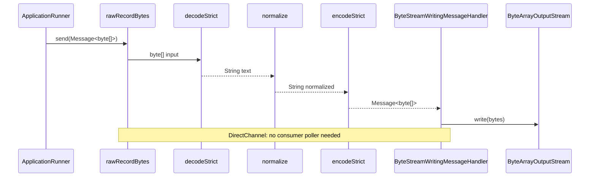

# Converting between byte arrays and text

## 1. Why is converting between `byte[]` and `String` a critical boundary?

In the **SPRING_INTEGRATION_ADAPTERS** module, applications connect external systems via **inbound/outbound adapters, gateways, pollers, and `MessageChannel`**, practicing file, SFTP, HTTP, JMS, AMQP, Kafka, and database data flows. To exchange messages according to contract, you must distinguish **binary payloads**, **character payloads**, conversion errors, reliability, and connection lifecycles.

In the **Adapter Stream** chapter, **Converting between byte arrays and text** tackles a very common problem:

> An adapter receives `Message<byte[]>` from an I/O stream, while a business handler wants `Message<String>` to parse CSV/NDJSON; conversely, a handler writing to an `OutputStream` only accepts bytes. How do we convert while preserving data, avoiding Unicode corruption, and keeping record boundaries intact?

Suppose an order-ingestion system receives UTF-8 records over a pipe:

```text
                         External bytes
                4F 52 44 45 52 2C ... 0A
                              |
                     ByteStreamReading
                        MessageSource
                              |
                         poller
                              v
                    Message<byte[]>
                              |
                    Framing / reassemble
                              |
                       UTF-8 decode
                              v
                     Message<String>
                              |
                   Validate / normalize
                              |
                     Message<String>
                              |
                       UTF-8 encode
                              v
                     Message<byte[]>
                              |
                     ByteStreamWriting
                       MessageHandler
                              |
                         OutputStream
```

The system **does not understand text automatically just because a byte array renders as letters in an IDE**. A `byte[]` value may hold UTF-8 text, JSON, protobuf, a compressed file, an image, or a small fragment of a frame. You must know the **format and charset contract** before decoding.

### Objectives

After this lesson, you will be able to:

1. Distinguish `byte[]`, `String`, `char[]`, `ByteBuffer`, and `InputStream`.
2. Convert `String ↔ byte[]` with `StandardCharsets.UTF_8` and verify Unicode round-trips.
3. Use `CharsetDecoder`/`CharsetEncoder` with `CodingErrorAction.REPORT` so bad data is never silently replaced.
4. Explain why a **byte chunk is not automatically a text record**, and handle UTF-8 split across multiple chunks.
5. Configure transformers in Spring Integration 6.5, especially `ObjectToStringTransformer`, `StreamTransformer`, and custom transformers.
6. Build Java DSL, `@Transformer`, and XML flows converting types between `MessageChannel`s.
7. Include charset/content-type metadata in the contract without confusing a header with actual transcoding.
8. Distinguish UTF-8 from Base64, hex, JSON serialization, and Java native object serialization.
9. Design size limits, error routing, retry/replay, idempotency, and realistic tests.

## 2. Three distinct contracts: bytes, characters, and records

| Layer | Example | Actual unit | Question to answer |
| --- | --- | --- | --- |
| **Wire** | `byte[]` | Byte sequence | Which encoding/protocol do these bytes belong to? |
| **Text** | `String` | UTF-16 code units in Java | Is it decoded properly and valid? |
| **Business record** | `OrderEvent`, JSON object, CSV row | Business unit | Where does a record begin/end, and what schema applies? |

A properly decoded `String` can still be **half a JSON document**, and a valid text line can still be an **invalid business record**. Separate three tasks:

```text
1. Framing:      wire bytes -> complete byte records
2. Decoding:     byte record -> text, right charset
3. Parsing:      text -> business record per schema
```

On the writing side:

```text
1. Serialization: business record -> text / binary body
2. Encoding:      text -> bytes (if text)
3. Framing:       bytes -> wire frame / delimiter
4. Write:         wire frame -> OutputStream / broker / transport
```

Never invert this order when a source emits arbitrary byte chunks. Calling `new String(chunk, UTF_8)` *before assembling a complete record* can corrupt a character split across two chunks.

### `byte[]` is not `Byte[]` or `char[]`

| Java type | Purpose | Note |
| --- | --- | --- |
| `byte[]` | Binary payload, holding protocol bytes `0..255` | Java `byte` elements are signed `-128..127` |
| `Byte[]` | Object wrappers | Nullable and memory-heavy; not interchangeable with `byte[]` |
| `char[]` | UTF-16 code units | Not wire bytes |
| `String` | Logical character sequence | One code point can span 2 `char`s |
| `ByteBuffer` | Byte region view with offset/limit | Must respect `position()/limit()` |
| `InputStream` | Stateful readable byte source | Should not pass references arbitrarily to multiple consumers |

Java's `byte` is signed; when you need an unsigned integer `0..255`:

```java
byte value = (byte) 0xE1;
int unsigned = value & 0xFF; // 225
```

Do not compare negative `byte` values carelessly in header checks and wrongly conclude data is invalid.

## 3. Simple `String → byte[]` conversion using UTF-8

For a **complete text record**, use an **explicit** charset:

```java
import java.nio.charset.StandardCharsets;
import java.util.Arrays;

String text = "Đã thanh toán 🚀";
byte[] payload = text.getBytes(StandardCharsets.UTF_8);

System.out.println(payload.length);
System.out.println(Arrays.toString(payload));
```

Here `StandardCharsets.UTF_8` is a standard JDK `Charset` instance, independent of OS default charset settings. The resulting bytes can go into a `Message<byte[]>`:

```java
import org.springframework.messaging.Message;
import org.springframework.messaging.support.MessageBuilder;

Message<byte[]> message = MessageBuilder
        .withPayload(text.getBytes(StandardCharsets.UTF_8))
        .setHeader("eventId", "evt-1001")
        .build();
```

The `eventId` header is application-defined; **the byte handler does not automatically inject this header into wire bytes**. If the receiver needs the event ID, the serializer must embed it explicitly in the body/frame.

### `String.getBytes()` without a charset: avoid in protocols

```java
byte[] unstable = text.getBytes(); // Runtime default charset
byte[] stable = text.getBytes(StandardCharsets.UTF_8);
```

Depending on the JDK, runtime, startup flags, or legacy environments, relying on the default charset creates incompatibility risks. Even though Java 18+ defaults to UTF-8 per JEP 400, **always specify the charset in the contract** rather than relying on environment defaults.

## 4. `byte[] → String` conversion and three commonly confused displays

Given a **complete byte payload confirmed to be UTF-8**:

```java
import java.nio.charset.StandardCharsets;

byte[] bytes = new byte[] {
        (byte) 0xC4, (byte) 0x90,
        (byte) 0xC3, (byte) 0xA3
};

String text = new String(bytes, StandardCharsets.UTF_8);
// text = "Đã"
```

### Why doesn't `bytes.toString()` print text?

```java
byte[] bytes = "OK".getBytes(StandardCharsets.UTF_8);

System.out.println(bytes.toString());                    // Prints [B@...
System.out.println(java.util.Arrays.toString(bytes));    // [79, 75]
System.out.println(new String(bytes, StandardCharsets.UTF_8)); // OK
```

| Call | Output | When to use? |
| --- | --- | --- |
| `bytes.toString()` | Array class name + identity/hash like `[B@...` | Never use for decoding |
| `Arrays.toString(bytes)` | List of signed byte numbers, e.g., `[79, 75]` | Size-bounded debugging |
| `new String(bytes, UTF_8)` | Decoded text | Only when bytes are valid UTF-8 |
| `HexFormat.of().formatHex(bytes)` | Hex string, e.g., `4f4b` | Debugging binary payloads |
| `Base64.getEncoder().encodeToString(bytes)` | Base64 text, e.g., `T0s=` | Wrapping binary over text-only channels |

**Base64 and hex are not UTF-8 decoding**: they represent **raw original bytes** using ASCII characters, allowing exact byte recovery. By contrast, `new String(bytes, UTF_8)` interprets bytes as Unicode text, which can fail or substitute characters if bytes are invalid.

### Avoid logging full byte arrays

`Arrays.toString(payload)` and hex dumps help inspect a few bytes, but can expose tokens, personal data, or secret records. In production, log only sizes, safe verification hashes, and a masked preview where policy allows.

## 5. Unicode in Java is not a byte count

One visible character may consist of multiple **Unicode code points**; Java's `String.length()` counts **UTF-16 code units**. UTF-8 uses variable byte lengths.

```java
import java.nio.charset.StandardCharsets;

String value = "đệ🚀";
int utf16Units = value.length();                        // 4
int codePoints = value.codePointCount(0, value.length()); // 3
int utf8Bytes = value.getBytes(StandardCharsets.UTF_8).length; // 9
```

| Character | Code point | UTF-8 bytes | UTF-16 code units |
| --- | --- | --- | --- |
| `đ` | `U+0111` | 2 | 1 |
| `ệ` | `U+1EC7` | 3 | 1 |
| `🚀` | `U+1F680` | 4 | 2 |

Never use `String.length()` to compute a **byte-based** length prefix for a UTF-8 protocol. Encode first, then take `payload.length`. Never slice emoji/surrogate pairs using a single `charAt(i)` during text processing.

### Unicode normalization

Two visually identical strings can have different code point sequences:

```java
import java.text.Normalizer;

String composed = "\u00E9";       // é
String decomposed = "e\u0301";     // e + combining acute
boolean sameBefore = composed.equals(decomposed); // false
String normalized = Normalizer.normalize(
        decomposed, Normalizer.Form.NFC
);
boolean sameAfter = composed.equals(normalized); // true
```

Normalize only when the **business contract** requires it. Never normalize passwords, digital signatures, or payloads that must stay byte-identical; normalization changes bytes upon re-encoding.

## 6. Strict UTF-8: invalid data must raise an error

Convenience methods like `new String(bytes, UTF_8)` suit data **trusted to be valid**, but silently substitute replacement characters when bytes are malformed. For financial, order, or identity data, **report errors instead of silently altering data**.

JDK `CharsetDecoder` and `CharsetEncoder` let you pick:

| `CodingErrorAction` | Meaning | Consequence |
| --- | --- | --- |
| `REPORT` | Throws on malformed/unmappable input | Safe when correctness matters |
| `REPLACE` | Replaces with substitution char/byte | Can silently alter IDs or text |
| `IGNORE` | Drops unconvertible parts | Silent data loss |

### 6.1. Reusable Java utility across flows

```java
import java.nio.ByteBuffer;
import java.nio.CharBuffer;
import java.nio.charset.CharacterCodingException;
import java.nio.charset.CodingErrorAction;
import java.nio.charset.StandardCharsets;
import java.util.Objects;

public final class Utf8TextCodec {

    private Utf8TextCodec() {
    }

    public static String decodeStrict(byte[] bytes) {
        Objects.requireNonNull(bytes, "bytes");
        try {
            var decoder = StandardCharsets.UTF_8.newDecoder()
                    .onMalformedInput(CodingErrorAction.REPORT)
                    .onUnmappableCharacter(CodingErrorAction.REPORT);

            return decoder.decode(ByteBuffer.wrap(bytes)).toString();
        }
        catch (CharacterCodingException ex) {
            throw new IllegalArgumentException(
                    "Payload is not valid UTF-8", ex);
        }
    }

    public static byte[] encodeStrict(String text) {
        Objects.requireNonNull(text, "text");
        try {
            var encoder = StandardCharsets.UTF_8.newEncoder()
                    .onMalformedInput(CodingErrorAction.REPORT)
                    .onUnmappableCharacter(CodingErrorAction.REPORT);

            ByteBuffer result = encoder.encode(CharBuffer.wrap(text));
            byte[] output = new byte[result.remaining()];
            result.get(output);
            return output;
        }
        catch (CharacterCodingException ex) {
            throw new IllegalArgumentException(
                    "Text cannot be encoded as valid UTF-8", ex);
        }
    }
}
```

Save this class as `Utf8TextCodec.java`. Each call creates its own decoder/encoder, so no state is shared across threads. The methods return **non-null** values or throw `IllegalArgumentException` wrapping the original cause, making them well-suited as transformers for complete records.

### 6.2. Quick utility test

```java
String original = "Đã thanh toán 🚀";
byte[] encoded = Utf8TextCodec.encodeStrict(original);
String decoded = Utf8TextCodec.decodeStrict(encoded);

if (!original.equals(decoded)) {
    throw new IllegalStateException("UTF-8 round-trip failed");
}
```

With malformed bytes:

```java
byte[] invalid = new byte[] {(byte) 0xC3, 0x28};
// UTF-8: C3 must be followed by a continuation byte 80..BF,
// but 0x28 is '(', so the payload is malformed.
String value = Utf8TextCodec.decodeStrict(invalid);
// Throws IllegalArgumentException (cause: CharacterCodingException).
```

The second snippet **intentionally throws an exception**, meant for an `assertThrows(...)` test rather than production startup code.

### 6.3. Special case: `String` containing an unpaired surrogate

A Java `String` can contain an **unpaired** UTF-16 surrogate:

```java
String invalidUnicode = "\uD800";
byte[] bytes = Utf8TextCodec.encodeStrict(invalidUnicode);
// Throws IllegalArgumentException instead of replacing with a question mark.
```

Use a strict encoder at boundaries if you do not want broken Unicode turning into seemingly "valid" payloads after replacement. In best-effort environments (such as display logs only), `REPLACE` may be a deliberate choice, but the policy must be documented.

## 7. A byte array is not text: Base64 and hex are different tasks

For example, a PNG image or encrypted bytes are not UTF-8 text. If a JSON/HTTP API requires carrying binary inside a string field, use Base64:

```java
import java.util.Base64;

byte[] binary = new byte[] {0x00, (byte) 0xFF, 0x23};
String base64 = Base64.getEncoder().encodeToString(binary);
byte[] restored = Base64.getDecoder().decode(base64);
```

This is a **lossless representation of bytes**, not a charset conversion. Base64 expands size (roughly 4/3 for large data), so enforce length limits and source trust. For APIs supporting native binary bodies, prefer passing `byte[]` directly instead of unnecessary Base64.

### Comparing operations

| Input | Output | Right operation | Do not use |
| --- | --- | --- | --- |
| UTF-8 bytes | Text | `CharsetDecoder` or `new String(bytes, UTF_8)` | `bytes.toString()` |
| Text | UTF-8 bytes | `CharsetEncoder` or `getBytes(UTF_8)` | Java `toString()` on arrays |
| Binary bytes | ASCII-safe text | Base64 or hex | Arbitrary UTF-8 decoding |
| JSON text | `OrderEvent` | Schema-aware JSON parser/mapper | Casting `(OrderEvent) String` |
| `OrderEvent` | JSON bytes | JSON serializer → UTF-8 bytes | Arbitrary `event.toString().getBytes()` |
| `InputStream` | bytes/text | Bounded reads + size cap, or `StreamTransformer` | Passing stream references to arbitrary consumers |

**Do not confuse serialization and encoding**: serialization defines record structure; encoding defines how characters map to bytes. Use a real JSON serializer when the contract is JSON rather than manual string concatenation when escaping can get tricky.

## 8. Spring Integration 6.5: which transformer fits?

Spring Integration provides transformers for different input types:

| Component | Input | Output | Note |
| --- | --- | --- | --- |
| `ObjectToStringTransformer` | `Object`, notably `byte[]`/`char[]` | `String` | `byte[]` is decoded with charset, defaulting to UTF-8 |
| `StreamTransformer` | `InputStream` payload | `byte[]` or `String` if charset configured | Reads stream content; distinct from stream inbound `MessageSource` |
| `PayloadTypeConvertingTransformer` | Source-typed payload | Target type via `Converter` | Conversion rules must be configured |
| `@Transformer` POJO | Per method signature | Payload or `Message` depending on return type | Verify input types and error handling |
| Java DSL `.transform(Class, GenericTransformer)` | Specified `Class` type | Return value of lambda/method | Explicit, pairs well with strict codecs |

**Reference:** Spring Integration 6.5 Javadoc and Reference. For **6.5** stream reading/writing classes, import from `org.springframework.integration.stream`; in **7.x**, classes moved into `.stream.inbound`/`.stream.outbound` subpackages. Core transformers like `ObjectToStringTransformer` remain in `org.springframework.integration.transformer` in 6.5.

### 8.1. `ObjectToStringTransformer` handles `byte[]` specially

Unlike Java's `byte[].toString()`, the official implementation:

- For `byte[]`, builds a `String` using the charset, **defaulting to UTF-8**.
- For `char[]`, builds a `String` from the characters.
- For other objects, calls `toString()` on the object.

Java DSL:

```java
import org.springframework.context.annotation.Bean;
import org.springframework.integration.dsl.IntegrationFlow;
import org.springframework.integration.dsl.Transformers;

@Bean
IntegrationFlow bytesToTextBuiltin() {
    return IntegrationFlow
            .from("rawBytesForText")
            .transform(Transformers.objectToString("UTF-8"))
            .channel("decodedText")
            .get();
}
```

This is an **illustrative flow**, to be placed inside `@Configuration` with producers/consumers on both channels. `ObjectToStringTransformer` is convenient when the charset is fixed and data is valid. However, for critical data that must **reject malformed bytes**, use a custom `Utf8TextCodec.decodeStrict` to enforce `CodingErrorAction.REPORT`; never assume every String-creating method fails on bad bytes.

### 8.2. `StreamTransformer` processes an `InputStream` payload

`Transformers.fromStream("UTF-8")` accepts an **`InputStream`** payload and produces a **`String`**. `Transformers.fromStream()` without a charset produces **`byte[]`**:

```java
@Bean
IntegrationFlow inputStreamPayloadToText() {
    return IntegrationFlow
            .from("streamsAsPayload")
            .transform(Transformers.fromStream("UTF-8"))
            .channel("textFromStream")
            .get();
}
```

**Do not confuse** `StreamTransformer` with `ByteStreamReadingMessageSource`:

```text
ByteStreamReadingMessageSource:
  Java InputStream input -> poller -> multiple Message<byte[]> chunks

StreamTransformer:
  One Message<InputStream> -> transform -> one Message<byte[]>/Message<String>
  (reads stream content into a new payload)
```

For unbounded streams (sockets, live feeds) or huge objects, materializing the entire stream into bytes/`String` can exhaust RAM or block indefinitely. Set clear size limits, timeouts, and ownership; when you need streaming with backpressure/frame semantics, use a more appropriate adapter or decoder.

### 8.3. Avoid converting arbitrary objects to text by default

`ObjectToStringTransformer` invokes `toString()` for many other objects. A DTO whose `toString()` emits `OrderEvent[id=..., status=...]` is not valid JSON or a compatible external payload. If the source is a business object, first run a **schema-aware serializer** (Jackson, Avro, protobuf...) and then encode per contract.

## 9. Spring Boot Java DSL: converting bytes to text and back to bytes

This main example processes **byte messages that are already complete records**. Input is simple UTF-8 CSV `orderId,status,note`; output is normalized text lines, **re-encoded to UTF-8 `byte[]`** and sent to a stream handler. The example separates both conversion steps so payload types can be inspected at each stage.

### 9.1. Dependencies

With Java 17+, Spring Boot, and Spring Integration **6.5.x** aligned via the BOM:

```xml
<dependencies>
    <dependency>
        <groupId>org.springframework.boot</groupId>
        <artifactId>spring-boot-starter-integration</artifactId>
    </dependency>
    <dependency>
        <groupId>org.springframework.integration</groupId>
        <artifactId>spring-integration-stream</artifactId>
    </dependency>
</dependencies>
```

Do not pull Spring Integration 7.x imports into a Spring Boot project still on 6.5.x. `spring-integration-stream` provides I/O stream sources/handlers; `@Transformer` and Java DSL come from Spring Integration core.

### 9.2. Business rules

Example specification:

| Field | Contract |
| --- | --- |
| Input bytes | One `byte[]` = **one complete CSV record** |
| Charset | Strict UTF-8; invalid bytes rejected |
| Input text | `1001,PAID,Đã thanh toán` |
| `orderId` | 1–12 ASCII digits |
| `status` | `CREATED`, `PAID`, or `CANCELLED` |
| `note` | Must not contain `,`, `|`, CR, or LF; max 256 UTF-16 characters |
| Output text | `ORDER|1001|PAID|Đã thanh toán\n` |
| Output wire bytes | UTF-8 of output text, with exactly one LF |
| Invalid schema/charset | Exception/quarantine; emit no output |

The contract is **deliberately simple** to focus on transcoding. Real-world CSV needs a parser handling quotes, escaped commas, and multiline records; never use `String.split(",")` for general CSV.

### 9.3. Record normalizer class

```java
import java.util.Set;

public final class OrderTextNormalizer {

    private static final Set<String> STATES =
            Set.of("CREATED", "PAID", "CANCELLED");

    private OrderTextNormalizer() {
    }

    public static String normalize(String line) {
        if (line == null || line.length() > 4096
                || line.indexOf('\r') >= 0
                || line.indexOf('\n') >= 0) {
            throw new IllegalArgumentException(
                    "Invalid input line");
        }

        // Contract demo: comma may only be a field separator.
        String[] fields = line.split(",", -1);
        if (fields.length != 3
                || !fields[0].matches("[0-9]{1,12}")
                || !STATES.contains(fields[1])
                || fields[2].isBlank()
                || fields[2].length() > 256
                || fields[2].indexOf('|') >= 0) {
            throw new IllegalArgumentException(
                    "Invalid order record");
        }

        return "ORDER|" + fields[0] + "|"
                + fields[1] + "|"
                + fields[2] + "\n";
    }
}
```

Place this class in `OrderTextNormalizer.java` in the same package or import it properly in the flow class. `note` is treated strictly as **data**. Never interpolate it directly into SQL query strings or shell commands; use parameterized SQL/JPA when persisting to a database.

### 9.4. Java configuration and producer

```java
import java.io.ByteArrayOutputStream;
import java.nio.charset.StandardCharsets;

import org.springframework.beans.factory.annotation.Qualifier;
import org.springframework.boot.ApplicationRunner;
import org.springframework.boot.SpringApplication;
import org.springframework.boot.autoconfigure.SpringBootApplication;
import org.springframework.context.annotation.Bean;
import org.springframework.integration.annotation.ServiceActivator;
import org.springframework.integration.channel.DirectChannel;
import org.springframework.integration.config.EnableIntegration;
import org.springframework.integration.dsl.IntegrationFlow;
import org.springframework.integration.stream.ByteStreamWritingMessageHandler;
import org.springframework.messaging.MessageChannel;
import org.springframework.messaging.support.MessageBuilder;

@SpringBootApplication
@EnableIntegration
public class ByteTextConversionApplication {

    public static void main(String[] args) {
        SpringApplication.run(ByteTextConversionApplication.class, args);
    }

    @Bean
    public MessageChannel rawRecordBytes() {
        return new DirectChannel();
    }

    @Bean
    public MessageChannel normalizedOutputBytes() {
        return new DirectChannel();
    }

    @Bean
    public IntegrationFlow utf8ConversionFlow() {
        return IntegrationFlow
                .from("rawRecordBytes")
                .transform(byte[].class, Utf8TextCodec::decodeStrict)
                .transform(String.class,
                        OrderTextNormalizer::normalize)
                .transform(String.class, Utf8TextCodec::encodeStrict)
                .channel("normalizedOutputBytes")
                .get();
    }

    @Bean
    public ByteArrayOutputStream binaryCapture() {
        return new ByteArrayOutputStream();
    }

    @Bean
    @ServiceActivator(inputChannel = "normalizedOutputBytes")
    public ByteStreamWritingMessageHandler byteWriter(
            @Qualifier("binaryCapture")
            ByteArrayOutputStream destination) {

        return new ByteStreamWritingMessageHandler(
                destination, 4096);
    }

    @Bean
    public ApplicationRunner sendSampleRecords(
            @Qualifier("rawRecordBytes") MessageChannel input) {

        return args -> {
            send(input, "1001,PAID,Đã thanh toán");
            send(input, "1002,CREATED,Chờ xử lý");
        };
    }

    private static void send(MessageChannel input, String text) {
        boolean accepted = input.send(
                MessageBuilder
                        .withPayload(
                            text.getBytes(StandardCharsets.UTF_8))
                        .build());
        if (!accepted) {
            throw new IllegalStateException(
                    "Conversion channel rejected a record");
        }
    }
}
```

The **three classes of the example** are `Utf8TextCodec.java`, `OrderTextNormalizer.java`, and `ByteTextConversionApplication.java` in the same package, with standard Spring Boot build configuration. This article **has not compiled/run them** because STEP 4 only authors content.

### 9.5. What happens at runtime?



1. The producer sends `Message<byte[]>`, not `Message<String>`.
2. The first transformer accepts **`byte[]`** and strict-decodes it to **`String`**.
3. The second transformer takes `String`, validates it, and builds the output record.
4. The third transformer **encodes `String → byte[]`**.
5. `ByteStreamWritingMessageHandler` receives `byte[]` on the final channel and writes to `ByteArrayOutputStream`.
6. Because the whole flow starts on a `DirectChannel`, **no poller is required**. Only if you replace the producer with `ByteStreamReadingMessageSource` does the inbound source side need a poller.

**Regarding output:** once the handler writes/flushes buffers per the runtime version's lifecycle, the bytes represent two lines:

```text
ORDER|1001|PAID|Đã thanh toán
ORDER|1002|CREATED|Chờ xử lý
```

Each line ends with **LF (`0x0A`)** added once by `OrderTextNormalizer`. Do not inspect `ByteArrayOutputStream` too early if wrapper buffering is active; verify after the sink flushes / handler completes per contract.

### 9.6. Why shouldn't a transformer return `null`?

Spring Integration's transformer contract **does not allow returning `null`** as a way to drop a record. To drop empty or schema-invalid messages per policy, use a dedicated `filter`/router; to report errors, throw an exception and configure a quarantine/error flow. `null` is not a valid "empty message".

### 9.7. Do not confuse payload and headers

When a transformer handles a raw payload, the framework creates a new output message and generally propagates appropriate headers per the transformer contract. However, **message ID/timestamp can change**, so never use `MessageHeaders.ID` as a stable business ID across retries. If `eventId` is needed, place it in the body or an application-managed header and verify propagation with integration tests.

## 10. From ByteStreamReadingMessageSource to transformer

A `ByteStreamReadingMessageSource` is built from a Java `InputStream`:

```java
import java.io.InputStream;
import org.springframework.integration.stream.ByteStreamReadingMessageSource;

InputStream input = /* opened stream with an owner */;
ByteStreamReadingMessageSource source =
        new ByteStreamReadingMessageSource(input);
source.setBytesPerMessage(1024);
source.setShouldTruncate(true);
```

To wire this source into a Spring flow, you need a **poller**:

```java
import java.time.Duration;
import org.springframework.context.annotation.Bean;
import org.springframework.integration.dsl.IntegrationFlow;
import org.springframework.integration.dsl.Pollers;

@Bean
IntegrationFlow rawByteInboundFlow(
        ByteStreamReadingMessageSource source) {
    return IntegrationFlow.from(
            source,
            spec -> spec.id("rawByteInbound")
                    .poller(Pollers
                            .fixedDelay(Duration.ofMillis(300))
                            .maxMessagesPerPoll(1)))
            .channel("rawByteChunks")
            .get();
}
```

This is a **configuration fragment**: it requires a `ByteStreamReadingMessageSource` bean, channels, and a consumer for `rawByteChunks`. **Do not feed each byte chunk directly into `Utf8TextCodec.decodeStrict`** unless the protocol already guarantees each chunk is a complete UTF-8 record. `bytesPerMessage=1024` is only a read byte cap, **not a JSON or UTF-8 code point boundary**.

### Example: UTF-8 split in the middle of a character

The character `Đ` has UTF-8 bytes `C4 90`:

```text
Chunk 1: 31 30 30 31 2C C4
           1  0  0  1  ,  [first byte of Đ]

Chunk 2: 90 0A
         [second byte of Đ]  newline
```

`Utf8TextCodec.decodeStrict(chunk1)` reports a malformed/truncated sequence; `decodeStrict(chunk2)` fails too, **even though the full stream is completely valid**. With `new String(chunk, UTF_8)`, each chunk can produce the replacement character `U+FFFD`, corrupting the original data.

What you must do instead:

```text
Chunk 1 + Chunk 2
       |
  Reassembler receives complete bytes 31 30 30 31 2C C4 90
       |
  decodeStrict(completeRecordBytes)
       |
  "1001,Đ"
```

Additionally, `InputStream.read(buffer)` does not have to fill the buffer even before EOF. With sockets/pipes, chunk sizes vary with load and buffering.

## 11. Reassembling before decoding: LF-delimited text protocol

A simple pattern for line-oriented streams is **accumulating bytes up to LF (`0x0A`)**, then UTF-8 decoding. This is level-1 framing: records must not contain unescaped LF bytes.

### 11.1. Size-bounded Java line assembler

```java
import java.io.ByteArrayOutputStream;
import java.util.ArrayList;
import java.util.Arrays;
import java.util.List;
import java.util.Objects;

public final class Utf8LineAssembler {

    private final int maxRecordBytes;
    private final ByteArrayOutputStream pending =
            new ByteArrayOutputStream();

    public Utf8LineAssembler(int maxRecordBytes) {
        if (maxRecordBytes < 1
                || maxRecordBytes > 1024 * 1024) {
            throw new IllegalArgumentException(
                    "Invalid maxRecordBytes");
        }
        this.maxRecordBytes = maxRecordBytes;
    }

    public synchronized List<String> accept(byte[] chunk) {
        Objects.requireNonNull(chunk, "chunk");
        List<String> completed = new ArrayList<>();

        for (byte value : chunk) {
            if (value == (byte) '\n') {
                byte[] record = pending.toByteArray();
                pending.reset();

                // Optional CRLF support.
                if (record.length > 0
                        && record[record.length - 1] == '\r') {
                    record = Arrays.copyOf(
                            record, record.length - 1);
                }

                if (record.length == 0) {
                    continue; // Demo: skip blank lines.
                }
                completed.add(
                        Utf8TextCodec.decodeStrict(record));
            }
            else {
                if (pending.size() >= maxRecordBytes) {
                    throw new IllegalArgumentException(
                            "Line exceeds maximum byte length");
                }
                pending.write(value);
            }
        }
        return completed;
    }

    public synchronized void endOfInput() {
        if (pending.size() != 0) {
            throw new IllegalStateException(
                    "Incomplete final line: no LF terminator");
        }
    }
}
```

**Example policy:** every record must end with **LF**. CRLF is supported by stripping a trailing CR before decoding; blank lines are skipped. If incomplete bytes remain at EOF, `endOfInput()` throws an error instead of silently emitting half a record.

Save this class as `Utf8LineAssembler.java` in the same package as `Utf8TextCodec`. It uses a **bounded** buffer and decodes a record only after all bytes arrive. Production systems may also need timeouts for incomplete records, origin tracking, stream epochs, mid-stream error reporting, reset/quarantine policies, checksums, and durable staging.

### 11.2. Example receiving a chunk split mid-character

```java
Utf8LineAssembler assembler = new Utf8LineAssembler(4096);

byte[] chunk1 = new byte[] {
        '1', '0', '0', '1', ',', (byte) 0xC4
};
byte[] chunk2 = new byte[] {
        (byte) 0x90, '\n'
};

List<String> first = assembler.accept(chunk1);  // []
List<String> second = assembler.accept(chunk2); // ["1001,Đ"]
assembler.endOfInput(); // PASS: no incomplete bytes left
```

**Assembler state belongs to one logical stream.** Never share the same instance across multiple sockets, tenants, or jobs. If multiple producers exist and exact byte order matters, design **a single writer/reader owner** per stream rather than assuming a `synchronized` method solves business ordering across independent sources.

### 11.3. Wiring the assembler into a Spring Message flow

A consumer can receive `Message<byte[]>` from `rawByteChunks`, collect completed lines, and send each line to `textRecords`:

```java
import org.springframework.messaging.Message;
import org.springframework.messaging.MessageChannel;
import org.springframework.messaging.support.MessageBuilder;

public final class ByteChunkToTextBridge {

    private final Utf8LineAssembler assembler =
            new Utf8LineAssembler(4096);
    private final MessageChannel textRecords;

    public ByteChunkToTextBridge(MessageChannel textRecords) {
        this.textRecords = textRecords;
    }

    public void handle(Message<byte[]> chunkMessage) {
        for (String record : assembler.accept(
                chunkMessage.getPayload())) {
            boolean accepted = textRecords.send(
                    MessageBuilder.withPayload(record).build());
            if (!accepted) {
                throw new IllegalStateException(
                        "Text channel rejected a record");
            }
        }
    }

    public void onSourceFinished() {
        assembler.endOfInput();
    }
}
```

This example is a **bridge class**, not yet registered as a `@ServiceActivator`/`MessageHandler` in a Spring context and without an EOF trigger. Implementers must wire it to the source channel along with the source's lifecycle callbacks, avoiding any assumption that `ByteStreamReadingMessageSource` emits `StreamClosedEvent` like a character source with EOF detection enabled.

**Important consequence:** one chunk can contain **0, 1, or many records**. A simple `byte[]→String` transformer returning one `String` **cannot** handle a chunk carrying two lines. Use an aggregator/decoder + splitter or a handler that emits multiple messages, like the bridge above.

## 12. Payload headers: `contentType` does not perform transcoding automatically

A Spring `Message<?>` has a payload and headers. A header can describe content type:

```java
import java.nio.charset.StandardCharsets;

import org.springframework.messaging.Message;
import org.springframework.messaging.MessageHeaders;
import org.springframework.messaging.support.MessageBuilder;
import org.springframework.util.MimeTypeUtils;

Message<byte[]> message = MessageBuilder
        .withPayload(
                "Đã thanh toán".getBytes(StandardCharsets.UTF_8))
        .setHeader(
                MessageHeaders.CONTENT_TYPE,
                MimeTypeUtils.parseMimeType(
                        "text/plain;charset=UTF-8"))
        .setHeader("sourceId", "orders-pipe-1")
        .build();
```

The `contentType` header here is **information supplied by the producer**, not proof that the payload is valid UTF-8. If actual bytes were encoded in Windows-1258 while the header claims UTF-8, the consumer will still misread or fail. Adding the header also **does not automatically invoke a converter** unless a specific endpoint/channel is configured with one.

### Distinguishing two cases

```text
Case A
  bytes = UTF-8("Đã"), header says UTF-8
  -> decodeStrict succeeds -> String "Đã"

Case B
  bytes = malformed UTF-8, header says UTF-8
  -> decodeStrict rejects
  -> do NOT trust the header as validation
```

### When charset varies per message

Some legacy systems have messages in multiple charsets. In that case:

1. Rely on a **trusted charset source**: contracted protocol/partner metadata.
2. Enforce an **allowlist** (e.g., UTF-8 and one supported legacy charset).
3. Never auto-detect over arbitrary bytes and guarantee accuracy; charset guessing is heuristic.
4. Log/emit metrics for the chosen charset name, decode errors, source, and protocol version.
5. Reject unsupported charsets instead of silently falling back to a default.

Never use a header sent by an untrusted partner for execution privileges, file paths, or arbitrary parser class selection.

### Header propagation and correlation

When rebuilding a `Message` in a custom bridge, you can carry forward permitted headers:

```java
Message<String> converted = MessageBuilder
        .withPayload(Utf8TextCodec.decodeStrict(
                originalMessage.getPayload()))
        .copyHeaders(originalMessage.getHeaders())
        .setHeader("decodedCharset", "UTF-8")
        .build();
```

`originalMessage` in this snippet is an existing `Message<byte[]>`. Note that `id`/`timestamp` are Spring-managed headers; when building a new message they may be regenerated or handled per framework contract. Do not rely on them as a **business event ID** across retries. Only propagate headers that are genuinely needed and safe for downstream (never copy tokens/PII indiscriminately).

## 13. Charset vs. framing, newlines, BOMs, and JSON

### 13.1. BOM

Some UTF-8 files start with a **BOM** prefix `EF BB BF`. The JDK's UTF-8 `CharsetDecoder` does not act as a file processor stripping BOMs per business rules. After decoding, you may receive `U+FEFF` at the beginning of the text:

```java
String text = Utf8TextCodec.decodeStrict(bytes);
if (text.startsWith("\uFEFF")) {
    // Strip BOM only if the file contract allows an optional BOM.
    text = text.substring(1);
}
```

Do not strip `U+FEFF` from the middle of content without a rule, and do not use a BOM to guess arbitrary uncontracted charsets. For CSV/JSON files, BOM policy must be agreed upon by both sides.

### 13.2. LF, CRLF, and delimiters

| Delimiter | Bytes in UTF-8 | Situation |
| --- | --- | --- |
| LF | `0A` | NDJSON, most Unix systems |
| CRLF | `0D 0A` | Many Windows files |
| CR | `0D` | Legacy systems |

`String.replace("\r\n", "\n")` only handles newlines once data is **already valid text**; it does nothing to repair UTF-8 bytes split across chunks. You must decide:

- Does the sender include LF in each record, or will the handler append the newline?
- If the producer adds LF and the character outbound handler also enables `appendNewLine(true)`, output will contain blank lines.
- When using the byte writer handler, it **does not automatically append LF** to each `byte[]`; the serializer must do so.
- A blank line is an **empty framed record** if the protocol permits it, not EOF.

### 13.3. NDJSON vs. a JSON document

```text
{"eventId":"e1","state":"PAID"}
{"eventId":"e2","state":"CREATED"}
```

These are **two JSON values in NDJSON format**, not a single JSON document containing both objects. The sender must serialize each object into valid text, escape newlines inside values, and place LF delimiters between records. The receiver assembles lines and then runs JSON parsing.

`UTF-8` only decodes characters; it **does not validate JSON grammar**. Building JSON via `String.format(...)` or string concatenation when text contains quotes, backslashes, or control characters is risky; use a proper JSON mapper.

### 13.4. Length prefixes must be measured in bytes

If a protocol uses a 4-byte length prefix:

```java
String record = "Đã";
byte[] utf8 = Utf8TextCodec.encodeStrict(record);
int wireLength = utf8.length;     // 4 bytes: C4 90 C3 A3
int stringLength = record.length(); // 2 UTF-16 units
```

The prefix is `4`, **not `2`**. The receiver must cap max frame size, read the exact byte count, and only then UTF-8 decode. Never use `String.length()` as payload length in a byte-oriented protocol.

## 14. Java annotations and XML transformers

Java DSL is not the only configuration option. Spring Integration supports `@Transformer`-annotated bean methods and XML `<int:transformer>`.

### 14.1. Bean methods with @Transformer

```java
import org.springframework.integration.annotation.Transformer;
import org.springframework.stereotype.Component;

@Component
public class TextConversionService {

    @Transformer(
        inputChannel = "inputWireBytes",
        outputChannel = "decodedText")
    public String bytesToText(byte[] payload) {
        return Utf8TextCodec.decodeStrict(payload);
    }

    @Transformer(
        inputChannel = "validatedText",
        outputChannel = "outputWireBytes")
    public byte[] textToBytes(String payload) {
        return Utf8TextCodec.encodeStrict(payload);
    }
}
```

This is an **alternative configuration** to the Java DSL flow. In a real app, `inputWireBytes`, `decodedText`, `validatedText`, and `outputWireBytes` must connect to their respective producers/consumers; if text validation is needed, place a handler/transformer **between** `decodedText` and `validatedText`.

Avoid accidentally subscribing both an annotation bean and a Java DSL transform to the same `DirectChannel`: `DirectChannel` does not broadcast messages to every subscriber by default; keep one clean flow.

### 14.2. Custom POJO transformer in XML

With XML, declare a class instance exposing the two methods:

```java
package com.example.integration;

public final class ByteTextConversionMethods {

    public String decode(byte[] payload) {
        return Utf8TextCodec.decodeStrict(payload);
    }

    public byte[] encode(String payload) {
        return Utf8TextCodec.encodeStrict(payload);
    }
}
```

Assuming `Utf8TextCodec` is in the same package, XML configures two transformers sharing the **stateless POJO converter**:

```xml
<beans:beans
    xmlns:beans="http://www.springframework.org/schema/beans"
    xmlns:xsi="http://www.w3.org/2001/XMLSchema-instance"
    xmlns:int="http://www.springframework.org/schema/integration"
    xsi:schemaLocation="
        http://www.springframework.org/schema/beans
        https://www.springframework.org/schema/beans/spring-beans.xsd
        http://www.springframework.org/schema/integration
        https://www.springframework.org/schema/integration/spring-integration.xsd">

    <int:channel id="inputBytes"/>
    <int:channel id="intermediateText"/>
    <int:channel id="outputBytes"/>

    <beans:bean id="byteTextOps"
                class="com.example.integration.ByteTextConversionMethods"/>

    <int:transformer
        id="decodeUtf8"
        input-channel="inputBytes"
        output-channel="intermediateText"
        ref="byteTextOps"
        method="decode"/>

    <int:transformer
        id="encodeUtf8"
        input-channel="intermediateText"
        output-channel="outputBytes"
        ref="byteTextOps"
        method="encode"/>

    <!-- Producer for inputBytes and consumer for outputBytes
         are configured in another flow. -->
</beans:beans>
```

This XML **defines the two conversion steps** but is not yet a complete system: a producer for `inputBytes` and consumer for `outputBytes` are needed. In production, add text validation/normalization between the two steps if the business contract requires it.

Note the distinction between a **POJO converter** and `AbstractMessageProducingHandler`: some Spring message handlers carry output-channel state and should not be shared across different endpoints. Here `ByteTextConversionMethods` is a stateless object with two separate methods, so reusing the instance is intentional.

### 14.3. XML built-in ObjectToStringTransformer

When input is known to be UTF-8 bytes and the transformer's default behavior is acceptable:

```xml
<int:object-to-string-transformer
        id="bytesToString"
        input-channel="inputBytes"
        output-channel="decodedText"
        charset="UTF-8"/>
```

This is an **Integration namespace fragment** requiring the full `int` namespace/XSD. For data needing strict `REPORT`, use a custom converter rather than relying solely on the `charset` attribute.

## 15. Unit tests: verifying exact bytes and catching errors

Verify **byte values**, not just terminal display. Each test is written in JUnit 5, independent of a Spring Context unless testing the full flow.

### 15.1. Testing Vietnamese and emoji round-trips

```java
import static org.junit.jupiter.api.Assertions.*;

import java.nio.charset.StandardCharsets;
import org.junit.jupiter.api.Test;

class Utf8TextCodecTest {

    @Test
    void roundTripsVietnameseAndEmoji() {
        String original = "Đã thanh toán 🚀";

        byte[] actual = Utf8TextCodec.encodeStrict(original);
        String restored = Utf8TextCodec.decodeStrict(actual);

        assertEquals(original, restored);
        assertArrayEquals(
                original.getBytes(StandardCharsets.UTF_8),
                actual);
    }

    @Test
    void rejectsMalformedUtf8() {
        byte[] malformed = new byte[] {
                (byte) 0xC3, 0x28
        };
        assertThrows(IllegalArgumentException.class,
                () -> Utf8TextCodec.decodeStrict(malformed));
    }

    @Test
    void rejectsUnpairedSurrogate() {
        String invalid = "\uD800";
        assertThrows(IllegalArgumentException.class,
                () -> Utf8TextCodec.encodeStrict(invalid));
    }

    @Test
    void handlesEmptyPayloadExplicitly() {
        assertEquals("", Utf8TextCodec.decodeStrict(new byte[0]));
        assertArrayEquals(
                new byte[0], Utf8TextCodec.encodeStrict(""));
    }
}
```

**Note on empty records:** the codec permits empty Strings/byte arrays at the conversion layer. The business contract may **reject** empty records during validation; do not conflate the two policies.

### 15.2. Testing chunks split mid-character

```java
import static org.junit.jupiter.api.Assertions.*;

import java.util.List;
import org.junit.jupiter.api.Test;

class Utf8LineAssemblerTest {

    @Test
    void combinesSplitMultibyteCharacter() {
        Utf8LineAssembler assembler =
                new Utf8LineAssembler(64);

        List<String> noLine = assembler.accept(
                new byte[] {'1', ',', (byte) 0xC4});
        List<String> complete = assembler.accept(
                new byte[] {(byte) 0x90, '\n'});

        assertTrue(noLine.isEmpty());
        assertEquals(List.of("1,Đ"), complete);
        assertDoesNotThrow(assembler::endOfInput);
    }

    @Test
    void rejectsTooLongLine() {
        Utf8LineAssembler assembler =
                new Utf8LineAssembler(2);
        assertThrows(IllegalArgumentException.class,
                () -> assembler.accept(
                        new byte[] {'a', 'b', 'c'}));
    }

    @Test
    void rejectsTruncatedLineAtEndOfInput() {
        Utf8LineAssembler assembler =
                new Utf8LineAssembler(16);
        assembler.accept(new byte[] {'a', 'b'});
        assertThrows(IllegalStateException.class,
                assembler::endOfInput);
    }
}
```

Expected tests use proper `String`/JDK Unicode semantics. **Not executed** while writing STEP 4. For real protocols, also test buffer overflow, CRLF, empty records, multiple records per chunk, invalid encoding before newline, and abrupt EOF.

### 15.3. Testing that headers do not alter bytes

When only adding `MessageHeaders.CONTENT_TYPE`, assert that the payload bytes remain unchanged. Only when a transformer runs do types/values convert per configuration. This catches bugs where someone "adds a charset header and assumes transcoding happened".

## 16. Testing Spring Integration: payload types and flow contracts

Codec unit tests are not enough: verify what payload type each channel receives in the actual flow, what message each transformer returns, and where exceptions surface.

### 16.1. Integration test without files or external servers

You can write a lightweight Spring Integration test configuration that accepts `byte[]` and places resulting `byte[]` payloads into a test queue:

```java
import static org.junit.jupiter.api.Assertions.*;

import java.nio.charset.StandardCharsets;
import java.util.concurrent.BlockingQueue;
import java.util.concurrent.LinkedBlockingQueue;
import java.util.concurrent.TimeUnit;

import org.junit.jupiter.api.Test;
import org.springframework.beans.factory.annotation.Autowired;
import org.springframework.beans.factory.annotation.Qualifier;
import org.springframework.context.annotation.Bean;
import org.springframework.context.annotation.Configuration;
import org.springframework.integration.annotation.ServiceActivator;
import org.springframework.integration.channel.DirectChannel;
import org.springframework.integration.config.EnableIntegration;
import org.springframework.integration.dsl.IntegrationFlow;
import org.springframework.messaging.MessageChannel;
import org.springframework.messaging.MessageHandler;
import org.springframework.messaging.support.MessageBuilder;
import org.springframework.test.context.junit.jupiter.SpringJUnitConfig;

@SpringJUnitConfig(classes = ByteTextFlowTest.Config.class)
class ByteTextFlowTest {

    @Configuration
    @EnableIntegration
    static class Config {

        @Bean
        MessageChannel testRawBytes() {
            return new DirectChannel();
        }

        @Bean
        MessageChannel testOutputBytes() {
            return new DirectChannel();
        }

        @Bean
        BlockingQueue<byte[]> results() {
            return new LinkedBlockingQueue<>();
        }

        @Bean
        IntegrationFlow conversionFlow() {
            return IntegrationFlow.from("testRawBytes")
                    .transform(byte[].class,
                            Utf8TextCodec::decodeStrict)
                    .transform(String.class,
                            OrderTextNormalizer::normalize)
                    .transform(String.class,
                            Utf8TextCodec::encodeStrict)
                    .channel("testOutputBytes")
                    .get();
        }

        @Bean
        @ServiceActivator(inputChannel = "testOutputBytes")
        MessageHandler collect(
                BlockingQueue<byte[]> results) {
            return message -> results.add(
                    (byte[]) message.getPayload());
        }
    }

    @Autowired
    @Qualifier("testRawBytes")
    MessageChannel input;

    @Autowired
    BlockingQueue<byte[]> results;

    @Test
    void convertsByteMessageThroughStringAndBack()
            throws InterruptedException {

        byte[] bytes = Utf8TextCodec.encodeStrict(
                "1001,PAID,Đã thanh toán");

        assertTrue(input.send(
                MessageBuilder.withPayload(bytes).build()));

        byte[] output = results.poll(2, TimeUnit.SECONDS);
        assertNotNull(output);
        assertEquals(
                "ORDER|1001|PAID|Đã thanh toán\n",
                new String(output, StandardCharsets.UTF_8));
    }
}
```

**This is a suggested test, not run in STEP 4.** It needs `spring-test`/JUnit 5 (usually via `spring-boot-starter-test`) and the article's `Utf8TextCodec`/`OrderTextNormalizer` classes. The final channel uses a **test queue** instead of a buffered writer, letting the test assert the exact post-transformer `byte[]` payload without depending on `OutputStream` flushing.

### 16.2. Additional scenarios to test

| Test | Input | Expected result |
| --- | --- | --- |
| Valid UTF-8 | Vietnamese characters and emoji | Exact byte round-trip |
| Malformed bytes | `C3 28` | Strict transformer throws error |
| Unpaired surrogate | `"\uD800"` | Strict encoder throws error |
| Empty input | `new byte[0]` | Codec allows; validator may reject |
| Wrong charset header | Non-UTF-8 bytes, UTF-8 header | Do not trust header blindly; strict decode fails on malformed bytes |
| Byte chunk split mid-code point | `C4` then `90 LF` | Assembler reassembles and decodes `Đ` |
| Two lines in one chunk | `A LF B LF` | Emits two logical records |
| Record exceeding limit | No LF, exceeds `maxBytes` | Rejects without unbounded buffer growth |
| Missing trailing LF at EOF | Pending bytes at EOF | Reject/quarantine per protocol |
| BOM | Leading `EF BB BF` | Explicit policy: strip/reject/preserve |
| CRLF | `0D 0A` | Normalized properly without eating body |
| JSON escaping | Quotes, newlines inside values | Validated by JSON parser/schema |
| Non-text binary | Random bytes | Do not try decoding; use binary pipeline |
| Wrong payload type | `Message<String>` sent to byte handler | Rejected or explicitly transformed |
| Retry | Same `eventId` sent twice | Idempotent consumer |

When testing multithreaded Spring flows, use `poll(timeout)`, latches/awaits, and deadlines; never rely on a fixed `Thread.sleep()` as proof.

## 17. Transcoding failures: classify before retrying

Errors can arise before or after transformation:

```text
ByteStream inbound
      |
      +-- IOException -> source failure
      |
      +-- byte chunk -> framing
                           |
                           +-- too large / incomplete record
                           |
                           +-- decodeStrict
                                |
                                +-- malformed UTF-8
                                |
                                +-- validate business record
                                       |
                                       +-- schema rejected
                                       |
                                       +-- encodeStrict
                                               |
                                               +-- invalid Unicode
                                               |
                                               +-- destination write
                                                     |
                                                     +-- IOException/timeout
```

| Error type | Example | Should you retry the same bytes immediately? |
| --- | --- | --- |
| **Framing** | Chunk has not reached LF yet | **Not yet**; keep waiting for chunks or time out per protocol |
| **Malformed UTF-8** | Invalid continuation byte | No; fix source / quarantine |
| **Unmappable encoding** | Legacy charset cannot represent char | No; fix contract/charset |
| **Schema** | Missing fields, invalid JSON | No if source data has not changed |
| **Transient I/O** | Pipe/socket disconnect | Possibly, after reconnecting and verifying replay |
| **Output partial write** | Half frame written before timeout | Do not blind-retry; outcome uncertain |
| **Business conflict** | Order already processed | Idempotency/dedup or conflict resolution |

### Where does an exception on DirectChannel go?

`DirectChannel` normally dispatches synchronously. If a transformer throws `IllegalArgumentException`, the exception can propagate back to the producer per Spring Messaging mechanics. A polling endpoint has its own error handler/error channel; async flows route errors differently. **Never claim all decoding errors automatically appear on the global `errorChannel`.**

Example error consumer:

```java
import org.springframework.integration.annotation.ServiceActivator;
import org.springframework.messaging.support.ErrorMessage;

@ServiceActivator(inputChannel = "errorChannel")
public void onIntegrationFailure(ErrorMessage errorMessage) {
    Throwable cause = errorMessage.getPayload();
    System.err.println("Flow failure type="
            + cause.getClass().getSimpleName());
    // Quarantine/durable retry follows the application policy.
}
```

This is a **method fragment** to place inside a Spring bean. It does not prove your flow sends errors to `errorChannel`: you must configure and integration-test the corresponding exception path. Never log raw payloads containing personal data or secrets.

### Errors in a stateful reassembler

`Utf8LineAssembler.accept(...)` in the example resets the buffer before decoding a completed line. If decoding throws, the bad line's bytes have already been cleared from the **in-memory** buffer; that is a **fail-fast** policy, not a quarantine store. In production:

1. Use a size-bounded record/frame buffer.
2. Once a full frame arrives, **save raw bytes in a durable quarantine/inbox** if investigation or replay is needed.
3. Clear state only after acceptance or durable storage per contract.
4. For mid-chunk failures, decide explicitly whether to **halt the stream, drop the frame, or resync**; never continue silently once framing is lost.
5. Maintain strict ordering and single-decoder ownership per logical source.

If the source is a non-seekable stream, read bytes **do not automatically return** when a Spring transformer throws. Retries are only safe when a durable copy exists or the source supports replay/checkpointing.

## 18. Durability, idempotency, and the meaning of "successful conversion"

Consider these execution steps:

```text
InputStream.read()
      |
      v
Message<byte[]> received
      |
      v
UTF-8 conversion success
      |
      v
OrderEvent saved to database
      |
      v
OutputStream.write()
      |
      v
Receiver business ACK
```

**Successfully decoding text does not mean business commit**, and **writing to `OutputStream` does not mean the receiver processed it**. If the application crashes:

- Bytes may have been read without saving the event.
- The database may have committed without writing the output.
- Output may have been partially written before failing.
- The receiver may have committed while the ACK was lost.

### Recoverable design

| Component | Purpose |
| --- | --- |
| Stable `eventId` | Business identity across retries |
| Durable inbox/outbox | Retains enough record data to replay |
| Source checkpoint | Tied to **committed** bytes/records |
| Idempotent consumer | Prevents duplicate side effects on redelivery |
| Schema/version | Ensures decoding follows the right format |
| Charset/version metadata | Prevents misdecoding when partners switch encodings |
| Error quarantine | Preserves bad byte evidence within security limits |

Do not use Spring's freshly generated `MessageHeaders.ID` as a durable idempotency key. A byte chunk is also not a business event on its own, so a proper `eventId` cannot be assigned until the record is parsed.

### Do not use Java native deserialization for untrusted input

Spring Integration includes object serialization/deserialization transformers, but **Java native serialization** introduces security risks and class-coupling issues. Never reach for it just to "turn a byte array into text". For untrusted data, prefer controlled schemas/formats (validated JSON, Avro, protobuf...); if Java deserialization is ever unavoidable, enforce allowlists/class filtering, bounds, and security review.

## 19. Performance, memory, and backpressure

### 19.1. Byte count and memory amplification

A record going through `byte[] -> String -> byte[]` can reside in RAM simultaneously in multiple representations:

```text
1 MiB raw byte[]  +  decoded String  +  encoded byte[]
                  +  parser objects  +  message wrappers
```

Continuously ingesting huge records through an unbounded queue can spike memory rapidly. Configure:

- `maxRecordBytes` and `maxDecodedChars` based on contract.
- `maxMessagesPerPoll` and an appropriate scheduler for inbound sources.
- Bounded queues/backpressure; worker quotas and timeouts.
- Size checks **before** materializing entire `String`s or JSON trees.
- Timeouts/policies for frames missing a delimiter.
- A **streaming decoder** when handling massive payloads is mandatory, rather than building a full `String`.

### 19.2. Does `String.getBytes(UTF_8)` allocate?

It normally returns a **new byte array**; `new String(bytes, UTF_8)` allocates character storage too. For high throughput, measure allocation and GC with realistic payloads; do not optimize by splitting multibyte characters carelessly. When true streaming is needed, use stateful `CharsetDecoder`/`CharsetEncoder` with `ByteBuffer`/`CharBuffer`, carrying leftover bytes across reads and handling EOF explicitly.

### 19.3. DirectChannel vs. QueueChannel

| Channel | Advantage | Risk |
| --- | --- | --- |
| `DirectChannel` | Synchronous, conversion pipeline easy to debug, error feedback near producer | Slow consumer throttles upstream |
| `ExecutorChannel` | Decouples threads | Ordering/queue/backpressure must be managed |
| `QueueChannel` | Capacity-bounded buffer | In-memory is not durable; consumer must poll |
| JMS/AMQP/Kafka | Dedicated broker/offset/ACK protocols | Must configure transactions, retries, partitions |

Note: pollers belong to sources or polling consumers; **a transformer wired to `DirectChannel` does not need a poller just to convert bytes to `String`**.

## 20. Security at the byte–text boundary

1. **Verify charset** from a trusted contract; never guess from filenames or geography.
2. **Never silently drop encoding errors** when they affect order IDs, payments, authentication, or signatures.
3. **Prevent oversized inputs:** bound bytes/frames/text before allocating or decoding.
4. **Validate decoded text content:** CR/LF injection, ANSI escapes, null chars, Unicode controls, CSV formula injection depending on sink.
5. **Never concatenate text into SQL/shell:** use parameterized queries and safe APIs.
6. **Never log raw binary or PII:** tokens, emails, phone numbers, addresses, payment data.
7. **Never interpret binary as Unicode** to "sanitize" encrypted payloads; use size-capped Base64 if a text wrapper is required.
8. **Do not trust headers blindly:** validate `contentType` and `charset` against actual bytes where possible.
9. **Protect integrity/signatures:** changing normalization, newlines, or charset can invalidate HMACs/digital signatures computed over bytes.
10. **Access-controlled and retention-bounded quarantine:** store original bad bytes only when policy permits, encrypted and purged on schedule.

### Unicode and visual spoofing

Two visually identical strings can use different Unicode code points or contain control/bi-directional characters. For account keys or order IDs, enforce a strict character set (e.g., ASCII digits for `orderId`), normalize per contract, and validate after decoding. Never rely on `trim()` or regex `.*` and assume safety.

## 21. Observability and troubleshooting

### 21.1. Metrics to record

| Suggested metric | Meaning | Limitation |
| --- | --- | --- |
| `byte_text_messages_in_total` | Total input messages | Not synonymous with business records |
| `byte_text_bytes_in_total` | Input bytes | Avoid double-counting retries without clarity |
| `byte_text_records_decoded_total` | Successfully decoded UTF-8 records | Measured post-framing |
| `byte_text_decode_errors_total` | Malformed/unmappable decode failures | Distinguish from framing errors |
| `byte_text_encode_errors_total` | Output encoding failures | Strict encoder |
| `byte_text_validation_rejects_total` | Schema-invalid text | Do not count as charset errors |
| `byte_text_pending_buffer_bytes` | Bytes waiting for LF/frame | Bounded to prevent memory leaks |
| `byte_text_output_bytes_total` | Bytes requested for output | Not yet a business ACK |
| `byte_text_processing_seconds` | Convert/validate latency | Track by payload size |
| `byte_text_quarantine_total` | Quarantined records | Present only when quarantine is configured |

These are **application-suggested metrics**, not Spring Integration's default metric list. Never put raw bytes, customer names, unbounded `eventId`s, or full file paths into metric labels.

### 21.2. Diagnostic table

| Symptom | Possible cause | How to resolve |
| --- | --- | --- |
| Output is `[B@1a2b3c` | Called `byte[].toString()` | Decode with right charset or use Base64 |
| Output is `[79, 75]` | Used `Arrays.toString` instead of decoding | `new String(bytes, UTF_8)` |
| Corrupted Vietnamese accents | Source/target charset mismatch | Inspect raw bytes; use UTF-8 |
| Character `U+FFFD` appears | Malformed bytes or split mid-chunk | Strict decoder, framing |
| Decoder errors on completely valid file | Decoding chunk by chunk instead of per record | Reassemble first |
| JSON parser fails randomly | Chunks do not align with record boundaries | Framing, decoder, schema |
| Two JSON objects concatenated | Missing delimiter between messages | LF / length-prefix |
| Extra blank lines in between | Both producer and handler append LF | Single delimiter owner |
| Too many trailing 0 bytes in chunk | Byte source not truncating | `setShouldTruncate(true)` |
| Text message becomes wrong bytes | Default charset, BOM, legacy encoding | Explicit charset, BOM policy |
| Added UTF-8 header yet still broken | Header does not decode automatically | Contract-compliant transformer |
| XML transformer does not run | Wrong channel/ref/method | Check bean wiring |
| `ClassNotFoundException` importing stream classes | Using 7.x packages with SI 6.5 | Align BOM/Javadoc |
| Wrong `contentType` header | Producer mislabeled payload | Validate bytes/schema; reject mismatches |
| Overly long record spikes memory | No max frame/line limit | Bounded assembler, size cap |
| Callback throws without hitting `errorChannel` | Sync `DirectChannel` or different error strategy | Test exception routing |
| Retries create duplicate events | Missing business ID/dedup | Idempotency and durable inbox |
| `OutputStream.write` succeeds yet receiver sees nothing | Buffering/flush/ACK differences | End-to-end confirmation |
| App hangs when no data arrives | `Source.read` blocks, poller lacks timeout | Transport timeout/lifecycle |
| Changing UTF-8 breaks signature | Altered bytes/normalization/newlines | Sign/verify on the exact canonical wire format |

### 21.3. Ordered debugging procedure

1. **Identify the real payload type:** `byte[]`, `String`, `InputStream`, or object?
2. **Capture safe metadata:** size, source, schema version, declared charset; never log raw secrets.
3. **Verify framing:** is one message a complete record?
4. **Inspect bytes:** BOM, encoding, split multibyte chars; inspect a masked hex preview if needed.
5. **Check strict decoder:** which byte fails—corrupted source or split chunk?
6. **Check schema:** required fields, delimiters, sizes, Unicode normalization policy?
7. **Check channels:** which transformer receives/emits which payload type?
8. **Check output:** encode charset, delimiters, destination writer, and flush.
9. **Check replay:** are there stable eventIds and a durable source/inbox?

## 22. Choosing the right adapter/transformer for your needs

| Need | Recommended choice |
| --- | --- |
| Already have a complete UTF-8 `Message<byte[]>` record | `ObjectToStringTransformer` or strict custom decoder |
| Already have `Message<String>` needing UTF-8 bytes | `Utf8TextCodec.encodeStrict` via Java DSL/`@Transformer` |
| Have a finite `Message<InputStream>` | `StreamTransformer` with a size cap |
| Read `InputStream` chunk by chunk | `ByteStreamReadingMessageSource` + poller |
| Read line-based text from `Reader` | `CharacterStreamReadingMessageSource` |
| Write `byte[]` to `OutputStream` | `ByteStreamWritingMessageHandler` |
| Write `String` to `Writer` | `CharacterStreamWritingMessageHandler` |
| Read new files from a directory | File inbound adapter |
| Send files over SFTP | SFTP outbound adapter |
| Send/receive TCP with framing and reconnect | TCP adapter/gateway |
| HTTP requests/statuses | HTTP gateway and appropriate converters |
| Broker ACK/redelivery | JMS/AMQP adapters |
| Topic partitions/offsets | Kafka adapters |
| Transactional persistence | JDBC adapters/gateway |

`ByteTextConversion` does **not** mean using the Java `Stream<T>` API or Kafka Streams. It is a data-conversion step within a Spring message flow; framing, serialization, ACKs, and transactions remain separate contracts.

## 23. Practice exercises

1. Encode `"Đã thanh toán"` as UTF-8 and print the exact byte count.
2. Compute `String.length()`, code points, and UTF-8 bytes for `"đệ🚀"`.
3. Explain why `bytes.toString()` returns `[B@...` instead of the text contents.
4. Compare `Arrays.toString(bytes)`, hex, Base64, and UTF-8 decoding.
5. Use `new String(bytes, StandardCharsets.UTF_8)` on valid data.
6. Use a strict `CharsetDecoder` to reject `C3 28`.
7. Test a strict `CharsetEncoder` with unpaired surrogate `\uD800`.
8. Round-trip a Vietnamese string containing emoji through `Utf8TextCodec`.
9. Build a `Message<byte[]>` with `MessageBuilder` and a UTF-8 `contentType` header.
10. Prove that changing the header does not change payload bytes.
11. Write Java DSL `transform(byte[].class, ...)` to decode with a charset.
12. Use `Transformers.objectToString("UTF-8")` and inspect the `String` output.
13. Use `Transformers.fromStream("UTF-8")` and contrast it with polled byte sources.
14. Write a `@Transformer` accepting `byte[]` and returning `String`, plus a reverse transformer.
15. Write XML `int:transformer` using a POJO converter with two methods.
16. Send two byte chunks splitting `Đ`, and verify per-chunk decoding fails.
17. Use `Utf8LineAssembler` to combine both chunks and decode successfully.
18. Feed one chunk containing three LF lines and verify three records are emitted.
19. Test CRLF, a leading BOM, and a final line missing LF.
20. Feed a record exceeding `maxRecordBytes` and verify bounded rejection.
21. Replace the simple CSV splitter with a parser supporting quotes and escaped delimiters.
22. Use a real JSON serializer to build NDJSON and verify LF delimiters.
23. Compare byte length against character count in a 4-byte length prefix.
24. Generate non-UTF-8 binary bytes and decide between Base64 vs. keeping binary.
25. Write a Spring Integration test verifying the output channel receives `Message<byte[]>`.
26. Deliberately send malformed bytes through `DirectChannel` and inspect the actual error path.
27. Use `ByteStreamReadingMessageSource` with a poller and explain why you cannot decode per chunk.
28. Simulate mid-stream I/O failure and route data to an access/retention-controlled quarantine.
29. Design a durable inbox with `eventId` to prevent reprocessing on restart.
30. List criteria for choosing File/SFTP/TCP/JMS/Kafka adapters instead of raw streams.

### Self-check questions

**Q1. What is the most common way to turn a String into UTF-8 byte[]?**  
`text.getBytes(StandardCharsets.UTF_8)`, or `CharsetEncoder` when strict error handling is required.

**Q2. How do you decode UTF-8 byte[]?**  
`new String(bytes, StandardCharsets.UTF_8)` for trusted data; `CharsetDecoder` + `CodingErrorAction.REPORT` for error control.

**Q3. Why is `byte[].toString()` not decoding?**  
Because it prints the Java array object's identity representation rather than interpreting its byte contents.

**Q4. Does `String.length()` equal the UTF-8 byte count?**  
No. It counts UTF-16 code units; UTF-8 is a variable-width encoding.

**Q5. Is a `Message<byte[]>` from `ByteStreamReadingMessageSource` guaranteed to be one text record?**  
No. It is merely a byte chunk and requires framing before decoding.

**Q6. What should you do when UTF-8 is split across two chunks?**  
Reassemble bytes up to the record boundary or use a stateful streaming decoder.

**Q7. How does `ObjectToStringTransformer` handle `byte[]`?**  
Using the configured charset, defaulting to UTF-8—unlike `byte[].toString()`.

**Q8. What payload type does `StreamTransformer` accept?**  
`InputStream`; it produces `byte[]`, or `String` when a charset is configured.

**Q9. Does the header `contentType=text/plain;charset=UTF-8` automatically convert `byte[]` to `String`?**  
No. You need an explicitly configured transformer/converter.

**Q10. Why avoid `REPLACE` if a business ID fails charset decoding?**  
Because replacement loses information and can silently alter IDs or records.

**Q11. With an InputStream source, where is the poller needed?**  
`ByteStreamReadingMessageSource` is a pollable source; a transformer on `DirectChannel` needs no separate poller.

**Q12. Does successfully decoding text prove the event was committed?**  
No. You need transactions, ACKs, or checkpoints per the business contract.

**Q13. When is Base64 better than UTF-8 decoding?**  
When the payload is genuinely binary and must pass intact through a text-only field.

**Q14. Why avoid arbitrary Java native deserialization?**  
Because of security vulnerabilities and class/version coupling; prefer schema-based serializers and allowlists when needed.

## 24. Takeaways

**Converting between byte arrays and text** is an **explicit contract step** between `Message<byte[]>` and `Message<String>`. For UTF-8, specify `StandardCharsets.UTF_8` explicitly; when correctness matters, use `CharsetDecoder`/`CharsetEncoder` with `CodingErrorAction.REPORT` to catch malformed bytes and broken Unicode. **Never call `byte[].toString()` to read text**, never confuse Base64 with charset decoding, and never use `String.length()` as a protocol byte length.

In **Spring Integration 6.5**, `ObjectToStringTransformer` includes a branch converting `byte[]` to `String` using a charset, while `StreamTransformer` handles **`InputStream` payloads**. Java DSL `.transform(...)`, `@Transformer`, and XML `<int:transformer>` can all structure a **decode → validate/normalize → encode** pipeline. With `ByteStreamReadingMessageSource`, **reassemble/frame before decoding** whenever a record can span multiple chunks; the source needs the poller, not every transformer.

Finally, **accurate conversion does not equal durable data**: preventing loss or duplication across failures and restarts requires stable event IDs, durable sources/inboxes/outboxes, checkpoints, retries/idempotency, and verified error handling. If the system requires SFTP sessions, TCP framing/reconnects, file publication, or broker ACKs/offsets, pick the specialized adapter from **SPRING_INTEGRATION_ADAPTERS** instead of expecting `byte[] ↔ String` conversion to provide those guarantees.

### References

- [Spring Integration Reference 6.5 — Transformer](https://docs.spring.io/spring-integration/reference/6.5/transformer.html)
- [Spring Integration Reference 6.5 — Stream Support](https://docs.spring.io/spring-integration/reference/6.5/stream.html)
- [Spring Integration API 6.5 — ObjectToStringTransformer](https://docs.spring.io/spring-integration/docs/6.5.0/api/org/springframework/integration/transformer/ObjectToStringTransformer.html)
- [Spring Integration API 6.5 — StreamTransformer](https://docs.spring.io/spring-integration/docs/6.5.0/api/org/springframework/integration/transformer/StreamTransformer.html)
- [Spring Integration API 6.5 — DSL Transformers factory](https://docs.spring.io/spring-integration/docs/6.5.0/api/org/springframework/integration/dsl/Transformers.html)
- [Spring Integration API 6.5 — ByteStreamReadingMessageSource](https://docs.spring.io/spring-integration/docs/6.5.0/api/org/springframework/integration/stream/ByteStreamReadingMessageSource.html)
- [Spring Integration API 6.5 — ByteStreamWritingMessageHandler](https://docs.spring.io/spring-integration/docs/6.5.0/api/org/springframework/integration/stream/ByteStreamWritingMessageHandler.html)
- [Spring Integration API 6.5 — GenericTransformer](https://docs.spring.io/spring-integration/docs/6.5.0/api/org/springframework/integration/core/GenericTransformer.html)
- [Java SE 17 — StandardCharsets](https://docs.oracle.com/en/java/javase/17/docs/api/java.base/java/nio/charset/StandardCharsets.html)
- [Java SE 17 — CharsetDecoder](https://docs.oracle.com/en/java/javase/17/docs/api/java.base/java/nio/charset/CharsetDecoder.html)
- [Java SE 17 — CharsetEncoder](https://docs.oracle.com/en/java/javase/17/docs/api/java.base/java/nio/charset/CharsetEncoder.html)
- [Java SE 17 — CodingErrorAction](https://docs.oracle.com/en/java/javase/17/docs/api/java.base/java/nio/charset/CodingErrorAction.html)
- [Java SE 17 — ByteBuffer](https://docs.oracle.com/en/java/javase/17/docs/api/java.base/java/nio/ByteBuffer.html)
- [Java SE 17 — Base64](https://docs.oracle.com/en/java/javase/17/docs/api/java.base/java/util/Base64.html)
- [Java SE 17 — Normalizer](https://docs.oracle.com/en/java/javase/17/docs/api/java.base/java/text/Normalizer.html)
