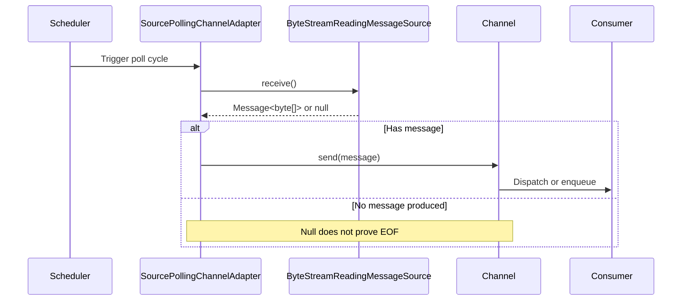

# Backpressure when reading long streams

## 1. Problem: the source can outpace the processor

In the **SPRING_INTEGRATION_ADAPTERS** module, Spring Integration connects external systems using **inbound/outbound adapters, gateways, pollers, and `MessageChannel`**. When practicing flows across files, SFTP, HTTP, JMS, AMQP, Kafka, and databases, you must control not only message contracts, but also ingestion/emission rates, errors, and connection lifecycles.

The **Adapter Stream** chapter includes a classic case: an `InputStream` or `Reader` delivers very large data, or runs continuously for hours, while downstream decoding, business validation, and database persistence run more slowly. If the app simply reads as fast as possible and dumps every message into an in-memory queue, it can:

- Grow memory without bound, triggering GC pressure and `OutOfMemoryError`.
- Accumulate latency: a newly read message waits a long time before processing.
- Hold many **uncommitted** events, making data loss likely if the JVM dies.
- Leave a scheduler thread blocked inside `InputStream.read()` or when sending to a queue.
- Attempt retries after source bytes were already consumed, causing duplicate or misaligned records.
- Make application shutdown hard because queues stay full, streams stay open, or writers are still writing.

**Backpressure** is the mechanism by which a slower downstream exerts pushback upstream to **bound resources and ingestion rate** to real capacity. In Java streams and Spring Integration, it can happen via **synchronous dispatch**, **bounded queues making the sender wait**, **poller limits**, or **source protocols that support pausing**. These mechanisms are not identical to Reactive Streams `request(n)`.

```text
  Huge file / endless pipe / SDK InputStream
                    |
                    v
      ByteStreamReadingMessageSource
                    |
                  poller
                    |
                    v
          Spring Message<byte[]>
                    |
            [Backpressure point]
               /          \\
        DirectChannel   Bounded QueueChannel
             |               |
    Sync downstream       Polling consumer
             |               |
             +-------+-------+
                     |
               Frame decoder
                     |
             Slow DB / HTTP / SDK
```

### Learning objectives

After this lesson, you will be able to:

1. Explain **source rate**, **consumer rate**, **queue depth**, **in-flight**, latency, and memory budgets.
2. Distinguish **unbounded streams**, **finite large files**, byte chunks, business records, and committed offsets.
3. Use `ByteStreamReadingMessageSource` / `CharacterStreamReadingMessageSource` properly as inbound adapter `MessageSource`s.
4. Apply synchronous backpressure with `DirectChannel` and bounded buffering with `QueueChannel`.
5. Configure poller `fixedDelay`, `maxMessagesPerPoll`, and a dedicated consumer poller for `PollableChannel`.
6. Understand `MessageChannel.send(message, timeout)` accurately when a queue is full and handle failure outcomes.
7. Evaluate `ExecutorChannel`, `ThreadPoolTaskExecutor`, `RendezvousChannel`, `Reactive Streams`, and their respective limits.
8. Design bounded framing/buffering when reading UTF-8/JSON/binary chunk by chunk.
9. Test slow consumers, full queues, shutdowns, and errors after source data has already been consumed.
10. Pick suitable durable storage/ACK/offset solutions when data loss or duplicate processing is unacceptable.

## 2. Load model: why can a queue swell?

Let:

- `λ` (lambda): rate at which the producer creates messages, in **messages/second**.
- `μ` (mu): rate at which the consumer finishes processing, in **messages/second**.
- `Q`: number of messages waiting in the queue.
- `S`: average payload size, in **bytes/message**.
- `W`: number of in-flight messages outside the queue.

Over a short interval `Δt`:

\[
\Delta Q \approx (\lambda-\mu)\,\Delta t
\]

If `λ > μ` persists without backpressure, `Q` tends to grow continuously. Minimum memory estimate for **queue payloads**:

\[
M_{\mathrm{payload}} \approx Q \times S
\]

In practice, memory is also needed for Spring `Message`s, headers, arrays, incomplete frame data in decoders, parsed objects, thread stacks, executor queues, and GC overhead. Thus a queue holding 64 messages × 16 KiB payloads already uses **at least ~1 MiB for payloads alone**, before counting everything else. These numbers illustrate sizing principles, not a benchmark.

### Four action groups when a queue is full

| Policy | Consequence | When appropriate |
| --- | --- | --- |
| **Block producer** | Source slows down when send calls block | Source can wait and has explicit deadlines |
| **Reject / fail-fast** | Send returns false or throws per component | Explicit retry/replay/quarantine exists |
| **Drop** | Loses designated messages | Best-effort telemetry; never for critical data |
| **Persist/broker handoff** | Stores data in a recoverable store | Business events needing durability, though the store also needs capacity |

**None of these actions is free.** Blocking can tie up threads and cause upstream timeouts; dropping loses events; persisting adds I/O and operational cost. In particular, **blocking reads does not undo bytes already pulled from `InputStream`**.

### Backpressure and batching are different

`maxMessagesPerPoll(10)` limits how many messages are fetched **in one poller trigger**, not total messages over the app's lifetime. `bytesPerMessage=4096` governs how many bytes the source tries to read for **one Spring message**, not end-to-end rate or business record count. `QueueChannel(32)` is **capacity by message count**, not 32 MB.

## 3. Identify the stream source before designing

"Long stream" is not just one kind of source:

| Source type | Example | What happens when reads pause/block? | Is replay available? |
| --- | --- | --- | --- |
| Finite large file | `Files.newInputStream(...)` | OS can pause reading progress; file remains on disk | Can reopen/seek if file is immutable and checkpointed |
| `ByteArrayInputStream` | In-RAM fixture | Data stays ready, read on next poll | Can recreate from fixture |
| In-JVM pipe | `PipedInputStream` | Pipe buffer can fill up, blocking writer | Not by default |
| OS stdin/pipe | `System.in` | Can exert backpressure on the writing process | Depends on sender and upstream durability |
| Socket `InputStream` | TCP connection | TCP window/buffer can throttle upstream, though timeouts/disconnects depend on protocol | Not by default |
| Object store/SDK stream | HTTP response body, SDK upload/download | SDK may buffer or time out independently | Usually needs reopening request/range |
| Text `Reader` | `InputStreamReader`/`BufferedReader` | Can block inside `readLine` | Depends on underlying byte source |
| JMS/AMQP/Kafka broker | Consumer records | Dedicated ACK/pause/offset APIs | Do not emulate with raw `InputStream` |

From **stopping reads**, you cannot conclude the sender stopped emitting into infrastructure. TCP has kernel buffers and flow control, yet application-level acknowledgement must still be defined by the protocol. With one-way HTTP stream downloads, reading too slowly can trigger server/proxy read timeouts. With files, no producer is waiting, so "backpressure" mainly throttles **internal resource consumption**.

### Common misconception about `InputStream.available()`

`available()==0` is only an estimate that no bytes are immediately readable without blocking; **it does not prove EOF**. `InputStream.read(byte[])` can also return fewer bytes than requested. Never use `available()` as a system-wide feedback signal to stop the poller or mark a job complete.

## 4. ByteStreamReadingMessageSource, poller, and per-read bounds

In **Spring Integration 6.5.x**:

```java
import java.io.InputStream;
import org.springframework.integration.stream.ByteStreamReadingMessageSource;

InputStream input = /* stream provided by the application */;

ByteStreamReadingMessageSource source =
        new ByteStreamReadingMessageSource(input);
source.setBytesPerMessage(4096);
source.setShouldTruncate(true);
```

`ByteStreamReadingMessageSource` creates `Message<byte[]>`. Per the documentation, `bytesPerMessage` **defaults to 1024**. Setting `4096` is just this example's choice, not the "best" number for every transport. `shouldTruncate(true)` ensures the payload reflects **only actual bytes read** when shorter than the target buffer.

### Source is pollable, does not push infinitely



A poller actively calls `receive()`, forwards the message to the channel, and repeats per trigger. Set `maxMessagesPerPoll(1)` so each trigger processes at most one source message. However, if sending to `QueueChannel` blocks because the queue is full, **the active poll cycle can still be held**, even though the next poll has not started yet.

### Key knobs table

| Knob | What it changes | What it does NOT solve |
| --- | --- | --- |
| `bytesPerMessage` | Chunk byte size the source tries to read | Framing, max business record |
| `shouldTruncate(true)` | Prevents padding bytes beyond actual bytes read | Replay/ACK |
| `fixedDelay` | Pause after the previous trigger completes | Timeout on blocking `InputStream.read()` |
| `maxMessagesPerPoll` | Limits `receive()` calls per poll cycle | Messages sitting in a queue |
| `QueueChannel(capacity)` | Caps queued messages waiting | Hard cap on entire JVM heap |
| Polling consumer `receiveTimeout` | Wait duration when polling from channel | Read timeout on external source |
| `send(message, timeout)` | Wait time for channel to accept message when supported | Timeout on consumer business I/O |

**Byte sources require a poller; outbound handlers receiving from `DirectChannel` do not.** A `QueueChannel` placed between two endpoints introduces **a polling consumer**, which has its own poller with separate throughput/timeout math.

## 5. Option A: DirectChannel for synchronous backpressure

The simplest flow has no queue between the source and business handler:

```text
InputStream -> ByteStreamReadingMessageSource -> inbound poller
                 -> DirectChannel -> slow business handler
                           |
                   poller thread waits
                           |
                   until next poll runs
```

`DirectChannel` typically dispatches messages synchronously on the thread calling `send()`. If the handler works for 250 ms before returning, the poller directly feels that latency. This is **natural call-stack backpressure**, requiring no large buffers.

### 5.1. Java DSL example

```java
import java.time.Duration;
import java.io.InputStream;

import org.springframework.context.annotation.Bean;
import org.springframework.integration.dsl.IntegrationFlow;
import org.springframework.integration.dsl.Pollers;
import org.springframework.integration.stream.ByteStreamReadingMessageSource;

@Bean
IntegrationFlow directByteStreamFlow(InputStream input) {
    ByteStreamReadingMessageSource source =
            new ByteStreamReadingMessageSource(input);
    source.setBytesPerMessage(4096);
    source.setShouldTruncate(true);

    return IntegrationFlow
            .from(source, endpoint -> endpoint
                    .id("directStreamInbound")
                    .poller(Pollers.fixedDelay(
                                    Duration.ofMillis(100))
                            .maxMessagesPerPoll(1)))
            .channel("directByteChunks")
            .get();
}
```

This is a **configuration fragment**: `input` must be a managed bean; `directByteChunks` must be a `DirectChannel` with a consumer. Do not enable both this example and the queue example below concurrently so two sources read **the same `InputStream`**.

### 5.2. Pros and cons

| Advantage | Limitation |
| --- | --- |
| Keeps inter-endpoint memory backlog low | Slow consumer ties up the poller thread |
| Sequential execution order is easier to reason about | Throughput capped by the slowest handler |
| Exceptions can propagate back up the call stack | Does not automatically replay source bytes after failure |
| Easier latency debugging on a single thread | Multiple sources sharing a scheduler can starve threads |

**`DirectChannel` is not a transaction.** If the consumer fails a DB write after the source read bytes, data is not automatically "unread" back into the `InputStream`. For critical data, persist inputs durably or use a source supporting replay/checkpointing.

## 6. Option B: QueueChannel with bounded capacity

When you want to decouple reading cadence from processing cadence, use `QueueChannel(capacity)`. Per the 6.5 docs:

- `QueueChannel` is point-to-point, **not a broadcast** to all consumers.
- The no-arg constructor essentially creates a practically unbounded queue (`Integer.MAX_VALUE`); avoid the default under heavy load.
- `new QueueChannel(32)` caps waiting messages at **32 Spring messages in the queue**.
- When full, `send(message)` can **block** until space frees up; `send(message, timeout)` lets you bound the wait.
- When a consumer calls `receive()` and takes a message, one queue slot is freed.

```text
                   fast ingress
InputStream -> Source -> poller -> QueueChannel(32)
                                  [msg1..msg32]
                                        |
                           queue full -> sender blocks
                                        |
                           separate consumer poller
                                        |
                                        v
                                 Slow business
```

### 6.1. A bounded buffer is not durability

The default queue holds messages **in RAM**. Even with bounded capacity, messages sitting in the queue can still be lost if the JVM crashes. If you need a durable queue, Spring Integration supports configuring a `MessageGroupStore`/`ChannelMessageStore`; or use JMS/AMQP/Kafka with dedicated broker contracts.

**Never ignore a `send()` failure just because `InputStream` could keep reading.** The source already consumed bytes, so you must stop intake or persist durable state; otherwise silent data loss occurs.

### 6.2. When capacity is full

| API | When space exists | When full |
| --- | --- | --- |
| `queue.send(message)` | Accepts, returns `true` | Can wait indefinitely (until space/interrupt) |
| `queue.send(message, 0)` | Accepts immediately | Returns `false` immediately |
| `queue.send(message, 500)` | Accepts if space frees within wait window | Returns `false` after wait window if still full |
| `queue.receive(0)` | Takes available message | Returns `null` immediately |

`500` here is **milliseconds** in `MessageChannel.send(Message, long)`. Do not confuse this timeout with a 500 ms database query timeout. With `DirectChannel`, the timeout parameter does not turn an active synchronous handler invocation into a cancellable operation.

### 6.3. Queue depth and remaining capacity

`QueueChannel` exposes operations such as:

```java
int pendingMessages = boundedChunks.getQueueSize();
int remainingSlots = boundedChunks.getRemainingCapacity();
```

`boundedChunks` is a `QueueChannel` instance; these values are **point-in-time snapshots** that can change immediately under concurrency. They fit metrics/alerts; never read `getQueueSize()` and assume a subsequent `send()` will not block (that is a check-then-act race).

## 7. Complete Spring Boot example: reading a long file through a bounded QueueChannel

This hands-on example uses **Java 17+**, Spring Boot, and Spring Integration **6.5.x**. The application reads an existing binary file via `InputStream`, produces `Message<byte[]>` through a poller, puts them into `QueueChannel(16)`, and processes them on a slow **polling consumer**.

The architecture uses two independent polling schedules:

```text
  InputStream (owned by Spring context)
                |
       ByteStreamReadingMessageSource
                |
        Inbound poller #1
     maxMessagesPerPoll=1
                |
                v
          boundedChunks
         QueueChannel(16)
                |
        Consumer poller #2
     maxMessagesPerPoll=1
                |
                v
     slowChunkConsumer handler
                |
         downstream operation
```

### 7.1. Dependencies

```xml
<dependencies>
    <dependency>
        <groupId>org.springframework.boot</groupId>
        <artifactId>spring-boot-starter-integration</artifactId>
    </dependency>
    <dependency>
        <groupId>org.springframework.integration</groupId>
        <artifactId>spring-integration-stream</artifactId>
    </dependency>
</dependencies>
```

Use the **Spring Boot BOM** to keep versions aligned, or specify compatible versions if the project has no BOM. In Spring Integration 6.5, `ByteStreamReadingMessageSource` is in `org.springframework.integration.stream`; in 7.x, imports may be in `.stream.inbound`. Do not mix imports/implementations from two framework lines in one app.

### 7.2. application.yml

```yaml
app:
  stream:
    input-path: ${STREAM_INPUT_PATH:./data/large-input.bin}
    chunk-size: ${STREAM_CHUNK_SIZE:4096}
    queue-capacity: ${STREAM_QUEUE_CAPACITY:16}
```

The example requires a real input file and a path configured by a **trusted operator**. Never let HTTP requests specify arbitrary server file paths. Do not apply this example directly to an indefinitely open socket without adding timeouts and EOF handling.

### 7.3. Complete Java configuration

```java
import java.io.IOException;
import java.io.InputStream;
import java.nio.file.Files;
import java.nio.file.Path;
import java.time.Duration;
import java.util.concurrent.atomic.AtomicLong;

import org.springframework.beans.factory.annotation.Qualifier;
import org.springframework.beans.factory.annotation.Value;
import org.springframework.boot.SpringApplication;
import org.springframework.boot.autoconfigure.SpringBootApplication;
import org.springframework.context.annotation.Bean;
import org.springframework.integration.annotation.Poller;
import org.springframework.integration.annotation.ServiceActivator;
import org.springframework.integration.channel.QueueChannel;
import org.springframework.integration.config.EnableIntegration;
import org.springframework.integration.dsl.IntegrationFlow;
import org.springframework.integration.dsl.Pollers;
import org.springframework.integration.stream.ByteStreamReadingMessageSource;
import org.springframework.messaging.Message;
import org.springframework.messaging.PollableChannel;

@SpringBootApplication
@EnableIntegration
public class StreamBackpressureApplication {

    private final AtomicLong processedBytes = new AtomicLong();

    public static void main(String[] args) {
        SpringApplication.run(
                StreamBackpressureApplication.class, args);
    }

    @Bean(name = "ownedInput", destroyMethod = "close")
    public InputStream ownedInput(
            @Value("${app.stream.input-path}") String filename)
            throws IOException {

        Path path = Path.of(filename).toAbsolutePath().normalize();
        return Files.newInputStream(path);
    }

    @Bean
    public PollableChannel boundedChunks(
            @Value("${app.stream.queue-capacity:16}") int capacity) {

        if (capacity < 1 || capacity > 1024) {
            throw new IllegalArgumentException(
                    "Queue capacity is outside allowed range");
        }
        return new QueueChannel(capacity);
    }

    @Bean
    public IntegrationFlow streamInboundFlow(
            @Qualifier("ownedInput") InputStream input,
            @Value("${app.stream.chunk-size:4096}") int chunkSize) {

        if (chunkSize < 1 || chunkSize > 1024 * 1024) {
            throw new IllegalArgumentException(
                    "Invalid chunkSize");
        }

        ByteStreamReadingMessageSource source =
                new ByteStreamReadingMessageSource(input);
        source.setBytesPerMessage(chunkSize);
        source.setShouldTruncate(true);

        return IntegrationFlow
                .from(source, endpoint -> endpoint
                        .id("streamInputAdapter")
                        .poller(Pollers
                                .fixedDelay(Duration.ofMillis(50))
                                .maxMessagesPerPoll(1)))
                .channel("boundedChunks")
                .get();
    }

    @ServiceActivator(
            inputChannel = "boundedChunks",
            poller = @Poller(
                    fixedDelay = "100",
                    maxMessagesPerPoll = "1"))
    public void slowChunkConsumer(Message<byte[]> message) {

        byte[] chunk = message.getPayload();
        try {
            // Demo: simulate slow DB/HTTP processing.
            // Production: replace with a real handler/transaction.
            Thread.sleep(250);
        }
        catch (InterruptedException ex) {
            Thread.currentThread().interrupt();
            throw new IllegalStateException(
                    "Consumer was interrupted", ex);
        }

        long total = processedBytes.addAndGet(chunk.length);
        // Log metadata only; never dump binary payloads.
        if (total % (1024L * 1024L) < chunk.length) {
            System.err.println("Processed bytes=" + total);
        }
    }
}
```

This is a **single-configuration-class** Spring Boot example with two endpoints. No extra files are needed besides build configuration and the input binary file; this Knowledge article **did not build or run the application**.

### 7.4. Step-by-step walkthrough

1. Spring creates **one `InputStream`** from the file. `destroyMethod="close"` closes it when the context destroys the bean.
2. Inbound `ByteStreamReadingMessageSource` reads chunk by chunk, up to `chunkSize`.
3. The inbound poller runs on schedule, with `maxMessagesPerPoll(1)` capping each poll at one message.
4. `QueueChannel(capacity)` holds chunks in RAM; **when full, the reading poller blocks on send** per channel semantics.
5. The consumer with `@ServiceActivator(... poller=@Poller(...))` takes at most one chunk per poll cycle.
6. `Thread.sleep(250)` merely **simulates** slow downstream work; never use fixed sleeps as business processing design.
7. Because the consumer runs slower than the reader, `boundedChunks` fills up and exerts backpressure on the inbound poller, limiting further chunk reads.

**Limitation:** succeeding on queue send only means **enqueued**, not processed by the consumer. If the program crashes, messages waiting in the in-memory `QueueChannel` can be lost. If the consumer throws after dequeuing a message, redelivery is **not automatically guaranteed**.

### 7.5. Two sets of parameters not to confuse

| Parameter | Where? | Meaning |
| --- | --- | --- |
| `fixedDelay(50 ms)` | Inbound poller | When to read the stream next |
| `maxMessagesPerPoll(1)` | Inbound poller | Max one chunk received per trigger |
| `new QueueChannel(16)` | Channel | Max 16 waiting messages |
| `fixedDelay=100 ms` | Consumer poller | When to fetch the next message |
| `maxMessagesPerPoll=1` | Consumer poller | Max one message consumed per cycle |
| `Thread.sleep(250)` | Demo handler | Simulates slow downstream |

Because the handler takes 250 ms, the queue can fill up to capacity and start blocking the inbound poller. These numbers **illustrate the effect**, not measured throughput. Schedulers, I/O, thread counts, and other settings change real timing.

### 7.6. File EOF does not auto-stop the application

`ByteStreamReadingMessageSource` may return `null` when no messages remain; on finite files, the poller can keep running if the application lacks a completion coordinator. **Do not assume the byte source emits `StreamClosedEvent` like `CharacterStreamReadingMessageSource` with EOF detection enabled.** For one-shot batch runs that must exit, add a source completion policy and **drain the queue before closing input/output**.

### 7.7. Why choose QueueChannel over two DirectChannels?

If both `rawInputChannel` and `processedChannel` are `DirectChannel`, a slow handler holds the inbound thread until it returns. A queue provides a **bounded buffer** so the source can read slightly ahead. This is a trade-off between throughput and memory, not a universal default optimization. When requirements are simple and thread decoupling is unnecessary, `DirectChannel` can be easier to prove correct.

## 8. XML alternative: bounded queue and two pollers

The same design can be declared in Spring Integration 6.5 XML. This snippet assumes the application already provides an `ownedInput` bean and a `slowChunkService` bean with a `consume(byte[])` method.

```xml
<beans:beans
    xmlns:beans="http://www.springframework.org/schema/beans"
    xmlns:xsi="http://www.w3.org/2001/XMLSchema-instance"
    xmlns:int="http://www.springframework.org/schema/integration"
    xsi:schemaLocation="
        http://www.springframework.org/schema/beans
        https://www.springframework.org/schema/beans/spring-beans.xsd
        http://www.springframework.org/schema/integration
        https://www.springframework.org/schema/integration/spring-integration.xsd">

    <beans:bean id="byteStreamSource"
                class="org.springframework.integration.stream.ByteStreamReadingMessageSource">
        <beans:constructor-arg ref="ownedInput"/>
        <beans:property name="bytesPerMessage" value="4096"/>
        <beans:property name="shouldTruncate" value="true"/>
    </beans:bean>

    <int:channel id="boundedChunksXml">
        <int:queue capacity="16"/>
    </int:channel>

    <int:inbound-channel-adapter
            id="streamInputAdapterXml"
            channel="boundedChunksXml"
            ref="byteStreamSource">
        <int:poller fixed-delay="50"
                    max-messages-per-poll="1"/>
    </int:inbound-channel-adapter>

    <int:service-activator
            id="slowChunkConsumerXml"
            input-channel="boundedChunksXml"
            ref="slowChunkService"
            method="consume">
        <int:poller fixed-delay="100"
                    max-messages-per-poll="1"/>
    </int:service-activator>
</beans:beans>
```

This is an **alternative configuration** to section 7's Java config; do not enable both concurrently so two adapters fight over one `InputStream`. `<int:queue capacity="16"/>` is bounded; omitting `capacity` creates an unbounded queue unsuitable for production operations. Consumers wired to a `PollableChannel` **must have a poller** or rely on a properly configured default poller.

### When no consumer is running

A bounded queue can fill up and block the inbound thread at `send()`. While that is a form of backpressure, it can also indicate an **operational outage** if the consumer never started or crashed. Track metrics/alerts for `queueDepth`, `consumerRunning`, `oldestMessageAge`, and send-blocked duration. Never treat a persistently full queue as an acceptable steady state.

## 9. Data correctness: a chunk is not an event

When reading long files/pipes, distinguish between **bytes returned by the source** and **the boundaries of a business record**.

```text
Wire UTF-8 record 1:  31 2C C4 90 0A      ("1,Đ\\n")
Wire UTF-8 record 2:  32 2C 50 41 49 44 0A ("2,PAID\\n")

Chunk A: 31 2C C4
Chunk B: 90 0A 32
Chunk C: 2C 50 41 49 44 0A
```

Here `Đ` consists of **2 UTF-8 bytes** `C4 90`, split across two chunks. If a worker calls `new String(chunk, UTF_8)` per chunk, it can emit replacement characters or a strict decoder will throw, even though the full stream is valid.

### Proper pipeline design

```text
Message<byte[]> chunks
        |
        v
Bounded reassembler (up to maxFrameBytes)
        |
   Complete byte record
        |
        v
Strict CharsetDecoder UTF-8
        |
        v
Parse schema / business validation
        |
        v
Durable inbox / sink
```

**Backpressure does not apply only to queues.** A reassembler can accumulate bytes waiting for LF or a length prefix. If a source sends a gigabyte-sized record without a delimiter, an unbounded `ByteArrayOutputStream` or `StringBuilder` will still trigger OOM **even when `QueueChannel` holds only a single message**.

### Resource rules for decoders

- Bound `bytesPerMessage` at the source, and also enforce **`maxRecordBytes` in the reassembler**.
- For length-prefixed frames, reject negative/zero/over-limit lengths **before allocating large arrays**.
- For text, use a stateful `CharsetDecoder` or assemble complete records before decoding.
- Never decode individual byte chunks and treat them as complete JSON/CSV records.
- Bound how long an incomplete frame is allowed to sit open.
- Maintain one decoder/reassembler **per logical stream**, never mixing data across sockets/tenants.
- Never make queues unbounded just to mask missing-frame errors.

## 10. A testable sizing exercise

Suppose a system projects:

| Parameter | Example value |
| --- | --- |
| `bytesPerMessage` | 16 KiB |
| Queue capacity | 64 messages |
| Consumers | 1 |
| Per-consumer rate | 25 messages/second |
| Peak source read rate | 80 messages/second |
| Additional payload memory in full queue | At least ~1 MiB |

Without bounds, backlog grows by the ~55 messages/second gap. With `QueueChannel(64)` and blocking sends, the source **blocks before the queue exceeds 64 messages** (excluding in-flight messages and bytes already buffered in the source/OS).

This is purely a **capacity exercise**, not a benchmark: actual read rates depend on how streams block, schedulers, and disk/network speeds; `Message` wrappers/headers/GC make real memory higher than raw payload math.

### Do not count "bytes read" as "orders completed"

A single chunk may hold:

- Half of a JSON event.
- Two NDJSON lines plus the start of a third.
- Part of a compressed archive.
- Bytes of an enqueued event not yet committed by the consumer.

Measure `bytesRead`, `chunksEmitted`, `framesCompleted`, `eventsValidated`, and `eventsCommitted` separately to understand real backlog and data correctness.

## 11. Limit of backpressure: read bytes cannot be "unread"

In a typical stream-reading flow, the order is:

```text
InputStream.read()
      |
      v
ByteStreamReadingMessageSource receives bytes
      |
      v
Create Message<byte[]>
      |
      v
MessageChannel.send(...)
      |
      +-- Queue has room -> enqueue OK
      |
      +-- Queue full -> block / timeout / fail
```

By the time a queue rejects or times out, bytes may **already have been read from `InputStream`**. Files, sockets, and pipes do not natively support "putting bytes back". That is why **a bounded queue is only one piece of the reliability puzzle**.

### 11.1. What if send times out after the source already read?

| Reaction | Problem |
| --- | --- |
| Skip the message and keep reading | Loses chunk, corrupts framing for all subsequent records |
| Infinite retry on poller thread | Can block/impede shutdown and trigger retry storms |
| Read again immediately from `InputStream` | Reads the *next* bytes, **not the failed chunk** |
| Try reopening the file from the start | Produces duplicates without a checkpoint |
| Persist message to durable staging before continuing | Requires transactions/idempotency, but gives a recovery path |
| Controlled inbound pause/stop | Stops additional new reads; still must handle the already-read chunk |

Never apply `drop` to byte-integrity-sensitive data such as JSON streams, compressed files, financial feeds, or audit logs, because losing one chunk can leave the decoder **unable to resynchronize**.

### 11.2. Be explicit about delivery guarantees

| Goal | What is needed beyond `QueueChannel`? |
| --- | --- |
| Best-effort telemetry | Drop policy, metrics, resource protection |
| At-least-once event delivery | Replayable source/durable staging, retries, stable event ID |
| Source-ordered data | Single-reader/sequence, ordered processing, or partitioned ordering |
| No duplicate side effects | Idempotent consumer / durable inbox |
| Zero byte loss after crash | Durable storage + checkpoints, not just an in-memory queue |
| End-to-end ACK | Explicit business acknowledgement from the target system |

If the source is an immutable retained file, you can build a job with **committed record/offset checkpoints**. However, buffering can read ahead from the OS and one chunk can span multiple records; accurate checkpointing separates the **read** position from the **committed** position.

### 11.3. Never claim exactly-once

`QueueChannel(16)` only caps queued messages; it does not create a transaction spanning `InputStream`, a database, and an output broker. On non-seekable streams, a crash can lose unpersisted bytes. Achieving exactly-once *business effects* requires scoped idempotency/transactions and explicit protocols—it cannot be inferred from `send()==true`.

## 12. Poller is a pacing mechanism, not a read timeout

### 12.1. `fixedDelay`

With `Pollers.fixedDelay(Duration.ofMillis(200))`, the scheduler waits the configured interval **after the previous trigger finishes**. Under healthy conditions it reduces `receive()` frequency, yet:

- If `receive()` blocks on network I/O, the trigger does not cancel `read()`.
- If channel send blocks, that poll cycle also stretches out.
- It knows nothing about business backlog inside queues unless the app feeds back signals.
- It does not guarantee every poll reads a full `bytesPerMessage`.

### 12.2. `maxMessagesPerPoll`

On `SourcePollingChannelAdapter`, **`maxMessagesPerPoll=1` is the default** if unconfigured. Setting `-1` (unlimited) lets a single poll keep reading continuously until the source returns `null`, tying up the scheduler indefinitely—dangerous for always-ready sources or non-interruptible streams.

Since Spring Integration 5.5, **`0`** can mean **temporarily skip calling `receive()`** when adjusted properly on the adapter/poller metadata. This is an **inbound polling pause** mechanism, not durable byte storage, and cannot cancel an already-blocked `InputStream.read()`.

### 12.3. Is changing poller speed complete backpressure?

No. If the source pushes fast into OS/socket buffers, slowing polling merely shifts pressure into another buffer. It can:

1. Keep the application heap from growing.
2. Once pipe/socket buffers fill, propagate pushback over the transport (if supported).
3. Cause timeouts/disconnects if the sender refuses to wait.

Therefore you need a **transport contract**: timeouts, reconnects, read resume, replay semantics, record/offset confirmations, and size limits. For Kafka, JMS/AMQP, or HTTP protocols, use specialized adapters with native pause/ACK/offset support.

### 12.4. Poll frequency does not measure actual throughput

Raising `maxMessagesPerPoll` or lowering `fixedDelay` does not guarantee higher throughput. Slow consumers, full queues, disk I/O, serialization, transactions, and memory pressure can be the true bottleneck. Measure **bytes/sec, messages/sec, and commits/sec** separately rather than counting polls.

## 13. QueueChannel, ExecutorChannel, and RendezvousChannel

### 13.1. DirectChannel

`DirectChannel` fits when you want **synchronous feedback** from the handler back to the producer. It maintains no default backlog queue between endpoints, though producers can block for long periods when handlers are slow.

### 13.2. Bounded QueueChannel

A bounded `QueueChannel` helps when a small buffer is needed between mismatched speeds. When full, sends wait or fail on timeout; **producers must have a policy**. Since it is a `PollableChannel`, consumers need a poller or explicit `receive()` logic.

### 13.3. ExecutorChannel does not imply a bounded queue

`ExecutorChannel` dispatches to a `TaskExecutor` and can decouple callers from business handlers. However, if the executor uses an unbounded queue, the application can still OOM. Configure:

- Worker thread bounds.
- Task queue bounds.
- Explicit rejection policy.
- Executor shutdown/drain behavior.
- Ordering by source/partition key if needed.

**Bounded executor example** (configuration fragment, not a complete flow):

```java
import java.util.concurrent.ThreadPoolExecutor;
import org.springframework.context.annotation.Bean;
import org.springframework.scheduling.concurrent.ThreadPoolTaskExecutor;

@Bean
public ThreadPoolTaskExecutor streamWorkerExecutor() {
    ThreadPoolTaskExecutor executor =
            new ThreadPoolTaskExecutor();
    executor.setCorePoolSize(2);
    executor.setMaxPoolSize(4);
    executor.setQueueCapacity(16);
    executor.setThreadNamePrefix("stream-worker-");
    executor.setRejectedExecutionHandler(
            new ThreadPoolExecutor.CallerRunsPolicy());
    executor.setWaitForTasksToCompleteOnShutdown(true);
    executor.setAwaitTerminationSeconds(15);
    return executor;
}
```

Spring manages the `ThreadPoolTaskExecutor` bean lifecycle. `CallerRunsPolicy` pushes work back onto the calling thread when saturated, creating backpressure, **yet it is not an absolute fairness or durability guarantee**; shutdown behavior still needs testing. When used with a source poller, CPU/I/O work can run on the poller thread under saturation. Never use an unbounded executor as a way to "avoid backpressure".

### 13.4. RendezvousChannel

`RendezvousChannel` provides **zero-capacity handoff**: a sender requires a waiting receiver to hand over a message. It eliminates intermediate buffering, but can cause heavy blocking and fits poorly when consumer schedules are unaligned. It also **has no broker ACK/commit**; a receiver accepting the message does not mean the business transaction succeeded.

### 13.5. Comparison

| Channel | Dispatch | Buffer | Feedback to source | What to watch out for |
| --- | --- | --- | --- | --- |
| `DirectChannel` | Synchronous | No separate queue | Slow handler slows sender | I/O can block scheduler |
| `QueueChannel(16)` | Producer enqueues, consumer polls | 16 messages | Blocks/fails on send timeout when full | Two pollers; in-memory is not durable |
| `ExecutorChannel` + bounded executor | Asynchronous | Configurable executor queue | Rejection/`CallerRuns` under load | Ordering and lifecycle |
| `RendezvousChannel` | Thread-to-thread handoff | Zero-capacity | Sender waits for receiver | Easy to deadlock if wired poorly |
| JMS/AMQP/Kafka broker | Per broker protocol | Broker-managed | Dedicated ACK/offset/consumer pacing | Needs transaction/retry/partition config |

## 14. Reactive Streams `request(n)` is a different model

In **Reactive Streams**, a subscriber requests up to `n` elements upfront via the `request(n)` demand protocol. This is **demand-driven backpressure**, not equivalent to simply using:

```java
new QueueChannel(16);
```

`QueueChannel` creates a **blocking/backed-up sender** based on capacity; it does not propagate `request(n)` signals to an arbitrary `InputStream`/SDK. Likewise, creating a `Flux` from an `InputStream` by reading everything first and emitting **does not** save memory if upstream already materialized all bytes.

### When to use Reactor/WebFlux?

- Both source and target genuinely support **non-blocking/Reactive Streams**.
- Demand and cancellation propagate end-to-end across the pipeline.
- Many concurrent connections must be managed without tying up one thread per blocking request.
- Backpressure can be verified over **real transports**, not just in-memory `Flux` operators.

If the source is still a blocking `InputStream.read()`, isolate it on an appropriate thread/scheduler, bound buffers, and handle cancellation/close. Never run blocking `read()` directly on an event-loop thread and call it reactive programming. For a simple single-file task, Spring Integration pollers + `DirectChannel`/bounded `QueueChannel` are often easier to understand and operate.

## 15. Deadlines, timeouts, and circuit breakers

Backpressure must not turn into **unmonitored infinite waiting**.

| Timeout / bound | Where it applies | What it cannot do |
| --- | --- | --- |
| `send(message, timeout)` | Channel on enqueue/dispatch per semantics | Cannot cancel an in-flight DB query |
| Consumer poll `receiveTimeout` | Waiting for a message from `PollableChannel` | Cannot cancel an `InputStream` read |
| Socket read timeout | TCP `InputStream` | Does not set a general timeout on output writes |
| SDK/HTTP request timeout | External client | Cannot recover bytes already read from a non-replayable source |
| Circuit breaker | Handler calling a failing service | Not a durable message queue |
| Graceful shutdown deadline | Coordinator | Cannot guarantee SIGKILL runs cleanup |

### When downstream stops accepting

Typical workflow:

1. Mark degraded/not-ready.
2. Stop or throttle intake; never read endlessly.
3. Allow processing within remaining queue/timeout limits.
4. On failure, persist `PENDING`/`UNCERTAIN` state per policy if a durable inbox exists.
5. Alert operators when queue occupancy or blocked-send duration exceeds thresholds.
6. Recover source/connections per protocol; avoid hot retry loops.

Never equate `send=false` with "safely skipped". If one byte chunk is rejected, framing for subsequent chunks may already be lost. Choose **fail-fast and stop the stream** when replay is unavailable.

## 16. Memory sizing: capacity × payload size is only the floor

Suppose `chunkSize=4096` and `capacity=16`. Queue payloads alone at full capacity hold around 64 KiB; in addition, the application holds:

- One chunk already read by the source waiting to enqueue.
- One or more messages currently in flight.
- Internal `InputStream` and stream-source buffer arrays.
- Reassembler buffers waiting for complete frames.
- Java `String`s, JSON DOMs, or DTOs created after decoding.
- Executor tasks, headers/metadata, and connection buffers.
- OS/network buffers not reflected in JVM heap.

If each chunk is 4 KiB yet the parser accumulates a 50 MiB JSON object lacking a delimiter, **`queue capacity=16` still will not save memory**. Enforce **`maxFrameBytes`**, `maxDecodedChars`, JSON depth/array limits, and disk quotas if staging.

### Suggested memory budget

```text
M_total_memory =
    M_queue_payload_and_headers
  + M_in_flight
  + M_reassembly
  + M_parser_objects
  + M_io_buffers
  + M_executor_tasks
  + M_runtime_headroom
```

Budget for **peak**, not average. When payload sizes are skewed (e.g., 99% small records, 1% huge), sizing by average causes OOM. Bounding bytes at ingest and message counts in queues are two orthogonal axes.

## 17. JUnit 5: testing capacity and send outcomes

You do not need external files or servers to prove a bounded `QueueChannel` rejects messages when full.

### 17.1. Simple test with capacity=1

```java
import static org.junit.jupiter.api.Assertions.*;

import org.junit.jupiter.api.Test;
import org.springframework.integration.channel.QueueChannel;
import org.springframework.messaging.Message;
import org.springframework.messaging.support.MessageBuilder;

class QueueBackpressureTest {

    @Test
    void refusesImmediateSendWhenFull() {
        QueueChannel queue = new QueueChannel(1);

        Message<byte[]> first = MessageBuilder
                .withPayload(new byte[] {1, 2})
                .build();
        Message<byte[]> second = MessageBuilder
                .withPayload(new byte[] {3, 4})
                .build();

        assertTrue(queue.send(first, 0));
        assertEquals(1, queue.getQueueSize());
        assertEquals(0, queue.getRemainingCapacity());

        assertFalse(queue.send(second, 0));
        assertEquals(1, queue.getQueueSize());

        Message<?> received = queue.receive(0);
        assertNotNull(received);
        assertArrayEquals(
                new byte[] {1, 2},
                (byte[]) received.getPayload());

        assertEquals(0, queue.getQueueSize());
        assertTrue(queue.send(second, 0));
        assertEquals(1, queue.getQueueSize());
    }
}
```

**This is a suggested test, not executed in STEP 4.** It verifies **queue capacity and channel send semantics**; it does not prove end-to-end database commits or `InputStream` replay. When using a real queue inside an `ApplicationContext`, also test running consumer/pollers, retries, and shutdown semantics.

### 17.2. Testing `send(message, timeout)`

With a full capacity-1 queue:

```java
import org.springframework.integration.channel.QueueChannel;
import org.springframework.messaging.Message;
import org.springframework.messaging.support.MessageBuilder;

QueueChannel queue = new QueueChannel(1);
Message<String> first = MessageBuilder.withPayload("first").build();
Message<String> second = MessageBuilder.withPayload("second").build();

boolean acceptedFirst = queue.send(first, 0);
boolean acceptedSecond = queue.send(second, 100);
```

If no consumer pulls a message during the wait, `acceptedFirst` is expected to be `true` and `acceptedSecond` `false` **after roughly the timeout**. Do not assert exact 100 ms wall-clock timing because schedulers have jitter; use reasonable upper bounds rather than strict millisecond assertions.

When moving from a queue unit test to a real inbound stream, **handle rejected messages explicitly**. Because bytes were already read by the source, you cannot simply call `source.receive()` again to recover the failed chunk.

### 17.3. Testing blocked producer unblocked by consumer

Create a capacity-1 queue; send the first message, then call `send(second, timeout)` on another thread. Once the main thread calls `receive(0)`, a slot opens and the sender completes. Use `CountDownLatch`/`Future.get(timeout)` and `ExecutorService.shutdownNow()` cleanup so tests have hard deadlines.

**Never use `Thread.sleep(500)` as the sole synchronization condition.** Schedulers can run slowly; tests should await observable state with an overall timeout and clean up even when assertions fail.

## 18. Integration tests with a finite source and slow consumer

### 18.1. Using ByteArrayInputStream instead of a network

With a 128 KiB source in RAM:

```java
import java.io.ByteArrayInputStream;
import org.springframework.integration.stream.ByteStreamReadingMessageSource;

byte[] fixture = new byte[128 * 1024];
ByteStreamReadingMessageSource source =
        new ByteStreamReadingMessageSource(
                new ByteArrayInputStream(fixture));

source.setBytesPerMessage(4096);
source.setShouldTruncate(true);
```

This is a **source fixture**, not a complete flow. Wire an inbound poller, `QueueChannel(2)`, and a slow consumer gated by a latch. Observe that:

1. The queue never exceeds capacity 2.
2. The poller does not pull hundreds of chunks into heap once the queue is full.
3. As the consumer frees slots, inbound resumes reading and enqueuing.
4. Total bytes reaching the consumer match the fixture length if there are no errors/rejections.
5. When the consumer is stopped, the sending thread can block and requires a shutdown policy.

### 18.2. Counting bytes is not enough to prove events

If the flow reads CSV/NDJSON, one chunk can span multiple lines. Tests must verify:

- `sum(chunk.length) == originalInputLength`.
- Framing assembler yields the exact **logical record count**.
- Parser/validator produces the exact **business event count**.
- After DB transactions, **committed** event count matches expectations.
- No duplicates arise from retries/restarts.

Counting raw bytes only proves bytes crossed a checkpoint, not schema or ACK correctness.

### 18.3. Testing fast producer, slow consumer

In integration tests, use a handler waiting on a `CountDownLatch` to intentionally hold the consumer. While the queue is full:

- Verify `getQueueSize()` reaches capacity.
- Measure `send()` duration or blocked thread state.
- Release the latch and verify the pipeline resumes.
- Interrupt/stop while the consumer waits and verify shutdown meets its deadline.

When the app has multiple input streams, use independent fixtures. Never share one `InputStream` across two adapters unless you intentionally built a single reader owner/dispatcher.

## 19. Testing failures after bytes were already read

### 19.1. Sink rejects a message

Create a capacity-1 queue with no running consumer. Let the source read 4 KiB chunks and attempt sending the second chunk into the full queue with a short timeout:

```text
source.receive() -> chunk 1 -> queue accepts
source.receive() -> chunk 2 -> queue is full
                               |
                               v
                          send fails
                               |
                    chunk 2 is already read!
```

This is a scenario exercise, not an API call that Spring Integration rolls back automatically. Design:

- Stop inbound intake immediately when handoff fails.
- Record source position/identifier and **received-but-unpersisted bytes** if policy allows.
- Do not read chunk 3 while chunk 2's fate is undecided.
- If the file is immutable with durable checkpoints, restart/resume from the committed offset.
- If the source cannot replay, report failure clearly instead of pretending success.

### 19.2. Consumer fails after dequeue

With `QueueChannel`, once the consumer pulls a message, the slot is freed. If the handler runs a DB query and throws, **the dequeued message does not automatically return to the queue**; configure retry advice/redelivery strategies or durable staging as required.

Never rely solely on `QueueChannel.getQueueSize()==0` to mark a batch complete. A message may be **dequeued yet still in flight**, with its DB transaction uncommitted.

### 19.3. Partial frame after crash

A finite `InputStream` has a 100 KiB record, the queue holds several chunks, and the JVM crashes. After restart, the original file may still exist, yet safe reprocessing requires:

1. Exact file identification (path/size/version/checksum per policy).
2. A **business-committed** checkpoint, not the raw read offset.
3. Reassembly from a valid frame/record boundary.
4. Stable business `eventId`s and an idempotent consumer.
5. Never assuming `MessageHeaders.ID` deduplicates across restarts.

## 20. Graceful shutdown: stop reading without losing backlog

`SmartLifecycle.stop()` controls the endpoint; `InputStream.close()` is a separate operation. A flow with `QueueChannel` also needs **draining**:

```text
SIGTERM / admin stop
         |
         v
Mark not-ready for new work
         |
         v
Stop inbound SourcePollingChannelAdapter
         |
         v
Wait for in-flight + QueueChannel drain
         |
         +---- deadline exceeded ---> Persist UNCERTAIN / recovery state
         |
         v
Flush / close downstream owned streams
         |
         v
Close input stream via resource owner
         |
         v
Context shutdown
```

### Dangerous case: poller blocked in send()

When the queue is full, the inbound poller may be waiting for a slot; `stop()`/interrupts can affect the send call. If no consumer is running, **`stop()` alone may not unblock the stall immediately**, depending on the implementation. Use bounded waits, interrupt handling, and monitoring rather than assuming `SmartLifecycle.stop()` is an instant "cancel all I/O" button.

### Source still blocked in `read()`

`fixedDelay` does not cancel `InputStream.read()`. On sockets/pipes, the thread can wait for data until timeout/EOF/close depending on implementation. Use connection manager/SDK timeouts or test-verified close/cancel mechanisms. Never close a shared JVM's `System.in` just to unblock one reader if other components still need it.

### Reader/Writer ownership

| Resource | When should it close? |
| --- | --- |
| `Files.newInputStream` opened by a Spring bean | When job/context completes, per owner/hook |
| `ByteArrayInputStream` fixture | Test scope |
| `System.in` | CLI/JVM owner, not an arbitrary module |
| SDK-provided `OutputStream` | Per session/commit/abort contract |
| Application file `Writer` | After draining/flushing and once no producers remain |
| In-memory queue | Does not turn into durable backlog on shutdown |

### EOF and backlog are independent conditions

On finite files, the source can reach EOF **before the queue drops to 0**. Closing the context immediately at EOF leaves queued messages unprocessed. Track all conditions together:

\[
\text{Completed} =
\text{SourceEOF} \land
\text{QueueEmpty} \land
\text{InFlightZero} \land
\text{BusinessCommitsConfirmed}
\]

This expression is an **architectural condition**; byte sources may not emit a default Spring EOF event, so the application must construct `SourceEOF` per contract (file length, custom source, job coordinator, or protocol EOF).

## 21. Backpressure observability and alerting

A system with bounded queues and no metrics easily becomes a **silently stalled** system. Do not measure only messages entering the queue: a slow consumer may not have committed a single record.

### 21.1. Metrics to track

| Suggested metric | Meaning | Note |
| --- | --- | --- |
| `stream_bytes_read_total` | Bytes read from source | Not yet committed bytes |
| `stream_chunks_emitted_total` | `Message<byte[]>` items created | Chunks differ from business records |
| `stream_queue_depth` | Waiting messages | Can read `getQueueSize()` |
| `stream_queue_capacity` | Message limit | Config value, not MB |
| `stream_queue_remaining_capacity` | Remaining slots | Snapshot, can change immediately |
| `stream_send_block_seconds` | Time sender blocked on send | Clear backpressure indicator |
| `stream_send_timeouts_total` | Enqueues missing deadline | Must have policy for already-read bytes |
| `stream_inflight_messages` | Dequeued but unfinished messages | Unavailable without instrumentation |
| `stream_records_decoded_total` | Complete logical records | Post-framing |
| `stream_business_commits_total` | Committed events | Separate from source `receive()` |
| `stream_processing_seconds` | Consumer latency | Use histograms/P95/P99 if supported |
| `stream_reassembly_pending_bytes` | Bytes awaiting full frame | Needs capacity/timeout |
| `stream_read_errors_total` | `InputStream.read()` failures | Separate from EOF |
| `stream_retry_attempts_total` | Retry attempts | Group by error/sink; avoid high cardinality |
| `stream_shutdown_deadline_exceeded_total` | Drain deadline timeouts | Signals backlog-loss risk |

These are **application-suggested metric names**, not all automatically produced by Spring Integration. When using Micrometer/IntegrationManagement, check existing meters before adding custom ones to avoid double-counting. Never use `eventId`, tokens, full filenames, or message contents as labels.

### 21.2. Multi-signal alerting

| Signal | Interpretation | Action |
| --- | --- | --- |
| High queue depth for a few seconds | Possible temporary burst | Watch drain rate |
| Queue depth near capacity persistently | Consumer falling behind | Throttle intake / scale processing within bounds |
| Rising `sendTimeouts` | Producer failing handoff | Stop reading further while chunks go unhandled |
| Rising consumer latency | DB/HTTP/SDK slowing down | Inspect downstream and circuit breakers |
| `bytesRead` rising, `recordsCommitted` flat | Framing/validation/consumer failure | Check parser, queue, and error paths |
| `pendingReassemblyBytes` rising | Missing delimiter / oversized record | Enforce max frame and timeout |
| Heap/GC rising despite small queue | Parser/record buffer/executor swelling | Heap profile, max object sizes |
| Queue empty yet in-flight > 0 | Handler still working | Do not mark batch complete |
| Input EOF yet queue depth > 0 | Not drained yet | Keep context/resources alive up to deadline |

### 21.3. Bounded queue occupancy

```java
int queued = boundedChunks.getQueueSize();
int free = boundedChunks.getRemainingCapacity();
int capacitySnapshot = queued + free;

double occupancy = capacitySnapshot == 0
        ? 0.0
        : (double) queued / capacitySnapshot;
```

`boundedChunks` is a `QueueChannel`. This is only an **approximate snapshot** because the two values are read at slightly different instants. Under concurrency, never use it to decide whether a message will fit without actually calling `send()`; use it for dashboards/alerts, and read fixed configured capacity for exact occupancy math.

## 22. Troubleshooting

| Symptom | Possible cause | Remediation |
| --- | --- | --- |
| Heap grows despite `QueueChannel` | Unbounded queue or parser/reassembler accumulating data | Set capacity + max frame/line bounds |
| `OutOfMemoryError` reading one huge line | Unbounded `readLine()` or accumulator | Bounded line parser, size/time caps |
| Source poller appears "hung" | Blocked in `InputStream.read()` or queue `send()` | Take thread dump; pinpoint block location |
| `fixedDelay(100)` sometimes polls much slower | Read/send/consumer cycle took longer | Measure poll duration and downstream latency |
| Queue capacity 16 yet huge bytes in memory | In-flight items, parsers, buffers outside queue | Sum total memory budget |
| Queue depth stays pinned at 16 | Consumer stopped or slower than producer | Check consumer poller, errors, DB |
| `send(message, 0)` returns false | Queue is full | Stop/retry handoff per policy; never drop chunks |
| Retry after error loses part of stream | Bytes read without saving failed payload | Durable staging/checkpoints |
| Consumer fails and message vanishes | Dequeued before DB commit | Durable inbox or proper retry advice |
| Messages arrive out of order | Executor/parallel consumers, multiple sources | Single owner / partition ordering |
| Random JSON parser failures | Decoding each byte chunk without framing | Reassemble first, strict UTF-8 |
| Vietnamese text turns into `U+FFFD` | UTF-8 split across chunks | Stateful decoder or reassemble record bytes |
| Queue empty while DB still updating | Messages currently in flight | Track active tasks/transactions |
| EOF reached yet JVM does not exit | Byte source/poller lacks completion coordinator | Stop endpoint, drain, close context |
| `StreamClosedEvent` never arrives for byte source | Confusing character EOF event with byte source | Build dedicated EOF signal for binary |
| Read timeouts despite slower poller | Transport cannot tolerate slow consumer | Transport timeouts/keepalive/replay |
| `ExecutorChannel` spikes memory | Unbounded executor task queue | Bound queue, threads, rejection policy |
| `CallerRunsPolicy` slows poller | Task runs on calling thread | Intentional backpressure; watch latency |
| Shutdown drags on | Poller blocked, consumer stuck, queue backlogged | Deadlines, transport-level cancel/close |
| Duplicates after restart | Misaligned checkpoints/ACKs | Stable event IDs and idempotency |
| Output file lost on restart | Reopened with truncate or closed unflushed | File publish/recovery policy |
| Error channel empty despite `IOException` | Sync vs. async routing or cleanup-stage error | Test error path and lifecycle separately |

### Ordered diagnostic workflow

1. **Identify the real source:** file, pipe, stdin, socket, SDK, or broker.
2. **Check channel type:** `DirectChannel`, `QueueChannel`, or `ExecutorChannel`?
3. **Inspect configuration:** `bytesPerMessage`, `maxMessagesPerPoll`, `fixedDelay`, queue capacity, executor queue size.
4. **Measure real throughput:** how many bytes/chunks produced vs. downstream commits.
5. **Inspect queue depth and in-flight:** is backlog in RAM queues or inside consumers/DB?
6. **Analyze thread dumps:** blocked in read, send, or downstream write?
7. **Check decoder/framing:** is a record split or oversized?
8. **Check errors/timeouts:** were any messages read but never handed off?
9. **Check replay/checkpoints:** is there a durable source or staging before restart?
10. **Check shutdown:** did intake stop, drain, flush, and close at the right owner?

## 23. When to use a specialized adapter instead of raw Stream

| Problem | Appropriate adapter | Where is backpressure/reliability? |
| --- | --- | --- |
| Reading an SDK-provided `InputStream` | Stream inbound + bounded channel | Poller/channel/SDK timeouts; add checkpoints if needed |
| Reading megabytes from a single file | Stream inbound or batch file reader | Bound chunks, records, draining; immutable file for replay |
| Watching a directory for multiple new files | **File inbound adapter** | Scanner/filter/poller, file completion, and locking |
| Remote SFTP files | **SFTP inbound adapter** | Remote listing/sync, local filters/metadata |
| HTTP streaming request/response | **HTTP/WebFlux** depending on use case | Reactive demand or transport flow control, timeouts |
| Long-lived TCP sockets | **TCP adapter/gateway** | Connection factory, serializers, framing, reconnects |
| JMS/AMQP queues | **JMS/AMQP inbound adapter** | Broker ACK/redelivery, listener concurrency, prefetch |
| Kafka topics | **Kafka inbound adapter** | Poll/consumer groups, pause/resume, offsets, partitions |
| Database polling/CDC | **JDBC/CDC adapter** | Query limits, transactions/checkpoints, and CDC contracts |
| Writing to a slow sink | Corresponding outbound adapter/gateway | Sink timeouts, concurrency, ACK/commit |

Raw `InputStream` is handy when an SDK already hands you a stream and you need a thin adapter. However, if the protocol natively provides **ACKs/offsets, sessions, reconnects, partitions, or transactions**, keeping the specialized adapter's semantics makes backpressure and recovery far easier than rebuilding them over raw byte chunks.

## 24. Practice exercises

1. Give an example where the producer reads 100 msg/s and the consumer handles 20 msg/s; explain why an unbounded queue grows continually.
2. Calculate minimum payload memory for `QueueChannel(64)` with `chunkSize=16 KiB`; list overheads omitted from that formula.
3. Compare `ByteStreamReadingMessageSource` and `CharacterStreamReadingMessageSource` on binary files vs. line-oriented UTF-8 files.
4. Create a `ByteArrayInputStream` with 100 KiB of data, `bytesPerMessage=4096`, and verify total bytes.
5. Change `bytesPerMessage` to 1024 and 8192; measure message counts and peak heap with a slow consumer.
6. Use `DirectChannel` for synchronous processing; measure how long the poller is held when the consumer slows down.
7. Use `QueueChannel(2)` and verify `send(message, 0)` returns `false` when full.
8. Use `send(message, 100)` and demonstrate that enqueue wait timeout is not a DB query timeout.
9. Write a dedicated polling consumer for `QueueChannel` using `@ServiceActivator(poller=@Poller(...))`.
10. Increase inbound `maxMessagesPerPoll` and observe queue saturation and scheduler fairness.
11. Reduce `fixedDelay` and check whether throughput actually increases when the consumer is the bottleneck.
12. Use two producers with a single consumer; measure ordering and queue depth.
13. Add a `ThreadPoolTaskExecutor` with a bounded queue and inspect its behavior under saturation.
14. Explain why `CallerRunsPolicy` creates pushback yet is not a durable queue.
15. Test `RendezvousChannel` with two threads and describe zero-capacity handoff.
16. Send two byte chunks splitting a UTF-8 character and verify you must reassemble before strict decoding.
17. Send a long record without LF and design `maxFrameBytes`/timeouts to prevent OOM.
18. Compare `bytesRead`, `chunksEmitted`, `recordsDecoded`, and `eventsCommitted`.
19. Simulate a full queue right after the source read a chunk; write a policy that never loses the chunk.
20. Simulate a consumer dequeuing a message followed by DB rollback, and analyze redelivery/replay.
21. Use an immutable file source and checkpoint by **committed** records, not bytes read.
22. Simulate a blocking `InputStream.read()` and verify `fixedDelay` does not cancel blocking reads.
23. Simulate a socket/pipe disconnect mid-frame and design source-appropriate retry/reconnect.
24. Trigger shutdown while 10 messages remain in the queue; measure `inFlight` and drain deadline.
25. Reach EOF while the queue is non-empty and prove the batch is not completed yet.
26. Define metrics/alerts for queue occupancy, blocked-send duration, and oldest queued message age.
27. Bound total flow heap including decoders, JSON parsers, and executor buffers.
28. Compare in-RAM `QueueChannel` against a persistent message store and a JMS/AMQP broker.
29. Explain the differences from Reactive Streams `request(n)` and cancellation.
30. Recommend when File, SFTP, TCP, HTTP, JMS, AMQP, or Kafka adapters beat raw streams.

### Self-check questions

**Q1. What is backpressure?**  
A mechanism allowing a lower-capacity downstream to push back on upstream, preventing data buildup beyond resource limits.

**Q2. Why are unbounded queues dangerous?**  
When the producer outpaces the consumer, backlog grows until RAM runs out, increasing latency and data-loss risk on crash.

**Q3. What is `ByteStreamReadingMessageSource`'s default `bytesPerMessage`?**  
1024 bytes, though this value does not act as a max record size or message ACK.

**Q4. How does `DirectChannel` apply backpressure?**  
Handlers are dispatched synchronously; a slow handler holds the producer/poller call stack before more reads happen.

**Q5. How many bytes does `QueueChannel(16)` cap?**  
It does not bound bytes directly; it caps at 16 **messages**, each with varying payload and header sizes.

**Q6. When `QueueChannel` is full, what does `send(message, 0)` do?**  
Returns `false` immediately if no slot is free; the producer must handle that outcome.

**Q7. After reading bytes from `InputStream` and failing to send, does retrying `receive()` re-read the old bytes?**  
No. It normally reads subsequent bytes; you need a durable copy, replay/checkpoints, or retention of the already-read message.

**Q8. Does `fixedDelay` act as a timeout for `InputStream.read()`?**  
No; you must use transport-appropriate timeouts, close, or cancel mechanisms.

**Q9. Does a consumer attached to `QueueChannel` need a poller?**  
Yes, when using a polling consumer; the inbound source also has its own poller.

**Q10. What side effect can `maxMessagesPerPoll=-1` cause?**  
A single poll can keep reading continuously for a long time if the source always has data and never returns `null`, hurting lifecycle responsiveness and fairness.

**Q11. Why not UTF-8 decode each byte chunk individually?**  
Multibyte characters can split across two chunks; reassemble record bytes or use a stateful streaming decoder.

**Q12. Does a queue depth of 0 mean the batch is done?**  
Not necessarily. Messages may still be in flight, transactions uncommitted, or the source still reading.

**Q13. Does an in-memory `QueueChannel` protect against data loss on JVM crash?**  
No. You need replayable sources, persistent message stores, or brokers with suitable contracts.

**Q14. Is `ExecutorChannel` automatically memory-safe?**  
No. If its `TaskExecutor` has an unbounded queue, OOM risk remains; enforce bounds and rejection policies.

**Q15. Is backpressure via `QueueChannel` the same as Reactive Streams `request(n)`?**  
No. `QueueChannel` blocks/fails senders at capacity; Reactive Streams uses an explicit demand-signaling protocol.

**Q16. When are checkpoints needed?**  
When the source supports replay and the app must recover from failures without losing or duplicating business records; checkpoints must track committed data.

## 25. Takeaways

**Backpressure when reading long streams** is about keeping `InputStream`/`Reader`, pollers, `MessageChannel`s, and consumers in balance. In Spring Integration **6.5**, `ByteStreamReadingMessageSource` emits `Message<byte[]>` sized by `bytesPerMessage`, while the poller governs `receive()` cadence. With `DirectChannel`, slow downstream consumers create **synchronous pushback**. With `QueueChannel(capacity)`, you get a **bounded buffer** where senders block or fail when full, requiring a **separate consumer poller**.

**Four principles to remember**:

1. **Bound both message count and byte size:** queue capacity does not replace max frame/line length, parser/decoder buffers, or heap budgets.
2. **A chunk is not a record:** when reading UTF-8, JSON, or binary protocols, use framing/reassemblers before parsing; short reads do not imply EOF.
3. **Blocking is not replay:** bytes may already have been pulled from `InputStream` before a queue send fails; recovery/retries require durable sources, checkpoints, stable event IDs, and idempotent consumers.
4. **Stopping is not committing:** graceful shutdown requires stopping reads, draining backlog, confirming in-flight work, flushing/closing at the right owner, and handling deadlines or crashes.

When a system connects to SFTP/HTTP/TCP/JMS/AMQP/Kafka or databases with sessions, transactions, offsets, and ACKs, use the **specialized adapters in SPRING_INTEGRATION_ADAPTERS** to preserve those semantics rather than treating an in-RAM queue as the sole line of defense.

### References

- [Spring Integration Reference 6.5 — Stream Support](https://docs.spring.io/spring-integration/reference/6.5/stream.html)
- [Spring Integration Reference 6.5 — Message Channel Implementations](https://docs.spring.io/spring-integration/reference/6.5/channel/implementations.html)
- [Spring Integration Reference 6.5 — Configuring Message Channels](https://docs.spring.io/spring-integration/reference/6.5/channel/configuration.html)
- [Spring Integration Reference 6.5 — Message Endpoints and Pollers](https://docs.spring.io/spring-integration/reference/6.5/endpoint.html)
- [Spring Integration Reference 6.5 — Channel Adapter](https://docs.spring.io/spring-integration/reference/6.5/channel-adapter.html)
- [Spring Integration API 6.5 — QueueChannel](https://docs.spring.io/spring-integration/docs/6.5.0/api/org/springframework/integration/channel/QueueChannel.html)
- [Spring Integration API 6.5 — QueueChannelOperations](https://docs.spring.io/spring-integration/docs/6.5.0/api/org/springframework/integration/channel/QueueChannelOperations.html)
- [Spring Integration API 6.5 — ByteStreamReadingMessageSource](https://docs.spring.io/spring-integration/docs/6.5.0/api/org/springframework/integration/stream/ByteStreamReadingMessageSource.html)
- [Spring Integration API 6.5 — CharacterStreamReadingMessageSource](https://docs.spring.io/spring-integration/docs/6.5.0/api/org/springframework/integration/stream/CharacterStreamReadingMessageSource.html)
- [Spring Integration API 6.5 — SourcePollingChannelAdapter](https://docs.spring.io/spring-integration/docs/6.5.0/api/org/springframework/integration/endpoint/SourcePollingChannelAdapter.html)
- [Spring Integration Reference 6.5 — Annotation Support / @Poller](https://docs.spring.io/spring-integration/reference/6.5/configuration/annotations.html)
- [Spring Framework API — ThreadPoolTaskExecutor](https://docs.spring.io/spring-framework/docs/6.2.x/javadoc-api/org/springframework/scheduling/concurrent/ThreadPoolTaskExecutor.html)
- [Java SE 17 — InputStream](https://docs.oracle.com/en/java/javase/17/docs/api/java.base/java/io/InputStream.html)
- [Java SE 17 — BlockingQueue](https://docs.oracle.com/en/java/javase/17/docs/api/java.base/java/util/concurrent/BlockingQueue.html)
- [Reactive Streams Specification](https://www.reactive-streams.org/)
