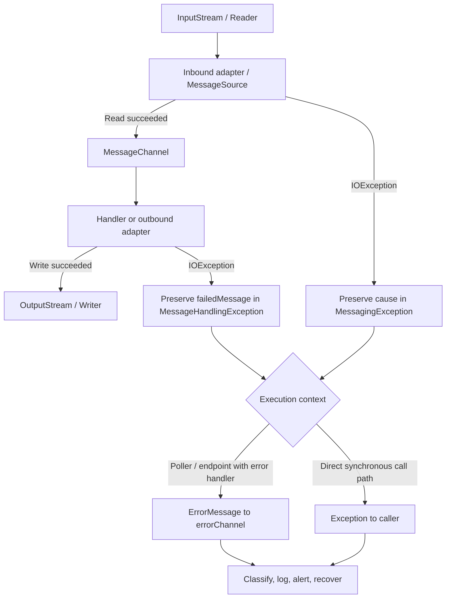

# Handling `IOException` in Stream Adapters

## 1. Context and objectives

In **Spring Integration**, a Stream Adapter brings data from an `InputStream`/`Reader` into a `MessageChannel` (inbound) or writes a message payload to an `OutputStream`/`Writer` (outbound). Because this sits at the boundary with external I/O resources, an integration flow can still encounter `IOException` even when every prior message transformation and routing step succeeded.

This lesson belongs to the **Adapter Stream** chapter of the **`SPRING_INTEGRATION_ADAPTERS`** module: connecting external systems with inbound/outbound adapters, gateways, pollers, and `MessageChannel`, and practicing message contracts, error handling, and connection lifecycles. After this lesson, you should be able to:

- Identify which read/write operations can throw `IOException` and distinguish I/O failures from **EOF** (end of data) or payload conversion errors.
- Preserve the root cause when wrapping failures into Spring Integration's `MessagingException`/`ErrorMessage` mechanisms.
- Know when an exception returns to the caller versus when a poller or asynchronous endpoint sends it to `errorChannel`.
- Choose recovery strategies, retries, closing/reopening streams, and guard against data loss or duplication.

Suppose an application reads lines from a stream and pushes them onto a `MessageChannel`, while another handler writes messages down to a destination stream. Input `read()` errors and output `write()`/`flush()` errors must be observed differently, because by the time a write error happens, **a portion of the bytes may already have reached the destination**.

## 2. Where does `IOException` occur?

| Location | Related operation | Example scenario | Consequence to check |
| --- | --- | --- | --- |
| Inbound byte read | `InputStream.read()` | Stream closed, source disconnected, device error | A `Message<?>` may not have been created; current read state may not be recoverable. |
| Inbound character read | `Reader.read()`, `BufferedReader.readLine()` | Read error or decoding failure when decoder reports errors | Part of a line/record may already have been read before failing. |
| Outbound byte write | `OutputStream.write()` | Broken pipe, target resource closed, device error | **Part of the payload** may already have been written before throwing. |
| Outbound character write | `Writer.write()`, `Writer.flush()` | Write/buffer-flush failure | You cannot assume the target received zero data. |
| Resource management | `flush()`, `close()`, opening a new stream | Failure releasing resources or reopening a connection/file | Track primary operation errors separately from cleanup errors. |

Related stream adapter classes include `ByteStreamReadingMessageSource`, `CharacterStreamReadingMessageSource` (inbound), and `ByteStreamWritingMessageHandler`, `CharacterStreamWritingMessageHandler` (outbound). In XML configuration, the same concepts appear as elements like `stdin-channel-adapter` and `stdout-channel-adapter`. Whether using Java DSL, annotations, or XML, error handling stems from the **actual I/O operation** and the **endpoint execution context**.

**Distinguish three key states:**

1. **Data available:** the adapter builds a message with the appropriate payload and sends it to the channel.
2. **Valid end of data:** `InputStream.read()` returns `-1`, `BufferedReader.readLine()` returns `null`. Under the `MessageSource.receive()` contract, `null` means *no message is currently available*. This is not an `IOException` and should not be sent to `errorChannel` as an error.
3. **Read/write failure:** the stream API throws `IOException`; preserve the `cause`, pinpoint where the failure occurred, and choose handling based on whether the resource can recover.

Do not equate a malformed record with an I/O error. For instance, a JSON parsing failure is usually a transformation/validation error; even if it travels through an error flow, its handling policy can differ completely from a lost connection.

## 3. Error flow in Spring Integration



In Spring Integration, an `IOException` raised inside an adapter typically surfaces at the integration layer as a messaging exception or nested exception. When writing a custom adapter or handler, **preserve the `IOException` in the `cause` chain** instead of keeping only a text message. For failures in a handler that received an input message, `MessageHandlingException` also attaches `failedMessage` for diagnostics.

`errorChannel` is **not a global `try/catch` for every call**:

- With a **polling inbound adapter**, failures on the poller task can be wrapped into an `ErrorMessage` and sent to the configured error channel; without a dedicated configuration, the endpoint's error handling may fall back to the default `errorChannel`.
- With a **synchronous `DirectChannel`**, a handler throwing an exception normally causes `send()` to fail and returns the exception to the calling thread. If that caller is itself a poller with an error handler, the poller may catch and route the error to the error channel.
- With an **asynchronous endpoint**, how errors are caught and dispatched depends on the configured channel, executor, and error handler. Verify the actual execution path before concluding where an error is routed.

`ErrorMessage#getPayload()` is a `Throwable` that may wrap multiple layers of `MessagingException`. Do not assume every `ErrorMessage` carries `failedMessage`: when inbound failed before creating a message, there is no message to attach to the exception.

## 4. Inbound example: preserving `IOException` when reading line by line

The example below illustrates a `MessageSource<String>` backed by `BufferedReader`; each `receive()` reads a line, builds a message if data is present, and throws `MessagingException` preserving the root cause on read failure. This wrapping pattern is also the principle to verify when using Spring Integration's built-in stream sources.

```java
import java.io.BufferedReader;
import java.io.IOException;
import java.io.InputStreamReader;
import java.nio.charset.StandardCharsets;
import java.time.Duration;

import org.springframework.context.annotation.Bean;
import org.springframework.context.annotation.Configuration;
import org.springframework.integration.config.EnableIntegration;
import org.springframework.integration.core.MessageSource;
import org.springframework.integration.dsl.IntegrationFlow;
import org.springframework.integration.dsl.Pollers;
import org.springframework.integration.channel.DirectChannel;
import org.springframework.messaging.MessageChannel;
import org.springframework.messaging.MessagingException;
import org.springframework.messaging.support.MessageBuilder;

@Configuration
@EnableIntegration
public class StreamInputConfiguration {

    @Bean
    MessageSource<String> stdinLines() {
        BufferedReader reader = new BufferedReader(
                new InputStreamReader(System.in, StandardCharsets.UTF_8));

        return () -> {
            try {
                String line = reader.readLine();
                return line == null
                        ? null
                        : MessageBuilder.withPayload(line).build();
            } catch (IOException ex) {
                throw new MessagingException("Failed to read input stream", ex);
            }
        };
    }

    @Bean
    MessageChannel streamErrors() {
        return new DirectChannel();
    }

    @Bean
    IntegrationFlow inboundLines(MessageSource<String> stdinLines) {
        return IntegrationFlow.from(stdinLines,
                    endpoint -> endpoint.poller(
                        Pollers.fixedDelay(Duration.ofSeconds(1))
                               .errorChannel("streamErrors")))
                .channel("streamInput")
                .get();
    }
}
```

Here `streamInput` needs to connect to a consumer processing messages; `streamErrors` needs a handler receiving `ErrorMessage` (section 6). The code intentionally does not close `System.in`, since it is a shared stream managed by the runtime environment. If the source is a file or socket opened by the application, the app must define clearly who closes it and who is allowed to reopen it.

**Note on the poller:** `readLine()` on `System.in` can **block the thread** until a line is entered or the source closes. `fixedDelay` only spaces out completed poll cycles; it does not make `readLine()` non-blocking, nor does it enforce a read timeout. For consoles or sockets that may wait indefinitely, choose appropriate threads/lifecycles and support controlled shutdown. When EOF is a permanent end state, stop the endpoint via lifecycle instead of polling forever.

## 5. Outbound example: preserving root cause and failed message

On outbound paths, it is vital to know **which message** failed and **roughly how many bytes the target might already have received**. A custom handler can preserve that context like this:

```java
import java.io.IOException;
import java.io.OutputStream;

import org.springframework.integration.annotation.ServiceActivator;
import org.springframework.messaging.Message;
import org.springframework.messaging.MessageHandlingException;
import org.springframework.stereotype.Component;

@Component
public class SafeStreamWriter {
    private final OutputStream output;

    public SafeStreamWriter(OutputStream output) {
        this.output = output;
    }

    @ServiceActivator(inputChannel = "streamOutput")
    public synchronized void write(Message<byte[]> message) {
        try {
            output.write(message.getPayload());
            output.flush();
        } catch (IOException ex) {
            throw new MessageHandlingException(
                    message, "Failed to write payload to stream", ex);
        }
    }
}
```

`OutputStream` in this example must be declared/allocated by the application (such as a bean opening a file with `Files.newOutputStream(...)`) and closed when the endpoint stops. `synchronized` prevents multiple threads from entering **one handler instance** simultaneously; if multiple instances or multiple processes write to the same target, higher-level synchronization is required. For externally owned streams like `System.out`, never close them from the handler.

This example handler accepts `Message<byte[]>`; the upstream flow must convert payloads to `byte[]` before sending to `streamOutput`. When using built-in `CharacterStreamWritingMessageHandler` or `ByteStreamWritingMessageHandler`, likewise ensure compatible payload types, charsets, record delimiters, and flush policies.

`flush()` pushes buffered data out of the Java layer; **it does not mean data was durably persisted to hardware**. If `write()` or `flush()` throws an error, you cannot conclude zero bytes reached the target; resending the entire message may duplicate data. In particular, `System.out` is a `PrintStream`: many I/O errors are recorded in an internal error flag (`checkError()`) instead of throwing `IOException` to the caller. If the application requires reliable write-failure detection, choose an abstraction with explicit error signals.

## 6. Receiving `ErrorMessage` and identifying the root cause

You can attach a service activator to `streamErrors` to classify root causes. The example below focuses on confirming whether an error originated from I/O; in a real system, add alerting channels or controlled error storage.

```java
import java.io.IOException;

import org.slf4j.Logger;
import org.slf4j.LoggerFactory;
import org.springframework.integration.annotation.ServiceActivator;
import org.springframework.messaging.support.ErrorMessage;
import org.springframework.stereotype.Component;

@Component
public class StreamErrorHandler {
    private static final Logger log =
            LoggerFactory.getLogger(StreamErrorHandler.class);

    @ServiceActivator(inputChannel = "streamErrors")
    public void handle(ErrorMessage errorMessage) {
        Throwable failure = errorMessage.getPayload();

        if (hasIoCause(failure)) {
            log.error("I/O error in stream adapter; check source/destination", failure);
            // Record metric, send alert, trigger controlled recovery.
        } else {
            log.error("Non-I/O message processing error", failure);
        }
    }

    private boolean hasIoCause(Throwable error) {
        Throwable current = error;
        while (current != null) {
            if (current instanceof IOException) {
                return true;
            }
            current = current.getCause();
        }
        return false;
    }
}
```

For synchronous call paths invoked directly by an API/gateway, handle exceptions at the call boundary (or configure async/error-handling layers accordingly). Simply registering a handler on `streamErrors` does not guarantee every failure from `streamOutput` lands there automatically. `errorChannel` helps **observe and react to errors**; it does not reopen streams, restore cursors, or retry messages on its own.

When logging, include `adapterId`, `inbound`/`outbound` direction, exception type, message ID/correlation ID if present, and record count or offset if tracked. Avoid logging full sensitive payloads. Balance full stack-trace logging against the risk of continuous errors flooding logs.

## 7. Retry, recovery, and connection lifecycle decisions

| Situation | Recommended action | Reason |
| --- | --- | --- |
| Valid EOF | Return `null`; if finite source ended, stop/release endpoint | EOF is not an exception; error retries here just cause pointless polls. |
| Transient read error, reopenable source with checkpoints | Reopen source, restore exact offset/record, bounded retry | Allows resuming without skipping or duplicating data. |
| Read error on forward-only stream (stdin, many sockets/pipes) | Record uncertain state; reconnect per protocol or halt for intervention | Consumed bytes cannot simply be re-read arbitrarily. |
| Write error before/during `flush()` with no target ACK | Assess partial-write risk; use record IDs, framing, ACKs, or idempotent operations before retrying | Blind retries can duplicate partial content at the target. |
| Stream permanently closed/broken, lost permissions, format errors | Stop automatic retries, alert, require root-cause fix | Extra retries cannot repair misconfigured resources. |

### 7.1. Bounded retry policies

A common strategy is **bounded attempts + exponential backoff + max cap**, applied only when source/destination state can be recovered and retries are safe. For example: 3 attempts with 200 ms, 400 ms, and 800 ms waits, then routing the message to a dead-letter/alerting path. These numbers are illustrative only; actual timings depend on SLAs and stream types.

In Spring Integration, `RequestHandlerRetryAdvice` fits retrying **message handler** execution when processing is repeatable. Do not assume attaching this advice to a handler automatically rewinds an already-read `InputStream`. Source-level retries require restoring read position; write-level retries must account for partial writes. Before enabling retries, answer:

1. How far did the previous attempt read/write, and what evidence determines its state?
2. Is the operation idempotent; if not, does the target support deduplication keys or compensation?
3. Is the error likely transient/self-healing, and when should it stop, alert, or escalate to manual handling?

### 7.2. Resource management

- **Ownership:** streams opened by the application are closed by the application at the right time; shared streams (`System.in`, `System.out`) must not be closed arbitrarily by an adapter.
- **Separate cleanup errors:** if a write fails and `close()` fails too, preserve the primary failure and record the stream-close failure; `try-with-resources` captures cleanup errors as *suppressed exceptions* when the resource lives within a short scope.
- **Do not share streams carelessly:** concurrent reads from one stream scramble record order; concurrent writes can interleave bytes. Bound concurrency, synchronize, or design an ordered write channel.
- **Post-failure state management:** decide whether the adapter should stop, reopen the source, or replace the `Reader`/`OutputStream`; never keep reusing a stream marked broken without verification.

## 8. Proactive failure testing

Do not wait for a production incident to test error flows. Use mock streams that throw controlled exceptions to verify root causes are preserved and retry policies do not lose data. For example, creating an always-failing byte source and sink:

```java
InputStream failingInput = new InputStream() {
    @Override
    public int read() throws IOException {
        throw new IOException("simulated read failure");
    }
};

OutputStream failingOutput = new OutputStream() {
    @Override
    public void write(int value) throws IOException {
        throw new IOException("simulated broken pipe");
    }
};
```

From these two streams, build unit/integration tests with the corresponding source/handler and verify:

| Test case | Expected result |
| --- | --- |
| Successful single-line read | Produces one message with expected content, charset, and record boundary. |
| Reading to EOF | `receive()` returns `null`; no `ErrorMessage` emitted for EOF. |
| `read()` throws `IOException` | `cause` chain stays intact; when run via configured poller, error handler receives `ErrorMessage`. |
| `write()`/`flush()` throws `IOException` | Exception retains `failedMessage`; synchronous caller or error flow receives the failure accordingly. |
| Partial write followed by error | Retry policy proves it does not duplicate records or exposes uncertain status. |
| Error handler or alerting fails | Does not enter an infinite error-replay loop; emits operational telemetry. |

In operations, monitor read/write error counts, reconnect/retry counts, unprocessed message counts, time since last successful message, and per-adapter error rates. These metrics catch cases where the poller keeps running while the source continuously fails.

## 9. Production checklist for Stream Adapters

1. Define **read/write direction**, `InputStream`/`Reader` vs. `OutputStream`/`Writer`, charset, delimiter, and message payload contract.
2. Separate **EOF** from exceptions; never turn an idle source with no messages into a false error.
3. Preserve `IOException` as `cause` and attach `failedMessage` when a message exists; verify the exact poller, sync, or async context to configure error flows.
4. Establish observability (`errorChannel`/caller, logs, metrics, alerts) and how to stop the adapter when the source/target cannot recover.
5. Retry only when you can restore read position or handle partially written output; bound retry counts and define a terminal error path.
6. Control ownership, close/reopen, and concurrency to avoid reusing broken streams or interleaving bytes across messages.
7. Verify EOF, read failures, partial write failures, `flush()` failures, and recovery via targeted tests.

**Takeaway:** In Stream Adapters, success or failure of an I/O call does not always correspond to a message being processed completely. Handling `IOException` properly means preserving the failure trail, routing it to the right Spring Integration mechanism, and knowing how far data traveled before deciding to retry.
