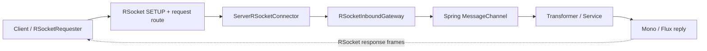
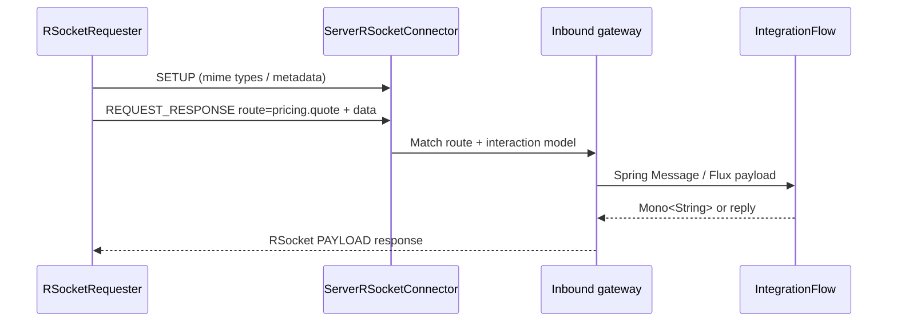
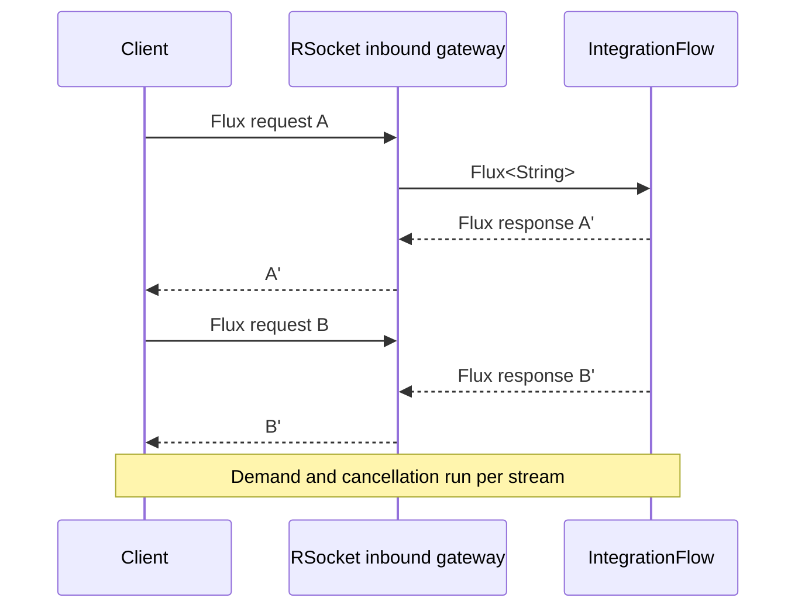
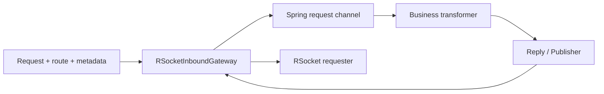
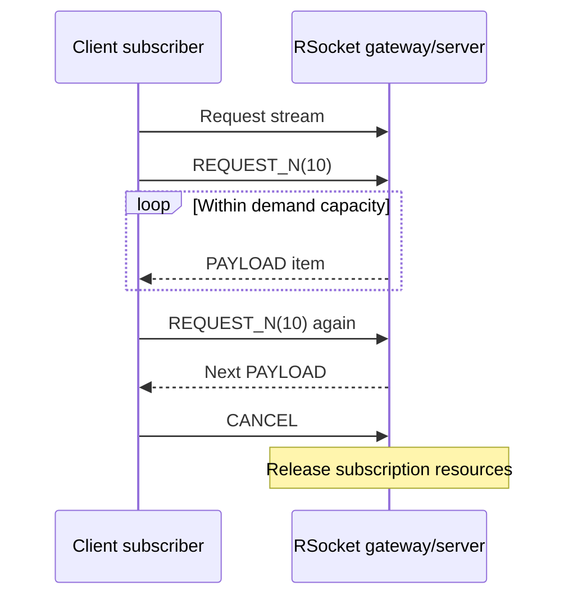
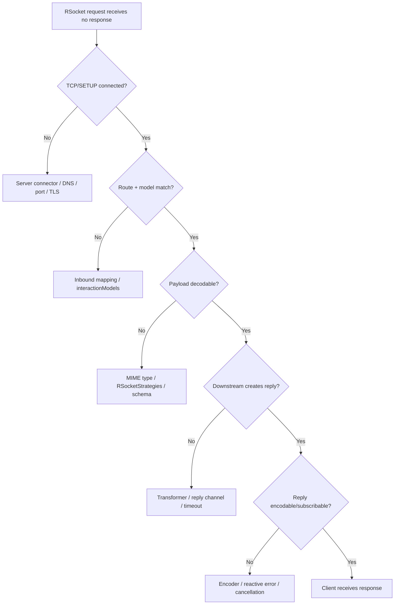

# RSocket inbound gateway in Spring Integration

## 1. Context: receiving a request and returning a response over RSocket

Suppose an e-commerce system has a **pricing-service** written in Spring Boot. When the admin application requests a price calculation, it sends a request to the route `pricing.quote`. The service must read data, check access permissions, calculate the result, and send the response back over the same RSocket interaction. Another request might need to return a **stream of price updates** instead of just a single result.

In Spring Integration, the component that receives and dispatches these requests is named **`RSocketInboundGateway`**. It does not merely "listen on a port" and push bytes into a channel; it is an **inbound gateway** that connects RSocket requests with Spring Integration's `Message<?>` system and request–reply flow, while allowing responses via `Mono`, `Flux`, or regular payloads according to the interaction model.

The **"RSocket inbound gateway"** lesson belongs to the **RSocket Adapter** chapter, module **SPRING_INTEGRATION_ADAPTERS**. The module focuses on connecting external systems using inbound/outbound adapters, gateways, pollers, and `MessageChannel`; practicing exchanges over files, SFTP, HTTP, JMS, AMQP, Kafka, and databases, while designing message contracts, error handling, and connection lifecycles. With RSocket, the emphasis is on **route, payload, metadata, request–reply, reactive streams, and connector lifecycle**.

### Objectives

After this lesson, you can:

1. Distinguish between the RSocket protocol, `ServerRSocketConnector`, `ClientRSocketConnector`, `RSocketInboundGateway`, and Spring `MessageChannel`.
2. Explain the four interaction models: `fireAndForget`, `requestResponse`, `requestStream`, `requestChannel`.
3. Register routes using Java configuration or Java DSL `RSockets.inboundGateway(...)`.
4. Create an RSocket TCP server with `ServerRSocketConnector` and send test requests using `RSocketRequester`.
5. Understand the reactive payload type `Flux<T>`, reply types `Mono<T>`/`Flux<T>`, and the impact of codecs/`RSocketStrategies`.
6. Distinguish **RSocket inbound gateway** from file/FTP inbound channel adapters and from Spring Messaging `@MessageMapping`.
7. Design request/reply/error/timeout/cancellation and backpressure without blocking the event loop.
8. Test routing, data, security, failure modes, and connections with a real socket.

## 2. Architecture and position of the inbound gateway



Each component has its own responsibility:

| Component | Role | What it does **not** do automatically |
| --- | --- | --- |
| **RSocket protocol** | Transmits requests, streams, metadata, demand/cancel signals | Does not decide business rules or database transactions |
| **`ServerRSocketConnector`** | Binds the server transport, accepts and manages RSocket connections, maps endpoints | Not a business processing service |
| **`ClientRSocketConnector`** | Connects to a peer via a client requester; can also register inbound endpoints for requests from the peer | Does not durably persist requests |
| **`RSocketInboundGateway`** | Maps routes and interaction models, forwards requests into Spring Integration, and produces responses | Not a message broker |
| **`MessageChannel`** | Dispatches `Message<?>` between endpoints | Does not guarantee the requester receives responses within SLA |
| **Transformer/service activator** | Processes payloads, validates, reads/writes data, returns replies | Does not automatically provide exactly-once guarantees |
| **`RSocketStrategies`** | Encoders/decoders, route matching, data buffer handling | Not authentication or authorization |

### 2.1. Inbound gateway vs. inbound channel adapter

In the file/FTP module, an inbound adapter typically **reads data and emits a one-way message**. Here, an RSocket inbound gateway can **receive a request and produce a reply**. Therefore, you must consider:

- Which gateway is the request route mapped to?
- What form of response does each interaction model require?
- Which handler/transformer creates the reply?
- If no reply is returned, does the RSocket client receive a completion signal or a timeout?
- How will decoding, business, and connection errors manifest?

**Note:** the name "inbound" describes **the direction of the request entering the Spring Integration flow**, not that the endpoint is always a server by default. A `ClientRSocketConnector` can also register an inbound gateway to handle **requests sent from the server to the client** over a bidirectional RSocket connection.

## 3. Four interaction models to master

RSocket supports four fundamental exchange styles:

| Spring Integration Model | Request from peer | Response | Use cases |
| --- | --- | --- | --- |
| `RSocketInteractionModel.fireAndForget` | One payload | No application reply | Telemetry where loss is acceptable / async processing |
| `RSocketInteractionModel.requestResponse` | One payload | One response or error | Data lookup, price calculation, command confirmation |
| `RSocketInteractionModel.requestStream` | One payload | A stream of responses `Flux<T>` | Progress updates, large lists, result feeds |
| `RSocketInteractionModel.requestChannel` | A request stream `Flux<T>` | A response stream `Flux<R>` | Bidirectional exchange, continuous processing pipeline |

The enum names **use camelCase** such as `requestResponse` and `requestChannel`, not `REQUEST_RESPONSE`. On `RSocketInboundGateway`, you can restrict the supported models using `setInteractionModels(...)` or DSL `.interactionModels(...)`. If unconfigured, the gateway supports the default models; in production, you should **only enable the models the endpoint is actually designed to handle**.

### 3.1. Do not equate the model with the Java payload type

- `requestResponse` describes **one request, one reply**; the payload inside Spring Integration may be represented as a publisher, depending on how the gateway converts it.
- `requestStream` describes **one request, many replies**; responses apply backpressure according to demand.
- `requestChannel` describes **many request elements, many response elements**; there is no guarantee that request[i] always matches response[i].
- `fireAndForget` has no response to carry a business ACK. A `Mono<Void>` completing on the client **should not be interpreted** as the server-side database having committed.

Specifically, the Spring Integration guide describes the inbound payload as typically being a `Flux` in flows with a reply, whereas `fireAndForget` uses the payload converted directly per the gateway's handling. The handler/transformer must declare the exact contract being used.

## 4. Routing: a gateway path is not an HTTP URL

`RSocketInboundGateway` requires one or more **route/path mappings**, for example:

```text
pricing.quote
pricing.stream
inventory.changes
echo
```

An RSocket requester sends the route via **request metadata**, not by sending an HTTP `GET /pricing.quote`. With TCP transport, no HTTP method or HTTP controller magically appears just because a route contains a `/` character.



A **route** can be a pattern following Spring Messaging mapping rules, but it is **not** a form of HTTP URL. The route name, delimiter, metadata MIME type, and how the client builds the request must align with the connector and `RSocketStrategies`.

### 4.1. Duplicate routes and models

Two gateways accepting the same route and interaction model can cause conflicts/ambiguous mappings. When designing:

1. Use namespaced routes, such as `orders.quote.v1`.
2. Explicitly restrict interaction models.
3. Avoid overly broad patterns when sensitive endpoints exist.
4. Verify routing results when the application context starts.
5. Do not use routes as the sole authorization mechanism.

## 5. Connector and lifecycle: who opens the TCP port?

Spring Integration RSocket uses `ServerRSocketConnector` or `ClientRSocketConnector` to establish and manage connections. **`RSocketInboundGateway` by itself does not mean a TCP port has been opened**.

| Area of responsibility | Component |
| --- | --- |
| Bind TCP or WebSocket listener | `ServerRSocketConnector` |
| Connect to an RSocket server | `ClientRSocketConnector` / `RSocketRequester` |
| Register incoming route | `RSocketInboundGateway` |
| Send internal Spring messages | `MessageChannel` |
| Process and create replies | Transformer, service activator, business service |

A gateway bean is **auto-detected and registered** by `ServerRSocketConnector` or `ClientRSocketConnector` when properly configured in the context. If you call `setRSocketConnector(...)` to register explicitly, examine the discovery mechanism on that connector: explicit configuration may **disable autodetection** for the associated connector, causing other gateways to no longer be automatically added to the mapping as expected.

### 5.1. `ServerRSocketConnector` with a fixed port

```java
import org.springframework.context.annotation.Bean;
import org.springframework.context.annotation.Configuration;
import org.springframework.integration.rsocket.ServerRSocketConnector;

@Configuration
public class RSocketTransportConfiguration {

    @Bean
    public ServerRSocketConnector rsocketServerConnector() {
        // Standalone server on RSocket TCP, not HTTP.
        return new ServerRSocketConnector("0.0.0.0", 7000);
    }
}
```

In production, bind a specific interface or place it behind controlled network infrastructure. `0.0.0.0` means listening on available interfaces; it **does not automatically provide authentication or TLS**.

**Do not configure two RSocket servers in parallel binding the same port 7000**, for example a self-created `ServerRSocketConnector` server and a Boot autoconfiguration RSocket server configured on the same port. If an application-managed RSocket server already exists, Spring Integration supports integration via `ServerRSocketMessageHandler`/an appropriate external server connector; do not spin up a second listener on the same port.

### 5.2. Binding a dynamic port

`ServerRSocketConnector("localhost", 0)` can be used in integration tests so the OS selects a port. The `getBoundPort()` API returns `Mono<Integer>`; it must be read **after the connector has started/bound**—do not assume you can get a valid port number from an unstarted bean.

```java
// Illustrative example in an integration test after application startup:
Integer actualPort = connector.getBoundPort()
        .block(java.time.Duration.ofSeconds(5));
if (actualPort == null || actualPort <= 0) {
    throw new IllegalStateException("RSocket server is not bound yet");
}
```

Do not put `.block()` inside a Netty/Reactor event-loop callback. In test orchestration or standalone command-line setup, calling block with an explicit deadline may be acceptable; in a reactive business flow, chain with Reactor operators instead.

## 6. Dependencies and Spring Boot configuration

Example using the Spring Boot BOM to manage compatible versions:

```xml
<dependencies>
    <dependency>
        <groupId>org.springframework.boot</groupId>
        <artifactId>spring-boot-starter-integration</artifactId>
    </dependency>
    <dependency>
        <groupId>org.springframework.integration</groupId>
        <artifactId>spring-integration-rsocket</artifactId>
    </dependency>

    <!-- Only needed if the example uses JSON DTOs and the application does not already include Jackson. -->
    <dependency>
        <groupId>com.fasterxml.jackson.core</groupId>
        <artifactId>jackson-databind</artifactId>
    </dependency>

    <!-- Include in test scope when writing StepVerifier tests. -->
    <dependency>
        <groupId>io.projectreactor</groupId>
        <artifactId>reactor-test</artifactId>
        <scope>test</scope>
    </dependency>
</dependencies>
```

`spring-integration-rsocket` is the dedicated module for RSocket gateways, distinct from `spring-integration-http`, `spring-integration-webflux`, `spring-integration-zeromq`, and `spring-boot-starter-rsocket`. Use the BOM compatible with your application's Spring Framework/Boot version; do not arbitrarily mix major versions.

Some projects add `spring-boot-starter-rsocket` for broader Boot RSocket support. In that case, you must agree on **who owns the server transport**: do not enable both the Boot server on the same port as a self-binding `ServerRSocketConnector`.

### 6.1. Properties for examples

```yaml
# application.yml
app:
  rsocket:
    bind-host: ${RSOCKET_BIND_HOST:127.0.0.1}
    port: ${RSOCKET_PORT:7000}
    client-host: ${RSOCKET_CLIENT_HOST:127.0.0.1}
    client-port: ${RSOCKET_CLIENT_PORT:7000}
    reply-timeout: 5s
```

`127.0.0.1` is suitable when client and server run on the same host/network namespace. When running in two different pods, `client-host` must be a DNS/IP that the client can reach. For the server pod, `bind-host` may need `0.0.0.0` to accept connections from outside the container; this must be combined with NetworkPolicy, service routing, and transport security.

## 7. Java configuration: request–response inbound gateway

The most direct way is to declare an `RSocketInboundGateway` with a route, set the request channel, and use a transformer returning `Mono<String>`.

### 7.1. Declaring the gateway bean

```java
import org.springframework.context.annotation.Bean;
import org.springframework.context.annotation.Configuration;
import org.springframework.integration.rsocket.RSocketInteractionModel;
import org.springframework.integration.rsocket.inbound.RSocketInboundGateway;

@Configuration
public class RSocketEchoGatewayConfiguration {

    @Bean
    public RSocketInboundGateway echoInboundGateway() {
        RSocketInboundGateway gateway =
                new RSocketInboundGateway("echo");
        gateway.setInteractionModels(
                RSocketInteractionModel.requestResponse);
        gateway.setRequestChannelName("echoRequests");
        return gateway;
    }
}
```

The `ServerRSocketConnector` in section 5 can auto-detect this inbound gateway to map the `echo` route. When using explicit connector registration, make sure the connector actually maps the gateway.

### 7.2. Transformer receiving a publisher and producing one reply

```java
import java.util.Locale;
import org.springframework.integration.annotation.Transformer;
import org.springframework.stereotype.Component;
import reactor.core.publisher.Flux;
import reactor.core.publisher.Mono;

@Component
public class EchoRequestTransformer {

    @Transformer(inputChannel = "echoRequests")
    public Mono<String> uppercase(Flux<String> incoming) {
        return incoming.next()
                .map(value -> value.toUpperCase(Locale.ROOT));
    }
}
```

This is the **fully reactive** style used by the Spring Integration documentation to illustrate the RSocket inbound gateway. Notably, `incoming` has type `Flux<String>`; you should not write a handler expecting only `String` if the flow and model are configured to place a publisher in the payload.

In the example above, `requestResponse` expects only one input. `incoming.next()` takes the first element and completes. With a client sending text data using the matching codec, `"hello"` results in `"HELLO"`. If the body cannot be decoded as `String` or the request has no payload, an error policy or default value is needed; `Mono.empty()` should not be treated as a successful business result in all cases.

### 7.3. Why can the gateway return a reply without specifying replyChannel?

`RSocketInboundGateway` inherits Spring Integration's messaging gateway mechanism. In request–reply interactions, the gateway mechanism uses the request's reply/correlation info to route the response back to the RSocket interaction. Learners still need to understand:

- The downstream handler/transformer **must produce a reply** when the interaction model requires one.
- If there is no reply, the client may complete empty or time out depending on the flow/policy.
- Errors and timeouts are not HTTP statuses; RSocket has its own error and termination protocol frames.
- If you customize `replyChannel`, `errorChannel`, `requestTimeout`, or `replyTimeout`, you must verify the exact channel/reply semantics for your version and reactive model.

**Do not add an unbounded polling `QueueChannel`** to "hold replies" while the client is waiting; doing so can lose deadlines and backpressure.

## 8. Java DSL: a complete endpoint in IntegrationFlow

Spring Integration Java DSL provides the `RSockets.inboundGateway(...)` factory. Example:

```java
import java.util.Locale;
import org.springframework.context.annotation.Bean;
import org.springframework.context.annotation.Configuration;
import org.springframework.core.ResolvableType;
import org.springframework.integration.dsl.IntegrationFlow;
import org.springframework.integration.rsocket.RSocketInteractionModel;
import org.springframework.integration.rsocket.dsl.RSockets;
import reactor.core.publisher.Flux;
import reactor.core.publisher.Mono;

@Configuration
public class RSocketUppercaseFlowConfiguration {

    @Bean
    public IntegrationFlow uppercaseInboundFlow() {
        return IntegrationFlow
                .from(RSockets.inboundGateway("uppercase")
                        .interactionModels(
                                RSocketInteractionModel.requestResponse)
                        .requestElementType(
                                ResolvableType.forClass(String.class)))
                .<Flux<String>, Mono<String>>transform(incoming ->
                        incoming.next().map(value ->
                                value.toUpperCase(Locale.ROOT)))
                .get();
    }
}
```

This is a **request–response gateway** using a route `uppercase`. `requestElementType(String.class)` as a `ResolvableType` makes the decode contract clearer; you must choose `RSocketStrategies`/MIME types that support `String`. The route string `"uppercase"` must match the client character-for-character.

If you are reading documentation that uses `.requestElementClass(...)` on the Java bean, note that the DSL `RSocketInboundGatewaySpec` API provides `.requestElementType(ResolvableType)`; do not assume every bean setter has a corresponding DSL overload.

### 8.1. Request-channel variant following the official reference example

```java
@Bean
public IntegrationFlow firstValueUppercaseChannelFlow() {
    return IntegrationFlow
            .from(RSockets.inboundGateway("uppercase.channel")
                    .interactionModels(
                            RSocketInteractionModel.requestChannel))
            .<Flux<String>, Mono<String>>transform(flux ->
                    flux.next().map(String::toUpperCase))
            .get();
}
```

This variant receives a request stream from the client but **only takes the first element** and returns a single reply. It demonstrates that the gateway can process a reactive `Flux`; if a multi-element response stream is required, return a `Flux` instead of a `Mono` and control completion/cancellation rules.

## 9. Client connection: RSocketRequester calling the inbound gateway

In Spring Framework, `RSocketRequester` is the client API for RSocket, working even when the caller is outside Spring Integration. You do not need an `RSocketOutboundGateway` just to write a client test: a standard requester can call the server endpoint directly.

### 9.1. Request–response client example

```java
import java.time.Duration;
import org.springframework.messaging.rsocket.RSocketRequester;
import org.springframework.util.MimeTypeUtils;
import reactor.core.publisher.Mono;

public class EchoRSocketClient {

    public static Mono<String> call() {
        RSocketRequester requester = RSocketRequester.builder()
                .dataMimeType(MimeTypeUtils.TEXT_PLAIN)
                .tcp("127.0.0.1", 7000);

        return requester
                .route("echo")
                .data("hello")
                .retrieveMono(String.class)
                .timeout(Duration.ofSeconds(5));
    }
}
```

**Usage:** after `ServerRSocketConnector` has started and the `echo` gateway route is registered, call `EchoRSocketClient.call()` and **subscribe** with a subscriber/`StepVerifier` or integrate it into a reactive chain. Merely creating a `Mono` without subscribing means the request may never execute. Do not create a new requester **for every message** in a high-throughput application when connections can be appropriately reused.

`dataMimeType(TEXT_PLAIN)` helps both sides understand the body is text. The route resides in RSocket metadata as encoded by the requester, not in an HTTP header. When the client uses `retrieveMono(String.class)`, the expected model is request–response with a single result.

### 9.2. Client using Spring Integration's own Java DSL

If the caller application also uses Spring Integration, you can define an **RSocket outbound gateway**:

```java
import org.springframework.context.annotation.Bean;
import org.springframework.context.annotation.Configuration;
import org.springframework.integration.dsl.IntegrationFlow;
import org.springframework.integration.rsocket.ClientRSocketConnector;
import org.springframework.integration.rsocket.RSocketInteractionModel;
import org.springframework.integration.rsocket.dsl.RSockets;

@Configuration
public class EchoOutboundCallerFlow {

    @Bean
    public IntegrationFlow callEcho(ClientRSocketConnector connector) {
        return IntegrationFlow
                .from("echoOutgoingRequests")
                .handle(RSockets.outboundGateway("echo")
                        .interactionModel(
                                RSocketInteractionModel.requestResponse)
                        .expectedResponseType(String.class)
                        .clientRSocketConnector(connector))
                .channel("echoReplies")
                .get();
    }
}
```

This is a **client-side flow**, not a server inbound gateway. To run it, you need a `ClientRSocketConnector` connected to the right server, corresponding channels/consumers, and a flow with an appropriate subscriber. Per Spring Integration, the outbound gateway produces a reactive result payload (`Mono` and/or `Flux` depending on the model), so the consumer must understand when the stream is subscribed and completed.

### 9.3. ClientRSocketConnector example

```java
import org.springframework.context.annotation.Bean;
import org.springframework.context.annotation.Configuration;
import org.springframework.integration.rsocket.ClientRSocketConnector;

@Configuration
public class RSocketClientConnectorConfiguration {

    @Bean
    public ClientRSocketConnector clientRSocketConnector() {
        return new ClientRSocketConnector("127.0.0.1", 7000);
    }
}
```

If client and server run in the same Spring context for a demo, avoid creating **two inbound gateways with the same route** on the same connector unintentionally. In production, configure hostname/port from properties and manage trust boundaries clearly.

## 10. Codec configuration: RSocketStrategies, MIME type, and payload

RSocket transmits **data payload** and **metadata**, where metadata can contain the route and other attributes. `RSocketStrategies` defines the encoders/decoders that convert `DataBuffer` into `String`, `byte[]`, or DTOs.

### 10.1. Default types and configured types

Per the `RSocketInboundGateway` API:

- You can set `setRequestElementClass(Class<?>)` or `setRequestElementType(ResolvableType)` on the Java bean.
- If no type is specified, the gateway relies on the content type header; **text** is usually decoded to `String`, while other types may default to `byte[]`.
- When a request has a publisher, the payload can be `Flux<T>` which the application layer must handle; it does not automatically turn every request into a single DTO.
- Replies are encoded using the encoders in `RSocketStrategies` and the reply data type or the publisher's element type.

Therefore, before writing a `Mono<OrderQuote>` or `Flux<OrderEvent>` handler, clearly establish the **MIME type, serializer, decoder, and schema** on both client and server.

### 10.2. Configuring text-only strategies per the Spring docs

```java
import org.springframework.context.annotation.Bean;
import org.springframework.context.annotation.Configuration;
import org.springframework.core.codec.CharSequenceEncoder;
import org.springframework.core.codec.StringDecoder;
import org.springframework.messaging.rsocket.RSocketStrategies;

@Configuration
public class TextRSocketCodecConfiguration {

    @Bean
    public RSocketStrategies rsocketStrategies() {
        return RSocketStrategies.builder()
                .decoder(StringDecoder.textPlainOnly())
                .encoder(CharSequenceEncoder.allMimeTypes())
                .build();
    }
}
```

You can then inject the strategies into the connector:

```java
@Bean
public ServerRSocketConnector serverRSocketConnector(
        RSocketStrategies strategies) {
    ServerRSocketConnector server =
            new ServerRSocketConnector("0.0.0.0", 7000);
    server.setRSocketStrategies(strategies);
    return server;
}
```

**This replaces the connector bean in section 5**, rather than acting as a second bean binding the same port. When a connector is provided to an inbound gateway, the connector's `RSocketStrategies` may take precedence over strategies explicitly configured on the gateway. Be consistent to avoid a situation where the server uses codec A while the gateway expects codec B.

### 10.3. JSON DTOs

Domain example:

```java
public record QuoteRequest(String sku, int quantity) {
}

public record QuoteReply(String sku, int quantity, long totalCents) {
}
```

If switching to JSON, you need appropriate Jackson encoders/decoders, `application/json` on the connection/request, a clear schema, validation, and payload size limits. Do not assume that merely adding the Jackson dependency lets an `RSocketStrategies` configured as text-only decode DTOs.

**Do not serialize Spring `Message.toString()` to send over RSocket.** Consumers in other languages only understand bytes matching the agreed codec and schema, not an arbitrary Java representation.

## 11. Request-stream: one request, many replies

With `requestStream`, the client sends one request but wants to receive a **sequence of results**:

```text
Client: route=pricing.updates, data="SKU-42"
Server: reply SKU-42:1
        reply SKU-42:2
        reply SKU-42:3
        ...
```

An illustrative flow:

```java
import java.time.Duration;
import org.springframework.context.annotation.Bean;
import org.springframework.context.annotation.Configuration;
import org.springframework.integration.dsl.IntegrationFlow;
import org.springframework.integration.rsocket.RSocketInteractionModel;
import org.springframework.integration.rsocket.dsl.RSockets;
import reactor.core.publisher.Flux;

@Configuration
public class PriceStreamFlow {

    @Bean
    public IntegrationFlow priceUpdates() {
        return IntegrationFlow
                .from(RSockets.inboundGateway("pricing.updates")
                        .interactionModels(
                                RSocketInteractionModel.requestStream))
                .<Flux<String>, Flux<String>>transform(requests ->
                        requests.next().flatMapMany(sku ->
                                Flux.range(1, 5)
                                        .delayElements(
                                                Duration.ofMillis(200))
                                        .map(n -> sku + ":version-" + n)))
                .get();
    }
}
```

This is a **finite five-element stream demo**, not how real prices are emitted from a database. The client calls `retrieveFlux(String.class)` and uses demand/cancellation to control how many responses are received. If the stream is infinite, there must be a cancellation mechanism when the subscriber goes offline; do not spawn a separate thread per stream without resource management.

### 11.1. Client receiving a stream

```java
import java.time.Duration;
import org.springframework.messaging.rsocket.RSocketRequester;
import reactor.core.publisher.Flux;

public Flux<String> readUpdates(RSocketRequester requester) {
    return requester.route("pricing.updates")
            .data("SKU-42")
            .retrieveFlux(String.class)
            .take(5)
            .timeout(Duration.ofSeconds(10));
}
```

`take(5)` terminates the client-side stream after five elements and sends a cancellation signal over the reactive protocol when needed. `timeout` is only a deadline on the client's reactive chain; a cancelled stream does not automatically undo database side effects that the server may have already committed.

### 11.2. Returning a Flux does not mean holding every element in RAM

RSocket has a **request(n)/backpressure** mechanism for streams, but the application layer must still respect demand. If you pull data from a non-backpressure-aware source and use an unbounded `buffer()`, the server still risks growing its heap. For continuous sources:

- Use publishers that follow the reactive contract.
- Bound buffers and concurrency.
- Apply intentional rate limits/overflow policies.
- Observe subscriber cancel signals and close resources.
- Do not keep DB transactions open for hours just waiting for the client to read more items.

## 12. Request-channel: bidirectional streams

`requestChannel` is suitable when the client continuously sends a stream of events and the server emits a stream of responses within the same interaction:



### 12.1. Stream-to-stream example

```java
import java.util.Locale;
import org.springframework.context.annotation.Bean;
import org.springframework.context.annotation.Configuration;
import org.springframework.integration.dsl.IntegrationFlow;
import org.springframework.integration.rsocket.RSocketInteractionModel;
import org.springframework.integration.rsocket.dsl.RSockets;
import reactor.core.publisher.Flux;

@Configuration
public class EventChannelFlow {

    @Bean
    public IntegrationFlow mapIncomingEvents() {
        return IntegrationFlow
                .from(RSockets.inboundGateway("events.duplex")
                        .interactionModels(
                                RSocketInteractionModel.requestChannel))
                .<Flux<String>, Flux<String>>transform(source ->
                        source.map(value ->
                                "ack:" + value.toUpperCase(Locale.ROOT)))
                .get();
    }
}
```

This is a **per-element text response** for learning, not an ACK after a DB commit. In production, if a response says `ack:...`, define whether it means **received**, **validated**, or **committed**. A synchronous `map` here cannot replace transactional acknowledgement.

### 12.2. Client sending Flux data

```java
import java.time.Duration;
import org.springframework.messaging.rsocket.RSocketRequester;
import reactor.core.publisher.Flux;

public Flux<String> channelDemo(RSocketRequester requester) {
    return requester.route("events.duplex")
            .data(Flux.just("a", "b", "c"), String.class)
            .retrieveFlux(String.class)
            .timeout(Duration.ofSeconds(5));
}
```

When data is a publisher and retrieve is a Flux, `RSocketRequester` uses the interaction model suitable for request-channel. You may need to pass a `ParameterizedTypeReference` or explicit element type for generic payloads or complex DTOs. With request-channel, both directions must support cancellation and valid terminal errors.

### 12.3. `decodeFluxAsUnit` and element boundaries

Since Spring Integration 5.3, the inbound gateway has a `setDecodeFluxAsUnit(boolean)` option (DSL `.decodeFluxAsUnit(...)`). The default is `false`, meaning it attempts to decode **each event of the Flux**; `true` allows decoding the entire Flux as a single unit depending on the decoder.

**Do not confuse** "one RSocket payload frame" with "one complete Java string" across all decoders. For example, `StringDecoder` may use newline delimiters to determine content boundaries, and how buffers are assembled depends on encoding. When interoperating with non-Spring clients, test:

1. How many elements on the server does one string element on the client become?
2. What happens if the body contains newlines?
3. Does splitting a frame into multiple `DataBuffer`s change decoding?
4. Does `decodeFluxAsUnit(true)` increase memory usage on long streams?

Do not enable `decodeFluxAsUnit(true)` for infinite streams just to "avoid losing elements"; a decoder that needs the entire stream may never complete or may consume excessive RAM.

## 13. Fire-and-forget: inbound gateway without a business reply

`fireAndForget` receives a request without returning an application payload. It can be used for telemetry signals, metrics, or events with an explicit data-loss policy. An inbound gateway can restrict to it:

```java
@Bean
public RSocketInboundGateway telemetryIngress() {
    RSocketInboundGateway gateway =
            new RSocketInboundGateway("telemetry.ingest");
    gateway.setInteractionModels(
            RSocketInteractionModel.fireAndForget);
    gateway.setRequestChannelName("telemetryRequests");
    return gateway;
}
```

Downstream, an appropriate handler is needed to process the payload, such as validating and storing telemetry. Because this model has no business response, **do not treat `send()` completing on the client as proof that the server-side DB has committed**.

If messages must not be lost, you need a durable handoff, outbox/inbox, idempotent retries, or switching to request–response with an explicit business ACK. Yet even request–response does not solve ACK loss/duplicates on its own: retries with the same command ID may still be necessary.

## 14. Distinguishing RSocket inbound gateway from @MessageMapping

Two common approaches in Spring:

| Approach | How routes are registered | How requests are handled |
| --- | --- | --- |
| **Spring Integration RSocketInboundGateway** | Gateway bean or `RSockets.inboundGateway(...)` | Spring Integration `MessageChannel`, transformer, service activator |
| **Spring Messaging @MessageMapping** | Annotated controller method | Spring Messaging method argument/reply handlers |

Both share the underlying RSocket/Spring Messaging foundation, but **declaring both does not mean they automatically share mappings without conflict**. In an integration architecture, `ServerRSocketMessageHandler` has a `messageMappingCompatible` option to handle `@MessageMapping` in an appropriate external server configuration. You must clarify who owns the RSocket server and handler mappings.

### 14.1. When to choose the inbound gateway?

Choose the inbound gateway if requests must go through one or more Spring Integration patterns:

- Transformers to normalize data before business logic.
- Routers based on message headers or payload contracts.
- Filters/validation, in-JVM publish-subscribe.
- Channel interception, tracing, and error handling managed in the flow.
- Forwarding onward to JMS/AMQP/Kafka/DB via other adapters.

Choose `@MessageMapping` if the service is a simple RSocket controller with minimal flow orchestration. Do not force every operation into an IntegrationFlow just to add another gateway.

## 15. RequestChannel, replyChannel, and correlation

An inbound gateway is a request–reply boundary. To properly complete an RSocket interaction, Spring Integration must know **which reply belongs to which request**.



### 15.1. Single request–response case

`@Transformer(inputChannel="echoRequests")` returns `Mono<String>`. The gateway maps the reply back to that exact request's RSocket interaction using the framework's mechanism. Adding an arbitrary `correlationId` header **does not** replace the gateway's reply correlation logic.

If logging correlation, use the message ID and a validated business correlation ID, but do not log credentials or PII.

### 15.2. When downstream has multiple processing steps

```text
RSocketInboundGateway
    ↓ requestChannel
validate
    ↓
enrich / transform
    ↓
business service
    ↓
reply message / publisher
    ↓
RSocket response
```

If a handler returns `null`, produces no reply, or creates a publisher that is never subscribed to, the request may not yield the expected result. With **asynchronous** steps, you must understand reply channels and lifecycle; do not read a request and "send a separate message on your own" without preserving proper correlation and expect the gateway to find the right client automatically.

### 15.3. Gateway metadata and RSocket headers

RSocket route/metadata are decoded by the framework into headers according to Spring Messaging policy. Do not assume every internal Spring `MessageHeaders` entry is wire-level RSocket metadata or safe to return to the peer.

If downstream uses headers to drive routers or authorization, only trust headers verified by mappers/validation; do not use a client-sent route string as proof that the client is authorized for a tenant.

## 16. Errors, timeouts, and cancellation

RSocket has distinct error and termination signals. An error in a decoder, transformer, business service, or network can produce different outcomes:

| Error location | Example | What to do |
| --- | --- | --- |
| **SETUP/transport** | Cannot connect, invalid MIME type | Distinguish connection errors from application errors |
| **Route mapping** | Route does not exist or model not allowed | Check route/model; return appropriate protocol error |
| **Decoding** | Body invalid UTF-8/JSON/schema | Reject, log error code, do not retry infinitely |
| **Validation** | `quantity <= 0`, invalid SKU | Return controlled business error |
| **Downstream handler** | Database timeout | Retry/rollback policy per transaction |
| **Response encoding** | Reply type has no encoder | Fix `RSocketStrategies` and DTO contract |
| **Client timeout** | Server processing exceeds SLA | Cancel request; do not assume DB did not commit |
| **Peer disconnected** | Client closes connection mid-stream | Cancel and release resources if possible |

### 16.1. Reactive errors must be emitted properly

In a reactive flow, instead of calling `throw` outside the publisher after returning it, use error signals:

```java
import reactor.core.publisher.Flux;
import reactor.core.publisher.Mono;

public Mono<String> normalize(Flux<String> incoming) {
    return incoming.next()
            .switchIfEmpty(Mono.error(
                    new IllegalArgumentException("Empty payload")))
            .map(String::trim)
            .flatMap(value -> value.isBlank()
                    ? Mono.error(new IllegalArgumentException("Blank text"))
                    : Mono.just(value.toUpperCase()));
}
```

With a `Mono.error`, the RSocket responder can propagate an error signal to the requester; the client needs `onErrorResume`, `retryWhen`, or appropriate exception mapping. Do not leak stack traces or secrets in error messages visible to external clients.

### 16.2. Client timeout is not a rollback

```java
Mono<String> reply = requester.route("orders.submit")
        .data("order-42")
        .retrieveMono(String.class)
        .timeout(java.time.Duration.ofSeconds(3));
```

If a timeout occurs on the client, the request **may have reached the server and the database may have committed**. When retrying a command with side effects, resend the **same idempotency key** and let the receiver deduplicate. Do not issue a new ID on every retry and expect "one request–response" to mean once-only processing.

### 16.3. Cancellation and resources

If the client cancels a request-stream, the server should observe the cancel signal to stop remaining work and release publishers/resources. However, cancellation **does not automatically undo** already completed side effects. For transactional flows, keep transaction boundaries short; do not hold DB connections open indefinitely during a multi-hour stream.

### 16.4. Error channel in Spring Integration

Because the gateway builds on `MessagingGatewaySupport`, it supports configuration for `errorChannel` and request/reply timeouts. However, reactive errors can occur **after the synchronous call finishes**; do not assume every error from decoders/network/publishers will enter the same `errorChannel` without testing your specific version and channel topology.

In production, test at minimum: bad route, bad payload, transformer throwing an exception, reply publisher error, client timeout, client cancel, and server disconnect.

## 17. Backpressure: the strength of request-stream and request-channel

RSocket provides **request(n)** in streaming models so downstream can signal demand. This ensures the caller does not have to receive unbounded data faster than it can process.



**However, backpressure does not automatically solve all overload issues**:

- `flatMap` with high concurrency can open many DB operations simultaneously.
- Unbounded `buffer()` can accumulate millions of elements.
- Switching to an `ExecutorChannel` without a bounded queue may just move the backlog onto the heap.
- A source that does not support demand may require a bounded `onBackpressureBuffer`, drop, or fail-fast policy.
- A fast reply does not prove a downstream transaction committed if the workflow intentionally replies early.

### 17.1. When blocking operations exist

Do not call blocking JDBC or `Thread.sleep` directly on the Netty/Reactor event loop. If you must use a blocking library in a demo, offload it to a scheduler meant for blocking work with monitored concurrency/queues:

```java
import reactor.core.publisher.Mono;
import reactor.core.scheduler.Schedulers;

public Mono<String> lookupBlocking(String sku) {
    return Mono.fromCallable(() -> {
                // Example blocking repository call.
                return legacyRepository.findDescription(sku);
            })
            .subscribeOn(Schedulers.boundedElastic());
}
```

This is an **illustrative snippet**; `legacyRepository` represents a dependency provided by the learner. For high throughput and reactive databases, consider R2DBC or non-blocking APIs, while still controlling concurrency and transactions. `boundedElastic()` does not make JDBC non-blocking; it only shifts the work to a more suitable pool.

### 17.2. Large response streams

For `requestStream` returning tens of thousands of elements:

1. Do not materialize the entire dataset into a `List` if it can be streamed page by page.
2. Enforce query limits and pagination/cursor mechanisms if needed.
3. Have timeouts and cancellation cleanup.
4. Track metrics for stream duration, active streams, and error rates.
5. Apply per-client/tenant quotas so one client cannot exhaust all resources.

## 18. Security: routes do not replace authentication

An inbound gateway can be called from a peer outside the JVM. Therefore, treat it as a **trust boundary**:

| Risk | Mitigation |
| --- | --- |
| Unauthenticated client | Protect transport/SETUP or compatible security interceptor |
| Unauthorized route access | Authorization by principal, role, and resource ownership |
| Oversized/malformed payload | Limit byte size, element count, JSON depth, and stream duration |
| Too many streams | Connection quota, request concurrency quota, rate limit |
| Spoofed tenant in metadata | Do not trust headers/route strings; map tenant from authenticated identity |
| Data leak in errors | Sanitized error mapping, do not expose stack traces/SQL/secrets |
| Unencrypted TCP | TLS when supported by deployment/transport, or verified network protection layer |
| Side-effect retries | Idempotency key + transactions to prevent double commits |

**RSocket TCP is not HTTPS.** If end-to-end encryption is required, configure TLS on the transport appropriate for RSocket/Reactor Netty or protect via approved infrastructure; never assume TCP port 7000 is encrypted by default.

### 18.1. RSocket routes are only routing metadata

A client sending `route("admin.deleteOrder")` does not mean they are allowed to delete orders. The processing layer must authenticate the caller and check permissions per object/resource. Do not authorize solely based on a route pattern or an arbitrary client-supplied header.

### 18.2. Request–response with side effects

If an inbound gateway is used to record orders, payments, or inventory updates, determine:

- Can duplicates be received?
- On timeout, could it already have committed?
- Is the event ID/idempotency key present in the wire protocol?
- Where is the transaction scope?
- If the server restarts mid-processing, does the client have a reconciliation mechanism?

A request–response over RSocket **is not equivalent to a distributed transaction**.

## 19. Lifecycle and shutdown

`ServerRSocketConnector` manages the server listener and connected client requesters. `RSocketInboundGateway` is an endpoint with a Spring Integration lifecycle.

```text
ApplicationContext starts
  → create connector / strategies / gateway beans
  → connector binds TCP/WebSocket transport
  → inbound gateway routes are registered
  → client sends SETUP and requests
  → requests enter Spring flow
  → replies return to client

ApplicationContext stops
  → stop accepting new work (per configuration/infrastructure)
  → cancel/drain streams within a finite timeout
  → stop gateway/connector, close connections
  → process exits
```

### 19.1. Readiness is more than an open port

| Condition | Conclusion that can be drawn |
| --- | --- |
| Listener bound successfully | Transport is listening; **not yet** guaranteed that routes are properly registered |
| SETUP succeeded | Two peers have an RSocket connection; **not** guaranteed downstream business is ready |
| `echo` request returns expected text | Route and codec work for the test case |
| Business DB commit/ACK | Business evidence exists for that specific request |

In containers/Kubernetes, a `readinessProbe` that only checks the TCP port may be insufficient. Have an appropriate non-destructive health check, guard against premature traffic, and monitor route/codec errors.

### 19.2. Reconnect and retry

A dropped RSocket connection does not mean uncommitted requests will automatically replay seamlessly. If the requester retries, classify them:

- Retrying idempotent requests (lookups) is generally easier.
- Retrying state-changing commands must include an idempotency key.
- Retrying a stream from the last received position may require an **application cursor/offset**.
- A new subscription will not automatically receive previously emitted data without an event store or snapshot.

If durable delivery/replay must be guaranteed, add an outbox/inbox/broker or a dedicated checkpoint protocol. RSocket streaming provides backpressure and multiplexing; it **is not a durable log**.

## 20. Testing the inbound gateway from a real RSocketRequester

A good test does not just invoke the transformer directly. It must send requests over a real TCP/WebSocket transport and connector to verify routing, MIME types, and response serialization.

### 20.1. Testing request–response with StepVerifier

```java
import java.time.Duration;
import org.junit.jupiter.api.Test;
import org.springframework.messaging.rsocket.RSocketRequester;
import org.springframework.util.MimeTypeUtils;
import reactor.test.StepVerifier;

class EchoRSocketIntegrationTest {

    @Test
    void echoRouteReturnsUppercase() {
        // Assumes the Spring application has a ServerRSocketConnector
        // already started at localhost:7000 with route "echo".
        RSocketRequester requester = RSocketRequester.builder()
                .dataMimeType(MimeTypeUtils.TEXT_PLAIN)
                .tcp("127.0.0.1", 7000);

        StepVerifier.create(
                requester.route("echo")
                        .data("hello")
                        .retrieveMono(String.class)
                        .timeout(Duration.ofSeconds(3)))
                .expectNext("HELLO")
                .verifyComplete();
    }
}
```

This is **sample test code** to run inside a project with an already configured application context/server. It omits `@SpringBootTest` and how the server is started in this short snippet; do not treat it as an executed test result. In CI, bind a dynamic port, retrieve the port via `ServerRSocketConnector.getBoundPort()` after startup, and build the requester from the actual port to avoid conflicts.

### 20.2. Testing request-stream

```java
StepVerifier.create(
        requester.route("pricing.updates")
                .data("SKU-42")
                .retrieveFlux(String.class)
                .take(5))
        .expectNextCount(5)
        .verifyComplete();
```

Tests should assert **content/ordering** if required by the business contract, not just counts. For infinite streams, add cancellation/`thenCancel()` or `take` so the test can finish; client timeout tests must have finite deadlines.

### 20.3. Testing request-channel

```java
StepVerifier.create(
        requester.route("events.duplex")
                .data(reactor.core.publisher.Flux.just("a", "b"), String.class)
                .retrieveFlux(String.class))
        .expectNext("ack:A", "ack:B")
        .verifyComplete();
```

This test matches the `source.map(...)` transformer in section 12 when text codecs are configured compatibly. If replaced with `flatMap` involving async work, response order may change; use ordered operators/policies if the protocol requires order.

### 20.4. Test matrix

| Scenario | What to verify |
| --- | --- |
| Valid route and requestResponse model | Receive one reply of the expected type |
| Non-existent route | Mapping error, does not route to wrong handler |
| Valid route but disallowed model | Request is clearly rejected |
| Content-Type text | Decodes `String` in UTF-8 properly |
| Content-Type JSON | DTO decodes/encodes per schema and validation |
| Empty payload | Consistent error or default policy |
| Oversized payload | Rejected without unbounded memory growth |
| Transformer emits `Mono.error` | Client sees sanitized error |
| Downstream missing reply | Client has clear timeout/empty-response policy |
| Request-stream N elements | Proper ordering, demand, and completion |
| Client cancels mid-stream | Resources released, no leaks |
| Request-channel Flux input | Each element decoded properly |
| `decodeFluxAsUnit` toggled | Decoder behavior tested per contract |
| Slow subscriber | Bounded buffer/backpressure works |
| Blocking database | Does not block Netty event loop; concurrency limited |
| Server restart mid-request | Timeout/reconnect/retry per policy |
| Two servers binding same port | Startup detects conflict |
| Duplicate route/model | Startup or request has no ambiguous mapping |
| Client wrong MIME type | Reject/codec error, no wrong deserialization |
| Unauthorized client | Authorization rejects, not just route filtering |
| Retrying side-effect command | Same idempotency key does not cause duplicate commit |

## 21. Troubleshooting: layered investigation

| Symptom | Common cause | What to check |
| --- | --- | --- |
| Cannot connect to TCP 7000 | Server connector not bound, wrong DNS/port | Listener, address, firewall, container network |
| Server opened port but route not found | Inbound gateway not mapped/wrong connector | Gateway bean, route, interaction models, explicit vs autodetection |
| `requestResponse` hangs indefinitely | Downstream returns no reply or reactive publisher not running | Request/reply channels, subscriber, timeout |
| Handler expects `String` but gets `Flux` | Inbound gateway passes reactive payload | Declare `Flux<String>` matching the flow |
| Handler receives `byte[]` | MIME type not text or type unconfigured | `requestElementType`, `RSocketStrategies`, client data MIME |
| JSON DTO fails to decode | Missing codec/schema or wrong client MIME type | Jackson encoder/decoder, schema, type |
| Returns `Flux` but requester calls `retrieveMono` | Mismatched interaction model or response cardinality | `retrieveFlux` and route model |
| Request-channel sees only one element | Using `flux.next()` or decoder/framing | Choose `map/flatMap`, test `decodeFluxAsUnit` |
| Stream loses ordering | Concurrent `flatMap` or multiple sources | Control ordering operators and transactions |
| Heap grows on long streams | Unbounded buffer/slow subscriber | Backpressure, quotas, cancel, bounded queues |
| Timeout but DB still changed | Server may have committed before cancel | Idempotency and reconciliation |
| Fire-and-forget has no ACK | This model returns no business response | Use requestResponse/dedicated ACK if needed |
| RSocket server port conflict | Both Boot server and connector opening ports | Choose a single listener owner |
| Flaky test with random port | Client reads port before startup | Read `getBoundPort()` after bind |
| Error channel misses expected error | Exception on a different reactive/transport boundary | Test propagation per version |
| Route matches but client lacks permission | Missing authentication/authorization | Check security integration |

### 21.1. Diagnostic tree



## 22. Case study

**Context:** The **inventory-service** uses Spring Integration RSocket inbound gateways for these routes:

```text
inventory.lookup      → client sends SKU, server returns one InventoryView
inventory.watch       → client sends SKU, server returns a stream of statuses
inventory.ingest      → client sends multiple StockEvents, server returns stream of ACKs
telemetry.temperature → client sends data without needing a reply
```

The development team configured `ServerRSocketConnector("0.0.0.0", 7000)` but also enabled another Boot RSocket server on port 7000. The `inventory.ingest` gateway was written with a handler accepting a single `String` while the client sends `Flux<String>`. When a client request-stream is cancelled, the server keeps running blocking work on the event loop. Additionally, the operations team plans to treat a completed `fireAndForget` as proof that the database has committed.

Answer the following:

1. How do the roles of the inbound gateway and `ServerRSocketConnector` differ?
2. Why is configuring two servers binding port 7000 wrong?
3. Are routes in RSocket located in the HTTP URL or in metadata?
4. Which interaction model should `inventory.lookup` restrict to?
5. What model and return type does `inventory.watch` need?
6. Which model should `inventory.ingest` use if both input and output are streams?
7. Which model can `telemetry.temperature` use when no reply is needed?
8. Does a completed `fireAndForget` prove a DB commit?
9. Why might a handler receive `Flux<String>` instead of a single `String`?
10. What is the Java DSL API for creating an inbound gateway?
11. When using `@Bean RSocketInboundGateway`, which method specifies the request channel?
12. Which configuration restricts a route to `requestResponse` and rejects `requestStream`?
13. How do `RSocketStrategies` and MIME types affect payloads?
14. If text is decoded into `byte[]` instead of `String`, what should you check?
15. When is `decodeFluxAsUnit(true)` needed and what are its risks?
16. Should the client call `retrieveMono` or `retrieveFlux` for a stream of results?
17. Why must blocking JDBC not be called directly on the Reactor event loop?
18. Does RSocket backpressure automatically bound every `ExecutorChannel` queue?
19. When a client times out after the server commits, how should retries avoid creating duplicates?
20. Why test with a real requester/connector instead of only calling the transformer?
21. When `getBoundPort()` is used with port 0, at what point must the value be retrieved?
22. If a gateway receives no requests due to explicit connector registration, what should you check?
23. How do you restrict route access per tenant?
24. Which metrics monitor request-stream and request-channel?

**Suggested answers:** (1) The connector opens/manages transport; the gateway maps requests into flows and replies. (2) Port conflict; pick one listener owner. (3) RSocket metadata. (4) `requestResponse`. (5) `requestStream` and `Flux<InventoryView>` or an equivalent publisher. (6) `requestChannel`. (7) `fireAndForget`. (8) No. (9) The gateway passes the payload publisher into the integration flow. (10) `RSockets.inboundGateway(...)`. (11) `setRequestChannelName(...)`. (12) `setInteractionModels(RSocketInteractionModel.requestResponse)` or the corresponding DSL method. (13) They define encoders/decoders and types. (14) Content-Type, `requestElementType`, and codecs. (15) When the contract requires decoding the entire Flux as one unit; risks include infinite waiting/high memory usage. (16) `retrieveFlux`. (17) It blocks the event loop and degrades throughput. (18) No. (19) Idempotency keys and state reconciliation. (20) Because routing/transport/metadata/codecs/errors/cancellation are only fully verified over the protocol. (21) After the connector starts and binds successfully. (22) Whether auto-discovery was replaced or disabled. (23) Authentication + authorization based on principal and resource ownership. (24) Requests/sec, active streams, latency, cancellations, errors, backpressure/queue depth, and memory.

## Key takeaways

- **`RSocketInboundGateway`** is a Spring Integration inbound gateway for receiving RSocket requests and producing replies (if the model has replies); it **does not open a TCP listener on its own**.
- An appropriate **`ServerRSocketConnector`** or `ClientRSocketConnector` is needed to create/hold connections and register route mappings.
- The four models are **`fireAndForget`, `requestResponse`, `requestStream`, and `requestChannel`**. Restrict each route to the right model.
- RSocket routes are **metadata**, not HTTP URLs. Codecs/`RSocketStrategies` and MIME types determine `String`, `byte[]`, or DTO payloads.
- Java configuration uses **`new RSocketInboundGateway("echo")` + `setRequestChannelName(...)`**; Java DSL uses **`RSockets.inboundGateway("uppercase")`**.
- In requests with replies, the flow payload may be **`Flux<T>`**, and replies are `Mono<T>` or `Flux<T>`. Do not assume handlers receive a single DTO by default.
- **Backpressure/cancellation** supports streams, but does not automatically solve blocking queues/DB calls or durable replay.
- **A client timeout does not mean a server rollback**. Operations with side effects need idempotency keys and post-commit ACKs.
- Test through a **real RSocketRequester + connector**, verifying routes, models, codecs, errors, timeouts, cancellation, and security.

## References

- [Spring Integration Reference — RSocket Support](https://docs.spring.io/spring-integration/reference/rsocket.html)
- [Spring Integration API — RSocketInboundGateway](https://docs.spring.io/spring-integration/api/org/springframework/integration/rsocket/inbound/RSocketInboundGateway.html)
- [Spring Integration API — RSocketInboundGatewaySpec](https://docs.spring.io/spring-integration/api/org/springframework/integration/rsocket/dsl/RSocketInboundGatewaySpec.html)
- [Spring Integration API — ServerRSocketConnector](https://docs.spring.io/spring-integration/api/org/springframework/integration/rsocket/ServerRSocketConnector.html)
- [Spring Integration API — ClientRSocketConnector](https://docs.spring.io/spring-integration/api/org/springframework/integration/rsocket/ClientRSocketConnector.html)
- [Spring Integration API — RSocketInteractionModel](https://docs.spring.io/spring-integration/api/org/springframework/integration/rsocket/RSocketInteractionModel.html)
- [Spring Framework Reference — RSocket](https://docs.spring.io/spring-framework/reference/rsocket.html)
- [RSocket Protocol](https://rsocket.io/)
