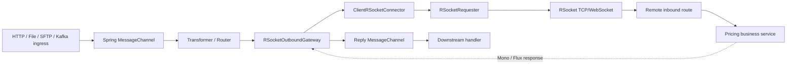
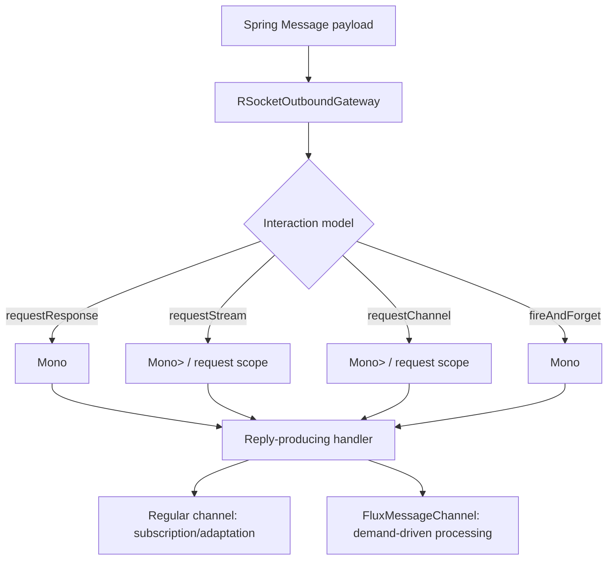
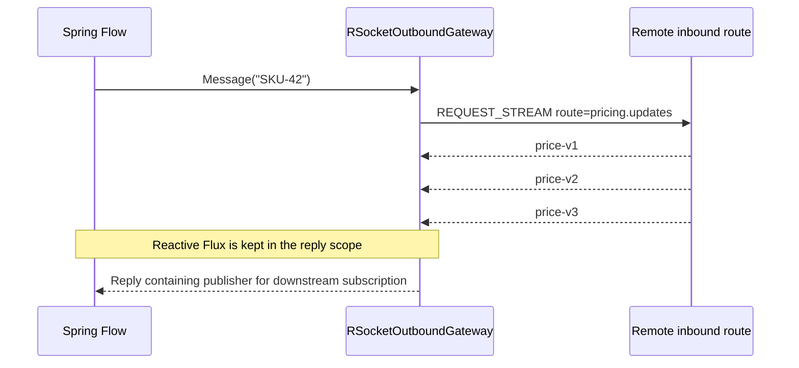
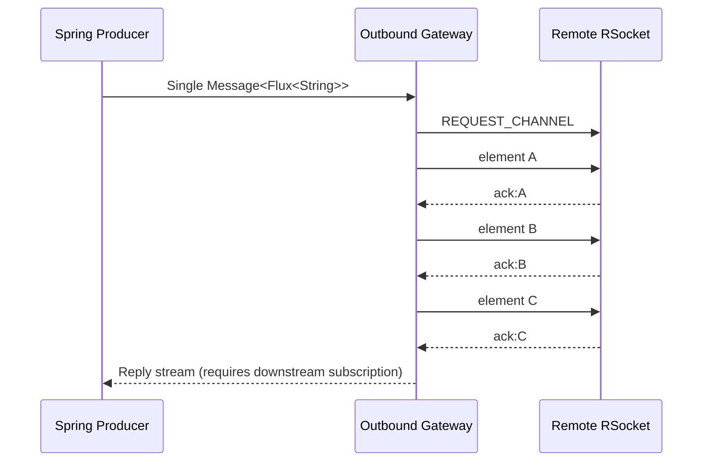
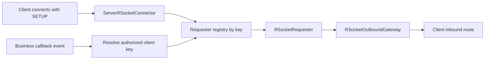
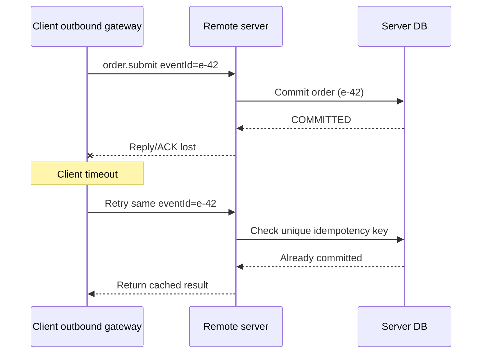
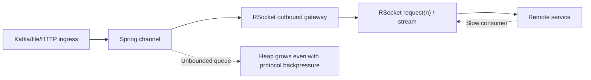
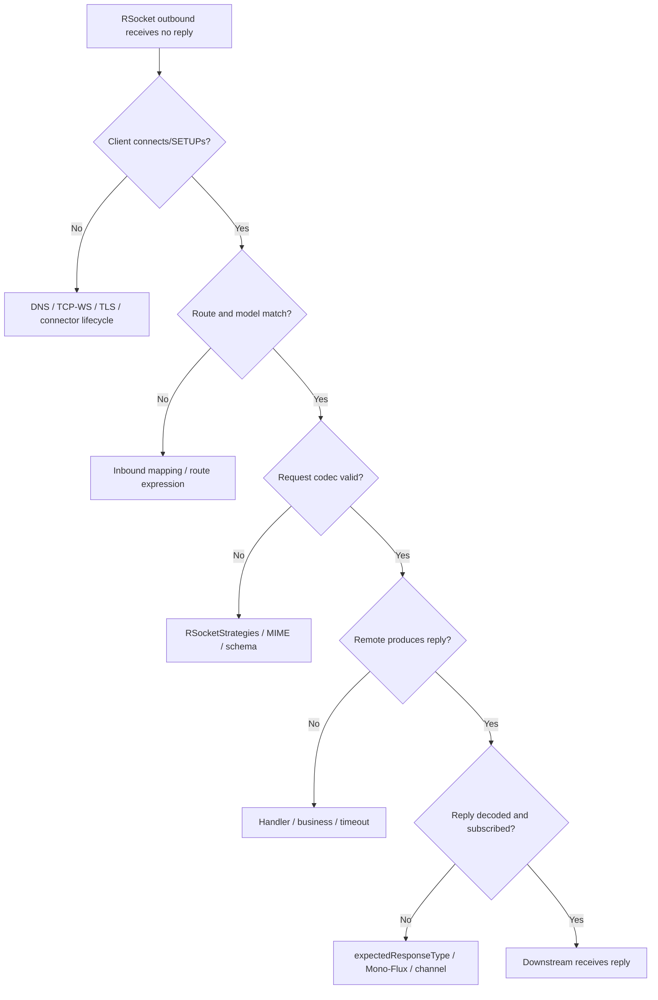

# RSocket outbound gateway in Spring Integration

## 1. Problem: calling an RSocket service from an IntegrationFlow

Suppose an order-processing application receives data over HTTP, checks inventory in the database, and then needs to ask **pricing-service** to determine the price. Pricing-service does not expose an HTTP endpoint; it uses RSocket and the `pricing.quote` route. Some requests only need a single price result, while others need to follow a **stream of price updates** and send a **stream of input events**.

Instead of having each service create and close an `RSocketRequester` for every command, the application can use **`RSocketOutboundGateway`** in Spring Integration. The gateway receives a Spring `Message<?>` from the internal flow, selects the route and interaction model, sends the request over the RSocket connection, and forwards the reply back to the flow.

The **"RSocket outbound gateway"** lesson belongs to the **RSocket Adapter** chapter of module **SPRING_INTEGRATION_ADAPTERS**. The overall goal of the module is to connect external systems using inbound/outbound adapters, gateways, pollers, and `MessageChannel`, practicing across files, SFTP, HTTP, JMS, AMQP, Kafka, and databases while handling message contracts, errors, and connection lifecycles. In this lesson, the focus is on **client-side request/reply, reactive responses, routes/metadata, codecs, and connector lifecycles**.

### Learning objectives

After completing this lesson, you can:

1. Distinguish `RSocketOutboundGateway`, `ClientRSocketConnector`, `RSocketRequester`, `ServerRSocketConnector`, and `RSocketInboundGateway`.
2. Configure an outbound gateway using a Java bean and the Java DSL `RSockets.outboundGateway(...)`.
3. Explain the four interaction models: `fireAndForget`, `requestResponse`, `requestStream`, `requestChannel`.
4. Understand `Mono` replies, `Flux` replies wrapped in `Mono`, subscriptions, and `FluxMessageChannel` boundaries.
5. Choose compatible `expectedResponseType`, `publisherElementType`, route expressions, and metadata between client and server.
6. Design timeouts, cancellation, retries, and idempotency for remote requests.
7. Distinguish RSocket routes from HTTP URLs, payload types from wire MIME types, and send completion from database commits.
8. Write integration tests against a real RSocket server, measuring backpressure, routing, and errors.

## 2. Outbound gateway position in the architecture



| Component | Responsibility | Does not provide automatically |
| --- | --- | --- |
| `RSocketOutboundGateway` | Converts a Spring message into an RSocket request; builds reply per model | Server listener or durable message store |
| `ClientRSocketConnector` | Manages the requester/connection to the RSocket server from the client side | Business retry, outbox, post-DB-commit ACK |
| `RSocketRequester` | Lower-level API to send `route(...)`, `data(...)`, `retrieveMono/Flux(...)` | Spring Integration routing and channel orchestration |
| `RSocketInboundGateway` | Receives RSocket requests on the peer and enters a Spring flow | Client connection for the outbound caller |
| `ServerRSocketConnector` | Binds the listener and maps routes on the server side | Automatic confirmation that business work finished |
| `MessageChannel` | Dispatches Spring `Message<?>` within the JVM | End-to-end transport backpressure or exactly-once |
| `RSocketStrategies` | Encoders/decoders, MIME, and wire data handling | Authentication/authorization and domain validation |

**"Outbound" only indicates the request direction leaving the current Spring Integration flow**, not "must reside in a client app". RSocket supports bidirectional communication: a server holding a connection to a client can also proactively send requests back to the client using an `RSocketRequester` bound to the appropriate connection.

### 2.1. Comparison with HTTP outbound gateway

| Characteristic | HTTP outbound gateway | RSocket outbound gateway |
| --- | --- | --- |
| Target | URL, HTTP method | RSocket route in metadata |
| Connection | HTTP client/transport | RSocket requester and TCP/WebSocket transport |
| Request–reply | Usually a single response | `requestResponse` or `requestStream` stream |
| Bidirectional stream | Not a standard HTTP request | `requestChannel` |
| Fire-and-forget | HTTP still typically has a response status | RSocket `fireAndForget` has no payload reply |
| Backpressure | API/streaming dependent | RSocket has request(n) for streaming |
| Durable replay | Not built-in | **Also not built-in** |

RSocket does not replace Kafka/AMQP/JMS if the problem requires a durable storage broker, consumption history, or consumer group offsets.

## 3. Four interaction models determine the request and reply type

| `RSocketInteractionModel` | Request | Response | Example |
| --- | --- | --- | --- |
| `requestResponse` | One payload | One reply or error | `pricing.quote` |
| `requestStream` | One payload | `Flux<T>` many elements | `pricing.updates` |
| `requestChannel` | `Publisher<T>` many request elements | `Flux<R>` responses | `inventory.ingest` |
| `fireAndForget` | One payload | **No** business response | Loss-tolerant telemetry |

The actual enum names are **`requestResponse`, `requestStream`, `requestChannel`, `fireAndForget`**; not UPPERCASE enums. `RSocketOutboundGateway` defaults to `requestResponse` if no interaction model is configured.

### 3.1. Model is not synonymous with each message's Java type

For `requestStream`, the gateway sends **one request** and receives many responses. For `requestChannel`, the payload of **a single Spring Message** must be a `Publisher`, such as `Flux<String>`; it is not three separate calls to the outbound gateway. A `fireAndForget` call completing at the RSocket layer does **not** prove the peer committed to its database.

### 3.2. Choosing a model by business requirement

```text
Query price for one SKU            → requestResponse
Watch 100 price updates            → requestStream
Send an event stream, get ACKs     → requestChannel
Send temperature, no reply needed  → fireAndForget
```

Do not use `fireAndForget` just to speed up a payment command if you must know whether it succeeded. If you need a post-commit ACK, choose a request–response protocol or design a dedicated ACK; at the same time, handle **lost ACK after commit** via idempotency.

## 4. Crucial difference: responses are reactive

The Spring Integration documentation describes the reply of `RSocketOutboundGateway` at the internal processing level as a **`Mono`**, even for `fireAndForget` (in which case it is `Mono<Void>`). If the underlying reply is a `Flux` from `requestStream` or `requestChannel`, the gateway **wraps the Flux inside a Mono to preserve the scope of a single request**.



**Do not read this diagram as a guarantee that every downstream message always has the exact Java generic type `Mono<Flux<T>>`.** The framework performs a subscribe/adapt step before emitting to a **regular output channel**; for `FluxMessageChannel`, subscription is demand-driven. The key takeaway is **not to flatten streams accidentally** and to verify the actual payload type at your chosen boundary.

### 4.1. Regular channel and FluxMessageChannel

- With a regular reply channel, the framework **subscribes/adapts the `Mono`** before placing the result onto the output channel.
- With `FluxMessageChannel`, the reactive reply is processed on demand.
- When the reply is a `Flux`, downstream must **extract the `Flux` from the payload and subscribe/flatten intentionally**.
- If you merely obtain a `Flux` and nobody subscribes, data emission may **never execute**.
- If an **inbound** `FluxMessageChannel` flattens a request `Flux` into multiple individual `Message`s, **the scope of a single requestChannel is lost**.

This is a common source of bugs: the RSocket endpoint works, yet the application never collects the stream response, or sends individual elements instead of a single request-channel.

### 4.2. `expectedResponseType`

When the model is not `fireAndForget`, `expectedResponseType` specifies the reply decode type. If unconfigured, the gateway defaults to **`String.class`**. With JSON DTOs or binary data, do **not** rely on this default.

Set `expectedResponseType(QuoteReply.class)` when both sides use a valid JSON codec; set `byte[].class` if the protocol returns raw undecoded bytes. For generic types, you can use an expression returning a `ParameterizedTypeReference` per the corresponding API, though integration tests are strongly recommended because codecs easily mismatch.

## 5. Dependencies and topology

### 5.1. Maven

```xml
<dependencies>
    <dependency>
        <groupId>org.springframework.boot</groupId>
        <artifactId>spring-boot-starter-integration</artifactId>
    </dependency>
    <dependency>
        <groupId>org.springframework.integration</groupId>
        <artifactId>spring-integration-rsocket</artifactId>
    </dependency>
    <!-- Only needed when the application uses Jackson for JSON DTOs. -->
    <dependency>
        <groupId>com.fasterxml.jackson.core</groupId>
        <artifactId>jackson-databind</artifactId>
    </dependency>
    <dependency>
        <groupId>io.projectreactor</groupId>
        <artifactId>reactor-test</artifactId>
        <scope>test</scope>
    </dependency>
</dependencies>
```

The application needs a compatible Spring Boot/Spring Integration BOM to resolve versions. Spring Integration has supported RSocket since 5.2, though APIs/behaviors change across major/minor versions; the examples are based on `RSocketOutboundGateway`, `RSocketOutboundGatewaySpec`, and `ClientRSocketConnector` in current releases. When building a real project, check the JavaDoc matching your BOM version.

### 5.2. application.yml

```yaml
app:
  rsocket:
    host: ${RSOCKET_HOST:127.0.0.1}
    port: ${RSOCKET_PORT:7000}
    response-timeout: ${RSOCKET_RESPONSE_TIMEOUT:5s}
    route:
      uppercase: uppercase
      price: pricing.quote
      stream: pricing.updates
      channel: events.duplex
```

When the peer is in another Kubernetes pod, `127.0.0.1` is the loopback of the **running pod**, not the target service. You must use a routable Service DNS/address and the actual RSocket port. RSocket TCP is **different** from an HTTP endpoint `http://host:port`; if the server uses RSocket over WebSocket, the client must use the matching WebSocket transport.

### 5.3. One connection can carry many requests

RSocket supports multiplexing many interactions over a single connection. `ClientRSocketConnector` holds an `RSocketRequester` serving related gateways; do not create a client connector and TCP connection **per message**.

```text
Client Spring Boot:
  RSocketOutboundGateway("pricing.quote")   ─┐
  RSocketOutboundGateway("pricing.updates")  ├→ ClientRSocketConnector
  RSocketOutboundGateway("events.duplex")   ─┘          ↓
                                                RSocketRequester
                                                       ↓ TCP
Remote ServerRSocketConnector → inbound routes
```

Sharing a requester/connection saves handshakes, yet you still need quotas and controls on concurrency/active streams. Having all requests travel over one connection does not combine separate business transactions into one shared transaction.

## 6. Initializing `ClientRSocketConnector`

A client connector represents an outbound connection to a remote server; it is not an arbitrary HTTP session pool.

```java
import org.springframework.beans.factory.annotation.Value;
import org.springframework.context.annotation.Bean;
import org.springframework.context.annotation.Configuration;
import org.springframework.integration.rsocket.ClientRSocketConnector;

@Configuration
public class PricingRSocketClientConfiguration {

    @Bean
    public ClientRSocketConnector pricingRSocketConnector(
            @Value("${app.rsocket.host}") String host,
            @Value("${app.rsocket.port}") int port) {
        return new ClientRSocketConnector(host, port);
    }
}
```

`ClientRSocketConnector` has a Spring-managed lifecycle, provides `getRequester()` to obtain the connected requester, and offers options like `setSetupRoute`, `setSetupData`, `setSetupMetadata`, `setRSocketStrategies`, and `setConnectorConfigurer`. Connecting/setup may involve asynchronous I/O; **bean creation completing does not prove the peer is ready to handle requests**.

### 6.1. SETUP route vs. business request route

```java
@Bean
public ClientRSocketConnector pricingConnector() {
    ClientRSocketConnector connector =
            new ClientRSocketConnector("pricing-service", 7000);
    connector.setSetupRoute("connect/client");
    connector.setSetupData("order-service");
    return connector;
}
```

This is an **alternative variant** replacing the bean above; do not create both unless you need two connections. `setupRoute` and `setupData` are sent during **connection setup**; they do not replace `RSockets.outboundGateway("pricing.quote")` for individual business requests. Never put sensitive tokens into SETUP logs.

### 6.2. Client connector with WebSocket

`ClientRSocketConnector` has an overload accepting a `URI` for WebSocket client transport per the API. Only use it when the server actually exposes an RSocket/WebSocket endpoint, such as `ws://...` or `wss://...`. Do not swap `tcp://` for `ws://` expecting firewalls, proxies, TLS, and handshakes to stay identical.

### 6.3. Startup and readiness

States to distinguish:

| Observation | Can conclude | Cannot yet conclude |
| --- | --- | --- |
| Spring context creates `ClientRSocketConnector` | Bean exists | Peer is online |
| TCP connect/SETUP succeeds | Basic transport/codec setup works | Route `pricing.quote` exists |
| Probe request returns test text | Route, model, and codec work for that case | All business logic and DBs are ready |
| Business reply after commit | Evidence per that request's contract | No duplicates when retrying other requests |

Readiness should check a route **that causes no side effects**, with an appropriate timeout and quota. Never pick an order-creation API as a health probe.

## 7. Minimal Java DSL: request–response

This is the primary pattern for **RSocket outbound gateway**.

### 7.1. Flow sending a string and receiving a string

```java
import org.springframework.context.annotation.Bean;
import org.springframework.context.annotation.Configuration;
import org.springframework.integration.dsl.IntegrationFlow;
import org.springframework.integration.rsocket.ClientRSocketConnector;
import org.springframework.integration.rsocket.RSocketInteractionModel;
import org.springframework.integration.rsocket.dsl.RSockets;

@Configuration
public class UppercaseRSocketOutboundFlow {

    @Bean
    public IntegrationFlow uppercaseRequestFlow(
            ClientRSocketConnector pricingRSocketConnector) {

        return IntegrationFlow
                .from("uppercaseRequests")
                .handle(RSockets.outboundGateway("uppercase")
                        .interactionModel(
                                RSocketInteractionModel.requestResponse)
                        .expectedResponseType(String.class)
                        .clientRSocketConnector(pricingRSocketConnector))
                .channel("uppercaseReplies")
                .get();
    }
}
```

This is a **client-side flow**. It requires `uppercaseRequests` as input and `uppercaseReplies` as the reply destination; channels can be declared/registered by Spring Integration per the DSL or created explicitly as beans. The remote server **must** have the `uppercase` route registered, using `requestResponse` and a compatible codec. `handle(...)` here performs an RSocket interaction, not local processing.

### 7.2. Creating messages from a business service

```java
import org.springframework.beans.factory.annotation.Qualifier;
import org.springframework.messaging.MessageChannel;
import org.springframework.messaging.support.MessageBuilder;
import org.springframework.stereotype.Service;

@Service
public class UppercaseRequestPublisher {

    private final MessageChannel channel;

    public UppercaseRequestPublisher(
            @Qualifier("uppercaseRequests") MessageChannel channel) {
        this.channel = channel;
    }

    public void dispatch(String text) {
        if (text == null || text.isBlank() || text.length() > 4_096) {
            throw new IllegalArgumentException("Invalid input");
        }
        boolean accepted = channel.send(
                MessageBuilder.withPayload(text).build());
        if (!accepted) {
            throw new IllegalStateException(
                    "Spring MessageChannel did not accept the request");
        }
    }
}
```

**There is no `String result = channel.send(...)`**: `MessageChannel.send(...)` returns a boolean reflecting only the Spring boundary, **not** the return value of the remote route. You must receive replies via the configured reply channel/gateway contract, or use a Java `@MessagingGateway` request–reply API after verifying asynchronous reply handling.

### 7.3. When a method-like API is needed

An interface style compatible with Spring Integration:

```java
import org.springframework.integration.annotation.Gateway;
import org.springframework.integration.annotation.MessagingGateway;

@MessagingGateway
public interface PricingRequestGateway {

    @Gateway(requestChannel = "uppercaseRequests")
    String uppercase(String text);
}
```

This interface is only a **facade for a Spring messaging gateway**, not `RSocketOutboundGateway` itself. Because the outbound handler operates with reactive/async semantics, you must **verify** that the return type, reply channel, reply timeout, and subscribe/adapt mechanism work properly in your version; do not assume synchronous method calls are safe on the Netty event loop.

If the caller is a reactive endpoint, prefer a design returning `Mono<T>` or using the `RSocketRequester` API inside an appropriate reactive chain, avoiding accidental `.block()` calls on the event loop.

## 8. Java bean: declaring `RSocketOutboundGateway` directly

Java DSL is not the only way. You can declare a handler bean and attach `@ServiceActivator`:

```java
import org.springframework.beans.factory.annotation.Qualifier;
import org.springframework.context.annotation.Bean;
import org.springframework.context.annotation.Configuration;
import org.springframework.integration.annotation.ServiceActivator;
import org.springframework.integration.rsocket.ClientRSocketConnector;
import org.springframework.integration.rsocket.RSocketInteractionModel;
import org.springframework.integration.rsocket.outbound.RSocketOutboundGateway;

@Configuration
public class DirectRSocketOutboundGatewayConfiguration {

    @Bean
    @ServiceActivator(
            inputChannel = "directUppercaseRequests",
            outputChannel = "directUppercaseReplies")
    public RSocketOutboundGateway directUppercaseGateway(
            @Qualifier("pricingRSocketConnector")
            ClientRSocketConnector connector) {

        RSocketOutboundGateway gateway =
                new RSocketOutboundGateway("uppercase");
        gateway.setClientRSocketConnector(connector);
        gateway.setInteractionModel(
                RSocketInteractionModel.requestResponse);
        gateway.setExpectedResponseType(String.class);
        return gateway;
    }
}
```

This example is an **alternative** to the Java DSL in section 7: do not declare both flows on the same input channel unless you intentionally want fan-out. In practice, pick one configuration style and keep ownership of the client connector clear.

### 8.1. API explanation

| API | Effect |
| --- | --- |
| `new RSocketOutboundGateway("uppercase")` | Configures a static route |
| `setClientRSocketConnector(...)` | Uses the client-side connection/requester |
| `setInteractionModel(requestResponse)` | Selects one request / one response |
| `setExpectedResponseType(String.class)` | Decodes the reply into a `String` |
| `@ServiceActivator(inputChannel=..., outputChannel=...)` | Connects the outbound handler to Spring channels |

In **server-to-client reverse request** mode, `setClientRSocketConnector` is not required if the message carries the proper requester header. Bidirectional callbacks are explained in a later section; never grab another server's connector to send arbitrarily to clients.

## 9. Comparing with the remote inbound gateway

An outbound gateway is only useful when a peer handles the corresponding route. To make testing easy for learners, below is a standalone demo server:

```java
import java.util.Locale;
import org.springframework.context.annotation.Bean;
import org.springframework.context.annotation.Configuration;
import org.springframework.integration.dsl.IntegrationFlow;
import org.springframework.integration.rsocket.ServerRSocketConnector;
import org.springframework.integration.rsocket.RSocketInteractionModel;
import org.springframework.integration.rsocket.dsl.RSockets;
import reactor.core.publisher.Flux;
import reactor.core.publisher.Mono;

@Configuration
public class DemoRSocketServer {

    @Bean
    public ServerRSocketConnector rsocketServer() {
        return new ServerRSocketConnector("0.0.0.0", 7000);
    }

    @Bean
    public IntegrationFlow uppercaseInboundFlow() {
        return IntegrationFlow
                .from(RSockets.inboundGateway("uppercase")
                        .interactionModels(
                                RSocketInteractionModel.requestResponse))
                .<Flux<String>, Mono<String>>transform(incoming ->
                        incoming.next().map(
                                value -> value.toUpperCase(Locale.ROOT)))
                .get();
    }
}
```

This is a **separate server configuration** from the client in section 7. Do not create a `ServerRSocketConnector` binding port 7000 **on the client as well**, nor run another Boot RSocket server on the same port. The server side must configure compatible `RSocketStrategies`/MIME types to decode `String`.

### 9.1. When an Integration inbound gateway is not needed

The server can use Spring Messaging's `@MessageMapping("uppercase")` instead of an inbound IntegrationFlow. The outbound gateway **does not require the remote peer to also use Spring Integration**; a Java, Kotlin, Node, or Go server with a compatible RSocket implementation can serve the agreed route.

The requirement is that **route, interaction model, MIME type, and payload schema must match**.

## 10. Direct requester to verify the wire contract

To isolate outbound gateway bugs from protocol issues, you can call directly with `RSocketRequester`:

```java
import java.time.Duration;
import org.springframework.messaging.rsocket.RSocketRequester;
import org.springframework.util.MimeTypeUtils;
import reactor.core.publisher.Mono;

public final class DirectRequesterProbe {

    public static Mono<String> probe() {
        RSocketRequester requester = RSocketRequester.builder()
                .dataMimeType(MimeTypeUtils.TEXT_PLAIN)
                .tcp("127.0.0.1", 7000);

        return requester.route("uppercase")
                .data("hello")
                .retrieveMono(String.class)
                .timeout(Duration.ofSeconds(5));
    }
}
```

**Only use probes in test or controlled operational environments**; do not create a new requester for every production request. The caller must subscribe to the `Mono` (for example via `StepVerifier`) for the reactive exchange to happen. When the Spring Integration gateway fails while the direct requester succeeds, re-check the message channels, payload types, route expression, and reply subscription.

## 11. Static routes, dynamic routes, and route variables

### 11.1. Fixed route

```java
RSockets.outboundGateway("pricing.quote")
        .interactionModel(RSocketInteractionModel.requestResponse)
        .expectedResponseType(QuoteReply.class)
        .clientRSocketConnector(connector);
```

An RSocket route is **metadata**, not HTTP `GET /pricing.quote`. Both sides must agree on the exact string/pattern; adding or removing a `/` can alter mapping depending on the server.

### 11.2. Route template

The API supports route templates and route variables:

```java
RSockets.outboundGateway("pricing/{version}/quote", "v1")
        .interactionModel(RSocketInteractionModel.requestResponse)
        .expectedResponseType(QuoteReply.class)
        .clientRSocketConnector(connector);
```

Variables are expanded into the route per the requester's logic; this does **not** automatically check the caller's permissions. Do not accept unrestricted user-supplied route variables to access sensitive admin routes.

### 11.3. Dynamic route based on a Spring header

`RSockets.outboundGateway(...)` has an overload taking `Function<Message<P>, ?>`. You can write:

```java
import org.springframework.messaging.Message;
import org.springframework.integration.rsocket.dsl.RSockets;

// DSL snippet inside .handle(...):
RSockets.outboundGateway((Message<String> message) -> {
            String requested =
                    (String) message.getHeaders().get("businessRoute");
            if (!"pricing.quote".equals(requested) &&
                    !"pricing.preview".equals(requested)) {
                throw new IllegalArgumentException(
                        "Route not allowed");
            }
            return requested;
        })
        .interactionModel(RSocketInteractionModel.requestResponse)
        .expectedResponseType(String.class)
        .clientRSocketConnector(connector);
```

**Important:** route expressions make the endpoint flexible, but **a route taken from a message header is potentially untrusted data**. Use whitelisting/authorization and avoid mapping raw user input verbatim to arbitrary peer routes.

### 11.4. Route expressions and request scope

The route expression is evaluated on the **request Spring Message**, not automatically extracted from fields inside an already-flattened `Flux<T>`. If a `FluxMessageChannel` has split each element of a request-channel into separate messages, there is no longer a single initial request scope to attach metadata/routes accurately.

## 12. Response types and schemas

For JSON request–response, you can define DTOs:

```java
// Java 17+, QuoteRequest.java
public record QuoteRequest(
        String sku, int quantity, String requestId) {
}

// QuoteReply.java
public record QuoteReply(
        String sku, int quantity,
        long totalCents, String requestId) {
}
```

```json
{
  "sku": "SKU-42",
  "quantity": 3,
  "requestId": "req-20261123-42"
}
```

The server returns:

```json
{
  "sku": "SKU-42",
  "quantity": 3,
  "totalCents": 123450,
  "requestId": "req-20261123-42"
}
```

In the DSL, you can use:

```java
.handle(RSockets.outboundGateway("pricing.quote")
        .interactionModel(RSocketInteractionModel.requestResponse)
        .expectedResponseType(QuoteReply.class)
        .clientRSocketConnector(connector))
```

For this to run, client and server must have **compatible JSON codecs**, a matching `dataMimeType` (typically `application/json`), and the right model. `expectedResponseType(QuoteReply.class)` only guides the decoder; it **does not automatically fix** invalid JSON schemas or select the right MIME type for the request.

### 12.1. Validation before sending

```java
public final class QuoteValidation {

    private QuoteValidation() {
    }

    public static void validate(QuoteRequest req) {
        if (req == null ||
                req.sku() == null ||
                !req.sku().matches("[A-Za-z0-9_-]{1,64}") ||
                req.quantity() < 1 || req.quantity() > 10_000 ||
                req.requestId() == null ||
                !req.requestId().matches("[A-Za-z0-9_-]{1,128}")) {
            throw new IllegalArgumentException(
                    "Invalid QuoteRequest");
        }
    }
}
```

The rules here are illustrative; production must check tenant, entitlement, valid pricing, byte limits, and resilience against client timeouts. Do not send entire JPA entities or sensitive fields over RSocket just because Jackson can serialize them.

### 12.2. When the response is generic

If the route returns `List<QuoteReply>` or `Page<QuoteReply>`, the response type must preserve generic types via an expression/`ParameterizedTypeReference` supported by the API. If you only specify `List.class`, contents may decode as `Map` instead of typed DTOs. For large multi-element payloads, consider `requestStream` so you do not materialize everything in RAM.

## 13. `requestStream`: one request, many responses

When you need to follow price updates, you can call route `pricing.updates` with `RSocketInteractionModel.requestStream`. The outbound gateway sends **one request**, and the remote publisher emits multiple elements until completion, error, or cancellation.



### 13.1. Outbound flow

```java
import org.springframework.context.annotation.Bean;
import org.springframework.context.annotation.Configuration;
import org.springframework.integration.dsl.IntegrationFlow;
import org.springframework.integration.rsocket.ClientRSocketConnector;
import org.springframework.integration.rsocket.RSocketInteractionModel;
import org.springframework.integration.rsocket.dsl.RSockets;

@Configuration
public class PricingUpdatesOutboundFlow {

    @Bean
    public IntegrationFlow priceStreamGatewayFlow(
            ClientRSocketConnector pricingRSocketConnector) {

        return IntegrationFlow
                .from("priceUpdatesRequests")
                .handle(RSockets.outboundGateway("pricing.updates")
                        .interactionModel(
                                RSocketInteractionModel.requestStream)
                        .expectedResponseType(String.class)
                        .clientRSocketConnector(pricingRSocketConnector))
                .channel("priceStreamReplies")
                .get();
    }
}
```

On the client, a message sent to `priceUpdatesRequests` can contain `"SKU-42"`. The remote route must be configured as a `requestStream` and return data using the `String` codec. `expectedResponseType(String.class)` is the type of **each response element**, not a requirement that "the server send the whole stream as one single String".

### 13.2. Downstream must subscribe to the reply Flux

The Spring Integration documentation shows one way to flatten a reply stream:

```java
import org.springframework.integration.annotation.ServiceActivator;
import reactor.core.publisher.Flux;

@ServiceActivator(
        inputChannel = "priceStreamReplies",
        outputChannel = "priceUpdatesFluxChannel")
public Flux<?> flattenRSocketResponse(Flux<?> payload) {
    return payload;
}
```

In this pattern, `priceUpdatesFluxChannel` should be built with proper **reactive/`FluxMessageChannel`** semantics. A service activator merely returning a `Flux` without a downstream subscriber may never trigger stream processing; conversely, unconditionally subscribing in multiple places can re-send the request on a cold publisher or duplicate side effects.

**Do not write `collectList().block()` inside the event loop to "convert a Flux into a List"**. If you need to aggregate a finite sequence, `collectList()` returns `Mono<List<T>>` and must have element count/timeout limits. On an infinite stream, it never completes and risks growing memory.

### 13.3. Handling on the caller side

A downstream handler receiving a `Flux<String>` reply can attach transformations:

```java
import java.time.Duration;
import reactor.core.publisher.Flux;

public Flux<String> normalizeUpdates(Flux<String> updates) {
    return updates
            .filter(value -> value != null && !value.isBlank())
            .take(100)
            .timeout(Duration.ofSeconds(15))
            .doOnCancel(() -> System.out.println("Client cancelled"));
}
```

This function is just a **publisher-handling example**; downstream still needs to subscribe. `take(100)` caps the element count, and `timeout` here applies per the chosen reactive operator's semantics—it does not set a **total SLA** for every request in the system.

### 13.4. A requestStream has no built-in history

When the network drops or the client cancels a subscription, RSocket does not automatically provide durable offsets to replay missed elements. If reliable resumption is required, you must add:

1. `streamId` and `eventId`/`sequenceNumber` in the payload.
2. Per-client cursor/offset/checkpointing.
3. An event store or data source snapshot.
4. Resubscribe/replay rules and duplicate handling.

Do not mistake RSocket's multiplexing and backpressure for a durable event log.

## 14. `requestChannel`: an input Publisher, a stream of responses

Unlike `requestStream`, `requestChannel` has **streams in both directions**:



### 14.1. Java DSL

```java
import org.springframework.context.annotation.Bean;
import org.springframework.context.annotation.Configuration;
import org.springframework.integration.dsl.IntegrationFlow;
import org.springframework.integration.rsocket.ClientRSocketConnector;
import org.springframework.integration.rsocket.RSocketInteractionModel;
import org.springframework.integration.rsocket.dsl.RSockets;

@Configuration
public class EventsRequestChannelOutboundFlow {

    @Bean
    public IntegrationFlow duplexEventsFlow(
            ClientRSocketConnector pricingRSocketConnector) {

        return IntegrationFlow
                .from("duplexEventsRequests")
                .handle(RSockets.outboundGateway("events.duplex")
                        .interactionModel(
                                RSocketInteractionModel.requestChannel)
                        .publisherElementType(String.class)
                        .expectedResponseType(String.class)
                        .clientRSocketConnector(pricingRSocketConnector))
                .channel("duplexEventsReplies")
                .get();
    }
}
```

`publisherElementType(String.class)` specifies the type of **each outbound element** in the `Publisher`. `expectedResponseType(String.class)` sets the type of **each reply element**. For JSON DTOs, both sides must agree on codec/MIME type. For a `requestChannel` with generic data types, an expression returning `ParameterizedTypeReference` can be configured where supported by the API.

### 14.2. Sending a Flux as the payload of **one** Spring Message

```java
import org.springframework.messaging.MessageChannel;
import org.springframework.messaging.support.MessageBuilder;
import reactor.core.publisher.Flux;

public void submitDuplex(
        MessageChannel duplexEventsRequests) {

    Flux<String> requestElements = Flux.just("a", "b", "c");
    boolean accepted = duplexEventsRequests.send(
            MessageBuilder.withPayload(requestElements).build());
    if (!accepted) {
        throw new IllegalStateException(
                "Channel did not accept request-channel");
    }
}
```

Do **not** replace it with:

```java
// ANTI-PATTERN: creates three separate Spring Messages.
Flux.just("a", "b", "c").subscribe(value ->
        duplexEventsRequests.send(
                MessageBuilder.withPayload(value).build()));
```

The second approach makes **three independent request messages**, not a single `requestChannel` with three input elements. Furthermore, if an upstream `FluxMessageChannel` flattens the `Flux` payload, the request scope may be lost before the outbound gateway receives the message. Always verify channel topology and payload type at the gateway.

### 14.3. Bidirectional backpressure

RSocket request-channel uses reactive demand/cancel to regulate data in each direction when publishers honor the contract. However:

- `flatMap` with high concurrency can trigger many concurrent side effects.
- An unbounded buffer in an `ExecutorChannel` can grow the heap.
- An external source that does not support backpressure needs a bounded buffer or explicit policy.
- The reply stream may not have a 1:1 relationship with request elements.
- Cancel can stop unprocessed items, but **does not roll back committed transactions**.

If using a per-event "ACK" response, define precisely whether ACK means **received**, **durably stored**, or **committed**. Do not emit `ack` in a plain `map` and assume it represents transactional confirmation.

## 15. `fireAndForget`: no business reply expected

`fireAndForget` is used when the client does not need an application response payload. It fits telemetry with an explicit data-loss policy or non-critical signals.

```java
import org.springframework.context.annotation.Bean;
import org.springframework.context.annotation.Configuration;
import org.springframework.integration.dsl.IntegrationFlow;
import org.springframework.integration.rsocket.ClientRSocketConnector;
import org.springframework.integration.rsocket.RSocketInteractionModel;
import org.springframework.integration.rsocket.dsl.RSockets;

@Configuration
public class TelemetryFireAndForgetFlow {

    @Bean
    public IntegrationFlow sendTelemetry(
            ClientRSocketConnector pricingRSocketConnector) {

        return IntegrationFlow
                .from("telemetryToSend")
                .handle(RSockets.outboundGateway("telemetry.ingest")
                        .interactionModel(
                                RSocketInteractionModel.fireAndForget)
                        .expectedResponseType(void.class)
                        .clientRSocketConnector(pricingRSocketConnector))
                .channel("nullChannel")
                .get();
    }
}
```

Per the reference documentation, the outbound gateway internally returns `Mono<Void>` for fire-and-forget. **Even when you want outbound-channel-adapter-like behavior and set the response type to `void`, you must still have an `outputChannel`** (such as `nullChannel`) to drive the subscription properly in the flow.

**Do not omit `.channel("nullChannel")` just because there is no business reply and assume the request is sent.** Subscription details and channel adapter/gateway behavior in your target version must be verified with an integration test.

### 15.1. Fire-and-forget has no business ACK

The client observing `Mono<Void>` complete cannot deduce that:

- The DB committed.
- The event was written to durable storage.
- A worker did not process a duplicate.
- The remote side can replay across restarts.

If a command is important, use a transactional outbox, idempotency, and a proper ACK/reconciliation protocol; or switch to `requestResponse` to receive a well-defined status.

## 16. Selecting interaction model and response type dynamically

The gateway can accept a static interaction model or a **Function/SpEL expression** evaluated on the Spring request message.

### 16.1. Choosing the model from a validated header

```java
import org.springframework.messaging.Message;
import org.springframework.integration.rsocket.RSocketInteractionModel;
import org.springframework.integration.rsocket.dsl.RSockets;

RSockets.outboundGateway("events.endpoint")
        .interactionModel((Message<String> message) -> {
            Object model = message.getHeaders().get("rsocketModel");
            if ("fire-and-forget".equals(model)) {
                return RSocketInteractionModel.fireAndForget;
            }
            if ("request-response".equals(model)) {
                return RSocketInteractionModel.requestResponse;
            }
            throw new IllegalArgumentException(
                    "Interaction model not allowed");
        })
        .expectedResponseType(String.class)
        .clientRSocketConnector(connector);
```

This is a **builder fragment** used inside `.handle(...)`; the route/models here assume the server supports both. Dynamic model selection must remain consistent with **response type, output channel, and input payload**, especially when one branch is `fireAndForget` and another is request–reply. In production, **it is usually clearer to split into two flows** by model rather than making one dynamic endpoint serve too many semantics.

### 16.2. Dynamic response type

The API supports `setExpectedResponseTypeExpression(...)` or DSL `.expectedResponseType(...)` as an expression/Function, e.g., picking `String.class` or a DTO class based on the route. Do not return an untrusted class name string and let SpEL instantiate arbitrary types; whitelist allowed types.

```text
route=pricing.quote       → expectedResponseType=QuoteReply.class
route=pricing.summaryText → expectedResponseType=String.class
route=inventory.raw       → expectedResponseType=byte[].class
```

Changing only the Java type on the outbound gateway does not change the remote reply's codec. Wire MIME types and schemas must match, otherwise decoding exceptions or wrong payload types will occur.

## 17. How metadata, MIME, and routes differ

An RSocket payload contains **data** and **metadata**; routes are typically carried as routing metadata. The Spring Integration outbound gateway can attach metadata via an expression producing **`Map<Object, MimeType>`**.

| Component | Example | Purpose |
| --- | --- | --- |
| Route | `pricing.quote` | Routes to remote handler |
| Data MIME | `application/json` | Selects body encoder/decoder |
| Metadata MIME | composite metadata/routing metadata per connector | Reads route and other metadata entries |
| Application metadata | Trace ID/schema info, if agreed | Observability or business contract |
| Setup metadata | Sent when opening the connection | Connection negotiation/identification; not per-request |
| Spring `MessageHeaders` | `traceId`, `replyChannel` | In-JVM headers, not serialized wholesale |

### 17.1. `metadata(...)` example in the DSL

```java
import java.util.Map;
import org.springframework.messaging.Message;
import org.springframework.util.MimeType;
import org.springframework.util.MimeTypeUtils;
import org.springframework.integration.rsocket.dsl.RSockets;

RSockets.outboundGateway("pricing.quote")
        .metadata((Message<QuoteRequest> message) ->
                Map.<Object, MimeType>of(
                        "schema-v1", MimeTypeUtils.TEXT_PLAIN))
        .expectedResponseType(QuoteReply.class)
        .clientRSocketConnector(connector);
```

This only attaches **additional string-valued metadata under a MIME type**. The remote peer must know how to parse/accept that metadata; do not assume Spring automatically maps `schema-v1` into a `schemaVersion` field in JSON. Never transmit tokens or private data without appropriate security mechanisms.

### 17.2. When metadata comes from request headers

```java
.metadata((Message<QuoteRequest> message) -> {
    Object raw = message.getHeaders().get("traceId");
    String trace = raw instanceof String value &&
            value.matches("[A-Za-z0-9_-]{1,128}")
            ? value : "missing-trace-id";
    return Map.<Object, MimeType>of(
            trace, MimeTypeUtils.TEXT_PLAIN);
})
```

Verify the trust boundary: a trace ID does not prove the caller is authorized for a SKU or tenant. If the server needs authorization, use authenticated principal info and check permissions at the business boundary.

### 17.3. `RSocketStrategies`

`RSocketStrategies` defines encoders/decoders for text, JSON, binary, or DTOs. It can be configured directly on the connector:

```java
import org.springframework.context.annotation.Bean;
import org.springframework.context.annotation.Configuration;
import org.springframework.core.codec.CharSequenceEncoder;
import org.springframework.core.codec.StringDecoder;
import org.springframework.integration.rsocket.ClientRSocketConnector;
import org.springframework.messaging.rsocket.RSocketStrategies;
import org.springframework.util.MimeTypeUtils;

@Configuration
public class TextRSocketClientCodec {

    @Bean
    public RSocketStrategies textRSocketStrategies() {
        return RSocketStrategies.builder()
                .decoder(StringDecoder.textPlainOnly())
                .encoder(CharSequenceEncoder.allMimeTypes())
                .build();
    }

    @Bean
    public ClientRSocketConnector textClientConnector(
            RSocketStrategies textRSocketStrategies) {
        ClientRSocketConnector connector =
                new ClientRSocketConnector("127.0.0.1", 7000);
        connector.setRSocketStrategies(textRSocketStrategies);
        connector.setDataMimeType(MimeTypeUtils.TEXT_PLAIN);
        return connector;
    }
}
```

This **replaces** the connector configuration in section 6; do not use a text-only codec for JSON DTOs and expect Jackson to work automatically. For JSON, you need BOM-compatible Jackson codecs, data MIME `application/json`, and consistent schema versions. Body formatting must be tested in both directions.

### 17.4. Distinguishing SETUP metadata from per-request metadata

`setSetupRoute(...)` is sent during connection SETUP for client identification/callback registration if supported by the server. `.metadata(...)` on the outbound gateway applies to **each request** created from a `Message<?>`. Do not treat the SETUP route as if it were the route handling all business requests.

## 18. Server sending requests back to the client

RSocket is a bidirectional connection. `RSocketOutboundGateway` can be used **inside a server application** to send requests to a connected RSocket client.

### 18.1. Two ways to determine the requester

1. **Client-side:** call `setClientRSocketConnector(...)`; the gateway obtains the `RSocketRequester` from the connector.
2. **Server-side callback:** the Spring request message contains the header `RSocketRequesterMethodArgumentResolver.RSOCKET_REQUESTER_HEADER` holding the appropriate `RSocketRequester`; the gateway uses the requester in the header instead of a client connector.

The server can also obtain the requester from `ServerRSocketConnector.getClientRSocketRequester(key)` or via `RSocketConnectedEvent`, with a predefined `clientRSocketKeyStrategy`.



### 18.2. Illustrating requester selection on the server

```java
import org.springframework.integration.rsocket.ServerRSocketConnector;
import org.springframework.messaging.rsocket.RSocketRequester;

// Logic used inside a server-side service:
RSocketRequester requester =
        serverConnector.getClientRSocketRequester(clientKey);

if (requester == null) {
    throw new IllegalStateException(
            "Client is not connected or no longer in the registry");
}
```

To send via the outbound gateway using that requester, the Spring message must carry the header:

```java
import org.springframework.messaging.rsocket.annotation.support.RSocketRequesterMethodArgumentResolver;
import org.springframework.messaging.support.MessageBuilder;

var callbackMessage = MessageBuilder
        .withPayload("recalculate")
        .setHeader(
                RSocketRequesterMethodArgumentResolver
                        .RSOCKET_REQUESTER_HEADER,
                requester)
        .build();
```

In this example, do **not** configure `clientRSocketConnector` on the server-side outbound gateway; the gateway takes the requester from the header when processing the message. This is an **advanced optional pattern** requiring proper authentication/authorization of `clientKey`, route, and connection state; **never** send callbacks to arbitrary clients based on user-provided IDs.

### 18.3. Callback risks

- A client disconnecting can render the requester in the registry unusable.
- The client might not have registered the expected inbound route.
- A successful connection does not prove the client is authorized to receive a tenant's data.
- Never persist raw Java `RSocketRequester` objects into a database.
- If callbacks must not be lost, you need a durable event store, cursors, and replay after client reconnect.

## 19. Timeouts, cancellation, and retries

### 19.1. Four easily confused timeout types

| Timeout/deadline | Scope | Does not imply |
| --- | --- | --- |
| Connect/SETUP timeout | Establishing the RSocket connection | Remote business service did/did not commit |
| Client response timeout | Waiting for a reply or publisher signal | Server never received the request |
| Stream idle timeout | No new elements within wait window | Stream lost data permanently |
| Business deadline | A command must complete before SLA | Transaction auto-rolls back on client timeout |

`RSocketOutboundGateway` executes requests via `RSocketRequester`. Errors and completions are **reactive**; do not assume every exception is thrown synchronously on the thread calling `MessageChannel.send()`.

### 19.2. Timeouts in a reactive flow

```java
import java.time.Duration;
import reactor.core.publisher.Mono;

public Mono<String> callWithTimeout(
        org.springframework.messaging.rsocket.RSocketRequester requester,
        String sku) {

    return requester.route("pricing.quote")
            .data(sku)
            .retrieveMono(String.class)
            .timeout(Duration.ofSeconds(3));
}
```

This is a direct `RSocketRequester` example to clarify **remote reply** timeouts, not a setter on `RSocketOutboundGatewaySpec`. With IntegrationFlow, place deadlines in the appropriate reactive chain, or configure gateway timeouts/error channels per your version's API. Do not guess that `MessageChannel`'s `sendTimeout` acts as the RSocket requester timeout.

### 19.3. Unknown outcome after timeout



When the client times out, you cannot assert the server did not process the request. For commands creating orders, payments, inventory writes, or permissions:

1. Assign an **idempotency key/event ID** before calling.
2. Persist to an outbox if the command is critical.
3. Have the server deduplicate **inside the transaction** by ID.
4. On retry, reuse the same ID; never generate a new ID on each attempt.
5. Provide a lookup/reconciliation mechanism.

### 19.4. When to retry?

| Error | Retryable? | Notes |
| --- | --- | --- |
| Transient TCP disconnect | Yes, with backoff/deadline | Previous request outcome may be unknown |
| Server overloaded | Yes, with rate limit/circuit breaker | Avoid retry storms |
| Client timeout while server may commit | Conditionally | Idempotency required |
| Route does not exist | Does not self-heal | Fix configuration/mapping |
| Incompatible codec/schema | Not via blind retries | Fix payload/MIME/codec |
| Authorization denied | Not automatically | Do not attempt to bypass security |
| Stream cancelled by user request | Depends on business contract | Do not resubscribe infinitely |

With Reactor, `retryWhen(...)` should only be attached inside a **controlled pipeline with exception classification and retry caps**. Retrying a cold publisher can **re-send the remote request**, so never retry side-effecting commands without idempotency.

## 20. Backpressure and resource limits

RSocket `requestStream` and `requestChannel` support Reactive Streams demand/cancel. Still, the application must control:

- Maximum connections and active streams.
- Concurrent requests to the remote service.
- `ExecutorChannel`/`QueueChannel` queue depths and Reactor buffers.
- Maximum elements held in memory while waiting for subscribers.
- Payload size, JSON depth, element count, and stream duration.
- Timeouts and cancellation when peers are slow.



**RSocket backpressure does not automatically bound every Spring Integration queue.** If upstream pushes 1 million messages into an unbounded executor before calling the gateway, memory can grow even while RSocket `request(n)` works properly.

### 20.1. `flatMap` can reorder elements

A pipeline:

```java
Flux<String> events = Flux.just("a", "b", "c");

Flux<String> concurrent = events
        .flatMap(value -> remoteCall(value), 8);
```

If `remoteCall` finishes with varying latencies, results may not match the input order. When the contract requires stream ordering, consider `concatMap` or `flatMapSequential`, along with **DB idempotency/sequence guards** for business operations. RSocket maintains request scope, but does not promise multiple asynchronous business tasks will commit in order.

### 20.2. Do not block the event loop

```java
import reactor.core.publisher.Mono;
import reactor.core.scheduler.Schedulers;

public Mono<String> lookupBlocking(String sku) {
    return Mono.fromCallable(() -> legacyRepository.findSku(sku))
            .subscribeOn(Schedulers.boundedElastic());
}
```

This is an illustrative snippet; `legacyRepository` is a dependency to be supplied when applied. Moving blocking JDBC off the event loop does not turn it into a non-blocking API, and `boundedElastic()` still has resource limits that must be monitored.

## 21. Security and trust boundaries

An outbound gateway communicates with an RSocket peer outside the JVM. Both outbound data **and** returned results must be protected.

| Risk | Mitigation |
| --- | --- |
| Connecting to a rogue peer | Transport authentication/TLS or verified network protection |
| Dynamic route from untrusted data | Route whitelist; do not let users invoke arbitrary admin routes |
| Spoofed metadata/SETUP | Authenticate principal; do not treat self-asserted metadata as identity |
| Token or PII leakage | Do not log raw data/credentials; control tracing and auditing |
| Oversized payload/response | Byte limits, schema validation, stream quotas/limits |
| RSocket request using wrong interaction model | Pin/validate model per route |
| Retries causing duplicate side effects | Idempotency keys and server transactions |
| Server → client callback targeting wrong tenant | Trusted key strategy and per-connection authorization |
| Errors leaking internal details | Sanitize exceptions returned remotely |
| Active stream flood | Connection concurrency quotas, rate limits, circuit breakers |

**RSocket TCP does not automatically mean HTTPS/TLS.** When encryption or peer authentication is required, properly configure transport TLS in the RSocket/Reactor Netty stack or an approved infrastructure layer. `ws://` has no TLS whereas `wss://` requires proper security configuration; both must match the server.

### 21.1. Data boundary

Do not trust a `QuoteReply` solely because JSON parsing succeeded. You must verify:

- `sku`/`requestId` in the reply matches the pending request.
- Currency/decimals/units were not altered.
- Total amount falls within valid bounds.
- The responding service is authorized to quote for that tenant.
- Schema version matches and the unknown-field policy is agreed upon.

A valid payload type does **not** guarantee valid business data.

## 22. Lifecycle, shutdown, and reconnection

### 22.1. Application lifecycle

```text
ApplicationContext starts
  → create ClientRSocketConnector
  → create RSocketOutboundGateway / IntegrationFlow
  → connector begins connect/SETUP per lifecycle
  → messages from MessageChannel trigger gateway
  → reply publisher is subscribed/adapted per channel

ApplicationContext stops
  → stop accepting new requests
  → drain/cancel active streams within a deadline
  → stop outbound endpoints and connector
  → release requester/connection
  → replay un-ACKed critical commands from outbox after restart
```

**Successful connect/SETUP** does not prove the `pricing.quote` route is working. **Gateway started** does not prove all reply publishers are being subscribed. Safe routing/codec probes plus error/timeout metrics are needed.

### 22.2. Reconnect does not replay lost requests automatically

If the remote service restarts, the connector may need recovery per its lifecycle/reconnect mechanism and transport configuration. However, a request that timed out, cancelled, or disconnected **does not automatically have durable replay**. To guarantee completion, use application-level idempotency, outboxes, ACKs, and reconciliation.

Specifically for `requestStream`, upon reconnect you must determine **which sequence/cursor to resume from**, rather than assuming a new stream automatically continues from the exact previous spot.

### 22.3. Shutdown and in-flight replies

When stopping a pod:

1. Set readiness to false to stop new traffic.
2. Stop Spring channel/scheduler emitters.
3. Track in-flight requests and active streams.
4. Wait for completion within a finite deadline; cancel incomplete ones.
5. Retain un-ACKed commands in durable storage.
6. Stop connectors/endpoints and check for resource leaks.

Grace periods or `doOnCancel` do not replace business compensation. If the remote side committed before the client cancelled, side effects do not roll back automatically.

## 23. Observability: measuring each boundary

| Metric | When measured | Question answered |
| --- | --- | --- |
| `rsocket_connect_attempts_total` | Every connect/SETUP attempt | Is the peer flapping? |
| `rsocket_connections_active` | Currently open connections | Actual connection count |
| `rsocket_gateway_requests_total` | Gateway receives Spring message | Traffic by route/model |
| `rsocket_gateway_errors_total` | Request/codec/route errors | Which error category? |
| `rsocket_request_duration_ms` | Request to terminal signal | Latency p50/p95/p99 |
| `rsocket_streams_active` | Subscribed unfinished streams | Are streams leaking? |
| `rsocket_stream_items_total` | Response elements consumed | Throughput/slow subscribers |
| `rsocket_cancellations_total` | Client/downstream cancellations | Are streams being aborted? |
| `rsocket_codec_failures_total` | Decoder/encoder failures | Incompatible MIME/schema? |
| `spring_channel_queue_depth` | Executor/QueueChannel | Is backpressure piling up in the JVM? |
| `business_commit_total` | Remote DB commit | Did processing truly complete? |
| `outbox_pending` | Un-ACKed commands | Is a backlog building across reconnects? |

**Do not merge** "Gateway received a Spring message", "RSocket request was emitted", "Remote sent a response", and "DB committed" into a single `success` metric. They live at different boundaries.

### 23.1. Correlation/tracing

For request–response, include `requestId` in the payload/metadata contract and log:

```text
requestId=req-42
route=pricing.quote
model=requestResponse
stage=REPLY_DECODED
durationMs=37
responseType=QuoteReply
peer=pricing-service
```

Do not put raw tokens, payment data, full payloads, or high-cardinality `requestId`s as Prometheus metric labels. Use bounded trace/span IDs combined with trace logs when investigating incidents.

## 24. Integration testing with a real RSocket server

Merely mocking a `MessageHandler` does not verify routes, SETUP, codecs, request models, or reactive subscriptions. Run a **real Spring Integration server connector** with a real client connector in an isolated test environment.

### 24.1. Minimal server fixture

```java
import java.util.Locale;
import org.springframework.context.annotation.Bean;
import org.springframework.context.annotation.Configuration;
import org.springframework.integration.dsl.IntegrationFlow;
import org.springframework.integration.rsocket.ServerRSocketConnector;
import org.springframework.integration.rsocket.RSocketInteractionModel;
import org.springframework.integration.rsocket.dsl.RSockets;
import reactor.core.publisher.Flux;
import reactor.core.publisher.Mono;

@Configuration
public class UppercaseTestRSocketServer {

    @Bean
    public ServerRSocketConnector testRSocketServer() {
        return new ServerRSocketConnector("127.0.0.1", 0);
    }

    @Bean
    public IntegrationFlow testUppercaseRoute() {
        return IntegrationFlow
                .from(RSockets.inboundGateway("uppercase")
                        .interactionModels(
                                RSocketInteractionModel.requestResponse))
                .<Flux<String>, Mono<String>>transform(source ->
                        source.next().map(text ->
                                text.toUpperCase(Locale.ROOT)))
                .get();
    }
}
```

This is a **test fixture**, not a production client/server configuration. After the connector binds port `0`, obtain the actual port via `getBoundPort()` **after startup**:

```java
Integer port = testServer.getBoundPort()
        .block(java.time.Duration.ofSeconds(5));
if (port == null || port < 1) {
    throw new IllegalStateException("Test server not bound");
}
```

Do not call `.block()` inside the Netty event loop. In test setup with a finite deadline, that is acceptable; in reactive business flows, use operators.

### 24.2. Checking the wire with RSocketRequester

```java
import java.time.Duration;
import org.junit.jupiter.api.Test;
import org.springframework.messaging.rsocket.RSocketRequester;
import org.springframework.util.MimeTypeUtils;
import reactor.test.StepVerifier;

class RSocketWireSmokeTest {

    @Test
    void uppercaseRouteWorks() {
        // Assumes the test server is already started at localhost:7000.
        // Better for CI: pass the dynamic bound port from the test fixture.
        RSocketRequester requester = RSocketRequester.builder()
                .dataMimeType(MimeTypeUtils.TEXT_PLAIN)
                .tcp("127.0.0.1", 7000);

        StepVerifier.create(
                requester.route("uppercase")
                        .data("hello")
                        .retrieveMono(String.class)
                        .timeout(Duration.ofSeconds(3)))
                .expectNext("HELLO")
                .verifyComplete();
    }
}
```

This example verifies the remote route independently of the Spring Integration outbound gateway, helping isolate whether a bug lies in transport/codec or in the IntegrationFlow. It does **not** yet include JUnit/test class context setup; learners must wire it with `@SpringBootTest`/dynamic ports appropriately and must not treat it as already executed in the repository.

### 24.3. Testing the real outbound flow

Once the remote test server is ready:

```text
1. Create ClientRSocketConnector pointing to the actual bound port.
2. Start IntegrationFlow containing RSockets.outboundGateway("uppercase").
3. Send Spring Message payload="hello" into uppercaseRequests.
4. Read uppercaseReplies with a finite deadline.
5. Assert the reply is decoded as "HELLO".
6. Assert the gateway does not return before appropriate subscription/adaptation occurs.
7. Stop connector/server and verify no active streams leak.
```

Do not use `MessageChannel.send()==true` as the assertion for step 5. If the reply channel uses a `QueueChannel`, you can call `receive(timeout)` on the test thread; if it uses a `FluxMessageChannel`, use a reactive subscriber/`StepVerifier` and verify the publisher is consumed.

### 24.4. Mandatory test matrix

| Test | Expectation |
| --- | --- |
| Fixed route, requestResponse | Reply matches single element/type |
| Dynamic route in whitelist | Selects the expected route |
| Rejected dynamic route | Fails before calling remote |
| Non-existent route | Clear mapping error |
| Model unsupported by server | Error response, does not hang forever |
| Valid JSON DTO | Encodes/decodes per schema |
| Wrong data MIME | Categorized codec error |
| Generic response list | Preserves element type if required |
| `requestChannel` publisher payload | **One** request-channel, multiple elements |
| Flux flattened upstream | Test catches lost scope |
| `requestStream` 5 elements | Downstream actually subscribes and receives all 5 |
| `requestStream` cancellation | Remote cleans up per contract |
| `fireAndForget` with `nullChannel` | Mono is subscribed, does not wait for business reply |
| `fireAndForget` side effect | Not marked committed solely from completion |
| `metadata` expression | `Map<Object,MimeType>` encoded properly |
| SETUP metadata vs. request metadata | Scopes are not confused |
| Server callback requester header | Valid client key/connection and permissions |
| Client offline / connection refused | Clear error, timeout/recovery |
| Client timeout after remote commit | Retry with same idempotency key, no duplicates |
| Slow subscriber / burst | Bounded queue, backpressure, no OOM |
| Stop connector mid-active stream | Cancel/cleanup and outbox reconciliation |
| Two listeners on same port | Startup conflict detected |

### 24.5. Safe fault-injection testing

For a command with side effects:

```text
1. Generate requestId=req-42 and persist pending state.
2. Send requestResponse to remote.
3. Let remote commit DB.
4. Block the reply before the client receives it.
5. Client times out; outcome state is marked UNKNOWN.
6. Retry with the same requestId=req-42.
7. Remote returns the already-committed result, causing no second side effect.
8. Client receives ACK/response and marks completed.
```

Intentional faults must only be injected in isolated test/staging environments. In production, use reconciliation/alerts rather than blindly replaying side-effecting commands.

## 25. Layered troubleshooting

| Symptom | Possible cause | Fix |
| --- | --- | --- |
| `ClientRSocketConnector` bean exists but cannot call | Peer offline, wrong SETUP/transport | Check host/port/transport, lifecycle, logs |
| `127.0.0.1` works locally but fails across pods | Per-pod loopback | Use Service DNS, port/NetworkPolicy |
| Remote cannot find route | Wrong route, missing inbound mapping, route expression | Probe with direct requester, check server routes |
| Dynamic route calls wrong endpoint | Unvalidated/unwhitelisted header | Check Function/SpEL and authorization |
| Response received as `String` instead of DTO | `expectedResponseType` defaults to String | Set DTO type and JSON codec |
| Reply decodes as `Map` | Generic type erased | Use `ParameterizedTypeReference`/appropriate expression |
| Client sends object but server expects text | Mismatched data MIME/codec | Align `RSocketStrategies`, JSON/text schema |
| `requestStream` sees only one item | Wrong model/consumer or `next()` | Check model, subscriber, and operators |
| `requestChannel` becomes many single requests | Upstream Flux flattened | Keep Flux inside one Spring Message payload |
| Reply Flux does not run | No downstream subscriber | Use `FluxMessageChannel`/appropriate subscriber |
| `fireAndForget` appears not to send | Missing outputChannel/subscription | Configure outputChannel (`nullChannel` if appropriate) |
| Output `nullChannel` without business ACK | FireAndForget returns no business reply | Use an ACK protocol if needed |
| Client times out yet DB has record | Remote committed before reply was lost | Idempotency and reconciliation |
| Retries create duplicates | New ID per attempt, server does not dedup | Reuse idempotency key + unique DB constraint |
| Stream memory grows | Unbounded buffer/concurrency | Backpressure, quotas, bounded buffers |
| Event loop blocked | JDBC/`Thread.sleep` on Reactor thread | Move blocking I/O to `boundedElastic` or use reactive DB |
| Server callback sends to wrong client | Wrong key strategy/tenant mapping | Verify authenticated identity and requester registry |
| Port already in use | Two connectors/Boot server binding same port | Single listener owner per port |
| Route works via direct requester but not IntegrationFlow | Channel, handler, reply subscription/codec | Check topology and metrics at each boundary |

### 25.1. Diagnostic tree



## 26. Comprehensive case study

**Context:** **order-service** uses Spring Integration with a `ClientRSocketConnector` connecting to pricing-service:

```text
pricing.quote          → requestResponse, JSON QuoteReply
pricing.updates        → requestStream, Flux<PriceUpdate>
inventory.ingest       → requestChannel, Flux<StockAck>
telemetry.ingest       → fireAndForget
clients/{id}/refresh   → callback sent from server to client
```

The development team passes a `Flux<StockEvent>` through a `FluxMessageChannel`, turning each event into a separate Spring message, and then configures `requestChannel` at the end of the flow. They also omit `expectedResponseType`, causing the JSON DTO to decode incorrectly. A fire-and-forget flow has no output channel. When a client `requestResponse` times out, the code generates a new request ID and retries immediately, even though the server may have committed the previous attempt. Finally, a dynamic route is taken verbatim from an HTTP header without whitelisting.

Answer the following:

1. What does `RSocketOutboundGateway` do and how does it differ from `RSocketInboundGateway`?
2. What is the function of `ClientRSocketConnector`? Why shouldn't it be created per request?
3. Is `RSocketRequester` a client or server component? Can the server use it for callbacks?
4. Which interaction model and response type should `pricing.quote` use?
5. Which interaction model should `pricing.updates` use?
6. What payload type must `inventory.ingest` pass to preserve a single request-channel?
7. Why does flattening `Flux<StockEvent>` upstream break request scope?
8. How do `publisherElementType` and `expectedResponseType` differ?
9. Why does the default `expectedResponseType=String.class` easily break JSON DTOs?
10. By what mechanism is a `Flux` reply from the outbound gateway kept in reply scope?
11. Who must subscribe to the reply stream so data is actually processed?
12. Does `fireAndForget` automatically provide a business ACK?
13. Why does a fire-and-forget flow still need an output channel/`nullChannel` per the documentation?
14. Does `MessageChannel.send()==true` mean the remote committed?
15. When a timeout occurs while the remote may have committed, how should retries behave?
16. Is an RSocket route an HTTP URL or metadata?
17. What risk comes from a route function reading an untrusted header?
18. What data type does `metadata(...)` in the DSL return?
19. How does a SETUP route differ from a business-processing route?
20. What is `RSocketStrategies` used for? When is Jackson needed?
21. If a remote inbound route returns an infinite `Flux`, what policies does the client need?
22. Does RSocket backpressure automatically bound `ExecutorChannel` queues?
23. When the server wants to call back a specific client, which requester/connection key is needed?
24. Why must a self-declared key from another tenant never be used to pick a callback requester?
25. Which test proves the outbound gateway works, not just the remote route?
26. Which metrics help detect stream leaks, timeouts, and codec failures?

**Suggested answers:** (1) Outbound sends requests from a Spring flow; inbound receives and handles RSocket requests. (2) Manages the requester/connection and should be reused per lifecycle. (3) Requester is the initiator API; either side can initiate requests over a bidirectional connection. (4) `requestResponse` and `QuoteReply.class`. (5) `requestStream`. (6) A single `Message<Flux<StockEvent>>`. (7) Each element becomes an independent request. (8) Outbound publisher element type vs. reply decode type. (9) DTOs require their own type/codec. (10) The `Flux` is wrapped in the reply `Mono` at the boundary. (11) A downstream subscriber or properly configured `FluxMessageChannel`. (12) No. (13) To subscribe to `Mono<Void>` and execute the interaction. (14) No. (15) Keep the same idempotency key, reconcile, and retry with backoff. (16) Metadata. (17) Route injection/unauthorized invocation. (18) `Map<Object, MimeType>`. (19) SETUP runs at connection time; business routes run per request. (20) Encoders/decoders; Jackson for JSON DTOs. (21) Quotas, cancellation, timeouts, and cursors/replay if needed. (22) No. (23) `ServerRSocketConnector.getClientRSocketRequester(key)` or a protected requester header. (24) Could leak data to the wrong tenant. (25) Send a Spring Message into the request channel and assert the reply channel after the gateway against a real peer. (26) Active streams, latency, error rate, decoder failures, cancellations, queue depth, and pending outbox.

## Key takeaways

- **`RSocketOutboundGateway`** is an outbound messaging gateway in Spring Integration that uses `ClientRSocketConnector` or a requester from a message header to send requests by **route** and **interaction model**.
- Java DSL **`RSockets.outboundGateway(...)`** supports static/dynamic routes, `interactionModel`, `publisherElementType`, `expectedResponseType`, `metadata`, and `clientRSocketConnector`.
- The four models are **`requestResponse`, `requestStream`, `requestChannel`, `fireAndForget`**; each has different request/response cardinality.
- Replies are handled internally as **`Mono`**; `Flux` replies are wrapped to preserve request scope. Downstream must **subscribe/flatten properly**; do not flatten a `requestChannel` input publisher into separate requests.
- For **`fireAndForget`**, an appropriate output channel is needed for subscription to happen, even when using `nullChannel` with no application reply. Completion is **not** a remote DB ACK.
- RSocket routes are **metadata**, while payload/metadata MIME and `RSocketStrategies` govern codecs. Dynamic routes and metadata require validation/security.
- **Timeouts/cancellation do not automatically roll back remote transactions**; side-effecting retries must use idempotency keys, outbox/ACKs, and reconciliation.
- **Backpressure does not automatically make all Spring queues bounded**, and RSocket has no built-in durable event log/replay.
- Test with a **real RSocket connector/requester and IntegrationFlow**, verifying routes, response types, subscriptions, payload schemas, errors, reconnects, cancellation, and security.

## References

- [Spring Integration Reference — RSocket Support](https://docs.spring.io/spring-integration/reference/rsocket.html)
- [Spring Integration API — RSocketOutboundGateway](https://docs.spring.io/spring-integration/api/org/springframework/integration/rsocket/outbound/RSocketOutboundGateway.html)
- [Spring Integration API — RSocketOutboundGatewaySpec](https://docs.spring.io/spring-integration/api/org/springframework/integration/rsocket/dsl/RSocketOutboundGatewaySpec.html)
- [Spring Integration API — RSockets DSL Factory](https://docs.spring.io/spring-integration/api/org/springframework/integration/rsocket/dsl/RSockets.html)
- [Spring Integration API — ClientRSocketConnector](https://docs.spring.io/spring-integration/api/org/springframework/integration/rsocket/ClientRSocketConnector.html)
- [Spring Integration API — ServerRSocketConnector](https://docs.spring.io/spring-integration/api/org/springframework/integration/rsocket/ServerRSocketConnector.html)
- [Spring Integration API — RSocketInteractionModel](https://docs.spring.io/spring-integration/api/org/springframework/integration/rsocket/RSocketInteractionModel.html)
- [Spring Framework Reference — RSocket](https://docs.spring.io/spring-framework/reference/rsocket.html)
- [Spring Framework API — RSocketRequester](https://docs.spring.io/spring-framework/docs/current/javadoc-api/org/springframework/messaging/rsocket/RSocketRequester.html)
- [Reactor Reference Guide — Mono, Flux, backpressure](https://projectreactor.io/docs/core/release/reference/)
- [RSocket Protocol](https://rsocket.io/)
