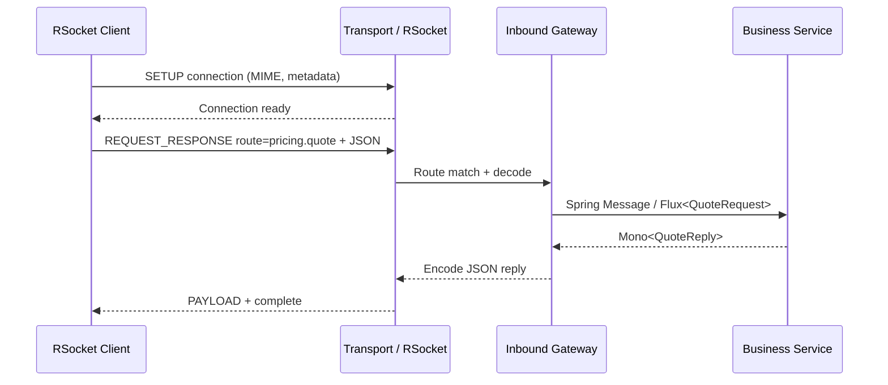
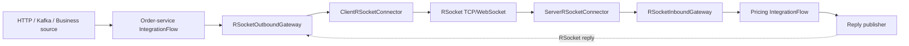
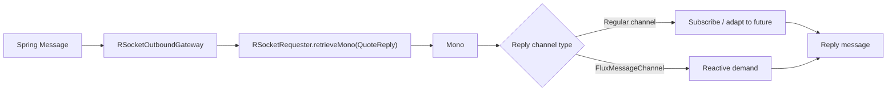
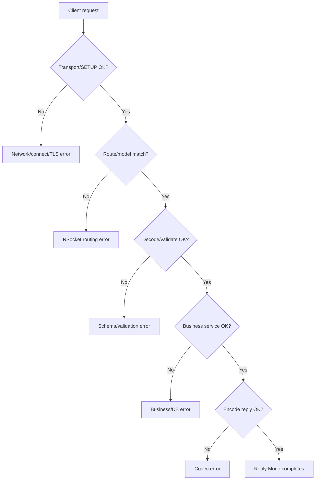
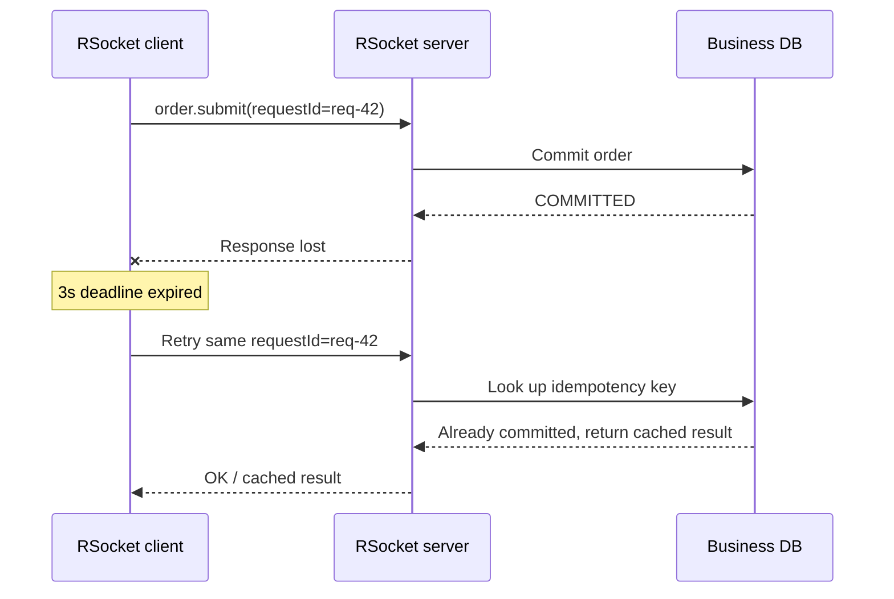
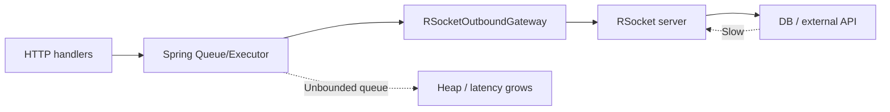
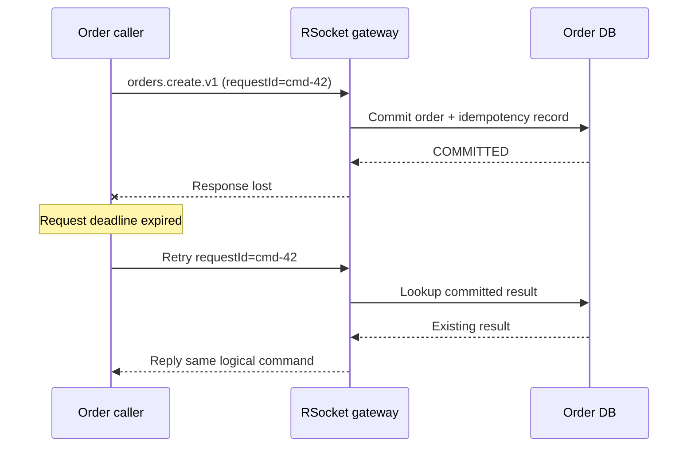
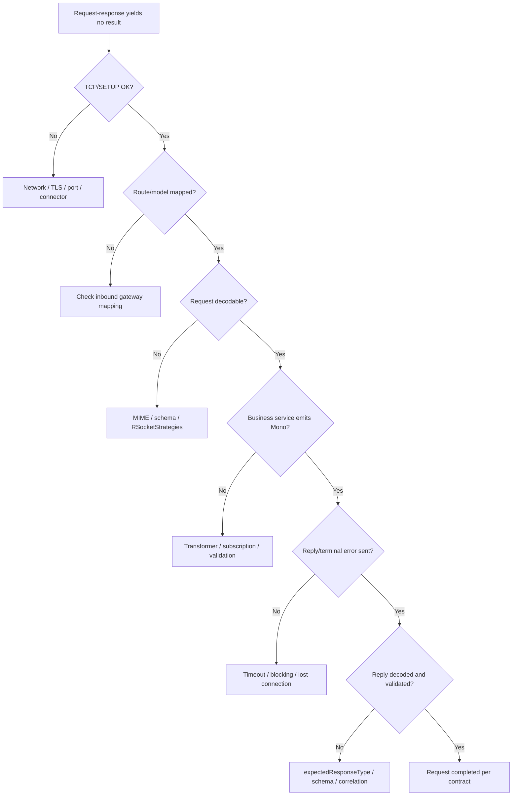

# Request-response over RSocket in Spring Integration

## 1. Real-world problem: calling a service and receiving one response

An ordering application needs to query the pricing service before confirming an order. The application sends a `pricing.quote` request containing the product SKU, quantity, and correlation ID, and receives **one** quote or **one** error signal. The two services do not want separate HTTP endpoints; they use RSocket over a reusable TCP connection.

```text
Order service                                      Pricing service
  QuoteRequest(sku, quantity, requestId)
          ────── REQUEST_RESPONSE ────────────────►
                                    Validate → Calculate
          ◄──────── QuoteReply ────────────────────
```

This is **request-response**. The challenge is not merely sending bytes, but also defining the **route, data MIME type, DTO schema, response type, deadline, behavior on server failure, and how to handle a reply lost after business logic has committed**.

The **"Request-response over RSocket"** lesson belongs to the **RSocket Adapter** chapter of module **SPRING_INTEGRATION_ADAPTERS**. The module introduces connecting external systems via inbound/outbound adapters, gateways, pollers, and `MessageChannel`; practicing flows with files, SFTP, HTTP, JMS, AMQP, Kafka, and databases while controlling message contracts, errors, and connection lifecycles. This lesson focuses on **one request – one response** over RSocket and how to integrate that interaction into Spring Integration.

### Learning objectives

After this lesson you can:

1. Explain the semantics of the `REQUEST_RESPONSE` model and distinguish it from `fireAndForget`, `requestStream`, and `requestChannel`.
2. Understand the classes: `RSocketRequester`, `ClientRSocketConnector`, `ServerRSocketConnector`, `RSocketOutboundGateway`, `RSocketInboundGateway`.
3. Define a wire-consistent route, MIME type, request DTO, and reply DTO.
4. Build a Spring Integration server that receives requests and returns `Mono<QuoteReply>` using Java DSL.
5. Call the server using `RSocketRequester` and via an outbound IntegrationFlow.
6. Understand reactive replies, subscribe/adapt behavior, correlation, and the difference between Spring `MessageChannel.send()` and a remote reply.
7. Design timeouts, cancellation, retries, and idempotency for side-effecting requests.
8. Test routes, codecs, errors, network failures, and unknown-outcome states.

## 2. RSocket request-response communication model

RSocket is a message-oriented protocol with interaction models, including request-response. One side initiates a **request** with payload and metadata; the other side returns **one response payload**, completes empty if permitted by the contract, or emits an error signal.



**A request-response is not a distributed transaction.** The transport may deliver the request successfully and the receiver may commit to the DB, yet the response can be lost before the client receives it. Therefore, the caller must separate "got a response" from "the command was processed exactly once".

### 2.1. Four RSocket models

| Interaction model | Request | Response | When to use |
| --- | --- | --- | --- |
| `requestResponse` | One payload | One response or terminal signal | Price lookup, status check, command expecting a reply |
| `fireAndForget` | One payload | No application response | Telemetry that needs no confirmation |
| `requestStream` | One payload | `Flux<T>` many results | Tracking price changes, update feeds |
| `requestChannel` | `Publisher<T>` many request elements | `Flux<R>` | Bidirectional streams |

In Spring Integration, the `RSocketInteractionModel` enum uses the names **`requestResponse`**, `fireAndForget`, `requestStream`, and `requestChannel`. An inbound gateway can restrict accepted models via `.interactionModels(RSocketInteractionModel.requestResponse)`; an outbound gateway selects the model via `.interactionModel(RSocketInteractionModel.requestResponse)`.

### 2.2. Request-response means "one result", not necessarily blocking

A Java call:

```java
Mono<QuoteReply> result = requester.route("pricing.quote")
        .data(request)
        .retrieveMono(QuoteReply.class);
```

Returns a `Mono<QuoteReply>`, **not an already materialized `QuoteReply`**. A Reactor publisher is an asynchronous contract; a request on a cold publisher typically executes only when subscribed. Do not call `block()` on the Netty/Reactor event loop.

For simple reads, the caller can use `StepVerifier` in tests, `flatMap` in a reactive service, or a Spring Integration gateway/channel with matching semantics.

## 3. Distinguishing inbound, outbound, and connectors



| Component | Responsibility | What it is not |
| --- | --- | --- |
| `RSocketRequester` | Lower-level client API: `route`, `data`, `retrieveMono` | A Spring Integration MessageChannel |
| `ClientRSocketConnector` | Establishes/manages the requester and connection to the peer | A business retry queue |
| `RSocketOutboundGateway` | Sends a Spring message as an RSocket request and produces a reply | An HTTP client or RSocket server listener |
| `ServerRSocketConnector` | Binds the transport and manages incoming requests to the server | A pricing calculation handler |
| `RSocketInboundGateway` | Maps route/model, forwards requests into IntegrationFlow, and encodes replies | A component that opens a port without a connector |
| `Transformer` / service activator | Computes and emits replies | A durable network ACK by default |
| `MessageChannel` | Dispatches Spring `Message<?>` | A guarantee that the peer committed |

**Outbound/inbound is the perspective from the IntegrationFlow**, not a hard restriction on which side may initiate requests. RSocket supports bidirectional connections; a server can proactively send requests to a client over an appropriate requester. However, the core example here is **client initiates, server responds**.

### 3.1. Comparison with HTTP request-response

| HTTP | RSocket |
| --- | --- |
| `GET /pricing/quote` or `POST` | `route("pricing.quote")` in metadata |
| HTTP status `200/400/500` | RSocket PAYLOAD/ERROR/terminal signal, not HTTP status |
| HTTP body and headers | RSocket data/metadata with MIME types |
| HTTP requests may open separate connections depending on client | RSocket multiplexes many interactions over one connection |
| Standard response has one body | `requestResponse` has one result; other models stream |

Do not configure `RSocketOutboundGateway` with `http://pricing-service/quote` expecting it to switch to HTTP POST automatically. An RSocket route is a **logical request mapping**, not an HTTP URL.

## 4. Wire contract: route, content type, payload, and correlation

Suppose we design the protocol:

```text
Transport: TCP RSocket
Server address: pricing-service:7000
Route: pricing.quote.v1
Interaction model: requestResponse
Data MIME: application/json
Request type: QuoteRequest
Reply type: QuoteReply
Correlation: requestId (in JSON)
Business timeout: client budget, e.g. 3 seconds
```

An illustrative request:

```json
{
  "schemaVersion": 1,
  "requestId": "req-20261123-42",
  "sku": "SKU-42",
  "quantity": 3
}
```

Response:

```json
{
  "schemaVersion": 1,
  "requestId": "req-20261123-42",
  "sku": "SKU-42",
  "quantity": 3,
  "currency": "VND",
  "totalMinorUnits": 37500
}
```

### 4.1. Role of each field

| Field | Meaning | Constraints |
| --- | --- | --- |
| `schemaVersion` | Wire schema version | Accept only supported versions |
| `requestId` | Logical request correlation | Unchanged across retry attempts of the same request |
| `sku` | Product code | Validate syntax and tenant access permissions |
| `quantity` | Quantity | Positive, below upper limit |
| `currency` | Currency code | Per standard list/contract |
| `totalMinorUnits` | Total amount in smallest currency unit per contract | Do not convert to `double` which risks precision loss |

Do not merely send `requestId` as a Spring header assuming a remote client in another language will automatically see that Java header. If it is part of the **business contract**, put the ID inside the JSON payload or defined metadata.

### 4.2. Route metadata is not authorization

A client can send `route("pricing.quote.v1")`, yet matching the route **does not prove** they have permission to quote for a tenant. Authenticate the connection/principal and verify SKU/tenant permissions in the service.

### 4.3. Reply type must match the decoder

If the response is JSON `QuoteReply`, the caller uses `retrieveMono(QuoteReply.class)` or outbound gateway `expectedResponseType(QuoteReply.class)`. Leaving the response defaulted to `String.class` may return an undeserialized JSON string or cause a codec error instead of a DTO.

## 5. Dependencies and sample application

Examples assume Java 17+, Spring Boot, and compatible Spring Integration versions managed by a BOM:

```xml
<dependencies>
    <dependency>
        <groupId>org.springframework.boot</groupId>
        <artifactId>spring-boot-starter-integration</artifactId>
    </dependency>
    <dependency>
        <groupId>org.springframework.integration</groupId>
        <artifactId>spring-integration-rsocket</artifactId>
    </dependency>
    <dependency>
        <groupId>com.fasterxml.jackson.core</groupId>
        <artifactId>jackson-databind</artifactId>
    </dependency>
    <dependency>
        <groupId>io.projectreactor</groupId>
        <artifactId>reactor-test</artifactId>
        <scope>test</scope>
    </dependency>
</dependencies>
```

Do not freely mix major versions of Spring Boot, Spring Framework, Spring Integration, and Reactor. The APIs in this lesson use classes present in Spring Integration RSocket; in a real project, cross-check the JavaDoc for your chosen BOM.

### 5.1. Two independent processes

For realistic testing, you can run:

```text
Process A: pricing-service
  ServerRSocketConnector bound TCP 7000
  RSocketInboundGateway route pricing.quote.v1
  PricingService returns Mono<QuoteReply>

Process B: order-service
  ClientRSocketConnector connects to pricing-service:7000
  RSocketOutboundGateway calls route pricing.quote.v1
  Downstream receives QuoteReply result
```

If running both parts in one JVM for learning, avoid creating **two connector/server beans binding the same port** or registering the same route with conflicting models.

### 5.2. Application configuration

```yaml
# Illustrative application.yml
app:
  rsocket:
    bind-host: ${RSOCKET_BIND_HOST:127.0.0.1}
    host: ${RSOCKET_HOST:127.0.0.1}
    port: ${RSOCKET_PORT:7000}
    request-timeout: ${RSOCKET_REQUEST_TIMEOUT:3s}
```

In Kubernetes, the server side may need to bind `0.0.0.0` while the client uses the Kubernetes Service DNS, rather than loopback `127.0.0.1` from another pod. Combine with appropriate firewall/NetworkPolicy rules and authentication/TLS.

## 6. DTOs and business rules

### 6.1. Java records

```java
// QuoteRequest.java
public record QuoteRequest(
        int schemaVersion,
        String requestId,
        String sku,
        int quantity) {
}
```

```java
// QuoteReply.java
public record QuoteReply(
        int schemaVersion,
        String requestId,
        String sku,
        int quantity,
        String currency,
        long totalMinorUnits) {
}
```

**These are illustrative DTOs.** In production, use versioned packages and never pass JSON input directly into ORM entities holding sensitive fields.

### 6.2. Validation

```java
public final class QuoteValidation {
    private QuoteValidation() {
    }

    public static void requireValid(QuoteRequest request) {
        if (request == null ||
                request.schemaVersion() != 1 ||
                request.requestId() == null ||
                !request.requestId().matches("[A-Za-z0-9_-]{1,128}") ||
                request.sku() == null ||
                !request.sku().matches("[A-Za-z0-9_-]{1,64}") ||
                request.quantity() < 1 ||
                request.quantity() > 10_000) {
            throw new IllegalArgumentException(
                    "Invalid QuoteRequest");
        }
    }
}
```

Regex validation does not check tenant permissions, inventory policies, or business pricing rules. Place those checks at the service boundary. Never return stack traces or SQL details to external requesters.

### 6.3. Service returning Mono instead of blocking the event loop

```java
import org.springframework.stereotype.Service;
import reactor.core.publisher.Mono;

@Service
public class QuoteCalculationService {

    public Mono<QuoteReply> quote(QuoteRequest request) {
        return Mono.fromSupplier(() -> {
            QuoteValidation.requireValid(request);
            long unitPrice = 12_500L; // Illustrative, in VND.
            long amount = Math.multiplyExact(
                    unitPrice, request.quantity());
            return new QuoteReply(
                    1,
                    request.requestId(),
                    request.sku(),
                    request.quantity(),
                    "VND",
                    amount);
        });
    }
}
```

`Mono.fromSupplier` here performs only tiny CPU math; do not wrap a blocking JDBC call inside it thinking it becomes non-blocking. For blocking repositories, use an appropriate scheduler and concurrency limits (see section 17).

## 7. Server: `ServerRSocketConnector` opens the listener

First create the connector in **pricing-service**:

```java
import org.springframework.beans.factory.annotation.Value;
import org.springframework.context.annotation.Bean;
import org.springframework.context.annotation.Configuration;
import org.springframework.integration.rsocket.ServerRSocketConnector;

@Configuration
public class PricingRSocketServerConfiguration {

    @Bean
    public ServerRSocketConnector pricingServerConnector(
            @Value("${app.rsocket.bind-host}") String bindHost,
            @Value("${app.rsocket.port}") int port) {
        return new ServerRSocketConnector(bindHost, port);
    }
}
```

`ServerRSocketConnector` opens and manages the RSocket transport; `RSocketInboundGateway` will be detected/registered by the framework's mechanism. Declaring only an inbound gateway bean **does not open a listener automatically**.

### 7.1. Who owns the port?

If Spring Boot RSocket server auto-configuration is also enabled on port 7000, `Address already in use` can occur. Choose **one** server owner. If the application already has another RSocket server managed by Spring Messaging, integrate the gateway via `ServerRSocketMessageHandler`/the appropriate connector architecture instead of creating a second listener on the same port.

### 7.2. Dynamic port in tests

`new ServerRSocketConnector("127.0.0.1", 0)` lets the OS assign a dynamic port. The `getBoundPort()` API returns a `Mono<Integer>`:

```java
// Only for test setup after connector start/bind.
Integer port = connector.getBoundPort()
        .block(java.time.Duration.ofSeconds(5));
if (port == null || port < 1) {
    throw new IllegalStateException("RSocket not bound yet");
}
```

Never call `.block()` on the Netty event loop; calling block with a finite timeout is acceptable in integration test orchestration.

## 8. Server: inbound gateway handling request-response

### 8.1. Java DSL

```java
import org.springframework.context.annotation.Bean;
import org.springframework.context.annotation.Configuration;
import org.springframework.core.ResolvableType;
import org.springframework.integration.dsl.IntegrationFlow;
import org.springframework.integration.rsocket.RSocketInteractionModel;
import org.springframework.integration.rsocket.dsl.RSockets;
import reactor.core.publisher.Flux;
import reactor.core.publisher.Mono;

@Configuration
public class PricingInboundFlowConfiguration {

    @Bean
    public IntegrationFlow pricingQuoteInboundFlow(
            QuoteCalculationService service) {

        return IntegrationFlow
                .from(RSockets.inboundGateway("pricing.quote.v1")
                        .interactionModels(
                                RSocketInteractionModel.requestResponse)
                        .requestElementType(
                                ResolvableType.forClass(QuoteRequest.class)))
                .<Flux<QuoteRequest>, Mono<QuoteReply>>transform(
                        requestFlux ->
                                requestFlux.single()
                                        .flatMap(service::quote))
                .get();
    }
}
```

**Breakdown:**

- `RSockets.inboundGateway("pricing.quote.v1")` registers the route.
- `interactionModels(requestResponse)` allows only that model on this endpoint.
- `requestElementType(ResolvableType.forClass(QuoteRequest.class))` tells the decoder the request element type.
- The payload entering the IntegrationFlow is **`Flux<QuoteRequest>`** per reactive inbound gateway semantics.
- `single()` requires **exactly one element**, matching request-response; if zero or more than one element arrives, the publisher errors.
- `flatMap(service::quote)` emits a `Mono<QuoteReply>` that the gateway encodes as a single response.

When using JSON, server and client must agree on `RSocketStrategies`/codecs and `application/json`. The Java type is only an in-JVM contract; it will not fix a client sending `text/plain` with JSON content or a mismatched schema.

### 8.2. Java bean instead of Java DSL

```java
import org.springframework.context.annotation.Bean;
import org.springframework.context.annotation.Configuration;
import org.springframework.core.ResolvableType;
import org.springframework.integration.rsocket.RSocketInteractionModel;
import org.springframework.integration.rsocket.inbound.RSocketInboundGateway;

@Configuration
public class PricingInboundBeanConfiguration {

    @Bean
    public RSocketInboundGateway quoteGateway() {
        RSocketInboundGateway gateway =
                new RSocketInboundGateway("pricing.quote.v1");
        gateway.setRequestChannelName("quoteRequests");
        gateway.setInteractionModels(
                RSocketInteractionModel.requestResponse);
        gateway.setRequestElementType(
                ResolvableType.forClass(QuoteRequest.class));
        return gateway;
    }
}
```

Combined with a transformer:

```java
import org.springframework.integration.annotation.Transformer;
import org.springframework.stereotype.Component;
import reactor.core.publisher.Flux;
import reactor.core.publisher.Mono;

@Component
public class QuoteTransformer {
    private final QuoteCalculationService service;

    public QuoteTransformer(QuoteCalculationService service) {
        this.service = service;
    }

    @Transformer(inputChannel = "quoteRequests")
    public Mono<QuoteReply> quote(Flux<QuoteRequest> input) {
        return input.single().flatMap(service::quote);
    }
}
```

**This is an alternative configuration** to the Java DSL in section 8.1. Within a single application, **do not register both inbound gateways on the same connector with the same route/model** unless intentionally handling mapping conflicts.

### 8.3. Why doesn't the handler receive `QuoteRequest` directly?

The Spring Integration RSocket inbound gateway uses a **publisher/`Flux`** payload for requests with replies, aligning with reactive models. The transformer in the example must work with `Flux<QuoteRequest>`; if you declare a plain `QuoteRequest` when the framework passes a `Flux`, argument conversion may fail.

This is a **key difference** from a `@MessageMapping` controller accepting a single DTO, and should be verified against your specific implementation/version.

## 9. Simple client: `RSocketRequester`

Before integrating the outbound gateway, verify **server, route, MIME, and DTOs** using a direct requester.

### 9.1. Calling the route and retrieving a `Mono<QuoteReply>`

```java
import java.time.Duration;
import org.springframework.messaging.rsocket.RSocketRequester;
import org.springframework.util.MimeTypeUtils;
import reactor.core.publisher.Mono;

public class DirectPricingClient {

    public static Mono<QuoteReply> requestQuote() {
        RSocketRequester requester = RSocketRequester.builder()
                .dataMimeType(MimeTypeUtils.APPLICATION_JSON)
                .tcp("127.0.0.1", 7000);

        QuoteRequest request =
                new QuoteRequest(1, "req-42", "SKU-42", 3);

        return requester.route("pricing.quote.v1")
                .data(request)
                .retrieveMono(QuoteReply.class)
                .timeout(Duration.ofSeconds(3));
    }
}
```

`route(...)` sets RSocket routing metadata; `data(request)` uses the encoder/decoder per MIME type; `retrieveMono(QuoteReply.class)` represents a single response. `timeout(...)` is a deadline on the reactive chain—it does **not** force the server to roll back if the server already performed side effects.

**Do not create a new requester for every production message.** The example above is minimized for learning; real applications should manage requester/connector lifecycles, cap active requests, and close resources on shutdown.

### 9.2. Reading the result with StepVerifier

```java
import reactor.test.StepVerifier;

StepVerifier.create(DirectPricingClient.requestQuote())
        .expectNextMatches(reply ->
                reply.requestId().equals("req-42") &&
                reply.totalMinorUnits() == 37_500L &&
                reply.currency().equals("VND"))
        .verifyComplete();
```

This assertion example is **only valid if the test server is already started** with matching route and codec. It does not mean tests have been run in the repository. With dynamic ports and CI, fetch the actual port from the server before building the requester.

### 9.3. When does the request actually happen?

With a cold publisher:

```java
Mono<QuoteReply> mono = requester.route("pricing.quote.v1")
        .data(request)
        .retrieveMono(QuoteReply.class);

// No subscriber yet: do not consider the remote call completed.
Mono<QuoteReply> checked = mono.doOnNext(this::validateReply);
// checked must be subscribed to by a reactive chain or test.
```

Avoid calling an unmanaged `subscribe()` inside a service method and immediately returning a fake "success". Prefer **returning Mono** so the caller manages cancellation/errors/deadlines; in Spring Integration, verify how the gateway subscribes/adapts per channel.

## 10. Spring Integration client: outbound gateway calling the remote

### 10.1. `ClientRSocketConnector` bean

```java
import org.springframework.beans.factory.annotation.Value;
import org.springframework.context.annotation.Bean;
import org.springframework.context.annotation.Configuration;
import org.springframework.integration.rsocket.ClientRSocketConnector;

@Configuration
public class PricingRSocketClientConnectorConfiguration {

    @Bean
    public ClientRSocketConnector pricingClientConnector(
            @Value("${app.rsocket.host}") String host,
            @Value("${app.rsocket.port}") int port) {
        return new ClientRSocketConnector(host, port);
    }
}
```

The connector manages the `RSocketRequester` to the server. The same connection can be reused across many requests; that reduces handshake/connection churn, but does **not** put those requests into a single business transaction.

### 10.2. Java DSL `RSockets.outboundGateway(...)`

```java
import org.springframework.context.annotation.Bean;
import org.springframework.context.annotation.Configuration;
import org.springframework.integration.dsl.IntegrationFlow;
import org.springframework.integration.rsocket.ClientRSocketConnector;
import org.springframework.integration.rsocket.RSocketInteractionModel;
import org.springframework.integration.rsocket.dsl.RSockets;

@Configuration
public class PricingRSocketOutboundFlowConfiguration {

    @Bean
    public IntegrationFlow quoteOutboundFlow(
            ClientRSocketConnector pricingClientConnector) {

        return IntegrationFlow
                .from("quoteOutboundRequests")
                .handle(RSockets.outboundGateway("pricing.quote.v1")
                        .interactionModel(
                                RSocketInteractionModel.requestResponse)
                        .expectedResponseType(QuoteReply.class)
                        .clientRSocketConnector(pricingClientConnector))
                .channel("quoteOutboundReplies")
                .get();
    }
}
```

**Explanation:**

1. A Spring message sent to `quoteOutboundRequests` carries `QuoteRequest` as payload.
2. The outbound gateway selects route `pricing.quote.v1` and model `requestResponse`.
3. The requester inside `ClientRSocketConnector` transmits data/metadata over the connection.
4. The remote inbound gateway receives the request, calculates the quote, and returns `QuoteReply`.
5. Spring Integration emits the reply using **reactive reply semantics** to `quoteOutboundReplies`.

`MessageChannel.send()==true` **only** indicates the channel accepted/dispatched the message per contract; it does **not** mean the remote response arrived or the DB committed.

### 10.3. Sending a Spring Message through the channel

```java
import org.springframework.beans.factory.annotation.Qualifier;
import org.springframework.messaging.MessageChannel;
import org.springframework.messaging.support.MessageBuilder;
import org.springframework.stereotype.Service;

@Service
public class QuoteRequestPublisher {
    private final MessageChannel channel;

    public QuoteRequestPublisher(
            @Qualifier("quoteOutboundRequests")
            MessageChannel channel) {
        this.channel = channel;
    }

    public void submit(QuoteRequest request) {
        QuoteValidation.requireValid(request);
        boolean accepted = channel.send(
                MessageBuilder.withPayload(request).build());

        if (!accepted) {
            throw new IllegalStateException(
                    "Channel did not accept QuoteRequest");
        }
        // Do not mark business COMPLETED here.
    }
}
```

### 10.4. Downstream consumer receiving the result

A reply handler can use `@ServiceActivator` to validate the reply:

```java
import org.springframework.integration.annotation.ServiceActivator;
import org.springframework.stereotype.Component;

@Component
public class QuoteReplyConsumer {

    @ServiceActivator(inputChannel = "quoteOutboundReplies")
    public void handle(QuoteReply reply) {
        if (reply == null ||
                reply.schemaVersion() != 1 ||
                reply.totalMinorUnits() < 0) {
            throw new IllegalArgumentException(
                    "Invalid QuoteReply");
        }
        // Reconcile requestId with the original request at the business layer.
        System.out.println("Quote amount: " +
                reply.totalMinorUnits());
    }
}
```

**Always test the actual type arriving on the output channel for your version/channel implementation.** `RSocketOutboundGateway` returns an internal `Mono`; with a regular channel, Spring Integration subscribes/adapts before sending the reply, whereas `FluxMessageChannel` processes on demand. Do not blindly assume the handler always sees `Mono<QuoteReply>` or always sees the DTO directly across every topology.

## 11. Java bean handler instead of Java DSL

If the codebase uses annotated endpoints, you can configure `RSocketOutboundGateway` directly:

```java
import org.springframework.beans.factory.annotation.Qualifier;
import org.springframework.context.annotation.Bean;
import org.springframework.context.annotation.Configuration;
import org.springframework.integration.annotation.ServiceActivator;
import org.springframework.integration.rsocket.ClientRSocketConnector;
import org.springframework.integration.rsocket.RSocketInteractionModel;
import org.springframework.integration.rsocket.outbound.RSocketOutboundGateway;

@Configuration
public class PricingOutboundBeanConfiguration {

    @Bean
    @ServiceActivator(
            inputChannel = "beanQuoteRequests",
            outputChannel = "beanQuoteReplies")
    public RSocketOutboundGateway quoteGateway(
            @Qualifier("pricingClientConnector")
            ClientRSocketConnector connector) {

        RSocketOutboundGateway gateway =
                new RSocketOutboundGateway("pricing.quote.v1");
        gateway.setInteractionModel(
                RSocketInteractionModel.requestResponse);
        gateway.setExpectedResponseType(QuoteReply.class);
        gateway.setClientRSocketConnector(connector);
        return gateway;
    }
}
```

This is an **alternative approach**; do not register the same route gateway twice on the **same request channel** unless fan-out is intentional. With request-response, fan-out can trigger multiple requests and create ambiguous reply correlation.

## 12. Reactive reply: how the gateway subscribes and delivers results

`RSocketOutboundGateway` is an `AbstractReplyProducingMessageHandler`. Per the Spring Integration RSocket reference, the gateway's internal reply is a **`Mono`**; for `requestResponse`, it represents one response element or terminal signal.



### 12.1. Two common pitfalls

**First pitfall:** assuming a successful `channel.send(...)` call means "the server returned a price". In reality, the Spring channel can accept the message before the asynchronous remote reply finishes.

**Second pitfall:** seeing `Mono<QuoteReply>` and calling `block()` on the Netty event loop. Blocking the event loop can cause deadlocks, poor throughput, or exceptions. Chain with reactive operators or let Spring Integration adapt via the appropriate channel.

### 12.2. Reply correlation inside an IntegrationFlow

When multiple requests flow through one gateway concurrently, the framework uses the request/reply channel/correlation context to return each reply to its internal flow per contract. However:

- Business `requestId` in the payload is still required for reconciliation and tracing.
- Internal `replyChannel` headers **do not automatically appear on the wire** at the remote service.
- If a flow branches, do not manually send a response to an uncorrelated channel and expect the requester to receive it properly.
- If using `@MessagingGateway` returning `QuoteReply` synchronously, test reply timeouts and the threading model—especially with async handlers.

### 12.3. Do not confuse with request-stream

With `requestStream` and `requestChannel`, a reply `Flux` is wrapped in a `Mono` to preserve request scope. Downstream must subscribe/flatten the `Flux` properly. However, this lesson uses `requestResponse`: **one request and at most one business reply**, so we normally work with `Mono<QuoteReply>`.

### 12.4. Request with no reply

If the remote handler returns `Mono.empty()`, the interaction can complete **without a QuoteReply**. For APIs where a quote is mandatory, do not treat empty as success; define a `NOT_FOUND` response or a clearly mapped error. The client can do:

```java
import reactor.core.publisher.Mono;

Mono<QuoteReply> requiredReply =
        requester.route("pricing.quote.v1")
                .data(request)
                .retrieveMono(QuoteReply.class)
                .switchIfEmpty(Mono.error(
                        new IllegalStateException(
                                "Remote returned no quote")));
```

Apply `switchIfEmpty` only at the appropriate caller layer; do not turn every empty response into an error if the business contract allows empty results.

## 13. Routing and dynamic routes in request-response

### 13.1. Fixed route is the easiest default to control

```java
RSockets.outboundGateway("pricing.quote.v1")
        .interactionModel(RSocketInteractionModel.requestResponse)
        .expectedResponseType(QuoteReply.class)
        .clientRSocketConnector(connector);
```

Do not dynamically change routes from user input when sensitive routes exist. When a route does not exist, the client should observe a mapping error (not HTTP 404), and the application must not retry configuration errors infinitely.

### 13.2. Dynamic route from a whitelisted header

`RSockets.outboundGateway(...)` has an overload accepting `Function<Message<P>, ?>`; for example:

```java
import org.springframework.messaging.Message;
import org.springframework.integration.rsocket.dsl.RSockets;

RSockets.outboundGateway((Message<QuoteRequest> msg) -> {
            Object raw = msg.getHeaders().get("pricingRoute");
            String route = raw instanceof String s ? s : "";
            if (!"pricing.quote.v1".equals(route) &&
                    !"pricing.preview.v1".equals(route)) {
                throw new IllegalArgumentException(
                        "Route not allowed");
            }
            return route;
        })
        .interactionModel(RSocketInteractionModel.requestResponse)
        .expectedResponseType(QuoteReply.class)
        .clientRSocketConnector(connector);
```

This is a DSL builder fragment, not a standalone running bean unless attached inside `IntegrationFlow.handle(...)`. Untrusted routes from headers must be **validated and authorized** before the remote call.

### 13.3. Route versioning

If both `pricing.quote.v1` and `pricing.quote.v2` exist, migration must clearly specify:

1. Which versions the client supports.
2. Corresponding request/response schemas.
3. How routing selects the version.
4. Whether a safe fallback exists.
5. Whether timeouts and retries keep the same version when resending.

A retry of the same logical request should keep **the same route/schema version** unless the application has an explicit migration/reconciliation protocol.

## 14. RSocketStrategies and JSON codecs

Spring RSocket encodes/decodes data using `RSocketStrategies`. What must match:

| Aspect | Client | Server |
| --- | --- | --- |
| Route | `pricing.quote.v1` | Inbound mapping with same name |
| Model | `requestResponse` | Inbound allows this model |
| Data MIME | `application/json` | Has JSON decoder |
| Request type | `QuoteRequest` | `requestElementType(QuoteRequest.class)` via `ResolvableType` |
| Reply type | `QuoteReply` | Encoder can serialize `QuoteReply` |
| Metadata route | Encoded by requester | Parseable by connector/gateway |

### 14.1. Explicit JSON decoder/encoder configuration

If the project needs explicit codec control, you can define:

```java
import com.fasterxml.jackson.databind.ObjectMapper;
import org.springframework.context.annotation.Bean;
import org.springframework.context.annotation.Configuration;
import org.springframework.http.codec.json.Jackson2JsonDecoder;
import org.springframework.http.codec.json.Jackson2JsonEncoder;
import org.springframework.messaging.rsocket.RSocketStrategies;

@Configuration
public class QuoteRSocketCodecConfiguration {

    @Bean
    public RSocketStrategies quoteRSocketStrategies(
            ObjectMapper mapper) {
        return RSocketStrategies.builder()
                .decoder(new Jackson2JsonDecoder(mapper))
                .encoder(new Jackson2JsonEncoder(mapper))
                .build();
    }
}
```

Then connectors can be configured to use those strategies:

```java
ServerRSocketConnector server =
        new ServerRSocketConnector("0.0.0.0", 7000);
server.setRSocketStrategies(strategies);

ClientRSocketConnector client =
        new ClientRSocketConnector("pricing-service", 7000);
client.setRSocketStrategies(strategies);
```

This **illustrates how to set it**, not creating a new server/client inside every request. If connector beans already exist, inject `RSocketStrategies` into those beans; do **not** configure a second connector binding the same port. When customizing codec strategies, ensure required routing/metadata components are preserved and run end-to-end integration tests.

### 14.2. MIME type must match the codec

With `RSocketRequester` directly, you can set:

```java
RSocketRequester requester = RSocketRequester.builder()
        .dataMimeType(
                org.springframework.util.MimeTypeUtils.APPLICATION_JSON)
        .tcp("127.0.0.1", 7000);
```

With `ClientRSocketConnector`, configure `RSocketStrategies` and data MIME per the connector API, then verify against a real server. **Do not merely change `expectedResponseType` and assume a `text/plain` message will turn into JSON automatically.**

### 14.3. Common codec failures

- Client sends `String` text while server expects `QuoteRequest`.
- Client sends JSON but data MIME is `text/plain`.
- DTOs on the two sides have mismatched fields/`schemaVersion`.
- Server lacks an encoder for the reply record.
- Two `RSocketStrategies` beans with different rules are injected into different connectors.
- Generic reply types like `List<QuoteReply>` lose element types if `List.class` is used.

Codec failures usually **do not recover via retries**. Fix the contract/implementation, log an error code, and quarantine bad input when appropriate.

## 15. Error handling: RSocket error signals are not HTTP statuses

In request-response, an error can occur at several points:



| Error layer | Example | Policy |
| --- | --- | --- |
| Transport | Peer offline, TCP refused, TLS handshake fail | Retry with backoff if appropriate, alert |
| SETUP | Unsupported MIME/metadata | Fix client/server contract |
| Route | `pricing.quote.v1` missing | Fix config, do not retry infinitely |
| Interaction model | Sending `requestStream` to a `requestResponse`-only route | Fix model |
| Decode | Malformed JSON or wrong schema version | Reject, do not retry blindly |
| Validate/authorize | Invalid SKU/tenant | Return controlled error, audit |
| Business | Database timeout | Determine outcome, idempotent retry if allowed |
| Encode reply | No encoder for `QuoteReply` | Fix `RSocketStrategies` |
| Lost reply | Server calculated/committed but client timed out | Reconcile by `requestId` |

### 15.1. Representing reactive errors

```java
import reactor.core.publisher.Mono;

public Mono<QuoteReply> quoteWithError(QuoteRequest req) {
    return Mono.defer(() -> {
        if (req == null || req.quantity() < 1) {
            return Mono.error(new IllegalArgumentException(
                    "Invalid quantity"));
        }
        return service.quote(req);
    });
}
```

This example sits inside a class with a `service` field; it illustrates a **terminal error** in a publisher. For external consumers, sanitize exceptions and define an application error code on the wire. Never leak DB table names, SQL queries, tokens, or stack traces in client-facing error messages.

### 15.2. Synchronous errors vs. post-subscription errors

Mapping errors when constructing a message may surface synchronously, whereas connection, timeout, reply decoding, and business publisher errors occur asynchronously **after subscription**. Therefore:

- Do not wrap `channel.send(...)` in `try/catch` thinking it catches every RSocket error.
- Do not treat a Spring Integration `errorChannel` as a durable retry queue.
- With an outbound gateway, verify error propagation across your specific channel/reply boundary.
- For critical commands, keep pending/unknown state in an outbox until a clear business outcome is confirmed.

## 16. Timeouts, cancellation, and "unknown outcome" state

Suppose the client has a 3-second deadline, the server commits after 2 seconds, and the reply is lost:



**A timeout does not prove the remote side did not process the request.** Client cancellation or reactive `timeout` stops waiting for the response, but does not roll back an already-committed server transaction.

### 16.1. A deadline spans multiple stages

| Stage | Must account for |
| --- | --- |
| Connect/SETUP | DNS, routing, TLS, and connection establishment |
| Request serialization | JSON encoder, payload size |
| Network transit | Network latency |
| Server validation | Auth, schema, routing |
| Business processing | CPU, database/transactions |
| Reply encode/transit | JSON codec, response network |
| Consumer adaptation | Reply subscription, channel topology |

If an HTTP caller has a 2-second SLA while the RSocket client retries three times with a 5-second wait each, total time can blow past the SLA. Choose total deadlines, attempt counts, backoff, and fallback policies per contract.

### 16.2. Expressing timeouts with RSocketRequester

```java
import java.time.Duration;
import reactor.core.publisher.Mono;

public Mono<QuoteReply> requestWithDeadline(
        RSocketRequester requester, QuoteRequest request) {
    return requester.route("pricing.quote.v1")
            .data(request)
            .retrieveMono(QuoteReply.class)
            .timeout(Duration.ofSeconds(3));
}
```

This is the **`RSocketRequester`** API, not a direct setter on `RSocketOutboundGatewaySpec`. In Spring Integration, integrate deadlines at the appropriate reactive layer/caller and test reply/error behavior for your actual version.

### 16.3. Retries must depend on error type

| Error | Retry? | Condition |
| --- | --- | --- |
| Idempotent price read, transient disconnect | Usually yes | Backoff, capped attempts |
| Temporary remote overload | Conditionally | Rate limit/circuit breaker |
| Malformed JSON | No | Fix data |
| Wrong route | No | Fix config |
| Permission denied | No | Do not try to bypass authorization |
| Command DB timeout, unknown outcome | Conditionally | Idempotency key, reconcile |
| HTTP deadline exceeded | Stop blocking user request | Complete async if backed by durable pending source |

### 16.4. Never generate a new requestId for the same logical command

```text
Wrong when submitting an order:
  attempt1: requestId=req-42
  timeout
  attempt2: requestId=req-43

Right when using idempotency:
  attempt1: requestId=req-42
  timeout (outcome unknown)
  attempt2: requestId=req-42
  remote deduplicates and returns the committed result
```

A **read-only quote** is usually simpler to retry; however, when RSocket request-response creates orders or records payments, idempotency must live **inside the server's transaction**, not just in an in-RAM `ConcurrentHashMap`.

## 17. Threading, backpressure, and blocking boundaries

RSocket interacts with Reactor publishers; for request-response, one request returns one `Mono`. That does not automatically cap concurrent requests or work queued in an `ExecutorChannel`.



### 17.1. Do not block the Reactor event loop

Do not call `Thread.sleep(...)` or blocking JDBC directly inside `map(...)`/`flatMap(...)` running on the Netty event loop. If you must use a legacy blocking repository, offload it to an appropriate scheduler:

```java
import reactor.core.publisher.Mono;
import reactor.core.scheduler.Schedulers;

public Mono<String> queryLegacy(String sku) {
    return Mono.fromCallable(() ->
                    legacyRepository.findSkuDescription(sku))
            .subscribeOn(Schedulers.boundedElastic());
}
```

This is illustrative code assuming `legacyRepository` exists. `boundedElastic` does not turn a JDBC call into non-blocking I/O; it merely moves blocking work off the event loop, and concurrency/queues must still be monitored.

### 17.2. Concurrency limits and overload policies

With thousands of concurrent requests:

- Cap concurrent requests per service/tenant.
- Set sensible timeouts; avoid holding requests indefinitely.
- Use bounded queues and explicit rejection policies.
- Track active requests, queue depth, and P95/P99 latency metrics.
- Avoid retry storms when a peer just recovers.
- Separate read requests (idempotent) from write commands (requiring ACKs/idempotency).

RSocket request-response can multiplex over a connection, which **does not mean the server has infinite CPU/DB connections**.

### 17.3. Cancellation does not automatically undo side effects

If the client cancels the `Mono` while the server is processing, some reactive work may receive the cancel signal; however, committed transactions, in-flight blocking I/O, or side effects in external systems **are not guaranteed to revert**. Therefore, business consistency design **must not rely on cancel** as a rollback command.

## 18. Securing request-response

An RSocket route receives data from outside the process; treat it as a trust boundary:

| Concern | Control |
| --- | --- |
| Caller identity | Authentication at transport/SETUP or compatible security integration |
| Route-level access | Authorization by principal/role |
| Tenant/resource ownership | Validate SKU/order tenant in the business service |
| Traffic abuse | Rate limits, active request quotas, payload size limits |
| Payload/schema | Field whitelisting, JSON depth, `schemaVersion` |
| Reply data leakage | Never return sensitive fields; sanitize errors |
| Dynamic route | Route whitelisting; never treat raw user headers as permissions |
| Replay/duplicates | Idempotency keys and retry controls |
| Data transport | TLS on transport or verified protected network |
| Observability | Trace IDs; never log raw secrets/PII |

`tcp://` RSocket does not automatically provide TLS. When encryption/peer authentication is needed, configure transport TLS for RSocket/Reactor Netty or an approved infrastructure layer; define clearly who terminates TLS and which headers/metadata are trusted.

### 18.1. Error messages are also data returned to the peer

If an `IllegalArgumentException` from a service propagates as an RSocket error, the client might see exception details depending on the handler. Map errors to a safe **application error contract** with codes and sanitized messages, while keeping full stack traces in restricted-access server logs.

### 18.2. Do not trust a QuoteReply just because JSON is valid

The client must verify `requestId`, `sku`, `quantity`, `currency`, and monetary values in the reply match the request. A response decoding cleanly as `QuoteReply.class` does not prove its business values are valid or belong to the expected tenant.

## 19. Request-response for write commands: ACK and idempotency

Price calculation is a **read-only** request. If the route changes to `orders.create.v1` and the server writes to a database, a `SUCCESS` response is a **business result** per contract; yet a timed-out request may still have caused side effects.

### 19.1. Transaction pattern with idempotency key

An illustrative table:

```sql
-- Illustrative SQL; adjust for your DBMS.
CREATE TABLE processed_command (
    request_id     VARCHAR(128) PRIMARY KEY,
    command_type   VARCHAR(64) NOT NULL,
    result_json    TEXT NOT NULL,
    committed_at   TIMESTAMP NOT NULL
);
```

When receiving `requestId`:

```text
BEGIN TRANSACTION
  1. Validate schema, caller identity, domain state.
  2. Check processed_command(requestId) under safe transaction semantics.
  3. If already committed with the same command contents:
       return the stored result; DO NOT apply side effects again.
  4. If requestId conflicts with a different command:
       reject/record conflict.
  5. If new:
       create order + insert processed_command(result_json)
       within the SAME transaction.
COMMIT
Return the response derived from the committed result.
```

Merely running `SELECT` then `INSERT` in two separate transactions without a unique constraint/lock can race when two attempts arrive concurrently. You need a **unique key in the same transaction** or a DB algorithm capable of handling conflicts safely.

### 19.2. Safe retry diagram



**Do not try to promise exactly-once network delivery.** The practical goal is **at-least-once attempts + idempotent business effects + durable reconciliation**, so multiple attempts of the same logical command produce only one side effect.

### 19.3. When an outbox fits

For commands that cannot be lost when the remote peer may be offline for long periods, the caller can:

1. Write business intent along with an outbox row in one transaction.
2. Return `PENDING` to the HTTP caller after the local commit.
3. Have a worker read the outbox and invoke request-response over RSocket.
4. When a response confirms commit, mark the outbox row `ACKED`.
5. On timeout, keep `PENDING/UNKNOWN` and retry with the same `requestId`, using backoff and caps.
6. The receiver enforces idempotency; if an ACK was lost, the retry returns the stored result.

RSocket provides transport, framing, and reactive responses; it **does not persist durable outboxes/inboxes itself**. If fan-out/replay/consumer groups are needed, consider a durable broker like Kafka/JMS/AMQP per contract rather than building everything over request-response.

## 20. Lifecycle, connection reuse, and shutdown

`ClientRSocketConnector` and `ServerRSocketConnector` manage connections on both sides. RSocket can multiplex many request-responses over one connection; however, an open connection does **not** mean all routes are ready.

### 20.1. Startup and readiness

```text
Server application:
  create RSocketStrategies, inbound flows
  → ServerRSocketConnector binds TCP port
  → route mappings registered
  → client SETUP
  → safe probe via a read-only route

Client application:
  create ClientRSocketConnector
  → connection/SETUP lifecycle
  → outbound flow available
  → actual request can be sent
```

| Signal | Can infer | Cannot infer |
| --- | --- | --- |
| Connector bean created | Bean is configured | Peer is online |
| Server bound port | Transport listener active | JSON route is valid and business is ready |
| Client SETUP succeeded | Peers have an RSocket connection | Route `pricing.quote.v1` works |
| Health probe returns valid reply | Route + codec work for probe | All DB write commands succeeded |
| Valid business response | That logical request met contract | No races exist when retrying other commands |

In Kubernetes, a TCP-port-only `readinessProbe` may be insufficient when downstream DBs are not yet ready. Provide a safe health/readiness route and avoid creating side effects inside probes.

### 20.2. Shutdown

When the application receives a stop signal:

1. Stop accepting new work and mark readiness false.
2. Track in-flight requests and remaining deadlines.
3. Allow completion/cancellation within a bounded grace period.
4. Preserve outbox state for commands lacking verified outcomes.
5. Stop IntegrationFlows/gateways and connectors per Spring lifecycle.
6. Prevent async callbacks from sending requests over closed connections.
7. On restart, re-establish connections and process pending commands using idempotency policies.

**Cancellation/connection close does not automatically roll back the DB.** If the server commits after the client stops waiting, reconcile by `requestId`.

### 20.3. Client/server port usage

A server typically has one RSocket port owner. If an application combines `spring-boot-starter-rsocket` listening on 7000 with a custom `ServerRSocketConnector("0.0.0.0",7000)`, port binding can collide. An outbound client does **not** need a `ServerRSocketConnector` just to send requests to a server.

## 21. Observability: tracking requests and replies at each boundary

A dashboard should separate **client dispatch, network exchange, and business completion**:

| Metric | Recorded at | Goal |
| --- | --- | --- |
| `pricing_request_created_total` | Business creates logical request | Count request origin |
| `rsocket_outbound_attempt_total` | Each attempt from outbound flow | Measure retries |
| `rsocket_request_response_duration_ms` | Subscribe/send to terminal signal | P50/P95/P99 latency |
| `rsocket_response_success_total` | Reply decoded/validated successfully | Valid reply rate |
| `rsocket_response_error_total` | Terminal error | Errors by category |
| `rsocket_request_timeout_total` | Client deadline exceeded | SLA evaluation |
| `rsocket_connections_active` | Active RSocket connections | Detect connection leaks |
| `rsocket_inflight_requests` | Non-terminal requests | Overload detection |
| `rsocket_codec_errors_total` | Encode/decode errors | Schema/MIME mismatches |
| `pricing_business_committed_total` | Server DB commit | True business completion |
| `outbox_pending` | Commands without valid ACK | Reliability backlog |
| `outbox_oldest_age_seconds` | Age of oldest pending command | SLA/reconciliation |
| `spring_channel_queue_depth` | Downstream/upstream queue | In-JVM backpressure |

### 21.1. Correlation in logs

```text
timestamp=2026-11-23T03:00:00Z
requestId=req-42
route=pricing.quote.v1
interactionModel=requestResponse
clientService=order-service
serverService=pricing-service
stage=REPLY_VALIDATED
durationMs=41
```

In multi-tenant applications, use validated correlation IDs with trace/span IDs; **never put per-transaction unique `requestId`s as Prometheus labels**, as cardinality will explode. Never log tokens, payment info, or full request/reply bodies containing private data.

### 21.2. Do not conflate "success"

```text
Spring channel accepted
   != RSocket request subscribed/sent
   != remote route matched
   != remote business committed
   != reply received
   != reply validated by caller
```

Similarly, "client timeout" does not mean "server never received the request". Every metric must state its exact measurement point.

## 22. Integration testing request-response

A unit test calling only `QuoteCalculationService.quote(...)` does not prove routes, MIME types, transport, or conversions. Add **tests using a real requester and connector**, then test the outbound Spring Integration channel.

### 22.1. Server fixture with a dynamic port

```java
import org.springframework.context.annotation.Bean;
import org.springframework.context.annotation.Configuration;
import org.springframework.integration.rsocket.ServerRSocketConnector;

@Configuration
public class QuoteTestServerConfiguration {
    @Bean
    public ServerRSocketConnector testRSocketConnector() {
        return new ServerRSocketConnector("127.0.0.1", 0);
    }
}
```

This fixture reuses the `PricingInboundFlowConfiguration` and `QuoteCalculationService` defined earlier. In the test lifecycle, after the connector starts:

```java
Integer boundPort = testConnector.getBoundPort()
        .block(java.time.Duration.ofSeconds(5));
if (boundPort == null || boundPort <= 0) {
    throw new IllegalStateException(
            "RSocket test connector not bound yet");
}
```

This is **test setup** allowed to block with a deadline; do not place it inside the Reactor event loop. The client must connect to the actual `boundPort`, not hardcode 7000 when the server binds port 0.

### 22.2. Client test with StepVerifier

```java
import java.time.Duration;
import org.springframework.messaging.rsocket.RSocketRequester;
import org.springframework.util.MimeTypeUtils;
import reactor.test.StepVerifier;

// Assumes boundPort was retrieved after the test server started.
RSocketRequester requester = RSocketRequester.builder()
        .dataMimeType(MimeTypeUtils.APPLICATION_JSON)
        .tcp("127.0.0.1", boundPort);

QuoteRequest request =
        new QuoteRequest(1, "test-quote-42", "SKU-42", 3);

StepVerifier.create(
        requester.route("pricing.quote.v1")
                .data(request)
                .retrieveMono(QuoteReply.class)
                .timeout(Duration.ofSeconds(3)))
        .expectNextMatches(reply ->
                reply.requestId().equals("test-quote-42") &&
                reply.sku().equals("SKU-42") &&
                reply.quantity() == 3 &&
                reply.totalMinorUnits() == 37_500L)
        .verifyComplete();
```

This is an **illustrative test snippet**, not an executed result. In real JUnit tests, build an `ApplicationContext`, inject `ServerRSocketConnector`, close connections, and clean up fixtures afterward. If hosting server and client in the same context, ensure only one connector bean binds the port and no duplicate routes exist.

### 22.3. Testing Spring Integration outbound

To verify `RSocketOutboundGateway` (distinct from direct requester tests):

```text
1. Start remote test server, retrieve bound port.
2. Create ClientRSocketConnector pointing to host/port.
3. Start IntegrationFlow:
     quoteOutboundRequests
         → RSockets.outboundGateway("pricing.quote.v1")
         → quoteOutboundReplies
4. Send a Message<QuoteRequest> with a unique requestId.
5. Wait for reply on channel/subscriber with finite deadline.
6. Assert QuoteReply has expected requestId/sku/quantity/amount.
7. Assert failures/timeouts reach the proper error boundary.
8. Shut down connector and verify no pending requests/streams remain.
```

Do not only assert `quoteOutboundRequests.send(...) == true`, because that occurs **before the remote reply**. If using a `QueueChannel` in tests, call `receive(timeout)` on the test thread; if using a reactive `FluxMessageChannel`, attach a subscriber and `StepVerifier` to the corresponding publisher.

### 22.4. Critical test matrix

| Scenario | How to reproduce | What to verify |
| --- | --- | --- |
| Valid request-response | Valid route + JSON | One `QuoteReply`, matching fields |
| Non-existent route | `route("pricing.unknown")` | Mapping error, does not hang |
| Wrong model | Call `requestStream` on `requestResponse`-only route | Clear error |
| Invalid JSON schema | `schemaVersion=99` | Reject, no blind retry |
| Empty body | Omit valid data | Clear empty/error policy |
| Out-of-range quantity | Negative/over-max quantity | Validation rejects |
| Unauthorized tenant | Principal lacks permission | Does not calculate/leak price |
| Wrong data MIME | Client `text/plain`, server JSON DTO | Codec error |
| Reply DTO schema mismatch | Server reply missing required field | Decode/validation fails |
| Remote returns `Mono.empty` | Service has no result | Caller handles empty per contract |
| Remote returns `Mono.error` | Business failure | Terminal error to client |
| Transport cannot connect | Stop server | Timeout/connect error within deadline |
| Client timeout | Slow server processing | Unknown outcome, not marked rolled back |
| Remote commits then reply lost | Fault injection after DB commit | Retry same ID, no duplicate side effect |
| Concurrent requests | N `requestId`s concurrently | Replies correlate accurately without mixing |
| Duplicate `requestId` | Send same logical command twice | Transaction deduplicates |
| Duplicate ID, different payload | Send different payload with same ID | Conflict rejected |
| Slow database | Inject latency | Does not block Netty event loop |
| Outbound gateway error boundary | Inject error post-subscription | Observed at right channel/trace |
| Client cancel | `take`/timeout/dispose | Cleans up resources, no fake rollback |
| Random port | Bind 0 then call `getBoundPort` | Connects to right endpoint |
| Two server beans same port | Boot invalid config | Conflict detected |

### 22.5. Fault injection: commit succeeds but reply is lost

```text
1. Save requestId=cmd-42 in caller's durable store.
2. Send requestResponse to server.
3. Server commits business DB + processed_command(cmd-42).
4. Intentionally drop reply on test transport.
5. Client times out; keep outcome status UNKNOWN/PENDING.
6. Resend same requestId=cmd-42.
7. Server finds existing processed_command row,
   returns cached result, executes no second side effect.
8. Client receives response and marks completed.
9. Assert DB has only one logical operation.
```

Never run fault injection against real production transactions without safe guardrails. This test distinguishes **proper retries** from treating timeouts as rollbacks.

## 23. Troubleshooting: finding the failing layer

| Symptom | Common cause | Investigation path |
| --- | --- | --- |
| RSocket client cannot connect | Wrong DNS/port, server unbound, NetworkPolicy/TLS | Transport logs, connector lifecycle |
| Works locally, fails in Kubernetes | Client using `127.0.0.1` pointing to own pod | Use Service DNS/port |
| SETUP succeeds but route errors | Inbound gateway unmapped or wrong route | Route/model and connector registration |
| Server returns JSON but client fails decode | Wrong `expectedResponseType`/MIME/codec | `RSocketStrategies`, DTO schema |
| Handler receives `Flux`, not single DTO | Inbound gateway passes publisher | Transformer accepting `Flux<QuoteRequest>` |
| Business service never runs | Publisher unsubscribed or wrong channel | Trace subscriptions and flow |
| `MessageChannel.send` true yet no reply | Only channel dispatch | Reply channel/timeout/reactive adaptation |
| Server returns `Mono.empty` | No reply payload | Empty response policy |
| Client `requestResponse` hangs | Downstream sends no terminal signal or blocks | Timeouts, thread dumps, reactive chain |
| Reply has wrong `requestId` | Wrong reply mapping/correlation | Validate IDs, tracing, concurrency tests |
| Data MIME is `text/plain` | Client did not configure JSON | `RSocketStrategies`/MIME |
| Client times out yet DB has record | Committed before reply was lost | Idempotency, reconciliation |
| Retries create two orders | New ID per attempt or server lacks dedup | Unique key + same ID |
| P99 latency spikes | DB/queue/CPU overload, retry storm | Active request metrics, thread pools |
| Connection leak after tests | Creating requester per message without dispose | Connector lifecycle/connection count |
| Stream operator blocks event loop | JDBC/`Thread.sleep` in reactive callback | Proper scheduler, non-blocking DB |
| Dynamic route hits wrong handler | Unwhitelisted header | Validate/authorize |
| RSocket error treated like HTTP 500 | Protocol differs from HTTP | Map errors per RSocket/error contract |

### 23.1. Diagnostic flowchart



## 24. Case study

**Context:** `order-service` has a Spring Integration `RSocketOutboundGateway` calling `pricing.quote.v1` on `pricing-service`. Requests are JSON containing `requestId`, `sku`, and `quantity`. The server uses `RSocketInboundGateway` and a transformer returning `Mono<QuoteReply>`. In production, the team encounters these issues:

- Clients occasionally see timeouts while server logs show successful price calculation.
- One group of callers uses `text/plain`, while another uses `application/json`.
- One team calls `channel.send(...)` and immediately transitions the order status to `COMPLETED` without reading any reply.
- Another service uses request-response to create orders and retries with a **new requestId** after every timeout.
- Tests only call `QuoteCalculationService.quote(...)` directly, never testing real routes or connectors.

Answer these questions:

1. How does request-response differ from fire-and-forget?
2. Does `RSocketRequester.retrieveMono(QuoteReply.class)` return the DTO immediately or a `Mono`?
3. What must happen for a cold `Mono` to execute the remote interaction?
4. Is route `pricing.quote.v1` sent in an HTTP URL or RSocket metadata?
5. Do `ServerRSocketConnector` and `RSocketInboundGateway` play the same role?
6. How does the Java DSL define an inbound `requestResponse` route?
7. Why can the inbound transformer receive `Flux<QuoteRequest>`?
8. How do the outbound gateway and client connector differ?
9. What is the Java DSL API to build an outbound request-response gateway?
10. What problem does `expectedResponseType(QuoteReply.class)` solve?
11. Is setting only the response type enough to fix a mismatched JSON codec?
12. Does `MessageChannel.send()==true` prove the remote side returned a reply?
13. When the caller times out, can we conclude the server definitely rolled back?
14. If a DB-writing command times out, should retries change or keep the ID?
15. What mechanism must the DB have to prevent two attempts from both creating side effects?
16. When the caller receives `Mono.empty()` while a price is mandatory, how should it handle it?
17. Why shouldn't `.block()` be called on the event loop?
18. Should `new RSocketRequester` be called for every production message? Why or why not?
19. If a client in pod A uses `127.0.0.1`, can it reach server pod B?
20. When a client receives a JSON reply whose `requestId` differs from the request, what should it do?
21. Should a missing-route error be retried like a transient network error?
22. Does RSocket request-response provide durable replay across process crashes?
23. What steps must a test using a real socket verify?
24. How do you test the case where the DB commits before the reply is lost?
25. Which metrics separate network errors, codec errors, and business commits?
26. If the server has two connectors binding TCP port 7000, what happens?

**Suggested answers:** (1) Request-response returns a reply/terminal signal; fire-and-forget has no application reply. (2) `Mono<QuoteReply>`. (3) A subscriber or reactive chain that subscribes/adapts properly. (4) Routing metadata. (5) No; the connector opens transport, the gateway routes requests into the flow. (6) `RSockets.inboundGateway(...).interactionModels(requestResponse)`. (7) The inbound gateway forwards the request as a reactive publisher. (8) The gateway is a messaging endpoint; the connector holds the requester/connection. (9) `RSockets.outboundGateway(...).interactionModel(requestResponse)`. (10) Chooses the Java type to decode replies into. (11) No, MIME types and codecs must also align. (12) No. (13) No, the outcome may be unknown. (14) Keep the same ID. (15) Unique constraint/idempotent transaction. (16) `switchIfEmpty` with a valid error policy. (17) It stalls the event loop and reduces throughput. (18) No; use connection reuse/lifecycle management. (19) No, loopback points only to the current pod. (20) Reject/alert; never match to the wrong transaction. (21) No, fix the configuration. (22) No. (23) Start connector, route, MIME, send via requester/flow, assert reply/error/timeout, clean up resources. (24) Fault injection after commit, retry same ID, assert single side effect. (25) Connect attempts, codec failures, request latency, business commits, pending outbox. (26) Port conflict/startup failure.

## Key takeaways

- **RSocket `requestResponse`** represents one logical request with **at most one reply**, not necessarily blocking; `retrieveMono(...)` returns a Reactor publisher.
- In Spring Integration, **`RSocketOutboundGateway`** sends requests from a `MessageChannel` via `ClientRSocketConnector`; **`RSocketInboundGateway`** receives routes on the server via `ServerRSocketConnector`.
- Agree on **route, interaction model, MIME, DTO schema, `requestId`, and response type**; routes are RSocket metadata, not HTTP URLs.
- An inbound gateway can pass **`Flux<QuoteRequest>`** to a transformer and reply with **`Mono<QuoteReply>`**. Java DSL uses `RSockets.inboundGateway(...)` and `RSockets.outboundGateway(...)`.
- **Spring `MessageChannel.send()==true` is neither a remote reply nor a DB commit.** Replies have reactive semantics requiring proper subscription/adaptation and correlation.
- **Timeouts/cancellations do not mean rollbacks**. For side-effecting commands, retries must preserve idempotency keys and deduplicate inside transactions.
- RSocket does not provide **durable replay** out of the box; use outboxes/inboxes/brokers/reconciliation when required.
- Control **backpressure, blocking threads, codecs, security, lifecycle, and observability** on both sides.
- Test with a **real RSocketRequester/connector and real IntegrationFlow**, including the case where the server commits but the client loses the reply.

## References

- [Spring Integration Reference — RSocket Support](https://docs.spring.io/spring-integration/reference/rsocket.html)
- [Spring Integration API — RSocketInboundGateway](https://docs.spring.io/spring-integration/api/org/springframework/integration/rsocket/inbound/RSocketInboundGateway.html)
- [Spring Integration API — RSocketOutboundGateway](https://docs.spring.io/spring-integration/api/org/springframework/integration/rsocket/outbound/RSocketOutboundGateway.html)
- [Spring Integration API — RSocketInboundGatewaySpec](https://docs.spring.io/spring-integration/api/org/springframework/integration/rsocket/dsl/RSocketInboundGatewaySpec.html)
- [Spring Integration API — RSocketOutboundGatewaySpec](https://docs.spring.io/spring-integration/api/org/springframework/integration/rsocket/dsl/RSocketOutboundGatewaySpec.html)
- [Spring Integration API — ServerRSocketConnector](https://docs.spring.io/spring-integration/api/org/springframework/integration/rsocket/ServerRSocketConnector.html)
- [Spring Integration API — ClientRSocketConnector](https://docs.spring.io/spring-integration/api/org/springframework/integration/rsocket/ClientRSocketConnector.html)
- [Spring Integration API — RSocketInteractionModel](https://docs.spring.io/spring-integration/api/org/springframework/integration/rsocket/RSocketInteractionModel.html)
- [Spring Framework Reference — RSocket](https://docs.spring.io/spring-framework/reference/rsocket.html)
- [Spring Framework API — RSocketRequester](https://docs.spring.io/spring-framework/docs/current/javadoc-api/org/springframework/messaging/rsocket/RSocketRequester.html)
- [Project Reactor Reference — Mono, Flux, error, backpressure](https://projectreactor.io/docs/core/release/reference/)
- [RSocket Protocol](https://rsocket.io/)
