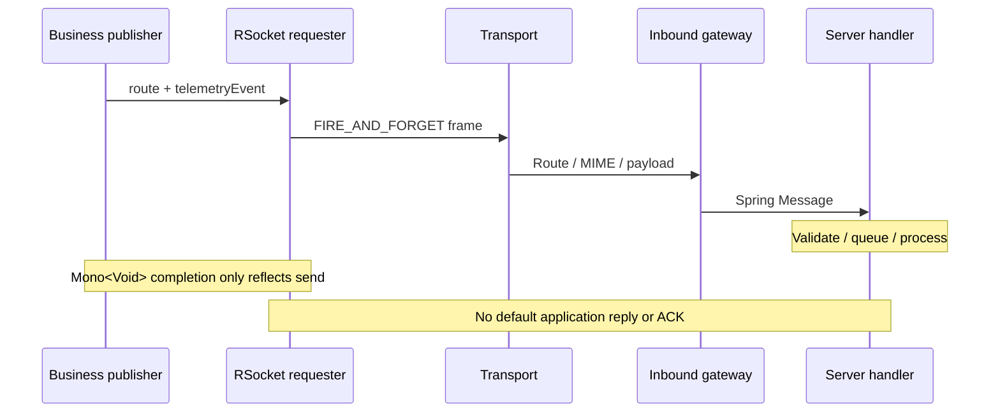
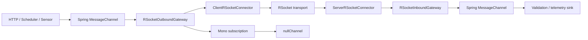
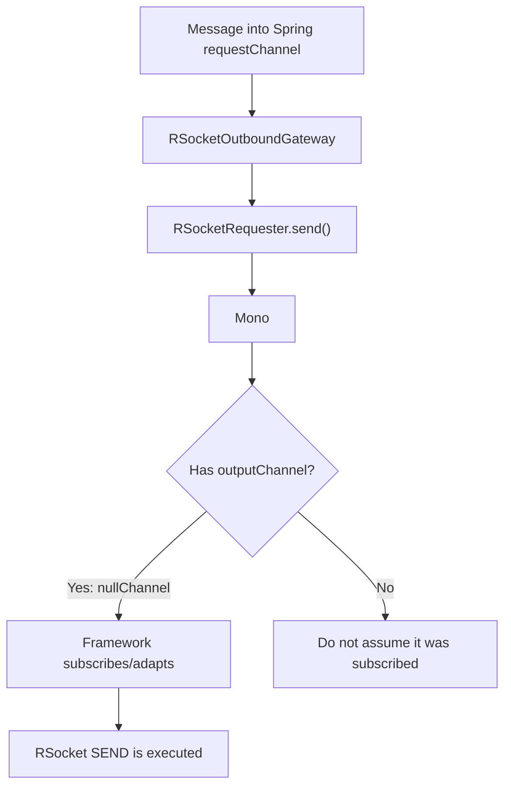
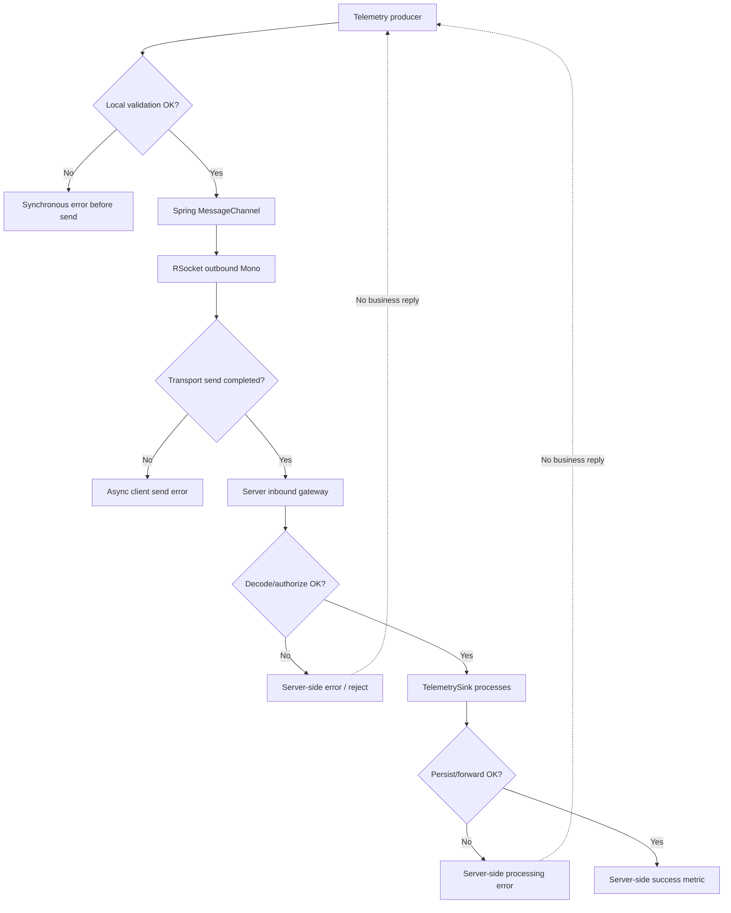
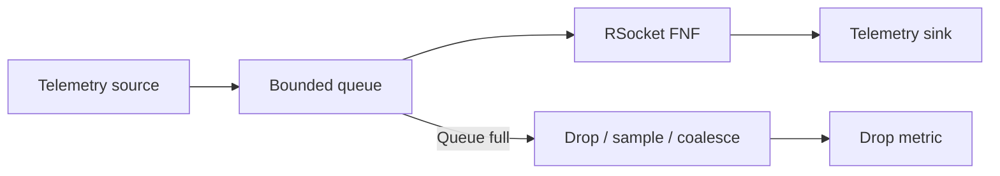
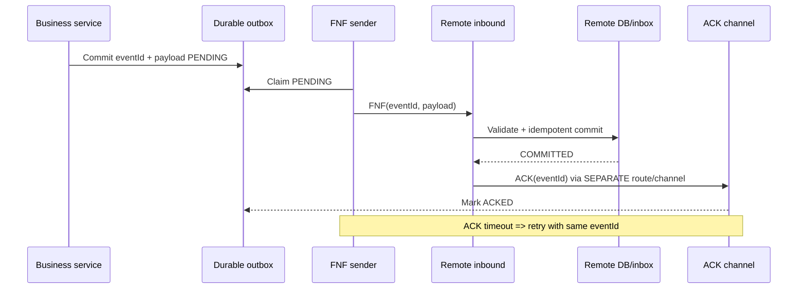
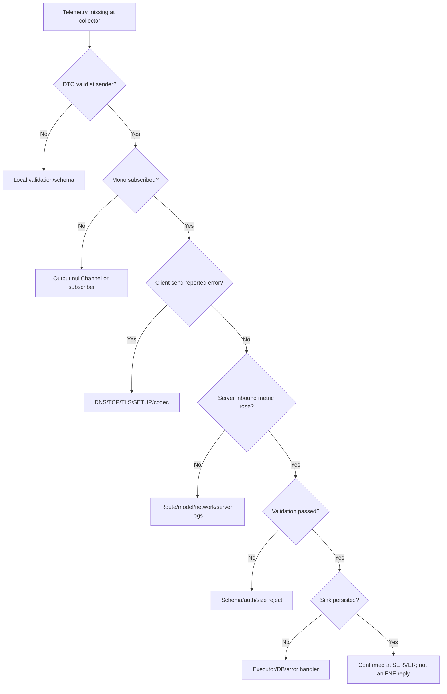

# Fire-and-forget over RSocket in Spring Integration

## 1. Context: sending signals without a business response

A fleet management system receives thousands of sensor records per second. Each device sends relative coordinates, battery status, and temperature readings. The **telemetry-collector** service only needs to ingest, validate formatting, and forward data into an analytics pipeline; the client does not need to wait for a response value for every measurement.

A very concise RSocket call:

```java
Mono<Void> sendAttempt = requester
        .route("telemetry.ingest.v1")
        .data(telemetryEvent)
        .send();
```

This is the **fire-and-forget** interaction model: the client sends **one request** and **expects no application response payload** from the server. However, the word "forget" does **not** mean the message is guaranteed to be processed, persisted to a database, or recoverable after network loss.

**Core message of this lesson:** `Mono<Void>` completing means the send operation completed within the RSocket client's scope; it **does not prove** the receiver ran its handler, committed to a DB, or durably stored the data. If you need that certainty, the application must design a **separate ACK or use request-response**, along with appropriate storage/retry mechanisms.

The **"Fire-and-forget over RSocket"** lesson belongs to the **RSocket Adapter** chapter, module **SPRING_INTEGRATION_ADAPTERS**. The module explains how to connect external systems using inbound/outbound adapters, gateways, pollers, and `MessageChannel`; practicing across files, SFTP, HTTP, JMS, AMQP, Kafka, and databases; and designing message contracts, error handling, and connection lifecycles. This lesson focuses on **RSocket fireAndForget**, Java DSL in Spring Integration, reactive semantics, reliability limits, error handling, security, and testing.

### Learning objectives

After this lesson, you can:

1. Distinguish `fireAndForget`, `requestResponse`, `requestStream`, and `requestChannel`.
2. Explain why `RSocketRequester.send()` returns `Mono<Void>` yet provides no business ACK.
3. Configure `ClientRSocketConnector`, `ServerRSocketConnector`, `RSocketOutboundGateway`, and `RSocketInboundGateway`.
4. Use `RSockets.outboundGateway(...)` with `RSocketInteractionModel.fireAndForget` and **output channel `nullChannel`**.
5. Configure a server inbound gateway allowing only `fireAndForget`, decoding JSON into a DTO, and handling without a reply.
6. Define route, MIME, schema/version, metadata, payload size, and message ID.
7. Analyze pre-send and post-send errors, timeouts, cancellation, retries, duplicates, and data loss.
8. Choose between best-effort telemetry, outbox/inbox with ACKs, request-response, and durable message brokers.
9. Test with a real RSocket transport, verifying subscription, server receipt, and no reply emitted.
10. Set resource limits, observe metrics, and manage connections/shutdown.

## 2. How does RSocket fire-and-forget work?

RSocket is a message-oriented protocol built on reactive streams. In **`fire-and-forget`** (`FIRE_AND_FORGET` request frame on the wire), the caller sends a payload with metadata for server routing, without requesting a data response from the server as in request-response.



### 2.1. Comparing the four interaction models

| Model | Client request | Server reply | Best suited for |
| --- | --- | --- | --- |
| **`fireAndForget`** | One payload | No application response payload | Best-effort telemetry, events not needing per-message reconciliation |
| **`requestResponse`** | One payload | One response or error | Status lookup, commands requiring confirmation |
| **`requestStream`** | One payload | Multiple responses `Flux<T>` | Result feeds, progress tracking |
| **`requestChannel`** | Request stream `Publisher<T>` | Response stream `Flux<R>` | Bidirectional streams |

In Spring Integration, the corresponding enum values are `RSocketInteractionModel.fireAndForget`, `requestResponse`, `requestStream`, and `requestChannel`. Do **not** treat `fireAndForget` as `requestResponse` with an empty response body: the two interaction models differ in protocol and lifecycle semantics.

### 2.2. Distinguishing five milestones of a single event

```text
CREATED:   Business producer created telemetryEvent.
ACCEPTED:  Spring MessageChannel accepted/dispatched the message.
SENT:      RSocket client completed its send operation.
RECEIVED:  Server inbound gateway/handler observed the event.
COMMITTED: Server persisted business data successfully.
```

| Signal | Can conclude | Cannot conclude |
| --- | --- | --- |
| `MessageChannel.send()==true` | Channel accepted per its contract | Event was sent over the network |
| `RSocketRequester.send()` returns `Mono<Void>` | A publisher representing the send exists | Request ran before subscription |
| `Mono<Void>` completes | Send completed within the RSocket client scope | Server received, validated, or committed |
| Server logs `received` | Handler observed the event | DB committed or logs safely flushed |
| Server DB has record | Concrete DB processing evidence exists | Whether the sender knows the outcome |
| Post-commit ACK via separate channel | Met the defined ACK contract for that event ID | Every other event was processed |

**No ACK in fire-and-forget** means the caller cannot reliably distinguish an event lost on the wire, rejected for schema issues, or already written to the DB. Therefore, the **delivery contract** must be agreed upon before adopting this model.

## 3. Fire-and-forget architecture in Spring Integration



Each component has a clear role:

| Component | Role |
| --- | --- |
| `ClientRSocketConnector` | Manages the requester/connection to the peer, MIME, and strategies |
| `RSocketOutboundGateway` | Receives Spring messages, routes, and invokes RSocket per model |
| `RSocketRequester` | Lower-level API using `route(...).data(...).send()` |
| `ServerRSocketConnector` | Binds the server transport, accepts connections |
| `RSocketInboundGateway` | Maps routes, selects interaction models, decodes requests, and enters Spring flows |
| `MessageChannel` | In-JVM message processing boundary |
| `nullChannel` | Discards internal output needing no consumer, **still acts as output channel to trigger subscription** |
| Business handler | Validates/processes, decides whether to store, drop, queue, or send a separate ACK |

### 3.1. Why use an "outbound gateway" when there is no reply?

`RSocketOutboundGateway` extends a **reply-producing handler**; per Spring Integration documentation, **its internal reply is always a `Mono`**, even for `fireAndForget` where it is `Mono<Void>`. On a regular output channel, the framework subscribes/adapts; on a `FluxMessageChannel`, subscription depends on demand.

Key point: set `expectedResponseType(void.class)` to use the gateway like an outbound channel adapter, **yet you must still configure an output channel** (such as `nullChannel`) to **trigger subscription**. Omitting the output channel can prevent the flow from sending requests as expected.

### 3.2. Inbound gateway is not a file/FTP inbound adapter

File/FTP inbound adapters typically poll files and emit Spring messages. An RSocket inbound gateway is **triggered by the remote peer when an RSocket request arrives**. With `fireAndForget`, there is no reply correlation as in request-response: the inbound gateway performs a **plain send** to the target channel instead of awaiting a business reply to return over RSocket.

**Do not use `@Poller`/`Pollers.fixedDelay` to "pull" RSocket fire-and-forget requests from the server.** The remote requester pushes proactively; the server simply maps the route and handles messages as they arrive.

## 4. Choosing fire-and-forget based on reliability requirements

Some use cases **fit well**:

- A sensor sends temperature every second; missing one reading is acceptable because the next reading updates it.
- A UI emits "viewing item X" analytics that can be sampled or dropped under overload.
- Continuous snapshot device state where a resync source exists.
- Internal signals with an explicit "best-effort" policy that are not the sole source of truth.

Use cases that **should not rely on standalone fire-and-forget**:

- Debiting funds, creating payments, transferring money.
- Recording every unique transaction for financial reconciliation.
- Confirming that an order was executed.
- Deleting data or modifying access permissions that cannot be missed.
- Requiring every event to replay after a crash without loss.

| Requirement | Recommended design |
| --- | --- |
| Can tolerate some dropped messages, trend tracking | Fire-and-forget + bounded buffer + drop metrics |
| Need immediate business error feedback | `requestResponse` with a response contract |
| Need continuous stream of multiple results | `requestStream` |
| Bidirectional demand/cancel over element streams | `requestChannel` |
| Must survive crashes, replay, ACK/dedup | Outbox/inbox + separate ACK or durable broker |

**An architecture decision must address what happens when the server is offline for 30 seconds, the client is killed, the network partitions, queues fill up, or the peer committed without the client knowing.**

## 5. Defining the wire contract for telemetry

To interoperate across services, use a versioned route and JSON payload:

```text
Transport         : RSocket over TCP
Server address    : telemetry-collector:7000
Route             : telemetry.ingest.v1
Interaction model : fireAndForget
Data MIME         : application/json
Schema version    : 1
Reply             : NONE
Failure policy    : Best-effort, bounded retry on send failure; metered drops
```

```json
{
  "schemaVersion": 1,
  "eventId": "evt-device17-000042",
  "deviceId": "device-17",
  "metric": "temperature.celsius",
  "value": 26.5,
  "observedAt": "2026-11-23T03:00:00Z"
}
```

| Field | Purpose | Notes |
| --- | --- | --- |
| `schemaVersion` | Tells decoder/consumer the version | Reject unsupported versions |
| `eventId` | Tracing and optional dedup | Keep same ID on retries of the same logical event |
| `deviceId` | Identifies the source | Validate and check principal/tenant permissions |
| `metric` | Measurement type | Whitelist; never use arbitrary strings as metric labels |
| `value` | Measurement reading | Check bounds, NaN/Infinity, and units |
| `observedAt` | Event time for analytics | Do not treat timestamps across machines as a global sequence |

**Why still include `eventId` in best-effort mode?** When duplicates arise from application retries, the receiver can detect/trace them; during load testing, you can reconcile created–sent–received counts. However, `eventId` **does not make the transport reliable on its own**.

### 5.1. Illustrative Java record

```java
// TelemetryEvent.java - Java 17+
import java.time.Instant;

public record TelemetryEvent(
        int schemaVersion,
        String eventId,
        String deviceId,
        String metric,
        double value,
        Instant observedAt) {
}
```

### 5.2. Validation before sending and after receiving

```java
// TelemetryValidation.java
public final class TelemetryValidation {
    private TelemetryValidation() {
    }

    public static void validate(TelemetryEvent event) {
        if (event == null || event.schemaVersion() != 1 ||
                event.eventId() == null ||
                !event.eventId().matches("[A-Za-z0-9_-]{1,128}") ||
                event.deviceId() == null ||
                !event.deviceId().matches("[A-Za-z0-9_-]{1,64}") ||
                !"temperature.celsius".equals(event.metric()) ||
                !Double.isFinite(event.value()) ||
                event.value() < -100.0 || event.value() > 250.0 ||
                event.observedAt() == null) {
            throw new IllegalArgumentException(
                    "Invalid telemetry event");
        }
    }
}
```

Sender-side validation catches errors early, but **does not replace server-side validation** because data from peers outside the JVM is untrusted. Production must enforce byte-size limits, rate limits, `deviceId` ownership, and policies for overly stale or future-dated events.

### 5.3. Metadata and route

`route("telemetry.ingest.v1")` attaches routing metadata, **not an HTTP URL**. Spring `MessageHeaders` do not automatically travel verbatim on the wire; if the remote needs `eventId`/`deviceId`, put them in the payload or agreed metadata. Do not use a client-supplied route string or header to infer authorization for any arbitrary device.

## 6. Dependencies and configuring both applications

### 6.1. Maven dependencies

```xml
<dependencies>
    <dependency>
        <groupId>org.springframework.boot</groupId>
        <artifactId>spring-boot-starter-integration</artifactId>
    </dependency>
    <dependency>
        <groupId>org.springframework.integration</groupId>
        <artifactId>spring-integration-rsocket</artifactId>
    </dependency>
    <dependency>
        <groupId>com.fasterxml.jackson.core</groupId>
        <artifactId>jackson-databind</artifactId>
    </dependency>
    <!-- Supports Java Time Instant in JSON DTOs. -->
    <dependency>
        <groupId>com.fasterxml.jackson.datatype</groupId>
        <artifactId>jackson-datatype-jsr310</artifactId>
    </dependency>
    <dependency>
        <groupId>io.projectreactor</groupId>
        <artifactId>reactor-test</artifactId>
        <scope>test</scope>
    </dependency>
</dependencies>
```

Keep Spring Boot/Spring Integration/Spring Framework/Reactor aligned under a compatible BOM. Since `TelemetryEvent` contains `Instant`, ensure Jackson has `JavaTimeModule` registered with `ObjectMapper`; Spring Boot usually auto-registers classpath modules, whereas custom mappers need explicit setup. If the app also enables `spring-boot-starter-rsocket` and Boot's RSocket server autoconfiguration, decide **who owns the TCP listener** so two servers never bind the same port.

### 6.2. application.yml

```yaml
app:
  rsocket:
    bind-host: ${RSOCKET_BIND_HOST:127.0.0.1}
    host: ${RSOCKET_HOST:127.0.0.1}
    port: ${RSOCKET_PORT:7000}
    route: telemetry.ingest.v1
    max-event-bytes: 16384
```

These are illustrative properties for both server and client locally; production typically splits them into separate processes/pods. Across pods, the sender's `127.0.0.1` does **not** reach the receiver; use Kubernetes Service DNS or a routable address. The server may need to bind `0.0.0.0` alongside NetworkPolicy, TLS, and authorization.

### 6.3. Being connected does not mean the endpoint is ready

`ClientRSocketConnector` establishes a connection/requester to the RSocket server. A successful TCP/SETUP connection **does not guarantee** the `telemetry.ingest.v1` route is mapped, the JSON decoder works, or the telemetry sink is ready. Because fire-and-forget has no reply, if reliable readiness is needed, expose a **separate non-mutating `requestResponse` health route** rather than sending a test telemetry message and treating `send()` completion as server readiness.

## 7. Client: sending directly with `RSocketRequester.send()`

This lower-level API illustrates fire-and-forget most clearly:

```java
import java.time.Duration;
import org.springframework.messaging.rsocket.RSocketRequester;
import org.springframework.util.MimeTypeUtils;
import reactor.core.publisher.Mono;

public final class DirectTelemetryClient {
    private final RSocketRequester requester;

    public DirectTelemetryClient(String host, int port) {
        this.requester = RSocketRequester.builder()
                .dataMimeType(MimeTypeUtils.APPLICATION_JSON)
                .tcp(host, port);
    }

    public Mono<Void> send(TelemetryEvent event) {
        TelemetryValidation.validate(event);
        return requester.route("telemetry.ingest.v1")
                .data(event)
                .send()
                .timeout(Duration.ofSeconds(3));
    }
}
```

`send()` is the **fire-and-forget** operation, distinct from `retrieveMono(...)` in request-response. The resulting `Mono<Void>` only reports client-side completion or error.

### 7.1. A cold publisher must be subscribed

```java
Mono<Void> pending = client.send(event);
// Not subscribed yet: do not treat as sent successfully.

Mono<Void> observed = pending
        .doOnSuccess(ignored ->
                System.out.println("Client send operation completed"))
        .doOnError(ex ->
                System.err.println(ex.getClass().getSimpleName()));

// Return observed to a reactive caller, or subscribe from
// an orchestration layer with lifecycle/error management.
```

An unsubscribed `Mono` **does not execute** any network send. Conversely, calling `subscribe()` indiscriminately everywhere creates truly "forgotten" tasks: no `Disposable` tracked, errors unhandled, shutdown ignored, and attempt rates uncapped.

### 7.2. Using StepVerifier in tests

```java
import reactor.test.StepVerifier;

StepVerifier.create(client.send(event))
        .verifyComplete();
```

**This assertion only verifies the client publisher completed.** It does not prove the receiver recorded anything. If a test must verify server receipt, add an independent observation mechanism (such as a test fixture `BlockingQueue`) and await processed events rather than treating completion as an ACK.

### 7.3. Do not create a requester per message in production

One RSocket connection can carry many interactions. Creating a new requester/TCP connection per reading causes handshake overhead, connection churn, and shutdown issues. Use a `ClientRSocketConnector` or requester managed per application lifecycle, and enforce quotas/concurrency limits so one client cannot spawn unbounded in-flight requests.

## 8. Client: `ClientRSocketConnector` and Java DSL outbound

Spring Integration provides `RSockets.outboundGateway(...)` and the enum `RSocketInteractionModel.fireAndForget`.

### 8.1. Connector managed by Spring bean lifecycle

```java
import org.springframework.beans.factory.annotation.Value;
import org.springframework.context.annotation.Bean;
import org.springframework.context.annotation.Configuration;
import org.springframework.integration.rsocket.ClientRSocketConnector;
import org.springframework.util.MimeTypeUtils;

@Configuration
public class TelemetryRSocketClientConfiguration {

    @Bean
    public ClientRSocketConnector telemetryClientConnector(
            @Value("${app.rsocket.host}") String host,
            @Value("${app.rsocket.port}") int port) {
        ClientRSocketConnector connector =
                new ClientRSocketConnector(host, port);
        connector.setDataMimeType(MimeTypeUtils.APPLICATION_JSON);
        return connector;
    }
}
```

To serialize `TelemetryEvent` into JSON, the connector must have `RSocketStrategies` with a BOM-compatible Jackson encoder and MIME type. Some Spring Boot setups provide JSON codecs automatically, but if using custom strategies with only text encoders, you must add Jackson; **do not assume merely adding the dependency makes both sides schema-compatible**.

### 8.2. Outbound IntegrationFlow with `nullChannel` output

```java
import org.springframework.context.annotation.Bean;
import org.springframework.context.annotation.Configuration;
import org.springframework.integration.dsl.IntegrationFlow;
import org.springframework.integration.rsocket.ClientRSocketConnector;
import org.springframework.integration.rsocket.RSocketInteractionModel;
import org.springframework.integration.rsocket.dsl.RSockets;

@Configuration
public class TelemetryOutboundFlow {

    @Bean
    public IntegrationFlow telemetryFireAndForgetFlow(
            ClientRSocketConnector telemetryClientConnector) {

        return IntegrationFlow
                .from("telemetryToSend")
                .handle(RSockets.outboundGateway("telemetry.ingest.v1")
                        .interactionModel(
                                RSocketInteractionModel.fireAndForget)
                        .expectedResponseType(void.class)
                        .clientRSocketConnector(telemetryClientConnector))
                // Output channel is required so Mono<Void>
                // is subscribed/adapted per gateway semantics.
                .channel("nullChannel")
                .get();
    }
}
```

**Key points of this code:**

1. `.interactionModel(fireAndForget)` chooses **one request with no reply**.
2. `.expectedResponseType(void.class)` indicates no response value is expected.
3. `.channel("nullChannel")` acts as a **valid `outputChannel`** for the gateway, causing `Mono<Void>` to be subscribed per the framework contract.
4. The `telemetryClientConnector` bean manages the requester/connection; business services do not call `RSocketRequester` directly.
5. Downstream `nullChannel` **is not an ACK receiver**: it discards/consumes the internal output and does not prove server processing.

**Do not omit the output channel assuming the gateway will "fire" as soon as `MessageChannel.send()` returns true.** This is the distinction between a **handler returning a reactive publisher** and a synchronous function that has already finished I/O.

### 8.3. Service sending a Spring Message

```java
import org.springframework.beans.factory.annotation.Qualifier;
import org.springframework.messaging.MessageChannel;
import org.springframework.messaging.support.MessageBuilder;
import org.springframework.stereotype.Service;

@Service
public class TelemetryDispatcher {

    private final MessageChannel telemetryToSend;

    public TelemetryDispatcher(
            @Qualifier("telemetryToSend")
            MessageChannel telemetryToSend) {
        this.telemetryToSend = telemetryToSend;
    }

    public void publish(TelemetryEvent event) {
        TelemetryValidation.validate(event);
        boolean accepted = telemetryToSend.send(
                MessageBuilder.withPayload(event)
                        .setHeader("eventId", event.eventId())
                        .build());

        if (!accepted) {
            throw new IllegalStateException(
                    "Spring MessageChannel did not accept telemetry");
        }
        // DO NOT: mark event as COMMITTED on remote.
    }
}
```

The `eventId` header on the Spring Message serves in-JVM tracing/routing; the DTO also includes `eventId` because **the server does not automatically see every Spring header** on the wire.

### 8.4. `RSocketOutboundGateway` Java bean instead of DSL

```java
import org.springframework.beans.factory.annotation.Bean;
import org.springframework.beans.factory.annotation.Qualifier;
import org.springframework.context.annotation.Configuration;
import org.springframework.integration.annotation.ServiceActivator;
import org.springframework.integration.rsocket.ClientRSocketConnector;
import org.springframework.integration.rsocket.RSocketInteractionModel;
import org.springframework.integration.rsocket.outbound.RSocketOutboundGateway;

@Configuration
public class TelemetryOutboundGatewayBeanConfiguration {

    @Bean
    @ServiceActivator(
            inputChannel = "rawTelemetryRequests",
            outputChannel = "nullChannel")
    public RSocketOutboundGateway sendTelemetry(
            @Qualifier("telemetryClientConnector")
            ClientRSocketConnector connector) {

        RSocketOutboundGateway gateway =
                new RSocketOutboundGateway("telemetry.ingest.v1");
        gateway.setInteractionModel(
                RSocketInteractionModel.fireAndForget);
        gateway.setExpectedResponseType(void.class);
        gateway.setClientRSocketConnector(connector);
        return gateway;
    }
}
```

This is an **alternative** to `telemetryFireAndForgetFlow`, not a second bean wired to the same input channel in the same running example unless intended. Both configuration styles must keep `outputChannel` so `Mono<Void>` is actively subscribed.

## 9. Server: creating `ServerRSocketConnector` to listen

The collector side needs a listener:

```java
import org.springframework.beans.factory.annotation.Value;
import org.springframework.context.annotation.Bean;
import org.springframework.context.annotation.Configuration;
import org.springframework.integration.rsocket.ServerRSocketConnector;
import org.springframework.util.MimeTypeUtils;

@Configuration
public class TelemetryRSocketServerConfiguration {

    @Bean
    public ServerRSocketConnector telemetryServerConnector(
            @Value("${app.rsocket.bind-host}") String host,
            @Value("${app.rsocket.port}") int port) {

        ServerRSocketConnector connector =
                new ServerRSocketConnector(host, port);
        connector.setDataMimeType(MimeTypeUtils.APPLICATION_JSON);
        return connector;
    }
}
```

`ServerRSocketConnector` binds the transport, while `RSocketInboundGateway` registers routes. `RSocketStrategies`/data MIME must align on both sides. If using a separate Spring Boot server on the same port, do not bind an additional `ServerRSocketConnector` on that port.

### 9.1. One server can serve multiple routes

One connector can manage multiple inbound endpoints when routes/models differ. For instance:

```text
telemetry.ingest.v1  : fireAndForget
telemetry.health.v1  : requestResponse
telemetry.watch.v1   : requestStream
```

**Do not tack `requestResponse` onto `telemetry.ingest.v1` just to get an ACK** without updating the client/contract. If post-commit ACKs are needed, design a dedicated endpoint with the proper model and response type.

## 10. Server inbound gateway receiving fire-and-forget

### 10.1. Java DSL receiving a DTO

```java
import org.springframework.context.annotation.Bean;
import org.springframework.context.annotation.Configuration;
import org.springframework.core.ResolvableType;
import org.springframework.integration.dsl.IntegrationFlow;
import org.springframework.integration.rsocket.RSocketInteractionModel;
import org.springframework.integration.rsocket.dsl.RSockets;

@Configuration
public class TelemetryInboundFlow {

    @Bean
    public IntegrationFlow telemetryInbound(
            TelemetrySink telemetrySink) {
        return IntegrationFlow
                .from(RSockets.inboundGateway("telemetry.ingest.v1")
                        .interactionModels(
                                RSocketInteractionModel.fireAndForget)
                        .requestElementType(
                                ResolvableType.forClass(
                                        TelemetryEvent.class)))
                .handle(telemetrySink, "accept")
                .get();
    }
}
```

Spring Integration documentation notes that **fire-and-forget inbound receives a directly decoded payload**, unlike interactions with replies where the payload is typically a `Flux`. Therefore, a handler accepting `TelemetryEvent` above is appropriate. Verify your version and codecs with a real integration test: if a client sends an incompatible MIME type, the gateway might decode only to `byte[]` or error.

### 10.2. Telemetry sink with no reply

```java
import org.springframework.stereotype.Service;
import java.util.concurrent.atomic.LongAdder;

@Service
public class TelemetrySink {

    private final LongAdder received = new LongAdder();

    public void accept(TelemetryEvent event) {
        TelemetryValidation.validate(event);
        received.increment();
        // Demo: no reply returned.
        // Production: persist, forward in pipeline, or drop per policy.
    }

    public long receivedCount() {
        return received.sum();
    }
}
```

`receivedCount()` is only an in-memory counter for demos/tests. It is **not** durable storage and resets on restart. If the counter increments before async processing or DB commit, name that metric **received/validated**, not "successfully persisted".

### 10.3. `RSocketInboundGateway` Java bean alternative to DSL

```java
import org.springframework.context.annotation.Bean;
import org.springframework.context.annotation.Configuration;
import org.springframework.core.ResolvableType;
import org.springframework.integration.rsocket.RSocketInteractionModel;
import org.springframework.integration.rsocket.inbound.RSocketInboundGateway;

@Configuration
public class TelemetryInboundGatewayBeanConfiguration {

    @Bean
    public RSocketInboundGateway telemetryGateway() {
        RSocketInboundGateway gateway =
                new RSocketInboundGateway("telemetry.ingest.v1");
        gateway.setInteractionModels(
                RSocketInteractionModel.fireAndForget);
        gateway.setRequestElementType(
                ResolvableType.forClass(TelemetryEvent.class));
        gateway.setRequestChannelName("telemetryInboundRequests");
        return gateway;
    }
}
```

Then a `@ServiceActivator(inputChannel="telemetryInboundRequests")` receives `TelemetryEvent`. This is an **alternative** to the Java DSL in section 10.1; do not register two gateways on the same route/model unless intentionally resolving conflicts.

### 10.4. Inbound does not wait for a reply from the Spring flow

In `fireAndForget`, the RSocket inbound gateway does not receive a response correlation header as in request-response, and **does not require the business handler to return `Mono<Reply>`**. It forwards the message to the Spring channel using the gateway's send semantics. Catching or throwing an exception in the handler after the client sends **does not generate a business reply** on this interaction.

If the caller must know whether the handler persisted to the DB, change the **communication contract**; do not just add `return "OK"` to a service method invoked via fire-and-forget.

## 11. Configuring data types, codecs, and route metadata

A fire-and-forget route has two key parts:

```text
RSocket request metadata:
  route = telemetry.ingest.v1
  (other metadata if permitted by protocol and security)

RSocket data:
  JSON TelemetryEvent (schemaVersion=1)
```

| Part | Client configuration | Server configuration |
| --- | --- | --- |
| Route | `route("telemetry.ingest.v1")` or DSL | `RSockets.inboundGateway("telemetry.ingest.v1")` |
| Interaction model | `send()`/`fireAndForget` | Allow only `fireAndForget` |
| Data MIME | `application/json` | `application/json` |
| Java payload | `TelemetryEvent` record | `requestElementType(TelemetryEvent.class)` |
| Encoder/decoder | Strategy-compatible Jackson | Matching decoder/validation |
| Response | `Mono<Void>`, no reply payload | Handler emits no response |

### 11.1. JSON codec with RSocketStrategies

```java
import com.fasterxml.jackson.databind.ObjectMapper;
import org.springframework.context.annotation.Bean;
import org.springframework.context.annotation.Configuration;
import org.springframework.http.codec.json.Jackson2JsonDecoder;
import org.springframework.http.codec.json.Jackson2JsonEncoder;
import org.springframework.messaging.rsocket.RSocketStrategies;

@Configuration
public class TelemetryRSocketCodecConfiguration {

    @Bean
    public RSocketStrategies telemetryRSocketStrategies(
            ObjectMapper mapper) {
        return RSocketStrategies.builder()
                .decoder(new Jackson2JsonDecoder(mapper))
                .encoder(new Jackson2JsonEncoder(mapper))
                .build();
    }
}
```

When using these strategies, inject them into the **existing connector bean** via `connector.setRSocketStrategies(strategies)` on **both client and server** (or use appropriate autoconfiguration). This is just a codec configuration example; production must retain any required routing/metadata registrations of your stack. Do not spin up a second server listener just to swap strategies.

### 11.2. When to use text instead of JSON?

A simple signal like `"device-17:online"` can use `text/plain` and `String`. In that case:

- Client/connector sets `MimeTypeUtils.TEXT_PLAIN`.
- Server inbound sets `requestElementType(String.class)`.
- Handler receives `String` and parses/validates it.
- Do not mix text payloads with a server expecting `TelemetryEvent` JSON.

Never send `TelemetryEvent.toString()` and call it standard JSON; a Java record's `toString()` is not a versioned wire contract.

### 11.3. Metadata carries traces, not authorization

The outbound gateway supports a metadata expression returning `Map<Object, MimeType>`. If sending a trace ID or schema hint, the server must have a mapper/decoder for that metadata. **Do not assume every Spring header propagates automatically**; and a client-asserted tenant ID header never proves permission to emit events for that tenant.

## 12. Why is `nullChannel` a mandatory detail?

In Spring Integration, `RSocketOutboundGateway` is a reply-producing handler even when the interaction model has no business reply. When sending fire-and-forget, internal processing produces **`Mono<Void>`** and requires subscription to be triggered.



### 12.1. Standard Java DSL pattern

```java
return IntegrationFlow.from("telemetryToSend")
        .handle(RSockets.outboundGateway("telemetry.ingest.v1")
                .interactionModel(
                        RSocketInteractionModel.fireAndForget)
                .expectedResponseType(void.class)
                .clientRSocketConnector(connector))
        .channel("nullChannel")
        .get();
```

With `FluxMessageChannel`, replies are processed by demand; if there is no subscriber, verify whether the interaction actually runs. With a regular output channel, the framework subscribes/adapts per the semantics documented in Spring Integration.

### 12.2. `nullChannel` does not mean "succeeded"

`nullChannel` is an internal sink that absorbs output needing no further processing. It **does not persist** messages, emit ACKs, or keep durable offsets. Do not use "messages sent to `nullChannel`" as a metric for messages committed by the server.

### 12.3. Anti-pattern

```java
// ANTI-PATTERN: missing output channel for Mono<Void>.
IntegrationFlow.from("telemetryToSend")
        .handle(RSockets.outboundGateway("telemetry.ingest.v1")
                .interactionModel(
                        RSocketInteractionModel.fireAndForget)
                .clientRSocketConnector(connector))
        .get();
```

**Do not assume this completes the send** just because `handle(...)` is configured. For fire-and-forget, declare `.channel("nullChannel")` or an appropriate output channel per the gateway contract.

### 12.4. When an output channel is used for observation

If using another regular channel to observe completion, distinguish:

- **`send attempt started`:** subscription began.
- **`send completed`:** client operation completed.
- **`send failed`:** client operation errored.
- **`server received/processed`:** must be measured on the server or via a separate ACK.

Never emit a fake `Reply("OK")` into Spring output and mistake it for an RSocket response from the remote peer.

## 13. At which boundaries do fire-and-forget errors occur?

Because there is no business reply, classify errors by **location** instead of catching one generic exception.



| Boundary | Error example | Does caller know? | Handling |
| --- | --- | --- | --- |
| **DTO creation/validation** | Empty `deviceId`, NaN value | Can know synchronously | Reject and fix data source |
| **Spring channel dispatch** | Bounded executor rejects | Channel/boundary dependent; may sync-throw | Rejection metric, shed load, or durable fallback |
| **RSocket client** | Connection refused, encode failure | Can emit `Mono.error` | Observe error signal, backoff |
| **RSocket transport** | Send finishes right before peer dies | Outcome uncertain | Accept loss or use separate ACK/replay |
| **Server route/codec** | Wrong route, unparseable JSON | No business reply in FNF | Server logs/metrics, fix protocol |
| **Server authorization** | Unauthorized for another device | No business reply | Reject, audit, protect resources |
| **Server business handler** | DB failure or executor rejection | Caller typically unaware | Error handler/server metrics, durable storage |
| **Server shutdown/crash** | Event sitting in RAM queue | Caller cannot know outcome | Snapshots/replay/broker if critical |

### 13.1. `try/catch` around `channel.send` is not enough

```java
// ANTI-PATTERN if treated as confirming server processing.
try {
    telemetryToSend.send(
            MessageBuilder.withPayload(event).build());
    markEventProcessedRemotely(event.eventId()); // WRONG
} catch (Exception ex) {
    scheduleRetryWithoutIdempotency();           // MAY DUPLICATE
}
```

`RSocketOutboundGateway` emits `Mono<Void>` with asynchronous execution. Network/encoding errors can surface **after** `MessageChannel.send()` returns. Observe errors at the proper reactive/error boundary and rely on **durable state** if data must not be lost.

### 13.2. Server exceptions do not turn into replies

```java
public void accept(TelemetryEvent event) {
    TelemetryValidation.validate(event);
    if (isUnknownDevice(event.deviceId())) {
        throw new IllegalArgumentException(
                "Unregistered device");
    }
    // No response payload for fire-and-forget.
}
```

This example assumes `isUnknownDevice(...)` is a real service method. When it throws, the server can observe it via error handlers/logs/metrics depending on channel topology. Do **not** expect the client to receive a business response containing `"Unregistered device"` from a fire-and-forget interaction.

If the client must know why a message was rejected, choose `requestResponse` and define an error response contract or a separate ACK/notification channel.

### 13.3. Error channel is for handling errors, not durable storage

Spring Integration provides error channels and handlers per endpoint/channel. However:

- Caller exceptions before sending differ from reactive publisher errors after subscription.
- Errors inside an asynchronous server-side handler may route to a separate error boundary.
- An `ErrorMessage`/`errorChannel` does not provide durable replay/offsets.
- Once fire-and-forget is sent, there is no reply to carry business outcomes back on that request.

In integration tests, prove **which errors enter the error channel**, which stay in the client `Mono`, and which are visible only on the server. Do not configure `errorChannel` and claim all failures will auto-retry.

## 14. Backpressure: fire-and-forget **has no per-ACK request(n)**

RSocket supports `REQUEST_N` for streaming models, whereas **fire-and-forget is a one-way request** with no response stream for downstream `request(n)` and no per-message business ACK. That does **not** mean every layer buffers infinitely or the network never slows down: transport, I/O, and JVM resources still have limits.

### 14.1. When the producer outpaces the collector

Suppose:

```text
Source emits:       5,000 telemetry events/sec
Collector handles:  2,000 telemetry events/sec

Deficit:            3,000 events/sec
After 60 seconds: 180,000 events backlogged (unless dropped/blocked/scaled)
```

Queues cannot grow unboundedly. For best-effort models, define an **explicit overload policy**:

1. **Drop latest:** discard new readings when the queue is full; emit metrics.
2. **Drop oldest:** retain the latest state, discarding older readings if the domain permits.
3. **Coalesce:** merge updates with the same `deviceId + metric` to retain only the latest snapshot.
4. **Sample:** ingest only a fraction of readings under load.
5. **Rate limit:** throttle the producer by quota.
6. **Scale out:** add server capacity when resources allow.
7. **Durable buffer:** if loss is unacceptable, choose an appropriate broker/outbox.

Which policy fits depends on reading semantics: a "current temperature" snapshot can coalesce, whereas a **one-time threshold alarm** probably cannot be dropped.

### 14.2. Bounded executor on the receiver

If telemetry handling involves blocking I/O, offload work from the event loop using a bounded executor:

```java
import java.util.concurrent.ThreadPoolExecutor;
import org.springframework.context.annotation.Bean;
import org.springframework.context.annotation.Configuration;
import org.springframework.scheduling.concurrent.ThreadPoolTaskExecutor;

@Configuration
public class TelemetryWorkerPoolConfiguration {

    @Bean
    public ThreadPoolTaskExecutor telemetryWorkerPool() {
        ThreadPoolTaskExecutor pool = new ThreadPoolTaskExecutor();
        pool.setThreadNamePrefix("telemetry-worker-");
        pool.setCorePoolSize(4);
        pool.setMaxPoolSize(8);
        pool.setQueueCapacity(1_000);
        pool.setRejectedExecutionHandler(
                new ThreadPoolExecutor.AbortPolicy());
        return pool;
    }
}
```

**This illustrates a resource budget** and is not yet wired into an IntegrationFlow. When using an `ExecutorChannel`/async executor, bind the channel to this pool bean, monitor queue depth, and catch rejected tasks at the right error boundary. Notably, when async enqueuing succeeds before a worker finishes, the caller finishing its send **is not** proof of completed processing.

### 14.3. Wiring a bounded `ExecutorChannel`

```java
import org.springframework.context.annotation.Bean;
import org.springframework.context.annotation.Configuration;
import org.springframework.integration.channel.ExecutorChannel;
import org.springframework.messaging.MessageChannel;
import org.springframework.scheduling.concurrent.ThreadPoolTaskExecutor;

@Configuration
public class TelemetryChannels {

    @Bean("telemetryWorkChannel")
    public MessageChannel telemetryWorkChannel(
            ThreadPoolTaskExecutor telemetryWorkerPool) {
        return new ExecutorChannel(telemetryWorkerPool);
    }
}
```

In the inbound flow:

```java
IntegrationFlow.from(
        RSockets.inboundGateway("telemetry.ingest.v1")
                .interactionModels(
                        RSocketInteractionModel.fireAndForget)
                .requestElementType(
                        ResolvableType.forClass(TelemetryEvent.class)))
        .channel("telemetryWorkChannel")
        .handle(telemetrySink, "accept")
        .get();
```

When the queue fills, the executor may reject; add metrics/alerts and do **not** expect the FNF client to reliably receive a business error to retry. If zero telemetry loss is required, write to durable storage **before the async handoff** or change the architecture.

### 14.4. Do not use unbounded `onBackpressureBuffer()`

```java
// ANTI-PATTERN - uncontrolled buffer when source is fast:
Flux<TelemetryEvent> flow = source
        .onBackpressureBuffer();
```

If the source outpaces the sink for long periods, memory can grow until OOM. Use bounded buffers, overflow strategies, and metrics—or a durable queue for critical data. Wrapping client emits in a Reactor `Flux` also **does not turn individual fire-and-forget requests into `requestChannel`**.

## 15. Retries in fire-and-forget: duplicates and uncertain outcomes

### 15.1. Four scenarios

| Scenario | Can retry? | Risk |
| --- | --- | --- |
| Payload fails local validation | Fix data first | Retrying identical payload will not help |
| Connection not open, send clearly failed | Can retry with backoff | Can cause bursts when peer returns |
| Client send completes yet no server metric appears | No ACK to be certain | Retry may duplicate or just add load |
| Server saved to DB then restarted | Sender cannot tell from FNF | Resending creates duplicates unless server is idempotent |

**Retrying an event with an "unknown outcome"** accepts the possibility of duplicates. For best-effort telemetry, you can either **tolerate loss without retrying** to protect latency/throughput, or apply bounded retries with deduplication by `eventId`.

### 15.2. Why never retry infinitely?

```text
while (true) {
    requester.route("telemetry.ingest.v1")
             .data(event)
             .send()
             .subscribe();     // ANTI-PATTERN: runaway requests
}
```

This neither bounds subscriptions nor observes completion/errors, lacks backoff, and can trigger a flood of connections/tasks when the peer is degraded. Never use `retryWhen(Retry.max(Long.MAX_VALUE))` for all errors, especially non-recoverable schema/auth errors.

### 15.3. Bounded retries in direct `RSocketRequester`

```java
import java.time.Duration;
import reactor.core.publisher.Mono;
import reactor.util.retry.Retry;

public Mono<Void> sendWithBoundedRetry(
        RSocketRequester requester, TelemetryEvent event) {

    TelemetryValidation.validate(event);
    return requester.route("telemetry.ingest.v1")
            .data(event)
            .send()
            .retryWhen(Retry.backoff(2, Duration.ofMillis(200))
                    .maxBackoff(Duration.ofSeconds(2)))
            .timeout(Duration.ofSeconds(6));
}
```

**This is a best-effort telemetry demo**, not a recipe guaranteeing at-most-once or exactly-once. When `send()` already wrote bytes to the network before completion/error became ambiguous, retries can produce **duplicates**. Production should classify retryable exceptions, add jitter/total budgets, and enforce deadlines and drop/reconciliation policies.

### 15.4. Retries must keep the same event ID

```text
Attempt 1:
  eventId=evt-device17-000042
  value=26.5

Attempt 2 (retry):
  eventId=evt-device17-000042
  value=26.5

Do not change to:
  eventId=evt-device17-000043
just because of a new network send attempt.
```

If each retry mints a new `eventId`, the receiver cannot distinguish a retry from a new logical telemetry event. When sending continuous state updates, ensure each distinct measurement has its own ID and observation timestamp; do not accidentally merge two distinct readings just because their values match.

## 16. Preventing message loss: add durability and ACKs outside FNF

Fire-and-forget **does not provide out of the box**:

- Post-commit ACKs.
- Outbox/inbox/offsets.
- Consumer groups and retention.
- Message replay after process crashes.
- Exactly-once side effects.

### 16.1. Best-effort model



This architecture is sound for continuous temperature readings, provided:

1. Product/business accepts dropping some readings.
2. Queue, payload size, rate, and retry limits exist.
3. Server exposes receiver lag and error charts.
4. You never report `received/persisted` from client completion alone.

### 16.2. Model requiring post-commit ACKs



**Design note:** the ACK in this diagram is **not a fire-and-forget reply**. It is a separate interaction (such as a server-to-client request-response/callback, a persistent messaging channel, or a dedicated status API). Using `RSocketRequester.send()` does not create `ACK(eventId)` for you.

### 16.3. Minimal outbox and inbox

| Field/key | Where | Why |
| --- | --- | --- |
| `eventId` | Sender and receiver | Idempotency/correlation |
| `payloadBytes` | Sender outbox | Replay exact content |
| `status` | Sender | `PENDING/ACKED/DEAD` |
| `nextAttemptAt` | Sender | Backoff |
| `attemptCount` | Sender | Retry budget |
| `lockedUntil` | Sender | Prevent uncontrolled duplicate worker claims |
| Unique `eventId` | Receiver inbox/DB | Deduplication across restarts |
| `processedAt` | Receiver | Audit/retention |

If an ACK is lost after the server committed, a retry with the same `eventId` must be an **idempotent no-op** or return the prior result. An in-RAM `ConcurrentHashMap` for dedup is insufficient because restarts wipe history.

### 16.4. When to choose request-response or a broker?

| Requirement | Recommendation |
| --- | --- |
| Latest reading, no status needed | Best-effort FNF |
| Send command and need immediate result | RSocket `requestResponse` |
| Send high-volume events needing batch confirmation | Design `requestChannel`/appropriate ACK protocol |
| Every event needs offsets/long-term replay | Durable broker like Kafka/JMS/AMQP or event store |
| Already using FNF but now zero loss is mandatory | Add durable source/ACK or change architecture; don't just raise timeouts |

**The goal is choosing the right model**, not forcing FNF into becoming a durable broker by adding a few retries or `Thread.sleep()`.

## 17. Ordering: sequential sending does not guarantee sequential commits

Suppose a device sends:

```text
seq=41 temperature=26.4
seq=42 temperature=26.5
seq=43 temperature=26.6
```

A single connection may deliver frames in order, yet the application can still:

- Process concurrently via an `ExecutorChannel` so `seq=43` commits before `42`.
- Retry `seq=42` after `seq=43` already arrived.
- Lose `seq=42` due to transport/overload.
- Restart the server and lose in-RAM queues.

For telemetry analytics, event timestamps/sequences detect gaps, pick the latest observation, or reorder within a bounded window. For business logic requiring strict state transitions, you need a **per-stream sequence guard**, durable inbox/outbox, and proper ACKs; FNF alone is not enough.

### 17.1. Timestamps do not replace sequences

Clocks across devices can drift. Two events arriving at the collector may carry timestamps differing from when they were created or committed. If ordering per `deviceId` matters, use a monotonic sequence issued by the authoritative source and define how sequences reset on device reboot.

### 17.2. When snapshots can coalesce

If each event only represents the **latest state**, the gateway can keep `lastByDevice` and overwrite unsent older readings. However, if an event is a **discrete alert** ("security door opened at 10:00"), coalescing can erase critical facts. Choose policies by semantics, not just traffic reduction.

## 18. Payload errors, metadata, and authorization

An RSocket route is routing metadata; it does not authenticate the caller. An inbound FNF server must enforce security controls:

| Risk | Mitigation |
| --- | --- |
| Unauthenticated client | Authentication at SETUP/security layer or protected transport |
| Spoofed `deviceId` | Match principal against allowed device list |
| Malicious JSON | Max bytes, `schemaVersion`, field whitelist, JSON depth |
| Client spamming FNF | Rate limits, quotas per identity/device |
| Unauthorized route invocation | Route-level authorization, not just name matching |
| Metadata carrying tokens | Encrypt transport, never log tokens |
| Metric labels exploding cardinality | Whitelist metric names to prevent cardinality explosion |
| Rogue peer | TLS/mTLS or verified trust infrastructure |
| Internal errors leaked to logs | Sanitize errors, restrict sensitive data |

RSocket TCP is **not automatically equivalent to HTTPS/TLS**. If end-to-end confidentiality/integrity is required, configure transport TLS or an approved network layer and verify peer identity.

### 18.1. Do not use FNF when errors need immediate feedback

If an external sender must immediately know `deviceId` is invalid to fix its config, FNF cannot return a business validation response. Provide a `devices.validate` or `telemetry.submit` route using `requestResponse`, or another status channel with meaningful ACKs. Server logs/error handlers only serve **internal observability**; they do not inform the caller of rejections.

## 19. Connection lifecycle and shutdown

### 19.1. Startup

```text
Spring ApplicationContext starts
  → create RSocketStrategies / connectors
  → bind ServerRSocketConnector
  → register fireAndForget inbound route
  → ClientRSocketConnector establishes connection
  → producer sends to MessageChannel
  → outbound gateway subscribes Mono<Void> via output channel
  → RSocket data is sent, server dispatches to sink
```

An RSocket connection can be reused across many requests. **Do not** create a new client connector per event, and **do not** mutate socket/buffer state from threads that do not own the connection.

### 19.2. Bounded shutdown

1. Stop accepting new telemetry from sources or throttle rates before stopping.
2. Set readiness false so load balancers drain new traffic.
3. Reconcile backlogs in bounded queues or durable sources.
4. Let accepted work finish **within a finite deadline**.
5. Stop Spring Integration endpoints/connectors per the context lifecycle.
6. Close requesters/connections with clear ownership.
7. On restart, **only replay** events backed by a durable source and matching policy.

If FNF `send()` completed before the server processed the message, shutting down either side can lose data. **Graceful shutdown does not create a business ACK.**

### 19.3. Reconnect is not replay

When a peer reconnects, the transport can resume accepting new requests per lifecycle/configuration. Events lost while offline are **not automatically replayed** unless persisted by the application. Never treat `ClientRSocketConnector` and `RSocketRequester` as a database outbox.

### 19.4. Health route needs a different model

With FNF, you cannot send a telemetry message to prove the full pipeline committed. A `requestResponse` route such as `telemetry.health.v1` can verify codecs/routing/DB readiness without side effects; restrict permissions, rates, and timeouts so probes do not overload the collector.

## 20. Observability for one-way sending

A system without per-message replies requires **both-sides observability** and bounded reconciliation.

| Metric | Where measured | Meaning |
| --- | --- | --- |
| `telemetry_created_total` | Source | Logical events created |
| `telemetry_channel_accepted_total` | Spring channel | Messages accepted in JVM |
| `rsocket_send_attempts_total` | Client gateway/requester | Send attempts |
| `rsocket_send_complete_total` | Client completion | Client send operations completed |
| `rsocket_send_errors_total` | Client error signal | Failed to send at client boundary |
| `telemetry_server_received_total` | Server inbound | Receiver observed message |
| `telemetry_validation_reject_total` | Server validation | Payload/auth errors |
| `telemetry_server_persisted_total` | After DB commit | Persisted successfully |
| `telemetry_buffer_dropped_total` | Bounded queue | Intentionally dropped events |
| `rsocket_connections_active` | Connector | Connection count |
| `telemetry_executor_queue_depth` | Executor | Internal backlog |
| `telemetry_event_lag_seconds` | Receiver analytics | Difference between event time and receive time |
| `telemetry_sequence_gaps_total` | Receiver | Sequence gaps detected |
| `outbox_pending` (if present) | Durable sender | Un-ACKed obligations |

**Never merge** `rsocket_send_complete_total` and `telemetry_server_persisted_total` into a single "delivered" metric. The two counters measure **different boundaries** and can diverge temporarily or permanently on drops/crashes.

### 20.1. Illustrative structured log

```text
eventId=evt-device17-000042
deviceId=device-17
route=telemetry.ingest.v1
model=fireAndForget
stage=SERVER_VALIDATED
schemaVersion=1
```

In production, avoid placing individual `eventId`s or high-cardinality `deviceId`s into every Prometheus label. Tracing can use sampled logs/spans; never log tokens, exact coordinates, or private payloads unnecessarily.

### 20.2. Reconciling with sequence numbers

If a device emits `seq=1..1000` and the collector receives 998 IDs, that is a clear signal some data is missing. Still, distinguish:

- Did the producer actually create all 1,000 events?
- Were any events filtered before sending?
- Did duplicates inflate counts without increasing unique IDs?
- Might a delayed batch arrive after the reconciliation timestamp?

A reconciliation job needs IDs/sequences, time windows, late-arrival policies, and a durable source of truth if replay is required.

## 21. Testing against a real RSocket server

Do not just mock `RSocketOutboundGateway` or `TelemetrySink` and assume transport works. Test **routing, MIME, serialization, subscription, and server receipt** through real RSocket connectors.

### 21.1. Fixture using a dynamic port

```java
import org.springframework.context.annotation.Bean;
import org.springframework.context.annotation.Configuration;
import org.springframework.integration.rsocket.ServerRSocketConnector;
import org.springframework.util.MimeTypeUtils;

@Configuration
public class TelemetryTestServerConfiguration {

    @Bean
    public ServerRSocketConnector testServerConnector() {
        ServerRSocketConnector server =
                new ServerRSocketConnector("127.0.0.1", 0);
        server.setDataMimeType(MimeTypeUtils.APPLICATION_JSON);
        return server;
    }
}
```

This is a **test configuration replacing a fixed server port**; do not declare two server connectors binding the same port simultaneously. Once the context starts, obtain the real port:

```java
Integer port = serverConnector.getBoundPort()
        .block(java.time.Duration.ofSeconds(5));
if (port == null || port < 1) {
    throw new IllegalStateException(
            "RSocket test server not bound yet");
}
```

Blocking with a finite deadline is allowed in test setup; **never use `block()` on the Netty/Reactor event loop in production**.

### 21.2. Server-side event counting/waiting fixture

```java
import java.util.concurrent.ArrayBlockingQueue;
import java.util.concurrent.BlockingQueue;
import java.util.concurrent.TimeUnit;

public class TelemetryProbeSink {
    private final BlockingQueue<TelemetryEvent> events =
            new ArrayBlockingQueue<>(100);

    public void accept(TelemetryEvent event) {
        TelemetryValidation.validate(event);
        if (!events.offer(event)) {
            throw new IllegalStateException(
                    "Test probe queue is full");
        }
    }

    public TelemetryEvent poll(long timeoutMillis)
            throws InterruptedException {
        return events.poll(timeoutMillis, TimeUnit.MILLISECONDS);
    }
}
```

In the test application, wire `TelemetryProbeSink` instead of `TelemetrySink` in the Java DSL, register route `telemetry.ingest.v1`, and set JSON strategies. A bounded queue in the fixture prevents holding infinite events when a test fails; it is solely for **server-side observation**.

### 21.3. StepVerifier verifying send, then waiting for server receipt

```java
import static org.junit.jupiter.api.Assertions.*;
import java.time.Duration;
import java.time.Instant;
import org.springframework.messaging.rsocket.RSocketRequester;
import org.springframework.util.MimeTypeUtils;
import reactor.test.StepVerifier;

// Body of a @Test. Assumes test context provides:
// int port = serverConnector.getBoundPort().block(...);
// TelemetryProbeSink probeSink;
TelemetryEvent event = new TelemetryEvent(
        1, "evt-test-42", "device-17",
        "temperature.celsius", 26.5, Instant.now());

RSocketRequester requester = RSocketRequester.builder()
        .dataMimeType(MimeTypeUtils.APPLICATION_JSON)
        .tcp("127.0.0.1", port);

StepVerifier.create(
        requester.route("telemetry.ingest.v1")
                .data(event)
                .send()
                .timeout(Duration.ofSeconds(3)))
        .verifyComplete();

// This is a SEPARATE assertion on the server.
TelemetryEvent received = probeSink.poll(3_000);
assertNotNull(received);
assertEquals(event.eventId(), received.eventId());
assertEquals(event.deviceId(), received.deviceId());
```

**Both separate assertions are required:** `verifyComplete()` measures the client send operation, while `probeSink.poll(...)` verifies the server received it. Asserting only one side misses whole classes of bugs. This is an **illustrative test snippet**, omitting full `@SpringBootTest`, bean/constructor wiring, and teardown; do not treat it as executed test output.

### 21.4. Testing the Spring Integration outbound gateway with `nullChannel`

To catch the "Mono never subscribed" bug, test the **flow**, not just the direct requester:

```text
1. Start TelemetryTestServerConfiguration + inbound route.
2. Read boundPort from the server after binding.
3. Create ClientRSocketConnector pointing to boundPort.
4. Start Spring Integration outbound flow:
     telemetryToSend
         → RSockets.outboundGateway(... fireAndForget ...)
         → nullChannel
5. Send Message<TelemetryEvent> into telemetryToSend.
6. Assert channel.send(...) was accepted.
7. AWAIT probeSink observing the matching eventId within a finite deadline.
8. Stop client/server connectors and verify no resources leak.
```

Checking only step 6 does not prove a network send occurred. If `nullChannel` is removed from the flow, this test should reveal the change in subscription/semantics rather than merely checking that the Spring application starts up.

### 21.5. Testing JSON and route errors

```text
Input: route = telemetry.unknown.v1
  → Server has no matching inbound gateway
  → No business reply in FNF
  → Assert server handler receives no event
  → Observe server logs/metrics.

Input: JSON schemaVersion = 99
  → Server decoder may parse DTO, yet validation rejects.
  → No FNF business reply.
  → Assert persisted count does not increase, validation_reject increments.

Input: client data MIME text/plain,
       server expects TelemetryEvent JSON
  → Decoding fails or payload has wrong type.
  → Assert server error metrics, not just Mono completion.
```

Because the server returns no response, **client-side tests cannot verify handler failure details** solely from `Mono<Void>`. To inspect server outcomes, add another observation point (test repository/metrics/probe).

### 21.6. Test matrix

| Scenario | How to reproduce | What to verify |
| --- | --- | --- |
| Valid fire-and-forget | Valid JSON DTO/route | Server receives event, no reply |
| Direct requester send | `route().data().send()` | Client `Mono<Void>` completes |
| Creating Mono without subscribing | No StepVerifier/subscriber | Never assume remote receipt occurred |
| Outbound DSL with `nullChannel` | Send via Spring request channel | Server actually observes event |
| Outbound missing output channel | Misconfigured separate fixture | Detects subscription/flow failure |
| Server route `fireAndForget`-only | Client sends matching model | Inbound matches |
| Client sends `requestResponse` to FNF route | Wrong model | Protocol route/model error |
| Non-existent route | `telemetry.unknown.v1` | Server records no event |
| JSON body violates schema | Wrong field/version | Server-side validation/codec error |
| Wrong JSON MIME | `text/plain` vs. JSON DTO | Payload not misprocessed |
| Unauthorized `deviceId` | Client lacks authorization | Server rejects/audits |
| Oversized payload | Exceeds byte limit | Rejected without OOM |
| Client offline at startup | Server unbound | Errors and backoffs per policy |
| Server stops mid-send | Controlled connection drop | Distinguish client error vs. unknown outcome |
| Client send completes, server unpersisted | Slow async handler | Do not conflate boundaries |
| DB failure after server receipt | Throw/rollback in handler | Server error metric; client gets no ACK |
| Bounded queue full | Executor rejects | Dropped/rejected metric increments |
| Bounded burst of 10,000 events | Isolated load test | No unbounded heap growth |
| Retry with same `eventId` | Resend on simulated failure | Receiver dedups or accepts duplicates per policy |
| Retry with new `eventId` | Anti-pattern | Test catches duplicate logical event |
| Collector crash/restart | Kill test process | Never claim RAM queues replay |
| Graceful shutdown | Stop sources/connectors within deadline | No leaked requests/streams |
| Separate health probe | Safe `requestResponse` route | Real readiness signal |

### 21.7. Safe load testing

Use synthetic events, finite counts, byte limits, and test deadlines. Never spawn millions of concurrent `subscribe()` calls without tracking `Disposable`s and conclude "RSocket cannot handle load" from an OOM. Measure throughput, backlog, latency, in-flight requests, server-received events, and dropped events to pinpoint bottlenecks.

## 22. Troubleshooting: when "sent" is invisible on the server

| Symptom | Possible cause | Investigation |
| --- | --- | --- |
| `MessageChannel.send` true but no event arrives | Outbound `Mono<Void>` unsubscribed | Check output channel, `nullChannel` |
| Caller builds `Mono<Void>` yet sees no I/O | Cold publisher unsubscribed | Return Mono to caller or StepVerifier |
| Server port open yet route fails | Gateway unmapped/wrong route | Check inbound registration and `interactionModels` |
| Client sends `requestResponse` to FNF | Wrong interaction model | Use `send()` or DSL `fireAndForget` |
| Client receives JSON error | Not default FNF business reply | Verify you are actually calling the right model |
| `ClientRSocketConnector` fails to connect | DNS, port, firewall, TLS/SETUP | Check transport and lifecycle |
| Works on localhost, fails in Kubernetes | Per-pod loopback | Use Service DNS and TCP policies |
| Server fails to deserialize DTO | Wrong MIME/`RSocketStrategies`/schema | Check both client and server codecs |
| Server handler gets `byte[]` instead of DTO | Request element type unset | `requestElementType(ResolvableType)` |
| Server validation fails silently to client | FNF has no business reply | Server logs/metrics, ACK route if needed |
| Client send completes yet DB lacks row | Completion != processing/commit | Observe server DB/metrics separately |
| Events lost after server restart | Non-durable RAM queue | Outbox/inbox or broker |
| Retries create duplicates | Changing `eventId` or lacking idempotency | Dedup in DB, retry same ID |
| Slow consumer, growing heap | Unbounded executor/Reactor buffer | Bounded queues, drop/sample/scale |
| Error channel misses some failures | Reactive/server boundaries differ | Integration test propagation paths |
| `nullChannel` enabled yet no ACK | `nullChannel` is not an ACK | Design `requestResponse` or separate ACK |
| Pod stops slowly | Workers/connections not stopping | Deadlines, lifecycle, thread/stream metrics |
| Spoofed tenant metadata accepted | Missing authorization | Authenticate principal/resource ownership |
| HTTP GET URL fails | RSocket route is not an HTTP URL | Use RSocket requester with proper transport |

### 22.1. Boundary-based diagnostic diagram



### 22.2. Distinguishing "no response" from an error

In `fireAndForget`, **having no business response is normal**. If a client expects response data and treats its absence as a timeout, the client is using the wrong model. When replies are required, use `requestResponse`; never wait for a `QuoteReply` on `send()`.

### 22.3. Diagnosing by eventId

When investigating a measurement:

```text
eventId=evt-device17-000042
client.stage=SEND_COMPLETED
server.stage=INBOUND_RECEIVED
server.validation=PASSED
server.persisted=UNKNOWN
```

This is an **unknown outcome** if DB commit metrics are missing; never flip it to `server.persisted=TRUE` by assumption. To know the outcome definitively, query a durable store or use a separate ACK.

## 23. Case study: choosing between best-effort telemetry and safety alerts

A factory emits two event types from the same device:

**Type A — instantaneous temperature**

```text
deviceId=device-17
metric=temperature.celsius
value=26.5
cadence=1 event/second
delivery=best-effort
```

Losing a few readings does not impair trend visibility. An FNF model with bounded queues, coalescing or sampling, and drop metrics **can be acceptable** if stakeholders agree.

**Type B — cooling system failure alarm**

```text
deviceId=device-17
eventType=cooling-failure
eventId=alarm-1729
delivery=must-be-auditable
```

Operators must receive this alarm or have an auditable record. **Do not use standalone FNF.** Choose `requestResponse` returning an ACK after durable write, or a durable broker/outbox + idempotent receiver and reconciliation. If FNF is still used on a network leg, wrap it with a separate ACK/durable retry protocol.

### 23.1. Decision matrix

| Criterion | Temperature best-effort | Cooling-failure alarm |
| --- | --- | --- |
| Losing an event acceptable? | Conditionally | No |
| Must know server committed? | Usually no | Yes |
| Needs replay across restarts? | Possibly no | Yes |
| Can coalesce/drop oldest? | Possibly | Should not |
| Appropriate protocol | FNF + metrics | Request-response/ACK + durable storage |
| Duplicates possible on retry? | Yes; accept or dedup | Mandatory dedup |
| Alerting basis on failure | Drop rate/lag | Pending `eventId` age |

### 23.2. Mandatory design questions

Before picking fire-and-forget, answer:

1. How many messages can be lost per minute?
2. What is the maximum loss rate allowed by the SLO?
3. During a 30-second network outage, must readings be replayed?
4. Is an ACK required after server persistence?
5. If retries cause duplicates, will the server cause unwanted side effects?
6. When queues fill, prefer drop-oldest, drop-latest, or blocking the producer?
7. Who owns the loss metrics and the authority to trigger replays?

There is no "RSocket handles all of that automatically" answer here: the protocol and application hold responsibilities at different layers.

## 24. Practice exercise

**Context:** `sensor-edge` collects 2,000 events/sec and forwards them to `telemetry-collector` using Spring Integration RSocket. The sender uses `ClientRSocketConnector`, outbound `RSockets.outboundGateway("telemetry.ingest.v1")`, and receives `Message<TelemetryEvent>` from `telemetryToSend`. The receiver has `ServerRSocketConnector` and an inbound gateway accepting only `fireAndForget`. Each second, the server processes about 1,200 events. During load testing, the caller logs "success" right after `MessageChannel.send()==true`; tests only run `StepVerifier.verifyComplete()` on the client; occasionally the server disconnects for 20 seconds. Later, the team wants to reuse this exact flow to transfer payment commands.

Answer the following:

1. How does fire-and-forget differ from request-response?
2. Which method does `RSocketRequester` call for fire-and-forget?
3. What type does `send()` return?
4. Does `Mono<Void>` completing prove the server committed?
5. If a `Mono<Void>` was created but not yet subscribed, can you conclude the request was sent?
6. Which enum configures the outbound interaction model?
7. What is the Java DSL API to create an RSocket outbound gateway?
8. Why is `.expectedResponseType(void.class)` needed when using the outbound gateway as a one-way adapter?
9. Why is `.channel("nullChannel")` still required after the outbound gateway?
10. Does `nullChannel` durably store data or emit ACKs?
11. Which API restricts the inbound gateway's accepted model?
12. For FNF, is the decoded inbound payload usually a single DTO or `Flux<DTO>`?
13. How do `ServerRSocketConnector` and `RSocketInboundGateway` differ in role?
14. Is route `telemetry.ingest.v1` an HTTP URL or metadata?
15. How must JSON schema/version and data MIME align?
16. If server validation rejects a device, does the FNF client automatically receive a business error?
17. Which boundary does `MessageChannel.send()==true` measure?
18. When the sender emits 2,000 and the receiver handles 1,200 events/sec, how does the backlog trend?
19. Why shouldn't an unbounded buffer be used to "solve" the backlog?
20. Name two reasonable overload policies for best-effort temperature readings.
21. During a 20-second disconnect, does RSocket FNF automatically replay lost events?
22. What risk comes from retrying with a new `eventId`?
23. If deduplication across server restarts is needed, where must state live?
24. If switching to payment commands, should standalone FNF be used?
25. To obtain a post-commit ACK while still sending over FNF, what must be added?
26. What assertions should an end-to-end test include?
27. When client `send()` completes yet the DB lacks a row, which stages must be investigated?
28. Why shouldn't an open TCP port be treated as route/business health?
29. In Kubernetes, why can't a client use `127.0.0.1` to call another pod?
30. Which metrics track client sends, server receipts, drops, and persistence separately?

**Suggested answers:**

1. FNF has no application reply; request-response has one response/terminal signal.
2. `requester.route(...).data(...).send()`.
3. `Mono<Void>`.
4. No, only client-side send completion.
5. No, a cold publisher requires subscription.
6. `RSocketInteractionModel.fireAndForget`.
7. `RSockets.outboundGateway(...)`.
8. To specify no reply payload is awaited when using the gateway as an outbound adapter.
9. So the framework subscribes/adapts `Mono<Void>`.
10. No.
11. `.interactionModels(RSocketInteractionModel.fireAndForget)` or the corresponding bean setter.
12. Directly decoded payload per FNF; verify codec/type in tests.
13. Connector binds/holds transport; gateway maps routes into Spring channels.
14. RSocket routing metadata.
15. Both sides share data MIME, codecs, and `schemaVersion`.
16. No default business reply.
17. In-JVM channel acceptance/dispatch, not server commit.
18. Grows by roughly 800 events/sec unless dropped/blocked/scaled.
19. Memory/latency grow and can OOM.
20. Drop-oldest, sampling/coalescing, or rate limiting depending on domain.
21. No built-in durable replay.
22. Server may treat a retry as a new event, creating duplicates.
23. Durable inbox/DB with unique `eventId` if surviving restarts is required.
24. No; ACKs/durability/idempotency or a different model is required.
25. Separate ACK channel, `eventId`, outbox/inbox, and reconciliation.
26. Client `Mono` completion **and** server-side probe receiving the exact event within a deadline.
27. Server routing, validation, async queues, DB/error boundaries.
28. An open listener does not prove routes/codecs/DB are ready.
29. Loopback points only to the current pod's network namespace.
30. `rsocket_send_complete_total`, `telemetry_server_received_total`, `telemetry_buffer_dropped_total`, `telemetry_server_persisted_total`.

## Key takeaways

- **`RSocketInteractionModel.fireAndForget` is a single request with no application reply.** Do not treat it as `requestResponse` with an empty result.
- `RSocketRequester.route(...).data(...).send()` returns **`Mono<Void>`**; publishers need subscription. Completion only means **the client send succeeded per protocol**, **not that the server received or committed**.
- In Spring Integration, use **`RSockets.outboundGateway(...).interactionModel(fireAndForget).expectedResponseType(void.class)`**, followed by **`.channel("nullChannel")`** to trigger `Mono<Void>` subscription.
- The server uses **`ServerRSocketConnector` + `RSockets.inboundGateway(...).interactionModels(fireAndForget)`**; FNF inbound payloads are decoded as single items per type/codec, and handlers emit no business reply.
- Routes are **RSocket metadata**, not HTTP URLs. `RSocketStrategies`, data MIME, and schemas must match on both sides.
- **There is no built-in business ACK or durable replay.** For best-effort telemetry, use bounded buffers, rate limits, drop/sample/coalesce policies, and loss metrics; for critical commands, use request-response or outbox/inbox + separate ACKs.
- Retries can produce **duplicates** when outcomes are unknown. Keep the same `eventId` across all attempts; idempotency requires durable state if surviving restarts is required.
- **Backpressure does not automatically bound every Spring queue**; fire-and-forget has no `request(n)` or per-message application acknowledgements.
- Test **both client send completion and server receive/persist separately** using real connectors, rather than only mocking handlers or asserting `MessageChannel.send()==true`.

## References

- [Spring Integration Reference — RSocket Support](https://docs.spring.io/spring-integration/reference/rsocket.html)
- [Spring Integration API — RSocketOutboundGateway](https://docs.spring.io/spring-integration/api/org/springframework/integration/rsocket/outbound/RSocketOutboundGateway.html)
- [Spring Integration API — RSocketOutboundGatewaySpec](https://docs.spring.io/spring-integration/api/org/springframework/integration/rsocket/dsl/RSocketOutboundGatewaySpec.html)
- [Spring Integration API — RSocketInboundGateway](https://docs.spring.io/spring-integration/api/org/springframework/integration/rsocket/inbound/RSocketInboundGateway.html)
- [Spring Integration API — RSocketInboundGatewaySpec](https://docs.spring.io/spring-integration/api/org/springframework/integration/rsocket/dsl/RSocketInboundGatewaySpec.html)
- [Spring Integration API — ClientRSocketConnector](https://docs.spring.io/spring-integration/api/org/springframework/integration/rsocket/ClientRSocketConnector.html)
- [Spring Integration API — ServerRSocketConnector](https://docs.spring.io/spring-integration/api/org/springframework/integration/rsocket/ServerRSocketConnector.html)
- [Spring Integration API — RSocketInteractionModel](https://docs.spring.io/spring-integration/api/org/springframework/integration/rsocket/RSocketInteractionModel.html)
- [Spring Framework Reference — RSocket, Fire-and-Forget](https://docs.spring.io/spring-framework/reference/rsocket.html)
- [Spring Framework API — RSocketRequester](https://docs.spring.io/spring-framework/docs/current/javadoc-api/org/springframework/messaging/rsocket/RSocketRequester.html)
- [Project Reactor Reference — Mono, Flux, error handling](https://projectreactor.io/docs/core/release/reference/)
- [Spring Blog — Getting Started With RSocket Fire-and-Forget](https://spring.io/blog/2020/03/16/getting-started-with-rsocket-spring-boot-fire-and-forget/)
- [RSocket Protocol](https://rsocket.io/)
