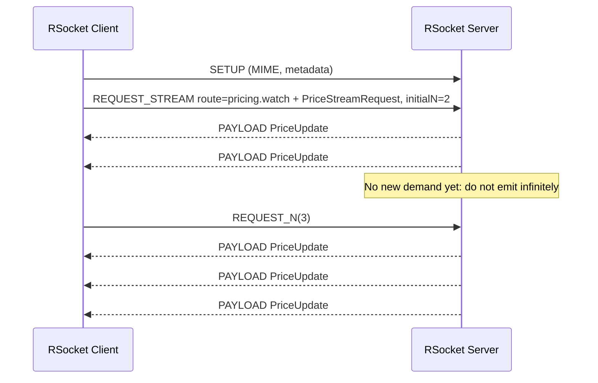
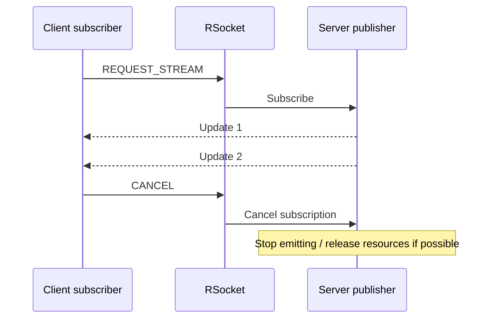
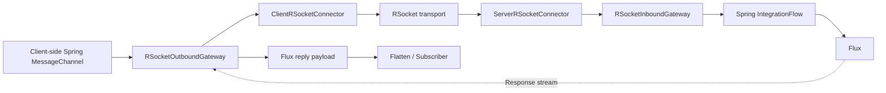
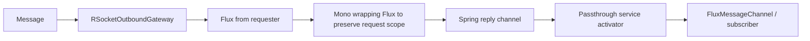
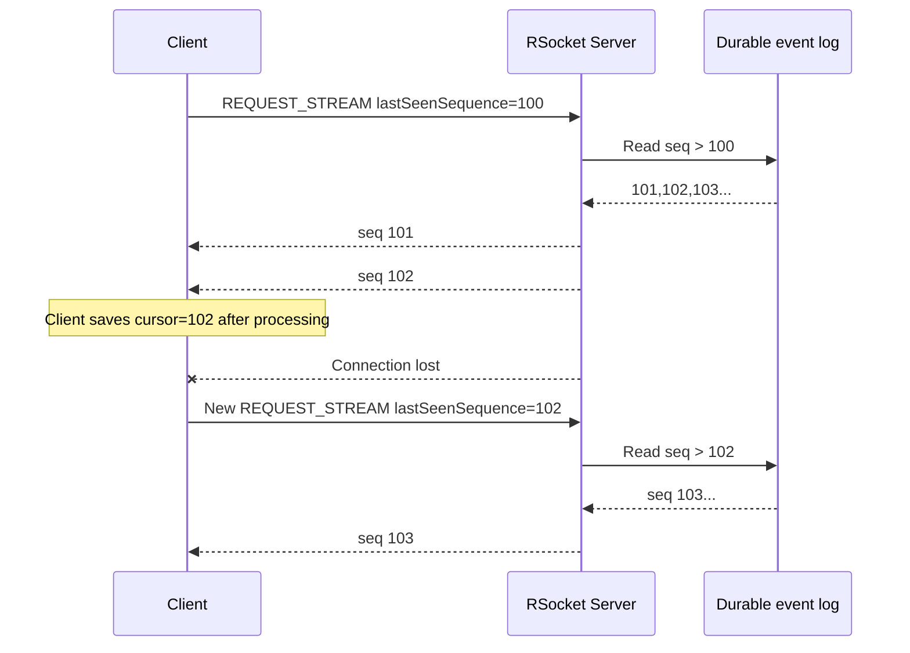
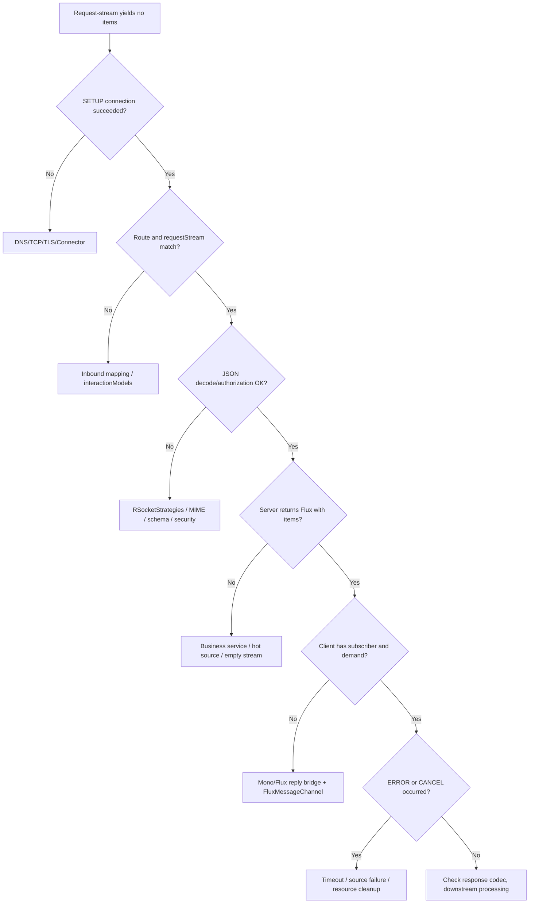

# Request-stream and response-stream in Spring Integration RSocket

## 1. Context: one request, many results over time

Suppose a pricing management application has a dashboard watching SKU `SKU-42`. The user clicks **Watch price** once; `pricing-service` continuously emits price updates thereafter. With pure request–response, the client would have to repeat requests asking "is there a new price yet?", causing polling, overhead, and latency. With RSocket **request-stream**, the client sends **one request**, and the server emits **one response stream** of many messages.

```text
Order-dashboard                  Pricing-service
  request SKU-42
       ── REQUEST_STREAM ──────────►
       ◄── PriceUpdate(seq=101) ───
       ◄── PriceUpdate(seq=102) ───
       ◄── PriceUpdate(seq=103) ───
       ...
       ── CANCEL ──────────────────►
```

The **"Request-stream and response-stream"** lesson belongs to the **RSocket Adapter** chapter, module **SPRING_INTEGRATION_ADAPTERS**. The module's scope is connecting external systems into Spring Integration using inbound/outbound adapters, gateways, pollers, and `MessageChannel`; practicing exchanges over files, SFTP, HTTP, JMS, AMQP, Kafka, and databases while controlling message contracts, errors, and connection lifecycles. This lesson focuses on how to **receive one request and return many responses over RSocket** while preserving backpressure, cancellation, resources, and Spring message semantics.

### Learning objectives

After this lesson, you can:

1. Explain `REQUEST_STREAM`, `PAYLOAD`, `REQUEST_N`, `CANCEL`, `COMPLETE`, and `ERROR` at the protocol level.
2. Distinguish **request-stream** from `requestResponse`, `requestChannel`, and `fireAndForget`.
3. Build a Spring Integration server using `ServerRSocketConnector` and `RSockets.inboundGateway(...)` restricted to `RSocketInteractionModel.requestStream`.
4. Return `Flux<PriceUpdate>` from a transformer/service and define completion, error, or cancellation conditions.
5. Call the server using `RSocketRequester.route(...).data(...).retrieveFlux(...)`.
6. Build a Spring Integration client using `ClientRSocketConnector` and `RSockets.outboundGateway(...)`.
7. Explain why the reply stream is **wrapped in a `Mono`** and downstream must flatten/subscribe intentionally.
8. Design DTOs, JSON codecs, metadata, stream IDs, sequences, and application-level resumption.
9. Control demand, bounded buffers, overload, blocking I/O, and leaked resources.
10. Test end-to-end with real requests, backpressure, cancellation, errors, and reconnects.

## 2. Concept: request-stream is not multiple request-responses

**Request-stream** is an interaction in RSocket:

- The **Requester** sends one `REQUEST_STREAM` frame containing route/metadata and at most one logical request payload.
- The **Responder** produces a `Publisher` returning multiple response `PAYLOAD`s—which can be **0, 1, or N** elements.
- The **`REQUEST_STREAM` frame carries `Initial Request N`** (initial credit, must be > 0); later the requester uses **`REQUEST_N`** to grant additional credit for response items.
- Each interaction terminates with **`COMPLETE`**, **`ERROR`**, or **`CANCEL`**; on transport failures, the connection may drop before the expected terminal signal arrives.



In the RSocket protocol, request-stream involves `REQUEST_STREAM` (code `0x06`, carrying **initial credit**), `REQUEST_N` (`0x08`, **granting more credit**), `CANCEL` (`0x09`), `PAYLOAD` (`0x0A`), and `ERROR` (`0x0B`). Those names describe the **protocol**, while `Flux` is the Java-side Reactive Streams API.

### 2.1. What does response-stream mean?

In this lesson, **response-stream** refers to the stream of response elements the server returns for **one** request-stream:

```text
One request:
  PriceStreamRequest(sku=SKU-42, cursor=100)

One response stream:
  PriceUpdate(sku=SKU-42, seq=101)
  PriceUpdate(sku=SKU-42, seq=102)
  PriceUpdate(sku=SKU-42, seq=103)
  ...
```

There is no separate RSocket interaction model named `responseStream`. The protocol name is **`requestStream`**, and the application-side response is typically **`Flux<T>`**.

### 2.2. Comparing the four interaction models

| Model | Request element count | Response element count | Common API | Use case |
| --- | --- | --- | --- | --- |
| `fireAndForget` | One | No application reply | `.send()` | Best-effort telemetry |
| `requestResponse` | One | At most one | `.retrieveMono(T.class)` | Instant price quote |
| **`requestStream`** | **One** | **0..N** | **`.retrieveFlux(T.class)`** | Price watching or result feeds |
| `requestChannel` | **0..N** | **0..N** | `.data(Flux,...).retrieveFlux(...)` | Bidirectional stream exchange |

**Do not call `requestStream` just because your request is a `Flux<T>`.** A request-stream carries only one logical request. If there are **multiple input elements**, that is a `requestChannel` problem. Conversely, calling `retrieveMono(...)` when expecting multiple results is a cardinality/contract mismatch.

### 2.3. Request-stream can be finite or infinite

| Form | Example | Expected termination |
| --- | --- | --- |
| **Finite** | Return 50 search results in a batch | `COMPLETE` after the last item |
| **Near real-time** | Watch 1 SKU for 5 minutes | Server `COMPLETE` on deadline or client `CANCEL` |
| **Long-lived** | Continuously watch a price board | Client cancels when no longer needed; recovery on reconnect |
| **Empty** | No matching records | Completes with zero items |

Do not design an infinite stream and then call `collectList()` on the client; that collection may never complete and will accumulate memory.

## 3. Reactive Streams: demand is not a business ACK

RSocket uses credit-based flow control for response streams. When a downstream subscriber calls `Subscription.request(n)`, RSocket can transmit additional credit via `REQUEST_N`. The server may only emit up to the granted credit when publishers follow protocol rules.

### 3.1. Why is `request(n)` needed?

Suppose the server computes 10,000 prices/sec while the client can only display 100 prices/sec. Without throttling, backlogs grow rapidly. Flow control lets the client signal demand by **item count**, instead of "just send everything" by default.

```text
Client requested=5 response items.
Server may emit at most 5 items against that granted credit.

When client requests another 3, credit increases by 3.
Granted credit is not an ACK that items committed to DB.
```

**Do not equate `REQUEST_N(5)` with "the previous five events were safely persisted".** It is **flow-control demand** for emitting responses; it does not mean the consumer persisted, displayed, or confirmed business state.

### 3.2. Reactor `Flux` and operators that affect demand

| Operator | Effect | Risks / controls needed |
| --- | --- | --- |
| `map` | Synchronous 1–1 transform | Do not call blocking I/O inside |
| `filter` | Drops non-matching items | May request more upstream items to satisfy downstream |
| `take(n)` | Accepts at most n items then cancels | Server may already produce extra items before cancel arrives |
| `limitRate(n)` | Regulates demand in batches | Does not guarantee exact n wire frames each time due to prefetch/encoding |
| `concatMap` | Ordered async processing | Can be slow because it is sequential |
| `flatMap` | Concurrent async processing | Results may arrive out of order |
| `onBackpressureBuffer` | Buffers when producer is too fast | Must be bounded; never grow infinitely |
| `timeout` | Errors if no signal within configured window | Does not automatically provide resume/replay |

RSocket has flow control, yet **queues at HTTP ingress, Spring `ExecutorChannel`, reactive hot sources, or databases** do not automatically become bounded just because the tail uses a `Flux`.

### 3.3. When the client sends CANCEL



`CANCEL` is a signal to **stop future emission**, not to roll back transactions or undo side effects that already occurred. For DB-querying streams, the server must close cursors/resources upon cancellation. If a write already committed, cancellation does not revert it.

## 4. Spring Integration RSocket architecture



| Component | Role | Does not do automatically |
| --- | --- | --- |
| `RSocketRequester` | Client API calling `route().data().retrieveFlux()` | Create Spring Integration message channels |
| `ClientRSocketConnector` | Holds caller-side requester/transport | Durable replay/outbox |
| `RSocketOutboundGateway` | Builds RSocket request and reply from Spring message | Ensure downstream subscribed properly |
| `ServerRSocketConnector` | Binds TCP/WebSocket server transport | Emit business updates |
| `RSocketInboundGateway` | Maps route/model into Spring flow | Open listener automatically without a connector |
| `Transformer` / service activator | Receives request, returns response `Flux` | Automatic event log/recovery |
| `FluxMessageChannel` | Demand-driven reactive handoff when properly configured | Bound every upstream source |
| `RSocketStrategies` | Codecs and metadata handling | Domain security/validation |

### 4.1. Inbound and outbound refer to Spring flow direction

An **inbound gateway** receives requests from an RSocket peer and enters Spring Integration. An **outbound gateway** takes a Spring message and sends a request to a peer. A server can proactively call back to a client via the bidirectional connection's `RSocketRequester`, yet that does not alter the request-stream concept: the **initiator** sends one request and receives a response stream.

### 4.2. Do not confuse an RSocket route with an HTTP URL

A route like `pricing.updates.v1` travels in **RSocket routing metadata**, not as HTTP `GET /pricing.updates.v1`. The transport can be RSocket TCP or RSocket over WebSocket, yet **a route is still not a URL**.

### 4.3. Spring replies are reactive

Per Spring Integration, `RSocketOutboundGateway` returns an internal **`Mono`**. When the remote returns a `Flux` via `requestStream`, **the gateway wraps the `Flux` inside the reply `Mono` to preserve the request scope**. Downstream must extract the `Flux` from the reply payload and **subscribe/flatten intentionally**. This differs from standard handlers returning a single DTO.

## 5. Wire contract for request-stream

A contract should specify completely:

```text
Transport           : RSocket over TCP
Server address      : pricing-service:7000
Route               : pricing.updates.v1
Interaction model   : requestStream
Data MIME           : application/json
Request payload     : PriceStreamRequest
Response item type  : PriceUpdate
Stream identity     : subscriptionId
Resume cursor       : lastSeenSequence (if a replay store exists)
Completion policy   : maxItems or server business deadline
Failure policy      : ERROR / cancel / reconnect + explicit resume
```

Example request:

```json
{
  "schemaVersion": 1,
  "subscriptionId": "sub-sku42-dashboard1",
  "sku": "SKU-42",
  "lastSeenSequence": 100,
  "maxItems": 5
}
```

One response item:

```json
{
  "schemaVersion": 1,
  "subscriptionId": "sub-sku42-dashboard1",
  "sku": "SKU-42",
  "sequence": 101,
  "priceMinorUnits": 37500,
  "currency": "VND"
}
```

### 5.1. Field meanings

| Field | Request or response? | Purpose |
| --- | --- | --- |
| `schemaVersion` | Both | Negotiate schema/codec |
| `subscriptionId` | Both | Correlate logical stream, ensure items do not mix across subscriptions |
| `sku` | Both | Resource key and authorization |
| `lastSeenSequence` | Request | Application resume position, not an RSocket offset |
| `maxItems` | Request | Caps finite stream in this practice |
| `sequence` | Response | Detect gaps, duplicates, and per-SKU ordering |
| `priceMinorUnits` | Response | Integer price avoiding floating-point errors |
| `currency` | Response | Price currency code |

**Important:** `lastSeenSequence` is an **application-defined contract**. RSocket request-stream **does not provide a durable cursor or replay by default**. The server can only "resume from sequence 100" if it has a backing event history or snapshot capable of serving it.

### 5.2. Choosing semantics: snapshots, events, or both?

| Stream type | On new client subscription | On network loss |
| --- | --- | --- |
| **Snapshot updates** | Sends current price state, then watches new ones | Can fetch fresh snapshot; does not necessarily keep every change |
| **Event history** | Replays events from a valid offset | Requires an event store/replay |
| **Live-only hot feed** | Receives only items emitted after subscribing | Can lose items; no replay |
| **Batch response-stream** | Returns exact N elements then completes | Retrying whole batch can duplicate items |

Do not pick a live-only stream when business rules require **every price change to be persisted/audited**. When durability is required, pair Kafka/JMS/AMQP/an event log with RSocket as the streaming layer to the UI.

## 6. Java DTOs and validation

### 6.1. Request and response records

```java
// PriceStreamRequest.java (Java 17+)
public record PriceStreamRequest(
        int schemaVersion,
        String subscriptionId,
        String sku,
        long lastSeenSequence,
        int maxItems) {
}
```

```java
// PriceUpdate.java
public record PriceUpdate(
        int schemaVersion,
        String subscriptionId,
        String sku,
        long sequence,
        long priceMinorUnits,
        String currency) {
}
```

`lastSeenSequence=0` in the demo means no cursor yet. Do not use negative values to mean "start" unless the schema specifies it.

### 6.2. Validator at the application boundary

```java
// PriceStreamValidation.java
public final class PriceStreamValidation {

    private PriceStreamValidation() {
    }

    public static void validate(PriceStreamRequest request) {
        if (request == null ||
                request.schemaVersion() != 1 ||
                request.subscriptionId() == null ||
                !request.subscriptionId().matches(
                        "[A-Za-z0-9_-]{1,128}") ||
                request.sku() == null ||
                !request.sku().matches("[A-Za-z0-9_-]{1,64}") ||
                request.lastSeenSequence() < 0 ||
                request.maxItems() < 1 ||
                request.maxItems() > 100) {
            throw new IllegalArgumentException(
                    "Invalid PriceStreamRequest");
        }
    }

    public static void validateUpdate(
            PriceStreamRequest request, PriceUpdate update) {
        if (update == null || update.schemaVersion() != 1 ||
                !request.subscriptionId().equals(
                        update.subscriptionId()) ||
                !request.sku().equals(update.sku()) ||
                update.sequence() <= request.lastSeenSequence() ||
                update.priceMinorUnits() < 0 ||
                !"VND".equals(update.currency())) {
            throw new IllegalArgumentException(
                    "PriceUpdate invalid or does not belong to stream");
        }
    }
}
```

**Note:** the validator above is only sufficient for a **single-currency demo with increasing sequences**. In production, you must also validate principal/tenant, currency schema, byte limits, SKU permissions, sequence consistency, overflows, and duplicate/gap handling policies.

## 7. Dependencies and Spring Boot configuration

Examples use Java 17+, Spring Boot BOM, and Spring Integration RSocket. One application is the **server**, and one is the **client**.

### 7.1. Maven

```xml
<dependencies>
    <dependency>
        <groupId>org.springframework.boot</groupId>
        <artifactId>spring-boot-starter-integration</artifactId>
    </dependency>
    <dependency>
        <groupId>org.springframework.integration</groupId>
        <artifactId>spring-integration-rsocket</artifactId>
    </dependency>
    <!-- When using JSON DTOs and Jackson is not yet on the classpath. -->
    <dependency>
        <groupId>com.fasterxml.jackson.core</groupId>
        <artifactId>jackson-databind</artifactId>
    </dependency>
    <dependency>
        <groupId>io.projectreactor</groupId>
        <artifactId>reactor-test</artifactId>
        <scope>test</scope>
    </dependency>
</dependencies>
```

Do not arbitrarily mix major versions of Spring Boot/Framework/Integration/Reactor outside a supported BOM. `spring-boot-starter-rsocket` can be added when the app uses Boot-managed RSocket server/client, but if a self-binding `ServerRSocketConnector` already exists, enforce **a single owner per port**.

### 7.2. application.yml

```yaml
app:
  rsocket:
    bind-host: ${RSOCKET_BIND_HOST:127.0.0.1}
    host: ${RSOCKET_HOST:127.0.0.1}
    port: ${RSOCKET_PORT:7000}
    stream-route: pricing.updates.v1
    max-items: 100
```

`127.0.0.1` only works when both sides share the **same network namespace**. In Kubernetes, the client pod must connect to the Service DNS, such as `pricing-service`; the server may need to bind `0.0.0.0` alongside NetworkPolicy/TLS and authorization.

### 7.3. Aligning codecs

RSocket carries **data** and **metadata**. For DTOs, select `application/json` and ensure both sides include compatible Jackson encoders/decoders in `RSocketStrategies`. If the server only has text codecs and inbound lacks `requestElementType`, JSON may arrive as `byte[]` or fail conversion instead of `PriceStreamRequest`.

Route `pricing.updates.v1` travels in routing metadata, not `GET /pricing.updates.v1`. Opening a TCP connection does not prove the route and JSON decoder are ready.

## 8. Server: `ServerRSocketConnector` opens the listener

The RSocket server needs a connector to bind TCP:

```java
import org.springframework.beans.factory.annotation.Value;
import org.springframework.context.annotation.Bean;
import org.springframework.context.annotation.Configuration;
import org.springframework.integration.rsocket.ServerRSocketConnector;
import org.springframework.util.MimeTypeUtils;

@Configuration
public class PricingRSocketServerConfiguration {

    @Bean
    public ServerRSocketConnector pricingRSocketServer(
            @Value("${app.rsocket.bind-host}") String bindHost,
            @Value("${app.rsocket.port}") int port) {

        ServerRSocketConnector connector =
                new ServerRSocketConnector(bindHost, port);
        connector.setDataMimeType(MimeTypeUtils.APPLICATION_JSON);
        return connector;
    }
}
```

`ServerRSocketConnector` manages the transport and registers inbound endpoints discovered in the application context. `RSocketInboundGateway` on its own does **not** open a TCP server port. If also using Boot's RSocket server autoconfiguration, avoid two listeners binding port 7000.

### 8.1. Dynamic port in integration tests

```java
ServerRSocketConnector connector =
        new ServerRSocketConnector("127.0.0.1", 0);

// In test setup AFTER connector has started/bound:
Integer boundPort = connector.getBoundPort()
        .block(java.time.Duration.ofSeconds(5));
```

This shows using port 0 and `getBoundPort()` (returning `Mono<Integer>`); **never** read it before the connector starts or call `block()` on a Reactor/Netty event loop. When tests start the connector via a Spring context, obtain the bound port from that real bean.

### 8.2. Readiness vs. connection setup

| Observation | Confirmed | Not yet confirmed |
| --- | --- | --- |
| TCP bind succeeded | Listener is open | Route works |
| RSocket SETUP succeeded | Basic connection/MIME compatible | Business service is ready |
| Request-stream emits first item | Route, decoder, and upstream work up to that point | Full history is available |
| Stream ends with `COMPLETE` | Server finished stream per contract | Client persisted every item |

If health checks are needed, use a safe read-only request–response route and an appropriate readiness policy; never rely solely on an open TCP port.

## 9. Server: producing a finite `Flux<PriceUpdate>`

First build a service emitting five results over time. This example does **not** query a DB and does **not** provide durable replay; it solely illustrates a response stream.

```java
// PriceStreamService.java
import java.time.Duration;
import org.springframework.stereotype.Service;
import reactor.core.publisher.Flux;

@Service
public class PriceStreamService {

    public Flux<PriceUpdate> watch(PriceStreamRequest request) {
        return Flux.defer(() -> {
            PriceStreamValidation.validate(request);

            long last = request.lastSeenSequence();
            return Flux.range(1, request.maxItems())
                    .delayElements(Duration.ofMillis(120))
                    .map(index -> new PriceUpdate(
                            1,
                            request.subscriptionId(),
                            request.sku(),
                            Math.addExact(last, index),
                            37_500L + index * 100L,
                            "VND"))
                    .doOnSubscribe(subscription ->
                            System.out.println(
                                    "price stream started: " +
                                    request.subscriptionId()))
                    .doOnCancel(() ->
                            System.out.println(
                                    "price stream cancelled: " +
                                    request.subscriptionId()))
                    .doOnComplete(() ->
                            System.out.println(
                                    "price stream complete: " +
                                    request.subscriptionId()));
        });
    }
}
```

`Flux.defer(...)` creates a publisher per subscription, so retries/resubscriptions re-run emission logic. `delayElements` only simulates periodic updates; it is not how real prices connect to `RSocketInboundGateway`. In production, the service pulls events from a backpressure-aware source and/or an event store.

**Note on cursors:** computing `lastSeenSequence + index` makes experimentation easy, **it does not prove the server stores history for those sequences**. Real replay must query an event log by cursor, enforce ordering/retention, and validate cursors.

### 9.1. Avoid holding resources for the entire stream

A long-lived response stream may hold:

- Reactive subscriptions and references to request context.
- RSocket connection/stream state.
- A DB cursor or broker subscription.
- Bounded buffers when consumers are slow.
- Active stream counters, metrics, and traces.

When the client cancels, errors, or the server shuts down, release all resources. Never open a JDBC transaction and leave it alive indefinitely inside a price-watching publisher.

## 10. Server Java DSL: `requestStream` inbound gateway

### 10.1. Creating the route and transformer

```java
// PriceStreamInboundConfiguration.java
import org.springframework.context.annotation.Bean;
import org.springframework.context.annotation.Configuration;
import org.springframework.core.ResolvableType;
import org.springframework.integration.dsl.IntegrationFlow;
import org.springframework.integration.rsocket.RSocketInteractionModel;
import org.springframework.integration.rsocket.dsl.RSockets;
import reactor.core.publisher.Flux;

@Configuration
public class PriceStreamInboundConfiguration {

    @Bean
    public IntegrationFlow priceUpdatesInbound(
            PriceStreamService priceStreamService) {

        return IntegrationFlow
                .from(RSockets.inboundGateway("pricing.updates.v1")
                        .interactionModels(
                                RSocketInteractionModel.requestStream)
                        .requestElementType(ResolvableType.forClass(
                                PriceStreamRequest.class)))
                .<Flux<PriceStreamRequest>, Flux<PriceUpdate>>transform(
                        incoming ->
                                incoming.single()
                                        .flatMapMany(priceStreamService::watch))
                .get();
    }
}
```

**Breakdown:**

1. `RSockets.inboundGateway("pricing.updates.v1")` accepts requests on the RSocket route.
2. `interactionModels(requestStream)` allows only the response-stream model on this route.
3. `requestElementType(PriceStreamRequest.class)` (via `ResolvableType`) sets the input decode type.
4. The inbound gateway passes the payload into the flow as **`Flux<PriceStreamRequest>`**, not just a single DTO.
5. `incoming.single()` requires exactly one request element.
6. `flatMapMany(priceStreamService::watch)` turns `Mono<PriceStreamRequest>` into the **`Flux<PriceUpdate>` response**.
7. The gateway encodes the reply publisher as an RSocket response stream per registered codecs/strategies.

**This is request-stream** because **one request** produces **many responses**. Do not mistake `incoming` having type `Flux<PriceStreamRequest>` for the client sending multiple request elements: that is simply the inbound gateway's reactive representation.

### 10.2. Why `single()` instead of `next()`?

In a request-stream, the contract allows only **one logical input**:

- `next()` takes the first element and ignores any remaining ones, potentially hiding protocol violations.
- `single()` enforces exactly one element, emitting an error if empty or if more than one arrives.
- Even though the protocol limits request-stream to one request payload, checking at the application boundary makes the contract explicit and testable.

In production, define a policy for requests without data, since some request-stream routes allow metadata-only requests. If no body is needed, design a separate route and handler rather than forcing every route to require a DTO.

### 10.3. Inbound gateway reply mechanism

`RSocketInboundGateway` uses Spring Integration gateway semantics to push a request into the flow, receive the reply, and encode it back over RSocket. For interactions with replies, request messages carry framework-managed reply context; when the handler returns `Flux<PriceUpdate>`, the gateway handles the publisher per the RSocket model. Learners never need to spin up a manual TCP writer thread to read the `Flux` and send frames.

Still, if downstream **returns no reply**, returns the wrong type, or returns an unsubscribed publisher, the client may not receive expected items. Always test route/model mapping, encoding, reply boundaries, and cancellation.

## 11. `RSocketInboundGateway` Java bean instead of DSL

For codebases using annotation-based endpoints, configure the gateway bean:

```java
import org.springframework.context.annotation.Bean;
import org.springframework.context.annotation.Configuration;
import org.springframework.core.ResolvableType;
import org.springframework.integration.rsocket.RSocketInteractionModel;
import org.springframework.integration.rsocket.inbound.RSocketInboundGateway;

@Configuration
public class PriceInboundGatewayBeans {

    @Bean
    public RSocketInboundGateway priceStreamGateway() {
        RSocketInboundGateway gateway =
                new RSocketInboundGateway("pricing.updates.v1");
        gateway.setInteractionModels(
                RSocketInteractionModel.requestStream);
        gateway.setRequestElementType(
                ResolvableType.forClass(PriceStreamRequest.class));
        gateway.setRequestChannelName("pricingStreamRequestChannel");
        return gateway;
    }
}
```

Corresponding transformer:

```java
import org.springframework.integration.annotation.Transformer;
import org.springframework.stereotype.Component;
import reactor.core.publisher.Flux;

@Component
public class PriceStreamTransformer {

    private final PriceStreamService service;

    public PriceStreamTransformer(PriceStreamService service) {
        this.service = service;
    }

    @Transformer(inputChannel = "pricingStreamRequestChannel")
    public Flux<PriceUpdate> stream(
            Flux<PriceStreamRequest> incoming) {
        return incoming.single().flatMapMany(service::watch);
    }
}
```

**This is an alternative** to the IntegrationFlow in section 10. Do not register **both** gateways with the same route and model on the same connector without explicit conflict management.

### 11.1. Is `decodeFluxAsUnit` a response-stream toggle?

`RSocketInboundGateway` has a `decodeFluxAsUnit(boolean)` option since Spring Integration 5.3:

- `false` (default): decodes **each element** of the inbound `Flux` per the decoder.
- `true`: attempts to decode the entire inbound `Flux` as **one unit** depending on decoder support.

This option applies to **input decoding** at the inbound gateway; it is **not** an "enable/disable response-stream" switch. For a single `PriceStreamRequest`, it normally stays unchanged. For `requestChannel` streaming input, the decoder and `decodeFluxAsUnit` strongly affect element boundaries.

**Do not enable `decodeFluxAsUnit(true)` for an infinite request stream** if the decoder needs the entire input to finish; it can wait forever or buffer too much data.

## 12. Direct client: `RSocketRequester.retrieveFlux(...)`

Before integrating `RSocketOutboundGateway` into Spring Integration, test the route with a plain requester.

```java
// DirectPriceStreamClient.java
import java.time.Duration;
import org.springframework.messaging.rsocket.RSocketRequester;
import org.springframework.util.MimeTypeUtils;
import reactor.core.publisher.Flux;

public class DirectPriceStreamClient {

    private final RSocketRequester requester;

    public DirectPriceStreamClient(String host, int port) {
        this.requester = RSocketRequester.builder()
                .dataMimeType(MimeTypeUtils.APPLICATION_JSON)
                .tcp(host, port);
    }

    public Flux<PriceUpdate> updates(PriceStreamRequest request) {
        PriceStreamValidation.validate(request);
        return requester
                .route("pricing.updates.v1")
                .data(request)
                .retrieveFlux(PriceUpdate.class)
                .timeout(Duration.ofSeconds(3));
    }
}
```

The key is `retrieveFlux(PriceUpdate.class)`: with one request data element and a `Flux` response, `RSocketRequester` chooses **request-stream**. `retrieveMono(...)` has a different cardinality and is wrong when handling multiple response items.

`timeout(Duration.ofSeconds(3))` here errors if no signal arrives within that operator window (including waiting for the next item); it **does not cap** total stream lifetime at three seconds if each new item arrives before the window expires. If an **overall deadline** is needed, enforce a dedicated policy from subscription start.

### 12.1. Calling the client in a reactive chain

```java
PriceStreamRequest request =
        new PriceStreamRequest(
                1, "sub-42", "SKU-42", 100L, 5);

Flux<PriceUpdate> responseStream =
        client.updates(request)
                .doOnNext(update ->
                        PriceStreamValidation.validateUpdate(
                                request, update))
                .take(5)
                .doFinally(signalType ->
                        System.out.println("Stream ended: " +
                                signalType));
```

A `Flux` only **describes a pipeline**; it does not necessarily execute until subscribed. The caller can return the `Flux` to Spring WebFlux, pass it into a reactive channel, or use `StepVerifier` in tests.

**Do not subscribe and immediately return "all prices loaded"** while the stream is still running asynchronously.

### 12.2. `take(n)` can cancel the server stream

If the remote has 100 items but the client uses `take(5)`, after the fifth item Reactor cancels the subscription; RSocket sends `CANCEL` to the server. Tests should verify publisher cleanup. The server may already have produced extra items in the pipeline before receiving cancel; do not rely on `take(5)` as a transactional boundary.

### 12.3. Do not create a new requester per item

`RSocketRequester` can multiplex many request-streams over the same connection. Reuse the requester/`ClientRSocketConnector` per lifecycle, limit active streams, and cancel subscriptions when the UI/consumer no longer needs them.

## 13. Client: `ClientRSocketConnector` in Spring Integration

```java
import org.springframework.beans.factory.annotation.Value;
import org.springframework.context.annotation.Bean;
import org.springframework.context.annotation.Configuration;
import org.springframework.integration.rsocket.ClientRSocketConnector;
import org.springframework.util.MimeTypeUtils;

@Configuration
public class PriceStreamClientConnectorConfiguration {

    @Bean
    public ClientRSocketConnector pricingClientRSocketConnector(
            @Value("${app.rsocket.host}") String host,
            @Value("${app.rsocket.port}") int port) {

        ClientRSocketConnector connector =
                new ClientRSocketConnector(host, port);
        connector.setDataMimeType(MimeTypeUtils.APPLICATION_JSON);
        return connector;
    }
}
```

`ClientRSocketConnector` manages the requester/connection; it **does not mean** every server route is ready or that streams resume automatically. You can set `RSocketStrategies` and codecs on the connector. If the server uses WebSocket instead of TCP, configure the proper WebSocket transport/URI per the API.

### 13.1. Client connector and reply scope

An application may have:

```text
pricing.quote.v1      → requestResponse    → Mono<QuoteReply>
pricing.updates.v1    → requestStream      → Flux<PriceUpdate>
pricing.health.v1     → requestResponse    → Mono<HealthReply>
```

Requests can share a connection, yet each request-stream keeps its own stream ID/request scope and subscription; cancelling stream A does not cancel stream B.

## 14. Java DSL outbound `requestStream`

```java
// PriceStreamOutboundConfiguration.java
import org.springframework.context.annotation.Bean;
import org.springframework.context.annotation.Configuration;
import org.springframework.integration.dsl.IntegrationFlow;
import org.springframework.integration.rsocket.ClientRSocketConnector;
import org.springframework.integration.rsocket.RSocketInteractionModel;
import org.springframework.integration.rsocket.dsl.RSockets;

@Configuration
public class PriceStreamOutboundConfiguration {

    @Bean
    public IntegrationFlow pricingUpdatesOutbound(
            ClientRSocketConnector pricingClientRSocketConnector) {

        return IntegrationFlow
                .from("priceStreamRequests")
                .handle(RSockets.outboundGateway("pricing.updates.v1")
                        .interactionModel(
                                RSocketInteractionModel.requestStream)
                        .expectedResponseType(PriceUpdate.class)
                        .clientRSocketConnector(
                                pricingClientRSocketConnector))
                .channel("priceStreamReplies")
                .get();
    }
}
```

This client-side flow:

1. Receives a Spring `Message<PriceStreamRequest>` on `priceStreamRequests`.
2. Uses the outbound gateway to call route `pricing.updates.v1` with `requestStream`.
3. Expects **each response element** to have type `PriceUpdate.class`.
4. Uses `ClientRSocketConnector` to obtain the `RSocketRequester`.
5. Sends the **request-scoped reply** to `priceStreamReplies`; downstream handles the `Flux` per framework semantics.

### 14.1. Do not set expected response type to `Flux.class`

`expectedResponseType(PriceUpdate.class)` specifies **the type of each returned element** for the decoder. A response stream has type `Flux<PriceUpdate>` at the Reactor layer, yet **each wire item** is still `PriceUpdate`. Passing `Flux.class` as expected response type can cause codec decoding failures.

### 14.2. Sending a request through a Spring channel

```java
import org.springframework.beans.factory.annotation.Qualifier;
import org.springframework.messaging.MessageChannel;
import org.springframework.messaging.support.MessageBuilder;
import org.springframework.stereotype.Service;

@Service
public class PriceStreamRequestDispatcher {

    private final MessageChannel requests;

    public PriceStreamRequestDispatcher(
            @Qualifier("priceStreamRequests")
            MessageChannel requests) {
        this.requests = requests;
    }

    public void start(PriceStreamRequest request) {
        PriceStreamValidation.validate(request);
        boolean accepted = requests.send(
                MessageBuilder.withPayload(request).build());
        if (!accepted) {
            throw new IllegalStateException(
                    "Spring channel rejected PriceStreamRequest");
        }
        // TRUE does not mean all stream results have been received.
    }
}
```

**`MessageChannel.send()==true` only confirms dispatch acceptance at the Spring channel.** It does **not** mean RSocket sent the request, the response stream was subscribed, the first item arrived, or the stream completed.

## 15. Reply streams in outbound gateway: `Mono` wrapping `Flux`

This is a Spring Integration nuance that frequently causes confusion with request-stream.

Per the Spring Integration RSocket reference:

- `RSocketOutboundGateway` is an `AbstractReplyProducingMessageHandler`.
- Its internal reply is a **`Mono`**, even when the interaction model is `fireAndForget`.
- When the remote returns a **`Flux`** (for `requestStream` or `requestChannel`), the gateway **wraps the `Flux` inside the reply `Mono`** to **preserve the scope of a single request**.
- With a **regular output channel**, the `Mono` is subscribed/adapted before emitting the output message.
- With **`FluxMessageChannel`**, reactive replies are driven by demand.
- **Downstream must extract the `Flux` from the message payload and subscribe or flatten**, instead of waiting for an already populated collection.



**This diagram illustrates request scope**, not that every message payload across all versions/channels has the literal Java generic type `Mono<Flux<T>>`. Always inspect the contract at your **specific boundary** and avoid duplicate subscriptions.

### 15.1. Flattening per the Spring Integration reference pattern

```java
import org.springframework.integration.annotation.ServiceActivator;
import reactor.core.publisher.Flux;

@ServiceActivator(
        inputChannel = "priceStreamReplies",
        outputChannel = "priceUpdateElements")
public Flux<?> flattenRSocketResponse(Flux<?> payload) {
    return payload;
}
```

The target channel should support reactive demand, such as `FluxMessageChannel`:

```java
import org.springframework.context.annotation.Bean;
import org.springframework.context.annotation.Configuration;
import org.springframework.integration.channel.FluxMessageChannel;

@Configuration
public class PriceStreamReactiveChannels {

    @Bean(name = "priceUpdateElements")
    public FluxMessageChannel priceUpdateElements() {
        return new FluxMessageChannel();
    }
}
```

This **illustrates a bridge step**. Afterward, a real subscriber/consumer for `priceUpdateElements` is needed; without downstream demand, there is no basis to claim the stream was consumed. Do not call `subscribe()` redundantly on the same publisher in multiple handlers because a cold publisher can trigger **a new remote request per subscription**.

### 15.2. Processing the stream in application logic

Once downstream receives a `Flux<PriceUpdate>`, you can process it:

```java
import reactor.core.publisher.Flux;

public Flux<PriceUpdate> validatePriceUpdates(
        PriceStreamRequest request,
        Flux<PriceUpdate> updates) {

    return updates
            .doOnNext(update ->
                    PriceStreamValidation.validateUpdate(
                            request, update))
            .take(request.maxItems());
}
```

The caller must attach a subscriber and manage cancellation/lifecycle. In a server with business side effects, pass the pipeline along instead of doing a fire-and-forget `subscribe()` inside a handler.

### 15.3. Why not use `collectList().block()`?

```java
// ANTI-PATTERN: can block event loop or hold entire stream in RAM.
var allUpdates = incomingFlux.collectList().block();
```

On an infinite stream, this operation may **never complete**; on a large stream, all data piles into the heap. If a finite aggregation is truly required, enforce `maxItems`/`maxBytes`/deadlines, use `collectList()` returning a `Mono<List<T>>` to a reactive caller, and never block on the Netty/Reactor event loop.

## 16. XML or Java bean: choosing the right configuration

Java DSL is convenient for pipelines, yet the `RSocketOutboundGateway` bean API can also be used:

```java
import org.springframework.beans.factory.annotation.Qualifier;
import org.springframework.context.annotation.Bean;
import org.springframework.context.annotation.Configuration;
import org.springframework.integration.annotation.ServiceActivator;
import org.springframework.integration.rsocket.ClientRSocketConnector;
import org.springframework.integration.rsocket.RSocketInteractionModel;
import org.springframework.integration.rsocket.outbound.RSocketOutboundGateway;

@Configuration
public class PriceStreamGatewayBeans {

    @Bean
    @ServiceActivator(
            inputChannel = "beanPriceStreamRequests",
            outputChannel = "beanPriceStreamReplies")
    public RSocketOutboundGateway pricingOutboundGateway(
            @Qualifier("pricingClientRSocketConnector")
            ClientRSocketConnector connector) {

        RSocketOutboundGateway gateway =
                new RSocketOutboundGateway("pricing.updates.v1");
        gateway.setInteractionModel(
                RSocketInteractionModel.requestStream);
        gateway.setExpectedResponseType(PriceUpdate.class);
        gateway.setClientRSocketConnector(connector);
        return gateway;
    }
}
```

This is an **alternative** to the Java DSL in section 14, not a second endpoint to add alongside it in every project. If using the `int-rsocket` XML namespace, `inbound-gateway` and `outbound-gateway` are available; configure route, interaction model, expected response type, connector, and channels per your Spring Integration XML schema.

## 17. JSON codecs, metadata, and stream contracts

### 17.1. Configuring strategies for DTOs

```java
import com.fasterxml.jackson.databind.ObjectMapper;
import org.springframework.context.annotation.Bean;
import org.springframework.context.annotation.Configuration;
import org.springframework.http.codec.json.Jackson2JsonDecoder;
import org.springframework.http.codec.json.Jackson2JsonEncoder;
import org.springframework.messaging.rsocket.RSocketStrategies;

@Configuration
public class PriceRSocketCodecConfiguration {

    @Bean
    public RSocketStrategies priceRSocketStrategies(
            ObjectMapper mapper) {
        return RSocketStrategies.builder()
                .decoder(new Jackson2JsonDecoder(mapper))
                .encoder(new Jackson2JsonEncoder(mapper))
                .build();
    }
}
```

This example configures Jackson for JSON DTOs; in a real application, ensure **other required codecs/metadata conventions are also intact**. If custom strategies differ in decoder ordering between client and server, requests can be read as `byte[]` or replies can fail. Inject strategies into existing connectors instead of adding a second listener on the same port just to swap codecs.

### 17.2. Content MIME and routing metadata

| RSocket message part | Example | Meaning |
| --- | --- | --- |
| Data MIME | `application/json` | Selects JSON encoder/decoder |
| Route metadata | `pricing.updates.v1` | Inbound routing |
| Application metadata | Trace ID, tenant hint | Does not replace authentication |
| Request data | `PriceStreamRequest` | One logical query |
| Response data | `PriceUpdate` | Each item of the Flux |
| Stream identity | `subscriptionId` | App-level correlation and tracing |

Spring `MessageHeaders` do not serialize wholesale over the wire by default. If a peer in another language needs `subscriptionId`, `lastSeenSequence`, or `schemaVersion`, put them in JSON or agreed metadata with a shared schema/codec.

### 17.3. Generic JSON response types

If each response element is `PriceUpdate`, use `expectedResponseType(PriceUpdate.class)` and `retrieveFlux(PriceUpdate.class)`. If each element is a generic type like `List<PriceUpdate>`, preserve generic types via `ParameterizedTypeReference`/an API-supported expression; `List.class` may decode as a list of maps.

### 17.4. Controlling item size

A request-stream can emit tens of thousands of response items, yet **each individual item** still needs byte-size/schema validation. Never emit a multi-gigabyte JSON blob as a single element expecting backpressure to eliminate memory overhead; flow control counts items, not guaranteeing every item is small.

## 18. Backpressure in practice: observing `REQUEST_N`

A major advantage of request-stream is that client demand **can throttle the rate of sent responses**. However, Reactor operators have internal prefetching/buffering, so distinguish **subscriber requests**, **publisher demand**, **wire `REQUEST_N` frames**, and **items processed in the application**.

### 18.1. Subscriber requesting in batches

```java
import org.reactivestreams.Subscriber;
import org.reactivestreams.Subscription;

public class TwoAtATimeSubscriber
        implements Subscriber<PriceUpdate> {

    private Subscription subscription;
    private int sinceLastRequest;

    @Override
    public void onSubscribe(Subscription subscription) {
        this.subscription = subscription;
        subscription.request(2);
    }

    @Override
    public void onNext(PriceUpdate item) {
        System.out.println("Received: " + item.sequence());
        sinceLastRequest++;
        if (sinceLastRequest == 2) {
            sinceLastRequest = 0;
            subscription.request(2);
        }
    }

    @Override
    public void onError(Throwable error) {
        System.err.println(error.getMessage());
    }

    @Override
    public void onComplete() {
        System.out.println("Response stream complete");
    }
}
```

Attaching the subscriber:

```java
// Where subscription lifecycle is owned:
responseStream.subscribe(new TwoAtATimeSubscriber());
```

**This illustrates Reactive Streams demand** and omits storing `Subscription` for lifecycle cancellation or forwarding errors to monitoring. In production, prefer Reactor operators and subscriber/framework-managed lifecycles. Inspect intermediate operators because prefetching can cause wire credits to differ from a naive demo subscriber's intuition.

### 18.2. StepVerifier with initial request 0

```java
import java.time.Duration;
import reactor.test.StepVerifier;

PriceStreamRequest request =
        new PriceStreamRequest(1, "test-sub-42", "SKU-42", 100, 5);

StepVerifier.create(client.updates(request), 0)
        .thenRequest(2)
        .expectNextCount(2)
        .thenRequest(3)
        .expectNextCount(3)
        .expectComplete()
        .verify(Duration.ofSeconds(10));
```

This test proves the publisher **respects demand observed by the test subscriber** and delivers all 5 items. To prove the **exact `REQUEST_N` wire frame counts**, instrument the transport/interceptor or use a dedicated protocol test; `StepVerifier` is not directly a packet analyzer.

### 18.3. Why can `flatMap` reorder items?

```java
Flux<PriceUpdate> normalized = updates
        .flatMap(update -> asyncEnrich(update), 8);
```

If `asyncEnrich` for sequence 102 finishes faster than sequence 101, results can appear out of upstream order. For response-stream contracts requiring **per-SKU ordering**, consider:

```java
Flux<PriceUpdate> ordered = updates
        .concatMap(update -> asyncEnrich(update));
```

`asyncEnrich(...)` is an illustrative application method returning `Mono<PriceUpdate>`. `concatMap` preserves order at the cost of lower concurrency; to scale across many SKUs, partition by key and preserve order within each partition. **Flux emission order does not guarantee DB commit order when downstream runs parallel transactions.**

### 18.4. Bounded buffering

```java
import reactor.core.publisher.BufferOverflowStrategy;

Flux<PriceUpdate> bounded = updates
        .onBackpressureBuffer(
                256,
                dropped -> System.err.println(
                        "Dropped seq=" + dropped.sequence()),
                BufferOverflowStrategy.DROP_OLDEST);
```

This is an **explicit drop-oldest policy**, suitable for some **UI snapshots** yet **seriously wrong** if every `PriceUpdate` is a mandatory audit event. If the contract requires every item, **do not drop**; use durable storage, pagination/replay, quotas, or slow down the source.

**Note:** a properly backpressure-aware RSocket request-stream publisher may not need an extra buffer. Buffers are typically needed around non-demand-aware operators/hot sources or handoffs; adding unbounded buffers only shifts the problem.

## 19. Cancellation, resource cleanup, and disappearing consumers

A response-stream can run for a long time. Consumers may close browser tabs, stop applications, lose connectivity, or explicitly call `take(n)`. The server must treat these events as **normal lifecycle paths**.

### 19.1. Attaching cleanup to terminal signals

```java
import reactor.core.publisher.Flux;

public Flux<PriceUpdate> trackLifecycle(
        PriceStreamRequest request) {
    return watch(request)
            .doOnSubscribe(subscription ->
                    metrics.streamStarted())
            .doOnNext(update ->
                    metrics.streamItemEmitted())
            .doOnCancel(() ->
                    metrics.streamCancelled())
            .doOnError(error ->
                    metrics.streamFailed(error))
            .doFinally(signal ->
                    metrics.streamEnded(signal));
}
```

This assumes a `metrics` bean and `watch(...)` method exist. `doFinally` observes every termination—complete, error, and cancel. Never use `doOnComplete` as the sole cleanup hook because cancel and error do not invoke `doOnComplete`.

### 19.2. Resources opened per subscription

When opening resources such as a database cursor, file handle, or broker subscription, manage them with operators that clean up on **complete/error/cancel**. Conceptually:

```java
// PSEUDOCODE - repository/cursor must have a real reactive API:
Flux.usingWhen(
        repository.openCursor(request),
        cursor -> cursor.streamPriceUpdates(),
        cursor -> cursor.close(),
        (cursor, error) -> cursor.close(),
        cursor -> cursor.close());
```

`usingWhen` suits asynchronously acquired/cleaned resources; do **not** apply it verbatim to blocking JDBC if `close`/`streamPriceUpdates` are not reactive publishers. For blocking resources, use proper schedulers and transaction boundaries.

### 19.3. Cancellation does not mean rollback

Suppose the server computes a price and writes an audit record after each update. The client cancels at item 5:

- Already-committed records are **not automatically deleted**.
- A non-cancellable blocking task may finish running anyway.
- A hot publisher may still emit to other subscribers.
- If the request requires accounting, the consumer must send separate checkpoints/ACKs.

RSocket provides cancellation **for the stream**, not compensating transactions.

### 19.4. Stream timeouts

```java
Flux<PriceUpdate> watched = requester
        .route("pricing.updates.v1")
        .data(request)
        .retrieveFlux(PriceUpdate.class)
        .timeout(java.time.Duration.ofSeconds(5))
        .take(100);
```

`timeout(Duration)` tracks per-signal/idle intervals rather than necessarily the total subscription lifetime. A stream emitting one item every 4 seconds can run for hours without timing out. Enforce a separate policy for **max stream duration**/lease—such as a deadline computed from subscription start that cancels on expiration—if business rules require it.

## 20. Hot streams, cold streams, and multiple subscriptions

### 20.1. Cold publisher in the demo

`PriceStreamService.watch(...)` uses `Flux.defer` and `Flux.range`: **each subscription re-creates** the 5 response items. If a client retries with `retryWhen(...)`, a **new request-stream** can be opened and the server regenerates sequences per demo logic.

**Conclusion:** duplicate responses on retry are not necessarily transport bugs. The application may have **re-subscribed the stream** or the source may generate fresh items per subscription.

### 20.2. Hot publisher

A shared live price feed might use a `Sinks.Many<PriceUpdate>` or broker subscription:

```text
Live price source
      ↓
Hot publisher
    ├─ subscriber A
    ├─ subscriber B
    └─ subscriber C
```

Late subscribers can **miss earlier items** if the hot publisher retains no history. A slow subscriber may experience overflow/drop/error depending on `Sinks` type and overflow policy. RSocket `REQUEST_N` only throttles **each respective connection/stream**; it does not turn a non-demand-aware hot source into a durable log.

### 20.3. Item ordering across multiple producers

If multiple backend producers emit prices for `SKU-42`, timestamps are insufficient for global ordering; you need an **authoritative sequence source** or an ordered partition per SKU. A single RSocket response stream emits items in the order received from its source, but cannot fix domain sequences already reordered upstream.

### 20.4. Subscriptions cost resources

Do not do this:

```java
// ANTI-PATTERN: creates a new subscription on every UI refresh,
// without closing the old subscription.
void onRefresh() {
    client.updates(request).subscribe(
            update -> render(update));
}
```

If the user clicks refresh repeatedly, the app spawns multiple concurrent request-streams and receives duplicate items. Maintain clear lifecycle ownership, store `Disposable` to `dispose()` when replacing subscriptions, or return the publisher for the framework to manage.

## 21. Retries, reconnects, and resumption: the hardest problem

A dropped RSocket connection terminates active subscriptions with an error. **Opening a new request-stream does not automatically continue from the last response item.** Without an application cursor/event store, the new stream may resend old items, skip new ones, or send only the current snapshot.

### 21.1. Application-defined cursor



Conditions for this diagram to **hold true**:

1. The server has a durable source holding sequenced events.
2. The client checkpoints sequence only after a business-appropriate **processing checkpoint**.
3. The server verifies the cursor is still within retention.
4. A new subscription defines the handoff between **history replay** and **live updates** without uncontrolled gaps or duplicates.
5. The client deduplicates if requests or checkpoints repeat.

**RSocket request-stream does not provide these guarantees out of the box.** Some RSocket implementations offer stack-specific protocol resumption, yet **never assume** that gives durable business replay across process crashes or retention gaps.

### 21.2. Client checkpointing too early

```text
Client receives seq=103
  → saves lastSeen=103 immediately
  → crashes before persisting/displaying/applying 103
  → resubscribes from 103
  → seq=103 is permanently skipped by the application
```

For auditable data, checkpoints must be recorded **after side effects commit durably**, ideally in the same transaction/batch. For snapshot-only dashboards, checkpoint policies can be simpler.

### 21.3. Replay can produce duplicates

```text
Client already processed seq=103
  → did not save checkpoint=103 yet
  → crashes
  → resubscribes from 102
  → receives seq=103 again
```

Under an at-least-once contract, this is normal. Use `streamId + sequence` or `eventId` to deduplicate without applying duplicate side effects.

### 21.4. Bounded retries on transient failures

```java
import java.time.Duration;
import reactor.core.publisher.Flux;
import reactor.util.retry.Retry;

public Flux<PriceUpdate> retryOnlyTransient(
        Flux<PriceUpdate> source) {
    return source.retryWhen(
            Retry.backoff(2, Duration.ofMillis(200))
                    .maxBackoff(Duration.ofSeconds(2))
                    .filter(this::isTransientTransportError));
}
```

This assumes `isTransientTransportError(Throwable)` is implemented accurately for your exception types/version. **This only retries on the same publisher**, usually creating a **new subscription/request**; it **does not update the cursor**. For true resumption, use a factory building a **new request with the latest checkpointed `lastSeenSequence`**, paired with duplicate and gap policies.

**Never retry blindly** on schema errors, authorization failures, non-existent routes, or expired cursor retention. Retries cannot fix configuration or business contract errors.

### 21.5. History replay and live stream must avoid race gaps

A common mistake:

```text
1. Query DB history up to seq=100.
2. Afterward, subscribe to live publisher.
3. Event seq=101 fires between steps 1 and 2.
4. Client misses seq=101.
```

To guarantee zero gaps:

- Use an ordered log subscribable by offset.
- Or perform a history→live handoff with explicit **watermarking/overlap + dedup**.
- Or write events into a durable inbox/broker before publishing live.

Never assume `Flux.concat(history, live)` is gap-free if the live source starts delivering only after the history subscription finishes.

## 22. Error handling in response-stream

An RSocket response-stream can terminate with **`COMPLETE`**, **`ERROR`**, or **`CANCEL`**. Errors can arise at multiple layers:

| Error layer | Symptom | Handling |
| --- | --- | --- |
| Connect/SETUP | DNS/TCP/TLS failure | Retry with backoff if transient |
| Route/model | Route `pricing.updates.v1` missing or disallows `requestStream` | Fix config; never retry infinitely |
| Request decode | Bad JSON/schema | Reject clearly; never replay corrupt data |
| Authorization | Unauthorized to watch SKU | Sanitize error, audit |
| Business source | DB/broker unavailable | Emit error, retry policy, or fallback |
| Response encode | DTO lacks encoder | Fix `RSocketStrategies` |
| Client decode | Wrong MIME/response type | Fix contract; blind retries are useless |
| Client timeout | No items longer than policy | Cancel/reconnect/resume if cursor exists |
| Client cancellation | User closes screen | Clean up; do not report business error |

### 22.1. Server emitting reactive errors

```java
import reactor.core.publisher.Flux;

public Flux<PriceUpdate> watchWithValidation(
        PriceStreamRequest request) {
    return Flux.defer(() -> {
        PriceStreamValidation.validate(request);
        if (!authorizedForSku(request.sku())) {
            return Flux.error(
                    new IllegalArgumentException(
                            "Not authorized to watch SKU"));
        }
        return priceStreamService.watch(request);
    });
}
```

This illustrative function assumes `authorizedForSku(...)` checks the **authenticated principal**, not merely reading raw `sku` from the payload. Production requires sanitized error mapping for peers; never expose stack traces or SQL details.

### 22.2. Partial results followed by ERROR

```text
Client receives seq=101
Client receives seq=102
Server emits ERROR because DB is unavailable.

Client already received partial results 101, 102.
The whole request cannot be treated as one atomic transaction.
```

If the consumer already committed side effects for 101 and 102, retries may re-deliver them. That is why sequences, idempotency, and checkpoints are needed when streams drive business mutations.

### 22.3. Post-subscription errors are not synchronous exceptions

An error from `retrieveFlux(...)` or the response publisher can surface after Spring `MessageChannel.send(...)` returned true. Do not rely solely on `try/catch` around `send()` to assume success; observe `onError` and error channels matching your topology/version.

### 22.4. Do not use `onErrorContinue` as a general fix

`onErrorContinue` has subtle semantics across operators and can silently drop items. When sequence numbers matter, **dropping an item** while advancing the cursor creates a data gap. For schema/validation errors, prefer **failing the stream + alerting/quarantining** or an explicit audited skip policy.

## 23. Security and resource governance for response-stream

A stream running for hours can consume far more resources than a single request–response:

| Risk | Control |
| --- | --- |
| Client opens thousands of unclosed streams | Active subscription quotas per principal/tenant |
| Watching another tenant's SKU | Authentication and per-resource authorization |
| Oversized payloads | Byte limits on requests and each response item |
| No deadline | Max stream duration/lease, heartbeats, and idle timeouts |
| Spoofed route/headers | Route whitelist, principal verification, distrust self-declared tenant headers |
| Stream holding DB connections long-term | Reactive paging/cursor cleanup, short transaction scopes |
| Hot source congestion | Bounded buffers and intentional overflow policies |
| Log/trace flooding | Sampling and avoid logging every item at high throughput |
| Missing TLS | TLS on RSocket transport or approved protected network |
| Client retry storm | Backoff + jitter, circuit breakers, and quotas |

RSocket TCP **is not automatically HTTPS**; configure TLS/mTLS or a security infrastructure layer when required by business rules. A route in metadata is not proof of access rights.

### 23.1. Tenant/resource authorization belongs on the server

`PriceStreamRequest.sku` and `subscriptionId` are both client-supplied; a client can spoof them. The server must check that the authenticated principal is authorized to watch that SKU and query only that tenant's data. Never treat `subscriptionId` or self-asserted `tenantId` metadata as authentication.

### 23.2. Practical quotas

A service might enforce:

```text
maxActiveStreamsPerClient = 20
maxActiveStreamsPerTenant = 200
maxItemsPerFiniteStream    = 1000
maxPayloadBytesPerItem     = 65536
maxStreamDuration          = 30 minutes
maxBufferedItems           = 256
```

These numbers are **quota design examples**, not Spring Integration defaults. Choose values based on real traffic and SLAs. When a quota is exceeded, return a meaningful terminal error and emit metrics; never let memory grow silently without bound.

## 24. Lifecycle, shutdown, and multiple clients

### 24.1. When a client disconnects

```text
Client browser tab closes
  → cancels reactive subscription
  → RSocket sends CANCEL if connection permits
  → server publisher receives cancellation
  → disposes source subscription / closes resources
  → active-stream metric decreases
```

If the network dies abruptly, the server may not receive `CANCEL` immediately; configure keepalives/transport failure handling and lease timeouts to reclaim resources eventually.

### 24.2. When the server restarts

- Existing active response streams are lost.
- Clients may receive `onError` or connection closed.
- After reconnecting, clients must re-subscribe using a **cursor/snapshot policy**.
- There is no built-in durable replay of emitted items across server crashes.
- If the source is an event log, valid offsets must be checked against retention.

### 24.3. Graceful shutdown

1. Set readiness false and curb new request-streams.
2. Let finite streams finish within the grace period if appropriate.
3. Close long-lived streams or emit protocol completion/errors.
4. Release DB/broker subscriptions.
5. Stop inbound/outbound gateways, connectors, and server listener.
6. Clients resume via checkpoints/replay in the next session if needed.

**Never keep an infinite stream alive so the process never exits**, and never promise reconnects automatically recover every item.

## 25. Observability: do not conflate "subscribed" with "processed"

Request-stream has distinct milestones:

```text
REQUEST_CREATED
  → CLIENT_SUBSCRIBED
  → SERVER_ROUTE_MATCHED
  → RESPONSE_ITEM_EMITTED
  → RESPONSE_ITEM_RECEIVED
  → BUSINESS_ITEM_APPLIED
  → CHECKPOINT_COMMITTED
  → STREAM_COMPLETED / STREAM_CANCELLED / STREAM_FAILED
```

| Metric | Where measured | Meaning |
| --- | --- | --- |
| `rsocket_request_stream_started_total` | Client/server | Request-streams opened |
| `rsocket_request_stream_active` | Client/server | Currently live streams |
| `rsocket_response_items_emitted_total` | Server | Response items emitted to RSocket boundary |
| `rsocket_response_items_received_total` | Client | Items observed by client |
| `rsocket_response_items_applied_total` | Consumer | Items applied to business logic |
| `rsocket_request_n_total` | RSocket instrumentation | Granted demand, if instrumented |
| `rsocket_stream_cancelled_total` | Client/server | Cancelled streams |
| `rsocket_stream_error_total` | Client/server | Categorized errors |
| `rsocket_stream_duration_seconds` | Client/server | Duration distribution p50/p95/p99 |
| `rsocket_stream_first_item_latency` | Client | Time from subscribe to first response |
| `stream_gap_detected_total` | Consumer | Sequence gaps detected |
| `stream_replayed_items_total` | Server/client | Items served from history/replay |
| `stream_checkpoint_lag` | Consumer | Last emitted vs. checkpoint if comparable |
| `buffer_queue_depth` | Channels/buffers | Internal overload/lag |

### 25.1. Avoid high-cardinality metric labels

`subscriptionId` and `eventId` are usually unique per stream/message. Putting them in Prometheus labels explodes time-series counts. Use low-cardinality labels like `route`, `model`, `service`, and `result`, paired with structured logs and tracing to inspect individual subscriptions.

### 25.2. Structured log example

```text
subscriptionId=sub-sku42-dashboard1
route=pricing.updates.v1
model=requestStream
streamPhase=ITEM_RECEIVED
sku=SKU-42
sequence=103
clientInstance=order-dashboard-2
```

Do not log full payloads containing sensitive info. In multi-tenant setups, only log SKU if data policies allow it.

### 25.3. Distinguishing emitted, received, and applied

```text
SERVER_EMITTED seq=104
CLIENT_RECEIVED seq=104
CONSUMER_APPLIED seq=104
CHECKPOINT_COMMITTED seq=104
```

Those are **four milestones that can happen at different times**. `REQUEST_N` only grants permission to emit; it does not advance any item to `CHECKPOINT_COMMITTED`.

## 26. End-to-end testing with a real RSocket transport

A unit test calling `PriceStreamService.watch(...)` directly verifies service logic, yet **does not** prove routes, MIME types, codecs, `REQUEST_STREAM`/`REQUEST_N`, or network cancellation. Add integration tests with a real connector/server.

### 26.1. Server fixture using port 0

```java
import org.springframework.context.annotation.Bean;
import org.springframework.context.annotation.Configuration;
import org.springframework.integration.rsocket.ServerRSocketConnector;
import org.springframework.util.MimeTypeUtils;

@Configuration
public class PricingTestRSocketServer {

    @Bean
    public ServerRSocketConnector testPricingConnector() {
        ServerRSocketConnector server =
                new ServerRSocketConnector("127.0.0.1", 0);
        server.setDataMimeType(MimeTypeUtils.APPLICATION_JSON);
        return server;
    }
}
```

This is a **test-specific configuration**; do not run the test fixture and production server bean on the same route/port simultaneously unless intended. After the application context starts, obtain the real port:

```java
Integer port = testPricingConnector.getBoundPort()
        .block(java.time.Duration.ofSeconds(5));
if (port == null || port <= 0) {
    throw new IllegalStateException(
            "RSocket test server not bound yet");
}
```

Use `block()` only in **test orchestration** with a finite deadline, never on the Reactor event loop. The test client must connect to the retrieved `port`, **never hardcoding 7000** when the server bound port 0.

### 26.2. Testing request-stream with StepVerifier

```java
import static org.junit.jupiter.api.Assertions.*;
import java.time.Duration;
import org.springframework.messaging.rsocket.RSocketRequester;
import org.springframework.util.MimeTypeUtils;
import reactor.test.StepVerifier;

// Body of a @Test.
// Assumes test server has route pricing.updates.v1
// and int port retrieved from connector after startup.
RSocketRequester requester = RSocketRequester.builder()
        .dataMimeType(MimeTypeUtils.APPLICATION_JSON)
        .tcp("127.0.0.1", port);

PriceStreamRequest request = new PriceStreamRequest(
        1, "sub-test-42", "SKU-42", 100L, 5);

StepVerifier.create(
        requester.route("pricing.updates.v1")
                .data(request)
                .retrieveFlux(PriceUpdate.class)
                .timeout(Duration.ofSeconds(3)))
        .expectNextMatches(item -> item.sequence() == 101)
        .expectNextMatches(item -> item.sequence() == 102)
        .expectNextMatches(item -> item.sequence() == 103)
        .expectNextMatches(item -> item.sequence() == 104)
        .expectNextMatches(item -> item.sequence() == 105)
        .verifyComplete();
```

**This is an illustrative test snippet**, omitting `@SpringBootTest`, bean wiring, connection teardown, and injecting `port` into the requester. It is not proof of an executed repository test. Real tests must run against a real server route/inbound flow with deadlines to prevent CI hangs.

### 26.3. Testing backpressure by demand count

```java
StepVerifier.create(
        requester.route("pricing.updates.v1")
                .data(request)
                .retrieveFlux(PriceUpdate.class), 0)
        .thenRequest(1)
        .expectNextMatches(item -> item.sequence() == 101)
        .thenRequest(2)
        .expectNextMatches(item -> item.sequence() == 102)
        .expectNextMatches(item -> item.sequence() == 103)
        .thenRequest(2)
        .expectNextCount(2)
        .verifyComplete();
```

This verifies the **publisher honors downstream demand**. To prove exact `REQUEST_N` frames on the wire, instrument the transport/protocol layer because Reactor operators/decoders may prefetch/buffer.

### 26.4. Testing cancellation

```java
StepVerifier.create(
        requester.route("pricing.updates.v1")
                .data(new PriceStreamRequest(
                        1, "sub-cancel", "SKU-42", 100L, 100))
                .retrieveFlux(PriceUpdate.class))
        .expectNextCount(2)
        .thenCancel()
        .verify();
```

To verify real cleanup, the server test fixture should track `doFinally` or an `activeStreams` counter and **await** the active count returning to 0. Observing client cancellation alone does not prove a DB cursor or broker subscription closed.

### 26.5. Testing the Spring Integration outbound flow

This test **differs** from the direct requester test:

```text
1. Start real RSocket ServerRSocketConnector with route pricing.updates.v1.
2. Retrieve boundPort.
3. Initialize ClientRSocketConnector pointing to boundPort.
4. Start IntegrationFlow:
     priceStreamRequests
       → RSockets.outboundGateway(... requestStream ...)
       → priceStreamReplies
       → flattenRSocketResponse
       → FluxMessageChannel / consumer.
5. Send Message<PriceStreamRequest> with unique subscriptionId.
6. Reactive consumer subscribes and receives five PriceUpdates.
7. Assert sequences 101..105, subscriptionId, and SKU match.
8. Assert terminal COMPLETE and zero remaining active streams.
9. Exercise client cancel and route/model/codec errors.
10. Shut down connectors and check for leaks.
```

Do **not** stop at `priceStreamRequests.send(...) == true`. That only verifies the channel boundary, offering zero proof of network requests or consumer subscription to the reply Flux.

### 26.6. Error and edge-case test matrix

| Scenario | Setup | What to assert |
| --- | --- | --- |
| One request, five responses | `requestStream` + `maxItems=5` | Exact 5 elements and `COMPLETE` |
| Empty response | Server `Flux.empty()` | Completes with zero items |
| Client requests in batches | Initial demand 0, then 1/2/2 | Does not exceed observable demand |
| Cancel after two items | `thenCancel` | Eventual server cleanup |
| Non-existent route | Wrong route name | Error, does not fall back to HTTP |
| Wrong interaction model | Client `requestResponse` on stream-only route | Model/mapping error |
| JSON MIME mismatch | Text-only server | Clear codec error |
| Response DTO schema mismatch | Wrong field/enum | Decode/validation fails |
| Unknown SKU | Unauthorized or missing data | Error/empty per contract |
| Oversized `maxItems` input | `maxItems=1000000` | Rejected before creating stream |
| Slow subscriber | Requests 1 at a time | Bounded memory, demand honored |
| Hot source slow consumer/overflow | Fast source, slow client | Bounded policy and metrics |
| Client cancels mid-DB read | Real cursor or test fake | No resource leaks |
| Error after three items | Server `concatWith(Flux.error(...))` | Partial results + terminal `ERROR` |
| Client timeout | Server delays items past policy | Timeout, cancellation, no fake success |
| Server restart | Stop connector mid-stream | Clear error and reconnect |
| Resume cursor | Processed up to `seq=103` | Fetches next seq if history exists |
| Duplicate on retry | Repeat `seq=103` | Consumer deduplicates |
| Replay/live handoff | Event fires during switchover | No gap, or gap detected |
| Interleaved streams | Two distinct `subscriptionId`s | No cross-stream mixing/correlation leaks |
| Unsubscribed outbound Flux reply | Misconfigured downstream | Test catches lack of consumption |
| `ExecutorChannel` backlog | Ingress faster than sink | Bounded/rejection policy |
| Security | SKU owned by another tenant | Rejected, no data leak |

### 26.7. Safe fault injection

```text
Given: server holds durable history seq 1..100.
Client requests from seq=90.
Server emits seq=91..94.
Cut test network; client loses connection.
Client had checkpointed seq=93.
Client opens a new REQUEST_STREAM from seq=93.
Server emits seq=94.. without skipping seq=94.
Client deduplicates any already-applied seq, preserving stream order.
```

Only run fault injection against test/staging data with finite deadlines. If the server **lacks** durable history, this resume test cannot pass; use snapshots/resync per business policy or change the data source.

## 27. Troubleshooting: request sent but no response stream arrives

| Symptom | Common cause | What to check |
| --- | --- | --- |
| Client cannot connect | Wrong host/port, DNS, TLS, connector not started | SETUP/transport logs and ports |
| Works locally, fails in Kubernetes | `127.0.0.1` points to local pod | Use Service DNS/NetworkPolicy |
| Route not found | Inbound gateway unmapped, route typo | Route, model, connector discovery |
| Client gets only one response | Used `retrieveMono` or server `.next()` | Use `retrieveFlux` and return `Flux` |
| Client receives `Flux` with no items | Publisher unsubscribed | Check downstream subscriber/`FluxMessageChannel` |
| Reply Flux treated as single DTO | Missed Mono wrapping/flattening | Passthrough service activator and channel |
| Outbound handler returns wrong payload type | `expectedResponseType(Flux.class)` | Use **element type** like `PriceUpdate.class` |
| Server receives `byte[]` payload | Missing `requestElementType`/JSON decoder | `RSocketStrategies`, `ResolvableType`, MIME |
| JSON decode fails | Client/server schema mismatch | Codec logs, data MIME, `schemaVersion` |
| Client hangs forever | Infinite stream, no cancel/deadline | `take`/duration policy/consumer lifecycle |
| Stream stops after a few items | Terminal `ERROR` or client `CANCEL` | Reactor signal logs |
| Backpressure behaves unexpectedly | Operator prefetch/buffering or hot publisher | Demand instrumentation, bounded buffers |
| Heap grows on long streams | `collectList`, unbounded buffer, slow consumer | Heap/queue/active streams |
| Cursor jumps and skips events | Checkpointing before commit or replay/live gap | Durable offsets, handoff algorithm |
| Retries see old items | Subscription recreated with stale cursor | Sequence dedup and checkpoints |
| Retries never recover | Missing history or expired cursor | Snapshot/resync policy |
| Items out of order | Concurrent `flatMap` or source reordering | `concatMap`/ordered partitions |
| Client cancels yet server holds DB cursor | Missing cleanup | `doFinally`/`usingWhen` and metrics |
| Server restart loses live items | Non-durable RAM hot publisher | Event store/broker |
| Route matches yet access denied | Missing authentication/authorization | Principal/tenant/resource checks |
| Spring queue grows unboundedly | RSocket demand does not govern all upstream | Bounded `QueueChannel`/`ExecutorChannel` |
| Health port OK yet streams fail | Codec/route/DB not ready | Read-only functional probe |

### 27.1. Diagnostic tree



### 27.2. Five minimum questions when debugging

1. Is the client actually calling `retrieveFlux(...)` or `retrieveMono(...)`?
2. Do the route and interaction model on the inbound gateway match?
3. Is the server emitting a `Flux` and is it subscribed?
4. Has the outbound gateway reply `Flux` been flattened/subscribed downstream?
5. If items arrived earlier and stopped, was it **`CANCEL`**, **`ERROR`**, **`complete`**, **no demand**, or **source idle**?

Log/trace these checkpoints before blindly increasing timeouts or queue sizes.

## 28. Case study and answers

**Context:** An inventory management system uses RSocket to display price changes. The UI creates a request:

```json
{
  "schemaVersion": 1,
  "subscriptionId": "sub-42",
  "sku": "SKU-42",
  "lastSeenSequence": 150,
  "maxItems": 20
}
```

The server uses `ServerRSocketConnector` and `RSockets.inboundGateway("pricing.updates.v1")`. The client calls via Spring Integration `RSockets.outboundGateway(...)` with replies routed through a `DirectChannel`. The development team only checks `MessageChannel.send()==true` and never subscribes to the reply Flux. Some clients call `retrieveMono(...)` instead of `retrieveFlux(...)`. When the source is overloaded, the team adds `collectList().block()` and an unbounded buffer. On network drops, they call `retryWhen(...)` without updating the cursor; once, switching from history to the hot feed lost `seq=164`.

Answer these questions:

1. What is the RSocket interaction model name for one request and multiple responses?
2. Is there a separate model named `responseStream`?
3. How does request-stream differ from request-channel on the request side?
4. Which Spring Framework API receives `Flux<PriceUpdate>` from `RSocketRequester`?
5. When the client sends `REQUEST_N(2)`, what is the server allowed to do?
6. Is `REQUEST_N` a DB commit ACK for the previous two items?
7. Does `CANCEL` automatically roll back committed side effects?
8. Why doesn't `MessageChannel.send()==true` prove the client received all responses?
9. Which enum does the Java DSL inbound gateway need for this route?
10. Which enum does the Java DSL outbound gateway need?
11. Why can the server transformer receive `Flux<PriceStreamRequest>` even though the client sent one DTO?
12. What does the `single()` operator enforce?
13. When the server returns `Flux<PriceUpdate>`, what does the outbound gateway do to preserve request scope?
14. Who must subscribe/flatten the `Flux` on the Spring Integration client side?
15. Should `expectedResponseType` be `Flux.class` or `PriceUpdate.class`?
16. Can `FluxMessageChannel` be used in the response flow?
17. Why is `collectList().block()` an anti-pattern?
18. If the stream is infinite, will `collectList()` ever complete?
19. Can `flatMap` reorder responses?
20. When ordering is required, which operator is a simple choice for sequential async per-item processing?
21. Is a slow subscriber completely protected from all `ExecutorChannel` queues solely by RSocket backpressure?
22. Why must each response item's size still be bounded despite `REQUEST_N`?
23. What happens when a client uses `take(5)` on a server planning to emit 20 items?
24. When the client cancels, does a DB cursor close automatically if the handler defines no cleanup?
25. Is `lastSeenSequence` built into RSocket or designed by the application?
26. To resume from `seq=160` after reconnecting, what does the server need?
27. If checkpointing `seq=160` before persisting 160, what is the risk?
28. If checkpointing lags behind processing, can retries create duplicates?
29. Why can `Flux.concat(history, live)` create a gap?
30. When a cursor exceeds retention, should it retry infinitely?
31. If the server emits two items then `ERROR`, did the client receive partial results?
32. What must an integration test assert besides received item count?
33. What does `StepVerifier.create(publisher, 0)` test?
34. Is `StepVerifier` sufficient to confirm exact `REQUEST_N` frames on the wire?
35. Which metrics monitor stream leaks and lag?
36. If tenant A guesses tenant B's SKU, is route matching enough to allow viewing prices?

**Suggested answers:**

1. `RSocketInteractionModel.requestStream` / `REQUEST_STREAM`.
2. No; response-stream refers to the response items of a request-stream.
3. Request-stream has one logical input; request-channel has multiple input elements.
4. `route(...).data(...).retrieveFlux(PriceUpdate.class)`.
5. Emit up to the granted credit, not exceeding allowed responses.
6. No, it is flow-control demand.
7. No, cancel only stops future stream emission/cancellable work.
8. Sending on a Spring channel is neither response subscription nor completion.
9. `RSockets.inboundGateway(...).interactionModels(requestStream)`.
10. `RSockets.outboundGateway(...).interactionModel(requestStream)`.
11. The gateway represents the inbound request as a `Flux` publisher.
12. Requires exactly one request element.
13. Wraps the `Flux` inside an internal reply `Mono`.
14. A downstream subscriber/properly configured `FluxMessageChannel` bridge.
15. `PriceUpdate.class`, which is the type of each response item.
16. Yes, paired with consumer demand/subscription.
17. Blocks the event loop and accumulates the whole stream in memory.
18. No, an infinite stream has no terminal signal.
19. Yes, when async tasks finish out of order.
20. `concatMap`; trades off concurrency/throughput.
21. No, Spring/upstream queues still need bounded policies.
22. Demand counts items; one huge item can still cause OOM.
23. Client cancels after five items; server must clean up.
24. Cannot be assumed; verify lifecycle/cleanup operators.
25. Application-defined; requires a durable store if replaying.
26. Sequenced event history/log with adequate retention.
27. Application can permanently lose item 160 after restart.
28. Yes, idempotent processing/dedup is required.
29. Events can fire between querying history and subscribing live.
30. No; use snapshot/resync or report an actionable error.
31. Yes, streams are not atomic across all response elements.
32. Route, MIME, type, sequence, demand, terminal signals, cleanup, and security.
33. Demand-controlled publisher behavior, not packet-level proof.
34. No; protocol instrumentation is required.
35. `rsocket_request_stream_active`, cancellations, first-item latency, checkpoint lag, queue depth.
36. No; the server must authenticate/authorize by principal and resource ownership.

## Key takeaways

- **RSocket `REQUEST_STREAM` = one request, one multi-element response `Flux`.** "Response-stream" is not an independent protocol model.
- `RSocketRequester.route(...).data(...).retrieveFlux(T.class)` is the direct API; `retrieveMono(...)` has a different cardinality.
- In Spring Integration, the server uses **`RSockets.inboundGateway(...).interactionModels(requestStream)`** and can return **`Flux<PriceUpdate>`** from a transformer receiving `Flux<PriceStreamRequest>`.
- The client uses **`RSockets.outboundGateway(...).interactionModel(requestStream).expectedResponseType(PriceUpdate.class)`** with `ClientRSocketConnector`.
- **The gateway wraps the reply `Flux` in a `Mono` to preserve request scope**; downstream must **subscribe or flatten** via a suitable flow/`FluxMessageChannel`.
- `REQUEST_N` regulates **demand**, not business ACKs; `CANCEL` stops the subscription but does not automatically roll back committed side effects.
- Backpressure does not automatically throttle all Spring queues/hot sources. **Bounded buffers, quotas, payload size limits, and cleanup** on complete/error/cancel are essential.
- Request-stream has no **built-in durable replay/cursor**. Reliable resumption needs `streamId/sequence`, an event store, post-apply checkpoints, dedup, and a gap-free history→live handoff.
- Test using **real `RSocketRequester` + connectors + outbound IntegrationFlow**, checking item type/sequence, demand, cancellation, errors, timeouts, resource release, and security.

## References

- [Spring Integration Reference — RSocket Support](https://docs.spring.io/spring-integration/reference/rsocket.html)
- [Spring Integration API — RSocketInboundGateway](https://docs.spring.io/spring-integration/api/org/springframework/integration/rsocket/inbound/RSocketInboundGateway.html)
- [Spring Integration API — RSocketInboundGatewaySpec](https://docs.spring.io/spring-integration/api/org/springframework/integration/rsocket/dsl/RSocketInboundGatewaySpec.html)
- [Spring Integration API — RSocketOutboundGateway](https://docs.spring.io/spring-integration/api/org/springframework/integration/rsocket/outbound/RSocketOutboundGateway.html)
- [Spring Integration API — RSocketOutboundGatewaySpec](https://docs.spring.io/spring-integration/api/org/springframework/integration/rsocket/dsl/RSocketOutboundGatewaySpec.html)
- [Spring Integration API — ClientRSocketConnector](https://docs.spring.io/spring-integration/api/org/springframework/integration/rsocket/ClientRSocketConnector.html)
- [Spring Integration API — ServerRSocketConnector](https://docs.spring.io/spring-integration/api/org/springframework/integration/rsocket/ServerRSocketConnector.html)
- [Spring Integration API — RSocketInteractionModel](https://docs.spring.io/spring-integration/api/org/springframework/integration/rsocket/RSocketInteractionModel.html)
- [Spring Framework Reference — RSocketRequester / RSocket](https://docs.spring.io/spring-framework/reference/rsocket.html)
- [RSocket Protocol — REQUEST_STREAM, REQUEST_N, CANCEL](https://rsocket.io/about/protocol/)
- [Project Reactor Reference — Flux, Backpressure, Error Handling](https://projectreactor.io/docs/core/release/reference/)
