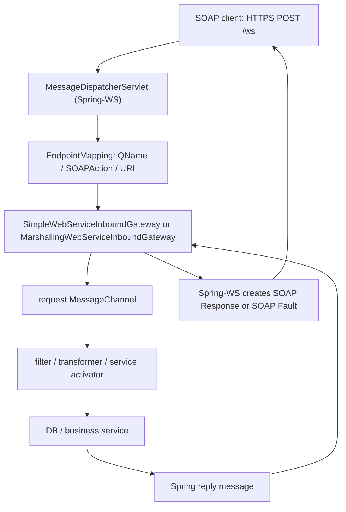
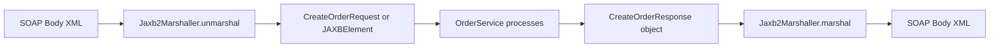
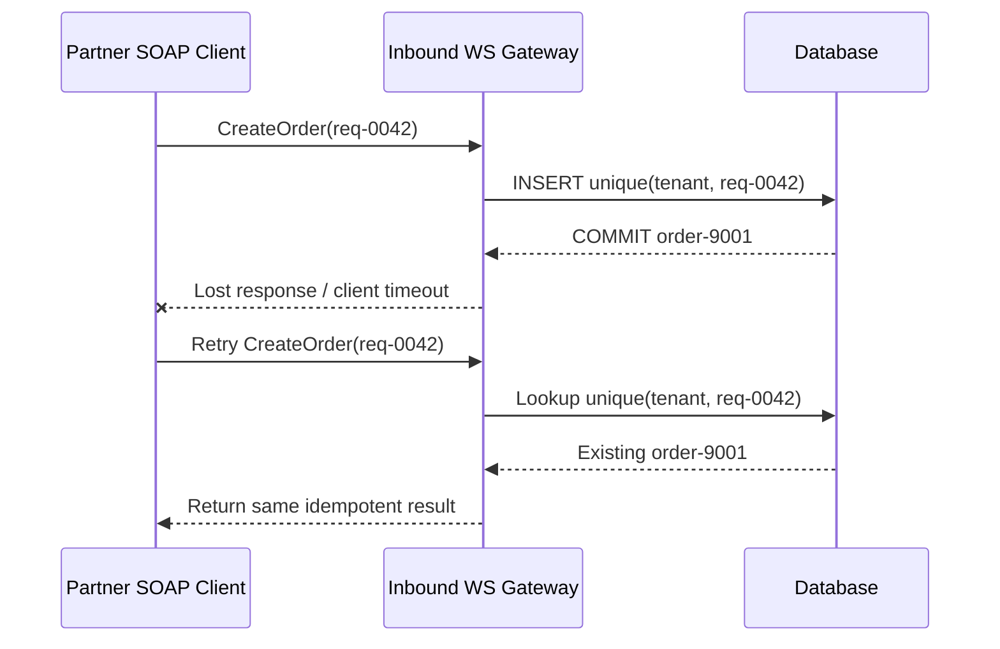

# Web service inbound gateway

## 1. Problem: a partner calls SOAP, and the system processes it via Spring Integration

A logistics partner still uses **SOAP 1.1** to send a `CreateOrderRequest`. The XML contract has been published using **XSD/WSDL**: the partner POSTs a SOAP envelope to an HTTPS endpoint, the service validates the data, creates the order, and returns a `CreateOrderResponse` within the same request. Inside the application, the development team wants to route the request to `MessageChannel`s, filters, transformers, service activators, and business services instead of putting everything inside a single SOAP controller.

Within the `SPRING_INTEGRATION_ADAPTERS` module — connecting external systems via inbound/outbound adapters, gateways, pollers, and `MessageChannel`s, managing message contracts, error handling, and connection lifecycles for files, SFTP, HTTP, JMS, AMQP, Kafka, and databases — the **Web service inbound gateway** acts as a bridge between **Spring Web Services (Spring-WS)** and **Spring Integration**. It receives a web service call from a client, creates a Spring Message, waits for a reply from the integration flow, and writes the result as a SOAP response.

**Why use an inbound gateway instead of an inbound channel adapter?** The partner requires **request–reply** within the same interaction: after sending `CreateOrderRequest`, the client expects a `CreateOrderResponse` or a SOAP Fault. An **outbound gateway** is the opposite direction: the application calls an external SOAP service. A **poller** is only for sources that actively pull data on a schedule and is **not needed** for SOAP inbound triggered by an HTTP request.

After this lesson, you will be able to:

1. Describe the chain `MessageDispatcherServlet → EndpointMapping → inbound gateway → MessageChannel → reply`.
2. Distinguish `SimpleWebServiceInboundGateway` from `MarshallingWebServiceInboundGateway` and `Source`/object payload types.
3. Configure a practical SOAP inbound gateway in Java with `PayloadRootQNameEndpointMapping` and `IntegrationFlow`; know when to use the `Ws.simpleInboundGateway()` DSL.
4. Design a **contract-first** XSD/WSDL contract, SOAPAction, SOAP headers, namespace versioning, and validation.
5. Handle reply channels, timeouts, SOAP Faults, retries/idempotency, and avoid confusing HTTP/SOAP accepted with database commit.
6. Harden the XML parser and endpoint with TLS, authn/authz, WS-Security, request size/time limits, observability, and sandbox testing.

> **Reference versions:** Spring Integration **6.5.x**, Spring Web Services **4.0.x**, Spring Framework **6.x**, Java 17+, and Spring Boot with a compatible dependency BOM. SOAP configuration packages use `org.springframework.ws.*` and XML payloads use `javax.xml.transform.Source` (**javax in JAXP is still correct**, do not confuse it with the Jakarta transition). The URI `urn:demo:orders:v1`, orders, and endpoints are sample data, not a real system.

## 2. Architecture: two dispatch layers



**Layer 1 — Spring-WS routing:** `MessageDispatcherServlet` receives the HTTP request and creates a `WebServiceMessage` from the SOAP envelope. `EndpointMapping` selects the right `MessageEndpoint` based on payload QName, SOAPAction, URI, or XPath. Both `SimpleWebServiceInboundGateway` and `MarshallingWebServiceInboundGateway` are **Spring-WS `MessageEndpoint`s**.

**Layer 2 — Spring Integration routing:** the inbound gateway creates a `Message<?>` containing the extracted payload or unmarshalled object and sends it to the **request channel**. Integration steps process the request and return a Spring reply. The gateway uses the result to create the web-service response. `MessageHeaders` can carry `WebServiceHeaders.SOAP_ACTION` (usually `ws_soapAction`), reply/error channels, and allowed header values.

| Component | Responsibility | Does not automatically do |
| --- | --- | --- |
| HTTP/SOAP transport | Receives HTTPS POST, performs TLS handshake, enforces request limits | Authorize orders per caller |
| `MessageDispatcherServlet` | Runs the Spring-WS message dispatcher | Auto-discover all IntegrationFlows without a mapping |
| `EndpointMapping` | Selects an endpoint by QName/SOAPAction/URI | Validate the entire XSD or access permissions |
| `SimpleWebServiceInboundGateway` | Sends `Source`/`WebServiceMessage` to a channel and waits for a reply | Automatically unmarshal into a POJO |
| `MarshallingWebServiceInboundGateway` | Uses a Spring OXM marshaller/unmarshaller | Automatically prevent XXE or validate business rules if underconfigured |
| `MessageChannel` | Routes Spring Messages within the integration graph | Guarantee DB commit or remote ACK |
| Service activator | Executes business logic, builds the response payload | Automatically turn exceptions into contract-compliant SOAP Faults |
| Spring-WS exception resolver | Maps appropriate errors to SOAP Faults | Automatically verify tenant or roll back side effects |

**Do not confuse `Http.inboundGateway("/...")` with `Ws.simpleInboundGateway()`.** The former belongs to Spring Integration HTTP and routes by HTTP request mapping; the latter is a **Spring-WS message endpoint** resolved by SOAP `EndpointMapping`. Both use HTTP as transport, but their contracts, faults, headers, and dispatch differ.

## 3. A valid SOAP 1.1 request and response

The sample SOAP request below uses `Content-Type: text/xml; charset=utf-8` and, when required, a SOAPAction sent by the client:

```http
POST /ws HTTP/1.1
Host: api.example.test
Content-Type: text/xml; charset=utf-8
SOAPAction: "urn:demo:orders:v1/CreateOrder"

<?xml version="1.0" encoding="UTF-8"?>
<soapenv:Envelope xmlns:soapenv="http://schemas.xmlsoap.org/soap/envelope/"
                  xmlns:ord="urn:demo:orders:v1">
  <soapenv:Header/>
  <soapenv:Body>
    <ord:CreateOrderRequest>
      <ord:requestId>req-0042</ord:requestId>
      <ord:customerId>C-100</ord:customerId>
    </ord:CreateOrderRequest>
  </soapenv:Body>
</soapenv:Envelope>
```

A successful response has the body:

```xml
<?xml version="1.0" encoding="UTF-8"?>
<soapenv:Envelope xmlns:soapenv="http://schemas.xmlsoap.org/soap/envelope/"
                  xmlns:ord="urn:demo:orders:v1">
  <soapenv:Body>
    <ord:CreateOrderResponse>
      <ord:requestId>req-0042</ord:requestId>
      <ord:status>ACCEPTED</ord:status>
    </ord:CreateOrderResponse>
  </soapenv:Body>
</soapenv:Envelope>
```

Spring-WS handles the SOAP envelope, while the **simple inbound gateway by default extracts the `Source` of the SOAP Body payload**: the `ord:CreateOrderRequest` element, **not the entire Envelope**. A normal service activator only needs to produce a `Source` containing **`ord:CreateOrderResponse`**; Spring-WS places the reply payload inside the response SOAP Body. If you return the entire `<soapenv:Envelope>` as the payload in default mode, you can produce malformed XML or a nested SOAP envelope.

With **SOAP 1.2**, the envelope namespace, Content-Type (`application/soap+xml`), and how action is passed differ from SOAP 1.1. Do not arbitrarily mix the two versions when a client has a fixed WSDL policy/contract.

## 4. Distinguishing simple and marshalling inbound gateways

Spring Integration supports two inbound gateway types:

| Criterion | `SimpleWebServiceInboundGateway` | `MarshallingWebServiceInboundGateway` |
| --- | --- | --- |
| Default request payload | `javax.xml.transform.Source` | Object produced by `Unmarshaller` |
| Handler response | `Source` or a contract-supported form | POJO converted to XML by `Marshaller` |
| Best suited for | XML transformers/XSLT, ESB, pass-through, contracts with many variants | XSD-generated JAXB classes or clearly separated domain DTOs |
| Schema validation | Requires configuring a Spring-WS validator or custom logic | **Unmarshalling is not full schema or business validation** |
| Dependencies | Spring Integration WS + Spring-WS | Plus Spring OXM/JAXB implementation and binding classes |
| Typical risks | Parsing XML without hardening; confusing `Source` with `String` | Wrong QName/JAXB annotations, missing JAXB runtime, oversized object graphs |

With the simple gateway:

```java
SimpleWebServiceInboundGateway simpleGateway =
        new SimpleWebServiceInboundGateway();
simpleGateway.setRequestChannel(orderRequests);
// Reply channel is optional; the gateway can use the replyChannel
// attached to the request message to receive the response.
```

With the marshalling gateway:

```java
MarshallingWebServiceInboundGateway objectGateway =
        new MarshallingWebServiceInboundGateway(jaxbMarshaller);
objectGateway.setRequestChannel(orderObjectRequests);
```

Both snippets are **API-illustrative excerpts**, not standalone runnable web endpoint configurations. They still require `MessageDispatcherServlet` and `EndpointMapping`. With Spring Integration 6.5, `Ws.simpleInboundGateway()` and `Ws.marshallingInboundGateway()` also provide corresponding DSL factories.

### `extractPayload(false)` mode of the simple gateway

If you use `simpleGateway.setExtractPayload(false)` or `Ws.simpleInboundGateway().extractPayload(false)`, the Spring message carries the **entire `WebServiceMessage`** instead of only the `Source`. This is useful when handling SOAP headers, attachments, metadata, or custom logic that needs the envelope. However, `WebServiceMessage` is typically tied to the request lifecycle/transport and **should not be arbitrarily serialized into Kafka/JMS**. For async processing, materialize a controlled DTO + metadata before the servlet request finishes.

## 5. Gradle and web-service transport configuration

Example using a Spring Boot BOM compatible with Spring Integration 6.5:

```groovy
dependencies {
    implementation 'org.springframework.boot:spring-boot-starter-integration'
    implementation 'org.springframework.integration:spring-integration-ws'
    implementation 'org.springframework.boot:spring-boot-starter-web-services'
    // JAXB runtime/bindings must be added when choosing the marshalling gateway.
    testImplementation 'org.springframework.boot:spring-boot-starter-test'
    testImplementation 'org.springframework.ws:spring-ws-test'
}
```

`spring-integration-ws` is a **separate module**, not replaced by `spring-integration-http`. Spring-WS provides `MessageDispatcherServlet`, SOAP factories, endpoint mapping, WSDL, and fault resolution. With the Spring Boot starter, check **existing auto-configuration** before registering a servlet manually: **use only one servlet registration/mapping matching `/ws/*`** to avoid two competing servlets. The next example shows **explicit registration**; when using equivalent Boot auto-configuration, you can omit the manual registration.

```yaml
server:
  port: 8080

spring:
  application:
    name: order-web-service

# Production: TLS is terminated at ingress/proxy or application
# with mTLS/rate limits/size caps; never expose demo HTTP directly to the Internet.
```

**Do not assume `spring.webservices.path=/ws` has registered your gateway:** that property relates to the Spring-WS servlet path when using auto-configuration, while **selecting the gateway bean by QName/SOAPAction still requires a mapping**. Routing with `@RestController`/`@RequestMapping` does not automatically convert a SOAP request into a Spring Integration WS message.

## 6. Minimal Java configuration: servlet + channel + inbound gateway + QName mapping

The sample below can serve as a **skeleton** for a SOAP 1.1 endpoint receiving `CreateOrderRequest`. In Spring-WS 4.x, `PayloadRootQNameEndpointMapping` accepts a map from a QName string of the form `{namespaceURI}localPart` to an endpoint bean; **this is not `@PayloadRoot` method mapping**.

```java
import java.util.Map;

import org.springframework.beans.factory.annotation.Qualifier;
import org.springframework.boot.web.servlet.ServletRegistrationBean;
import org.springframework.context.ApplicationContext;
import org.springframework.context.annotation.Bean;
import org.springframework.context.annotation.Configuration;
import org.springframework.integration.channel.DirectChannel;
import org.springframework.integration.ws.SimpleWebServiceInboundGateway;
import org.springframework.messaging.MessageChannel;
import org.springframework.ws.server.endpoint.mapping.PayloadRootQNameEndpointMapping;
import org.springframework.ws.transport.http.MessageDispatcherServlet;

@Configuration
public class SoapOrdersInboundConfig {

    public static final String NS = "urn:demo:orders:v1";
    public static final String REQUEST_QNAME =
            "{" + NS + "}CreateOrderRequest";

    @Bean
    public ServletRegistrationBean<MessageDispatcherServlet> soapDispatcher(
            ApplicationContext context) {
        MessageDispatcherServlet servlet = new MessageDispatcherServlet();
        servlet.setApplicationContext(context);
        servlet.setTransformWsdlLocations(true);
        return new ServletRegistrationBean<>(servlet, "/ws/*");
    }

    @Bean
    public MessageChannel orderSoapRequests() {
        return new DirectChannel();
    }

    @Bean
    public SimpleWebServiceInboundGateway orderSoapGateway(
            @Qualifier("orderSoapRequests") MessageChannel requests) {

        SimpleWebServiceInboundGateway gateway =
                new SimpleWebServiceInboundGateway();
        gateway.setRequestChannel(requests);
        gateway.setRequestTimeout(5_000L);
        gateway.setReplyTimeout(10_000L);
        // Reply channel is optional; the gateway provides a temporary reply channel
        // per the request-reply mechanism when no fixed channel is configured.
        return gateway;
    }

    @Bean
    public PayloadRootQNameEndpointMapping orderSoapEndpointMapping(
            SimpleWebServiceInboundGateway orderSoapGateway) {

        PayloadRootQNameEndpointMapping mapping =
                new PayloadRootQNameEndpointMapping();
        mapping.setEndpointMap(Map.of(REQUEST_QNAME, orderSoapGateway));
        return mapping;
    }
}
```

**Bean lifecycle notes:** `orderSoapGateway` is a `MessageEndpoint`; `orderSoapEndpointMapping` references that exact object. If the code only registers the gateway without registering `PayloadRootQNameEndpointMapping`/another mapping, `MessageDispatcherServlet` may fail to find an endpoint and return a dispatch error. If the code only has `EndpointMapping` without a request channel subscriber, requests will not be processed into a reply. If auto-configuration already registers the servlet, avoid registering a second servlet on the same path.

### Why use `DirectChannel` in the first example?

The gateway serves **synchronous SOAP request–reply**. `DirectChannel` invokes the handler synchronously on the sending thread, making responses and exceptions easy to test. If you use `ExecutorChannel`, the gateway can still wait on the reply channel, but now you must coordinate threads, timeouts, context, and potential servlet thread exhaustion. If you use `QueueChannel` without a consumer, requests will wait and then time out. For multi-minute processing, consider **accept/ack + correlation ID** or a callback/poll-status contract instead of holding the HTTP connection open.

## 7. Java DSL for processing SOAP payloads and returning a reply

The gateway in section 6 puts a `Source` payload onto the `orderSoapRequests` channel. The flow below illustrates a static response to **verify end-to-end wiring**; it intentionally does not create an order or read the ID from the request. A production implementation must safely parse/validate XML, check authorization, and invoke an idempotent business service.

```java
import java.io.StringReader;

import javax.xml.transform.Source;
import javax.xml.transform.stream.StreamSource;

import org.springframework.beans.factory.annotation.Qualifier;
import org.springframework.context.annotation.Bean;
import org.springframework.context.annotation.Configuration;
import org.springframework.integration.dsl.IntegrationFlow;
import org.springframework.messaging.MessageChannel;

@Configuration
public class SoapOrdersProcessingFlow {

    @Bean
    public IntegrationFlow orderSoapProcessing(
            @Qualifier("orderSoapRequests") MessageChannel requestChannel) {

        return IntegrationFlow.from(requestChannel)
                .handle(Source.class, (requestPayload, headers) -> {
                    // Demo wiring: DO NOT use as real business processing.
                    String responsePayload = """
                        <ord:CreateOrderResponse
                            xmlns:ord="urn:demo:orders:v1">
                          <ord:requestId>req-0042</ord:requestId>
                          <ord:status>ACCEPTED</ord:status>
                        </ord:CreateOrderResponse>
                        """;
                    return new StreamSource(new StringReader(responsePayload));
                })
                .get();
    }
}
```

Because the handler **returns a value** instead of `void`, Spring Integration produces a reply and sends it to the temporary reply channel provided by the gateway for the request, following request–reply rules. The gateway receives the `Source` containing the `CreateOrderResponse` element, and Spring-WS creates the SOAP envelope response. If the handler throws an exception, returns no reply, or exceeds the wait timeout, the client is not guaranteed a successful response.

**Limitation of the sample code:** the response always returns `req-0042` and status ACCEPTED to prove connectivity; **it does not reflect the actual ID**. Section 10 will describe proper business processing boundaries, and section 11 explains how to return SOAP errors. Never deploy this demo to production.

### Request–reply contract at each step

| Step | Input | Output |
| --- | --- | --- |
| SOAP client | Envelope XML | HTTP request |
| Spring-WS | `SoapMessage`/`WebServiceMessage` | Maps to gateway via body QName |
| Simple inbound gateway | `Source` + headers | Spring `Message<Source>` |
| `IntegrationFlow` | Request payload + headers | `Source` response |
| Inbound gateway | Spring reply | Spring-WS response body |
| SOAP client | HTTP + SOAP Envelope | Result conforming to XSD/WSDL |

## 8. Java DSL creating a **gateway at the start of IntegrationFlow**: alternative approach

Besides creating a `SimpleWebServiceInboundGateway` bean as in section 6, Spring Integration 6.5 supports the `Ws.simpleInboundGateway()` and `Ws.marshallingInboundGateway()` DSLs. The official style uses:

```java
import org.springframework.context.annotation.Bean;
import org.springframework.context.annotation.Configuration;
import org.springframework.integration.dsl.IntegrationFlow;
import org.springframework.integration.ws.dsl.Ws;

@Configuration
public class WsInboundDslAlternative {

    @Bean
    public IntegrationFlow inboundOrderFlow(OrderSoapBusinessHandler handler) {
        return IntegrationFlow.from(
                        Ws.simpleInboundGateway()
                                .id("createOrderDslGateway"))
                .handle(handler)
                .get();
    }
}
```

`OrderSoapBusinessHandler` is an **application-implemented** handler with validation logic returning a `Source`; it is not a Spring Integration API. With the DSL approach, the `createOrderDslGateway` endpoint must still be **referenced by a Spring-WS EndpointMapping**, for example using the bean name as the value:

```java
@Bean
public PayloadRootQNameEndpointMapping dslOrderMapping() {
    PayloadRootQNameEndpointMapping mapping =
            new PayloadRootQNameEndpointMapping();
    mapping.setEndpointMap(Map.of(
            "{urn:demo:orders:v1}CreateOrderRequest",
            "createOrderDslGateway"));
    return mapping;
}
```

Place the mapping snippet in a configuration that imports `Map` and `PayloadRootQNameEndpointMapping` as in section 6. Spring-WS allows `endpointMap` to accept **a bean instance or a bean name**; verify that the DSL registers the gateway under the expected ID in your chosen version. **This is an alternative approach**—do not enable both `orderSoapGateway` and `createOrderDslGateway` mapping the same QName, as two competing mappings can cause non-deterministic dispatch.

## 9. Contract-first: XSD and WSDL as the integration boundary

For B2B SOAP web services, the **contract must be published first** and version-controlled. XSD defines elements, ordering, and data types; WSDL describes operations, messages, bindings, and the endpoint address. A client that generates code from WSDL may tightly depend on QNames, SOAPAction, namespaces, and the XML schema.

Minimal XSD example for the CreateOrder operation:

```xml
<?xml version="1.0" encoding="UTF-8"?>
<xs:schema xmlns:xs="http://www.w3.org/2001/XMLSchema"
           targetNamespace="urn:demo:orders:v1"
           xmlns:ord="urn:demo:orders:v1"
           elementFormDefault="qualified">

  <xs:element name="CreateOrderRequest">
    <xs:complexType>
      <xs:sequence>
        <xs:element name="requestId" type="xs:string"/>
        <xs:element name="customerId" type="xs:string"/>
      </xs:sequence>
    </xs:complexType>
  </xs:element>

  <xs:element name="CreateOrderResponse">
    <xs:complexType>
      <xs:sequence>
        <xs:element name="requestId" type="xs:string"/>
        <xs:element name="status" type="xs:string"/>
      </xs:sequence>
    </xs:complexType>
  </xs:element>
</xs:schema>
```

**Note:** this is a learning XSD and does not constrain `requestId` with a pattern, `status` with an enumeration, or length limits. Production contracts should include types/domain constraints, backward compatibility rules, and CI contract tests. Business rules (such as verifying that the customer belongs to the tenant) must also be validated **after** the XML is valid.

### Publishing WSDL with `DefaultWsdl11Definition`

Spring Web Services can generate WSDL 1.1 from an XSD via `DefaultWsdl11Definition`, or serve a static WSDL approved by the partner. Example Spring beans assuming the `orders.xsd` resource actually exists on the classpath:

```java
import org.springframework.context.annotation.Bean;
import org.springframework.context.annotation.Configuration;
import org.springframework.core.io.ClassPathResource;
import org.springframework.ws.wsdl.wsdl11.DefaultWsdl11Definition;
import org.springframework.xml.xsd.SimpleXsdSchema;
import org.springframework.xml.xsd.XsdSchema;

@Configuration
public class OrdersContractConfiguration {

    @Bean
    public XsdSchema ordersSchema() {
        return new SimpleXsdSchema(new ClassPathResource("orders.xsd"));
    }

    @Bean(name = "orders")
    public DefaultWsdl11Definition ordersWsdl(XsdSchema ordersSchema) {
        DefaultWsdl11Definition wsdl = new DefaultWsdl11Definition();
        wsdl.setPortTypeName("OrdersPort");
        wsdl.setLocationUri("/ws");
        wsdl.setTargetNamespace("urn:demo:orders:v1");
        wsdl.setSchema(ordersSchema);
        return wsdl;
    }
}
```

When `MessageDispatcherServlet` is configured to expose WSDLs, the URL typically takes the form `/ws/orders.wsdl` in this example; **verify the mapping and Boot auto-configuration** in the actual runtime environment. `setTransformWsdlLocations(true)` updates the location according to the external request/address, but when behind an ingress/proxy you must manage Forwarded headers and **trust only authorized proxies**. Otherwise, the generated WSDL may advertise the wrong scheme/host or trust client-forged headers.

A WSDL may be published over HTTPS, but downloading the WSDL **does not mean the client is authorized to invoke the operation**. Authentication/authorization lives at the HTTP/SOAP/business boundary, not in keeping the `orders.wsdl` path secret.

### Contract-first versioning

| Change | Impact | Handling strategy |
| --- | --- | --- |
| Changing namespace from `v1` to `v2` | QName routing and JAXB classes change | Create a new mapping/version and separate contract tests |
| Adding an optional element in XSD | May be partially compatible | Verify with generated clients and schema rules |
| Adding a required element | Easily breaks backward compatibility | Create a new contract version |
| Switching SOAP 1.1 to SOAP 1.2 | Envelope/Content-Type/Action differ | Test client/bindings and message factory |
| Renaming operation/response element | WSDL/client stubs must be regenerated | Migration plan, keep v1 endpoint for a deprecation period |
| Changing semantics of `ACCEPTED` | Can break partner workflows even if XML is unchanged | Version behavior, not just the schema |

Never string-split XML tags or compare local names while ignoring namespaces. `{urn:demo:orders:v1}CreateOrderRequest` differs from `{urn:attacker:orders}CreateOrderRequest` even though both look like `CreateOrderRequest` on the surface.

## 10. Mapping by QName, SOAPAction, URI, and XPath

Spring-WS provides multiple `EndpointMapping` implementations. For an integration gateway, choose **one primary contract** to route on, then validate the contents:

| Mapping | Routing key | When to use | Notes |
| --- | --- | --- | --- |
| `PayloadRootQNameEndpointMapping` | QName of first SOAP Body element | Contract-first with XSD | Never drop namespace; exact QName |
| `SoapActionEndpointMapping` | HTTP SOAPAction / SOAP-version-specific action | Partner uses stable actions | Action is client-declared, **not** authentication |
| `UriEndpointMapping` | Endpoint URI/path per Spring-WS | Dedicated endpoints per operation group | Does not replace content validation |
| `XPathPayloadEndpointMapping` | XPath over XML payload | Legacy contracts with multiple forms under one root | Restrict XML/XPath complexity and namespaces |

Section 6 uses QName because it is explicit and less dependent on HTTP headers. With `SoapActionEndpointMapping`, configure `endpointMap` according to the contracted SOAPAction; the business layer must still verify the payload QName and schema. If SOAPAction says “CreateOrder” while the body is “CancelOrder”, **do not execute a cancellation** just because the route matched.

If the application also uses `@Endpoint` + `@PayloadRoot`, Spring-WS provides **`PayloadRootAnnotationMethodEndpointMapping`** for method-based endpoints. A `SimpleWebServiceInboundGateway` bean is **not** a `@PayloadRoot` controller method; you need the **right type** of mapping pointing to the gateway. When configuring multiple mappings with overlapping conditions, test their order and priority to avoid a catch-all default endpoint routing requests into the wrong flow.

### Spring headers for SOAPAction

Spring Integration defines `WebServiceHeaders.SOAP_ACTION` with key value `ws_soapAction`. Per the reference, SOAPAction is placed in Spring message headers when the inbound message is SOAP. Example handler reading it solely for logging/routing after verification:

```java
import org.springframework.integration.ws.WebServiceHeaders;
import org.springframework.messaging.Message;

public static void inspectAction(Message<?> message) {
    String action = message.getHeaders()
            .get(WebServiceHeaders.SOAP_ACTION, String.class);
    // Use only for correlation or contract checking; never use as
    // authentication/authorization or a business unique key.
}
```

Do not assume **arbitrary SOAP headers** automatically become Spring headers. To map fields like correlation ID or WS-Addressing, configure a `SoapHeaderMapper`/`DefaultSoapHeaderMapper` or read from `WebServiceMessage`, with an allowlist and length limits.

## 11. Marshalling inbound gateway: mapping XML to Java objects

When a project uses schema-generated Java classes (JAXB/XJC), `MarshallingWebServiceInboundGateway` can unmarshal request XML into an object and marshal the response object back into the SOAP body:



Example `Jaxb2Marshaller` with **XSD-generated** binding classes already present in the project:

```java
import org.springframework.context.annotation.Bean;
import org.springframework.context.annotation.Configuration;
import org.springframework.integration.dsl.IntegrationFlow;
import org.springframework.integration.ws.dsl.Ws;
import org.springframework.oxm.jaxb.Jaxb2Marshaller;

@Configuration
public class OrderJaxbInboundAlternative {

    @Bean
    public Jaxb2Marshaller orderMarshaller() {
        Jaxb2Marshaller marshaller = new Jaxb2Marshaller();
        marshaller.setContextPath("com.example.generated.orders.v1");
        // Schema validation, XXE hardening, type allowlists, and JAXB
        // runtime must be configured/verified in the real project.
        return marshaller;
    }

    @Bean
    public IntegrationFlow marshallingOrderFlow(
            Jaxb2Marshaller orderMarshaller,
            GeneratedOrderRequestHandler orderRequestHandler) {

        return IntegrationFlow.from(
                        Ws.marshallingInboundGateway()
                                .marshaller(orderMarshaller)
                                .unmarshaller(orderMarshaller)
                                .id("marshalledOrderGateway"))
                .handle(orderRequestHandler)
                .get();
    }
}
```

`GeneratedOrderRequestHandler` is an **application-built handler** that receives the JAXB-created object and returns a response object; you must define the classes/bindings from XSD. Depending on how XJC generates classes, the payload may be `JAXBElement<CreateOrderRequest>` rather than `CreateOrderRequest` directly; inspect the type in tests. `Jaxb2Marshaller` requires a compatible JAXB runtime/provider and should only trust/allow contract types. You must also create a `PayloadRootQNameEndpointMapping` or another mapping pointing to the `marshalledOrderGateway` bean as in section 8, **without using the same QName as an active simple gateway**.

### Do not equate unmarshalling with validation

Unmarshalling into a POJO **does not by default** guarantee:

- That the request obeys every `minOccurs/maxOccurs`, pattern, extension, and version expected by the XSD.
- That the customer/tenant or token is authorized to create the order.
- That `requestId` has never been processed and the business transaction will run once.
- That the parser is safe against XML external entities, entity expansion, XInclude, or oversized payloads.

You need **XSD validation + business validation + authz + quotas** at the appropriate boundaries. Some generated fields may be `null` when schema validation is disabled, even if business code assumes they are required.

## 12. XSD validation using a Spring-WS interceptor

Spring-WS provides the **server-side** `PayloadValidatingInterceptor` in package `org.springframework.ws.soap.server.endpoint.interceptor`. When a request is invalid, the interceptor can generate a SOAP Fault before calling the business handler. Example adding it to `PayloadRootQNameEndpointMapping` with an XSD existing on the classpath:

```java
import org.springframework.core.io.ClassPathResource;
import org.springframework.ws.server.EndpointInterceptor;
import org.springframework.ws.server.endpoint.mapping.PayloadRootQNameEndpointMapping;
import org.springframework.ws.soap.server.endpoint.interceptor.PayloadValidatingInterceptor;

// Snippet placed inside the configuration that creates PayloadRootQNameEndpointMapping.
PayloadValidatingInterceptor validator = new PayloadValidatingInterceptor();
validator.setSchema(new ClassPathResource("orders.xsd"));
validator.setValidateRequest(true);
validator.setValidateResponse(true);

PayloadRootQNameEndpointMapping mapping =
        new PayloadRootQNameEndpointMapping();
mapping.setEndpointMap(Map.of(
        "{urn:demo:orders:v1}CreateOrderRequest", orderSoapGateway));
mapping.setInterceptors(new EndpointInterceptor[]{validator});
```

`Map` and `orderSoapGateway` are the bean/variables from section 6. This is an **extension to** the existing mapping—do not create a second mapping matching the same QName. The validator should be managed as a Spring bean/interceptor with proper lifecycle initialization; when assembling production code, ensure `afterPropertiesSet`/Spring container initialization executes and the XSD resource exists.

**Validation policy is a contract decision:** strict request validation may block valid partner extensions. If choosing a permissive contract, you must still cap XML complexity, validate required fields, and prevent schema-invalid business operations. Response validation helps catch contract bugs before sending replies to clients. Never enable full SOAP envelope tracing in production just to debug XSD failures.

## 13. SOAP Fault, business errors, and integration errors

A SOAP inbound gateway needs a clear **error contract**. Do not arbitrarily turn every exception into HTTP 200 + `status=ERROR`, nor expose Java stack traces or SQL statements in a SOAP Fault.

Conceptual SOAP 1.1 Fault example:

```xml
<soapenv:Envelope xmlns:soapenv="http://schemas.xmlsoap.org/soap/envelope/">
  <soapenv:Body>
    <soapenv:Fault>
      <faultcode>soapenv:Client</faultcode>
      <faultstring>Request violates the published contract</faultstring>
    </soapenv:Fault>
  </soapenv:Body>
</soapenv:Envelope>
```

| Error | Usually appropriate behavior | Avoid |
| --- | --- | --- |
| Malformed XML, wrong QName, XSD mismatch | Client/sender SOAP Fault per version, do not enter business logic | Swallowing the error and creating a default order |
| Unauthenticated / unauthorized | HTTP/SOAP security failure per policy | Trusting SOAPAction/`From` as authorization |
| Customer does not exist | Business fault or decline response per WSDL | Returning SQL details or stack traces |
| DB temporarily unavailable | Server/receiver fault or retryable contract error | Promising no side effects occurred if uncertain |
| Flow fails to reply in time | Monitored timeout/fault with correlation | Letting servlet threads hang indefinitely |
| Response fails schema | Server error; do not send non-compliant reply | Treating HTTP 200 as success |

Spring-WS provides `SoapFaultMappingExceptionResolver` to map exceptions to SOAP fault codes/reasons, alongside `@SoapFault` on annotation-style endpoints. With Spring Integration WS inbound, verify that exceptions thrown inside the integration flow propagate to the **Spring-WS resolver layer** as expected. A Spring Integration `errorChannel` only receives errors per messaging infrastructure; **it does not automatically turn every `ErrorMessage` into a SOAP Fault**. Place the resolver in the Spring-WS context, define fault mappings per contract codes, and test with real requests.

### HTTP status does not replace inspecting the SOAP body

In SOAP 1.1, faults typically appear under HTTP 500 with a SOAP Fault; in SOAP 1.2 or specific providers, semantics may differ. Clients must inspect the **SOAP Fault and contract payload**, not rely solely on a 200/500 code. If a reverse proxy returns an HTML error page instead of a SOAP envelope, SOAP clients may fail to parse it: test auth/filters/ingress and the error boundary from HTTP through Spring-WS.

### Request timeout, reply timeout, and business timeout

`gateway.setRequestTimeout(...)` limits how long sending the message to the request channel can take; `setReplyTimeout(...)` limits waiting for a reply via the messaging gateway, and is **not** an end-to-end deadline for the entire HTTP client, DB transaction, and proxy. With `DirectChannel`, synchronous handler execution can dominate request duration; configure appropriate HTTP server/proxy/read timeouts and DB query timeouts.

If a downstream handler creates the order and crashes before replying, the client may **receive no response even though the DB committed**. When the client retries with the same `requestId`, the service must recognize the already-processed request and return an **idempotent result** rather than creating a second order.

## 14. SOAP security: TLS, WS-Security, and business authorization

A SOAP client can send valid XML while **lacking permission** to create an order. `EndpointMapping` decides where to route based on QName/SOAPAction/URI; that is **not** identity verification or authorization.

| Boundary | What to verify | Tool or policy |
| --- | --- | --- |
| Network/transport | Trusted TLS connection, valid host/port only | HTTPS at ingress or embedded server; cert verification and mTLS as required |
| Caller authentication | Who sent the request? | OAuth2/JWT at HTTP layer, mTLS, or WS-Security token/signature |
| Message integrity | Were SOAP body/headers altered after signing? | WS-Security digital signature/timestamp, `Wss4jSecurityInterceptor` |
| Authorization | Is the client/tenant allowed to create orders for this customer? | Business policy, customer ownership, scope/role |
| Replay protection | Is a previously sent request being replayed? | Unique `(tenant_id, request_id)`, timestamp/nonce where applicable |
| Payload validation | Is XML contract-compliant and safe? | XSD, parser hardening, size/depth/attachment limits |
| Secrets and privacy | No leaked tokens, customer PII, or keys/certificates | Secret manager, logging redaction, retention, and access control |

**TLS and WS-Security address different layers.** TLS protects transport between two endpoints, but after TLS termination at a proxy, SOAP XML may continue through internal components. WS-Security can provide message-level integrity/signatures per partner policy. Never assume a SOAP `UsernameToken` header is authenticated merely because it is present. Configure an interceptor that verifies signatures, timestamps/nonces, and the corresponding principal's permissions.

### `Wss4jSecurityInterceptor` and policy

Spring Web Services supports `org.springframework.ws.soap.security.wss4j2.Wss4jSecurityInterceptor` (verify package for your Spring-WS version); it can be configured to validate UsernameToken, signatures, expiration, and encryption per the contract. Register the interceptor on the Spring-WS endpoint mapping or a Spring-WS-enforced interceptor policy, paired with environment-appropriate authentication providers/keystores/truststores. **Never** write a header mapper that fakes signatures, and never read a UsernameToken and compare plaintext passwords in custom code.

If using HTTP Bearer tokens at an API gateway, verify JWT issuer, audience, signature, expiration, and authorization scopes; do not trust client-supplied `X-User` headers unless normalized by a trusted proxy. If using mTLS, validate the client certificate and bind subject/SAN to the tenant identity rather than just checking `isSecure()`.

## 15. XML parser hardening, XXE, entity expansion, and MTOM

SOAP uses XML; a request with external entities, DTDs, or an expanding payload can cause **XXE/SSRF**, arbitrary file read, or denial-of-service if parsers are insecurely configured. An XML body can also contain millions of nodes/attributes or excessive nesting depth.

Mandatory rules:

1. **Enforce request size limits at ingress/servlet** and limit attachment counts, MTOM size, XML depth, and processing time.
2. **Disable DTDs/external entities/XInclude** on any parser created by the application; enable secure processing and disable external DTD/schema/XSLT access where applicable.
3. Never use `TransformerFactory.newInstance()` with untrusted stylesheets/`Source`s without enabling security limits and pinning the provider implementation.
4. With `Jaxb2Marshaller`, restrict allowed classes, control unmarshalling, validate against schema; never let clients specify arbitrary Java classes.
5. Never build a custom SOAP parser using `String.split`, raw client-provided XPath expressions, or XSLT loaded from untrusted URLs.
6. If SOAP carries attachments/MTOM, enforce quotas and antivirus scanning by content type, never log raw bytes, and never push request streams onto a queue after the request lifecycle ends.

Hardening snippet **applies only when the application creates its own DOM parser**; it does not automatically configure every parser inside Spring-WS:

```java
import javax.xml.XMLConstants;
import javax.xml.parsers.DocumentBuilderFactory;

public static DocumentBuilderFactory secureDocumentBuilderFactory()
        throws Exception {
    DocumentBuilderFactory factory =
            DocumentBuilderFactory.newInstance();
    factory.setNamespaceAware(true);
    factory.setFeature(XMLConstants.FEATURE_SECURE_PROCESSING, true);
    factory.setFeature(
            "http://apache.org/xml/features/disallow-doctype-decl", true);
    factory.setFeature(
            "http://xml.org/sax/features/external-general-entities", false);
    factory.setFeature(
            "http://xml.org/sax/features/external-parameter-entities", false);
    factory.setXIncludeAware(false);
    factory.setExpandEntityReferences(false);
    factory.setAttribute(XMLConstants.ACCESS_EXTERNAL_DTD, "");
    factory.setAttribute(XMLConstants.ACCESS_EXTERNAL_SCHEMA, "");
    return factory;
}
```

This snippet is a **utility method** that belongs in a class and must handle `ParserConfigurationException`/feature support per JAXP provider. If a provider does not support a required protective feature, **fail configuration** rather than silently ignoring it and parsing anyway. When using SOAP/JAXB, verify the actual `WebServiceMessageFactory`, SAAJ/JAXB/Transformer configuration—hardening one manual factory **does not guarantee** the entire stack is safe.

### When is `extractPayload(false)` needed?

By default, the simple gateway passes the XML body's `Source`. If you need to process special **SOAP headers or MIME/MTOM attachments**, you can choose `extractPayload(false)` to receive `WebServiceMessage`, then extract the needed data within the same request scope. When doing so, the code must control SOAP version, attachment resource lifecycles, quotas, header trust, and transformations. There is no reason to push the entire `WebServiceMessage` over JMS/Kafka and expect it to still access the HTTP request stream.

## 16. Idempotency and timeouts when partners retry requests

A SOAP inbound gateway usually runs **synchronously**. If the DB commits but the client times out before receiving the SOAP response, the partner may resend `CreateOrderRequest` with the same `requestId`. Without server-side idempotency, two orders could be created.



**Distinguish two types of keys:**

- The partner's `requestId` is the key to **recognize retries of the same request**, scoped to the authenticated tenant/client identity.
- `orderId` or a business reference in the DB is the **business identity**. Two different requests must not be treated as duplicates merely because the customer name is the same.

Example schema and mechanism:

```sql
CREATE TABLE soap_request_ledger (
    tenant_id       VARCHAR(80) NOT NULL,
    request_id      VARCHAR(120) NOT NULL,
    request_hash    VARCHAR(64) NOT NULL,
    status          VARCHAR(30) NOT NULL,
    order_id        VARCHAR(120),
    response_ref    VARCHAR(255),
    created_at      TIMESTAMP NOT NULL,
    updated_at      TIMESTAMP NOT NULL,
    PRIMARY KEY (tenant_id, request_id)
);
```

Processing flow:

1. Authenticate the tenant and validate the payload against XSD + business constraints.
2. Canonicalize and compute a hash of the **business content** per policy (do not naively hash raw XML assuming two semantically identical envelopes have identical bytes).
3. In a transaction, claim `(tenant_id, request_id)` and check the hash of any existing request.
4. If first time, run business logic + store result/`response_ref`, committing atomically with the ledger.
5. If retried with the same content and the record is `COMPLETED`, return the **same stored response**.
6. If the same request ID has different content, return a contract fault/validation conflict rather than silently returning the old result.
7. If the status is unclear (`IN_PROGRESS`) due to a crash, reconcile with the DB; do not create a second order.

**Do not rely on Spring `MessageHeaders.ID` as an idempotency key.** That header identifies one message emission inside the flow; when a client retries HTTP/SOAP, a new Spring message usually gets a new ID. Likewise, never trust SOAPAction or any caller-sent header as a business unique key without authenticated tenant scoping.

### When business processing is slower than the HTTP timeout

If creating an order requires calling multiple systems over several minutes, holding a synchronous HTTP connection risks timeouts at the ingress, servlet, or client. You can design a contract like:

```xml
<ord:CreateOrderResponse xmlns:ord="urn:demo:orders:v1">
  <ord:requestId>req-0042</ord:requestId>
  <ord:status>ACCEPTED_FOR_PROCESSING</ord:status>
  <ord:jobId>job-7823</ord:jobId>
</ord:CreateOrderResponse>
```

**This is a different contract** requiring corresponding XSD/WSDL definitions: `ACCEPTED_FOR_PROCESSING` does not mean the order has committed. After replying, the downstream job is processed via a durable queue, and the partner tracks it via a status query operation or agreed callback. Never return a "completed success" reply when the job has only been placed in RAM.

## 17. Error channel, transactions, and SOAP replies

Spring Integration has `errorChannel`/`ErrorMessage` and several `MessageChannel` types; however, errors in SOAP request–reply have **two sides**:

1. **Messaging error:** a service activator, transformer, router, or downstream handler throws an exception; Spring Integration can wrap the error and route it to a configured error flow.
2. **SOAP transport error:** the client expects a contract-compliant SOAP Fault/response, and the Spring-WS exception resolver or gateway must complete the request before timeout.

If an error flow merely logs and **swallows the exception**, the SOAP client may hit a timeout or receive an unclear response. If a handler returns an `ErrorMessage` object instead of a `Source`/POJO response, the gateway may also fail to marshal it. The error pipeline must decide **explicitly**: return a business response, throw an exception for the Spring-WS fault resolver to handle, or terminate with a transport error that has metrics and correlation.

| Handling approach | Appropriate scenario | Avoid |
| --- | --- | --- |
| Service returns `CreateOrderResponse` with explicit status | Order validly declined per business contract | Disguising system errors as `ACCEPTED` |
| Spring-WS SOAP Fault | XML/schema/auth/business fault per WSDL policy | Leaking stack traces/SQL/tokens into fault detail |
| DB rollback + client retry | Failure before commit where no side effects occurred | Promising client retry is safe when commit state is unknown |
| Outbox/job + async response | Long-running processing needing durable continuation | Replying success before durably persisting the job |
| Reject at gateway/ingress | Oversized request, unauthenticated, rate-limited | Letting payloads enter business queues before auth |

Keep DB transactions short and explicit; avoid holding a transaction open while waiting on a slow remote call if an inbox/outbox pattern can be used. When a SOAP response is lost after commit, the **unique constraint/ledger** is responsible for preventing duplicate order creation.

## 18. Performance: servlet threads, channels, and backpressure

Unlike a file/SFTP poller, SOAP requests are **pushed** by partners. Each request can occupy a servlet thread, XML parser, DB connection, and reply-waiting capacity. A request flood can exhaust resources **before** messages even enter the integration flow.

| Mechanism | What it protects | Limitations |
| --- | --- | --- |
| Ingress rate limiting per client/tenant | Requests per second | Does not limit XML depth |
| Max HTTP body/attachment size | Memory/IO volume | Does not block entity expansion or XSLT recursion |
| `DirectChannel` | Synchronous path, straightforward reply control | Slow handlers hold servlet threads |
| `ExecutorChannel` | Offloads work to an executor | Gateway still waits for reply and retains request context |
| `QueueChannel` | Internal buffering | Without a consumer/reply, requests time out; RAM buffer is not durable |
| DB connection pool | Prevents excessive concurrent transactions | Does not prevent XML-parsing CPU overload |
| Circuit breaker/rate limiter advice | Isolates temporarily failing downstreams | Does not replace auth, schema, or ingress rate limits |
| Durable job/outbox | Moves heavy work to async | Requires async contract, correlation, and retention |

**Do not attach `Pollers.fixedDelay(...)` to an inbound SOAP gateway:** the servlet invokes the endpoint on incoming requests; adding a poller changes semantics and does not make clients send faster or slower. An async worker after staging can use its own poller/queue, but the **SOAP source remains request-driven**.

### Controlling timeouts

- HTTP client timeout, reverse proxy read timeout, server request timeout, and Spring Integration `replyTimeout` must be configured consistently with the SLA.
- If a handler holds DB locks or makes downstream HTTP calls, bound them individually rather than relying on a reply timeout to cancel already-initiated side effects.
- SOAP client retries must be paired with idempotency; aggressive retry counts amplify load on providers/DB during outages.
- When all connection pools are saturated, return a temporary error with a correlation ID per the contract; never buffer unbounded jobs in RAM.

## 19. Observability and tracing

Every step should carry an internal **correlation ID**, linkable to the partner's `requestId` after validation. SOAP headers may carry trace identifiers, but those are caller inputs; create or enrich spans/traces using OpenTelemetry or a trusted logging system and cap string lengths.

| Metric | Meaning |
| --- | --- |
| `soap_request_total{operation,client}` | Requests reaching the gateway after ingress |
| `soap_endpoint_not_found_total` | Requests failing to match QName/SOAPAction/URI mapping |
| `soap_xsd_validation_failure_total` | XML failing XSD validation |
| `soap_auth_failure_total` | Rejected authn/authz |
| `soap_fault_total{category}` | SOAP Faults by code/client/server |
| `soap_gateway_reply_timeout_total` | Requests missing a timely reply |
| `soap_request_duration` | End-to-end duration from request receipt to response |
| `soap_integration_processing_duration` | Time spent in the integration flow processing the payload |
| `soap_business_committed_total` | Committed business transactions |
| `soap_idempotent_replay_total` | Retries returning an existing stored result |
| `soap_active_requests` | In-flight waiting requests, detecting saturation |

**Do not log raw SOAP bodies** in production just to debug mappings. SOAP payloads and headers may contain personal data, credentials, UsernameTokens, signatures, certificates, and sensitive business information. Log the operation QName, internal `tenantId`, correlation ID, duration, status, and normalized error codes; redact all protected data. When raw XML must be archived for audit, encrypt it, restrict access, and enforce retention.

## 20. Testing with MockWebServiceClient and HTTP clients

To verify a SOAP inbound gateway, test at **two levels**:

- **Integration test in Spring-WS:** `MockWebServiceClient` dispatches SOAP payloads through Spring-WS mappings/gateway into the integration flow and verifies replies/faults. These tests are fast and isolated from the network.
- **End-to-end HTTP/HTTPS test:** a real client calls `MessageDispatcherServlet` over a port/ingress; verifies Content-Type, TLS, auth, path, WSDL, SOAPAction, status, and limits. `MockWebServiceClient` **does not replace** tests for servlet registration, reverse proxies, or mTLS.

### Testing request–reply through Spring-WS

The unit/integration test sample below uses the demo flow from sections 6–7 without crafting a manual SOAP envelope, because `withPayload` wraps the XML under test into the request message:

```java
import org.junit.jupiter.api.Test;
import org.springframework.beans.factory.annotation.Autowired;
import org.springframework.boot.test.context.SpringBootTest;
import org.springframework.context.ApplicationContext;
import org.springframework.ws.test.server.MockWebServiceClient;
import org.springframework.xml.transform.StringSource;

import static org.springframework.ws.test.server.RequestCreators.withPayload;
import static org.springframework.ws.test.server.ResponseMatchers.noFault;
import static org.springframework.ws.test.server.ResponseMatchers.payload;

@SpringBootTest
class OrderWsInboundTest {

    @Autowired
    ApplicationContext context;

    @Test
    void inboundGatewayShouldReplyWithSoapPayload() {
        MockWebServiceClient client =
                MockWebServiceClient.createClient(context);

        StringSource request = new StringSource("""
            <ord:CreateOrderRequest xmlns:ord="urn:demo:orders:v1">
              <ord:requestId>req-0042</ord:requestId>
              <ord:customerId>C-100</ord:customerId>
            </ord:CreateOrderRequest>
            """);

        StringSource expected = new StringSource("""
            <ord:CreateOrderResponse xmlns:ord="urn:demo:orders:v1">
              <ord:requestId>req-0042</ord:requestId>
              <ord:status>ACCEPTED</ord:status>
            </ord:CreateOrderResponse>
            """);

        client.sendRequest(withPayload(request))
                .andExpect(noFault())
                .andExpect(payload(expected));
    }
}
```

Additional tests must cover **wrong QName**, missing payload fields, invalid namespaces, invalid response schemas, exception handlers, and timeouts. If a test passes only because the demo response is always `req-0042`, it **does not prove business logic** works for other requests. When using the JAXB alternative, test with XSD-generated classes and verify real `JAXBElement`/type mappings.

### Testing SOAP over HTTP

In a sandbox, save the SOAP Envelope XML request from section 3 to `create-order.soap.xml`, then call the endpoint:

```bash
curl -i \
  -X POST "http://localhost:8080/ws" \
  -H "Content-Type: text/xml; charset=utf-8" \
  -H 'SOAPAction: "urn:demo:orders:v1/CreateOrder"' \
  --data-binary @create-order.soap.xml
```

`http://localhost:8080/ws` is for **local development only**. Production must use HTTPS, auth, rate limits, and partner-approved hosts/paths. If the servlet registers `/ws/*` and the `orders` WSDL bean is active, you can check `GET /ws/orders.wsdl`; the actual route depends on Boot registration/ingress.

Do not test by issuing only `GET /ws` and concluding the gateway is broken: SOAP 1.1 operations use **POST envelopes**, not REST GET endpoints.

## 21. Applicable test scenarios for implementation

| # | Scenario | Expected outcome |
| --- | --- | --- |
| 1 | Valid SOAP 1.1 envelope + `CreateOrderRequest` | Gateway is mapped, flow returns `CreateOrderResponse` |
| 2 | No QName mapping exists | Business handler does not run; dispatch failure metric recorded |
| 3 | Same local part with wrong namespace | Not misrouted as a v1 request |
| 4 | Valid SOAPAction but wrong body QName | Mapping/body validation prevents off-contract operation |
| 5 | SOAPAction absent when using QName mapping | Behavior follows WSDL/policy; not treated as auth failure by default |
| 6 | XML missing `customerId` | XSD validation returns client error/fault per contract |
| 7 | XML contains unsupported field | Explicit schema/version policy enforced, not silently ignored |
| 8 | Simple gateway selected | Handler receives `Source`, not automatically a `CreateOrderRequest` POJO |
| 9 | Marshalling gateway selected | JAXB unmarshals/marshals generated request/response classes properly |
| 10 | `extractPayload(false)` | Handler receives `WebServiceMessage` with controlled lifecycle |
| 11 | SOAP Header contains correlation ID | Only allowlisted headers are mapped and traced |
| 12 | SOAP Envelope contains invalid WS-Security UsernameToken | Security interceptor blocks before business logic |
| 13 | TLS client lacks certificate under mTLS policy | Connection/auth rejected |
| 14 | Client has valid token for a different tenant | Business authorization rejects |
| 15 | XML contains DTD/external entity | Parser rejects or refuses external resource access |
| 16 | Deeply nested XML or oversized body | XML/HTTP limits protect CPU/memory |
| 17 | MTOM attachment exceeds quota | Rejected/quarantined; not buffered unboundedly into heap |
| 18 | Handler throws business validation exception | Contract fault/decline returned without leaking stack traces |
| 19 | Handler fails to return a reply | Gateway times out with metric; does not hang indefinitely |
| 20 | DB commits successfully but SOAP reply is lost | Client retries with same `requestId` and receives idempotent result |
| 21 | Same `requestId` with different body | Conflict/contract fault returned; old result not blindly returned |
| 22 | Two concurrent client retries | DB unique key prevents double creation |
| 23 | Downstream slower than proxy timeout | Clear async/ack policy or timeout error; no false success claim |
| 24 | WSDL published behind HTTPS reverse proxy | Address inside WSDL points to the published external endpoint |
| 25 | Namespace upgrade v1 → v2 | Both contracts have separate mappings/tests; no misrouting |
| 26 | 100 concurrent requests | Rate limits/backpressure hold without exhausting servlet threads |
| 27 | SOAP Fault from XSD interceptor | Client receives Fault body matching SOAP version and status |
| 28 | Both DSL and gateway bean enabled for same QName | Tests detect route conflict; only one active mapping retained |

### Result observation matrix

| Stage | Success evidence | Failure indicators |
| --- | --- | --- |
| HTTP/Servlet | Request reaches `/ws`, complies with HTTPS policy | 404, 405, body size limit, TLS/auth rejection |
| Spring-WS routing | QName matches one gateway | Unknown endpoint or mapping conflict |
| Input validation | XSD + authn/authz pass | SOAP Fault or safe rejection |
| Integration processing | Handler produces reply payload of expected type | Conversion error, timeout, exception |
| Database | Unique business key + clear commit | Rollback, deadlock, request conflict |
| SOAP serialization | Response matches namespace/schema/envelope | Marshalling error or malformed reply |
| Client receipt | SOAP reply arrives at client | Network timeout does not imply DB rollback |

## 22. Common mistakes

- **Creating only `SimpleWebServiceInboundGateway` and expecting HTTP traffic:** requires `MessageDispatcherServlet` and `EndpointMapping`.
- **Using `Http.inboundGateway` for contract-first SOAP without Spring-WS:** the HTTP gateway does not provide SOAP faults, WSDL, or WS-Security.
- **Confusing `SimpleWebServiceInboundGateway` with `SimpleWebServiceOutboundGateway`:** inbound receives client calls; outbound calls external servers.
- **Assuming SOAP inbound needs a `Poller`:** HTTP/SOAP requests already trigger the gateway; pollers are a different mechanism.
- **Mapping by local name while ignoring namespace:** `{nsA}CreateOrderRequest` differs from `{nsB}CreateOrderRequest`.
- **Not registering an endpoint mapping for a DSL gateway:** the flow bean may exist, but Spring-WS won't know how to route requests to it.
- **Registering multiple mappings for the same QName:** requests may be misrouted or behave unpredictably when bean order changes.
- **Returning the whole SOAP Envelope in default simple gateway mode:** default payload is the body `Source`; Spring-WS wraps the envelope automatically.
- **Trying to cast `Source` to a JAXB POJO without choosing a marshalling gateway:** payload contracts differ.
- **Assuming `Unmarshaller` validates full XSD and business authorization by default:** separate configuration/checks are required.
- **Thinking the `SOAPAction` header proves client authorization:** headers can be arbitrarily set by the client.
- **Trusting all SOAP headers to auto-map into Spring `MessageHeaders`:** requires an explicit header mapper/allowlist per policy.
- **Swallowing errors in `errorChannel` and expecting the client to get a SOAP Fault:** messaging error handling does not automatically enforce the fault contract.
- **Forwarding raw `WebServiceMessage` to Kafka/JMS after the HTTP request ends:** resource lifecycle and serialization are incompatible.
- **Using `ExecutorChannel` and relying solely on `send() == true` to report business success:** downstream processing may not have occurred yet.
- **Treating a reply timeout as proof of DB rollback:** the handler may have committed and lost the response.
- **Lacking idempotency for partner-supplied `requestId`:** network retries can create duplicate orders.
- **Using `requestId` as a global key without tenant identity:** two different partners may choose the same ID.
- **Enabling XML DTDs/external entities or untrusted XSLT:** exposes XXE/SSRF/DoS vulnerabilities.
- **Disabling TLS hostname verification or WS-Security to ease integration errors:** weakens system security.
- **Logging raw SOAP envelopes or WS-Security tokens:** can leak secrets or customer data.
- **Using auto-generated WSDLs without testing behind a reverse proxy:** clients may receive wrong public URLs/schemes.
- **Testing only happy-path requests with static responses:** fails to prove validation, mapping, security, DB, or fault behavior.

## 23. Self-check questions

1. How does an inbound web service gateway differ from an inbound channel adapter and an outbound web service gateway?
2. What distinct responsibilities do `MessageDispatcherServlet` and `PayloadRootQNameEndpointMapping` solve?
3. What happens if a `SimpleWebServiceInboundGateway` bean is not referenced by any endpoint mapping?
4. With the simple gateway, which part of the SOAP message is the default `Source` payload?
5. How does `extractPayload(false)` change the message contract and lifecycle constraints?
6. Why does `MarshallingWebServiceInboundGateway` require a `Marshaller` and `Unmarshaller`?
7. Why does a successfully unmarshalled JAXB object not prove the entire request is XSD-valid?
8. How does QName differ from SOAPAction? Can either be used to authenticate callers?
9. Why is `{urn:demo:orders:v1}CreateOrderRequest` not equivalent to the same local name in a different namespace?
10. What roles do `ReplyChannel` and `replyTimeout` play in SOAP request–reply?
11. When a handler throws an exception, how do Spring Integration's `errorChannel` and Spring-WS SOAP Fault mapping differ?
12. When should you return a business decline response versus a SOAP Fault?
13. If the DB has committed but the client times out, how does idempotency prevent creating a second order?
14. Why must `requestId` be bound to an authenticated tenant and request hash?
15. If order creation takes 2 minutes, what risks does a synchronous contract carry and how do you switch to async?
16. How do XSD validation, XXE hardening, and business authorization protect against different risks?
17. At what layers do WS-Security and HTTPS/mTLS operate? Why not rely solely on SOAPAction?
18. Why can logging full SOAP requests/responses be dangerous?
19. What can `MockWebServiceClient` test, and what requires separate HTTP end-to-end testing?
20. How would you design metrics and fault injection to measure mapping errors, schema faults, reply timeouts, and business duplicates?

## 24. References

- [Spring Integration 6.5 — Web Services Support: inbound, outbound, headers, MTOM, and Java DSL](https://docs.spring.io/spring-integration/reference/6.5/ws.html)
- [Spring Integration 6.5 API — SimpleWebServiceInboundGateway](https://docs.spring.io/spring-integration/docs/6.5.x/api/org/springframework/integration/ws/SimpleWebServiceInboundGateway.html)
- [Spring Integration 6.5 API — MarshallingWebServiceInboundGateway](https://docs.spring.io/spring-integration/docs/6.5.x/api/org/springframework/integration/ws/MarshallingWebServiceInboundGateway.html)
- [Spring Integration 6.5 API — WS Java DSL](https://docs.spring.io/spring-integration/docs/6.5.x/api/org/springframework/integration/ws/dsl/Ws.html)
- [Spring Integration 6.5 API — WebServiceHeaders](https://docs.spring.io/spring-integration/docs/6.5.x/api/org/springframework/integration/ws/WebServiceHeaders.html)
- [Spring Web Services 4.0 — Reference Documentation, endpoint mappings, WSDL, security, and testing](https://docs.spring.io/spring-ws/docs/4.0.x/reference/html/)
- [Spring Web Services 4.0 — PayloadRootQNameEndpointMapping API](https://docs.spring.io/spring-ws/docs/4.0.12/api/org/springframework/ws/server/endpoint/mapping/PayloadRootQNameEndpointMapping.html)
- [Spring Web Services 4.0 — AbstractMapBasedEndpointMapping API](https://docs.spring.io/spring-ws/docs/4.0.12/api/org/springframework/ws/server/endpoint/mapping/AbstractMapBasedEndpointMapping.html)
- [Spring Web Services 4.0 — PayloadValidatingInterceptor API](https://docs.spring.io/spring-ws/docs/4.0.12/api/org/springframework/ws/soap/server/endpoint/interceptor/PayloadValidatingInterceptor.html)
- [Spring Framework — Jaxb2Marshaller API](https://docs.spring.io/spring-framework/docs/6.2.x/javadoc-api/org/springframework/oxm/jaxb/Jaxb2Marshaller.html)
- [Spring Boot — Spring Web Services auto-configuration](https://docs.spring.io/spring-boot/reference/io/webservices.html)
- [W3C — SOAP Version 1.2](https://www.w3.org/TR/soap12/)
- [W3C — XML Schema Definition Language (XSD)](https://www.w3.org/XML/Schema)
