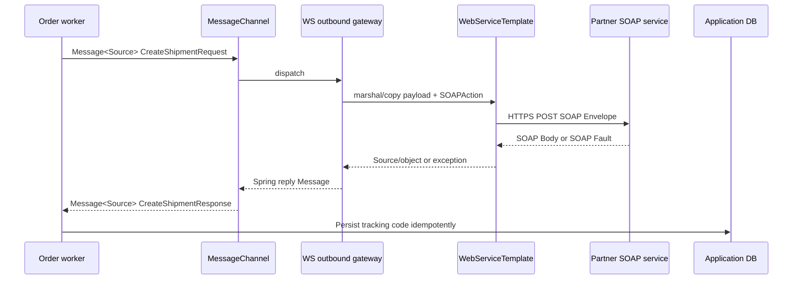
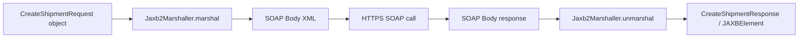
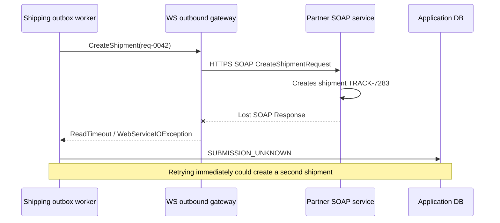
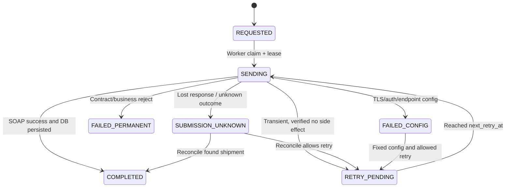

# Web service outbound gateway

## 1. Problem: calling a partner's SOAP service from an integration flow

A Spring Boot order-management application needs to send a shipment-creation request to a legacy logistics system that only exposes **SOAP 1.1**. Inside the application, the `ORDER_READY` event has been validated, persisted to the database, and routed into the processing flow. The system must build a `CreateShipmentRequest` conforming to the XML Schema, call an HTTPS endpoint, read `CreateShipmentResponse`, save the tracking number, and handle SOAP Faults, timeouts, or responses lost after the partner **has already created the shipment**.

Spring Integration's **Web service outbound gateway** turns a SOAP call into a **request–reply** step inside an `IntegrationFlow`:

- **Input:** a Spring `Message<?>` containing an XML `String`/`Source` or an object to marshal.
- **Processing:** the gateway uses Spring Web Services (Spring-WS) to send SOAP over transport, receive the response, apply the header mapper, and handle SOAP Faults.
- **Output:** a Spring reply message containing the response payload, forwarded to a downstream transformer/handler or reply channel.

This lesson belongs to the **Adapter Web Services** chapter of the `SPRING_INTEGRATION_ADAPTERS` module: connecting external systems via inbound/outbound adapters, gateways, pollers, and `MessageChannel`s; practicing message contracts, errors, and connection lifecycles for files, SFTP, HTTP, JMS, AMQP, Kafka, and databases. A SOAP outbound gateway is an example of an **external call point that can cause side effects**, where you must distinguish timeouts, business outcomes, and retry responsibilities.

### Learning objectives

1. Distinguish **outbound gateway**, **outbound channel adapter**, **inbound gateway**, `WebServiceTemplate`, and HTTP outbound gateway.
2. Use `SimpleWebServiceOutboundGateway` with XML payloads and `MarshallingWebServiceOutboundGateway` with `Marshaller`/`Unmarshaller`.
3. Configure `Ws.simpleOutboundGateway(...)` and `Ws.marshallingOutboundGateway(...)` in Java DSL, and know how to send messages via a channel and receive replies.
4. Design requests/responses per XSD/WSDL, SOAP 1.1/1.2, SOAPAction, SOAP headers, URI encoding, and MTOM.
5. Configure HTTPS, authentication, WS-Security, connect/read timeouts, SSRF prevention, and XML parser hardening.
6. Classify SOAP Faults, empty responses, network timeouts, mapping errors, retries/idempotency, and observe remote side-effect states.
7. Test SOAP outbound with `MockWebServiceServer` and HTTPS end-to-end tests in a sandbox.

> **Reference versions:** Spring Integration **6.5.x**, Spring Web Services **4.0.x**, Spring Framework **6.x**, Spring Boot with a compatible BOM, Java 17+. XML `Source` belongs to **`javax.xml.transform.Source`** (JAXP still uses the `javax` package); JAXB in a Jakarta stack may use `jakarta.xml.bind.*`. The domain `example.test`, XML namespaces, and operations in this lesson are simulated examples.

## 2. Architectural boundary: request–reply in a Spring Integration flow



There are **two message layers**:

- `org.springframework.messaging.Message<?>` from Spring Integration: payload and `MessageHeaders`, used to connect adapters/routers/transformers/service activators.
- `org.springframework.ws.WebServiceMessage` from Spring-WS: SOAP Envelope, Header, Body, attachments, and transport metadata, created/read by `WebServiceTemplate`.

The gateway translates between these two layers. When calling HTTPS, Spring-WS places the **XML payload inside the SOAP Body**; the application sends `<CreateShipmentRequest>` per the contract, **not** manually wrapping an entire `Envelope` inside the default payload.

| Component | Role | What it does **not** guarantee |
| --- | --- | --- |
| `MessageChannel` | Delivers the request to the outbound gateway | That the partner call finished merely because `send()` returned true on an async channel |
| `SimpleWebServiceOutboundGateway` | Converts `String`/`Source` to a SOAP request and extracts the response | Unmarshalling into a domain POJO |
| `MarshallingWebServiceOutboundGateway` | Uses `Marshaller` and `Unmarshaller` for requests/responses | Business authz or full schema validation if not configured |
| `WebServiceTemplate` | Spring-WS client handling message factory, transport, interceptors, fault handling | Distributed transactions or exactly-once delivery |
| `WebServiceMessageSender` | Opens HTTP/HTTPS or another supported transport | Safe retries when the server has already processed the request |
| `ClientInterceptor` | Observes/modifies/inspects WS requests/responses | Automatic tenant auth or replay protection if policy is missing |
| Post-gateway handler | Converts response into business results and writes to DB | Knowing the outcome when the partner times out after commit |

**A poller is not needed to invoke SOAP for an existing message.** A poller may trigger a worker that reads a DB outbox or queue, but the outbound gateway itself is **message-driven**: upon receiving a request on the channel, it calls the service and produces a reply.

## 3. Distinguishing the outbound gateway from neighboring adapters

| Integration | Direction and contract | Example |
| --- | --- | --- |
| **WS outbound gateway** | Application **calls** SOAP from a Spring Message and waits for reply or fault | Creating a shipment at a partner |
| WS inbound gateway | Partner **calls into** the application's SOAP service and waits for reply | Partner submits an order to our system |
| HTTP outbound gateway | Calls HTTP/REST via HTTP message conversion | Payment JSON API |
| HTTP outbound channel adapter | Calls HTTP without emitting a reply message into the flow | Notification needing no response body |
| Plain `WebServiceTemplate` SOAP client | Java service calls Spring-WS API directly | Small service without a message flow |
| JMS/AMQP/Kafka outbound | Sends message to a broker | Durable async business job |

A WS outbound gateway is typically **synchronous at the transport call site**. Putting an `ExecutorChannel` before the gateway can decouple it from the message-producing thread, but **does not turn SOAP into an asynchronous protocol**: a worker thread still waits for the partner response or timeout. If using a queue/broker in front, you must define job claiming, replay, idempotency, and when the message may be ACKed.

## 4. Two main gateways: simple and marshalling

Spring Integration 6.5 documentation describes two options:

| Criterion | `SimpleWebServiceOutboundGateway` | `MarshallingWebServiceOutboundGateway` |
| --- | --- | --- |
| Request payload | `String` or `javax.xml.transform.Source` | Java object supported by `Marshaller` |
| Reply payload | XML `Source`/`String` per extraction contract | Java object produced by `Unmarshaller` |
| Suitable when | Existing XML, XSLT, ESB, special legacy partners | JAXB/XSD-generated classes, WSDL-derived DTOs |
| Additional components | XML validation/transformers if needed | `Jaxb2Marshaller` + JAXB runtime/bindings |
| Primary risks | Invalid XSD XML, confusing Body with Envelope, unsafe parsers | Namespace/JAXB `JAXBElement`/schema/type mismatches |
| Attachments | `WebServiceMessage`/`MimeMessage` when needed | MTOM via supporting marshaller |

Instantiation via Java API (illustrative only):

```java
DestinationProvider partnerDestination = ...; // Spring-WS bean.

SimpleWebServiceOutboundGateway xmlGateway =
        new SimpleWebServiceOutboundGateway(partnerDestination);

MarshallingWebServiceOutboundGateway objectGateway =
        new MarshallingWebServiceOutboundGateway(
                partnerDestination, orderMarshaller);
```

In Spring Integration **6.5**, besides `DestinationProvider`, you can use a **fixed URI** via namespace/DSL or supply an external `WebServiceTemplate` to configure transport and fault policies. `DestinationProvider` fits dynamic endpoint lookup from a managed registry; **never** take an arbitrary URL from an HTTP request or SOAP body and send directly to it.

## 5. SOAP 1.1 contract and what goes into the payload

Suppose the partner defines QName `{urn:demo:logistics:v1}CreateShipmentRequest`. Complete SOAP 1.1 message on the wire:

```http
POST /ws/shipping HTTP/1.1
Host: logistics.example.test
Content-Type: text/xml; charset=utf-8
SOAPAction: "urn:demo:logistics:v1/CreateShipment"

<?xml version="1.0" encoding="UTF-8"?>
<soapenv:Envelope xmlns:soapenv="http://schemas.xmlsoap.org/soap/envelope/"
                  xmlns:ship="urn:demo:logistics:v1">
  <soapenv:Header/>
  <soapenv:Body>
    <ship:CreateShipmentRequest>
      <ship:clientRequestId>req-0042</ship:clientRequestId>
      <ship:orderId>O-9001</ship:orderId>
    </ship:CreateShipmentRequest>
  </soapenv:Body>
</soapenv:Envelope>
```

With the **default simple outbound gateway**, send a payload containing only this element:

```xml
<ship:CreateShipmentRequest xmlns:ship="urn:demo:logistics:v1">
  <ship:clientRequestId>req-0042</ship:clientRequestId>
  <ship:orderId>O-9001</ship:orderId>
</ship:CreateShipmentRequest>
```

Spring-WS constructs the SOAP Envelope and Header and inserts that XML into the SOAP Body. Expected valid response:

```xml
<ship:CreateShipmentResponse xmlns:ship="urn:demo:logistics:v1">
  <ship:clientRequestId>req-0042</ship:clientRequestId>
  <ship:trackingNumber>TRACK-7283</ship:trackingNumber>
  <ship:status>CREATED</ship:status>
</ship:CreateShipmentResponse>
```

**Never drop the namespace** just because the element name looks right. `{urn:demo:logistics:v1}CreateShipmentResponse` differs from the same local name in a v2 namespace or an untrusted namespace.

With SOAP 1.2, the envelope namespace, HTTP Content-Type (`application/soap+xml`), and action mechanism differ from SOAP 1.1. Select a `WebServiceMessageFactory`/SOAP version matching the partner's WSDL; do not mix 1.1 requests with a 1.2-only endpoint.

## 6. Dependencies and endpoint configuration

With Spring Boot managing a compatible Spring Integration version:

```groovy
dependencies {
    implementation 'org.springframework.boot:spring-boot-starter-integration'
    implementation 'org.springframework.integration:spring-integration-ws'
    implementation 'org.springframework.boot:spring-boot-starter-web-services'
    testImplementation 'org.springframework.boot:spring-boot-starter-test'
    testImplementation 'org.springframework.ws:spring-ws-test'
}
```

`spring-integration-ws` contains the gateways and WS DSL, while Spring-WS provides `WebServiceTemplate` and `MessageSender`. An application acting **purely as an outbound SOAP client** does not need to register `MessageDispatcherServlet`, `EndpointMapping`, or expose `/ws` — those belong to an **inbound web service**.

```yaml
app:
  logistics:
    soap-endpoint: ${LOGISTICS_SOAP_ENDPOINT:https://logistics.example.test/ws/shipping}
    soap-action: "urn:demo:logistics:v1/CreateShipment"
    connect-timeout-ms: 5000
    read-timeout-ms: 20000
```

The URL must come from **trusted configuration**, a controlled secret manager/config registry, never from an arbitrary client-supplied field. Production TLS must verify the certificate chain, hostname, and corresponding access permissions; never fall back to HTTP or trust-all when a provider handshake fails.

## 7. WebServiceTemplate: HTTPS transport and timeouts

Spring-WS `WebServiceTemplate` manages the message factory, message sender, interceptors, fault resolver, and XML mapping. For basic HTTP/HTTPS, `HttpUrlConnectionMessageSender` in Spring-WS 4.0 accepts `java.time.Duration` timeouts:

```java
import java.time.Duration;

import org.springframework.beans.factory.annotation.Value;
import org.springframework.context.annotation.Bean;
import org.springframework.context.annotation.Configuration;
import org.springframework.ws.client.core.WebServiceTemplate;
import org.springframework.ws.transport.http.HttpUrlConnectionMessageSender;

@Configuration
public class PartnerSoapTransportConfig {

    @Bean
    public WebServiceTemplate partnerSoapTemplate(
            @Value("${app.logistics.connect-timeout-ms:5000}") long connectMs,
            @Value("${app.logistics.read-timeout-ms:20000}") long readMs) {

        HttpUrlConnectionMessageSender sender =
                new HttpUrlConnectionMessageSender();
        sender.setConnectionTimeout(Duration.ofMillis(connectMs));
        sender.setReadTimeout(Duration.ofMillis(readMs));

        WebServiceTemplate template = new WebServiceTemplate();
        template.setMessageSender(sender);
        // By default, Spring-WS uses a fault resolver;
        // do not disable fault detection just to turn a SOAP Fault into success.
        return template;
    }
}
```

**These two timeouts are socket limits**, not the total business deadline. A call includes DNS, TCP, TLS, writing the SOAP request, waiting for the response, XML parsing, and the subsequent DB handler. Add an overall job budget/monitoring and per-provider concurrency limits; on a socket timeout, **never assume the partner has not created the shipment**.

When connection pooling, proxies, or client certificates/mTLS are needed, configure `HttpComponents5MessageSender` and Apache HttpClient 5 matching your Spring-WS version. When supplying a custom `HttpClient`, configure timeouts, pooling, TLS, auth, and resource lifecycles on that client itself; **do not assume default sender setters override a custom client**.

## 8. Java DSL: simple outbound gateway with reply

This example flow uses a `DirectChannel` to receive XML `Source` and send SOAP requests to a controlled static endpoint. The gateway **returns a reply message** when the partner responds with a payload.

```java
import org.springframework.beans.factory.annotation.Qualifier;
import org.springframework.beans.factory.annotation.Value;
import org.springframework.context.annotation.Bean;
import org.springframework.context.annotation.Configuration;
import org.springframework.integration.channel.DirectChannel;
import org.springframework.integration.dsl.IntegrationFlow;
import org.springframework.integration.ws.dsl.Ws;
import org.springframework.messaging.MessageChannel;
import org.springframework.ws.client.core.WebServiceTemplate;

@Configuration
public class PartnerSoapOutboundFlow {

    @Bean
    public MessageChannel partnerSoapRequests() {
        return new DirectChannel();
    }

    @Bean
    public IntegrationFlow partnerSoapFlow(
            @Qualifier("partnerSoapRequests") MessageChannel requests,
            @Qualifier("partnerSoapTemplate") WebServiceTemplate template,
            @Value("${app.logistics.soap-endpoint}") String endpointUri) {

        return IntegrationFlow.from(requests)
                .handle(Ws.simpleOutboundGateway(template)
                        .uri(endpointUri))
                .get();
    }
}
```

This is an **outbound handler** inside the integration graph: `.handle(...)` receives a Spring Message, sends SOAP, and returns the response. The client layer must define request correlation, message payloads, and the reply contract. `Ws.simpleOutboundGateway(template)` is the DSL using an **external WebServiceTemplate** that already holds transport timeouts. If no external template is needed, you can use `Ws.simpleOutboundGateway().uri(endpointUri).messageSenders(sender)` with setters available on the no-template spec, but **do not mix both configuration styles** assuming every property applies.

## 9. Sending requests via MessageChannel and receiving responses

`MessagingTemplate` lets you send a Spring Message to the outbound gateway and wait for a reply from the flow. This example constructs a `Source` payload, sets the SOAPAction header, and reads the reply as a Spring message; it does not need to build a SOAP Envelope manually.

```java
import javax.xml.transform.Source;

import org.springframework.beans.factory.annotation.Qualifier;
import org.springframework.integration.core.MessagingTemplate;
import org.springframework.integration.ws.WebServiceHeaders;
import org.springframework.messaging.Message;
import org.springframework.messaging.MessageChannel;
import org.springframework.messaging.support.MessageBuilder;
import org.springframework.stereotype.Service;
import org.springframework.xml.transform.StringSource;

@Service
public class PartnerSoapCaller {

    private final MessageChannel channel;

    public PartnerSoapCaller(
            @Qualifier("partnerSoapRequests") MessageChannel channel) {
        this.channel = channel;
    }

    public Message<?> createShipment(String requestId, String orderId) {
        // Illustrates XML body for IDs managed by a trusted application.
        // Production must build via JAXB/builder or safe XML escaping.
        String payloadXml = """
                <ship:CreateShipmentRequest
                    xmlns:ship="urn:demo:logistics:v1">
                  <ship:clientRequestId>req-0042</ship:clientRequestId>
                  <ship:orderId>O-9001</ship:orderId>
                </ship:CreateShipmentRequest>
                """;

        Source xml = new StringSource(payloadXml);
        Message<Source> request = MessageBuilder.withPayload(xml)
                .setHeader(WebServiceHeaders.SOAP_ACTION,
                        "urn:demo:logistics:v1/CreateShipment")
                .setHeader("businessRequestId", requestId)
                .build();

        MessagingTemplate messaging = new MessagingTemplate();
        messaging.setReceiveTimeout(25_000);
        Message<?> reply = messaging.sendAndReceive(channel, request);
        if (reply == null) {
            throw new IllegalStateException(
                    "SOAP did not return a reply within the timeout");
        }
        return reply;
    }
}
```

The demo **intentionally uses hardcoded XML values** to illustrate wiring; real `requestId`/`orderId` parameters must be safely serialized/escaped and bound to the business ledger. Never concatenate XML strings from untrusted input, as that can cause XML injection or schema-invalid bodies. `MessagingTemplate` enforces a reply timeout at the messaging layer, **not cancelling already-executed HTTP/SOAP side effects** if the response arrives late. The next step must parse/validate the response and **commit the `trackingNumber` mapping** only after verifying the matching `requestId`/tenant.

### What type is the reply payload?

`SimpleWebServiceOutboundGateway` handles `String` or `Source`; for XML payloads, depending on `sourceExtractor`/`extractPayload` configuration and request type, the response may be a `Source` or a corresponding text representation. Define a **clear payload contract** for downstream transformers: verify type, namespace, size limits, and schema—never call `reply.toString()` assuming it produces SOAP body XML.

## 10. SOAPAction and SOAP headers: bidirectional mapping

Spring Integration defines `WebServiceHeaders.SOAP_ACTION` (key `ws_soapAction`). `DefaultSoapHeaderMapper` automatically maps **standard SOAPAction** from Spring `MessageHeaders` to the SOAP request and from the SOAP reply back to Spring reply headers. **Custom SOAP headers** are not automatically sent/received unless you configure which header names to map.

```java
import org.springframework.integration.ws.WebServiceHeaders;
import org.springframework.messaging.Message;
import org.springframework.messaging.support.MessageBuilder;

Message<String> request = MessageBuilder
        .withPayload("""
            <ship:GetShipmentRequest xmlns:ship="urn:demo:logistics:v1">
              <ship:trackingNumber>TRACK-7283</ship:trackingNumber>
            </ship:GetShipmentRequest>
            """)
        .setHeader(WebServiceHeaders.SOAP_ACTION,
                "urn:demo:logistics:v1/GetShipment")
        .build();
```

This is the **body XML**; the gateway and `WebServiceTemplate` handle the SOAP Envelope. In SOAP 1.1, the action can be conveyed via the HTTP `SOAPAction` header; in SOAP 1.2, the action is usually embedded in the media type. Follow the partner's WSDL binding/policy rather than manually appending raw HTTP headers to forge a different action from Spring-WS.

### Controlled mapping of custom SOAP headers

Suppose the partner requires a `<partner:CorrelationId>` element in the SOAP Header. Spring Integration provides `DefaultSoapHeaderMapper`:

```java
import org.springframework.context.annotation.Bean;
import org.springframework.integration.ws.DefaultSoapHeaderMapper;
import org.springframework.integration.ws.WebServiceHeaders;

@Bean
public DefaultSoapHeaderMapper partnerSoapHeaderMapper() {
    DefaultSoapHeaderMapper mapper = new DefaultSoapHeaderMapper();
    mapper.setRequestHeaderNames(
            WebServiceHeaders.SOAP_ACTION, "CorrelationId");
    mapper.setReplyHeaderNames(
            WebServiceHeaders.SOAP_ACTION, "CorrelationId");
    return mapper;
}
```

`CorrelationId` here is a **sample mapped header name** that must match the real QName/namespace and configuration. Spring Integration 6.5 allows a custom `Source` in Spring message headers to be emitted as a child element of the SOAP Header. Example usage:

```java
import org.springframework.xml.transform.StringSource;
import org.springframework.messaging.support.MessageBuilder;

StringSource correlation = new StringSource("""
        <partner:CorrelationId xmlns:partner="urn:demo:partner:headers">
          req-0042
        </partner:CorrelationId>
        """);

var request = MessageBuilder.withPayload("<ship:.../>")
        .setHeader("CorrelationId", correlation)
        .build();
```

`<ship:.../>` is only a **placeholder**, not schema-valid XML; use a valid payload per section 5. When building the flow, attach `.headerMapper(partnerSoapHeaderMapper)` on the spec. **Never map all non-standard headers with `*`** for "convenience": you could accidentally leak internal tenant IDs, OAuth tokens, stack traces, or Spring reply/error channels outside in the SOAP envelope.

### Are headers proof of access rights?

**No.** `SOAPAction`, `CorrelationId`, `From`, or `ClientId` set by a message producer do not prove partner identity. Permission to invoke an operation rests on authenticated TLS/mTLS, OAuth/tokens, or WS-Security, followed by business authorization. If messages traverse multiple routers, distinguish headers set by trusted components from headers originating from external requests.

## 11. Response headers and `extractPayload(false)`

By default, the simple outbound gateway extracts the **SOAP body payload** from the response `WebServiceMessage` as the Spring payload. When you need access to the **entire** SOAP message (SOAP Header, attachments, metadata), you can set `.extractPayload(false)` on `Ws.simpleOutboundGateway(...)`. The payload will then be a `WebServiceMessage` instead of a `String`/`Source` body.

| Configuration | Output | When to use |
| --- | --- | --- |
| Default `extractPayload(true)` | XML body payload (`String`/`Source` per contract) | Business transformer only needs the response element |
| `extractPayload(false)` | Full `WebServiceMessage` response | Need to read SOAP Headers or special MIME attachments |
| `headerMapper(...)` | Maps allowed SOAP headers to Spring headers | Correlation, tracing, contract metadata |
| `sourceExtractor(...)` | Custom handling of response `Source` | Custom XML extraction, limits, and validation |

**Lifecycle warning:** `WebServiceMessage` and attachment streams may be bound to the transport/request context. If content must be sent to Kafka/JMS/queues or processed asynchronously, **materialize the needed data** while the response is still valid and store a durable reference. Never serialize a raw `WebServiceMessage` or pass its streams to another thread expecting them to remain readable.

## 12. Marshalling outbound gateway: JAXB object → SOAP XML → JAXB object

When a partner publishes XSD/WSDL, a code generator can generate Java classes in package `com.example.partner.shipping.v1`. Spring OXM `Jaxb2Marshaller` marshals request objects to XML and unmarshals response XML back into objects. This integrates more cleanly with domain services than raw XML, provided you test QNames and schemas accurately.



### JAXB marshaller with XSD-generated classes

```java
import org.springframework.context.annotation.Bean;
import org.springframework.context.annotation.Configuration;
import org.springframework.oxm.jaxb.Jaxb2Marshaller;

@Configuration
public class PartnerSoapBindingConfiguration {

    @Bean
    public Jaxb2Marshaller partnerOrderMarshaller() {
        Jaxb2Marshaller marshaller = new Jaxb2Marshaller();
        marshaller.setContextPath("com.example.partner.shipping.v1");
        // Only use JAXB binding classes generated from a trusted XSD.
        // XSD validation and XML security policies must be configured/tested.
        return marshaller;
    }
}
```

`com.example.partner.shipping.v1` is a **simulated package**; it must contain XSD-generated JAXB classes/`ObjectFactory` in your project. Modern Spring Boot/Jakarta stacks require a compatible JAXB runtime if the BOM does not supply it; do not add legacy `javax.xml.bind` runtimes to a Jakarta application. A root element may be represented as `JAXBElement<CreateShipmentRequest>` rather than a raw `CreateShipmentRequest` instance, depending on annotations and code-generation settings.

### Java DSL using `Ws.marshallingOutboundGateway()`

```java
import org.springframework.beans.factory.annotation.Qualifier;
import org.springframework.beans.factory.annotation.Value;
import org.springframework.context.annotation.Bean;
import org.springframework.context.annotation.Configuration;
import org.springframework.integration.dsl.IntegrationFlow;
import org.springframework.integration.ws.dsl.Ws;
import org.springframework.oxm.jaxb.Jaxb2Marshaller;
import org.springframework.ws.transport.http.HttpUrlConnectionMessageSender;

@Configuration
public class PartnerMarshallingOutboundFlow {

    @Bean
    public IntegrationFlow marshallingPartnerSoapFlow(
            @Qualifier("partnerOrderMarshaller") Jaxb2Marshaller marshaller,
            @Value("${app.logistics.soap-endpoint}") String endpointUri) {

        HttpUrlConnectionMessageSender sender =
                new HttpUrlConnectionMessageSender();
        sender.setConnectionTimeout(java.time.Duration.ofSeconds(5));
        sender.setReadTimeout(java.time.Duration.ofSeconds(20));

        return IntegrationFlow.from("partnerSoapObjectRequests")
                .handle(Ws.marshallingOutboundGateway()
                        .uri(endpointUri)
                        .marshaller(marshaller)
                        .unmarshaller(marshaller)
                        .messageSenders(sender))
                .get();
    }
}
```

This flow is an **alternative** to the simple gateway in section 8; it reads from channel `partnerSoapObjectRequests` expecting JAXB object payloads instead of XML `Source`. `.marshaller(...)` and `.unmarshaller(...)` on the **no-template spec** match Spring Integration 6.5. When using an external `WebServiceTemplate`, marshalling/fault/message-factory components typically must be configured directly on the template; do not assume all setters from the no-template spec behave identically.

**Do not attach two gateways to the same channel expecting the framework to pick by payload type.** If you must support both legacy XML and JAXB objects, use an explicit router based on the business contract, or normalize to a unified DTO/request type before calling the partner.

### Testing response types and XSD

Unmarshalling does not by default prove:

- That the response uses the exact namespace/element published in the WSDL.
- That `status=CREATED` comes with a valid tracking number; fields could be null/blank.
- That the response does not belong to another schema version silently ignored by the object mapper.
- That the response belongs to the current `clientRequestId` (preventing response mix-ups).

Enforce XSD/contract validation, XML size limits, and business validation before saving the tracking number to the DB. Never persist "a parsed POJO" as the sole proof that the partner created a shipment.

## 13. Static URI, DestinationProvider, and safe dynamic URIs

Spring Integration WS outbound supports static/templated URIs and `DestinationProvider`. Pick **one** endpoint resolution style:

| Configuration style | Example | When to use |
| --- | --- | --- |
| Fixed URI | `.uri("https://logistics.example.test/ws/shipping")` | A single stable partner endpoint |
| URI template | `https://services.example.test/{region}/shipping` | Region comes from an allowlist |
| `DestinationProvider` | Looks up endpoint in a trusted registry | Partner endpoint changes via config/registry |
| External `WebServiceTemplate` | Custom transport/interceptors/fault configuration | Complex TLS/mTLS/auth/timeouts |

### URI variables and encoding mode

In Java DSL, `uriVariableExpressions(...)` can compute variables from the message. `DefaultUriBuilderFactory.EncodingMode` modes control encoding. The default in Spring Integration WS is `TEMPLATE_AND_VALUES`; be aware if URLs already contain pre-encoded characters to avoid double encoding. When using `DestinationProvider`, Spring Integration **does not support combining it with URI variable substitution** and ignores destination-provider encoding modes.

**Conceptual example:**

```text
Trusted base: https://logistics.example.test
URI template: /ws/{region}/shipping
Allowed region values: vn, sg, th
Resolved: https://logistics.example.test/ws/vn/shipping
```

Never pass caller-supplied `headers.callbackUrl` or `payload.targetUri` into `uri(...)` unvalidated. That is **SSRF**: attackers can force the application to call cloud metadata/token services, loopback, or internal IPs. You must:

1. Allowlist host/scheme/port **and check the actual resolved DNS/IP**, blocking private/link-local/loopback ranges unless explicitly permitted by policy.
2. Prevent user input from altering scheme/host or escaping the intended path namespace.
3. Control redirects, DNS rebinding, egress proxies, certificate hostname verification, and mTLS identity.
4. Bound size/timeouts/concurrency for every registry-permitted endpoint.
5. Never treat URI encoding as **authentication** or SSRF protection.

A `DestinationProvider` returning URLs from a service registry still sits at a trust boundary: a metadata registry can be stale or compromised and requires governance and access control.

## 14. SOAP Fault, HTTP errors, and `WebServiceTemplate`

A SOAP Fault is a **SOAP-protocol response** describing a client/server error; an HTTP 500 with a SOAP Fault is not the same as an HTTP 500 HTML page from a reverse proxy. `WebServiceTemplate` normally detects transport/fault errors and uses a `FaultMessageResolver`, which by default throws `SoapFaultClientException` when reading a SOAP Fault.

```xml
<soapenv:Envelope xmlns:soapenv="http://schemas.xmlsoap.org/soap/envelope/">
  <soapenv:Body>
    <soapenv:Fault>
      <faultcode>soapenv:Client</faultcode>
      <faultstring>Invalid shipment request</faultstring>
      <detail>
        <err:code xmlns:err="urn:demo:errors:v1">INVALID_CUSTOMER</err:code>
      </detail>
    </soapenv:Fault>
  </soapenv:Body>
</soapenv:Envelope>
```

| Partner outcome | How it may surface | Handling |
| --- | --- | --- |
| SOAP Body success, HTTP success | `CreateShipmentResponse` payload | Validate XSD, `requestId`, business rules, then commit |
| Client/sender SOAP Fault | `SoapFaultClientException` or custom fault resolver | Inspect fault code/details per contract; do not retry endlessly |
| Server/receiver SOAP Fault | Fault or partner-specific error | Classify transient/permanent using **contracted** codes, not just the word "Server" |
| HTTP 401/403 | Transport authentication/authorization | Refresh/rotate credentials per policy; alert |
| HTTP 429/503 | Rate limit/outage | Backoff, jitter, quotas—while checking if side effects could have occurred |
| HTTP 500 with HTML | Reverse proxy/transport error | Do not parse HTML as a SOAP Fault |
| Socket read timeout after send | Partner **may have processed the request** | `SUBMISSION_UNKNOWN` + reconciliation; no blind retries |
| HTTP 200 with SOAP Fault from non-standard provider | Fault inside SOAP body | Adjust `checkConnectionForFault` if needed; test strictly |

### When is `checkConnectionForFault` used?

`WebServiceTemplate` has a `checkConnectionForFault` property to accommodate SOAP services with non-standard HTTP status behavior. Changing it does **not** turn all errors into successes; ensure the resolver still inspects SOAP Faults and returns the proper business state. Adjust it only per the **partner's contract and integration tests**, never setting `false` to swallow exceptions.

**Never parse `SoapFaultClientException.getMessage()` with an ad-hoc regex to decide retries.** Use documented fault codes/subcodes/details mapped to controlled error categories; never return raw `faultstring` to public APIs if it may contain PII, stack traces, or internal system info.

## 15. Empty responses and `ignoreEmptyResponses`

This is an easy edge case to miss. Spring Integration WS outbound by default **does not produce a Spring reply message** for a SOAP response lacking an appropriate payload. Per the 6.5 reference:

- For a **`String`** request payload, if the service returns an empty response, default `ignoreEmptyResponses=true` causes the gateway to **emit no reply**.
- If you need a message representing an empty response, set `ignoreEmptyResponses(false)`; the reference documents this behavior **only for `String` requests**.
- If the request payload is `Source` or `Document` and the response is empty, the source extractor may return `null`, so **no reply message is produced** even if you want ignore disabled.

```java
// Java DSL snippet, assuming endpointUri and template beans exist:
.handle(Ws.simpleOutboundGateway(template)
        .uri(endpointUri)
        .ignoreEmptyResponses(false))
```

This snippet is an `IntegrationFlow` fragment, not a standalone Java expression. **Do not let callers wait 30 seconds in `sendAndReceive()` and treat it as a failure** if the WSDL defines a one-way/void operation. An "HTTP ACK only" operation needs a different message contract: record transport acceptance, handle the absence of a reply by design, and never infer business success without another confirmation.

## 16. MTOM and SOAP attachments

Some partners send/receive receipt images, PDFs, and binary files alongside SOAP. There are two approaches:

| Mechanism | Payload | Notes |
| --- | --- | --- |
| JAXB MTOM | `@XmlMimeType`/`DataHandler` in generated classes | `Jaxb2Marshaller.setMtomEnabled(true)`; requires XSD/WSDL support |
| Simple gateway with `MimeMessage` | `WebServiceMessage` + attachments | Build message factory, attachment IDs/media types explicitly |
| Base64 embedded in XML | `xsd:base64Binary` | Bloats message size and memory usage |

Spring Integration 6.5 supports attachments via marshallers (e.g., JAXB MTOM), and with the simple gateway you can pass an `org.springframework.ws.mime.MimeMessage`. **Illustrative** Spring-WS message factory example:

```java
import jakarta.xml.soap.MessageFactory;
import javax.xml.transform.Transformer;
import javax.xml.transform.TransformerFactory;

import org.springframework.core.io.ByteArrayResource;
import org.springframework.ws.mime.MimeMessage;
import org.springframework.ws.soap.saaj.SaajSoapMessageFactory;
import org.springframework.xml.transform.StringSource;

SaajSoapMessageFactory factory =
        new SaajSoapMessageFactory(MessageFactory.newInstance());
factory.afterPropertiesSet();

MimeMessage soap = (MimeMessage) factory.createWebServiceMessage();
StringSource body = new StringSource("""
    <doc:UploadDocumentRequest xmlns:doc="urn:demo:documents:v1">
      <doc:requestId>req-0042</doc:requestId>
    </doc:UploadDocumentRequest>
    """);

Transformer transformer = TransformerFactory.newInstance().newTransformer();
transformer.transform(body, soap.getPayloadResult());

byte[] safePdfBytes = ...; // Size and MIME validated beforehand.
soap.addAttachment("invoicePdf",
        new ByteArrayResource(safePdfBytes), "application/pdf");
// Send soap as payload via simple WS outbound gateway.
```

This is a **snippet**; `safePdfBytes` is unimplemented and the newly created `TransformerFactory` must be hardened per your environment's JAXP security policy. For large files, avoid loading entire payloads into heap: use bounded storage/streams that remain re-readable during request creation/retries. In SOAP MTOM, WSDL/schema/attachment CIDs must match the partner; do not equate "has attachment" with "MTOM was negotiated".

## 17. HTTPS, mTLS, WS-Security, and partner identity

Outbound SOAP often carries sensitive data (orders, invoices, customers). Protect the **transport channel**, **content**, and **operation permissions** at distinct layers:

| Layer | Policy | Notes |
| --- | --- | --- |
| HTTPS | TLS chain + hostname verification, approved protocols/ciphers | Never use trust-all or disable certificate checks |
| mTLS | Client certificate verified by provider | Client keystore/truststore, rotation, tenant identity |
| HTTP authentication | Bearer/OAuth2, Basic over TLS, or agreed scheme | Token TTL, scopes, secret manager, never log `Authorization` |
| WS-Security | UsernameToken, XML Signature, Timestamp, encryption per policy | Requires `Wss4jSecurityInterceptor` or compatible interceptor |
| Business authorization | Which tenant/order the caller may create shipments/read status for | Never trust `SOAPAction`/headers alone |
| Anti-replay/idempotency | Request ID and timestamp/nonce per contract | Even a valid SOAP signature can be replayed |
| Data confidentiality | Restrict logging of SOAP bodies and attachments | May contain PII and secrets |

Spring-WS provides `org.springframework.ws.soap.security.wss4j2.Wss4jSecurityInterceptor` for WS-Security/WSS4J integration. On the **outbound client**, configure security actions and keys/certs/credentials matching the partner; **do not assume placing a `UsernameToken` String in a SOAP header authenticates anything**. Signed messages require tested timestamps, canonicalization, certificate trust, and replay policies. Use a secret manager and isolate credentials per partner/tenant.

### TLS truststore and client certificates

- When the server certificate is issued by a public CA, use the JVM/HTTP client's proper trust policy with hostname verification enabled.
- For internal CAs, supply the trusted CA chain in a managed truststore; never install a "trust all" strategy just to bypass `PKIX path building failed`.
- For mTLS, give the client its private key/certificate in a keystore with a runtime-supplied password; manage rotation before expiration.
- When using a custom Apache HttpClient, configure `SSLContext`, trust strategy, and hostname verifier properly, while ensuring DNS/routing prevents access outside the allowlist.
- Behind TLS termination/proxies, never trust identity headers sent directly by untrusted sources; accept only fields signed or issued by trusted proxies.

**WS-Security does not replace HTTPS**: WS-Security protects specific message parts per policy, whereas HTTPS protects transport and prevents in-transit interception. Conversely, HTTPS does not make a partner's SOAP body trustworthy business data without authz and validation.

## 18. XML hardening: SSRF, XXE, XSLT, and payload expansion

A SOAP response is also data from an **external system**, even from an authenticated partner. Unsafe XML parsing/transformation can lead to **XXE**, local file disclosure, SSRF, entity expansion/denial-of-service, or excessive memory consumption.

**Principles:**

1. Cap HTTP response bytes, XML depth/element/attribute counts, MTOM attachment count/bytes, and deserialization time.
2. Disable DTDs/external entities/XInclude in parsers handling remote data; enable secure processing and block external DTDs/schemas.
3. Never accept arbitrary client- or partner-supplied XPath/XSLT and execute it on the server.
4. Never call `Source.toString()` to extract XML content; use a hardened transformer, streaming/size caps, and namespace checks.
5. With JAXB, restrict classes to the exact contract; enable schema validation where appropriate and test responses missing required fields.
6. Never auto-fetch URLs found inside a SOAP response as secondary attachments/paths without an allowlist, as that enables secondary SSRF.
7. Scan binary attachments for malware before ingesting internally; sanitize filenames and never treat paths inside SOAP as filesystem paths.

When the application creates its own JAXP `TransformerFactory`, harden it per provider:

```java
import javax.xml.XMLConstants;
import javax.xml.transform.TransformerFactory;

public static TransformerFactory newSecureTransformerFactory()
        throws Exception {

    TransformerFactory factory = TransformerFactory.newInstance();
    factory.setFeature(XMLConstants.FEATURE_SECURE_PROCESSING, true);
    factory.setAttribute(XMLConstants.ACCESS_EXTERNAL_DTD, "");
    factory.setAttribute(XMLConstants.ACCESS_EXTERNAL_STYLESHEET, "");
    return factory;
}
```

This is a **utility method** to place inside a class. Not every provider supports every attribute; if a mandatory protection is unsupported, **fail configuration** instead of silently falling back. Also inspect the actual JAXP/JAXB/SAAJ/HTTP client configuration—hardening a standalone utility does not automatically protect the whole Spring-WS stack.

## 19. Timeout after the partner created the resource: the UNKNOWN outcome

SOAP over HTTP shares a classic scenario with SMTP submission: **the remote side effect may happen before the client receives the response**.



When a request has side effects, you cannot infer from `SocketTimeoutException` or `WebServiceIOException` that the partner **did not process it**. If the partner supports an idempotency key on `clientRequestId`, reuse **one stable ID** across retries and verify their dedup retention/rules. Otherwise, prefer **`GetShipmentByClientRequestId`**, a provider status API, audit/reconciliation, or manual review before resubmitting.

| Operation | Characteristics | Retry policy |
| --- | --- | --- |
| `GetShipmentStatus` (no state change) | Read-only if partner confirms | Retry with backoff/budget; handle 429/503 |
| `CreateShipment` with provider-supported idempotency key | Side effect can be deduplicated | Retry per contract; check key/TTL/response |
| `CreateShipment` without idempotency | Could create multiple shipments | `UNKNOWN`/reconcile; no blind retries |
| `CancelShipment` | May affect fees/permissions | Check status before retry; requires business authorization |
| Explicit `INVALID_ORDER` SOAP Fault | Permanent business reject | Do not retry identically; fix data |
| `SERVER_TEMP_UNAVAILABLE` SOAP Fault | Potentially transient per partner codes | Retry only if side-effect-safe or idempotent |

### Important: a timeout does not roll back internal transactions

The application DB may already have committed a "need to call partner" record; the partner may also have committed the shipment; the network may drop the response in between. **There is no default 2PC transaction** spanning Spring Integration and a SOAP endpoint. Never wrap an HTTP call in `@Transactional` and claim a rollback will cancel a shipment on an external server.

## 20. Durable outbox and inbox ledger to prevent duplicates

For operations with side effects, a reliable design uses a **database outbox** as the job owner instead of sending SOAP directly inside an HTTP request transaction:

```text
partner_operation_id           // unique per tenant/order/operation
tenant_id, order_id, partner_id
operation: CREATE_SHIPMENT
client_request_id              // stable partner-side ID usable for dedup
payload_reference, payload_hash
status: REQUESTED | SENDING | COMPLETED
      | RETRY_PENDING | SUBMISSION_UNKNOWN
      | FAILED_PERMANENT | FAILED_CONFIG
attempt_count, next_retry_at, lease_until
last_error_code, partner_tracking_number
created_at, updated_at
```



**Mandatory worker invariants:**

- `claimReady()` must be atomic within a DB transaction with a lease/fencing token so multiple replicas cannot call the partner for the same job.
- Send SOAP **outside long DB transactions**; after receiving the result, persist the tracking number and status in a short transaction.
- Unique constraint on `(tenant_id, order_id, operation)` or an appropriate key; **keep `clientRequestId` fixed** across retries.
- If a worker dies after the partner processed the request but before the DB recorded `COMPLETED`, the job requires **reconciliation**, not a blind second submission.
- If the partner lacks dedup/reconcile APIs, retrying is a **business decision carrying duplicate risk** and must be recorded as such.

### Spring Integration handlers and retry advice

Spring Integration offers `RequestHandlerRetryAdvice`, `RequestHandlerCircuitBreakerAdvice`, and rate-limiting advice for message handlers. Attaching retry advice to a SOAP gateway can retry **the entire shipment-creation call**, so only do this when the operation is **read-only/idempotent** or the provider gives explicit idempotency guarantees.

**Policy example:**

```text
GetShipmentStatus (read-only)
  -> bounded handler retry with backoff + jitter if applicable
CreateShipment (side effect)
  -> SOAP gateway called once
  -> clear pre-send failure: RETRY_PENDING
  -> uncertain outcome: SUBMISSION_UNKNOWN + reconciliation
  -> valid response: commit tracking number
```

An `errorChannel` only forwards exceptions; **it does not persistently store payloads, states, or retry schedules**. You need an inbox/outbox store or durable broker paired with business idempotency. Circuit breakers/limiters only shed load—they do not create exactly-once semantics.

### Retry budgets and backoff

For transient failures verified safe to retry: use capped exponential backoff + jitter, `maxAttempts`, `maxAge`, and per-partner/per-tenant rate limits. Persist `next_retry_at` in the DB. **Never use `while(true)` loops or long `Thread.sleep` calls** in any handler: that exhausts threads and loses schedules on restart. TLS certificate mismatches and invalid credentials are configuration errors requiring alerts/rotation, not endless retries.

## 21. Tracking and handling SOAP Faults by contract

Do not classify faults by substring matching on `faultstring`. The partner should publish fault codes/details in the WSDL, for example:

| Partner error code (illustrative) | Meaning | Handling |
| --- | --- | --- |
| `SHIPMENT_ALREADY_EXISTS` | Shipment already exists for `clientRequestId` | Query to fetch tracking number; do not create another |
| `INVALID_CUSTOMER` | Data violates business contract | Permanent reject/quarantine |
| `UNAUTHORIZED_CLIENT` | Identity lacks scope/permission | Failed config/auth; alert |
| `RATE_LIMITED` | Provider throttling | Backoff/jitter; reduce concurrency |
| `TEMPORARY_UNAVAILABLE` | Temporary provider outage | Retry if side-effect-safe, or `UNKNOWN` if outcome ambiguous |
| `INVALID_SCHEMA_VERSION` | Request violates namespace/XSD | Fix contract/version; do not retry identically |

`SoapFaultClientException` typically contains the SOAP fault code/reason; handling should inspect **fault detail/namespace** per contract, not just HTTP status. For an HTTP 500 without a SOAP Envelope, classify as a transport exception. Some non-compliant providers return SOAP Faults with HTTP 200; adjust `WebServiceTemplate.checkConnectionForFault` only after testing that scenario, never trying to swallow a Fault as success.

**Error security:** do not log full fault details/raw SOAP, as partners may echo sensitive inputs, customer IDs, or stack traces. Only store the partner error code, sanitized correlation ID, internal request ID, and reconciliation metadata.

## 22. Observability and performance of outbound SOAP

| Metric | Meaning and what to watch |
| --- | --- |
| `ws_outbound_request_total{partner,operation}` | SOAP requests initiated |
| `ws_outbound_transport_error_total{reason}` | DNS/TLS/connect/read timeouts, HTTP 4xx/5xx |
| `ws_outbound_fault_total{partner,code}` | SOAP Faults by normalized code |
| `ws_outbound_request_duration` | Time from sending message to reply/fault |
| `ws_outbound_reply_empty_total` | Empty/one-way responses |
| `ws_outbound_response_schema_error_total` | Responses failing XSD or business contract |
| `ws_partner_auth_failure_total` | Rejected OAuth/mTLS/WS-Security |
| `ws_outbox_retry_pending` | Jobs awaiting safe retry |
| `ws_outbox_unknown_pending` | Jobs with uncertain outcome |
| `ws_outbox_oldest_age` | Age of oldest pending job |
| `ws_outbound_in_flight` | In-flight SOAP calls holding connections/threads |
| `ws_outbound_idempotent_replay_total` | Replays avoiding duplicate side effects |

Never report "SOAP gateway connected" and assume the integration is healthy: a service can return HTTP 200 with schema-invalid XML or business status = REJECTED. Separate **transport success**, **SOAP contract success**, **business acceptance**, and **database commit**.

When multiple replicas call partners concurrently, design global/per-partner concurrency caps, connection pools, timeouts, and circuit breakers; never let provider A starve threads needed by provider B. SOAP XML and attachments can be large—bound heap, bytes, parsing time, and retention. Log `operation`, `clientRequestId` (PII-controlled), `partnerId`, `correlationId`, `duration`, and state transitions, **never** auth tokens, private keys, full SOAP envelopes, or attachments.

## 23. Contract-first: XSD/WSDL is the standard, not XML that "looks right"

Partners typically supply a WSDL 1.1 and XSD for the `CreateShipment` operation. WSDL describes `portType`, `binding`, `operation`, `soapAction`, and endpoints; XSD defines QNames, types, and element ordering. Compatible clients must preserve exact **namespaces**, SOAP version, actions, encodings, and message shapes.

Minimal XSD to understand the request/response structure:

```xml
<?xml version="1.0" encoding="UTF-8"?>
<xs:schema xmlns:xs="http://www.w3.org/2001/XMLSchema"
           targetNamespace="urn:demo:logistics:v1"
           xmlns:ship="urn:demo:logistics:v1"
           elementFormDefault="qualified">

  <xs:element name="CreateShipmentRequest">
    <xs:complexType>
      <xs:sequence>
        <xs:element name="clientRequestId" type="xs:string"/>
        <xs:element name="orderId" type="xs:string"/>
      </xs:sequence>
    </xs:complexType>
  </xs:element>

  <xs:element name="CreateShipmentResponse">
    <xs:complexType>
      <xs:sequence>
        <xs:element name="clientRequestId" type="xs:string"/>
        <xs:element name="trackingNumber" type="xs:string"/>
        <xs:element name="status" type="xs:string"/>
      </xs:sequence>
    </xs:complexType>
  </xs:element>
</xs:schema>
```

This is a **simulated schema** without `maxLength`, enumerations, size quotas, patterns, optionality, error details, or MTOM. In production, use the partner's XSD, check backward compatibility, and version-control generated bindings in CI. Never auto-fetch XSDs from a remote WSDL at startup in case the provider is compromised or unreachable; pin contract artifacts and govern changes.

### Controlling JAXB marshalling and schema

For the `Jaxb2Marshaller` in section 12, you can add schema validation (when `shipment-v1.xsd` actually exists in the project):

```java
import org.springframework.core.io.ClassPathResource;
import org.springframework.oxm.jaxb.Jaxb2Marshaller;

Jaxb2Marshaller marshaller = new Jaxb2Marshaller();
marshaller.setContextPath("com.example.partner.shipping.v1");
marshaller.setSchema(new ClassPathResource("shipment-v1.xsd"));
marshaller.setMtomEnabled(false);
```

This is a **bean snippet**; `ClassPathResource` must exist, the JAXB runtime must match, and object types must be supported by the generated classes. XSD validation does not replace **business validation**: a tracking number may be a valid `xs:string` yet still fail partner confirmation criteria. For a SOAP 1.2-only WSDL, configure a SOAP 1.2 message factory instead of continuing to send SOAP 1.1 just because of the examples here.

### Mandatory contract tests

- Request element namespace + local name match the WSDL message/binding.
- SOAPAction/headers match the SOAP version; no action conflicting with the body.
- XML field order, required/optional elements, datetime/timezone, decimal precision, and enum values match XSD.
- Marshalling/unmarshalling with matching-version JAXB classes; proper handling of `JAXBElement` where applicable.
- Partner returns SOAP Faults across both success HTTP and error HTTP per their real behavior.
- Missing required fields, newly added fields, or wrong namespaces in responses follow an explicit policy.
- MTOM/attachments have contract-compliant Content-IDs and media types.

## 24. Testing outbound with `MockWebServiceServer`

**`MockWebServiceServer` is the Spring-WS client testing tool**, distinct from `MockWebServiceClient` used for Spring-WS server/inbound endpoints. It replaces `WebServiceTemplate`'s transport, verifies the **outgoing request**, and returns a mock SOAP response/fault without real HTTPS calls.

### JUnit 5: verifying body XML and reply from the integration flow

```java
import javax.xml.transform.Source;

import org.junit.jupiter.api.Test;
import org.springframework.beans.factory.annotation.Autowired;
import org.springframework.beans.factory.annotation.Qualifier;
import org.springframework.boot.test.context.SpringBootTest;
import org.springframework.integration.core.MessagingTemplate;
import org.springframework.integration.ws.WebServiceHeaders;
import org.springframework.messaging.Message;
import org.springframework.messaging.MessageChannel;
import org.springframework.messaging.support.MessageBuilder;
import org.springframework.ws.client.core.WebServiceTemplate;
import org.springframework.ws.test.client.MockWebServiceServer;
import org.springframework.xml.transform.StringSource;

import static org.junit.jupiter.api.Assertions.assertNotNull;
import static org.springframework.ws.test.client.RequestMatchers.payload;
import static org.springframework.ws.test.client.ResponseCreators.withPayload;

@SpringBootTest
class PartnerSoapOutboundTest {

    @Autowired
    @Qualifier("partnerSoapTemplate")
    WebServiceTemplate webServiceTemplate;

    @Autowired
    @Qualifier("partnerSoapRequests")
    MessageChannel requestChannel;

    @Test
    void outboundGatewaySendsCorrectPayloadAndReceivesReply() {
        StringSource expectedRequest = new StringSource("""
            <ship:CreateShipmentRequest xmlns:ship="urn:demo:logistics:v1">
              <ship:clientRequestId>req-0042</ship:clientRequestId>
              <ship:orderId>O-9001</ship:orderId>
            </ship:CreateShipmentRequest>
            """);
        StringSource fakeResponse = new StringSource("""
            <ship:CreateShipmentResponse xmlns:ship="urn:demo:logistics:v1">
              <ship:clientRequestId>req-0042</ship:clientRequestId>
              <ship:trackingNumber>TRACK-7283</ship:trackingNumber>
              <ship:status>CREATED</ship:status>
            </ship:CreateShipmentResponse>
            """);

        MockWebServiceServer mockServer =
                MockWebServiceServer.createServer(webServiceTemplate);
        mockServer.expect(payload(expectedRequest))
                .andRespond(withPayload(fakeResponse));

        Message<Source> request = MessageBuilder
                .withPayload((Source) new StringSource("""
                    <ship:CreateShipmentRequest xmlns:ship="urn:demo:logistics:v1">
                      <ship:clientRequestId>req-0042</ship:clientRequestId>
                      <ship:orderId>O-9001</ship:orderId>
                    </ship:CreateShipmentRequest>
                    """))
                .setHeader(WebServiceHeaders.SOAP_ACTION,
                        "urn:demo:logistics:v1/CreateShipment")
                .build();

        MessagingTemplate template = new MessagingTemplate();
        template.setReceiveTimeout(2_000);
        Message<?> reply =
                template.sendAndReceive(requestChannel, request);

        assertNotNull(reply);
        mockServer.verify();
        // Add assertions verifying QName, trackingNumber, and
        // clientRequestId in the reply, rather than only checking non-null.
    }
}
```

This test requires a Spring context containing `PartnerSoapOutboundFlow` and the `partnerSoapTemplate` bean (sections 7–8). `MockWebServiceServer.createServer(webServiceTemplate)` attaches the mock transport to the template; no external endpoint is needed. If multiple test methods share one singleton template, reset/rebuild the mock server carefully so expectations from prior tests do not leak.

**Do not stop at `assertNotNull(reply)`**: production tests must assert schema/QName, SOAPAction if required by contract, correlation, fault mapping, and DB side effects. This test demonstrates flow wiring; it does not prove the adapter works with real TLS, mTLS, proxies, and certificates.

### Mocking SOAP Faults

Spring-WS test provides `ResponseCreators` for Faults, such as `withServerOrReceiverFault(...)`; use them to verify the gateway **raises the expected exception or maps state properly** instead of turning a fault into success. Separately test HTTP 200 with a SOAP Fault body and empty responses if a provider has non-standard behavior. You do not need to stand up an inbound servlet to test an **outbound client**.

## 25. Fault injection and end-to-end test matrix

Beyond mock client tests, use a **SOAP sandbox server** and an HTTPS reverse proxy/test harness to verify networking, TLS, timeouts, quotas, retries, and crashes. Each test should record **transport outcome**, **outbox/DB state**, and **actual side effects at the partner**.

| # | Scenario | Expected outcome |
| --- | --- | --- |
| 1 | Valid SOAP 1.1 `Source` request QName | Gateway puts XML body inside Envelope and receives reply |
| 2 | Request already wraps full `SOAP Envelope` with default simple gateway | Contract test catches nested/malformed envelope |
| 3 | Valid SOAPAction sent | Partner receives WSDL-compliant action; payload matches |
| 4 | SOAPAction conflicts with Body QName | Contract validator/partner rejects |
| 5 | Custom SOAP header missing | Partner error/contract test reveals missing mapper |
| 6 | Custom `Source` header outside allowlist | Not emitted on outgoing SOAP request |
| 7 | SOAP 1.1 request sent to SOAP 1.2-only endpoint | Version mismatch clearly detected |
| 8 | JAXB request and response objects | Marshaller/unmarshaller produce expected QName and types |
| 9 | JAXB response is a `JAXBElement` | Downstream handles unwrapped type and business payload |
| 10 | Response has wrong namespace/missing fields | Shipment not marked `COMPLETED` |
| 11 | Client SOAP Fault `INVALID_CUSTOMER` | Permanent failure; identical request not retried |
| 12 | Temporary server SOAP Fault | Bounded retry when side-effect-safe, or reconciliation |
| 13 | HTTP 500 HTML from proxy | Transport error; HTML not parsed as SOAP Fault |
| 14 | HTTP 200 with SOAP Fault from non-standard vendor | Fault detected with appropriate `checkConnectionForFault` policy |
| 15 | Empty SOAP response with `String` input | `ignoreEmptyResponses` produces or omits reply per config |
| 16 | Empty SOAP response with `Source` input | No reply message silently created when extractor returns null |
| 17 | Connect timeout/DNS failure | Retry budget/backoff applied; no connection/thread leaks |
| 18 | Read timeout **after partner created shipment** | `SUBMISSION_UNKNOWN`; no blind resubmission |
| 19 | Partner supports idempotent `clientRequestId` | Retrying same ID returns the same `trackingNumber` |
| 20 | Partner **lacks** dedup support | Reconcile/manual review; tests do not blindly resend |
| 21 | Worker crashes after SOAP success before DB status update | Lease expiry + reconciliation prevents double creation |
| 22 | Two replicas pick up the same outbox job | Atomic claim/fencing allows only one worker to submit |
| 23 | Input endpoint URI contains localhost/private IP | SSRF protection blocks before transport |
| 24 | HTTPS certificate hostname mismatch | Fail closed; no trust-all |
| 25 | Expired OAuth token or expired mTLS cert | Auth/config failure; rotate; no tight retry storm |
| 26 | Invalid WS-Security signature/timestamp | Partner rejects; security errors never swallowed |
| 27 | SOAP contains DTD/external entity | Parser refuses external resource access |
| 28 | Attachment/MTOM exceeds quota | Bounded stream/memory, cleanup, and safe rejection |
| 29 | Proxy returns slow response and huge body | Timeout/size limits enforced; no OOM |
| 30 | 100 concurrent calls to rate-limited provider | Bulkhead/circuit breaker/rate limiter prevent connection storm |
| 31 | URI template has characters needing encoding | Resolves to exact endpoint without double-encoding |
| 32 | WSDL/XSD upgraded from v1 to v2 | Contract tests detect version mismatch |

### Reconciliation decisions during outages

| Outbox state | Partner state | Decision |
| --- | --- | --- |
| `REQUESTED` | Not yet called | Safe to claim/send for the first time |
| `RETRY_PENDING` | Confirmed no side effect, retry budget remains | Resend on schedule |
| `SUBMISSION_UNKNOWN` | Unknown | Query partner/logs before retrying |
| `SUBMISSION_UNKNOWN` | `trackingNumber` exists for `clientRequestId` | Record `COMPLETED`; do not create another |
| `COMPLETED` | Shipment already exists | Do not call create a second time |
| `FAILED_PERMANENT` | Rejected for contract/business reason | Fix data or manual review |
| `FAILED_CONFIG` | Bad TLS/auth/URI | Fix config; re-enable only after verification |

## 26. Common mistakes

- **Using `Http.outboundGateway` assuming it includes SOAP header mappers, marshalling, and Faults:** it is a different abstraction.
- **Calling `Ws.simpleInboundGateway()` to send outbound SOAP:** inbound and outbound are opposite directions.
- **Putting a full SOAP Envelope into the default simple payload:** Spring-WS wraps the Envelope around the body automatically.
- **Passing a POJO to the simple gateway expecting JAXB to run automatically:** requires a marshalling gateway or explicit transformer.
- **Using `StringSource` and casting the reply to `String` unchecked:** the payload contract depends on extraction settings.
- **Calling `MessageChannel.send()` and assuming the remote side effect succeeded:** especially wrong with executors/queues.
- **Forgetting a reply channel on a request–reply flow:** the gateway gets a response that never reaches the intended waiter.
- **Ignoring `ignoreEmptyResponses`:** callers wait on one-way operations until timeout.
- **Setting ignore-empty false with `Source` and expecting a reply always:** the extractor may return null.
- **Sending SOAPAction without mapping custom SOAP headers:** default only maps standard headers.
- **Mapping `*` for all Spring headers to SOAP:** risks leaking internal tenant metadata or tokens.
- **Trusting `SOAPAction` or `CorrelationId` headers as authentication:** callers can forge them.
- **Using dynamic URIs from payloads without an allowlist:** opens SSRF against internal services.
- **Combining `DestinationProvider` with URI variable substitution:** the framework does not support combining them.
- **Neglecting URL encoding and redirects:** causes double encoding, wrong endpoints, or indirect SSRF.
- **Disabling TLS hostname verification to "fix" PKIX errors:** introduces MITM risk.
- **Assuming a present WS-Security header means the signature is verified:** requires the proper interceptor/policy.
- **Omitting XML DTD/external-entity/size limits:** exposes XXE or denial-of-service.
- **Failing to distinguish SOAP Faults from proxy HTML HTTP 500s:** breaks retry and error mapping.
- **Checking only HTTP 200 without validating the response body:** may hide SOAP Faults or business rejections.
- **Retrying `CreateShipment` immediately after a read timeout:** the partner may already have created the shipment.
- **Generating a new `clientRequestId` on each retry:** breaks the partner's idempotency contract.
- **Applying default `RequestHandlerRetryAdvice` to every SOAP call:** can cause duplicate side effects.
- **Missing a ledger, lease/fencing, or reconciliation:** two replicas may submit the same operation.
- **Storing raw `WebServiceMessage`/attachment streams in a queue after transport closes:** breaks data lifetime and serialization.
- **Testing only mocked SOAP successes:** misses faults, TLS/mTLS, proxies, timeouts, and real partner contracts.

## 27. Self-check questions

1. How do `SimpleWebServiceOutboundGateway` and `MarshallingWebServiceOutboundGateway` differ in payload types and dependencies?
2. How does an outbound SOAP gateway differ from an inbound SOAP gateway and an HTTP outbound gateway?
3. Why does the simple outbound gateway send body XML without wrapping the whole `soapenv:Envelope` manually?
4. At which layers are `MessageChannel`, `WebServiceTemplate`, and `WebServiceMessageSender` responsible?
5. How is `WebServiceHeaders.SOAP_ACTION` mapped to SOAP? Why is SOAPAction not authorization?
6. Why are custom SOAP headers not copied automatically without `DefaultSoapHeaderMapper`?
7. When is `extractPayload(false)` needed, and how does it affect resource lifecycles?
8. How does `Jaxb2Marshaller` handle request/response objects, and when does `JAXBElement` appear?
9. Why does unmarshalling to a POJO not prove XSD and business-contract validity?
10. When using an external `WebServiceTemplate`, where do you configure transport, fault resolvers, and URIs?
11. How does `DestinationProvider` differ from URI templates, and why can't it be combined with variable substitution?
12. What risks arise when messages pick endpoint URLs or regions outside an allowlist?
13. How does `checkConnectionForFault` help with non-standard providers, and what are its limits?
14. For empty SOAP responses, does `ignoreEmptyResponses(false)` guarantee a reply for all payload types?
15. How do MTOM and SOAP `MimeMessage` differ from embedding Base64 in XML?
16. What distinct aspects do WS-Security, HTTPS/mTLS, and business authorization protect?
17. How do you block XXE/entity expansion, oversized XML responses, and spoofed SOAP attachments?
18. Why can a read timeout during `CreateShipment` lead to `SUBMISSION_UNKNOWN`?
19. How do `clientRequestId` and partner lookup prevent creating duplicate shipments?
20. If a worker receives SOAP success but crashes before updating the DB, how should reconciliation proceed?
21. Why shouldn't you attach default `RequestHandlerRetryAdvice` to every side-effecting SOAP call?
22. What different parts do `MockWebServiceServer` and an HTTPS end-to-end sandbox test verify?
23. Which metrics distinguish transport success, SOAP contract success, and business commit?

## 28. References

- [Spring Integration 6.5 — Web Services Support: outbound gateways, WS DSL, URI, headers, MTOM](https://docs.spring.io/spring-integration/reference/6.5/ws.html)
- [Spring Integration 6.5 API — SimpleWebServiceOutboundGateway](https://docs.spring.io/spring-integration/docs/6.5.x/api/org/springframework/integration/ws/SimpleWebServiceOutboundGateway.html)
- [Spring Integration 6.5 API — MarshallingWebServiceOutboundGateway](https://docs.spring.io/spring-integration/docs/6.5.x/api/org/springframework/integration/ws/MarshallingWebServiceOutboundGateway.html)
- [Spring Integration 6.5 API — AbstractWebServiceOutboundGateway](https://docs.spring.io/spring-integration/docs/6.5.x/api/org/springframework/integration/ws/AbstractWebServiceOutboundGateway.html)
- [Spring Integration 6.5 API — Ws Java DSL](https://docs.spring.io/spring-integration/docs/6.5.x/api/org/springframework/integration/ws/dsl/Ws.html)
- [Spring Integration 6.5 API — DefaultSoapHeaderMapper](https://docs.spring.io/spring-integration/docs/6.5.x/api/org/springframework/integration/ws/DefaultSoapHeaderMapper.html)
- [Spring Web Services 4.0 — Reference, client access, WS-Security, marshalling, testing](https://docs.spring.io/spring-ws/docs/4.0.x/reference/html/)
- [Spring Web Services 4.0 — WebServiceTemplate API](https://docs.spring.io/spring-ws/docs/4.0.x/api/org/springframework/ws/client/core/WebServiceTemplate.html)
- [Spring Web Services 4.0 — HttpUrlConnectionMessageSender](https://docs.spring.io/spring-ws/docs/4.0.x/api/org/springframework/ws/transport/http/HttpUrlConnectionMessageSender.html)
- [Spring Web Services 4.0 — MockWebServiceServer](https://docs.spring.io/spring-ws/docs/4.0.x/api/org/springframework/ws/test/client/MockWebServiceServer.html)
- [Spring Framework 6.2 — Jaxb2Marshaller API](https://docs.spring.io/spring-framework/docs/6.2.x/javadoc-api/org/springframework/oxm/jaxb/Jaxb2Marshaller.html)
- [Spring Boot — Web Services](https://docs.spring.io/spring-boot/reference/io/webservices.html)
- [W3C — SOAP 1.2](https://www.w3.org/TR/soap12/)
- [W3C — XML Schema](https://www.w3.org/XML/Schema)
