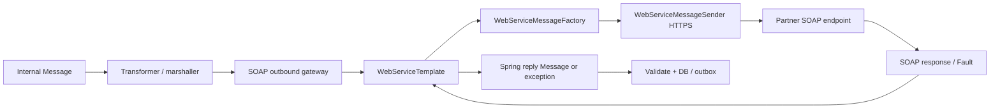
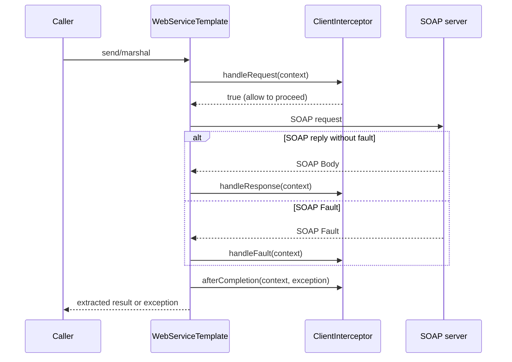
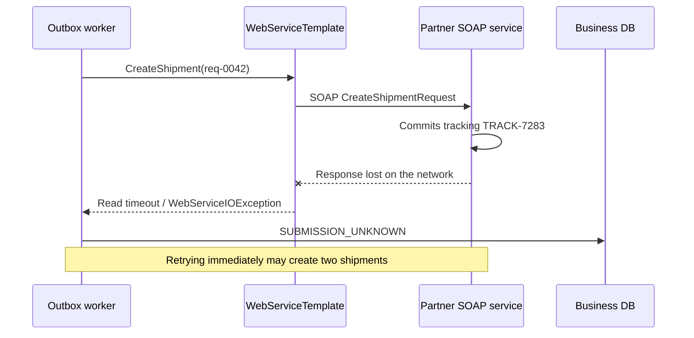

# SOAP messages and WebServiceTemplate

## 1. Real-world problem and objectives

A Spring Boot system receives an `ORDER_PAID` event over a `MessageChannel`, and must then call a partner's SOAP service to create a shipment. The partner publishes a WSDL/XSD, requires SOAP 1.1, a `SOAPAction` matching the operation, a `ClientRequestId` header for reconciliation, and returns a `CreateShipmentResponse` containing a tracking code. When transport errors occur, the application must distinguish a **SOAP Fault**, an HTTP transport error, invalid XML, and the case where **the partner already created the shipment but the response was lost**.

To implement this safely, developers must understand **two message types**:

- **Spring Integration `Message<?>`:** internal message passed between channels, transformers, gateways, handlers, and error flows; consists of `payload` + `MessageHeaders`.
- **Spring Web Services `WebServiceMessage` / `SoapMessage`:** representation of a SOAP call (Envelope, Header, Body, Fault, attachments), created and processed via `WebServiceTemplate`.

`WebServiceTemplate` is Spring-WS's foundational client. Within the `SPRING_INTEGRATION_ADAPTERS` module, `SimpleWebServiceOutboundGateway` and `MarshallingWebServiceOutboundGateway` build on that same infrastructure to wire SOAP calls into integration flows. This is how **external systems are connected** alongside File/SFTP/HTTP/JMS/AMQP/Kafka/databases, sharing common principles around message contracts, errors, timeouts, and connection lifecycles.

After this lesson, you will be able to:

1. Read SOAP 1.1/1.2 structure, distinguishing Envelope, Header, Body, Fault, `SOAPAction`, and WS-Addressing `Action`.
2. Create/read `SoapMessage` via `SaajSoapMessageFactory`; understand `Source`/`Result` and the difference between the **body payload** and the **entire SOAP envelope**.
3. Configure `WebServiceTemplate`, `WebServiceMessageSender`, timeouts, `WebServiceMessageCallback`, `SoapActionCallback`, and `ClientInterceptor`.
4. Send/receive SOAP using `sendSourceAndReceiveToResult`, `sendSourceAndReceive`, `marshalSendAndReceive`, and `sendAndReceive`.
5. Integrate `WebServiceTemplate` into Spring Integration Java DSL; map SOAPAction/headers and handle empty replies.
6. Diagnose SOAP Faults, schema mismatches, transport/TLS errors, retries, and idempotency; test with `MockWebServiceServer`.

> **Version scope:** Spring Integration **6.5.x**, Spring Web Services **4.0.x**, Spring Framework 6.x, compatible Spring Boot, and Java 17+. XML transform API `javax.xml.transform.*` belongs to **JAXP and still uses `javax`**, whereas Jakarta SOAP/JAXB use `jakarta.xml.soap.*` and `jakarta.xml.bind.*`. The domain `example.test`, namespaces, and sample data below are completely simulated.

## 2. Which layers does a SOAP call pass through?



| Component | Specific responsibility | Does not automatically guarantee |
| --- | --- | --- |
| `MessageChannel` | Routes Spring messages between endpoints | That HTTP/SOAP was sent merely because an async channel accepted the message |
| Spring Integration WS outbound gateway | Translates Spring messages into SOAP calls and replies back into the flow | That the remote business transaction is exactly-once |
| `WebServiceTemplate` | Orchestrates request callback → transport → response/fault → extractor | That the reply reliably reaches the client after a remote commit |
| `WebServiceMessageFactory` | Creates/parses the corresponding SOAP/POX message | Automatic business authorization or XSD validation |
| `SoapMessage` | Exposes Envelope/Header/Body/Action/attachments | Trustworthiness of remotely declared headers |
| `WebServiceMessageSender` | Executes transport (HTTP/HTTPS and other supported senders) | Safe retries when side effects exist |
| `ClientInterceptor` | Attaches auth/tracing/validation and observes requests/responses/faults | Determining whether business state actually committed |
| Domain service/ledger | Validates and commits business results, prevents duplicates | Replacing DB transactions with SOAP Faults |

`WebServiceTemplate` is **not an HTTP REST client**: it does not define JSON mapping like `RestClient`, nor does it inspect WSDLs to generate Java classes automatically. With JAXB and contract-first, generated classes/`Jaxb2Marshaller` are prepared separately by the project.

### Comparing inbound and outbound

- **Inbound SOAP:** HTTP/SOAP clients call into the application; `MessageDispatcherServlet` and `EndpointMapping` select `SimpleWebServiceInboundGateway` or `MarshallingWebServiceInboundGateway`. This is the **server** side.
- **Outbound SOAP:** the application calls an external SOAP endpoint; `WebServiceTemplate`/outbound gateway acts as the **client**. You do not need to register `MessageDispatcherServlet` just to make outbound calls.
- **SOAP vs REST:** SOAP has an Envelope, Fault, Header, WSDL/XSD, and often `SOAPAction`. Do not equate Spring Integration `Http.outboundGateway` with `Ws.simpleOutboundGateway`.

## 3. Anatomy of a SOAP Envelope: Body vs. Header

SOAP 1.1 requires a root `Envelope` with namespace `http://schemas.xmlsoap.org/soap/envelope/`. `Header` is optional; `Body` is required and contains the message payload or a SOAP Fault.

```xml
<?xml version="1.0" encoding="UTF-8"?>
<soapenv:Envelope
    xmlns:soapenv="http://schemas.xmlsoap.org/soap/envelope/"
    xmlns:ship="urn:demo:shipping:v1"
    xmlns:sec="urn:demo:shipping:headers">
  <soapenv:Header>
    <sec:ClientRequestId soapenv:mustUnderstand="0">
      req-0042
    </sec:ClientRequestId>
  </soapenv:Header>
  <soapenv:Body>
    <ship:CreateShipmentRequest>
      <ship:clientRequestId>req-0042</ship:clientRequestId>
      <ship:orderId>O-9001</ship:orderId>
    </ship:CreateShipmentRequest>
  </soapenv:Body>
</soapenv:Envelope>
```

Key point: when calling `WebServiceTemplate.sendSourceAndReceiveToResult(...)`, the request `Source` is normally **only the `<ship:CreateShipmentRequest>` element**, while the factory wraps it in the SOAP Body. If you wrap an entire `Envelope` as the `Source`, you can create a **nested Envelope inside the Body** and cause the partner to reject the XML.

**A SOAP Header is not an HTTP header:** `sec:ClientRequestId` lives inside the SOAP Envelope; `Content-Type` and SOAP 1.1 `SOAPAction` are HTTP/transport metadata. A value with the same name in an HTTP header, a SOAP Header, and Spring `MessageHeaders` occupies **three distinct places** and is only mapped when configured.

### SOAP over HTTP (abbreviated)

```http
POST /ws/shipping HTTP/1.1
Host: shipping.example.test
Content-Type: text/xml; charset=utf-8
SOAPAction: "urn:demo:shipping:v1/CreateShipment"

<?xml version="1.0" encoding="UTF-8"?>
<soapenv:Envelope xmlns:soapenv="http://schemas.xmlsoap.org/soap/envelope/"
                  xmlns:ship="urn:demo:shipping:v1">
  <soapenv:Body>
    <ship:CreateShipmentRequest>
      <ship:clientRequestId>req-0042</ship:clientRequestId>
      <ship:orderId>O-9001</ship:orderId>
    </ship:CreateShipmentRequest>
  </soapenv:Body>
</soapenv:Envelope>
```

This HTTP example uses SOAP 1.1 with `text/xml` and `SOAPAction`; with SOAP 1.2, `Content-Type` is typically `application/soap+xml` with an `action` parameter when required by the contract.

## 4. SOAP 1.1 and SOAP 1.2 differ by more than Content-Type

| Aspect | SOAP 1.1 | SOAP 1.2 |
| --- | --- | --- |
| Envelope namespace | `http://schemas.xmlsoap.org/soap/envelope/` | `http://www.w3.org/2003/05/soap-envelope` |
| Typical HTTP media type | `text/xml` | `application/soap+xml` |
| Action | HTTP `SOAPAction` per binding | `action` parameter on media type and/or WS-Addressing per binding |
| Fault | `faultcode`, `faultstring`, `detail` | `Code`, `Reason`, `Detail`, optional `Subcode` |
| Creation | `SoapVersion.SOAP_11` | `SoapVersion.SOAP_12` |
| Compatibility | Not automatically 1.2-compatible | Does not automatically accept 1.1 |

Example SOAP 1.2 body with the **correct namespace**:

```xml
<env:Envelope xmlns:env="http://www.w3.org/2003/05/soap-envelope"
              xmlns:ship="urn:demo:shipping:v1">
  <env:Body>
    <ship:GetShipmentStatusRequest>
      <ship:trackingNumber>TRACK-7283</ship:trackingNumber>
    </ship:GetShipmentStatusRequest>
  </env:Body>
</env:Envelope>
```

**WS-Addressing Action** (`wsa:Action`) is a WS-Addressing SOAP Header, distinct from SOAP 1.1's `SOAPAction`. Spring-WS provides `SoapActionCallback` and `org.springframework.ws.soap.addressing.client.ActionCallback` with different responsibilities. Never substitute one for the other if the WSDL/policy explicitly requires both.

## 5. `WebServiceMessage`, `SoapMessage`, and XML types in Java

`WebServiceMessage` is Spring-WS's base abstraction, while `SoapMessage` provides SOAP-specific APIs:

| API | Value/meaning |
| --- | --- |
| `WebServiceMessage.getPayloadSource()` | `Source` of the payload inside the Body |
| `WebServiceMessage.getPayloadResult()` | `Result` for writing the payload into the Body |
| `SoapMessage.getEnvelope()` | Accesses the Envelope |
| `SoapMessage.getSoapHeader()` | Accesses the SOAP Header |
| `SoapMessage.getSoapBody()` | Accesses the SOAP Body |
| `SoapMessage.getSoapAction()` / `setSoapAction(...)` | Reads/sets action per SOAP version |
| `SoapMessage.getVersion()` | `SOAP_11` or `SOAP_12` |
| `SoapMessage.getDocument()` | DOM of the whole SOAP message; consider memory cost |
| `SoapBody.hasFault()` / `getFault()` | Checks for a Fault in the Body |

### `Source` is not a String, `Result` is not a Java response object

Java XML transformation uses `javax.xml.transform.Source` and `Result`:

- `StringSource` is a Spring XML utility wrapping an XML string as a `Source`.
- `StreamSource` reads from an `InputStream`/`Reader`, subject to stream lifecycles.
- `DOMSource` wraps a DOM `Node`/`Document`, which can be memory-heavy for large XML.
- `DOMResult` captures output content as a DOM.
- `StringResult` captures transformed XML as a string.

A `Source` usually **does not return XML text from `toString()`**. You need a hardened/bounded `Transformer` or XML parser to convert it. A `Source` may be single-use (stream-backed) and unsuitable as a payload for long-lived retries once the underlying resource closes.

### QName and namespace

Payload `<ship:CreateShipmentRequest xmlns:ship="urn:demo:shipping:v1">` has QName `{urn:demo:shipping:v1}CreateShipmentRequest`. `ship` is only a **presentation prefix**, not the element's identity; prefix `x` with the same URI represents the exact same QName. Conversely, `CreateShipmentRequest` in namespace `v2` is a **different operation contract**, even with an identical local name.

## 6. `WebServiceMessageFactory`: creating SOAP 1.1 and SOAP 1.2

Spring-WS uses `WebServiceMessageFactory` to create/parse messages. For SAAJ, `SaajSoapMessageFactory` implements `SoapMessageFactory`. On Spring-WS 4.x, SAAJ belongs to Jakarta XML SOAP, not the legacy `javax` SAAJ runtime.

```java
import org.springframework.context.annotation.Bean;
import org.springframework.context.annotation.Configuration;
import org.springframework.ws.soap.SoapVersion;
import org.springframework.ws.soap.saaj.SaajSoapMessageFactory;

@Configuration
public class SoapMessageFactories {

    @Bean
    public SaajSoapMessageFactory partnerSoap11Factory() {
        SaajSoapMessageFactory factory = new SaajSoapMessageFactory();
        factory.setSoapVersion(SoapVersion.SOAP_11);
        // For Spring beans, the container calls afterPropertiesSet().
        return factory;
    }
}
```

If a partner uses SOAP 1.2, create a **separate bean** with `SoapVersion.SOAP_12` and inject it into a separate template; never mutate a shared factory's version per concurrent request. SAAJ typically builds DOM-backed messages, so large SOAP payloads/attachments require memory limits and performance testing. For MTOM, you need a compatible XSD/WSDL contract and JAXB/attachment handling; choosing a factory does not automatically enable MTOM.

### Creating a `SoapMessage` and writing payload into the Body

```java
import javax.xml.transform.Transformer;
import javax.xml.transform.TransformerFactory;

import org.springframework.ws.soap.SoapMessage;
import org.springframework.ws.soap.saaj.SaajSoapMessageFactory;
import org.springframework.xml.transform.StringSource;

public class SoapMessageExample {

    public static SoapMessage createBody(SaajSoapMessageFactory factory)
            throws Exception {

        SoapMessage message = factory.createWebServiceMessage();
        message.setSoapAction("urn:demo:shipping:v1/CreateShipment");

        String body = """
            <ship:CreateShipmentRequest xmlns:ship="urn:demo:shipping:v1">
              <ship:clientRequestId>req-0042</ship:clientRequestId>
              <ship:orderId>O-9001</ship:orderId>
            </ship:CreateShipmentRequest>
            """;

        TransformerFactory tf = TransformerFactory.newInstance();
        // Production: configure JAXP secure processing and
        // ACCESS_EXTERNAL_DTD/STYLESHEET on this factory.
        Transformer transformer = tf.newTransformer();
        transformer.transform(new StringSource(body),
                message.getPayloadResult());
        return message;
    }
}
```

This code receives a Spring-initialized factory. If you instantiate `new SaajSoapMessageFactory()` outside the Spring container, you must initialize its lifecycle properly (e.g., `afterPropertiesSet()`), otherwise you will hit an uninitialized message factory error. **Pass only the Body payload into `getPayloadResult()`**, never writing a second SOAP Envelope. Section 18/20 covers practical JAXP hardening.

## 7. `WebServiceTemplate`: configuring transport, URI, and timeouts

The core of the Spring-WS client is `WebServiceTemplate`. You can configure the template bean with a `WebServiceMessageFactory`, `WebServiceMessageSender`, default URI, marshaller/unmarshaller, interceptors, and fault resolver. No `MessageDispatcherServlet` is needed: the template acts as a **client**.

```groovy
dependencies {
    implementation 'org.springframework.boot:spring-boot-starter-integration'
    implementation 'org.springframework.integration:spring-integration-ws'
    implementation 'org.springframework.boot:spring-boot-starter-web-services'
    testImplementation 'org.springframework.boot:spring-boot-starter-test'
    testImplementation 'org.springframework.ws:spring-ws-test'
}
```

With a compatible Spring Boot BOM, avoid pulling conflicting `javax.xml.soap`/`jakarta.xml.soap` versions simultaneously. If using JAXB object mapping, add the JAXB runtime/bindings managed by the BOM and build plugin.

```yaml
app:
  shipping:
    endpoint: ${SHIPPING_SOAP_ENDPOINT:https://shipping.example.test/ws/shipping}
    soap-action: "urn:demo:shipping:v1/CreateShipment"
    connect-timeout-ms: 5000
    read-timeout-ms: 20000
```

```java
import java.time.Duration;

import org.springframework.beans.factory.annotation.Value;
import org.springframework.context.annotation.Bean;
import org.springframework.context.annotation.Configuration;
import org.springframework.ws.client.core.WebServiceTemplate;
import org.springframework.ws.soap.saaj.SaajSoapMessageFactory;
import org.springframework.ws.transport.http.HttpUrlConnectionMessageSender;

@Configuration
public class ShippingWebServiceClientConfig {

    @Bean
    public WebServiceTemplate shippingWebServiceTemplate(
            SaajSoapMessageFactory partnerSoap11Factory,
            @Value("${app.shipping.endpoint}") String endpoint,
            @Value("${app.shipping.connect-timeout-ms:5000}") long connectMs,
            @Value("${app.shipping.read-timeout-ms:20000}") long readMs) {

        HttpUrlConnectionMessageSender sender =
                new HttpUrlConnectionMessageSender();
        sender.setConnectionTimeout(Duration.ofMillis(connectMs));
        sender.setReadTimeout(Duration.ofMillis(readMs));

        WebServiceTemplate template =
                new WebServiceTemplate(partnerSoap11Factory);
        template.setDefaultUri(endpoint);
        template.setMessageSender(sender);
        return template;
    }
}
```

Timeouts use **`Duration`**, matching Spring-WS 4.x `HttpUrlConnectionMessageSender`. Connect timeout only bounds socket connection establishment; read timeout only bounds waiting to read data. **There is no automatic end-to-end deadline** covering DNS + TLS + upload + server processing + XML decoding + DB. When pooling/mTLS/proxies are required, consider `HttpComponents5MessageSender` with a properly configured client; do not assume default sender setters override a custom HTTP client.

**URIs must come from trusted configuration.** Never let an HTTP client send a `targetUrl` header passed straight into `setDefaultUri` or `send...(uri, ...)`; that enables SSRF against metadata services or internal networks. For multi-tenant systems, isolate clients/credentials and maintain an explicit endpoint allowlist.

## 8. Four call groups on `WebServiceTemplate`

| Method | Request API | Reply API | Purpose |
| --- | --- | --- | --- |
| `sendSourceAndReceiveToResult` | `Source` | Writes reply into `Result`, returns `boolean` indicating response presence | Send XML without JAXB |
| `sendSourceAndReceive` | `Source` | `SourceExtractor<T>` produces result object | Read reply content directly via extractor |
| `marshalSendAndReceive` | Object + `Marshaller` | Object + `Unmarshaller` | Contract-first JAXB/POJO |
| `sendAndReceive` | `WebServiceMessageCallback` | `WebServiceMessageExtractor<T>` or callback | Full manual control over Header, Body, attachments |

Each group has overloads taking an **explicit URI** or using the template's `defaultUri`. Overloads without a URI only work when the template has a destination/default URI configured. Every group accepts a `WebServiceMessageCallback` to customize the SOAP request after the body is written/marshalled.

For empty responses, never assume returning `false`/`null` is always a network error. A SOAP operation may have a **one-way/void** contract. Conversely, if an operation expects a tracking number and returns an empty response, that is a **contract violation** and must be classified accordingly rather than recording "shipment created" in the DB.

## 9. Calling SOAP with `Source` and receiving `Result` — first example

This is the shortest path to learning `WebServiceTemplate`: create a body-element XML `Source`, pass it to the template, set `SOAPAction` via callback, and receive the response as an XML string.

```java
import org.springframework.beans.factory.annotation.Qualifier;
import org.springframework.stereotype.Service;
import org.springframework.ws.client.core.WebServiceTemplate;
import org.springframework.ws.soap.client.core.SoapActionCallback;
import org.springframework.xml.transform.StringResult;
import org.springframework.xml.transform.StringSource;

@Service
public class ShippingXmlClient {

    private final WebServiceTemplate template;

    public ShippingXmlClient(
            @Qualifier("shippingWebServiceTemplate") WebServiceTemplate template) {
        this.template = template;
    }

    public String submitDemoRequest() {
        StringSource request = new StringSource("""
            <ship:CreateShipmentRequest xmlns:ship="urn:demo:shipping:v1">
              <ship:clientRequestId>req-0042</ship:clientRequestId>
              <ship:orderId>O-9001</ship:orderId>
            </ship:CreateShipmentRequest>
            """);

        StringResult response = new StringResult();
        boolean received = template.sendSourceAndReceiveToResult(
                request,
                new SoapActionCallback("urn:demo:shipping:v1/CreateShipment"),
                response);

        if (!received) {
            throw new IllegalStateException(
                    "Operation requires a response but none was received");
        }
        // This is the BODY PAYLOAD XML, not yet schema- or business-validated.
        return response.toString();
    }
}
```

**What this code actually does:** it uses `defaultUri` on `shippingWebServiceTemplate`, sends the SOAP 1.1 body, sets `SOAPAction`, and retrieves the result. It does **not** verify namespace, `clientRequestId`, tracking number, or response status, so any arbitrary XML string must not be treated as business success.

In production code, `requestId`/`orderId` must be marshalled/escaped per XSD. Never concatenate XML strings from user input: `&`, `<`, and special characters can produce invalid XML or XML injection. Prefer JAXB-generated classes or a safe XML builder, and validate responses against XSD before persisting to the DB.

### Without a default URI

An overload exists:

```java
boolean gotReply = template.sendSourceAndReceiveToResult(
        "https://shipping.example.test/ws/shipping",
        request,
        new SoapActionCallback("urn:demo:shipping:v1/CreateShipment"),
        response);
```

This snippet is a fragment for the method above using a **static URI from configuration**. Never pass a URL from a SOAP payload or HTTP input into this overload without checking host/scheme/port/IP/redirects; that is a prime SSRF vector.

## 10. `sendSourceAndReceive` and `SourceExtractor<T>`

When you prefer not to write the response into a pre-allocated `Result`, supply a `SourceExtractor<T>`: a callback that reads the `Source` of the **response body payload** and returns an application-meaningful type. Not every extractor needs to build a large DOM.

```java
import javax.xml.transform.Source;
import javax.xml.transform.TransformerFactory;

import org.springframework.ws.client.core.SourceExtractor;
import org.springframework.ws.client.core.WebServiceTemplate;
import org.springframework.ws.soap.client.core.SoapActionCallback;
import org.springframework.xml.transform.StringResult;
import org.springframework.xml.transform.StringSource;

public final class SourceExtractorExample {

    public static String call(
            WebServiceTemplate template, String bodyXml) {

        SourceExtractor<String> extractor = responseSource -> {
            // TransformerFactory must be hardened per the security section.
            var factory = TransformerFactory.newInstance();
            var transformer = factory.newTransformer();
            StringResult result = new StringResult();
            transformer.transform(responseSource, result);
            return result.toString();
        };

        return template.sendSourceAndReceive(
                new StringSource(bodyXml),
                new SoapActionCallback("urn:demo:shipping:v1/GetShipmentStatus"),
                extractor);
    }
}
```

This snippet illustrates the callback contract, but `TransformerFactory` here is unhardened: **never use it in production when parsing untrusted XML**. Controls are covered in section 20. `SourceExtractor` may return `null` when there is no response or payload. If downstream steps need durable data, the extractor must materialize the content while the source is valid, enforce byte limits, and check the QName/version.

A well-designed extractor can extract just `trackingNumber` and status using a safe XML parser, without skipping schema/business validation. `getPayloadSource()` may be stream- or DOM-backed depending on the factory; never assume a `Source` can be read multiple times.

## 11. `marshalSendAndReceive`: object ↔ XML via JAXB

When a partner supplies XSD/WSDL, using contract-generated JAXB classes reduces manual XML bugs. `WebServiceTemplate` needs both `Marshaller` and `Unmarshaller` to send and receive objects.

```java
import org.springframework.context.annotation.Bean;
import org.springframework.context.annotation.Configuration;
import org.springframework.oxm.jaxb.Jaxb2Marshaller;

@Configuration
public class ShippingJaxbBindingConfig {

    @Bean
    public Jaxb2Marshaller shippingMarshaller() {
        Jaxb2Marshaller marshaller = new Jaxb2Marshaller();
        marshaller.setContextPath("com.example.partner.shipping.v1");
        // Package assumed to contain generated JAXB classes / ObjectFactory.
        // Schema validation, allowed types, and JAXB runtime must be tested.
        return marshaller;
    }
}
```

```java
import org.springframework.beans.factory.annotation.Qualifier;
import org.springframework.beans.factory.annotation.Value;
import org.springframework.context.annotation.Bean;
import org.springframework.context.annotation.Configuration;
import org.springframework.oxm.jaxb.Jaxb2Marshaller;
import org.springframework.ws.client.core.WebServiceTemplate;
import org.springframework.ws.soap.saaj.SaajSoapMessageFactory;
import org.springframework.ws.transport.http.HttpUrlConnectionMessageSender;

@Configuration
public class ShippingJaxbClientConfig {

    @Bean
    public WebServiceTemplate jaxbShippingTemplate(
            @Qualifier("partnerSoap11Factory") SaajSoapMessageFactory factory,
            @Qualifier("shippingMarshaller") Jaxb2Marshaller marshaller,
            @Value("${app.shipping.endpoint}") String endpoint) {

        HttpUrlConnectionMessageSender sender =
                new HttpUrlConnectionMessageSender();
        sender.setConnectionTimeout(java.time.Duration.ofSeconds(5));
        sender.setReadTimeout(java.time.Duration.ofSeconds(20));

        WebServiceTemplate template = new WebServiceTemplate(factory);
        template.setDefaultUri(endpoint);
        template.setMessageSender(sender);
        template.setMarshaller(marshaller);
        template.setUnmarshaller(marshaller);
        return template;
    }
}
```

Service calling the template with an object of the **correct JAXB-generated type**:

```java
import org.springframework.ws.client.core.WebServiceTemplate;
import org.springframework.ws.soap.client.core.SoapActionCallback;

public final class JaxbShippingCaller {

    private final WebServiceTemplate template;

    public JaxbShippingCaller(WebServiceTemplate template) {
        this.template = template;
    }

    public Object call(Object generatedJaxbRequest) {
        return template.marshalSendAndReceive(
                generatedJaxbRequest,
                new SoapActionCallback(
                        "urn:demo:shipping:v1/CreateShipment"));
    }
}
```

`generatedJaxbRequest` must be an object accepted by the marshaller, such as `JAXBElement<CreateShipmentRequest>` from `ObjectFactory`; the return value may likewise be `JAXBElement<CreateShipmentResponse>` depending on XJC. **Do not blindly cast the reply object** to a domain DTO. Schema validation, non-null constraints, and `clientRequestId`/tenant checks must be performed explicitly.

### Unmarshalling does not equal business success

A valid XML response with `<status>REJECTED</status>` is still a business failure; a parseable response with an empty `trackingNumber` is likewise not ready to commit. Distinguish:

1. **Transport success** — HTTP/SOAP response received.
2. **SOAP success** — no SOAP Fault.
3. **Contract success** — matches XSD, namespace, action, and response type.
4. **Business success** — matching request ID, valid tracking number/status, partner operation succeeded.
5. **Local commit** — result persisted idempotently to DB.

## 12. `WebServiceMessageCallback` and `SoapActionCallback`

Callbacks run **after the request body is built/marshalled** and before sending via `WebServiceMessageSender`. They are the right place to set `SOAPAction` or contract SOAP headers, not to mutate business transactions.

```java
import javax.xml.namespace.QName;

import org.springframework.ws.WebServiceMessage;
import org.springframework.ws.client.core.WebServiceMessageCallback;
import org.springframework.ws.soap.SoapHeaderElement;
import org.springframework.ws.soap.SoapMessage;

public final class ShippingSoapCallbacks {

    public static WebServiceMessageCallback withMetadata(String requestId) {
        // requestId has already been validated, length-bounded, and tenant-scoped.
        return (WebServiceMessage message) -> {
            if (!(message instanceof SoapMessage soap)) {
                throw new IllegalStateException("Requires a SOAP message factory");
            }

            soap.setSoapAction("urn:demo:shipping:v1/CreateShipment");
            SoapHeaderElement idHeader = soap.getSoapHeader()
                    .addHeaderElement(new QName(
                            "urn:demo:shipping:headers",
                            "ClientRequestId",
                            "hdr"));
            idHeader.setText(requestId);
        };
    }
}
```

Use this callback with `sendSourceAndReceiveToResult(...)` or `marshalSendAndReceive(request, callback)`. When you **only need to set the action**, `SoapActionCallback` is simpler and easier to audit. When partners require headers like WS-Security signatures, Timestamps, or WS-Addressing, **never hand-craft fake XML signatures**; use Spring-WS client interceptors/WSS4J policies and proper key material.

### `SoapHeaderElement` and the `mustUnderstand` attribute

`SoapHeaderElement#setMustUnderstand(true)` requires the targeted SOAP node to process that header; otherwise, the receiver may return a `MustUnderstand` Fault. This **does not mean** the header is authenticated or signed. `setActorOrRole(...)` must match the SOAP version and partner binding.

Never enable `mustUnderstand` on every correlation header just because it feels "important": legacy clients/servers that do not recognize that header will reject the message.

## 13. `ClientInterceptor`: request, response, fault, cleanup

`WebServiceTemplate#setInterceptors(ClientInterceptor[])` attaches shared observability/validation/WS-Security logic. Lifecycle order matters:



`ClientInterceptor#handleRequest` runs after payload creation/callbacks and before transport. `handleResponse` handles non-fault responses, `handleFault` handles SOAP Faults, and `afterCompletion` cleans up resources/records metrics for interceptors that executed. If an interceptor returns `false`, the chain can short-circuit; **never use that to silently drop a response and report success**.

Example interceptor logging only bounded metadata:

```java
import org.springframework.ws.context.MessageContext;
import org.springframework.ws.client.support.interceptor.ClientInterceptorAdapter;
import org.springframework.ws.soap.SoapMessage;

public class SoapMetadataInterceptor extends ClientInterceptorAdapter {

    @Override
    public boolean handleRequest(MessageContext context) {
        if (context.getRequest() instanceof SoapMessage soap) {
            String action = soap.getSoapAction();
            // Log sanitized action and internal correlation ID;
            // never log SOAP body, UsernameToken, or raw Headers.
        }
        return true;
    }

    @Override
    public boolean handleFault(MessageContext context) {
        // Record fault count and category; do not print full Fault XML.
        return true;
    }
}
```

Registration:

```java
import org.springframework.ws.client.support.interceptor.ClientInterceptor;

template.setInterceptors(
        new ClientInterceptor[]{new SoapMetadataInterceptor()});
```

This is a snippet inside a bean configuration. In production, Spring manages `ClientInterceptor` beans and policy/security ordering. A logging interceptor does not replace an XSD validator, TLS, or business authorization.

## 14. SOAPAction, WS-Addressing, and Spring Integration headers

Three concepts are often confused:

| Name | Where it lives | Purpose |
| --- | --- | --- |
| `SOAPAction` (SOAP 1.1) | HTTP transport metadata; Spring-WS `SoapMessage` abstraction | Signals SOAP operation intent per WSDL binding |
| `wsa:Action` | WS-Addressing SOAP Header | Routing/correlation per WS-Addressing contract |
| `WebServiceHeaders.SOAP_ACTION` | Spring Integration `MessageHeaders`, key `ws_soapAction` | Gateway maps action to/from `SoapMessage` |

`org.springframework.ws.soap.addressing.client.ActionCallback` supports WS-Addressing and is **not** `SoapActionCallback`. An endpoint may require both, and they must point to the same operation per policy. Never use any action header as authentication: callers can write arbitrary action names.

In Spring Integration 6.5, `DefaultSoapHeaderMapper` copies **`SOAPAction`** by default; custom SOAP headers are **not mapped automatically** unless allowlisted via `requestHeaderNames` or `replyHeaderNames`.

```java
import org.springframework.context.annotation.Bean;
import org.springframework.integration.ws.DefaultSoapHeaderMapper;
import org.springframework.integration.ws.WebServiceHeaders;

@Bean
public DefaultSoapHeaderMapper shippingSoapHeaderMapper() {
    DefaultSoapHeaderMapper mapper = new DefaultSoapHeaderMapper();
    mapper.setRequestHeaderNames(
            WebServiceHeaders.SOAP_ACTION, "ClientRequestId");
    mapper.setReplyHeaderNames(
            WebServiceHeaders.SOAP_ACTION, "PartnerReceiptId");
    return mapper;
}
```

When mapping custom headers, the request can hold a `Source` as an XML child inside the SOAP Header:

```java
import org.springframework.xml.transform.StringSource;
import org.springframework.messaging.support.MessageBuilder;

var springMessage = MessageBuilder
        .withPayload("<ship:.../>") // Placeholder; must be replaced with valid XML.
        .setHeader("ClientRequestId", new StringSource("""
            <hdr:ClientRequestId xmlns:hdr="urn:demo:shipping:headers">
              req-0042
            </hdr:ClientRequestId>
            """))
        .build();
```

This fragment only illustrates **how headers are mapped**, not a SOAP request with a valid body. When reading custom SOAP headers from a reply, Spring Integration can place a `SoapHeaderElement` in Spring message headers; `SoapHeaderElement#getSource()` lets you parse its data, though headers remain **untrusted input**. Never wildcard-map `*` all Spring headers out to SOAP, which risks leaking tokens, tenant metadata, or Spring reply/error channels.

## 15. Wiring `WebServiceTemplate` into Spring Integration Java DSL

Choosing a plain client versus an integration flow depends on requirements:

- **Plain client:** a domain service calls `WebServiceTemplate` directly; fits small logic without routers/channels.
- **Integration flow:** needs transformers, filters, gateways, retry policies, channels, metrics, or multiple external systems; uses a Spring Integration WS outbound gateway backed by the configured template.

```java
import org.springframework.beans.factory.annotation.Qualifier;
import org.springframework.beans.factory.annotation.Value;
import org.springframework.context.annotation.Bean;
import org.springframework.context.annotation.Configuration;
import org.springframework.integration.channel.DirectChannel;
import org.springframework.integration.dsl.IntegrationFlow;
import org.springframework.integration.ws.DefaultSoapHeaderMapper;
import org.springframework.integration.ws.dsl.Ws;
import org.springframework.messaging.MessageChannel;
import org.springframework.ws.client.core.WebServiceTemplate;

@Configuration
public class ShippingIntegrationWsFlow {

    @Bean
    public MessageChannel outboundShipmentRequests() {
        return new DirectChannel();
    }

    @Bean
    public IntegrationFlow submitShipmentViaSoap(
            @Qualifier("outboundShipmentRequests") MessageChannel requests,
            @Qualifier("shippingWebServiceTemplate") WebServiceTemplate template,
            DefaultSoapHeaderMapper shippingSoapHeaderMapper,
            @Value("${app.shipping.endpoint}") String uri) {

        return IntegrationFlow.from(requests)
                .handle(Ws.simpleOutboundGateway(template)
                        .uri(uri)
                        .headerMapper(shippingSoapHeaderMapper)
                        .ignoreEmptyResponses(true))
                .get();
    }
}
```

`Ws.simpleOutboundGateway(template)` uses an external `WebServiceTemplate`; configure the message factory, sender, fault resolver, and interceptors on **that template**. Do not expect every setter from the **no-template spec** to apply identically when using an external template.

### Sending a Spring message and receiving a reply

```java
import org.springframework.beans.factory.annotation.Qualifier;
import org.springframework.integration.core.MessagingTemplate;
import org.springframework.integration.ws.WebServiceHeaders;
import org.springframework.messaging.Message;
import org.springframework.messaging.MessageChannel;
import org.springframework.messaging.support.MessageBuilder;
import org.springframework.stereotype.Service;

@Service
public class ShippingFlowCaller {

    private final MessageChannel channel;

    public ShippingFlowCaller(
            @Qualifier("outboundShipmentRequests") MessageChannel channel) {
        this.channel = channel;
    }

    public Message<?> callDemo() {
        String body = """
            <ship:CreateShipmentRequest xmlns:ship="urn:demo:shipping:v1">
              <ship:clientRequestId>req-0042</ship:clientRequestId>
              <ship:orderId>O-9001</ship:orderId>
            </ship:CreateShipmentRequest>
            """;
        Message<String> request = MessageBuilder.withPayload(body)
                .setHeader(WebServiceHeaders.SOAP_ACTION,
                        "urn:demo:shipping:v1/CreateShipment")
                .build();

        MessagingTemplate sender = new MessagingTemplate();
        sender.setReceiveTimeout(25_000);
        Message<?> reply = sender.sendAndReceive(channel, request);
        if (reply == null) {
            throw new IllegalStateException(
                    "No SOAP reply received per contract");
        }
        return reply;
    }
}
```

`MessagingTemplate` is a **Spring Integration client**, not `WebServiceTemplate`. It sends a Spring Message to a channel and waits for a Spring reply. If the flow uses an `ExecutorChannel`/queue, `send()` returning true **does not prove SOAP completed**. For typical outbound request–reply, `DirectChannel` lets you observe the handler synchronously. `receiveTimeout` at the messaging layer does not cancel side effects at the partner once the HTTP request has left the system.

## 16. SOAP Faults and `WebServiceTemplate` fault resolution

A SOAP Fault is a **SOAP-protocol payload** inside the SOAP Body; not every HTTP 4xx/5xx carries a Fault. A proxy may return HTTP 503 with HTML; conversely, a non-compliant provider may return a SOAP Fault inside HTTP 200.

SOAP 1.1 Fault example:

```xml
<soapenv:Envelope xmlns:soapenv="http://schemas.xmlsoap.org/soap/envelope/">
  <soapenv:Body>
    <soapenv:Fault>
      <faultcode>soapenv:Client</faultcode>
      <faultstring>Customer identifier is invalid</faultstring>
      <detail>
        <err:code xmlns:err="urn:demo:shipping:errors">INVALID_CUSTOMER</err:code>
      </detail>
    </soapenv:Fault>
  </soapenv:Body>
</soapenv:Envelope>
```

SOAP 1.2 Fault has a different structure:

```xml
<env:Envelope xmlns:env="http://www.w3.org/2003/05/soap-envelope">
  <env:Body>
    <env:Fault>
      <env:Code><env:Value>env:Sender</env:Value></env:Code>
      <env:Reason>
        <env:Text xml:lang="en">Invalid request</env:Text>
      </env:Reason>
    </env:Fault>
  </env:Body>
</env:Envelope>
```

`WebServiceTemplate` uses a `FaultMessageResolver`. With the common SOAP fault resolver, clients receive `org.springframework.ws.soap.client.SoapFaultClientException`; pure transport errors raise `WebServiceTransportException` or `WebServiceIOException`; transform errors raise `WebServiceTransformerException`. Exceptions may be wrapped by Spring Integration as they pass through handlers.

| Scenario | Detection | Action to take |
| --- | --- | --- |
| SOAP `Client`/`Sender` Fault from bad input | Fault code/detail, contract namespace | Quarantine/fix request; do not retry unchanged |
| SOAP `Server`/`Receiver` Fault | Partner fault code/detail | Classify transient per docs; never assume every server error is safe to retry |
| HTTP 401/403, TLS/auth failure | Transport/security exception | Fix scope/cert/token; do not brute-force |
| HTTP 429/503 | Rate limit/outage | Backoff/jitter; check whether side effects may have occurred |
| HTTP 500 + HTML | No valid SOAP Envelope | Diagnose proxy/endpoint; never parse HTML as Fault XML |
| HTTP 200 + SOAP Fault | Non-standard status from provider | Tune fault detection per tests; never treat HTTP 200 as business success |
| Read timeout after request | Unknown whether partner committed | `SUBMISSION_UNKNOWN` + reconciliation |
| SOAP success, XSD-invalid body | Not a SOAP Fault, but violates contract | Do not commit invalid data |

### Configuring template fault handling

```java
import org.springframework.ws.client.core.WebServiceTemplate;
import org.springframework.ws.soap.client.core.SoapFaultMessageResolver;

public static void configureFaults(WebServiceTemplate template) {
    template.setFaultMessageResolver(new SoapFaultMessageResolver());
    // By default, keep checking HTTP status.
    // Only change if the provider returns SOAP Faults with non-standard status:
    // template.setCheckConnectionForFault(false);
}
```

This is a utility method. `checkConnectionForFault` controls whether transport status is inspected to detect Faults; **it does not disable SOAP Fault resolution**. Only set it to `false` after testing a non-standard provider. `checkConnectionForError` is a separate property: never set both to false merely to "stop exceptions".

### Fault codes are not business status

A successful HTTP/SOAP response can still contain `<status>REJECTED</status>` with no Fault. Conversely, a Fault saying `SHIPMENT_ALREADY_EXISTS` may allow **querying the already-created ID** instead of calling Create again. Map **fault details by contracted namespace/code**, never by regex-parsing natural-language `faultstring`s.

## 17. Empty SOAP responses and `ignoreEmptyResponses`

The two APIs have different semantics on empty responses:

- In `WebServiceTemplate.sendSourceAndReceiveToResult(...)`, the `boolean` return value indicates whether a response existed; `marshalSendAndReceive(...)` may return `null` when there is nothing to unmarshal.
- In **Spring Integration `SimpleWebServiceOutboundGateway`**, an HTTP/SOAP response without a body payload can result in **emitting no Spring reply Message**.

Spring Integration 6.5 specifies:

| Simple outbound gateway request payload | Empty response, default | With `ignoreEmptyResponses(false)` |
| --- | --- | --- |
| `String` | No reply produced | May produce a Spring reply representing the empty response |
| `Source` | Source extractor returns `null`, no reply produced | Still **not** guaranteed to produce a reply |
| `Document` | Source extractor returns `null`, no reply produced | Still **not** guaranteed to produce a reply |
| JAXB object | Follows marshalling/unmarshalling contract | Do not assume simple `String` behavior |

```java
// Snippet inside an IntegrationFlow:
.handle(Ws.simpleOutboundGateway(template)
        .uri("https://shipping.example.test/ws/shipping")
        .ignoreEmptyResponses(false))
```

Never add `ignoreEmptyResponses(false)` and assume every request–reply will always return a payload. When the WSDL defines a **one-way** operation, design the flow/caller around **no SOAP reply**, or confirm HTTP acceptance per the transport-level contract. A shipment-creation operation requiring a `trackingNumber` cannot be marked successful merely on an empty HTTP 202/200.

### Message channel timeout vs. empty response

If `MessagingTemplate.sendAndReceive(...)` returns `null` due to a reply timeout, there can be several causes: the SOAP service returned no body; the gateway emitted no Spring reply due to ignore-empty; a handler didn't send to `replyChannel`; a worker is blocked; or the network is slow. Measure and log the request **stage** rather than blindly increasing timeouts and resending the same side effect.

## 18. MessageFactory, MIME attachments, and MTOM

A SOAP body may reference images, PDFs, or binary data. Two common mechanisms exist:

| Binary transport | Representation | When suitable |
| --- | --- | --- |
| `xsd:base64Binary` in Body | Base64 text in XML | Small files, simple contracts; high XML/heap overhead |
| MTOM/XOP via SOAP attachment | MIME multipart, CID/`xop:Include` | Large files, MTOM-enabled WSDL/XSD |
| Client-created attachment | `org.springframework.ws.mime.MimeMessage` | Need explicit control over Content-ID/media type/streams |

Marshalling gateways and `WebServiceTemplate` can enable `Jaxb2Marshaller#setMtomEnabled(true)` when the JAXB model has MTOM-capable bindings. This **does not automatically turn an arbitrary `byte[]` into an attachment**: the schema element, JAXB annotations (`@XmlMimeType` where appropriate), message factory, and partner must support it.

### Creating a SOAP message with an attachment (illustrative sample)

```java
import java.nio.charset.StandardCharsets;
import javax.xml.transform.TransformerFactory;

import org.springframework.core.io.ByteArrayResource;
import org.springframework.ws.mime.MimeMessage;
import org.springframework.ws.soap.saaj.SaajSoapMessageFactory;
import org.springframework.xml.transform.StringSource;

public class SoapAttachmentExample {

    public static MimeMessage create(
            SaajSoapMessageFactory factory) throws Exception {

        MimeMessage message =
                (MimeMessage) factory.createWebServiceMessage();

        String bodyXml = """
            <doc:UploadDocumentRequest xmlns:doc="urn:demo:docs:v1">
              <doc:requestId>req-0042</doc:requestId>
            </doc:UploadDocumentRequest>
            """;
        var tf = TransformerFactory.newInstance();
        // Harden the JAXP factory before using with external XML sources.
        tf.newTransformer().transform(
                new StringSource(bodyXml), message.getPayloadResult());

        byte[] demoBytes = "PDF DEMO PLACEHOLDER"
                .getBytes(StandardCharsets.UTF_8);
        message.addAttachment(
                "invoicePdf",
                new ByteArrayResource(demoBytes),
                "application/pdf");
        return message;
    }
}
```

**Do not treat dummy bytes as a real PDF**; this is an API sample only. In production, never buffer a 500 MB attachment into `byte[]`: cap total bytes, part counts, and duration, stream to storage/quarantine, and scan for malware. Partner-required `Content-ID`, filename, and media type must match the WSDL/contract. For retries, binary sources must be **repeatable** from durable storage, not a single-use `InputStream`.

Spring Integration 6.5 simple WS gateways can accept/return a `MimeMessage` as the payload when working with attachments. Because `MimeMessage` is **bound to message/stream lifecycles**, never push the raw object into Kafka/JMS or a long-lived queue for later reading; persist the data and pass a storage reference.

## 19. XSD/WSDL and SOAP message contracts

Successful SOAP transport is **not** enough to prove XML complies with the contract. A WSDL/XSD may constrain element ordering, enums, decimal scale, timezones, nillable/optional fields, and fault details. In SOAP, namespace and QName typically determine both message type and operation.

Minimal XSD:

```xml
<?xml version="1.0" encoding="UTF-8"?>
<xs:schema xmlns:xs="http://www.w3.org/2001/XMLSchema"
           targetNamespace="urn:demo:shipping:v1"
           xmlns:ship="urn:demo:shipping:v1"
           elementFormDefault="qualified">

  <xs:element name="CreateShipmentRequest">
    <xs:complexType>
      <xs:sequence>
        <xs:element name="clientRequestId" type="xs:string"/>
        <xs:element name="orderId" type="xs:string"/>
      </xs:sequence>
    </xs:complexType>
  </xs:element>

  <xs:element name="CreateShipmentResponse">
    <xs:complexType>
      <xs:sequence>
        <xs:element name="clientRequestId" type="xs:string"/>
        <xs:element name="trackingNumber" type="xs:string"/>
        <xs:element name="status" type="xs:string"/>
      </xs:sequence>
    </xs:complexType>
  </xs:element>
</xs:schema>
```

This is a learning schema only; production should enforce `minLength/maxLength`, enums, regexes, business constraints, and a partner-published/approved WSDL. If `trackingNumber` is `xs:string`, an empty string satisfies the sample XSD yet is **business-invalid**.

### Client-side validation with `PayloadValidatingInterceptor`

Spring-WS provides `org.springframework.ws.client.support.interceptor.PayloadValidatingInterceptor`. It can validate requests (default true) and responses (when enabled) against a classpath XSD. Running on the client, it catches malformed requests before sending and malformed responses before writing to the DB:

```java
import org.springframework.core.io.ClassPathResource;
import org.springframework.ws.client.support.interceptor.ClientInterceptor;
import org.springframework.ws.client.support.interceptor.PayloadValidatingInterceptor;
import org.springframework.ws.client.core.WebServiceTemplate;

public static void addSchemaValidation(WebServiceTemplate template)
        throws Exception {
    PayloadValidatingInterceptor validator =
            new PayloadValidatingInterceptor();
    validator.setSchema(new ClassPathResource("shipping-v1.xsd"));
    validator.setValidateRequest(true);
    validator.setValidateResponse(true);
    validator.afterPropertiesSet();
    template.setInterceptors(new ClientInterceptor[]{validator});
}
```

`shipping-v1.xsd` must exist and be compatible. This is a **snippet inside a configuration utility**. If other interceptors already exist (logging, WS-Security), **do not overwrite them with a validator-only array**; order them per policy so security interceptors are not bypassed. XSD validation does not replace tenant authorization, idempotency, or business validation.

### Pin versions instead of fetching WSDLs dynamically at runtime

A partner may upgrade WSDL/XSD without notice. **Version generated Java bindings, schemas, and tests inside the repository** and verify changes in CI; never download WSDLs from an arbitrary URL on every application startup. A v2 response namespace **must never** be silently ignored by a v1 parser and committed as corrupt data.

## 20. HTTPS, mTLS, WS-Security, and trust boundaries

Because a SOAP client connects to an external system, **mutual** verification is required: we verify the target host, and the partner verifies our client identity. Protection layers serve different goals:

| Layer | Controls | Why it matters |
| --- | --- | --- |
| TLS certificate/hostname verification | Valid CA, SAN/host, strong protocols | Prevents MITM; never send tokens to an imposter server |
| mTLS | Client certificate/keystore authorized by partner | Protects machine-client identity; requires rotation |
| OAuth2/HTTP auth | Access token/scope/expiration, Basic over HTTPS if contracted | Controls permission to call operations |
| WS-Security | UsernameToken, XML Signature/Timestamp/Encryption per policy | Protects SOAP message parts/anti-replay per contract |
| Business authorization | Partner/tenant/order relationship | Blocks out-of-scope shipment orders even with valid tokens |
| Confidentiality | Log/trace redaction; encryption at rest for payloads | SOAP carries customer info and attachments |

Spring-WS supports `Wss4jSecurityInterceptor` (`org.springframework.ws.soap.security.wss4j2` in Spring-WS 4.x) for WS-Security. On outbound clients, configure proper **securement actions**, keys/keystores/truststores, and timestamp/signature policies matching the partner; **never** insert a fake `<Signature>ok</Signature>` SOAP Header.

If a partner uses HTTP Bearer tokens, fetch them from a secret/token supplier and refresh before expiry. Never log `Authorization` or dump full envelopes while debugging. With mTLS, bind client certificates to the proper partner/tenant; avoid reusing the same private key across all partners unless explicitly required.

### SSRF and dynamic endpoint URLs

When `WebServiceTemplate` accepts URIs from callers, it can open connections to caller-specified hosts. Allowlist schemes/hosts/ports, verify resolved DNS/IP addresses and redirect policies, and block disallowed private/link-local/loopback ranges; never treat URI encoding as SSRF protection. When using a service registry/dynamic `DestinationProvider`, protect registry integrity and permissions.

### XXE, external schemas, and XML bombs

XML requests/responses require hardened parsers. On application-created JAXP factories, enable `FEATURE_SECURE_PROCESSING` and set `ACCESS_EXTERNAL_DTD`/`ACCESS_EXTERNAL_STYLESHEET` to empty strings; on DOM/SAX parsers, disable external entities/DTDs/XInclude as needed. If a provider does not support a required security flag, **fail configuration**. Cap SOAP body size, XML depth, element counts, MTOM bytes, and CPU/time.

**Important:** securing one `TransformerFactory` utility **does not automatically secure the entire Spring-WS/SAAJ/JAXB pipeline**. Test the actual message factory, schema parser, and HTTP client; never turn on full XML tracing in production just to debug QName errors.

## 21. Timeouts, retries, and remote side effects: SOAP success can be lost

One of the worst mistakes is "the client timed out, so resend". For `CreateShipmentRequest` with side effects:



| Operation type | Characteristics | Retry approach |
| --- | --- | --- |
| Read-only `GetShipmentStatus` | Does not mutate state per contract | Retry with backoff/jitter/budget |
| `CreateShipment` with partner-**confirmed** idempotency | Partner deduplicates via stable `clientRequestId` | Retry within contract conditions and TTL |
| `CreateShipment` without idempotency | Can create duplicate shipments | Transition to `SUBMISSION_UNKNOWN`, reconcile before retry |
| `CancelShipment` | Complex side effects, possible fees | Verify status/contract before retrying |
| SOAP Fault from invalid data | Usually permanent | Fix data; do not retry unchanged |
| TLS identity/auth failure | Bad certificate/token/scope | Fail closed, fix config; no retry storms |

**There is no default distributed transaction** between the DB and a SOAP service. Even if the caller is `@Transactional`, rolling back the local DB does not cancel a shipment already created on an external server. If a worker crashes after the partner commits but before updating the DB, only **outbox + reconciliation** can determine the next step.

### Durable outbox for side effects

```text
operation_id (unique per tenant/order/operation)
tenant_id, partner_id, order_id
client_request_id (fixed across retries)
request_payload_ref, payload_hash
status: REQUESTED | SENDING | COMPLETED
      | RETRY_PENDING | SUBMISSION_UNKNOWN
      | FAILED_CONFIG | FAILED_PERMANENT
attempt_count, next_retry_at, lease_until
partner_tracking_number, last_error_category
created_at, updated_at
```

Workers must **claim atomically** with lease/fencing, bound concurrent calls per partner, and persist results in short DB transactions. `RETRY_PENDING` is strictly for transient errors where retrying is **contract-safe**; `SUBMISSION_UNKNOWN` requires querying status by `clientRequestId` or manual review. Unique DB keys prevent duplicate **internal jobs**, but do not automatically create exactly-once remote side effects.

Avoid placing default `RequestHandlerRetryAdvice` on every `Ws.simpleOutboundGateway(...)`. That advice can replay the entire SOAP call on any exception, including timeouts after a partner commit. Only attach direct handler retries when the operation is **read-only/idempotent** or backed by provider idempotency guarantees; retries must have backoff, quotas, and budgets.

## 22. Lifecycle, throughput, and observability

A single `WebServiceTemplate` bean can be reused across requests, but SOAP messages, response streams, and transport connections have **per-request lifecycles**. `WebServiceMessageSender` governs connection opening, pooling, and cleanup. Never retain a `WebServiceMessage`, stream-backed `Source`, or attachment beyond the transport/request lifetime; copy data into DTOs or durable storage before passing to other workers.

| Resource | Common issue | Control |
| --- | --- | --- |
| HTTP connection | Unresponsive provider, stale keep-alive/idle sockets | Connect/read timeouts, pool policies, health checks |
| Worker threads | Many synchronous SOAP calls | Bounded executors/bulkheads; never block servlet threads too long |
| XML DOM | SAAJ building large payloads | Size caps, streaming where applicable, heap bounds |
| MTOM attachments | Large files, non-repeatable input streams | Durable storage, quotas, scanning, controlled streaming |
| TLS/auth tokens | Expired certs/tokens | Rotation/refresh, alerts, fail closed |
| Provider quota | HTTP 429/503 rate limits | Per-partner concurrency caps, backoff/jitter |
| Reply routing | Missing reply channel/empty response | Contract tests, `replyTimeout`, correlation |
| Side effects | Timeout after partner commit | Outbox `SUBMISSION_UNKNOWN` and reconciliation |

Measure **transport success, valid SOAP contract, partner business acceptance, and local DB commit** separately:

| Metric | Explanation |
| --- | --- |
| `ws_soap_request_total{partner,operation}` | Calls actually sent to partner |
| `ws_soap_http_error_total{status_class}` | 4xx/5xx transport errors, distinct from SOAP Faults |
| `ws_soap_fault_total{code}` | Faults by normalized code |
| `ws_soap_request_duration` | Total transport + parse duration |
| `ws_soap_connect_timeout_total` | Connect timeouts |
| `ws_soap_read_timeout_total` | Timeouts waiting for response |
| `ws_soap_schema_error_total` | Response XML failing XSD |
| `ws_soap_no_reply_total` | Empty body / missing Spring reply per contract |
| `ws_soap_inflight` | Threads/connections currently waiting on partners |
| `ws_outbox_unknown_pending` | Side effects with unknown outcome |
| `ws_outbox_retry_pending` | Retries permitted by policy |
| `ws_shipment_committed_total` | Tracking numbers successfully persisted to DB |

Never log raw SOAP bodies/Headers in production for "quick debugging": they may hold PII, customer addresses, WS-Security UsernameTokens, key material, Authorization tokens, or attachments. Log internal correlation ID, operation QName, partner ID, controlled request ID, duration, fault/error category, and state transitions. When XML audit archiving is required, enforce encryption at rest, access controls, and retention.

### Tracing across boundaries

```text
orderId=O-9001
operationId=ship-create-O-9001
soapOperation={urn:demo:shipping:v1}CreateShipmentRequest
clientRequestId=req-0042
stage=SOAP_TRANSPORT | SOAP_PARSE | PARTNER_ACCEPTED | DB_COMMIT
status=REQUESTED | SENDING | COMPLETED | SUBMISSION_UNKNOWN
```

A `clientRequestId` from a SOAP Header is not automatically a trusted trace ID: validate/normalize per tenant and map to an internal correlation ID. A trace may end with "remote accepted" while DB commit fails; recover **local state** without triggering duplicate remote side effects.

## 23. Testing `WebServiceTemplate` with `MockWebServiceServer`

Spring-WS provides:

- `MockWebServiceServer`: tests **SOAP clients/outbound**, replacing `WebServiceTemplate`'s transport, verifying request payloads, and returning mock responses/faults.
- `MockWebServiceClient`: tests **SOAP servers/inbound** through Spring-WS endpoint mappings.

For this lesson, we use **`MockWebServiceServer`** to prove `WebServiceTemplate` sends the expected **Body payload**, reads the reply properly, and invokes callbacks.

### JUnit 5 request/response test

```java
import org.junit.jupiter.api.Test;
import org.springframework.beans.factory.annotation.Autowired;
import org.springframework.beans.factory.annotation.Qualifier;
import org.springframework.boot.test.context.SpringBootTest;
import org.springframework.ws.client.core.WebServiceTemplate;
import org.springframework.ws.soap.client.core.SoapActionCallback;
import org.springframework.ws.test.client.MockWebServiceServer;
import org.springframework.xml.transform.StringResult;
import org.springframework.xml.transform.StringSource;

import static org.junit.jupiter.api.Assertions.assertTrue;
import static org.springframework.ws.test.client.RequestMatchers.payload;
import static org.springframework.ws.test.client.ResponseCreators.withPayload;

@SpringBootTest
class ShippingSoapTemplateTest {

    @Autowired
    @Qualifier("shippingWebServiceTemplate")
    WebServiceTemplate template;

    @Test
    void sendsBodyXmlAndReceivesPartnerResponse() {
        StringSource request = new StringSource("""
            <ship:CreateShipmentRequest xmlns:ship="urn:demo:shipping:v1">
              <ship:clientRequestId>req-0042</ship:clientRequestId>
              <ship:orderId>O-9001</ship:orderId>
            </ship:CreateShipmentRequest>
            """);
        StringSource response = new StringSource("""
            <ship:CreateShipmentResponse xmlns:ship="urn:demo:shipping:v1">
              <ship:clientRequestId>req-0042</ship:clientRequestId>
              <ship:trackingNumber>TRACK-7283</ship:trackingNumber>
              <ship:status>CREATED</ship:status>
            </ship:CreateShipmentResponse>
            """);

        MockWebServiceServer server =
                MockWebServiceServer.createServer(template);
        server.expect(payload(request))
                .andRespond(withPayload(response));

        StringResult result = new StringResult();
        boolean hasReply = template.sendSourceAndReceiveToResult(
                new StringSource("""
                    <ship:CreateShipmentRequest xmlns:ship="urn:demo:shipping:v1">
                      <ship:clientRequestId>req-0042</ship:clientRequestId>
                      <ship:orderId>O-9001</ship:orderId>
                    </ship:CreateShipmentRequest>
                    """),
                new SoapActionCallback(
                        "urn:demo:shipping:v1/CreateShipment"),
                result);

        assertTrue(hasReply);
        assertTrue(result.toString().contains("TRACK-7283"));
        server.verify();
    }
}
```

`MockWebServiceServer.createServer(template)` swaps the template's message sender so the test avoids calling a real partner. The test above only checks wiring and a demo tracking string; production tests must add **namespace-aware schema/QName validation**, checking `clientRequestId`, `status`, and business constraints instead of using `String.contains(...)` as a validator.

**Note on shared beans:** if tests run in parallel and mutate a singleton `WebServiceTemplate`, tests can interfere with each other's mock senders/expectations. Use separate contexts/test instances or explicit test isolation and resets. `MockWebServiceServer` does not test TLS/mTLS, real socket timeouts, proxies, DNS, or connection pooling—use an HTTPS sandbox or WireMock/proxy test harness for those.

### Testing SOAP Faults and empty responses

Add tests for:

1. Mock server returns `withServerOrReceiverFault(...)`; verify application code raises the expected exception/fault category and **does not** commit a tracking number.
2. Mock an empty response for a one-way WSDL; verify `sendSourceAndReceiveToResult` and Spring Integration `ignoreEmptyResponses` semantics.
3. Mock a response with wrong QName/XSD; client XSD interceptor or business parser must catch it.
4. Mock a wrong `SOAPAction` header or missing custom header; test exact header mapping.
5. Mock a SOAP 1.2 response against a 1.1 factory; test that version mismatches are not silently ignored.

Only enable `checkConnectionForFault` exceptions for documented/observed provider behavior; never "fix" failing tests by turning off fault detection.

## 24. End-to-end fault-injection scenarios (sandbox)

For every case, inspect **whether the request actually left the application, whether the partner had side effects, and the DB state**, rather than only checking for exceptions. The sandbox must control the HTTPS endpoint, TLS cert, mock responses/faults, and count of created shipments.

| # | Scenario | Expected outcome |
| --- | --- | --- |
| 1 | Contract-valid SOAP 1.1 body | `WebServiceTemplate` wraps Envelope and receives reply |
| 2 | Full Envelope sent as body payload | Test detects nested XML/wrong QName |
| 3 | XML prefix changed while preserving namespace | Still valid QName; business parser is prefix-independent |
| 4 | Namespace changed from v1 to v2 | Blocked by contract validation or routed to right version |
| 5 | SOAP 1.2 client calls SOAP 1.1 endpoint | Explicit version mismatch; never treated as success |
| 6 | Valid SOAPAction | Partner receives WSDL-compliant action |
| 7 | `SOAPAction` conflicts with `wsa:Action`/body QName | Rejected/contract error per policy |
| 8 | Custom SOAP Header without mapper | Header omitted; test highlights missing config |
| 9 | Allowlisted custom SOAP Header | Mapped without leaking Spring internal headers |
| 10 | Unsupported SOAP `mustUnderstand` header | Partner returns `MustUnderstand` Fault per contract |
| 11 | Valid `sendSourceAndReceiveToResult` reply | Returns `true`, `Result` contains expected payload |
| 12 | `marshalSendAndReceive` with v1 JAXB classes | Object ↔ XML ↔ object preserves exact types |
| 13 | JAXB returns `JAXBElement` | Caller handles wrapper properly |
| 14 | SOAP success but `status=REJECTED` | Shipment not committed; classified as business decline |
| 15 | Client/Sender SOAP Fault | No identical retry; error code persisted |
| 16 | Server/Receiver SOAP Fault | Controlled retry only if side-effect-safe |
| 17 | HTTP 503 + HTML | Transport error; HTML not parsed as SOAP XML |
| 18 | HTTP 200 with SOAP Fault from non-standard provider | Fault resolver still detects it per tested policy |
| 19 | Empty response with simple `String` payload | `ignoreEmptyResponses` behaves as configured |
| 20 | Empty response with `Source` payload | Do not promise a Spring reply when extractor returns null |
| 21 | DTD/external entity in SOAP response | XML parser fetches no external resources |
| 22 | XML entity expansion/oversized response | Memory/time limits reject safely |
| 23 | Oversized MTOM attachment exceeding quota | No OOM; staging cleaned up; audited |
| 24 | Connect timeout | Backoff/budget; no leaked connections |
| 25 | TLS certificate hostname mismatch | Fail closed; no trust-all |
| 26 | Expired/unauthorized mTLS client cert | Config/auth failure; rotate |
| 27 | Partner rate limit HTTP 429/503 | Bounded retry, concurrency limits |
| 28 | Partner commits then response drops | `SUBMISSION_UNKNOWN`; no duplicate shipment created |
| 29 | Partner supports `clientRequestId` idempotency | Retry with same ID returns same result |
| 30 | Partner lacks idempotency | Reconcile/manual review before retry |
| 31 | Worker crashes after reply before DB commit | Ledger/outbox recovery; no double-create |
| 32 | Two workers claim the same outbox job | Unique/lease/fencing allows only valid owner to send |
| 33 | Caller-supplied URL targets localhost/link-local | SSRF guard rejects |
| 34 | Partner WSDL/XSD v2 alters required field | Contract tests report compatibility break |
| 35 | SOAP Header contains forged token or tampered signature | WS-Security validation fails |
| 36 | 100 concurrent requests + bounded pool | Backpressure holds without exhausting threads/heap |

### Post-SOAP conclusion matrix

| Remote evidence | Local observation | Status to record |
| --- | --- | --- |
| Partner returns complete SOAP success and valid tracking | Saved to DB | `COMPLETED` |
| Partner returns contracted Client/Sender Fault | Explicit input error | `FAILED_PERMANENT` or business rejected |
| Bad TLS/auth | Unable to connect | `FAILED_CONFIG`, requires fix |
| Connect failure before request sent | Transient error, no side effect | Scheduled `RETRY_PENDING` |
| Request may have been processed, response lost | Unknown whether partner committed | `SUBMISSION_UNKNOWN` |
| Partner lookup confirms creation | DB lacks tracking number | Reconcile then `COMPLETED` |
| SOAP body violates XSD | HTTP status may still be 200 | `INVALID_RESPONSE`/manual review; do not commit data |

## 25. Troubleshooting by symptom

| Symptom | What to check | What not to do |
| --- | --- | --- |
| SOAP version mismatch | `SoapVersion` and Content-Type/WSDL binding | Manually tweak HTTP Content-Type alone |
| `SoapFaultClientException` | Fault code/detail + namespace | Retry all Faults |
| HTTP 500 HTML | Ingress/proxy, TLS/auth, endpoint URI | Parse HTML as SOAP Fault |
| `Read timed out` | Partner may have created resource | Resend non-idempotent operation immediately |
| `PKIX path building failed` | Truststore, CA/intermediate, SAN | Trust-all or disable hostname verification |
| JAXB marshalling exception | `ObjectFactory`, root element/QName, runtime dependencies | Cast `Object` without checking generated types |
| Response is `JAXBElement` instead of POJO | JAXB binding semantics | Save `toString()` to DB |
| No reply in Spring Integration | `ignoreEmptyResponses`, `replyChannel`, payload type | Increase timeouts indefinitely |
| `SOAPAction` not sent | `SoapActionCallback` or header mapper | Inject arbitrary HTTP headers at multiple layers |
| Custom header missing | `DefaultSoapHeaderMapper.requestHeaderNames` | Wildcard-map all headers |
| MTOM attachment unreadable | MIME factory, CID, stream lifecycle/quotas | Hold message streams across restarts |
| Two shipments for one request | Outbox claiming, partner idempotency, retry policy | Just add a `Message-ID` like SMTP |
| Response parser hits OOM | XML/attachment size, DOM, limits | Keep increasing heap without quotas |
| `Source` cannot be re-read | Stream already consumed/closed | Retry with the old raw `InputStream` |

## 26. Production deployment checklist

1. **Contract:** WSDL/XSD/version/QName/SOAPAction pinned and covered by contract tests.
2. **Message types:** clearly choose XML `String`/`Source`, JAXB objects, or full `WebServiceMessage`; never mix on one channel.
3. **Factory:** appropriate `SoapVersion.SOAP_11` or `SOAP_12`; memory/attachment bounds set.
4. **Template:** trusted URI, HTTP message sender, connect/read timeouts, fault resolver, and interceptors managed.
5. **Headers:** map only `SOAPAction` and allowed custom headers; never leak Spring internal headers.
6. **Security:** HTTPS hostname verification, client auth/mTLS, WS-Security, and secret rotation per contract.
7. **XML safety:** XXE/DTD/XSLT controls, XSD validation, SOAP size/MTOM quotas, malware scanning.
8. **Error taxonomy:** distinguish SOAP Faults, HTTP transport, auth/TLS, XML contracts, and business statuses.
9. **No reply:** handle empty/one-way per contract; never treat a null timeout as business success.
10. **Side effects:** stable `clientRequestId`, durable outbox, unique keys, atomic claim/lease/fencing.
11. **Retries:** bounded backoff/jitter and reconciliation when remote outcomes are uncertain.
12. **Observability:** metrics separating transport, SOAP Faults, validation, business acceptance, and DB commits.
13. **Testing:** `MockWebServiceServer` for logic, HTTPS sandbox for TLS/timeouts/redirects, fault injection after partner commits.
14. **Operations:** alerts on oldest pending job age, `SUBMISSION_UNKNOWN`, expiring certs/tokens, and rate limits.

## 27. Self-check questions

1. How do Spring `Message<?>` and Spring-WS `WebServiceMessage` differ in payload, headers, and lifecycle?
2. Which APIs does `SoapMessage` add over `WebServiceMessage`?
3. In SOAP 1.1, where do `Envelope`, `Header`, `Body`, and `Fault` live?
4. Why pass a body `Source` rather than a whole SOAP Envelope into `sendSourceAndReceiveToResult`?
5. How do SOAP 1.1 and SOAP 1.2 differ in namespace, media type, action, and Faults?
6. What is `SaajSoapMessageFactory` responsible for? When do you choose `SoapVersion.SOAP_12`?
7. How does `getPayloadSource()` differ from `getEnvelope()`/`getDocument()` in XML scope?
8. When do you use `StringSource`, `StreamSource`, `DOMSource`, and `StringResult`?
9. How do the four `WebServiceTemplate` method groups differ in input/reply contracts?
10. How do `SoapActionCallback` and WS-Addressing's `ActionCallback` differ?
11. Where in the SOAP sending lifecycle does `WebServiceMessageCallback` run?
12. When are `ClientInterceptor#handleRequest`, `handleResponse`, `handleFault`, and `afterCompletion` invoked?
13. Why does successful JAXB unmarshalling not prove schema and business success?
14. What does `DefaultSoapHeaderMapper` map by default, and why avoid wildcarding all headers?
15. How does `Ws.simpleOutboundGateway(template)` differ from calling `WebServiceTemplate` directly?
16. When using an external template, where should message factory, timeouts, and fault resolver be configured?
17. Does `ignoreEmptyResponses(false)` produce a reply for all `Source` payload types?
18. How does a SOAP Fault differ from an HTTP 500 HTML page or a business `status=REJECTED`?
19. When does a SOAP message need MTOM, and why can't a raw `InputStream` be used for durable retries?
20. Which distinct security layers do HTTPS/mTLS, WS-Security, business authz, and XML validation protect?
21. If a SOAP read timeout occurs after a partner commit, why is `SUBMISSION_UNKNOWN` needed?
22. Do outbox unique keys/leases alone guarantee an exactly-once remote SOAP side effect?
23. What can `MockWebServiceServer` verify, and what can only an HTTPS sandbox test?
24. Which metrics show that a request reached the partner, satisfied the contract, and actually committed to the DB?
25. What recovery workflow is needed for a `CreateShipment` call without provider idempotency?

## 28. References

- [Spring Integration 6.5 — Web Services Support](https://docs.spring.io/spring-integration/reference/6.5/ws.html)
- [Spring Integration 6.5 API — SimpleWebServiceOutboundGateway](https://docs.spring.io/spring-integration/docs/6.5.x/api/org/springframework/integration/ws/SimpleWebServiceOutboundGateway.html)
- [Spring Integration 6.5 API — MarshallingWebServiceOutboundGateway](https://docs.spring.io/spring-integration/docs/6.5.x/api/org/springframework/integration/ws/MarshallingWebServiceOutboundGateway.html)
- [Spring Integration 6.5 API — AbstractWebServiceOutboundGateway](https://docs.spring.io/spring-integration/docs/6.5.x/api/org/springframework/integration/ws/AbstractWebServiceOutboundGateway.html)
- [Spring Integration 6.5 API — WS Java DSL](https://docs.spring.io/spring-integration/docs/6.5.x/api/org/springframework/integration/ws/dsl/Ws.html)
- [Spring Integration 6.5 API — DefaultSoapHeaderMapper](https://docs.spring.io/spring-integration/docs/6.5.x/api/org/springframework/integration/ws/DefaultSoapHeaderMapper.html)
- [Spring Web Services 4.0 — Reference Documentation](https://docs.spring.io/spring-ws/docs/4.0.x/reference/html/)
- [Spring Web Services 4.0 — WebServiceTemplate API](https://docs.spring.io/spring-ws/docs/4.0.x/api/org/springframework/ws/client/core/WebServiceTemplate.html)
- [Spring Web Services 4.0 — SoapMessage API](https://docs.spring.io/spring-ws/docs/4.0.6/api/org/springframework/ws/soap/SoapMessage.html)
- [Spring Web Services 4.0 — SaajSoapMessageFactory API](https://docs.spring.io/spring-ws/docs/4.0.9/api/org/springframework/ws/soap/saaj/SaajSoapMessageFactory.html)
- [Spring Web Services 4.0 — ClientInterceptor API](https://docs.spring.io/spring-ws/docs/4.0.13/api/org/springframework/ws/client/support/interceptor/ClientInterceptor.html)
- [Spring Web Services 4.0 — SoapActionCallback API](https://docs.spring.io/spring-ws/docs/4.0.9/api/org/springframework/ws/soap/client/core/SoapActionCallback.html)
- [Spring Web Services 4.0 — HttpUrlConnectionMessageSender API](https://docs.spring.io/spring-ws/docs/4.0.13/api/org/springframework/ws/transport/http/HttpUrlConnectionMessageSender.html)
- [Spring Web Services 4.0 — MockWebServiceServer API](https://docs.spring.io/spring-ws/docs/4.0.x/api/org/springframework/ws/test/client/MockWebServiceServer.html)
- [Spring Framework 6 — Jaxb2Marshaller API](https://docs.spring.io/spring-framework/docs/6.2.x/javadoc-api/org/springframework/oxm/jaxb/Jaxb2Marshaller.html)
- [W3C — SOAP Version 1.2](https://www.w3.org/TR/soap12/)
- [W3C — XML Schema](https://www.w3.org/XML/Schema)
