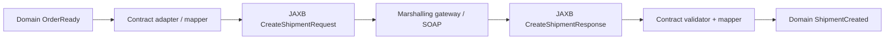
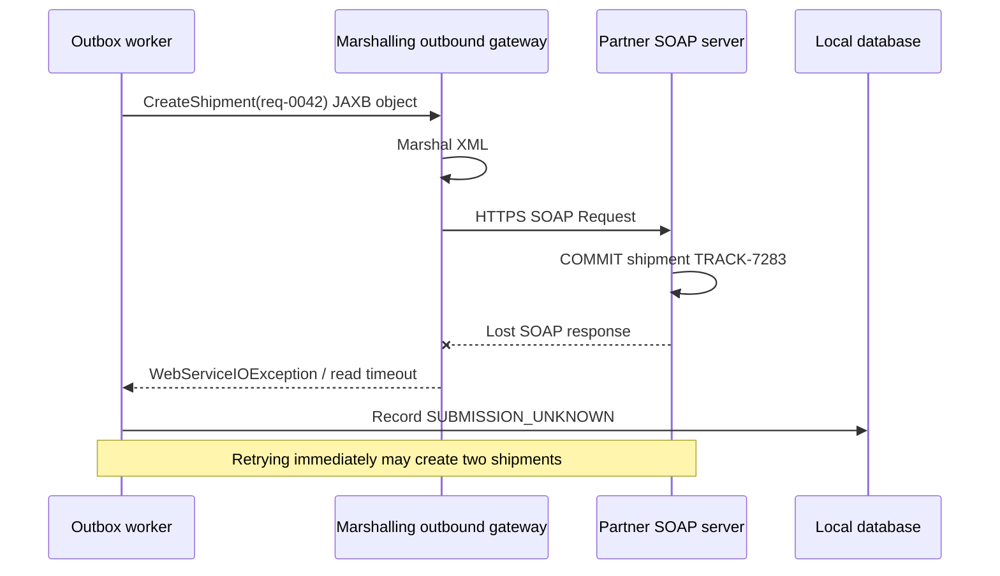

# Marshalling and unmarshalling

## 1. Problem: from Java objects to a partner's SOAP contract

A Spring Boot service on an e-commerce platform has processed `ORDER_READY` and needs to create a shipment in a logistics system exposing **SOAP**. The partner publishes a WSDL/XSD: the client must send a `CreateShipmentRequest` containing `clientRequestId` and `orderId`; on success, they return `CreateShipmentResponse` with `trackingNumber` and `status`. Inside the application, business logic wants to work with **typed Java objects**, rather than reading/editing XML via string concatenation and substring searches.

This is where **marshalling** and **unmarshalling** apply. Spring Framework provides **Spring OXM (Object/XML Mapping)** via `Marshaller` and `Unmarshaller`; Spring Web Services (`Spring-WS`) uses them inside `WebServiceTemplate`; Spring Integration provides `MarshallingWebServiceInboundGateway` and `MarshallingWebServiceOutboundGateway` to bring SOAP request–reply into `MessageChannel`s and `IntegrationFlow`s.

This lesson belongs to **Adapter Web Services** in the `SPRING_INTEGRATION_ADAPTERS` module — learning how to connect external systems using inbound/outbound adapters, gateways, pollers, and `MessageChannel`s; practicing message contracts, error handling, and connection lifecycles much like File/SFTP/HTTP/JMS/AMQP/Kafka/databases. The emphasis of this lesson is **strict XML contracts**: when QNames/namespaces are mapped incorrectly or untrusted data is unmarshalled, an integration flow can misprocess business logic even when HTTP returns 200.

### Learning objectives

1. Distinguish marshalling, unmarshalling, SOAP serialization, Spring `Message<?>`, and Java object serialization.
2. Design **contract-first** XSD/WSDL, understanding namespaces, QNames, element ordering, `minOccurs`, `nillable`, `xs:decimal`, and date/time types.
3. Create JAXB-annotated classes or use XSD-generated classes, knowing when `JAXBElement<T>` and `ObjectFactory` appear.
4. Configure `Jaxb2Marshaller` with `setContextPath`/`setClassesToBeBound`, `setSchema`, `setSupportDtd`, and `setProcessExternalEntities`.
5. Wire marshalling inbound/outbound gateways using Java DSL; distinguish `SimpleWebService*Gateway` from `MarshallingWebService*Gateway`.
6. Classify XML parse/XSD/JAXB errors, SOAP Faults, network timeouts, and business errors; protect the application against XXE, oversized XML, and retries causing duplicate side effects.
7. Practice round-trips, XSD testing, `MockWebServiceServer`/`MockWebServiceClient`, MTOM, and schema version migration.

> **Reference versions:** Spring Integration **6.5.x**, Spring Framework **6.2.x**, Spring Web Services **4.x**, Java 17+, and Spring Boot with compatible dependency management. The JAXB API on the Jakarta stack is `jakarta.xml.bind.*`; the Java XML transform API remains `javax.xml.transform.*` (JAXP). `example.test`, `urn:demo:shipping:v1`, and tracking numbers are dummy data. Never mix legacy `javax.xml.bind` runtimes with the Jakarta stack.

## 2. Core concepts and commonly confused terms

**Marshalling** converts a Java object graph into an XML representation matching the JAXB binding/schema contract. **Unmarshalling** reads XML into a Java object graph per the binding classes. This is neither Java serialization of objects to bytes, nor automatic wrapping of XML in a SOAP Envelope.

```mermaid
flowchart LR
    A["CreateShipmentRequest (Java object)"] -->|Marshaller| B["XML Body payload (Source/Result)"]
    B -->|Spring-WS SOAP MessageFactory| C["SOAP Envelope + Header + Body"]
    C -->|HTTPS| D["Partner SOAP endpoint"]
    D -->|SOAP response| E["XML Body response"]
    E -->|Unmarshaller| F["CreateShipmentResponse (Java object)"]
    F --> G["Business validation + DB commit"]
```



| Term | Input → Output | Example and limits |
| --- | --- | --- |
| **Marshalling** | Java object → XML `Result` | `Marshaller.marshal(request, result)`; does **not** send HTTP |
| **Unmarshalling** | XML `Source` → Java object | `Unmarshaller.unmarshal(source)`; XML may be untrusted |
| **SOAP serialization** | XML payload → SOAP Envelope (+ Header, Fault, MTOM) | `WebServiceMessageFactory`/`SoapMessage` |
| **Spring message** | `Message<payload>` + `MessageHeaders` | Used in `MessageChannel`, not a SOAP Envelope |
| **JAXB `JAXBContext`** | Binding metadata between classes and XML | Reusable; initialization has cost |
| **`JAXBElement<T>`** | Java value + QName/root element metadata | Needed for generated types lacking `@XmlRootElement` |
| **XSD validation** | XML/object serialization ↔ XML Schema | Validates contract shape, **not** business authorization |
| **Business validation** | Object/request ↔ system rules | Checks tenant, order, allowed values, idempotency |

### One crucial statement

`marshaller.marshal(request, result)` produces XML, but **does not prove** the SOAP server received it or created a shipment. `unmarshaller.unmarshal(source)` produces an object, but **does not prove** the object satisfies the full business contract, is authorized, or came from a trusted XML source.

## 3. Where does marshalling sit in Spring Integration WS?

Spring Integration 6.5 provides two pairs of gateways:

| Direction | Simple gateway | Marshalling gateway |
| --- | --- | --- |
| **Inbound** — partner calls SOAP into our app | `SimpleWebServiceInboundGateway`: puts the SOAP Body `Source` onto `MessageChannel` | `MarshallingWebServiceInboundGateway`: **unmarshals** SOAP Body into an object before sending to channel; **marshals** reply object to XML |
| **Outbound** — app calls partner SOAP | `SimpleWebServiceOutboundGateway`: takes `String` or `Source`, returns XML payload | `MarshallingWebServiceOutboundGateway`: **marshals** request object, sends SOAP, **unmarshals** response into an object |

```mermaid
flowchart TD
    subgraph Inbound["SOAP inbound"]
        A["Partner SOAP request"] --> B["MessageDispatcherServlet"]
        B --> C["EndpointMapping → MarshallingWebServiceInboundGateway"]
        C --> D["Unmarshaller: XML → Java"]
        D --> E["MessageChannel → business handler"]
        E --> F["Marshaller: Java → XML"]
        F --> G["SOAP reply / Fault"]
    end
    subgraph Outbound["SOAP outbound"]
        H["MessageChannel<Java object>"] --> I["MarshallingWebServiceOutboundGateway"]
        I --> J["Marshaller: Java → XML"]
        J --> K["WebServiceTemplate → SOAP/HTTPS"]
        K --> L["Unmarshaller: XML → Java"]
        L --> M["Spring reply Message"]
    end
```



**Inbound** also requires `MessageDispatcherServlet` and a Spring-WS `EndpointMapping` selecting the gateway by QName/SOAPAction/URI. An inbound gateway bean **does not accept HTTP automatically** without servlet mapping. **Outbound** requires an endpoint URI or `DestinationProvider` and transport; no server-side servlet is needed just to make outbound SOAP calls.

Regarding payload contracts, marshalling gateways accept/return **JAXB objects**; simple gateways accept/return **`Source`/`String` XML**. Do not place both types on the same channel expecting the framework to dispatch by payload type without an explicit router or transformer.

## 4. Contract-first XSD: the canonical source of XML structure

Suppose the logistics partner publishes namespace `urn:demo:shipping:v1` and operation `CreateShipment`. The illustrative XSD below defines **two top-level elements** and basic constraints:

```xml
<?xml version="1.0" encoding="UTF-8"?>
<xs:schema xmlns:xs="http://www.w3.org/2001/XMLSchema"
           xmlns:ship="urn:demo:shipping:v1"
           targetNamespace="urn:demo:shipping:v1"
           elementFormDefault="qualified">

  <xs:simpleType name="RequestIdType">
    <xs:restriction base="xs:string">
      <xs:minLength value="1"/>
      <xs:maxLength value="100"/>
    </xs:restriction>
  </xs:simpleType>

  <xs:simpleType name="ShipmentStatusType">
    <xs:restriction base="xs:string">
      <xs:enumeration value="CREATED"/>
      <xs:enumeration value="REJECTED"/>
    </xs:restriction>
  </xs:simpleType>

  <xs:element name="CreateShipmentRequest">
    <xs:complexType>
      <xs:sequence>
        <xs:element name="clientRequestId" type="ship:RequestIdType"/>
        <xs:element name="orderId" type="xs:string"/>
      </xs:sequence>
    </xs:complexType>
  </xs:element>

  <xs:element name="CreateShipmentResponse">
    <xs:complexType>
      <xs:sequence>
        <xs:element name="clientRequestId" type="ship:RequestIdType"/>
        <xs:element name="trackingNumber" type="xs:string"
                    minOccurs="0"/>
        <xs:element name="status" type="ship:ShipmentStatusType"/>
      </xs:sequence>
    </xs:complexType>
  </xs:element>
</xs:schema>
```

Assumed filename `shipping-v1.xsd`; to run `setSchema(new ClassPathResource("shipping-v1.xsd"))`, place this XSD on the classpath at `src/main/resources/shipping-v1.xsd`. Per the STEP 4 constraint, the worker writes only the assigned Markdown and YAML files and **does not create an actual XSD file**.

### Meaning of each contract part

- **Namespace + local name:** `{urn:demo:shipping:v1}CreateShipmentRequest` is the root element QName. Prefix `ship` can be changed to `s` with the same QName; changing namespace `v1` to `v2` is a **different contract**.
- **`elementFormDefault="qualified"`:** local child elements also belong to namespace `urn:demo:shipping:v1`.
- **`xs:sequence`:** the order `clientRequestId` followed by `orderId` is part of the contract and cannot be arbitrarily reordered.
- **`minOccurs="0"`:** `trackingNumber` may be absent, e.g., when `status=REJECTED`. This differs from an element appearing with `xsi:nil="true"` when XSD has `nillable="true"`.
- **`xs:enumeration`:** a response with `status=APPROVED` violates XSD; if JAXB code only uses `String` without schema validation, it may still parse and cause business bugs.
- **`xs:string`:** does not guarantee the customer/order is valid, which tenant owns it, or that the tracking number actually exists.

For financial systems, `xs:decimal` should map to `BigDecimal`—**never** convert arbitrarily to `double`, which introduces rounding errors. For `xs:dateTime`, generated JAXB classes may use `XMLGregorianCalendar`; when converting to `Instant`/`OffsetDateTime`, define timezone and normalization policies explicitly.

### WSDL and QName

XSD defines the **message shape**; WSDL adds `portType/operation/binding/soapAction/endpoint`. Spring OXM **does not read the WSDL on each marshal** to determine action, URL, or TLS: those belong to `WebServiceTemplate`/gateways. Never treat successful XML parsing as proof that the SOAP 1.1 or 1.2 binding is correct.

## 5. Dependencies and tools for generating classes from XSD

With a Spring Boot BOM compatible with Spring Integration 6.5:

```groovy
dependencies {
    implementation 'org.springframework.boot:spring-boot-starter-integration'
    implementation 'org.springframework.integration:spring-integration-ws'
    implementation 'org.springframework.boot:spring-boot-starter-web-services'
    // Inspect JAXB API/runtime in the BOM dependency tree;
    // add a compatible Jakarta JAXB runtime if the build does not include one.
    testImplementation 'org.springframework.boot:spring-boot-starter-test'
    testImplementation 'org.springframework.ws:spring-ws-test'
}
```

**Spring OXM** provides `org.springframework.oxm.Marshaller`/`Unmarshaller` and `Jaxb2Marshaller`; Spring-WS provides `WebServiceTemplate`, SOAP message factories, and test client/server; Spring Integration WS provides the messaging gateways. Do not replace `spring-integration-ws` with `spring-integration-http` when the problem requires SOAP semantics.

In a **contract-first** project, use JAXB/XJC code generation from partner-approved XSD/WSDL files, pinning both schema and tool versions in the build. Code generation may produce `ObjectFactory`, `@XmlType`, `@XmlElement`, `@XmlRootElement`, or `JAXBElement<T>` wrappers. Never hand-edit generated classes since the next generation run overwrites them; put custom domain mapping in a separate adapter layer.

**Do not use `javax.xml.bind.*` as in Java 8** on a Jakarta 3+/Spring-WS 4 runtime if your project uses `jakarta.xml.bind.*`. Meanwhile, `javax.xml.transform.Source`/`Result` belong to JAXP and remain valid on Java 17.

## 6. Typed JAXB models, root QNames, and field ordering

To keep this lesson self-contained, we illustrate JAXB-annotated classes. In production code, prefer **XSD-generated classes** over hand-written ones; the examples below show the equivalent shape.

```java
// src/main/java/com/example/shipping/xml/CreateShipmentRequest.java
package com.example.shipping.xml;

import jakarta.xml.bind.annotation.XmlAccessType;
import jakarta.xml.bind.annotation.XmlAccessorType;
import jakarta.xml.bind.annotation.XmlElement;
import jakarta.xml.bind.annotation.XmlRootElement;
import jakarta.xml.bind.annotation.XmlType;

@XmlRootElement(name = "CreateShipmentRequest",
        namespace = "urn:demo:shipping:v1")
@XmlAccessorType(XmlAccessType.FIELD)
@XmlType(propOrder = {"clientRequestId", "orderId"})
public class CreateShipmentRequest {
    @XmlElement(required = true)
    private String clientRequestId;

    @XmlElement(required = true)
    private String orderId;

    public CreateShipmentRequest() { }  // JAXB requires a no-arg constructor.

    public CreateShipmentRequest(String clientRequestId, String orderId) {
        this.clientRequestId = clientRequestId;
        this.orderId = orderId;
    }

    public String getClientRequestId() { return clientRequestId; }
    public String getOrderId() { return orderId; }
}
```

```java
// src/main/java/com/example/shipping/xml/CreateShipmentResponse.java
package com.example.shipping.xml;

import jakarta.xml.bind.annotation.XmlAccessType;
import jakarta.xml.bind.annotation.XmlAccessorType;
import jakarta.xml.bind.annotation.XmlElement;
import jakarta.xml.bind.annotation.XmlRootElement;
import jakarta.xml.bind.annotation.XmlType;

@XmlRootElement(name = "CreateShipmentResponse",
        namespace = "urn:demo:shipping:v1")
@XmlAccessorType(XmlAccessType.FIELD)
@XmlType(propOrder = {"clientRequestId", "trackingNumber", "status"})
public class CreateShipmentResponse {
    @XmlElement(required = true)
    private String clientRequestId;

    @XmlElement
    private String trackingNumber;

    @XmlElement(required = true)
    private String status;

    public CreateShipmentResponse() { }

    public CreateShipmentResponse(
            String clientRequestId, String trackingNumber, String status) {
        this.clientRequestId = clientRequestId;
        this.trackingNumber = trackingNumber;
        this.status = status;
    }

    public String getClientRequestId() { return clientRequestId; }
    public String getTrackingNumber() { return trackingNumber; }
    public String getStatus() { return status; }
}
```

To ensure **child elements** match `qualified` namespace per XSD, declare `package-info.java` in the same package:

```java
@jakarta.xml.bind.annotation.XmlSchema(
    namespace = "urn:demo:shipping:v1",
    elementFormDefault =
        jakarta.xml.bind.annotation.XmlNsForm.QUALIFIED)
package com.example.shipping.xml;
```

The JAXB marshaller may emit prefix `ns2` instead of `ship`. **A different prefix is not a bug** as long as the namespace URI and QName match. Conversely, omitting `@XmlSchema`/element namespaces when XSD requires `qualified` produces child elements in the wrong namespace; the XML looks "identical" to the naked eye yet is rejected by validators/partners.

**`@XmlElement(required=true)` does not replace XSD validation.** It affects JAXB/XSD generation metadata; never assume a `null` field is blocked during marshalling unless schema validation is enabled. Because `trackingNumber` is optional, business logic must treat `status=CREATED` without a `trackingNumber` as an anomaly to handle.

## 7. `Jaxb2Marshaller` as a Spring OXM bean

`Jaxb2Marshaller` implements both `Marshaller` and `Unmarshaller`. With the two JAXB classes defined in section 6 and the XSD placed on the classpath:

```java
package com.example.shipping.config;

import com.example.shipping.xml.CreateShipmentRequest;
import com.example.shipping.xml.CreateShipmentResponse;

import org.springframework.context.annotation.Bean;
import org.springframework.context.annotation.Configuration;
import org.springframework.core.io.ClassPathResource;
import org.springframework.oxm.jaxb.Jaxb2Marshaller;

@Configuration
public class ShippingXmlBindingConfiguration {

    @Bean
    public Jaxb2Marshaller shippingMarshaller() {
        Jaxb2Marshaller mapper = new Jaxb2Marshaller();
        mapper.setClassesToBeBound(
                CreateShipmentRequest.class,
                CreateShipmentResponse.class);
        mapper.setSchema(new ClassPathResource("shipping-v1.xsd"));
        mapper.setSupportDtd(false);
        mapper.setProcessExternalEntities(false);
        mapper.setMtomEnabled(false);
        return mapper;
    }
}
```

In a project with a **generated package** containing `ObjectFactory`, replace `setClassesToBeBound(...)` with `setContextPath("com.example.partner.shipping.v1")`, or `setPackagesToScan(...)` as required. Choose **one intentional binding strategy** for easy auditing/versioning. `setSchema(...)` validates against XSD during marshal/unmarshal, though you must still harden XML parsers **at every layer before data reaches OXM**.

| Configuration | Role | Caveat |
| --- | --- | --- |
| `setContextPath(packageName)` | `JAXBContext` locates binding classes/`ObjectFactory` in package | Package must contain binding metadata |
| `setClassesToBeBound(...)` | Registers an explicit set of classes | Root elements and nested types must have valid bindings |
| `setPackagesToScan(...)` | Scans packages for JAXB-annotated classes | Broad scanning slows startup and widens allowed types |
| `setSchema(Resource)` / `setSchemas(...)` | Validates against XSD | Schema resources/imports require trust policies and must exist |
| `setSupportDtd(false)` | Disallows DTDs | Default false; state explicitly for auditability |
| `setProcessExternalEntities(false)` | Blocks external entity resolution for Spring-managed `Source` types | Does **not** replace hardening caller-created `DOMSource`/`StAXSource` |
| `setMtomEnabled(true)` | Enables XOP/MTOM when bindings and SOAP factory match | Does not automatically turn every `byte[]` into an attachment |
| `setMarshallerProperties(...)` | Configures JAXB marshal options, e.g., formatted output | Pretty-printing XML increases byte size and is not contract validation |
| `setValidationEventHandler(...)` | Customizes handling of validation events | Never swallow invalid XML and treat it as valid |

**Thread-safety:** `Jaxb2Marshaller` is a reusable Spring bean managing `JAXBContext`; never hold a mutable `jakarta.xml.bind.Marshaller` or `Unmarshaller` instance and share it concurrently across threads. When using custom `XmlAdapter`s or listeners, verify thread-safety and avoid request-specific mutable state on singletons.

## 8. Round-trip: Java → XML → Java without the network

Practice with OXM first **without a SOAP endpoint**: invoke the marshaller with a `StringResult`, take the XML, and feed it back into the unmarshaller via `StringSource`. This test isolates JAXB/XSD bugs from HTTP/TLS/WS-Security errors.

```java
import com.example.shipping.xml.CreateShipmentRequest;
import org.springframework.oxm.Marshaller;
import org.springframework.oxm.Unmarshaller;
import org.springframework.xml.transform.StringResult;
import org.springframework.xml.transform.StringSource;

public final class ShippingXmlRoundTrip {

    private final Marshaller marshaller;
    private final Unmarshaller unmarshaller;

    public ShippingXmlRoundTrip(
            Marshaller marshaller, Unmarshaller unmarshaller) {
        this.marshaller = marshaller;
        this.unmarshaller = unmarshaller;
    }

    public CreateShipmentRequest execute() throws Exception {
        var request = new CreateShipmentRequest("req-0042", "O-9001");

        var xml = new StringResult();
        marshaller.marshal(request, xml);

        // StringResult holds the XML Body payload, NOT the SOAP Envelope.
        Object value = unmarshaller.unmarshal(
                new StringSource(xml.toString()));

        if (!(value instanceof CreateShipmentRequest parsed)) {
            throw new IllegalStateException(
                    "JAXB binding returned an off-contract type");
        }
        return parsed;
    }
}
```

With generated bindings, `Unmarshaller.unmarshal(Source)` may return `JAXBElement<CreateShipmentRequest>` instead of a direct class instance. Do not treat that as an error: inspect `getName()` and `getValue()` per QName/Java type, as shown in the next section. **Successful `StringResult` XML** is necessary but not sufficient: also test namespaces, field order, schemas, and character encoding.

## 9. `@XmlRootElement`, `JAXBElement<T>`, and `ObjectFactory`

JAXB must know the **root element QName** when marshalling/unmarshalling. Two common cases occur:

- Class has `@XmlRootElement(name=..., namespace=...)`: JAXB has enough root metadata to marshal directly (like `CreateShipmentRequest` in section 6).
- Generated class has only `@XmlType` without `@XmlRootElement`: XJC generates an `ObjectFactory` with `@XmlElementDecl` methods producing `JAXBElement<T>` with the proper QName. In that case, marshal the **wrapper**, not the raw class hoping JAXB guesses the root.

Illustrative learning factory, **only needed when generated classes do not already provide one**:

```java
package com.example.shipping.xml;

import javax.xml.namespace.QName;
import jakarta.xml.bind.JAXBElement;
import jakarta.xml.bind.annotation.XmlElementDecl;
import jakarta.xml.bind.annotation.XmlRegistry;

@XmlRegistry
public class ShippingObjectFactory {
    private static final QName REQUEST_NAME = new QName(
            "urn:demo:shipping:v1", "CreateShipmentRequest");

    @XmlElementDecl(namespace = "urn:demo:shipping:v1",
            name = "CreateShipmentRequest")
    public JAXBElement<CreateShipmentRequest> createRequest(
            CreateShipmentRequest value) {
        return new JAXBElement<>(
                REQUEST_NAME, CreateShipmentRequest.class, null, value);
    }
}
```

When `setClassesToBeBound(...)` is used with a class already annotated with `@XmlRootElement`, **no wrapper is typically needed**. The factory snippet above explains code-generator output and does not require creating a new factory file alongside the model in section 6. In production, use the XJC-generated `ObjectFactory` for your exact WSDL/XSD; never redefine the same QName manually and cause conflicting binding metadata.

### Unwrapping results safely

```java
import com.example.shipping.xml.CreateShipmentResponse;

import javax.xml.namespace.QName;
import jakarta.xml.bind.JAXBElement;

public final class ShippingResponseUnwrapper {
    private static final QName RESPONSE_QNAME =
            new QName("urn:demo:shipping:v1", "CreateShipmentResponse");

    public static CreateShipmentResponse unwrap(Object value) {
        if (value instanceof CreateShipmentResponse response) {
            return response;
        }
        if (value instanceof JAXBElement<?> wrapped
                && RESPONSE_QNAME.equals(wrapped.getName())
                && wrapped.getValue() instanceof CreateShipmentResponse response) {
            return response;
        }
        throw new IllegalArgumentException(
                "SOAP response type/QName differs from contract");
    }
}
```

**Never check only `getValue() instanceof CreateShipmentResponse`** while ignoring `getName()` if the same Java class can bind to multiple XML roots. If the partner sends an element in another namespace, reject it. When using generated classes with `@XmlRootElement`, combine with XSD validation to verify the QName rather than relying solely on the Java instance type.

## 10. Data type mapping: numbers, dates/times, enums, and absent values

| XSD/JAXB | Typical Java type | Common pitfalls |
| --- | --- | --- |
| `xs:string` | `String` | Unicode characters, trimming, `maxLength`, blank vs. null |
| `xs:decimal` | `BigDecimal` | Converting to `double` introduces precision loss |
| `xs:int` / `xs:long` | `int`/`Integer`, `long`/`Long` | Null when optional; integer overflow |
| `xs:dateTime` | `XMLGregorianCalendar` (generated JAXB) | Missing timezone; converting to `Instant` with wrong offset |
| `xs:date` | `XMLGregorianCalendar` | Must not be blindly treated as a UTC timestamp |
| `xs:boolean` | `boolean`/`Boolean` | `null` differs from `false` when optional |
| `xs:base64Binary` | `byte[]` or `DataHandler` per binding | Memory, MTOM, streams, and size quotas |
| `xs:enumeration` | `@XmlEnum` Java enum or `String` | A new partner enum value can break unmarshalling |
| `minOccurs="0"` | Field may be `null`/absent | Differs from `nillable="true"` |
| `xsi:nil="true"` | Null per schema and JAXB binding | Only valid if schema allows `nillable` |

Example safe monetary mapper in business logic:

```java
import java.math.BigDecimal;

public static BigDecimal validateAmount(BigDecimal raw) {
    if (raw == null || raw.signum() < 0 || raw.scale() > 2) {
        throw new IllegalArgumentException(
                "Invalid amount per policy");
    }
    return raw;
}
```

This is only an example **business rule**; the XSD might allow broader scale, and the service must align rounding policies with the partner. For timestamps, normalize timezones **at the adapter boundary**; for calendar dates without a timezone, never silently append `Z` and alter their meaning.

When a partner adds a new enum or required field in v2, **never** configure the JAXB parser to unconditionally "fill in a default" and keep committing. Use versioned bindings and a contract migration plan.

## 11. Marshalling inbound gateway: SOAP XML → Java request → Java reply

When a partner calls SOAP into our application, a `MarshallingWebServiceInboundGateway` connects the Spring-WS server to Spring Integration. Here:

1. `MessageDispatcherServlet` receives the HTTP/SOAP request.
2. `PayloadRootQNameEndpointMapping` selects the gateway by `CreateShipmentRequest` QName.
3. The gateway invokes `Unmarshaller` on the **SOAP Body payload** and sends `CreateShipmentRequest` to the request channel.
4. The service activator processes the object and returns `CreateShipmentResponse`.
5. The gateway invokes `Marshaller` to produce response XML, and Spring-WS wraps it in a SOAP Envelope.

### Configuring gateway + servlet + endpoint mapping

```java
import java.util.Map;

import org.springframework.beans.factory.annotation.Qualifier;
import org.springframework.boot.web.servlet.ServletRegistrationBean;
import org.springframework.context.ApplicationContext;
import org.springframework.context.annotation.Bean;
import org.springframework.context.annotation.Configuration;
import org.springframework.integration.channel.DirectChannel;
import org.springframework.integration.ws.MarshallingWebServiceInboundGateway;
import org.springframework.messaging.MessageChannel;
import org.springframework.oxm.jaxb.Jaxb2Marshaller;
import org.springframework.ws.server.endpoint.mapping.PayloadRootQNameEndpointMapping;
import org.springframework.ws.transport.http.MessageDispatcherServlet;

@Configuration
public class InboundShipmentSoapConfiguration {
    public static final String REQUEST_QNAME =
            "{urn:demo:shipping:v1}CreateShipmentRequest";

    @Bean
    public ServletRegistrationBean<MessageDispatcherServlet> shippingWsServlet(
            ApplicationContext context) {
        MessageDispatcherServlet servlet = new MessageDispatcherServlet();
        servlet.setApplicationContext(context);
        return new ServletRegistrationBean<>(servlet, "/ws/*");
    }

    @Bean
    public MessageChannel inboundShipmentObjects() {
        return new DirectChannel();
    }

    @Bean
    public MarshallingWebServiceInboundGateway inboundShipmentGateway(
            @Qualifier("inboundShipmentObjects") MessageChannel channel,
            Jaxb2Marshaller shippingMarshaller) {
        MarshallingWebServiceInboundGateway gateway =
                new MarshallingWebServiceInboundGateway(shippingMarshaller);
        gateway.setRequestChannel(channel);
        gateway.setRequestTimeout(5_000L);
        gateway.setReplyTimeout(10_000L);
        return gateway;
    }

    @Bean
    public PayloadRootQNameEndpointMapping inboundShipmentEndpointMapping(
            MarshallingWebServiceInboundGateway inboundShipmentGateway) {
        PayloadRootQNameEndpointMapping mapping =
                new PayloadRootQNameEndpointMapping();
        mapping.setEndpointMap(
                Map.of(REQUEST_QNAME, inboundShipmentGateway));
        return mapping;
    }
}
```

**A Spring Boot caveat:** `spring-boot-starter-web-services` may auto-register `MessageDispatcherServlet`. If auto-config already maps the servlet, **do not register a second servlet** on `/ws/*`. Pick either explicit registration **or** Boot auto-config, and verify the route with WSDL GET / SOAP POST tests. The gateway bean requires an explicit mapping; a `@Bean MarshallingWebServiceInboundGateway` alone is not enough for the servlet to find it.

### Service activator receiving an object and returning an object

```java
import com.example.shipping.xml.CreateShipmentRequest;
import com.example.shipping.xml.CreateShipmentResponse;

import org.springframework.beans.factory.annotation.Qualifier;
import org.springframework.context.annotation.Bean;
import org.springframework.context.annotation.Configuration;
import org.springframework.integration.dsl.IntegrationFlow;
import org.springframework.messaging.MessageChannel;

@Configuration
public class InboundShipmentProcessingFlow {

    @Bean
    public IntegrationFlow handleInboundShipment(
            @Qualifier("inboundShipmentObjects") MessageChannel requests) {

        return IntegrationFlow.from(requests)
                .handle(CreateShipmentRequest.class, (request, headers) -> {
                    if (request.getClientRequestId() == null
                            || request.getOrderId() == null) {
                        throw new IllegalArgumentException(
                                "Missing business fields");
                    }
                    // Simulation only: real code must verify caller/tenant,
                    // idempotency, DB commit, and correlation.
                    return new CreateShipmentResponse(
                            request.getClientRequestId(),
                            "TRACK-DEMO-001",
                            "CREATED");
                })
                .get();
    }
}
```

Here `DirectChannel` runs the handler synchronously and replies to the gateway via a temporary reply channel. If the handler returns no reply or takes too long, the gateway may time out; **a timeout does not automatically roll back** DB side effects. Prevent SOAP client retries from creating duplicate shipments by enforcing a unique `(authenticatedTenant, clientRequestId)` constraint and storing an idempotent response.

### Java DSL alternative creating the gateway at the start of the flow

Instead of declaring `MarshallingWebServiceInboundGateway` and `IntegrationFlow.from(requestChannel)` separately, Spring Integration 6.5 supports:

```java
@Bean
public IntegrationFlow inboundMarshalledDsl(
        Jaxb2Marshaller shippingMarshaller,
        InboundShipmentObjectHandler handler) {
    return IntegrationFlow.from(
                    Ws.marshallingInboundGateway()
                            .marshaller(shippingMarshaller)
                            .unmarshaller(shippingMarshaller)
                            .id("inboundShipmentDslGateway"))
            .handle(handler)
            .get();
}
```

`InboundShipmentObjectHandler` is an application-defined service. This DSL snippet is an **alternative approach** requiring `IntegrationFlow` and `Ws` imports plus a `PayloadRootQNameEndpointMapping` pointing to gateway bean ID `inboundShipmentDslGateway`. **Do not enable both the explicit gateway and the DSL gateway mapping the same QName**; that causes a route conflict. The DSL does not replace Spring-WS servlet/endpoint mappings.

## 12. Marshalling outbound gateway: Java request → SOAP → Java response

On the outbound side, `MarshallingWebServiceOutboundGateway` marshals the request object, sends SOAP to an external endpoint via `WebServiceTemplate`, and unmarshals the SOAP reply into an object. This is **request–reply**, not "fire and forget".

### Java DSL — providing marshaller/unmarshaller directly

```java
import java.time.Duration;

import org.springframework.beans.factory.annotation.Value;
import org.springframework.context.annotation.Bean;
import org.springframework.context.annotation.Configuration;
import org.springframework.integration.channel.DirectChannel;
import org.springframework.integration.dsl.IntegrationFlow;
import org.springframework.integration.ws.dsl.Ws;
import org.springframework.messaging.MessageChannel;
import org.springframework.oxm.jaxb.Jaxb2Marshaller;
import org.springframework.ws.transport.http.HttpUrlConnectionMessageSender;

@Configuration
public class OutboundShipmentSoapFlow {

    @Bean
    public MessageChannel outboundShipmentObjects() {
        return new DirectChannel();
    }

    @Bean
    public IntegrationFlow sendShipmentToPartner(
            MessageChannel outboundShipmentObjects,
            Jaxb2Marshaller shippingMarshaller,
            @Value("${app.shipping.endpoint}") String endpoint) {

        HttpUrlConnectionMessageSender sender =
                new HttpUrlConnectionMessageSender();
        sender.setConnectionTimeout(Duration.ofSeconds(5));
        sender.setReadTimeout(Duration.ofSeconds(20));

        return IntegrationFlow.from(outboundShipmentObjects)
                .handle(Ws.marshallingOutboundGateway()
                        .uri(endpoint)
                        .marshaller(shippingMarshaller)
                        .unmarshaller(shippingMarshaller)
                        .messageSenders(sender))
                .get();
    }
}
```

`app.shipping.endpoint` comes from configuration/secret registry with a host allowlist; never take a URI directly from an HTTP client due to **SSRF** risk. Timeouts use `Duration` per the Spring-WS 4.x HTTP sender. **Connect/read timeouts are not end-to-end deadlines** and do not prove the partner did not commit when the client sees an exception.

### Producer invoking the flow and receiving a typed reply

```java
import com.example.shipping.xml.CreateShipmentRequest;
import com.example.shipping.xml.CreateShipmentResponse;

import org.springframework.beans.factory.annotation.Qualifier;
import org.springframework.integration.core.MessagingTemplate;
import org.springframework.integration.ws.WebServiceHeaders;
import org.springframework.messaging.Message;
import org.springframework.messaging.MessageChannel;
import org.springframework.messaging.support.MessageBuilder;
import org.springframework.stereotype.Service;

@Service
public class OutboundShipmentCaller {
    private final MessageChannel channel;

    public OutboundShipmentCaller(
            @Qualifier("outboundShipmentObjects") MessageChannel channel) {
        this.channel = channel;
    }

    public CreateShipmentResponse create(String requestId, String orderId) {
        Message<CreateShipmentRequest> request = MessageBuilder
                .withPayload(new CreateShipmentRequest(requestId, orderId))
                .setHeader(WebServiceHeaders.SOAP_ACTION,
                        "urn:demo:shipping:v1/CreateShipment")
                .build();

        MessagingTemplate messaging = new MessagingTemplate();
        messaging.setReceiveTimeout(25_000L);
        Message<?> reply = messaging.sendAndReceive(channel, request);
        if (reply == null) {
            throw new IllegalStateException(
                    "SOAP contract requires a reply but none arrived");
        }
        return ShippingResponseUnwrapper.unwrap(reply.getPayload());
    }
}
```

The gateway **creates a Spring reply message** from the unmarshalled object, rather than returning a response to a bare `channel.send(...)` call. `MessagingTemplate.sendAndReceive(...)` creates a temporary reply channel; with a `DirectChannel`, the handler executes the SOAP call synchronously. Switching to an `ExecutorChannel` or queue requires redesigning the timeout/ack/result contract: `send() == true` on an async channel only proves accepted for dispatch, not that the partner created the shipment.

### When using an external `WebServiceTemplate`

If you need mTLS, proxies, connection pooling, WS-Security, or custom SOAP Fault policies, configure a `WebServiceTemplate` with `marshaller`/`unmarshaller`, `messageFactory`, `messageSender`, and `ClientInterceptor`s, then use:

```java
// Placed inside an IntegrationFlow bean; template must be fully configured
// with JAXB/OXM and SOAP/HTTP transport:
.handle(Ws.marshallingOutboundGateway(template)
        .uri(endpoint)
        .headerMapper(soapHeaderMapper))
```

**Do not mix the two spec styles** expecting setters from the no-template spec to configure the same components on an external template. When an external template carries instances/configs/secrets, it is the single source of truth for transport and OXM; real tests must verify marshalling, SOAPAction, fault resolution, and TLS are properly applied.

## 13. `WebServiceTemplate.marshalSendAndReceive(...)`: IntegrationFlow is not always required

Spring-WS allows calling JAXB directly via `WebServiceTemplate`. This fits a simple service client that does not need routers or channels, while reusing the same configured `Jaxb2Marshaller`:

```java
import com.example.shipping.xml.CreateShipmentRequest;
import com.example.shipping.xml.CreateShipmentResponse;

import org.springframework.ws.client.core.WebServiceTemplate;
import org.springframework.ws.soap.client.core.SoapActionCallback;

public final class DirectShipmentSoapClient {
    private final WebServiceTemplate template;

    public DirectShipmentSoapClient(WebServiceTemplate template) {
        this.template = template;
    }

    public CreateShipmentResponse submit(String requestId, String orderId) {
        Object result = template.marshalSendAndReceive(
                new CreateShipmentRequest(requestId, orderId),
                new SoapActionCallback(
                        "urn:demo:shipping:v1/CreateShipment"));
        if (result == null) {
            throw new IllegalStateException(
                    "Empty SOAP response violates CreateShipment contract");
        }
        return ShippingResponseUnwrapper.unwrap(result);
    }
}
```

To run, `WebServiceTemplate` must have `setDefaultUri(...)` (or use a URI overload), `setMarshaller(shippingMarshaller)`, and `setUnmarshaller(shippingMarshaller)`. Without them, you will hit "No marshaller registered" or "No unmarshaller registered". `SoapActionCallback` sets the action per WSDL; it is **not** authentication.

Never hand-build a SOAP envelope and call `marshalSendAndReceive` with a `String` containing that envelope: this method treats its argument as an **object to marshal**, not raw XML. When you already have XML `Source`, use `sendSourceAndReceive...` or the **simple outbound gateway**.

## 14. SOAP Body XML, SOAP Envelope, SOAPAction, and header mappers

Marshalling in Spring-WS operates on the **SOAP Body payload**, not the entire SOAP Envelope. When the client sends:

```xml
<ship:CreateShipmentRequest xmlns:ship="urn:demo:shipping:v1">
  <ship:clientRequestId>req-0042</ship:clientRequestId>
  <ship:orderId>O-9001</ship:orderId>
</ship:CreateShipmentRequest>
```

`Jaxb2Marshaller` produces the root element above. `SaajSoapMessageFactory`/`WebServiceTemplate` places it inside the SOAP 1.1/1.2 Body:

```xml
<soapenv:Envelope
    xmlns:soapenv="http://schemas.xmlsoap.org/soap/envelope/"
    xmlns:ship="urn:demo:shipping:v1">
  <soapenv:Header/>
  <soapenv:Body>
    <ship:CreateShipmentRequest>
      <ship:clientRequestId>req-0042</ship:clientRequestId>
      <ship:orderId>O-9001</ship:orderId>
    </ship:CreateShipmentRequest>
  </soapenv:Body>
</soapenv:Envelope>
```

**Never marshal a class representing the entire `soapenv:Envelope` and pass it to `WebServiceTemplate.marshalSendAndReceive`**: the SOAP envelope will be nested, or the provider will return a `Client/Sender` SOAP Fault due to an invalid body QName.

### SOAPAction vs. root QName

- **Root QName** comes from `@XmlRootElement`/`JAXBElement`/XSD: e.g., `{urn:demo:shipping:v1}CreateShipmentRequest`.
- **SOAPAction** per the WSDL binding is set via `SoapActionCallback` or `WebServiceHeaders.SOAP_ACTION`, e.g., `urn:demo:shipping:v1/CreateShipment`.
- **WS-Addressing `wsa:Action`** is a separate SOAP Header using `ActionCallback` from WS-Addressing if partner policy requires it.
- **Spring Integration header mapper** maps `SOAPAction` by default; custom SOAP headers require an explicit allowlist and are not automatically copied from JAXB object fields to the SOAP Header.

Example mapper configuration for an allowed metadata header:

```java
import org.springframework.context.annotation.Bean;
import org.springframework.integration.ws.DefaultSoapHeaderMapper;
import org.springframework.integration.ws.WebServiceHeaders;

@Bean
public DefaultSoapHeaderMapper shippingSoapHeaders() {
    DefaultSoapHeaderMapper mapper = new DefaultSoapHeaderMapper();
    mapper.setRequestHeaderNames(
            WebServiceHeaders.SOAP_ACTION, "ClientRequestId");
    mapper.setReplyHeaderNames(
            WebServiceHeaders.SOAP_ACTION, "PartnerReceiptId");
    return mapper;
}
```

When sending a **custom header** via `DefaultSoapHeaderMapper`, the header value may be a `Source` containing an XML element QName matching the partner's namespace. Never use `*` to map all Spring message headers: you might accidentally export `replyChannel`/`errorChannel`, tokens, or tenant metadata into SOAP.

**Common mistake:** sending SOAPAction "CancelShipment" when the JAXB root is `CreateShipmentRequest`. This header can be self-asserted by the caller and does not prove authorization to invoke the operation. Always verify caller/tenant permissions and consistency across SOAPAction–QName–WSDL.

## 15. XML Schema validation: parseable by JAXB does not mean contract-valid

Three validation layers must be distinguished:

| Layer | Checks | Does not check |
| --- | --- | --- |
| Well-formed XML | Tag open/close, escaping, XML syntax | Required fields, XSD types |
| **XSD validation** | QName, ordering, `minOccurs/maxOccurs`, enums, data formats | Whether caller is authorized or invoice exists |
| **Business validation** | Tenant/ownership, idempotency, business state | Whether XML parser/DTD is hardened |

`@XmlElement(required=true)` is JAXB metadata, **not a Java Bean Validation rule automatically enforced during unmarshalling**. Without `setSchema(...)`, a document missing a required element can unmarshal into a POJO with a `null` field, later causing a `NullPointerException` or silent misprocessing.

**How to enable XSD:** see `shippingMarshaller()` in section 7 — `mapper.setSchema(new ClassPathResource("shipping-v1.xsd"))`. In tests, verify **both marshalling and unmarshalling directions**:

1. Marshal a request missing `clientRequestId`: expect the validator to reject when the contract requires it.
2. Unmarshal a response containing `status=APPROVED`: the schema enum only allows CREATED/REJECTED, so it must fail.
3. Unmarshal a child `orderId` in an empty namespace: wrong namespace qualification, must be blocked.
4. Unmarshal a `trackingNumber` exceeding business length limits: even if the sample XSD uses `xs:string`, business validation must reject it.
5. Test a response with the wrong root `CreateShipmentRequest` where `CreateShipmentResponse` is expected: verify the exact QName, not only Java `instanceof`.

### Handling `ValidationEventHandler`

`Jaxb2Marshaller#setValidationEventHandler(...)` lets you customize reactions to JAXB schema validation events. **Never** install a handler that always returns `true` for `ERROR`/`FATAL_ERROR` for "compatibility", then persist to the DB as a valid request. If deliberate schema extensions must be supported, constrain allowed extensions via contract/version rules and monitor error metrics.

A manually created `Unmarshaller` from the JAXB runtime may have no schema; a `Jaxb2Marshaller` bean with schemas and policies standardizes behavior across both Spring-WS client and server. However, if an earlier layer already parsed XML unsafely into a DOM, `setSchema` **cannot undo XXE side effects** that happened during parsing.

## 16. Unmarshalling security: XXE, external entities, and oversized XML

Unmarshalling is an **external data boundary**. XML from a SOAP client or a partner SOAP server must be treated as **untrusted** until it passes TLS/auth, XML hardening, schema validation, and business authorization.

### Risks

- **XXE/SSRF:** DTD/external entities attempting to read local files or cloud metadata URLs.
- **Entity expansion:** "billion laughs" XML causing CPU/memory spikes.
- **Oversized SOAP:** millions of nodes, attributes, deeply nested elements, or unbounded MTOM files.
- **Remote schema/DTD fetching:** XML/XSD imports without trust policies triggering unexpected network requests.
- **Type confusion:** unmarshalling into a valid JAXB class despite a different root QName or schema version.
- **XSLT/XPath injection:** letting senders supply arbitrary XPath/XSLT or remote stylesheets.

`Jaxb2Marshaller` **disables DTD support** and **does not process external entities** by default; state this explicitly:

```java
mapper.setSupportDtd(false);
mapper.setProcessExternalEntities(false);
```

Per Spring OXM 6.2 Javadoc, `setProcessExternalEntities` only applies to `SAXSource` or `StreamSource` handled by `Jaxb2Marshaller`; **it does not protect a `DOMSource` or `StAXSource` already created by another parser**. If a `DOMSource` came from an unsafe XML parser, external entities may already have been resolved **before** JAXB sees the input.

### If creating a DOM parser manually, harden that parser itself

```java
import javax.xml.XMLConstants;
import javax.xml.parsers.DocumentBuilderFactory;

public final class SecureXmlParserFactory {

    public static DocumentBuilderFactory newFactory() throws Exception {
        DocumentBuilderFactory factory =
                DocumentBuilderFactory.newInstance();
        factory.setNamespaceAware(true);
        factory.setFeature(XMLConstants.FEATURE_SECURE_PROCESSING, true);
        factory.setFeature(
                "http://apache.org/xml/features/disallow-doctype-decl", true);
        factory.setFeature(
                "http://xml.org/sax/features/external-general-entities", false);
        factory.setFeature(
                "http://xml.org/sax/features/external-parameter-entities", false);
        factory.setXIncludeAware(false);
        factory.setExpandEntityReferences(false);
        factory.setAttribute(XMLConstants.ACCESS_EXTERNAL_DTD, "");
        factory.setAttribute(XMLConstants.ACCESS_EXTERNAL_SCHEMA, "");
        return factory;
    }
}
```

Features/attributes may depend on the JAXP provider; if a mandatory protection is unsupported, **fail configuration** rather than silently ignoring it. Never enable DTDs or `ACCESS_EXTERNAL_DTD=*` merely to get a broken legacy XML document to pass. Harden the **Spring-WS `MessageFactory`/JAXB/Transformer/XSD parsers** actually used in production, not only the utility above.

### Size and time limits

HTTP/servlet/ingress layers must cap request bytes; SOAP clients must cap response bytes. Unmarshallers can construct huge object graphs: bound XML depth, element counts, string lengths, attachment counts, decoded bytes, parsing time, and heap usage. XSD validation is **not** an automatic total-XML-size limiter.

**Testing tip:** use synthetic test data for XXE or entity expansion and assert the parser rejects them without outbound connections or file access; never test these payloads against environments holding real customer data.

## 17. Classifying marshalling/unmarshalling errors vs. SOAP and network errors

| Common error/exception | Where it originates | How to handle |
| --- | --- | --- |
| `org.springframework.oxm.MarshallingFailureException` | JAXB cannot serialize object to XML | Fix binding/root/fields; do not retry network |
| `org.springframework.oxm.UnmarshallingFailureException` | XML cannot map to JAXB object | Quarantine response / alert on schema drift |
| `org.springframework.oxm.ValidationFailureException` | XML violates schema/validation policy | Return client SOAP Fault or fail partner integration |
| `jakarta.xml.bind.UnmarshalException` | Low-level JAXB failure | Record error category; never log raw XML/PII |
| `SoapFaultClientException` | Partner sent a SOAP Fault | Map by Fault code/detail/WSDL; do not treat as JAXB error |
| `WebServiceTransportException` or `WebServiceIOException` | HTTP/DNS/TLS/socket network failure | Conditional retry; side effects may have happened |
| `MessageHandlingException` | Spring Integration handler wrapper | Inspect cause chain and message correlation |
| `ClassCastException` downstream | Actual reply is `JAXBElement`/different version | Fix type/QName guard; do not "retry SOAP" |
| `NullPointerException` after unmarshalling | Optional/missing field not validated | Enforce XSD/bean/business validation before processing |

**The same HTTP 200 status can carry** a non-standard provider's SOAP Fault, XSD-invalid XML, a `REJECTED` response, or valid business data. Conversely, HTTP 500 can be a standard SOAP Fault or a proxy HTML page. Never use HTTP status or exception class name alone to mark a transaction successful.

### Inbound SOAP Faults

When request XML fails schema validation, a Spring-WS `PayloadValidatingInterceptor` or an `EndpointExceptionResolver` such as `SoapFaultMappingExceptionResolver` can return a contract-compliant SOAP Fault. Never put `ValidationFailureException.toString()` or Java stack traces into `faultstring`/`detail`: that can expose data structures, SQL, tokens, and internal details. **Business** errors must use response/fault codes defined by WSDL/policy.

### Spring Integration `errorChannel` does not automatically become a SOAP Fault

At an inbound gateway, failures in `MessageChannel`, transformers, handlers, or OXM may appear on an error flow (depending on channel/poller/executor). An `ErrorMessage` is **not a SOAP response by default**. If an error handler only logs and swallows the exception, the caller may hit reply timeout or receive a non-contract transport error. Choose an explicit path: return a valid response object, or propagate the exception to the Spring-WS fault resolver.

At an outbound gateway, a `RequestHandlerRetryAdvice` attached directly to a SOAP create operation can resend **multiple side-effecting requests**. Only apply automatic handler retries when the operation is read-only/idempotent or the partner documents an idempotency guarantee; see section 21.

## 18. MTOM and `@XmlMimeType`: binary data vs. XML text

When a SOAP service accepts PDF receipts or large images, placing base64 `byte[]` inside XML inflates payload size and heap usage. **MTOM/XOP** lets the SOAP body reference a MIME attachment instead of inlining all base64 text, when WSDL/XSD and both sides support it.

`Jaxb2Marshaller` provides `setMtomEnabled(true)` (default `false`). JAXB binary bindings can use `jakarta.activation.DataHandler` and `@XmlMimeType`:

```java
import jakarta.activation.DataHandler;
import jakarta.xml.bind.annotation.XmlAccessType;
import jakarta.xml.bind.annotation.XmlAccessorType;
import jakarta.xml.bind.annotation.XmlMimeType;
import jakarta.xml.bind.annotation.XmlRootElement;

@XmlRootElement(name = "UploadDocumentRequest",
        namespace = "urn:demo:documents:v1")
@XmlAccessorType(XmlAccessType.FIELD)
public class UploadDocumentRequest {

    private String clientRequestId;

    @XmlMimeType("application/pdf")
    private DataHandler document;

    public UploadDocumentRequest() { }

    // Constructors/getters/setters and storage-backed DataSource
    // implemented by the application per contract.
}
```

**This is an illustrative model**, not a complete copy-paste API: it requires a `DataSource` with a clear stream lifecycle, accurate generated bindings/XSD, and a MIME-capable SOAP message factory. Never set `setMtomEnabled(true)` assuming every `byte[]` automatically becomes a multipart attachment: verify JAXB provider/threshold/bindings and partner interoperability.

| Data representation | Transfer method | Risks |
| --- | --- | --- |
| `xs:base64Binary` mapped to `byte[]` | May inline Base64 | High heap and CPU cost on large files |
| `DataHandler` + MTOM | MIME multipart, XOP reference | CID/media types, stream lifecycle, quotas |
| File on object storage | Payload carries only contract ID/URL | URL requires SSRF/access-control/expiry enforcement |

**Retries and attachments:** a consumed `InputStream` cannot be re-read automatically. If a side-effecting SOAP request needs durable retries, store the document in durable storage and rebuild a fresh MIME/JAXB request on each attempt. Never retain raw `WebServiceMessage` or a `DataHandler` pointing to a closed temporary stream across queues or restarts.

## 19. Performance, concurrency, and JAXB object lifetimes

Marshalling/unmarshalling often consumes CPU and memory in places hidden from basic traces:

- Recreating `JAXBContext` per request is expensive; use a singleton `Jaxb2Marshaller` initialized once by the Spring container.
- Never share mutable `jakarta.xml.bind.Marshaller`/`Unmarshaller` instances across threads; rely on `Jaxb2Marshaller` instance management and test custom `XmlAdapter`s/listeners to avoid shared mutable state.
- DOM/SAAJ typically builds an in-memory object tree. For large payloads, use streaming or size-bounded parsing where suitable, while preserving DTD/XXE protections and contract validation.
- XSD validation adds processing overhead; run p95/p99 load tests and distinguish JAXB CPU bottlenecks from partner network latency.
- Keep charsets and XML declarations consistent; SOAP 1.1 typically uses `text/xml; charset=utf-8` and SOAP 1.2 `application/soap+xml`. `Source`/`Result` conversion does not automatically set transport media types.
- Avoid logging or pretty-printing full XML in production: it increases byte volume, exposes PII, and hurts throughput.
- Choose `@XmlAccessorType(FIELD)`/`PROPERTY` deliberately to prevent JAXB from double-binding a field via both getter and field.
- When multiple tenants use different schema/partner versions, isolate marshallers/contexts per contract; avoid scanning a broad package that allows deserializing unintended types.

### Separating SOAP objects from domain models

`CreateShipmentRequest` is an **XSD-derived transport DTO**. The domain model may contain `OrderId`, `Money`, and `TenantId` value objects with independent validation and lifecycles. Use a mapping adapter:



Keep JAXB-generated classes out of business domain aggregates and DB entities. If XSD v2 changes how `status` is represented, only the contract adapter needs updating; services and aggregates should not depend directly on `ObjectFactory` or QNames.

## 20. Versioning: v1 and v2 require separate bindings and mappings

| Partner change | Risk | Strategy |
| --- | --- | --- |
| Namespace `v1` → `v2` | Different QName; marshaller/unmarshaller incompatible | Create separate v2 package/binding/marshaller |
| Added optional field | Potentially partially compatible | Test generated JAXB and response XSD |
| Added required field | Old clients cannot marshal valid requests | New contract version / migration plan |
| Added enum value | v1 generated enum may fail unmarshalling | Versioned code and explicit handling policy |
| Changed `xs:dateTime` semantics | Wrong timezone/instant | Domain adapter normalizes per contract |
| Changed `xs:decimal` precision/scale | Currency/reconciliation errors | Update `BigDecimal` rules and contract tests |
| Added MTOM attachment | Streaming/memory/security changes | v2 adapter, file quotas, and dedicated tests |
| Switched SOAP 1.1 → 1.2 | Envelope, Content-Type, Fault differ | Separate message factory, WSDL binding, and client/server tests |

To support v1 and v2 concurrently, inbound should route by **SOAP Body QName and endpoint mapping** into the contract-appropriate gateway/marshaller. Outbound should select the **version-matched partner endpoint + JAXB marshaller bean** using a **controlled** router. Never accept arbitrary `@XmlRootElement(namespace=...)` from inputs and unmarshal broadly across every class on the classpath; that is not safe versioning.

**CI contract tests** should pin approved XSD/WSDL versions, sample SOAP requests/responses, and schema validation. Never dynamically download WSDLs from a provider URL at runtime to swap JAXB bindings uncontrolled.

## 21. Retries, idempotency, and uncertain SOAP outcomes

Marshalling/unmarshalling can fail **before or after a remote side effect**. That is why not every exception means "the SOAP request was not processed".



### Classification by failure point

| Failure point | Could remote side effect have occurred? | Safe to retry? |
| --- | --- | --- |
| `MarshallingFailureException` before XML built | No SOAP sent from this call | **Fix binding/input**, do not retry network |
| XSD validation rejects request before send | No SOAP sent from this call | Fix request/schema; do not retry unchanged |
| TCP connect refused before request | No request sent over that connection | Retry with backoff/budget if provider outage |
| Explicit HTTP 503/429 from proxy/server | Depends on operation and contract | Retry only with proof of safety/idempotency |
| Read timeout after sending request | **May have committed** | `SUBMISSION_UNKNOWN` and reconciliation |
| SOAP response arrived but unmarshalling failed | Partner replied; **side effect may have succeeded** | Do not call Create again immediately; save evidence and reconcile |
| SOAP Fault from invalid data | Request usually rejected per contract | Quarantine/permanent failure; do not retry identically |
| Local DB failed to save tracking after SOAP success | Partner may have committed | Retry **local persistence/reconciliation**, not SOAP Create |

### Durable outbox for outbound create operations

```text
operation_id: unique per (tenant, orderId, operation)
client_request_id: fixed across all attempts
payload_reference, payload_hash, JAXB_schema_version
status: REQUESTED | SENDING | COMPLETED
      | RETRY_PENDING | SUBMISSION_UNKNOWN
      | FAILED_PERMANENT | FAILED_CONFIG
attempt_count, next_retry_at, lease_until
tracking_number, last_error_category
```

The outbox worker atomically claims jobs with a lease/fencing token, serializes requests from **durable data**, sends SOAP outside long DB transactions, processes the response, and updates status in a short transaction. If a worker dies after the partner commits but before the DB records `COMPLETED`, the job is not marked done: query the partner by `clientRequestId` or rely on a **partner-supported** idempotency protocol.

**A unique key in the outbox does not guarantee exactly-once on an external server.** It prevents creating duplicate internal jobs, but cannot prevent a timed-out worker from resending when the partner already received the request. If the provider exposes a "GetShipmentByClientRequestId" operation, **query status** before deciding to retry; otherwise, require manual review or record the duplicate risk explicitly.

### Inbound SOAP also needs idempotency

When a partner calls the inbound gateway and the DB commits before the HTTP reply is lost, they may resend the **same `clientRequestId`**. Create a unique constraint on `(authenticatedTenant, clientRequestId)`, store the request hash/result, and return the **same response** when the request is a genuine equivalent retry. Never use Spring `MessageHeaders.ID` as a business idempotency key: message IDs change across requests.

### Why not attach retry advice broadly?

`RequestHandlerRetryAdvice` can retry the **entire outbound gateway invocation**, meaning marshalling and sending SOAP again. That fits read-only operations like `GetShipmentStatus` or APIs with partner-guaranteed idempotency—**not** `CreateShipment` without deduplication. For OXM validation errors, network retries only repeat the exact same configuration failure.

## 22. Unit testing JAXB marshalling/unmarshalling

Testing OXM independently catches JAXB/XSD issues before writing integration flows or setting up a mock SOAP server. Use `@SpringJUnitConfig` to load just the `ShippingXmlBindingConfiguration` bean:

```java
import com.example.shipping.config.ShippingXmlBindingConfiguration;
import com.example.shipping.xml.CreateShipmentRequest;

import org.junit.jupiter.api.Test;
import org.springframework.beans.factory.annotation.Autowired;
import org.springframework.oxm.XmlMappingException;
import org.springframework.oxm.jaxb.Jaxb2Marshaller;
import org.springframework.test.context.junit.jupiter.SpringJUnitConfig;
import org.springframework.xml.transform.StringResult;
import org.springframework.xml.transform.StringSource;

import static org.junit.jupiter.api.Assertions.*;

@SpringJUnitConfig(ShippingXmlBindingConfiguration.class)
class ShippingXmlMappingTest {

    @Autowired
    Jaxb2Marshaller mapper;

    @Test
    void requestRoundTripPreservesDomainFields() throws Exception {
        CreateShipmentRequest request =
                new CreateShipmentRequest("req-0042", "O-9001");
        StringResult out = new StringResult();
        mapper.marshal(request, out);

        Object value = mapper.unmarshal(
                new StringSource(out.toString()));
        CreateShipmentRequest parsed =
                assertInstanceOf(CreateShipmentRequest.class, value);

        assertEquals("req-0042", parsed.getClientRequestId());
        assertEquals("O-9001", parsed.getOrderId());
        // A real contract test needs namespace-aware XPath/QName checks,
        // not just substring matching <CreateShipmentRequest>.
    }

    @Test
    void invalidEnumMustFailSchemaValidation() {
        String xml = """
            <ship:CreateShipmentResponse xmlns:ship="urn:demo:shipping:v1">
              <ship:clientRequestId>req-0042</ship:clientRequestId>
              <ship:status>APPROVED</ship:status>
            </ship:CreateShipmentResponse>
            """;

        assertThrows(XmlMappingException.class,
                () -> mapper.unmarshal(new StringSource(xml)));
    }
}
```

To run this test, `shipping-v1.xsd` from section 4 must exist at the matching classpath path, with Spring Test and JUnit dependencies from the BOM. `XmlMappingException` is the parent type of OXM exceptions; tests can assert more specific provider types without coupling to exception message strings. For generated JAXB bindings returning `JAXBElement<?>`, adjust assertions and verify `QName`.

### 5 mandatory additional tests

1. **Namespace mismatch:** root in `urn:demo:shipping:v2` with v1 class — must be rejected or routed to a separate binding.
2. **Missing required element:** missing `clientRequestId` — when schema validation is on, must fail.
3. **Wrong child order:** `orderId` before `clientRequestId` in `xs:sequence` — must fail.
4. **Special characters:** data containing `&`, `<`, Unicode — marshaller must escape XML properly and round-trip preserve text.
5. **JAXBElement wrapper:** if XJC generates an `ObjectFactory` wrapper, marshal/unmarshal must match QName and `getValue()` type.

Also test `xs:decimal`/`xs:dateTime`/timezones and null-vs-absent against the real partner schema. Never declare a JAXB binding complete based solely on a single "happy path XML" test.

## 23. Mocking SOAP outbound with `MockWebServiceServer`

Spring-WS `MockWebServiceServer` tests **SOAP clients**: it attaches a mock sender to `WebServiceTemplate`, verifies the outgoing XML Body, and supplies mock SOAP replies without real network calls. This works both for direct `marshalSendAndReceive` **and** a Spring Integration outbound flow sharing the same template.

### Preparing an OXM-enabled template

```java
import java.time.Duration;

import org.springframework.beans.factory.annotation.Value;
import org.springframework.context.annotation.Bean;
import org.springframework.context.annotation.Configuration;
import org.springframework.oxm.jaxb.Jaxb2Marshaller;
import org.springframework.ws.client.core.WebServiceTemplate;
import org.springframework.ws.transport.http.HttpUrlConnectionMessageSender;

@Configuration
public class ShippingSoapClientTemplateConfig {

    @Bean
    public WebServiceTemplate shippingSoapTemplate(
            Jaxb2Marshaller shippingMarshaller,
            @Value("${app.shipping.endpoint}") String uri) {

        HttpUrlConnectionMessageSender sender =
                new HttpUrlConnectionMessageSender();
        sender.setConnectionTimeout(Duration.ofSeconds(5));
        sender.setReadTimeout(Duration.ofSeconds(20));

        WebServiceTemplate template = new WebServiceTemplate();
        template.setDefaultUri(uri);
        template.setMessageSender(sender);
        template.setMarshaller(shippingMarshaller);
        template.setUnmarshaller(shippingMarshaller);
        return template;
    }
}
```

The application must configure `app.shipping.endpoint` (e.g., `https://shipping.example.test/ws/shipping`), though **mock tests never open a connection to that endpoint**. For SOAP 1.2, swap in the appropriate message factory and test `Content-Type`/Envelope via an HTTP sandbox. Never register both a no-template flow and an external-template flow on the same channel without an explicit router.

### JUnit request/response test

```java
import com.example.shipping.xml.CreateShipmentRequest;
import com.example.shipping.xml.CreateShipmentResponse;

import org.junit.jupiter.api.Test;
import org.springframework.beans.factory.annotation.Autowired;
import org.springframework.beans.factory.annotation.Qualifier;
import org.springframework.boot.test.context.SpringBootTest;
import org.springframework.ws.client.core.WebServiceTemplate;
import org.springframework.ws.soap.client.core.SoapActionCallback;
import org.springframework.ws.test.client.MockWebServiceServer;
import org.springframework.xml.transform.StringSource;

import static org.junit.jupiter.api.Assertions.*;
import static org.springframework.ws.test.client.RequestMatchers.payload;
import static org.springframework.ws.test.client.ResponseCreators.withPayload;

@SpringBootTest
class ShippingOutboundMarshallingTest {

    @Autowired
    @Qualifier("shippingSoapTemplate")
    WebServiceTemplate template;

    @Test
    void sendsTypedRequestAndParsesTypedReply() {
        StringSource request = new StringSource("""
            <ship:CreateShipmentRequest xmlns:ship="urn:demo:shipping:v1">
              <ship:clientRequestId>req-0042</ship:clientRequestId>
              <ship:orderId>O-9001</ship:orderId>
            </ship:CreateShipmentRequest>
            """);
        StringSource response = new StringSource("""
            <ship:CreateShipmentResponse xmlns:ship="urn:demo:shipping:v1">
              <ship:clientRequestId>req-0042</ship:clientRequestId>
              <ship:trackingNumber>TRACK-7283</ship:trackingNumber>
              <ship:status>CREATED</ship:status>
            </ship:CreateShipmentResponse>
            """);

        MockWebServiceServer server =
                MockWebServiceServer.createServer(template);
        server.expect(payload(request))
                .andRespond(withPayload(response));

        Object result = template.marshalSendAndReceive(
                new CreateShipmentRequest("req-0042", "O-9001"),
                new SoapActionCallback(
                        "urn:demo:shipping:v1/CreateShipment"));

        CreateShipmentResponse shipment =
                ShippingResponseUnwrapper.unwrap(result);
        assertEquals("req-0042", shipment.getClientRequestId());
        assertEquals("TRACK-7283", shipment.getTrackingNumber());
        assertEquals("CREATED", shipment.getStatus());
        server.verify();
    }
}
```

This test must load with `ShippingXmlBindingConfiguration` (JAXB/XSD) and `ShippingSoapClientTemplateConfig`. If `@SpringBootTest` scans multiple SOAP endpoints/flows sharing a channel, narrow the test context to avoid duplicate subscribers. `MockWebServiceServer` replaces the sender on the **template instance**; it cannot directly test TLS, mTLS, proxies, or real socket timeouts. Those require a separate sandbox/proxy test harness.

### Testing SOAP Faults and empty replies

The mock server offers response creators for SOAP Faults; add scenarios for `Client/Sender` and `Server/Receiver` faults, verifying errors are classified and **no** fake tracking number is created. For operations requiring a reply, an empty SOAP Body or unmarshalling returning `null` must mark the job failed/UNKNOWN depending on side-effect risk—never `COMPLETED`.

## 24. Mocking SOAP inbound with `MockWebServiceClient`

`MockWebServiceClient` differs from `MockWebServiceServer`: it tests the **Spring-WS server/inbound side** by dispatching payloads through `MessageDispatcher`, endpoint mappings, and the gateway in the application context.

```java
import org.junit.jupiter.api.Test;
import org.springframework.beans.factory.annotation.Autowired;
import org.springframework.context.ApplicationContext;
import org.springframework.test.context.junit.jupiter.SpringJUnitConfig;
import org.springframework.ws.test.server.MockWebServiceClient;
import org.springframework.xml.transform.StringSource;

import static org.springframework.ws.test.server.RequestCreators.withPayload;
import static org.springframework.ws.test.server.ResponseMatchers.noFault;
import static org.springframework.ws.test.server.ResponseMatchers.payload;

@SpringJUnitConfig({
    ShippingXmlBindingConfiguration.class,
    InboundShipmentSoapConfiguration.class,
    InboundShipmentProcessingFlow.class
})
class ShippingInboundMarshallingTest {

    @Autowired
    ApplicationContext context;

    @Test
    void shouldUnmarshalRequestAndMarshalReply() {
        MockWebServiceClient client =
                MockWebServiceClient.createClient(context);

        StringSource request = new StringSource("""
            <ship:CreateShipmentRequest xmlns:ship="urn:demo:shipping:v1">
              <ship:clientRequestId>req-0042</ship:clientRequestId>
              <ship:orderId>O-9001</ship:orderId>
            </ship:CreateShipmentRequest>
            """);
        StringSource expected = new StringSource("""
            <ship:CreateShipmentResponse xmlns:ship="urn:demo:shipping:v1">
              <ship:clientRequestId>req-0042</ship:clientRequestId>
              <ship:trackingNumber>TRACK-DEMO-001</ship:trackingNumber>
              <ship:status>CREATED</ship:status>
            </ship:CreateShipmentResponse>
            """);

        client.sendRequest(withPayload(request))
                .andExpect(noFault())
                .andExpect(payload(expected));
    }
}
```

This is an integration test **without starting a real HTTP server**; it focuses on Spring-WS endpoint mapping, inbound/outbound JAXB for the same request, and the Spring Integration flow. When using `@SpringJUnitConfig` with `ServletRegistrationBean`, the test classpath must supply servlet types; if absent, separate the servlet bean from the test configuration without modifying files outside scope. For real HTTP tests, boot the application on a test port and issue SOAP POST calls to `/ws` under the required auth/TLS policy.

**Never check only `noFault()` and assume the business service committed.** Production tests must use fake repositories or transaction spies to verify idempotency/tenant authorization and response schemas; the sample flow in section 11 merely returns a dummy tracking number.

## 25. Fault-injection matrix for JAXB and SOAP gateways

Use **two test layers**: verify OXM/contracts locally with XML tests and `MockWebServiceServer`/`Client`, then verify networking/TLS/timeouts using a dedicated sandbox or proxy fault harness. Never run destructive or XXE tests against environments containing real customer data.

| # | Scenario | Expected outcome |
| --- | --- | --- |
| 1 | Valid JAXB request round-trip | `clientRequestId` and `orderId` preserved |
| 2 | XML prefix changed `ship` → `x`, namespace unchanged | Unmarshals cleanly; QName remains valid |
| 3 | Root namespace changed from v1 to v2 | Rejected or routed by version explicitly; never mis-unmarshalled |
| 4 | Missing required `clientRequestId` | Rejected by XSD validation |
| 5 | `orderId` placed before `clientRequestId` | XSD `xs:sequence` catches ordering error |
| 6 | Response status `APPROVED` when schema allows only CREATED/REJECTED | Validation failure; nothing committed |
| 7 | `trackingNumber` absent with `status=REJECTED` | Schema-valid parse; business layer handles rejection |
| 8 | `trackingNumber` absent with `status=CREATED` | Business validation fails |
| 9 | `xsi:nil` when XSD is not `nillable` | XSD violation |
| 10 | Data with `&`, `<`, Unicode | JAXB escapes properly and round-trips intact |
| 11 | `BigDecimal` `0.10` through XML | Not converted into an imprecise float |
| 12 | `xs:dateTime` with `+07:00` | Timezone preserved/normalized per policy |
| 13 | Generated class lacks `@XmlRootElement` | Uses `JAXBElement`/`ObjectFactory` with exact QName |
| 14 | New JAXB-generated enum/field | Contract/version tests detect incompatibility |
| 15 | `Jaxb2Marshaller` missing JAXB runtime | Startup/test fails explicitly without legacy `javax` fallback |
| 16 | Unmarshal XML with DTD/external entity | Parser rejects and fetches no external files/URLs |
| 17 | 100 MB XML exceeding quota | HTTP/parser size cap rejects without OOM |
| 18 | MTOM PDF larger than policy | Rejected/quarantined; streams cleaned up |
| 19 | MTOM client uses single-use stream and retries | Rebuilt from durable storage rather than reusing closed stream |
| 20 | SOAP 1.1 XML sent to SOAP 1.2 endpoint | Version mismatch detected |
| 21 | SOAPAction conflicts with Body QName | Partner/contract rule rejects |
| 22 | Non-allowlisted SOAP header | Not leaked outward; mapping requires explicit config |
| 23 | Inbound gateway lacks `EndpointMapping` | SOAP request not routed into flow |
| 24 | Inbound handler returns reply object of wrong JAXB type | Marshalling failure/SOAP fault; no fake success returned |
| 25 | Outbound SOAP returns valid typed response | Unmarshalled, `requestId` verified, tracking saved |
| 26 | Outbound returns `INVALID_ORDER` SOAP Fault | Mapped as business failure; no endless retry |
| 27 | Outbound returns HTTP 500 + HTML | Classified as transport error; HTML never unmarshalled as SOAP |
| 28 | HTTP 200 but XML response has wrong namespace | Schema/QName guard catches it |
| 29 | Empty SOAP response when contract expects a reply | Not marked `COMPLETED` |
| 30 | Read timeout after partner commit | `SUBMISSION_UNKNOWN`, reconciliation |
| 31 | Worker crashes after reply before DB commit | Outbox/partner lookup recovery; no double-create |
| 32 | Two replicas claim the same job | Atomic claim/lease/fencing prevents concurrent double-submit |
| 33 | Client resends inbound after lost reply | Unique `(tenant, clientRequestId)` returns same result |
| 34 | TLS hostname mismatch | Fail closed; no trust-all |
| 35 | Partner requires mTLS/WS-Security | Only properly signed/authenticated requests accepted |
| 36 | Request-supplied endpoint URI targets localhost/link-local | SSRF guard blocks before transport |
| 37 | 100 concurrent SOAP payloads | No mutable JAXB object/stream leaks; bounded resources |
| 38 | XSD v2 alters a required field | Contract tests fail before production |

### Technical conclusions by layer

| Layer | Success signal | Do not infer |
| --- | --- | --- |
| JAXB marshal | XML was generated | SOAP message was sent successfully |
| XSD validation | XML matches schema | Request is authorized and business-valid |
| SOAP transport | HTTP/SOAP reply reached client | Business outcome is always `CREATED` |
| Unmarshal | JAXB object created | Object has valid version/tenant/tracking |
| Partner business | Trustworthy `CREATED` response received | Local DB already committed |
| Local DB | Tracking saved successfully | Duplicate remote side effects can never occur |

## 26. Troubleshooting: diagnosing errors at each boundary

| Symptom | First check | Avoid |
| --- | --- | --- |
| `MarshalException: unable to marshal type` | Root `@XmlRootElement`, generated `ObjectFactory`, `JAXBElement` | Disabling schema validation to "bypass" errors |
| `UnmarshalException: unexpected element` | QName namespace/local name, SOAP Body vs. Envelope, schema version | Regex-splitting strings and ignoring namespaces |
| `No marshaller registered` | `WebServiceTemplate.setMarshaller` or spec `.marshaller` | Switching to sending unvalidated raw XML |
| `No unmarshaller registered` | `template.setUnmarshaller`/`.unmarshaller` | Casting `Source` to POJO |
| `Schema validation failure` | Required/optional, enum, `xs:sequence`, `xsi:nil` | Installing a `ValidationEventHandler` that ignores all errors |
| `NoClassDefFoundError: javax.xml.bind...` | Jakarta JAXB vs. `javax` JAXB, runtime, BOM | Arbitrarily mixing both namespaces on classpath |
| Child elements lack namespace | `package-info.java @XmlSchema(elementFormDefault=QUALIFIED)` | Comparing local names instead of QNames |
| `ClassCastException` on reply | `JAXBElement<T>` or v2 generated class | Using `Object.toString()` as JSON/XML |
| SOAP HTTP 200 but business failed | `status`, Fault, request ID, schema | Recording `COMPLETED` solely from HTTP status |
| `SoapFaultClientException` | Fault code/detail namespace per WSDL | Retrying all Faults |
| Empty SOAP response | One-way operation, gateway behavior, reply channel | Increasing timeout infinitely and resending side effects |
| `PKIX path building failed` | CA/truststore, intermediates, SAN, JVM | Disabling hostname verification or trust-all |
| `Read timed out` after Create request | Partner may have committed | Retrying immediately with a new ID |
| SOAP parser OOM | Request/response bytes, DOM, entity expansion, MTOM | Raising heap limits without quotas |
| XSD import fetches remote URL | `SchemaFactory`/resource resolver/external access policy | Allowing arbitrary external schemas |
| `WebServiceMessage`/attachment stream closed | Transport resource lifecycle | Pushing raw messages/streams into durable queues |
| Many threads waiting on SOAP | HttpClient connect/read timeouts, pool, bulkhead | Letting servlet threads wait indefinitely |
| Inbound endpoint returns 404/not found | Servlet registration and QName `EndpointMapping` | Assuming `@Bean gateway` alone suffices |

### Ordered diagnostic procedure

1. **Input contract:** inspect Java JAXB types, root QName, XML field order, and XSD version.
2. **Marshalling:** run unit round-trips before calling the partner; ensure the message is a **SOAP Body payload**, not a full Envelope.
3. **Transport:** verify URI/port/SOAP version/TLS/auth/timeouts in a sandbox, never debugging with production data.
4. **SOAP protocol:** inspect HTTP status, SOAP Faults, and parse errors separately.
5. **Unmarshalling:** check object type/`JAXBElement`, response QName/schema, and size/XXE rules.
6. **Business:** verify `requestId`, tenant, status, tracking number, and data validity before DB commit.
7. **Recovery:** if the remote outcome is unclear, reconcile with the partner before retrying side effects.

## 27. Design and implementation checklist

1. **Contract-first:** XSD/WSDL versions pinned; QName and required-field changes tracked.
2. **Binding classes:** compatible JAXB-generated classes/Jakarta runtime; never hand-edit generated code.
3. **Object graph:** decide `@XmlRootElement` vs. `JAXBElement`/`ObjectFactory`; no-arg constructors for JAXB where needed.
4. **Namespaces:** accurate root QName, `@XmlSchema`, and `elementFormDefault`; prefix-independent.
5. **Schema validation:** `setSchema`, test enums/sequences/missing elements; keep business validation separate.
6. **XML hardening:** DTD/external entities disabled, secure parsers, request/response size and depth caps.
7. **Transport:** SOAP 1.1/1.2 matching WSDL, TLS/mTLS, SOAPAction, WS-Security, timeouts.
8. **Inbound:** `MessageDispatcherServlet` and `EndpointMapping` target the gateway without duplicate registrations.
9. **Outbound:** allowlisted endpoint URIs, explicitly managed `WebServiceTemplate` or no-template spec.
10. **Message contract:** inbound unmarshals to objects, outbound marshals from objects; never mix `Source` and POJOs on one channel.
11. **MTOM:** binary contracts, size quotas, repeatable inputs, cleanup, and malware scanning where needed.
12. **Faults/errors:** distinguish OXM parse/schema vs. SOAP Fault vs. network vs. business; never swallow exceptions or timeouts.
13. **Idempotency:** stable keys, DB unique constraints, durable outbox/inbox, `SUBMISSION_UNKNOWN` state.
14. **Observability:** log correlation IDs, operation QNames, schema versions, error categories; never log SOAP secrets/PII.
15. **Testing:** OXM round-trips, `MockWebServiceServer`/`Client`, HTTPS sandbox, and fault injection after remote commits.
16. **Lifecycle:** never share mutable JAXB `Marshaller`s across threads; never retain streams/`WebServiceMessage` past transport completion.

## 28. Self-check questions

1. How do marshalling and unmarshalling differ from Java serialization and SOAP serialization?
2. What input/output types do `Marshaller.marshal(graph, Result)` and `Unmarshaller.unmarshal(Source)` operate on?
3. Is `javax.xml.transform.Source` still valid on Spring 6/Jakarta SOAP? Why?
4. Why are root QNames and namespaces more important than XML prefixes in SOAP contracts?
5. How does `elementFormDefault="qualified"` affect child elements in a JAXB model?
6. When does JAXB generate `@XmlRootElement`, and when are `JAXBElement<T>`/`ObjectFactory` needed?
7. Is `@XmlElement(required=true)` enough to ensure XML always satisfies the XSD?
8. How do `setClassesToBeBound`, `setContextPath`, and `setPackagesToScan` differ?
9. What errors does `setSchema` catch that a well-formed XML parser misses?
10. How should `xs:decimal` and `xs:dateTime` be handled when mapping to Java domain types?
11. How do `minOccurs=0` and `nillable=true` differ?
12. How does a marshalling inbound gateway work with `MessageDispatcherServlet` and `EndpointMapping`?
13. Why is no server-side servlet required to use a marshalling **outbound** gateway?
14. How do `Ws.marshallingOutboundGateway()` and `Ws.marshallingOutboundGateway(template)` differ in configuration source?
15. When should you pick `WebServiceTemplate.marshalSendAndReceive` instead of an `IntegrationFlow`?
16. If unmarshalling a reply returns `JAXBElement<CreateShipmentResponse>`, what must you verify before using the object?
17. At which different layers are `SOAPAction` and the root QName formed?
18. Why do Spring Integration custom SOAP headers need an allowlist instead of wildcard `*` mapping?
19. Does `setProcessExternalEntities(false)` protect a pre-parsed `DOMSource`?
20. Why does XSD validation alone fail to protect against XXE or oversized XML?
21. How does MTOM support binary transfers, and why is a single-use `InputStream` unsuitable for durable retries?
22. What is the difference between `UnmarshallingFailureException` and `SoapFaultClientException`?
23. If a SOAP client times out after the server created a shipment, why is `SUBMISSION_UNKNOWN` necessary?
24. Does a unique DB outbox key guarantee exactly-once remote SOAP side effects? What must be added?
25. How do `MockWebServiceServer` and `MockWebServiceClient` test opposite directions?
26. How would you test v1/v2 JAXB schemas, XML namespaces, field ordering, and optional elements?
27. Why should generated JAXB classes be kept out of domain aggregates and database entities?
28. Which metrics/logs help distinguish XML mapping, SOAP transport, Faults, business acceptance, and DB commits?

## 29. References

- [Spring Integration 6.5 — Web Services Support: inbound/outbound marshalling gateways and Java DSL](https://docs.spring.io/spring-integration/reference/6.5/ws.html)
- [Spring Integration 6.5 API — MarshallingWebServiceInboundGateway](https://docs.spring.io/spring-integration/docs/6.5.x/api/org/springframework/integration/ws/MarshallingWebServiceInboundGateway.html)
- [Spring Integration 6.5 API — MarshallingWebServiceOutboundGateway](https://docs.spring.io/spring-integration/docs/6.5.x/api/org/springframework/integration/ws/MarshallingWebServiceOutboundGateway.html)
- [Spring Integration 6.5 API — WS Java DSL](https://docs.spring.io/spring-integration/docs/6.5.x/api/org/springframework/integration/ws/dsl/Ws.html)
- [Spring Integration 6.5 API — DefaultSoapHeaderMapper](https://docs.spring.io/spring-integration/docs/6.5.x/api/org/springframework/integration/ws/DefaultSoapHeaderMapper.html)
- [Spring Framework 6.2 — OXM reference](https://docs.spring.io/spring-framework/reference/data-access/oxm.html)
- [Spring Framework 6.2 — Jaxb2Marshaller API](https://docs.spring.io/spring-framework/docs/6.2.14/javadoc-api/org/springframework/oxm/jaxb/Jaxb2Marshaller.html)
- [Spring Framework 6.2 — Marshaller API](https://docs.spring.io/spring-framework/docs/6.2.14/javadoc-api/org/springframework/oxm/Marshaller.html)
- [Spring Framework 6.2 — Unmarshaller API](https://docs.spring.io/spring-framework/docs/6.2.14/javadoc-api/org/springframework/oxm/Unmarshaller.html)
- [Spring Web Services 4.0 — Reference documentation](https://docs.spring.io/spring-ws/docs/4.0.x/reference/html/)
- [Spring Web Services 4.0 — WebServiceTemplate API](https://docs.spring.io/spring-ws/docs/4.0.x/api/org/springframework/ws/client/core/WebServiceTemplate.html)
- [Spring Web Services 4.0 — MockWebServiceServer](https://docs.spring.io/spring-ws/docs/4.0.x/api/org/springframework/ws/test/client/MockWebServiceServer.html)
- [Spring Web Services 4.0 — MockWebServiceClient](https://docs.spring.io/spring-ws/docs/4.0.x/api/org/springframework/ws/test/server/MockWebServiceClient.html)
- [Jakarta XML Binding (JAXB) Specification](https://jakarta.ee/specifications/xml-binding/)
- [W3C — XML Schema (XSD)](https://www.w3.org/XML/Schema)
- [W3C — SOAP Version 1.2](https://www.w3.org/TR/soap12/)
