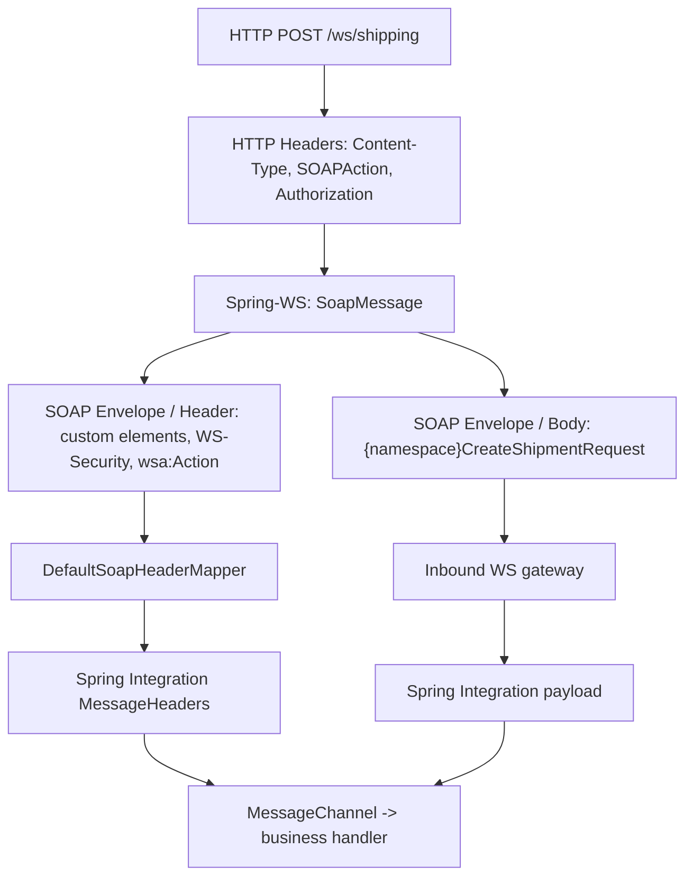
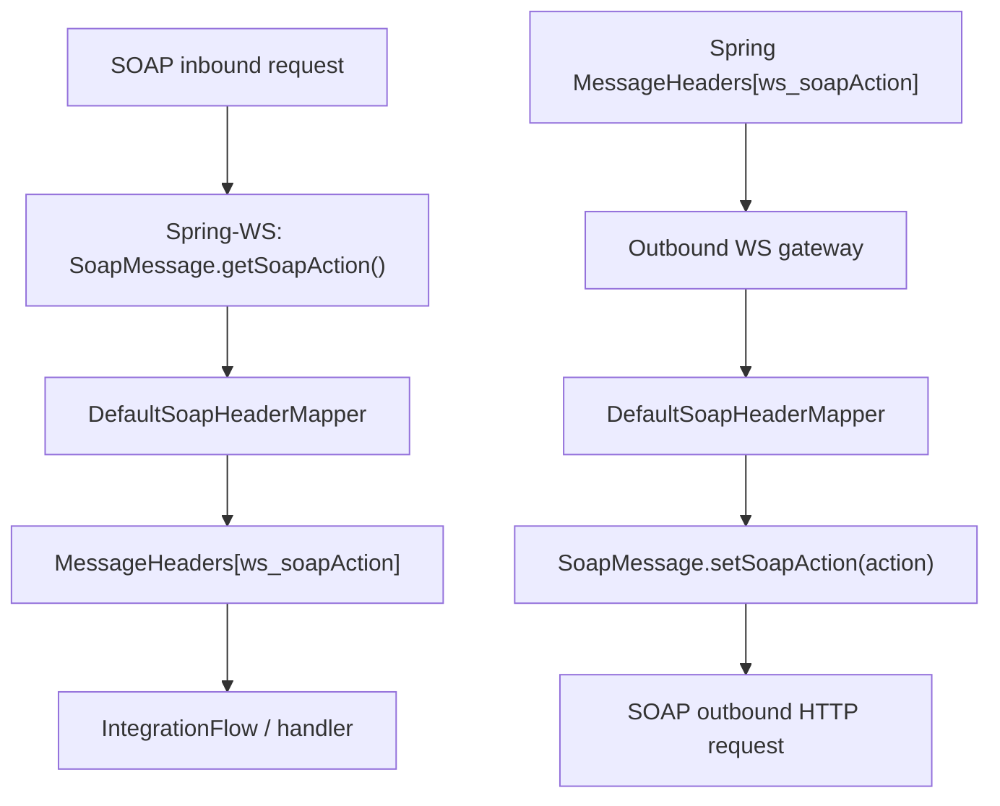
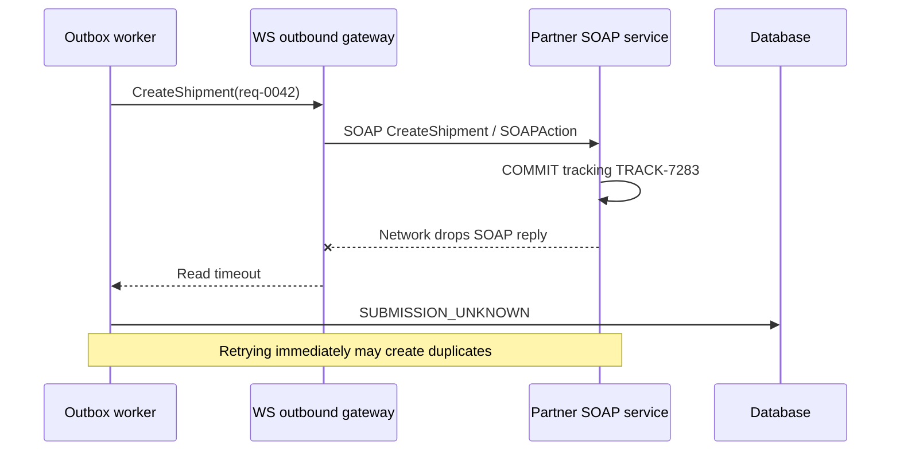

# SOAP action and headers

## 1. Problem: valid XML SOAP request routed to the wrong operation

A Spring Boot system receives integration requests from a logistics partner over **SOAP 1.1**. Two operations, `CreateShipment` and `CancelShipment`, use different XML elements described in the WSDL. When receiving `CreateShipmentRequest`, the application needs to read a correlation ID in the SOAP Header, turn the request into a Spring Integration `Message<?>`, execute business logic, and return a SOAP response. Conversely, when **calling outbound** to the partner's SOAP service, the application must send the agreed `SOAPAction` and `ClientContext` header.

A common incident: the client sends `SOAPAction: "urn:demo:shipments:v1/CancelShipment"` while the SOAP Body contains `CreateShipmentRequest`. If the server trusts the action alone to invoke the cancellation handler, or checks only the local name ignoring the namespace, it can execute the **wrong business operation**. Another common issue: a team sets a Spring message header `ClientContext` and expects it to appear automatically in the SOAP Envelope; by default, `DefaultSoapHeaderMapper` **does not arbitrarily copy custom SOAP headers**.

Within the `SPRING_INTEGRATION_ADAPTERS` module — connecting external systems via inbound/outbound adapters, gateways, pollers, and `MessageChannel`s, handling message contracts, errors, and connection lifecycles across files, SFTP, HTTP, JMS, AMQP, Kafka, and databases — the **"SOAP action and headers"** lesson focuses on the boundaries between **HTTP transport headers**, **SOAP Envelope Headers**, **SOAP Body QNames**, **WS-Addressing**, and **Spring Integration MessageHeaders**.

### Learning outcomes

After this lesson you will be able to:

1. Distinguish `SOAPAction` (SOAP 1.1), SOAP 1.2 `action` parameter, `wsa:Action`, and the QName of the first SOAP Body element.
2. Understand `SoapMessage.getSoapAction()/setSoapAction(...)`, `SoapActionCallback`, `ActionCallback`, `SoapHeaderElement`, and `mustUnderstand`.
3. Read/write custom SOAP Headers using `DefaultSoapHeaderMapper` with `Source` or `SoapHeaderElement` and an allowlist.
4. Build an outbound `Ws.simpleOutboundGateway(...)` flow with `WebServiceHeaders.SOAP_ACTION` and test emitted actions/headers.
5. Route inbound calls via `PayloadRootQNameEndpointMapping` or `SoapActionEndpointMapping` and enforce contract consistency.
6. Handle header security (WS-Security, mTLS, OAuth, WS-Addressing, replay), SOAP Faults, and timeouts without confusing metadata with access permissions.
7. Write `MockWebServiceServer`/`MockWebServiceClient` tests, troubleshoot incidents, and apply a production integration checklist.

> **Versions:** Spring Integration **6.5.x**, Spring Web Services **4.0.x**, Spring Framework 6.x, Java 17+, and compatible Spring Boot. `javax.xml.transform.Source` remains valid JAXP on Java 17; Jakarta SOAP/JAXB use `jakarta.xml.soap`/`jakarta.xml.bind`. URIs like `urn:demo:shipments:v1`, the `example.test` domain, and IDs here are purely educational data.

## 2. Four distinct layers of "headers"/identifiers



| Concept | Location | Example | Who is responsible? |
| --- | --- | --- | --- |
| HTTP `Content-Type` | HTTP transport | `text/xml; charset=utf-8` | HTTP client/servlet, message factory |
| SOAP 1.1 `SOAPAction` | HTTP header, via `SoapMessage` | `"urn:demo:shipments:v1/CreateShipment"` | Spring-WS + `SoapActionCallback`/mapper |
| SOAP 1.2 `action` | `application/soap+xml` media-type parameter | `action="urn:demo:shipments:v1/CreateShipment"` | SOAP 1.2 message factory + HTTP transport |
| SOAP Header | `<env:Header>` inside Envelope | `<ctx:ClientContext>`, `<wsse:Security>` | SOAP client/server, interceptors, header mapper |
| WS-Addressing `wsa:Action` | **SOAP Header**, WS-A namespace | `urn:demo:shipments:v1/CreateShipment` | WS-Addressing `ActionCallback`/endpoint mapping |
| SOAP Body root QName | `<env:Body>` | `{urn:demo:shipments:v1}CreateShipmentRequest` | XSD/WSDL + payload mapping/validation |
| Spring Integration header | `MessageHeaders` in JVM | `WebServiceHeaders.SOAP_ACTION` | Integration gateway + mapper/handler |

**Important:** seeing the string `CreateShipment` inside an action, QName, or SOAP Header does not make them equivalent. An HTTP `X-Client-ID` header does not automatically become a `ctx:ClientId` SOAP Header; a Spring `ClientContext` header does not automatically go out over HTTP unless a mapper or callback explicitly places it there.

### Spring message vs. SOAP message

Spring Integration carries `Message<Source>` or `Message<POJO>` across `MessageChannel`s; `MessageHeaders` is Spring's immutable map. Spring-WS `SoapMessage` contains the Envelope, Header, Body, and transport-specific action. The gateway is the **mapping boundary** between these two representations. External headers are untrusted data and must not by default control routers or business operations.

## 3. SOAP 1.1: `SOAPAction` does not live inside the SOAP Header

Example SOAP 1.1 request showing HTTP transport headers and the SOAP envelope:

```http
POST /ws/shipping HTTP/1.1
Host: shipping.example.test
Content-Type: text/xml; charset=utf-8
SOAPAction: "urn:demo:shipments:v1/CreateShipment"
Authorization: Bearer <token-redacted>

<?xml version="1.0" encoding="UTF-8"?>
<soap:Envelope xmlns:soap="http://schemas.xmlsoap.org/soap/envelope/"
               xmlns:ship="urn:demo:shipments:v1"
               xmlns:ctx="urn:demo:shipments:headers:v1">
  <soap:Header>
    <ctx:ClientContext soap:mustUnderstand="0">
      <ctx:RequestId>req-0042</ctx:RequestId>
    </ctx:ClientContext>
  </soap:Header>
  <soap:Body>
    <ship:CreateShipmentRequest>
      <ship:clientRequestId>req-0042</ship:clientRequestId>
      <ship:orderId>O-9001</ship:orderId>
    </ship:CreateShipmentRequest>
  </soap:Body>
</soap:Envelope>
```

In this sample:

- `SOAPAction` is an **HTTP header**, outside the XML document; in Spring-WS it is normally set via `SoapMessage.setSoapAction(...)`.
- `ctx:ClientContext` is a **SOAP header block** inside the Envelope. The namespace URI defines QName `{urn:demo:shipments:headers:v1}ClientContext`.
- `ship:CreateShipmentRequest` is the **SOAP Body payload root**, QName `{urn:demo:shipments:v1}CreateShipmentRequest`, not an HTTP header.
- `Authorization` is **HTTP authorization**; the token must be verified for issuer/audience/scope or matching policy. **Never** put real tokens in sample docs or logs.

SOAP 1.1 may use a quoted URI, an empty string, or omit `SOAPAction` depending on the client/binding; the **partner's WSDL/policy** dictates the expected value. An action URI **is not necessarily a URL to GET**; it is usually an operation identifier. Never issue an HTTP request to an action URI merely because it looks like a web URL.

## 4. SOAP 1.2: media-type `action` vs. `wsa:Action`

SOAP 1.2 changes the Envelope namespace to `http://www.w3.org/2003/05/soap-envelope`; over HTTP it typically uses media type `application/soap+xml` and an `action` parameter per binding.

```http
POST /ws/shipping HTTP/1.1
Host: shipping.example.test
Content-Type: application/soap+xml; charset=utf-8; action="urn:demo:shipments:v1/CreateShipment"

<env:Envelope xmlns:env="http://www.w3.org/2003/05/soap-envelope"
              xmlns:ship="urn:demo:shipments:v1">
  <env:Body>
    <ship:CreateShipmentRequest>
      <ship:clientRequestId>req-0042</ship:clientRequestId>
      <ship:orderId>O-9001</ship:orderId>
    </ship:CreateShipmentRequest>
  </env:Body>
</env:Envelope>
```

Never manually add a SOAP 1.1 HTTP `SOAPAction` header to a SOAP 1.2 message assuming that satisfies the contract. In Spring-WS, configure `SaajSoapMessageFactory` with `SoapVersion.SOAP_11` or `SoapVersion.SOAP_12` matching the WSDL binding, and let the message factory/transport handle content types and actions.

### Comparison table

| Property | SOAP 1.1 | SOAP 1.2 |
| --- | --- | --- |
| Envelope namespace | `http://schemas.xmlsoap.org/soap/envelope/` | `http://www.w3.org/2003/05/soap-envelope` |
| Common media type | `text/xml` | `application/soap+xml` |
| HTTP action | `SOAPAction` HTTP header | `action` parameter in media type |
| SOAP Fault | `faultcode`/`faultstring`/`detail` | `Code`/`Reason`/`Detail`, optional `Subcode` |
| `mustUnderstand` | `0`/`1` | `false`/`true` per SOAP 1.2 |
| `actor`/`role` | `actor` (SOAP 1.1) | `role` (SOAP 1.2), with `relay` semantics |

**Do not infer the version solely from the `SOAPAction` string.** Inspect the Envelope QName, media type/binding, and actual endpoint. SOAP 1.1 and 1.2 cannot be interchanged simply by editing an XML prefix or `Content-Type` alone.

## 5. WS-Addressing: `wsa:Action` is an independent SOAP Header

WS-Addressing defines transport-independent **Message Addressing Properties**: `Action`, `To`, `MessageID`, `ReplyTo`, `FaultTo`, and `RelatesTo`. These headers assist routing/correlation in complex SOAP topologies; they **do not replace** transport security or business idempotency.

```xml
<env:Envelope xmlns:env="http://www.w3.org/2003/05/soap-envelope"
              xmlns:wsa="http://www.w3.org/2005/08/addressing"
              xmlns:ship="urn:demo:shipments:v1">
  <env:Header>
    <wsa:Action env:mustUnderstand="true">
      urn:demo:shipments:v1/CreateShipment
    </wsa:Action>
    <wsa:To>https://shipping.example.test/ws/shipping</wsa:To>
    <wsa:MessageID>urn:uuid:6c9ea159-8a63-40b6-9e40-7e97d522af50</wsa:MessageID>
    <wsa:ReplyTo>
      <wsa:Address>http://www.w3.org/2005/08/addressing/anonymous</wsa:Address>
    </wsa:ReplyTo>
  </env:Header>
  <env:Body>
    <ship:CreateShipmentRequest>
      <ship:clientRequestId>req-0042</ship:clientRequestId>
      <ship:orderId>O-9001</ship:orderId>
    </ship:CreateShipmentRequest>
  </env:Body>
</env:Envelope>
```

`wsa:Action` is an **XML element inside the SOAP Header**; SOAP 1.1 `SOAPAction` is an HTTP header. They may carry **the same action URI** per policy, yet **they are not the same header**. If WSDL/policy requires both, configure and test consistency and the WS-Addressing version.

`wsa:MessageID` supports protocol-level correlation, **not duplicate-shipment prevention**. When a client retries after a timeout, business idempotency must rely on `clientRequestId` and a partner-agreed deduplication mechanism. Never take `wsa:ReplyTo` from an untrusted client and automatically callback to arbitrary URLs: that risks SSRF/exfiltration.

## 6. Spring Integration flow: where does SOAPAction go on inbound and outbound?

Per **Spring Integration 6.5** documentation, web service gateways map the SOAP action automatically via `DefaultSoapHeaderMapper`. The constant `WebServiceHeaders.SOAP_ACTION` has value `ws_soapAction`.



| Direction | Incoming data | Internal header after mapping | Outgoing data |
| --- | --- | --- | --- |
| **SOAP inbound request** | `SoapMessage` action + SOAP Header | `WebServiceHeaders.SOAP_ACTION` and allowed custom headers | Spring message to request channel |
| **SOAP inbound reply** | Spring reply payload + headers | Selected headers from reply message | Response SOAP Header/Action when configured |
| **SOAP outbound request** | Spring message + `SOAP_ACTION` | `DefaultSoapHeaderMapper` extracts action | SOAP request transport action/headers |
| **SOAP outbound reply** | SOAP reply/headers from provider | `SOAP_ACTION` and allowed custom reply headers | Spring reply message back to flow |

**Note:** the header mapper's `requestHeaderNames`/`replyHeaderNames` configure **both request and reply directions at the boundary**, which does not mean "reading/writing raw HTTP headers". Custom SOAP headers must be explicitly named and are not mapped by default. Actions and headers are **metadata**—never assume they are authenticated or prove a business operation succeeded.

## 7. `DefaultSoapHeaderMapper`: allowlists and actual values

`org.springframework.integration.ws.DefaultSoapHeaderMapper` implements the `SoapHeaderMapper` interface. Two configuration APIs:

```java
import org.springframework.context.annotation.Bean;
import org.springframework.context.annotation.Configuration;
import org.springframework.integration.ws.DefaultSoapHeaderMapper;
import org.springframework.integration.ws.WebServiceHeaders;

@Configuration
public class ShippingHeaderMappingConfig {

    @Bean
    public DefaultSoapHeaderMapper shippingSoapHeaderMapper() {
        DefaultSoapHeaderMapper mapper = new DefaultSoapHeaderMapper();
        mapper.setRequestHeaderNames(
                WebServiceHeaders.SOAP_ACTION, "ClientContext");
        mapper.setReplyHeaderNames(
                WebServiceHeaders.SOAP_ACTION, "PartnerReceipt");
        return mapper;
    }
}
```

**This is an allowlist of Spring header names**, not a standalone protection for SOAP Header QNames. `ClientContext` and `PartnerReceipt` are application-chosen names; the XML content resides inside a `Source`/`SoapHeaderElement` value and must have its QName + namespace validated before use. When a response contains a selected `PartnerReceipt` SOAP Header, the gateway typically places it in the Spring message header as a `SoapHeaderElement`. Do not treat `header.get("PartnerReceipt").toString()` as XML text.

### Custom header mapping mechanics

Spring Integration 6.5 supports:

- **From Spring Message to SOAP Header:** a custom header value of type `javax.xml.transform.Source` is added as a child element of `<soap:Header>`. Use `StringSource` for validated XML, or a safe transformer/marshaller.
- **From SOAP Header to Spring Message:** selected custom headers enter `MessageHeaders` as `SoapHeaderElement`s. Read via `SoapHeaderElement.getSource()` or `getText()` per contract.
- **SOAPAction:** handled automatically by the mapper as standard header `WebServiceHeaders.SOAP_ACTION`; you still need to set the right operation action on outbound requests.

The mapper supports patterns like `Client*` and `!ClientSecret`; the `NON_STANDARD_HEADERS` token may be broader than intended. In production, prefer **listing exact allowed header names**. Wildcard `*` risks leaking internal metadata, and broad patterns cause bugs as new headers are introduced.

### Trust level

Never take a caller-asserted `ClientContext` to decide tenant/role without checking signatures/certificates/tokens and business authorization. Never let client-supplied `SOAP_ACTION` or custom header values determine outbound server URIs, file paths, callback URLs, or Spring bean names.

## 8. Dependencies, message factory, and `WebServiceTemplate` client

Application using a Spring Boot BOM compatible with Spring Integration 6.5:

```groovy
dependencies {
    implementation 'org.springframework.boot:spring-boot-starter-integration'
    implementation 'org.springframework.integration:spring-integration-ws'
    implementation 'org.springframework.boot:spring-boot-starter-web-services'
    testImplementation 'org.springframework.boot:spring-boot-starter-test'
    testImplementation 'org.springframework.ws:spring-ws-test'
}
```

`spring-integration-ws` holds WS gateways, `DefaultSoapHeaderMapper`, and `WebServiceHeaders`; Spring-WS holds `WebServiceTemplate`, `SoapMessage`, `SoapActionCallback`, `ActionCallback`, and `MessageDispatcherServlet`. **Pure outbound SOAP clients do not need to register a server-side servlet.**

```yaml
app:
  shipping:
    endpoint: ${SHIPPING_SOAP_ENDPOINT:https://shipping.example.test/ws/shipping}
    create-action: "urn:demo:shipments:v1/CreateShipment"
    connection-timeout-ms: 5000
    read-timeout-ms: 20000
```

```java
import java.time.Duration;

import org.springframework.beans.factory.annotation.Value;
import org.springframework.context.annotation.Bean;
import org.springframework.context.annotation.Configuration;
import org.springframework.ws.client.core.WebServiceTemplate;
import org.springframework.ws.soap.SoapVersion;
import org.springframework.ws.soap.saaj.SaajSoapMessageFactory;
import org.springframework.ws.transport.http.HttpUrlConnectionMessageSender;

@Configuration
public class ShippingSoapClientConfiguration {

    @Bean
    public SaajSoapMessageFactory shippingSoap11MessageFactory() {
        SaajSoapMessageFactory factory = new SaajSoapMessageFactory();
        factory.setSoapVersion(SoapVersion.SOAP_11);
        // Spring manages afterPropertiesSet/lifecycle.
        return factory;
    }

    @Bean
    public WebServiceTemplate shippingSoapTemplate(
            SaajSoapMessageFactory shippingSoap11MessageFactory,
            @Value("${app.shipping.endpoint}") String uri,
            @Value("${app.shipping.connection-timeout-ms:5000}") long connectMs,
            @Value("${app.shipping.read-timeout-ms:20000}") long readMs) {
        HttpUrlConnectionMessageSender sender =
                new HttpUrlConnectionMessageSender();
        sender.setConnectionTimeout(Duration.ofMillis(connectMs));
        sender.setReadTimeout(Duration.ofMillis(readMs));

        WebServiceTemplate template =
                new WebServiceTemplate(shippingSoap11MessageFactory);
        template.setDefaultUri(uri);
        template.setMessageSender(sender);
        return template;
    }
}
```

**URI security:** `endpoint` must come from trusted configuration or a host/port-allowlisted registry. Never accept raw client-supplied URLs: that exposes SSRF to loopback, cloud metadata, or internal networks. TLS must verify the certificate chain and hostname; if mTLS, OAuth, or proxies are needed, provide an appropriately configured HTTP client. `connectionTimeout` and `readTimeout` bound individual socket operations, **not the total deadline** for the full request/response. A read timeout after sending a request **does not prove** remote side effects did not occur.

## 9. Setting `SOAPAction` directly with `SoapActionCallback`

Spring-WS provides `org.springframework.ws.soap.client.core.SoapActionCallback` to set the action through the SOAP API without manually editing HTTP headers:

```java
import org.springframework.beans.factory.annotation.Qualifier;
import org.springframework.stereotype.Service;
import org.springframework.ws.client.core.WebServiceTemplate;
import org.springframework.ws.soap.client.core.SoapActionCallback;
import org.springframework.xml.transform.StringResult;
import org.springframework.xml.transform.StringSource;

@Service
public class ShippingSoapActionClient {
    private final WebServiceTemplate template;

    public ShippingSoapActionClient(
            @Qualifier("shippingSoapTemplate") WebServiceTemplate template) {
        this.template = template;
    }

    public String sendDemo() {
        StringSource request = new StringSource("""
            <ship:CreateShipmentRequest xmlns:ship="urn:demo:shipments:v1">
              <ship:clientRequestId>req-0042</ship:clientRequestId>
              <ship:orderId>O-9001</ship:orderId>
            </ship:CreateShipmentRequest>
            """);
        StringResult response = new StringResult();

        boolean received = template.sendSourceAndReceiveToResult(
                request,
                new SoapActionCallback(
                        "urn:demo:shipments:v1/CreateShipment"),
                response);

        if (!received) {
            throw new IllegalStateException(
                    "Operation requires a reply but no SOAP response arrived");
        }
        // Only the XML Body so far, not yet XSD/business-validated.
        return response.toString();
    }
}
```

`SoapActionCallback` runs after the request body is constructed and before transport sends it. It calls `SoapMessage.setSoapAction(...)`; the message factory formats the action for the chosen SOAP version. The `StringSource` payload here is only the **Body root element**; Spring-WS builds the `Envelope`. Never pass a full SOAP Envelope into the body, or you can produce nested Envelopes.

**Example limitation:** the IDs are demo literals; production must safely serialize business data (JAXB/XML builder), validate requests/responses against XSD, and reconcile `clientRequestId` and tracking numbers. Never concatenate XML strings from untrusted input.

## 10. Writing a SOAP Header with `WebServiceMessageCallback`

When the contract requires a simple custom Header, use `WebServiceMessageCallback` and `SoapHeaderElement`. `ctx:ClientContext` below is a **text-only header**:

```java
import javax.xml.namespace.QName;

import org.springframework.ws.WebServiceMessage;
import org.springframework.ws.client.core.WebServiceMessageCallback;
import org.springframework.ws.soap.SoapHeaderElement;
import org.springframework.ws.soap.SoapMessage;

public final class ShippingSoapCallbacks {
    public static final String CREATE_ACTION =
            "urn:demo:shipments:v1/CreateShipment";
    public static final QName CLIENT_CONTEXT = new QName(
            "urn:demo:shipments:headers:v1", "ClientContext");

    public static WebServiceMessageCallback withClientContext(
            String verifiedRequestId) {
        if (verifiedRequestId == null || verifiedRequestId.isBlank()
                || verifiedRequestId.length() > 100) {
            throw new IllegalArgumentException("Invalid request ID");
        }
        return (WebServiceMessage message) -> {
            if (!(message instanceof SoapMessage soap)) {
                throw new IllegalStateException(
                        "Client requires a SOAP message factory");
            }
            soap.setSoapAction(CREATE_ACTION);
            SoapHeaderElement context =
                    soap.getSoapHeader().addHeaderElement(CLIENT_CONTEXT);
            context.setText(verifiedRequestId);
            context.setMustUnderstand(false);
        };
    }
}
```

The generated Header looks like:

```xml
<soap:Header xmlns:soap="http://schemas.xmlsoap.org/soap/envelope/"
             xmlns:ctx="urn:demo:shipments:headers:v1">
  <ctx:ClientContext soap:mustUnderstand="0">req-0042</ctx:ClientContext>
</soap:Header>
```

Use this callback **instead of** `SoapActionCallback` from section 9:

```java
// Inside a method that has request/response and template:
boolean received = template.sendSourceAndReceiveToResult(
        request,
        ShippingSoapCallbacks.withClientContext("req-0042"),
        response);
```

For structures with multiple child elements, `setText(...)` is not enough; use `SoapHeaderElement.getResult()` with a hardened XML transformer, JAXB, or `Source` mapping as in section 11. **Never concatenate XML from unescaped input**, and never attach a fake WS-Security signature into the Header assuming it counts as verified.

## 11. Spring Integration outbound: SOAPAction and XML `Source` header

Example of sending a `Message<Source>` to a WS outbound gateway; `WebServiceHeaders.SOAP_ACTION` carries the action while `ClientContext` carries an XML `Source` for the SOAP Header:

```java
import org.springframework.beans.factory.annotation.Qualifier;
import org.springframework.beans.factory.annotation.Value;
import org.springframework.context.annotation.Bean;
import org.springframework.context.annotation.Configuration;
import org.springframework.integration.channel.DirectChannel;
import org.springframework.integration.dsl.IntegrationFlow;
import org.springframework.integration.ws.DefaultSoapHeaderMapper;
import org.springframework.integration.ws.dsl.Ws;
import org.springframework.messaging.MessageChannel;
import org.springframework.ws.client.core.WebServiceTemplate;

@Configuration
public class ShippingSoapOutboundFlow {

    @Bean
    public MessageChannel outboundShipmentSoapRequests() {
        return new DirectChannel();
    }

    @Bean
    public IntegrationFlow shippingSoapOutbound(
            @Qualifier("outboundShipmentSoapRequests") MessageChannel channel,
            @Qualifier("shippingSoapTemplate") WebServiceTemplate template,
            DefaultSoapHeaderMapper shippingSoapHeaderMapper,
            @Value("${app.shipping.endpoint}") String endpointUri) {
        return IntegrationFlow.from(channel)
                .handle(Ws.simpleOutboundGateway(template)
                        .uri(endpointUri)
                        .headerMapper(shippingSoapHeaderMapper))
                .get();
    }
}
```

Producer sending a Spring Message:

```java
import javax.xml.transform.Source;

import org.springframework.beans.factory.annotation.Qualifier;
import org.springframework.integration.core.MessagingTemplate;
import org.springframework.integration.ws.WebServiceHeaders;
import org.springframework.messaging.Message;
import org.springframework.messaging.MessageChannel;
import org.springframework.messaging.support.MessageBuilder;
import org.springframework.stereotype.Service;
import org.springframework.xml.transform.StringSource;

@Service
public class ShippingSoapMessageProducer {
    private final MessageChannel outboundChannel;

    public ShippingSoapMessageProducer(
            @Qualifier("outboundShipmentSoapRequests")
            MessageChannel outboundChannel) {
        this.outboundChannel = outboundChannel;
    }

    public Message<?> sendDemo() {
        Source contextHeader = new StringSource("""
            <ctx:ClientContext
                    xmlns:ctx="urn:demo:shipments:headers:v1">
              req-0042
            </ctx:ClientContext>
            """);
        Source body = new StringSource("""
            <ship:CreateShipmentRequest
                    xmlns:ship="urn:demo:shipments:v1">
              <ship:clientRequestId>req-0042</ship:clientRequestId>
              <ship:orderId>O-9001</ship:orderId>
            </ship:CreateShipmentRequest>
            """);

        Message<Source> request = MessageBuilder.withPayload(body)
                .setHeader(WebServiceHeaders.SOAP_ACTION,
                        "urn:demo:shipments:v1/CreateShipment")
                .setHeader("ClientContext", contextHeader)
                .build();
        MessagingTemplate messaging = new MessagingTemplate();
        messaging.setReceiveTimeout(25_000);
        Message<?> reply =
                messaging.sendAndReceive(outboundChannel, request);
        if (reply == null) {
            throw new IllegalStateException("Missing SOAP reply");
        }
        return reply;
    }
}
```

With `setRequestHeaderNames(WebServiceHeaders.SOAP_ACTION, "ClientContext")`, the mapper inserts the XML `StringSource` as a child element of the SOAP Header. `SOAPAction` is handled as the standard action. Test the **actual wire message**, not merely asserting the Spring message has the header. If using `ExecutorChannel`/`QueueChannel` before the gateway, `send()` may return true before SOAP is sent; `sendAndReceive()` still requires a reply channel and timeout.

**Why does `Source` matter?** Per Spring Integration 6.5, custom headers of type `Source` are copied into the SOAP Header as XML children; a plain `String` does not automatically become an arbitrary XML subtree. Enforce quotas, validate namespaces/QNames, and escape data before creating a `Source`. A `Source` backed by a closed stream is unsuitable for durable retries.

## 12. Inbound gateway: mapping SOAPAction to the right operation

The Spring-WS server receives HTTP/SOAP via `MessageDispatcherServlet`, then `EndpointMapping` selects the gateway. Spring-WS 4.x provides `org.springframework.ws.soap.server.endpoint.mapping.SoapActionEndpointMapping` to choose endpoints by SOAP action; a Spring Integration inbound gateway is a `MessageEndpoint`:

```java
import java.util.Map;

import org.springframework.beans.factory.annotation.Qualifier;
import org.springframework.boot.web.servlet.ServletRegistrationBean;
import org.springframework.context.ApplicationContext;
import org.springframework.context.annotation.Bean;
import org.springframework.context.annotation.Configuration;
import org.springframework.integration.channel.DirectChannel;
import org.springframework.integration.ws.SimpleWebServiceInboundGateway;
import org.springframework.messaging.MessageChannel;
import org.springframework.ws.soap.server.endpoint.mapping.SoapActionEndpointMapping;
import org.springframework.ws.transport.http.MessageDispatcherServlet;

@Configuration
public class ShippingSoapInboundConfiguration {
    public static final String CREATE_ACTION =
            "urn:demo:shipments:v1/CreateShipment";

    @Bean
    public ServletRegistrationBean<MessageDispatcherServlet> shippingWsServlet(
            ApplicationContext context) {
        MessageDispatcherServlet servlet = new MessageDispatcherServlet();
        servlet.setApplicationContext(context);
        return new ServletRegistrationBean<>(servlet, "/ws/*");
    }

    @Bean
    public MessageChannel inboundShipmentRequests() {
        return new DirectChannel();
    }

    @Bean
    public SimpleWebServiceInboundGateway shippingInboundGateway(
            @Qualifier("inboundShipmentRequests") MessageChannel channel,
            DefaultSoapHeaderMapper shippingSoapHeaderMapper) {
        SimpleWebServiceInboundGateway gateway =
                new SimpleWebServiceInboundGateway();
        gateway.setRequestChannel(channel);
        gateway.setHeaderMapper(shippingSoapHeaderMapper);
        gateway.setReplyTimeout(10_000);
        return gateway;
    }

    @Bean
    public SoapActionEndpointMapping shippingSoapActionMapping(
            SimpleWebServiceInboundGateway shippingInboundGateway) {
        SoapActionEndpointMapping mapping = new SoapActionEndpointMapping();
        mapping.setEndpointMap(
                Map.of(CREATE_ACTION, shippingInboundGateway));
        return mapping;
    }
}
```

**Two routing layers:** HTTP POST `/ws` is received by the servlet; `SoapActionEndpointMapping` picks the gateway by action; the gateway turns the **SOAP Body payload** into a Spring Message on `inboundShipmentRequests`. A gateway bean without an `EndpointMapping` will not receive SOAP HTTP traffic. If the Boot starter already auto-registers a servlet on the same path, **do not register a second servlet** with an overlapping mapping. Choose explicit or Boot auto-config and test the actual route.

### Handler verifying action and metadata

```java
import javax.xml.namespace.QName;
import javax.xml.transform.Source;

import org.springframework.beans.factory.annotation.Qualifier;
import org.springframework.context.annotation.Bean;
import org.springframework.context.annotation.Configuration;
import org.springframework.integration.dsl.IntegrationFlow;
import org.springframework.integration.ws.WebServiceHeaders;
import org.springframework.messaging.MessageChannel;
import org.springframework.ws.soap.SoapHeaderElement;
import org.springframework.xml.transform.StringSource;

@Configuration
public class ShippingSoapInboundFlow {
    private static final QName CONTEXT_NAME = new QName(
            "urn:demo:shipments:headers:v1", "ClientContext");

    @Bean
    public IntegrationFlow processInboundShipment(
            @Qualifier("inboundShipmentRequests") MessageChannel channel) {
        return IntegrationFlow.from(channel)
                .handle(Source.class, (payload, headers) -> {
                    String action = (String) headers.get(
                            WebServiceHeaders.SOAP_ACTION);
                    if (!ShippingSoapInboundConfiguration.CREATE_ACTION
                            .equals(action)) {
                        throw new IllegalArgumentException(
                                "SOAPAction does not match operation");
                    }

                    Object custom = headers.get("ClientContext");
                    if (!(custom instanceof SoapHeaderElement header)
                            || !CONTEXT_NAME.equals(header.getName())) {
                        throw new IllegalArgumentException(
                                "Missing ClientContext with expected QName");
                    }
                    // Use header.getText() only after validating data.
                    // Tenant identity must come from the authenticated security
                    // principal, not from a self-asserted XML Header.

                    return new StringSource("""
                        <ship:CreateShipmentResponse
                                xmlns:ship="urn:demo:shipments:v1">
                          <ship:clientRequestId>req-0042</ship:clientRequestId>
                          <ship:trackingNumber>TRACK-DEMO-001</ship:trackingNumber>
                          <ship:status>CREATED</ship:status>
                        </ship:CreateShipmentResponse>
                        """);
                })
                .get();
    }
}
```

The `shippingInboundGateway` bean has `shippingSoapHeaderMapper` attached for both request and reply, so `ClientContext` is mapped when its QName/name matches; if the mapper omits that name from `requestHeaderNames`, the handler rejects it. The response in this handler is **simulated**, without processing the request `Source` or writing to a DB; production needs schema validation for `CreateShipmentRequest`, authn/authz, idempotency, a real business handler, and responses derived from real IDs. Never treat a matching `SOAPAction` as sufficient permission to run an operation.

## 13. Routing by Body QName instead of SOAPAction

When two operations have distinct XSDs, you can choose `PayloadRootQNameEndpointMapping` as the primary router:

```java
import java.util.Map;

import org.springframework.context.annotation.Bean;
import org.springframework.ws.server.endpoint.mapping.PayloadRootQNameEndpointMapping;

@Bean
public PayloadRootQNameEndpointMapping shippingQNameMapping(
        SimpleWebServiceInboundGateway shippingInboundGateway) {
    PayloadRootQNameEndpointMapping mapping =
            new PayloadRootQNameEndpointMapping();
    mapping.setEndpointMap(Map.of(
            "{urn:demo:shipments:v1}CreateShipmentRequest",
            shippingInboundGateway));
    return mapping;
}
```

This is an **alternative** to `SoapActionEndpointMapping` in section 12. Do not enable both mappings for the same business operation without designing `order`/priority and testing for conflicts. When routing by Body QName, still verify `SOAPAction` against WSDL policy if required; when routing by `SOAPAction`, still validate Body QName/schema **to block action/body mismatches**.

For method-based `@Endpoint` servers, Spring-WS also supports `@SoapAction` via `SoapActionAnnotationMethodEndpointMapping` and `@PayloadRoot` via `PayloadRootAnnotationMethodEndpointMapping`. However, a `SimpleWebServiceInboundGateway` is a **`MessageEndpoint` object**, not a `@PayloadRoot` method; use the mapping appropriate for the endpoint type.

### Never use action to grant permissions

A client can freely send `SOAPAction: "urn:.../CancelShipment"`; that is not proof of `scope=shipment:cancel`. The service must authenticate the mTLS/WS-Security/OAuth principal and check tenant/order ownership and permissions **after routing** and before side effects. Never configure a catch-all default mapping pointing to sensitive operations without body and permission checks.

## 14. WS-Addressing `ActionCallback`

If the WSDL/policy uses **WS-Addressing 2005/08**, Spring-WS provides `org.springframework.ws.soap.addressing.client.ActionCallback` to emit `wsa:Action` and addressing headers:

```java
import org.springframework.ws.client.core.WebServiceTemplate;
import org.springframework.ws.soap.addressing.client.ActionCallback;
import org.springframework.xml.transform.StringResult;
import org.springframework.xml.transform.StringSource;

public final class ShippingWsAddressingClient {
    public static boolean sendStatusQuery(WebServiceTemplate template) {
        StringSource xml = new StringSource("""
            <ship:GetShipmentStatusRequest
                    xmlns:ship="urn:demo:shipments:v1">
              <ship:trackingNumber>TRACK-7283</ship:trackingNumber>
            </ship:GetShipmentStatusRequest>
            """);
        StringResult result = new StringResult();
        return template.sendSourceAndReceiveToResult(
                xml,
                new ActionCallback(
                        "urn:demo:shipments:v1/GetShipmentStatus"),
                result);
    }
}
```

`ActionCallback` targets **WS-Addressing SOAP Headers**, not just HTTP `SOAPAction`. It has overloads for `AddressingVersion`, `To`, and correlation properties. Never invoke callbacks to a caller-supplied `wsa:ReplyTo` URL without checking allowlist/SSRF policies. When both transport action and WS-Addressing action are needed, combine both callbacks inside one `WebServiceMessageCallback` after aligning ordering with WS-Security:

```java
import org.springframework.ws.client.core.WebServiceMessageCallback;
import org.springframework.ws.soap.addressing.client.ActionCallback;
import org.springframework.ws.soap.client.core.SoapActionCallback;

WebServiceMessageCallback bothActions = message -> {
    new SoapActionCallback("urn:demo:shipments:v1/CreateShipment")
            .doWithMessage(message);
    new ActionCallback("urn:demo:shipments:v1/CreateShipment")
            .doWithMessage(message);
};
```

This is a **fragment inside a method**, not a standalone Java source file. Use both callbacks only when the partner **truly requires** both semantics; do not confuse `SoapActionCallback` with `ActionCallback` just because both contain the word "Action".

## 15. Reading custom inbound/reply SOAP Headers with the right types

A custom header inside SOAP XML is normally mapped by `DefaultSoapHeaderMapper` to a `SoapHeaderElement`, not a plain `String`. Given sample Header:

```xml
<ctx:PartnerReceipt xmlns:ctx="urn:demo:shipments:headers:v1">
  <ctx:ReceiptId>receipt-7283</ctx:ReceiptId>
  <ctx:Time>2026-11-23T03:00:00Z</ctx:Time>
</ctx:PartnerReceipt>
```

When mapping a reply header named `PartnerReceipt`, downstream code may receive `MessageHeaders["PartnerReceipt"]` as a `SoapHeaderElement`. Two handling levels apply:

1. For **text-only headers** defined by the contract, `SoapHeaderElement.getText()` may suffice after checking QName, length, and content.
2. For **complex headers** with child elements, use `SoapHeaderElement.getSource()` and parse with a **hardened and size-bounded** XML parser/XPath/JAXB. Never call `toString()` expecting XML or blindly cast to `DOMSource`; the concrete `Source` type depends on the message factory.

Example safely extracting minimal metadata:

```java
import javax.xml.namespace.QName;
import javax.xml.transform.Source;

import org.springframework.messaging.Message;
import org.springframework.ws.soap.SoapHeaderElement;

public final class PartnerReceiptHeaders {
    public static final QName RECEIPT_QNAME = new QName(
            "urn:demo:shipments:headers:v1", "PartnerReceipt");

    public static Source extractReceiptXml(Message<?> springReply) {
        Object candidate = springReply.getHeaders().get("PartnerReceipt");
        if (!(candidate instanceof SoapHeaderElement header)) {
            throw new IllegalArgumentException("Missing PartnerReceipt");
        }
        if (!RECEIPT_QNAME.equals(header.getName())) {
            throw new IllegalArgumentException("Wrong PartnerReceipt QName");
        }
        // Caller must parse Source before the transport/message is released.
        return header.getSource();
    }
}
```

`Source` may be lazy/stream-backed and tied to the SOAP response lifecycle. **Materialize needed data** into a DTO or storage reference within the current processing scope; never push raw `SoapHeaderElement` or `WebServiceMessage` into Kafka/JMS/durable queues to read after the connection closes. An unauthenticated `PartnerReceipt` header could be forged, so never treat it as proof of delivery or commit.

### Inbound request vs. outbound reply headers

| SOAP message location | In Spring message | Setting to test |
| --- | --- | --- |
| Request coming **into** app | `MessageHeaders` on inbound gateway request | `requestHeaderNames` |
| Reply going **out** to SOAP client | Headers on Spring reply message | `replyHeaderNames` |
| Request sent **outbound** by app | Headers on Spring outbound request | `requestHeaderNames` |
| Reply returned **from** provider | Headers on Spring outbound reply | `replyHeaderNames` |

The names `request`/`reply` denote **SOAP message role at the boundary**; do not flip their logic based on inbound/outbound network direction. The header mapper recognizes `SOAPAction` by default; custom headers still require an allowlist.

## 16. `mustUnderstand`: a processing obligation, not a digital signature

`mustUnderstand` is an attribute on **a SOAP header block**. It requires the targeted node in the corresponding role/actor to understand and process the header; otherwise, a `MustUnderstand` SOAP Fault may be returned.

```xml
<soap:Header xmlns:soap="http://schemas.xmlsoap.org/soap/envelope/"
             xmlns:ctx="urn:demo:shipments:headers:v1">
  <ctx:Policy soap:mustUnderstand="1">v1</ctx:Policy>
</soap:Header>
```

In SOAP 1.2:

```xml
<env:Header xmlns:env="http://www.w3.org/2003/05/soap-envelope"
            xmlns:ctx="urn:demo:shipments:headers:v1">
  <ctx:Policy env:mustUnderstand="true"
              env:role="http://www.w3.org/2003/05/soap-envelope/role/ultimateReceiver">
    v1
  </ctx:Policy>
</env:Header>
```

`SoapHeaderElement.setMustUnderstand(true)` is used when creating headers; `getMustUnderstand()` reads it. `setActorOrRole(...)` sets the SOAP actor/role per version. However, `mustUnderstand` **does not prove** the header is signed, authenticated, scoped to the right tenant, or authorized to drive business logic.

**Rules:**

- Enable `mustUnderstand` only when the server/partner **has committed to processing** the header; otherwise, it triggers `MustUnderstand Fault`s and breaks interoperability.
- Watch `role/actor` when SOAP intermediaries exist: a header targeting an intermediary is not necessarily meant for the ultimate receiver.
- SOAP 1.2 adds `relay` semantics for unprocessed header blocks; do not assume SOAP 1.1 intermediaries behave like 1.2.
- Implement protocol/header processing properly in the Spring-WS/server stack; **merely copying a header into a Spring Message does not enforce WS-Security or policy**.
- If the application must enforce a mandatory header, validate its QName/namespace/version/contents, apply policy, and return a Fault when unsupported rather than silently ignoring it after mapping.

## 17. Routing headers vs. authentication headers

`SOAPAction`, `wsa:Action`, `ClientContext`, `wsa:MessageID`, `wsa:To`, and `ReplyTo` often look like "identifiers". None of them alone constitutes **authentication**.

| Value | Legitimate use | Must never be used as |
| --- | --- | --- |
| `SOAPAction` | Select SOAP operation when WSDL requires it | Caller identity or permission |
| Body QName | Identify request schema/operation | Trusted tenant information |
| `ClientContext` | Correlation/business metadata after validation | Substitute for mTLS/WS-Security |
| `wsa:MessageID` | Protocol-level trace/correlation across SOAP messages | Exactly-once key deduplicated automatically by provider |
| `wsa:ReplyTo` | Reply routing per WS-Addressing contract | Open callback URL for arbitrary users |
| `wsse:UsernameToken` | Authn **only when verified by a security interceptor** | A raw username string to trust immediately |
| `wsu:Timestamp` | Part of freshness/replay checks | Proof of valid signature before verification |

### Multi-layered authentication and authorization

1. **Transport:** HTTPS with certificate chain/hostname validation; mTLS if required by partner policy.
2. **Security principal:** OAuth2/JWT, HTTP auth over TLS, or WS-Security/WSS4J; verify issuer/audience/token expiry/signature/keystore accordingly.
3. **SOAP XML security:** verify signatures, ensure signed references cover the **exact Body/Headers requiring protection**, plus timestamp/nonce/replay and algorithm policies.
4. **Business authorization:** whether the principal may invoke Create/Cancel for the given tenant/order.
5. **Idempotency:** request ID scoped within the authenticated tenant namespace and enforced by DB/provider protocol.

Spring-WS provides `org.springframework.ws.soap.security.wss4j2.Wss4jSecurityInterceptor` to enforce WS-Security, with **inbound validation actions** and **outbound securement actions** configured per policy. Never write a transformer injecting `<wsse:Security>` with a password string and treat it as verified auth. Protect private keys/certs/tokens in a secret manager; never log raw SOAP Envelopes or WS-Security headers.

### XML signature wrapping and namespace tricks

A SOAP message can contain multiple identically named elements across namespaces, or a signed section in one part of the Body while business code reads a different unsigned element. WS-Security must verify that the signature references the exact element being processed; schema validation, ID resolution, and signature verification must use supported libraries. **Never** check signatures by searching for `<Signature>` strings or the `ds:` XML prefix. Test tampering, unsigned Bodies, and duplicated IDs.

## 18. SOAP Faults, error channels, and reply timeouts

Errors in the SOAP protocol can occur at multiple layers:

| Error | Originating layer | Recommended response |
| --- | --- | --- |
| No matching action mapping | Spring-WS `EndpointMapping` | Server fault/dispatch error with metrics; never invoke arbitrary business logic |
| Action matches, Body QName mismatches | Contract validation | `Client/Sender` Fault or rejection per WSDL |
| Unprocessed `mustUnderstand` header | SOAP processor | Version-appropriate `MustUnderstand` Fault |
| Invalid WS-Security signature/token | Security interceptor | Fail closed; never enter business logic |
| Malformed XML, XXE, or size cap | Parser/validation/ingress | Reject safely; never parse/retry endlessly |
| Business handler throws exception | Spring Integration handler | Contract Fault/business response |
| Outbound SOAP server returns Fault | `WebServiceTemplate`/`FaultMessageResolver` | `SoapFaultClientException`/policy mapping |
| HTTP proxy returns 500 HTML | HTTP transport | Never unmarshal HTML as a SOAP Fault |
| Read timeout after remote commit | Network | `SUBMISSION_UNKNOWN`; requires reconciliation |

Example SOAP 1.1 `MustUnderstand` Fault:

```xml
<soap:Envelope xmlns:soap="http://schemas.xmlsoap.org/soap/envelope/">
  <soap:Body>
    <soap:Fault>
      <faultcode>soap:MustUnderstand</faultcode>
      <faultstring>Required policy header is not understood</faultstring>
    </soap:Fault>
  </soap:Body>
</soap:Envelope>
```

A Spring Integration `errorChannel` carrying `ErrorMessage` **does not automatically turn into a SOAP Fault response**. For inbound, configure a Spring-WS `EndpointExceptionResolver` or an explicit error contract so the client receives a Fault in the right SOAP version. If an error handler merely logs and swallows exceptions, the inbound gateway may block until reply timeout. For outbound, `WebServiceTemplate`/`FaultMessageResolver` handles SOAP Faults differently from network exceptions; never retry all Faults like transient network errors.

`MessageChannel.send()` returning true on an async channel only means the message was accepted for dispatch; it does not prove an external SOAP call succeeded. `replyTimeout` bounds waiting for a Spring reply—it **does not roll back the DB or cancel remote side effects** when the HTTP connection drops.

## 19. Header quotas, XML security, and resource lifecycles

When accepting SOAP Headers from clients/partners, do not validate only the Body while letting arbitrary Headers pass unchecked:

- Cap **HTTP header bytes**, SOAP Envelope/Body/Header bytes, SOAP header block count, and XML depth.
- Disable XML DTDs/external entities/XInclude on parsers, enable JAXP `FEATURE_SECURE_PROCESSING`, and block external DTDs/schemas where appropriate.
- Bound the length of `SOAPAction`, `wsa:Action`, `ClientContext`, `wsa:ReplyTo`, `MessageID`, and XML attribute/namespace-declaration counts.
- Never parse SOAP Header `Source`/`SoapHeaderElement` multiple times or retain them past the request/transport lifecycle. Extract into a validated DTO within the current scope.
- Never let user-supplied URIs in `wsa:To`/`ReplyTo` or custom Headers pick arbitrary outbound endpoints: enforce allowlists, DNS/IP checks, redirect controls, and egress rules.
- Never use `TransformerFactory.newInstance()` with untrusted header XSLT or unrestricted external stylesheet access.
- Avoid debug-logging full SOAP Envelopes, especially when headers contain tokens, signatures, certificates, or customer addresses.

`DefaultSoapHeaderMapper` restricts **which header names are copied**, but does not replace XML parser hardening, schema validation, WS-Security, or authorization. Seeing a header named `ClientContext` does not mean its content has the right QName/namespace or wasn't tampered with. Validate every custom header per contract.

### When headers involve binary/MTOM

SOAP attachments/MTOM are managed by `WebServiceMessageFactory`, `MimeMessage`, or a JAXB marshaller—they do **not** materialize from a plain Spring String header. If a SOAP Header references an attachment CID, enforce media-type/size/quota checks and stream lifecycles. Never hold raw `MimeMessage`/`InputStream` across Kafka/JMS or retries after restart; save to durable storage and pass a reference.

## 20. Timeouts, retries, and correlation: `Action` is not idempotency

A dangerous incident occurs when a client sends SOAP Create, the server **commits**, and the HTTP response is lost:



`SOAPAction` and `wsa:Action` identify the **operation**, not **a single shipment-creation attempt**. `wsa:MessageID` assists protocol-level correlation but offers no default remote deduplication guarantee. Contracted `clientRequestId` or `IdempotencyKey` values must remain **stable across retries** and be scoped to tenant and operation.

### Durable state outbox

```text
operation_id: unique(tenant_id, order_id, operation)
client_request_id: stable across all attempts
soap_action, body_qname, contract_version
status: REQUESTED | SENDING | COMPLETED
      | RETRY_PENDING | SUBMISSION_UNKNOWN
      | FAILED_CONFIG | FAILED_PERMANENT
attempt_count, next_retry_at, lease_until
last_error_category, partner_tracking_number
```

Workers must claim jobs atomically with lease/fencing, use repeatable request bodies, and configure per-provider concurrency/quotas. On clear **pre-send failures**, retry with backoff/budget. On read timeouts after the remote may have processed the request, move the job to `SUBMISSION_UNKNOWN` and query the provider using stable IDs/logs or perform manual review before resending.

**Never attach default `RequestHandlerRetryAdvice` to every SOAP outbound create operation.** It can replay side effects on any exception; blind retries are safe only for read-only operations or when the partner enforces contracted idempotency. HTTP 200 alone is also insufficient for `COMPLETED`: verify no SOAP Fault, response schema, business status, and local DB commit.

## 21. Testing outbound SOAPAction and custom Headers with `MockWebServiceServer`

Spring-WS `MockWebServiceServer` swaps `WebServiceTemplate`'s transport in tests. It verifies **Body XML**, **SOAP Header QNames**, **target URI**, `SOAPAction`, and responses without real network calls.

### Checking action and Header presence in the SOAP request

```java
import javax.xml.namespace.QName;

import org.junit.jupiter.api.Test;
import org.springframework.beans.factory.annotation.Autowired;
import org.springframework.beans.factory.annotation.Qualifier;
import org.springframework.boot.test.context.SpringBootTest;
import org.springframework.ws.client.core.WebServiceTemplate;
import org.springframework.ws.soap.SoapMessage;
import org.springframework.ws.test.client.MockWebServiceServer;
import org.springframework.xml.transform.StringResult;
import org.springframework.xml.transform.StringSource;

import static org.junit.jupiter.api.Assertions.assertEquals;
import static org.junit.jupiter.api.Assertions.assertTrue;
import static org.springframework.ws.test.client.RequestMatchers.*;
import static org.springframework.ws.test.client.ResponseCreators.withPayload;

@SpringBootTest
class ShippingSoapActionClientTest {

    @Autowired
    @Qualifier("shippingSoapTemplate")
    WebServiceTemplate template;

    @Test
    void emitsExpectedActionAndSoapHeader() {
        StringSource request = new StringSource("""
            <ship:CreateShipmentRequest xmlns:ship="urn:demo:shipments:v1">
              <ship:clientRequestId>req-0042</ship:clientRequestId>
              <ship:orderId>O-9001</ship:orderId>
            </ship:CreateShipmentRequest>
            """);
        StringSource response = new StringSource("""
            <ship:CreateShipmentResponse xmlns:ship="urn:demo:shipments:v1">
              <ship:clientRequestId>req-0042</ship:clientRequestId>
              <ship:trackingNumber>TRACK-7283</ship:trackingNumber>
              <ship:status>CREATED</ship:status>
            </ship:CreateShipmentResponse>
            """);

        MockWebServiceServer server =
                MockWebServiceServer.createServer(template);
        server.expect(connectionTo(
                        "https://shipping.example.test/ws/shipping"))
                .andExpect(payload(request))
                .andExpect(soapHeader(new QName(
                        "urn:demo:shipments:headers:v1", "ClientContext")))
                .andExpect((uri, message) -> {
                    assertTrue(message instanceof SoapMessage);
                    assertEquals(
                            "urn:demo:shipments:v1/CreateShipment",
                            ((SoapMessage) message).getSoapAction());
                })
                .andRespond(withPayload(response));

        StringResult result = new StringResult();
        boolean received = template.sendSourceAndReceiveToResult(
                new StringSource("""
                    <ship:CreateShipmentRequest xmlns:ship="urn:demo:shipments:v1">
                      <ship:clientRequestId>req-0042</ship:clientRequestId>
                      <ship:orderId>O-9001</ship:orderId>
                    </ship:CreateShipmentRequest>
                    """),
                ShippingSoapCallbacks.withClientContext("req-0042"),
                result);
        assertTrue(received);
        assertTrue(result.toString().contains("TRACK-7283"));
        server.verify();
    }
}
```

This test needs a Spring Boot test context with `shippingSoapTemplate`, `shippingSoap11MessageFactory`, and `app.shipping.endpoint` set to the mock URL. `MockWebServiceServer` replaces the message sender and **never opens real HTTPS**. It verifies the body, presence of the Header QName, and action via `SoapMessage.getSoapAction()`; `String.contains(...)` at the end is just a smoke test—production must validate reply QName/XSD, `clientRequestId`, and tracking number. Across multiple tests sharing a singleton template, isolate contexts/expectations so tests do not clobber each other's mock sender.

### Testing Spring Integration mapping specifically

The test above uses a **direct callback**. To test `DefaultSoapHeaderMapper`, invoke `ShippingSoapMessageProducer.sendDemo()` through `ShippingSoapOutboundFlow` with the same mock template and similar expectations. Expand tests to verify:

1. `MessageHeaders[WebServiceHeaders.SOAP_ACTION]` emits the expected SOAP transport action.
2. Custom `ClientContext` of type `StringSource` creates the expected SOAP Header QName.
3. Spring header `InternalSecret` outside the allowlist does **not** appear in the SOAP Envelope.
4. Headers with wrong namespaces or duplicate QNames are rejected by policy/contract validators.
5. A valid `PartnerReceipt` in the SOAP reply enters the Spring reply header when permitted by `replyHeaderNames`.

Testing **that disallowed headers are NOT mapped** is just as vital as testing present headers; a wildcard `*` can leak tokens or internal headers unnoticed by happy-path tests.

## 22. Testing inbound routing and SOAP Faults

`MockWebServiceClient` targets Spring-WS **server/inbound**, unlike `MockWebServiceServer` for **client/outbound**. When a server routes by `PayloadRootQNameEndpointMapping`, `withPayload(...)` suffices. When routing by `SoapActionEndpointMapping`, tests must build a SOAP message carrying the **corresponding `SOAPAction`**, not just the Body.

### Testing over real HTTP in a sandbox

Locally, save the SOAP 1.1 Envelope from section 3 into `create-shipment.soap.xml` and send:

```bash
curl -i -X POST "http://localhost:8080/ws" \
  -H "Content-Type: text/xml; charset=utf-8" \
  -H 'SOAPAction: "urn:demo:shipments:v1/CreateShipment"' \
  --data-binary @create-shipment.soap.xml
```

This is a **local HTTP sandbox**, not a production URL. Production requires HTTPS/mTLS/auth, size caps, and rate limits. To test an action/body conflict, change **only** the HTTP `SOAPAction` to `urn:demo:shipments:v1/CancelShipment` while keeping the `CreateShipmentRequest` Body. The right outcome is that neither Cancel nor off-policy Create executes; routing by action must enforce **Body QName/XSD checks**.

### Inbound error cases to test

| Case | Expectation |
| --- | --- |
| Missing `SOAPAction` when contract requires it | Dispatch failure or normalized client fault |
| Valid `SOAPAction`, wrong Body QName | Rejected before business side effects |
| Valid QName but custom Header missing | Clear validation/fault; never pick a default tenant |
| Unhandled `mustUnderstand=true` header | `MustUnderstand Fault` |
| Header with non-ultimate-receiver role | Role processing obeys SOAP version |
| Invalid WS-Security signature | Authn fails closed; handler does not run |
| Valid SOAP Header, XSD-invalid Body | Schema fault; no shipment created |
| Handler throws business exception | WSDL-compliant fault/decline; no leaked stack traces |
| Handler fails to reply | Monitored/correlated timeout; never hangs forever |

`MockWebServiceClient` primarily verifies endpoint mappings, flows, and responses inside the application context; **it does not replace HTTPS end-to-end tests** for client certificates, real HTTP headers, ingress URLs/forwarded headers, proxies, or socket timeouts.

## 23. Fault-injection matrix for SOAP Action and Headers

| # | Scenario | Expected outcome |
| --- | --- | --- |
| 1 | Consistent SOAP 1.1 action, Body QName, and WSDL | Routed to the right operation |
| 2 | `SOAPAction` is a URI and code tries to GET it | Test catches design bug; action is not an endpoint |
| 3 | `SOAPAction` missing when policy requires it | Dispatch/contract fault; business logic does not run |
| 4 | `SOAPAction` names a different operation | Wrong side effect never executes |
| 5 | Body v1 with `SOAPAction` v2 | Explicit version mismatch |
| 6 | SOAP 1.2 with valid media-type `action` | Sent/routed per SOAP 1.2 binding |
| 7 | `Content-Type` switched to SOAP 1.2 with 1.1 Envelope | Version mismatch/transport error |
| 8 | XML prefix changed while preserving namespace | QName remains valid |
| 9 | Header has same local name but wrong namespace | Rejected or not mis-mapped |
| 10 | `DefaultSoapHeaderMapper` lacks `ClientContext` in allowlist | Custom header omitted from SOAP request |
| 11 | Allowlist includes `ClientContext` of type `Source` | Header XML child appears |
| 12 | Custom `InternalSecret` header not allowlisted | Never leaked onto wire |
| 13 | Overly broad `NON_STANDARD_HEADERS` or `*` | Security test catches header leak |
| 14 | Custom reply `PartnerReceipt` outside reply allowlist | Does not appear in Spring reply |
| 15 | Allowlisted `PartnerReceipt` | `SoapHeaderElement` present with right QName |
| 16 | `wsa:Action` differs from HTTP `SOAPAction` per contract | Test detects inconsistency |
| 17 | Duplicate WS-A `MessageID` across two requests | Not blindly treated as business idempotency |
| 18 | `wsa:ReplyTo` points to localhost/private IP | SSRF/unauthorized callback blocked |
| 19 | `mustUnderstand=true` header unsupported by receiver | `MustUnderstand` Fault |
| 20 | `mustUnderstand=false` header optional per WSDL | Does not fail when consumer policy ignores it |
| 21 | SOAP 1.2 `role`/`relay` differs from SOAP 1.1 `actor` | Correct SOAP version semantics verified |
| 22 | Forged WS-Security `UsernameToken` | No access granted without real verification |
| 23 | XML Signature fails to cover the actual Body | Security interceptor fails closed |
| 24 | Expired timestamp or replayed nonce | Blocked by anti-replay policy |
| 25 | SOAP Header XML contains DTD/external entity | Parser accesses no external files/URLs |
| 26 | Oversized/deeply nested SOAP Header | Bounded memory/CPU; safe rejection |
| 27 | Partner SOAP Fault inside HTTP 200 | Fault detection works per policy |
| 28 | HTTP 500 HTML from proxy | Transport error; never parsed as SOAP Fault |
| 29 | SOAP call read timeout after partner commit | `SUBMISSION_UNKNOWN`, reconciliation |
| 30 | Client retries with new `clientRequestId` | Test proves duplicate risk; policy rejects |
| 31 | Two workers process the same outbox job | Atomic claim/lease/fencing stops concurrent double-submit |
| 32 | Provider rate-limited 429/503 | Budget/backoff/jitter; no connection storm |
| 33 | TLS cert hostname mismatch | Fail closed; no trust-all |
| 34 | Partner changes `SOAPAction` in WSDL v2 | Contract/version tests fail |
| 35 | SOAP response Header contains PII/secrets | Logging redacts; retention follows policy |
| 36 | 100 concurrent requests | No leaked streams/headers; bounded thread pool |

## 24. Troubleshooting by symptom

| Symptom | Systematic check | Avoid |
| --- | --- | --- |
| "No endpoint mapping found" | Servlet registration, `SoapActionEndpointMapping` keys, actual action, mapping order | Assuming `@Bean gateway` alone suffices |
| `SOAPAction` in Spring Message but missing on wire | `DefaultSoapHeaderMapper` and whether outbound flow attaches it | Injecting raw HTTP headers across layers |
| Valid HTTP `SOAPAction` but server routes wrong | Action/Body mismatch, WSDL contract, namespaces | Trusting action as auth |
| Custom SOAP Header not sent | `requestHeaderNames`, `Source` type, QName | Wildcard-mapping `*` all headers |
| Header received as `SoapHeaderElement` instead of `String` | Expected inbound/reply mapping API; use `getSource/getText` | Calling `toString()` as XML |
| Wrong header mapped due to local-name collision | Compare full QName and contract namespace | Dropping namespaces |
| `MustUnderstand Fault` | Mandatory header/role/actor, whether partner supports it | Disabling `mustUnderstand` on mandatory security headers blindly |
| WS-Addressing fault | Version/action/`To`/`ReplyTo`, endpoint policy | Confusing `ActionCallback` with `SoapActionCallback` |
| WS-Security failure | Keys/trust/certs/signatures/timestamps/nonces | Accepting unverified `UsernameToken` headers |
| SOAP 1.1/1.2 version mismatch | Envelope namespace, media type, message factory | Tweaking `Content-Type` alone |
| XML parser CPU/memory spike | Header/body XML limits, DTD/entity expansion | Just bumping heap |
| Read timeout after remote create | Side effect may have committed; query partner | Immediately sending a new Create |
| Outbound reply never reaches caller | `replyChannel`, `ignoreEmptyResponses`, handler timeout | Raising timeouts infinitely |
| HTTP 200 but business failed | SOAP Fault/body schema/business status | Auto-marking `COMPLETED` |

### Investigation order during production incidents

1. Identify **SOAP version and WSDL binding**, not just an action URI.
2. Check HTTP transport, URI/host/TLS, `Content-Type`, and `SOAPAction` in redacted trace metadata.
3. Verify Envelope/Header/Body **QName + namespace**, header-mapping allowlists, and `mustUnderstand`.
4. Check security principals/WS-Security signatures, tenant authorization, and business policy.
5. Classify SOAP Faults, XML/schema errors, HTTP/proxy errors, timeouts, and uncertain remote outcomes.
6. For side-effecting requests, inspect the outbox/inbox ledger and run provider reconciliation **before retrying**.

## 25. Production checklist for SOAP Action and Headers

1. **Pin contract:** archive partner-approved WSDL/XSD and SOAP bindings; gate namespace/QName/action changes by version in CI.
2. **Choose SOAP version:** match `SoapVersion.SOAP_11` or `SOAP_12`, media types, action parameters, and SOAP Fault semantics to the contract.
3. **Normalize actions:** define a single mapping `(operation, contractVersion) → action URI`; never generate actions dynamically from untrusted data.
4. **Inbound routing:** pick `PayloadRootQNameEndpointMapping` or `SoapActionEndpointMapping` as primary, and test ordering when multiple `EndpointMapping`s exist.
5. **Cross-check Body:** even when routing by action, validate root QName, namespace, and XSD before side effects; never skip mismatch checks.
6. **Specify custom Headers:** document name, QName, namespace, type, required/optional, `mustUnderstand`, actor/role, and max length.
7. **Header mapper:** configure `DefaultSoapHeaderMapper.requestHeaderNames/replyHeaderNames` with exact allowlists; never wildcard-map `*` without clear security justification.
8. **Outbound XML headers:** for custom structures, prepare validated `Source`s; use `SoapHeaderElement` callbacks when controlling QName/`mustUnderstand`.
9. **Inbound Headers:** read `SoapHeaderElement.getSource()/getText()` with proper types, verify QName, and cap sizes; never assume headers are `String`s.
10. **WS-Addressing:** when using WS-A, separate `wsa:Action` from `SOAPAction`, and enforce policies for `To`, `ReplyTo`, `MessageID`, `RelatesTo`, and addressing version.
11. **Security:** HTTPS chain/hostname verification, mTLS/OAuth/WS-Security validation, separate tenant/role authorization, and strict signature-reference/timestamp checks.
12. **XML hardening:** disable DTDs/external entities, bound XML depth/attributes/size/attachments, and never fetch URLs from untrusted Headers.
13. **Prevent data leaks:** configure logging/tracing to exclude Bearer tokens, UsernameTokens, signatures, certificates, full SOAP Body/Headers, and PII.
14. **Fault contract:** distinguish `MustUnderstand`, `VersionMismatch`, `Client/Sender`, `Server/Receiver`, HTTP/proxy errors, and business declines.
15. **Reply routing:** enforce contract-compliant reply channels, timeouts, and valid empty-response handling; never treat timeouts as rollbacks.
16. **Idempotency:** for side-effecting operations, use stable request IDs, outbox/inbox ledgers, atomic claim/leases, and reconciliation on uncertain outcomes.
17. **Observability:** metrics distinguishing action mismatches, missing headers, auth failures, SOAP Faults, timeouts, business commits, and duplicates/replays.
18. **Two-tier testing:** `MockWebServiceServer`/`MockWebServiceClient` for mapping; HTTPS sandbox for HTTP headers, TLS, proxies, MTOM, and fault injection.

### Suggested metrics and audit trail

| Metric/log field | Useful signal |
| --- | --- |
| `soap_action_received_total{operation,version}` | Inbound action after sanitization/mapping |
| `soap_action_mismatch_total` | Action conflicts with Body QName/XSD |
| `soap_header_missing_total{header}` | Required custom header absent |
| `soap_header_invalid_total{reason}` | Invalid QName, schema, role, or size |
| `soap_ws_addressing_fault_total{reason}` | Action/`To`/`ReplyTo`/`MessageID` policy fault |
| `soap_must_understand_fault_total` | Mandatory header not processed |
| `soap_security_rejected_total{reason}` | Authn, XML Signature, timestamp, certificate |
| `soap_fault_total{category}` | `Client/Sender`, `Server/Receiver`, version, and internal codes |
| `soap_request_duration` | Request–reply latency by operation/partner |
| `soap_remote_result_unknown` | Side-effecting calls with unknown outcome |
| `soap_business_committed_total` | Business transactions actually committed |

Avoid putting arbitrary caller-supplied `SOAPAction` or header values into unbounded-cardinality **metric labels**. Map them to declared operations/versions; log correlation IDs, internal tenants, categories, latency, and policy decisions with clear retention.

## 26. Self-check questions

1. Does SOAP 1.1 `SOAPAction` live in an HTTP header or the XML SOAP Header?
2. How does SOAP 1.2 convey media type and action differently from SOAP 1.1?
3. How does the SOAP Body root QName differ from an action URI? Why must the same local name in a different namespace be treated as a different contract?
4. Are `wsa:Action` and SOAP 1.1 `SOAPAction` the same header?
5. What problems do WS-Addressing `To`, `ReplyTo`, `MessageID`, and `RelatesTo` solve?
6. Does `wsa:MessageID` automatically provide idempotency for `CreateShipment`? Why or why not?
7. How do `SoapMessage.setSoapAction(...)` and `SoapActionCallback` help outbound clients?
8. How does `ActionCallback` from `org.springframework.ws.soap.addressing.client` differ from `SoapActionCallback` in responsibility?
9. What is the actual header key behind `WebServiceHeaders.SOAP_ACTION` in Spring Integration?
10. What does `DefaultSoapHeaderMapper` map by default, and what extra config do custom SOAP headers require?
11. Why can a `StringSource`-valued `ClientContext` header produce an XML SOAP Header child while a plain `String` does not automatically share those semantics?
12. As what Java type does a Spring Integration inbound gateway place custom SOAP headers into `MessageHeaders`?
13. When reading a `SoapHeaderElement`, why check the full QName and harden/bound the XML parser?
14. How do `requestHeaderNames` and `replyHeaderNames` apply to inbound vs. outbound gateways?
15. Why avoid using `*` or `NON_STANDARD_HEADERS` loosely in environments carrying tokens or tenant metadata?
16. How do `SoapActionEndpointMapping` and `PayloadRootQNameEndpointMapping` differ?
17. When routing by `SOAPAction`, why must you still verify Body QName/XSD?
18. Why are `SOAPAction` and `ClientContext` not authentication or authorization?
19. What does `mustUnderstand=true` mean, and when should a SOAP server return a `MustUnderstand` Fault?
20. How does SOAP 1.1 `actor` differ from SOAP 1.2 `role`/`relay`?
21. With WS-Security, is checking for the presence of a `UsernameToken` Header enough to treat a user as authenticated?
22. What risk does XML Signature wrapping pose if the application processes a Body element different from the signed one?
23. How can `wsa:ReplyTo` lead to SSRF if a server performs automatic callbacks?
24. Why is a SOAP Fault distinct from a reverse proxy's HTTP 500 HTML page and a business `status=REJECTED` response?
25. On an HTTP read timeout after remote Create, why can't you assume business state did not commit?
26. How do outbox/`clientRequestId`/reconciliation support recovery, and why is there no default exactly-once guarantee?
27. Which action/header details can `MockWebServiceServer` verify that tests inspecting only Spring Messages miss?
28. When are HTTPS end-to-end sandbox tests needed beyond `MockWebServiceClient`?
29. How would you design tests for action/body mismatch, `mustUnderstand`, WS-A faults, and header allowlists?
30. What should be measured and logged to separate transport success, SOAP contract success, security success, and DB commits?

## 27. References

- [Spring Integration 6.5 — Web Services Support: WS Message Headers, inbound/outbound, and Java DSL](https://docs.spring.io/spring-integration/reference/6.5/ws.html)
- [Spring Integration 6.5 API — DefaultSoapHeaderMapper](https://docs.spring.io/spring-integration/docs/6.5.x/api/org/springframework/integration/ws/DefaultSoapHeaderMapper.html)
- [Spring Integration 6.5 API — SoapHeaderMapper](https://docs.spring.io/spring-integration/docs/6.5.x/api/org/springframework/integration/ws/SoapHeaderMapper.html)
- [Spring Integration 6.5 API — WebServiceHeaders](https://docs.spring.io/spring-integration/docs/6.5.x/api/org/springframework/integration/ws/WebServiceHeaders.html)
- [Spring Integration 6.5 API — Ws Java DSL](https://docs.spring.io/spring-integration/docs/6.5.x/api/org/springframework/integration/ws/dsl/Ws.html)
- [Spring Web Services 4.0 — Reference: client callbacks, WS-Addressing, endpoint mappings, and security](https://docs.spring.io/spring-ws/docs/4.0.x/reference/html/)
- [Spring Web Services 4.0 — SoapMessage API](https://docs.spring.io/spring-ws/docs/4.0.13/api/org/springframework/ws/soap/SoapMessage.html)
- [Spring Web Services 4.0 — SoapHeader API](https://docs.spring.io/spring-ws/docs/4.0.13/api/org/springframework/ws/soap/SoapHeader.html)
- [Spring Web Services 4.0 — SoapHeaderElement API](https://docs.spring.io/spring-ws/docs/4.0.13/api/org/springframework/ws/soap/SoapHeaderElement.html)
- [Spring Web Services 4.0 — SoapActionCallback API](https://docs.spring.io/spring-ws/docs/4.0.13/api/org/springframework/ws/soap/client/core/SoapActionCallback.html)
- [Spring Web Services 4.0 — WS-Addressing ActionCallback API](https://docs.spring.io/spring-ws/docs/4.0.9/api/org/springframework/ws/soap/addressing/client/ActionCallback.html)
- [Spring Web Services 4.0 — SoapActionEndpointMapping API](https://docs.spring.io/spring-ws/docs/4.0.13/api/org/springframework/ws/soap/server/endpoint/mapping/SoapActionEndpointMapping.html)
- [Spring Web Services 4.0 — MockWebServiceServer](https://docs.spring.io/spring-ws/docs/4.0.x/api/org/springframework/ws/test/client/MockWebServiceServer.html)
- [Spring Web Services 4.0 — MockWebServiceClient](https://docs.spring.io/spring-ws/docs/4.0.x/api/org/springframework/ws/test/server/MockWebServiceClient.html)
- [W3C — SOAP 1.2 Messaging Framework](https://www.w3.org/TR/soap12-part1/)
- [W3C — WS-Addressing 1.0 Core](https://www.w3.org/TR/ws-addr-core/)
- [W3C — WS-Addressing 1.0 SOAP Binding](https://www.w3.org/TR/ws-addr-soap/)
- [W3C — XML Schema](https://www.w3.org/XML/Schema)

---

**Takeaway:** `SOAPAction` declares *operation intent*, QName defines the *payload contract*, SOAP Headers carry *metadata/policy*, and Spring `MessageHeaders` form the *internal contract*. Configuring mappings alone is never enough: the system must authenticate callers, validate XML/headers, govern Faults/timeouts, and preserve idempotency when executing remote side effects.
