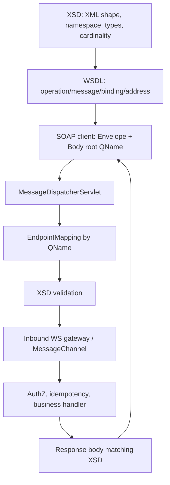
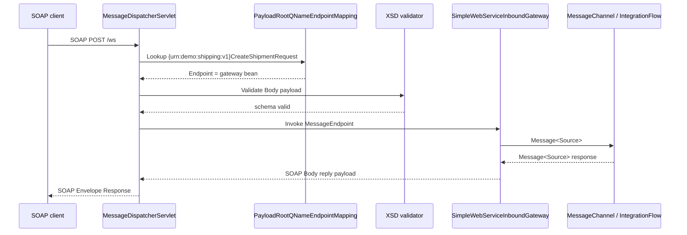
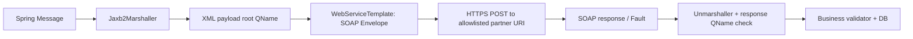
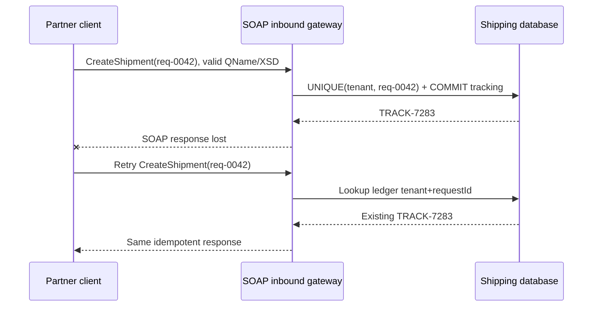

# XSD contract and payload root

## 1. Problem: syntactically valid SOAP body that violates the contract

A shipping enterprise exposes a SOAP 1.1 web service for partners to create shipments. Partners must send a `CreateShipmentRequest` containing `clientRequestId`, `orderId`, and `recipientCountry`; the system returns a `CreateShipmentResponse` with the outcome and tracking number upon success. Spring Boot receives requests via **Spring Web Services (Spring-WS)**, passes the content onto a **Spring Integration `MessageChannel`**, runs business logic, and returns a SOAP response.

During integration, the development team hits three puzzling errors:

1. The XML has a `CreateShipmentRequest` element and all required data, yet the server reports *No endpoint mapping found* because the root element's **namespace URI** is wrong.
2. The request routes into the gateway, but a required field is missing or elements are out of order. Without **XSD validation**, the object handler receives `null` fields or tries to process an off-contract request.
3. The partner releases `v2` with new elements and a new namespace. The v1 application inspects **local names** instead of **QNames**, misprocessing the new version and triggering wrong side effects.

**XSD contract and payload root** address these at two distinct layers: **Spring-WS selects the endpoint using the QName of the first element inside the SOAP Body**, while **XML Schema (XSD) validates the entire payload structure**. Both still require authentication, authorization, and idempotency controls before executing business operations.

Within the `SPRING_INTEGRATION_ADAPTERS` module, this lesson belongs to **Adapter Web Services**, focusing on connecting external systems using inbound/outbound adapters, gateways, pollers, and `MessageChannel`s. The same message contract, error, retry, and connection-lifecycle principles from files, SFTP, HTTP, JMS, AMQP, Kafka, and databases apply to SOAP: **right endpoint ≠ valid data ≠ committed business state**.

### Learning objectives

After this lesson, you will be able to:

1. Distinguish **SOAP Envelope**, **SOAP Body payload**, **payload root**, **XML QName**, **SOAPAction**, and **WS-Addressing Action**.
2. Design **contract-first XSD** with namespaces, global elements, complex types, sequences, required/optional, `nillable`, enums, and versioning.
3. Explain how Spring-WS `PayloadRootQNameEndpointMapping` or `@PayloadRoot` routes SOAP by root QName.
4. Configure `MessageDispatcherServlet` + `SimpleWebServiceInboundGateway` + `MessageChannel` + `IntegrationFlow` with explicit mappings.
5. Enable **Spring-WS `PayloadValidatingInterceptor`** for requests/responses; compare with `Jaxb2Marshaller.setSchema(...)`.
6. Invoke outbound SOAP using `Source` or JAXB objects, checking the **root QName** of both request and response.
7. Handle schema faults, missing replies, XML parser security, XSD/WSDL changes, and retries/idempotency.
8. Practice mapping tests with `MockWebServiceClient`, outbound tests with `MockWebServiceServer`, and build a negative-case matrix.

> **Reference environment:** Spring Integration **6.5.x**, Spring Web Services **4.0.x**, Spring Framework 6.x, and Java 17+, with a compatible Spring Boot BOM. `javax.xml.transform.Source` is **JAXP** and still uses the `javax` package; modern JAXB/SAAJ belong to `jakarta.xml.bind`/`jakarta.xml.soap`. Namespace `urn:demo:shipping:v1`, partners, ports, and tracking numbers in this lesson are simulated data; no live server is accessed.

## 2. Contract-first: XSD, WSDL, SOAP, and business rules are distinct



| Layer | Defines | Does not solve automatically |
| --- | --- | --- |
| **Well-formed XML** | Tag closing syntax, escaping, namespace declarations | Required fields, schema, access permissions |
| **XSD** | QNames, data types, ordering, cardinality, enums, `nil` | `SOAPAction`, URLs, tenant authorization |
| **WSDL** | Operations, input/output messages, SOAP 1.1/1.2 bindings, endpoints | Exactly-once remote commits, authentication implementation |
| **SOAP** | Envelope, Header, Body, Fault, version | Selecting business tenant or checking permissions |
| **EndpointMapping** | Server endpoint selection by QName/action/URI | Full XSD validation, XXE defense, token checks |
| **Spring Integration gateway** | Translates SOAP payload to Spring Message and awaits reply | Guaranteeing DB commit or single execution |
| **Business service** | Permissions, state, idempotency, commit | Replacing schema validation or parser hardening |

**Contract-first** means treating the XSD/WSDL contract as a versioned artifact agreed **before** writing processing logic, rather than letting Java DTOs implicitly dictate the SOAP shape. When modifying contracts, test generated clients, consumers, and migration plans—even if HTTP requests still return 200.

### Why is the payload root the starting point?

In the common **document/literal wrapped** style, the first element inside `SOAP Body` is the operation's request wrapper, such as `CreateShipmentRequest`. Spring-WS can route on that QName. However, **never assume every WSDL uses one root per operation**: document/literal bare, RPC, and legacy contracts may have different mapping rules requiring a different mapping strategy per the actual contract.

## 3. SOAP structure: payload root is **not** the Envelope root

SOAP 1.1 request example:

```xml
<?xml version="1.0" encoding="UTF-8"?>
<soap:Envelope xmlns:soap="http://schemas.xmlsoap.org/soap/envelope/"
               xmlns:ship="urn:demo:shipping:v1"
               xmlns:ctx="urn:demo:shipping:headers">
  <soap:Header>
    <ctx:RequestId>req-0042</ctx:RequestId>
  </soap:Header>
  <soap:Body>
    <ship:CreateShipmentRequest>
      <ship:clientRequestId>req-0042</ship:clientRequestId>
      <ship:orderId>O-9001</ship:orderId>
      <ship:recipientCountry>VN</ship:recipientCountry>
    </ship:CreateShipmentRequest>
  </soap:Body>
</soap:Envelope>
```

There are **three distinct QNames**:

- Envelope root: `{http://schemas.xmlsoap.org/soap/envelope/}Envelope`.
- Body container: `{http://schemas.xmlsoap.org/soap/envelope/}Body`.
- **Payload root:** `{urn:demo:shipping:v1}CreateShipmentRequest`.

`PayloadRootQNameEndpointMapping` inspects the **payload root** — the first element inside the Body — not the Envelope and not `ctx:RequestId` in the SOAP Header.

In the **default inbound `SimpleWebServiceInboundGateway`**, the message payload is typically a `javax.xml.transform.Source` holding **`<ship:CreateShipmentRequest>...`**, not the whole SOAP envelope. The handler returns a `Source` containing `<ship:CreateShipmentResponse>...`; Spring-WS wraps it in the response SOAP Body automatically. Setting `extractPayload(false)` lets the simple gateway pass the full `WebServiceMessage`, altering both payload contract and resource lifecycles.

### Prefix-independent QName identity

These two XML elements share the **same QName**:

```xml
<ship:CreateShipmentRequest xmlns:ship="urn:demo:shipping:v1"/>
<x:CreateShipmentRequest xmlns:x="urn:demo:shipping:v1"/>
```

Whereas these three examples have **different QNames**:

```xml
<CreateShipmentRequest/>
<x:CreateShipmentRequest xmlns:x="urn:demo:shipping:v2"/>
<CreateShipmentRequest xmlns="urn:other:shipping:v1"/>
```

When an element has neither a prefix nor a default namespace, its namespace URI is the **empty string**. When an element declares `xmlns="..."`, the default namespace applies to **unprefixed elements** (not unprefixed attributes). Therefore, comparing `getLocalName()` or `getNodeName().endsWith(...)` while ignoring namespaces can misroute v1/v2 or accept spoofed XML.

**QName** is commonly written as `{namespaceURI}localPart` when configuring `PayloadRootQNameEndpointMapping`. The XML prefix is not part of the routing key: it is merely a local alias for the namespace declaration.

## 4. Complete XSD for `CreateShipmentRequest` and `CreateShipmentResponse`

Save the XSD sample below as `src/main/resources/shipping-v1.xsd` **in a separate practice project** when running code; the STEP 4 worker only writes the assigned Markdown/YAML files and does not create files elsewhere in this repo.

```xml
<?xml version="1.0" encoding="UTF-8"?>
<xs:schema xmlns:xs="http://www.w3.org/2001/XMLSchema"
           xmlns:ship="urn:demo:shipping:v1"
           targetNamespace="urn:demo:shipping:v1"
           elementFormDefault="qualified">

  <xs:simpleType name="ClientRequestIdType">
    <xs:restriction base="xs:token">
      <xs:minLength value="1"/>
      <xs:maxLength value="100"/>
    </xs:restriction>
  </xs:simpleType>

  <xs:simpleType name="CountryCodeType">
    <xs:restriction base="xs:string">
      <xs:pattern value="[A-Z]{2}"/>
    </xs:restriction>
  </xs:simpleType>

  <xs:simpleType name="ShipmentStatusType">
    <xs:restriction base="xs:string">
      <xs:enumeration value="CREATED"/>
      <xs:enumeration value="REJECTED"/>
    </xs:restriction>
  </xs:simpleType>

  <xs:complexType name="CreateShipmentRequestType">
    <xs:sequence>
      <xs:element name="clientRequestId" type="ship:ClientRequestIdType"/>
      <xs:element name="orderId" type="xs:string"/>
      <xs:element name="recipientCountry" type="ship:CountryCodeType"/>
      <xs:element name="notes" type="xs:string" minOccurs="0"/>
    </xs:sequence>
  </xs:complexType>

  <xs:complexType name="CreateShipmentResponseType">
    <xs:sequence>
      <xs:element name="clientRequestId" type="ship:ClientRequestIdType"/>
      <xs:element name="status" type="ship:ShipmentStatusType"/>
      <xs:element name="trackingNumber" type="xs:string" minOccurs="0"/>
    </xs:sequence>
  </xs:complexType>

  <xs:element name="CreateShipmentRequest"
              type="ship:CreateShipmentRequestType"/>
  <xs:element name="CreateShipmentResponse"
              type="ship:CreateShipmentResponseType"/>
</xs:schema>
```

### Global element vs. complex type

These two lines serve **two different roles**:

```xml
<xs:complexType name="CreateShipmentRequestType"> ... </xs:complexType>
<xs:element name="CreateShipmentRequest" type="ship:CreateShipmentRequestType"/>
```

`CreateShipmentRequestType` is a **type declaration**; `CreateShipmentRequest` is a **global element declaration** providing the QName used in the SOAP Body. A root XML element can have type `CreateShipmentRequestType` without the **element name matching the type name**. Spring-WS `PayloadRootQNameEndpointMapping` routes by **element QName**, **not by Java class name, complex type name, or operation method name**.

With JAXB/XJC, types and elements may generate distinct classes plus `ObjectFactory`/`JAXBElement<T>`. When a class lacks `@XmlRootElement`, use the root element wrapper declared by the generated factory; never alter a DTO's namespace manually just to "help routing".

### Constraints in the sample XSD

| Constraint | Meaning | Invalid example |
| --- | --- | --- |
| `targetNamespace` | Namespace for global declarations | Payload root `urn:demo:shipping:v2` sent to v1 |
| `elementFormDefault="qualified"` | Local child elements belong to target namespace | `<clientRequestId xmlns="">...` |
| `xs:sequence` | Element order must match | `orderId` before `clientRequestId` |
| `minOccurs` default 1 | Element required once | Missing `recipientCountry` |
| `minOccurs="0"` | Element may be omitted | No error when `notes` is absent |
| `maxOccurs` default 1 | Cannot repeat arbitrarily | Two `orderId` elements |
| `xs:pattern` | Country code is two uppercase letters | `"vietnam"` |
| `xs:enumeration` | `CREATED` or `REJECTED` | `"ACCEPTED"` is not defined |
| `xs:token` + length | ID obeys whitespace normalization and length bounds | Empty ID or longer than 100 |
| `nillable` default false | `xsi:nil="true"` invalid unless allowed | `<notes xsi:nil="true"/>` in this XSD |

The sample XSD does **not** state "status `CREATED` requires `trackingNumber`", because `trackingNumber` is optional for both statuses. That conditional rule belongs in **business validation** or a tighter schema/contract. Likewise, `[A-Z]{2}` only validates an ISO-like code format, not whether the country exists or the partner ships there.

## 5. `elementFormDefault`, `xmlns`, and namespace traps

When an XSD sets `elementFormDefault="qualified"` as in section 4, child elements also belong to `urn:demo:shipping:v1`. Thus, a valid payload may be written as:

```xml
<CreateShipmentRequest xmlns="urn:demo:shipping:v1">
  <clientRequestId>req-0042</clientRequestId>
  <orderId>O-9001</orderId>
  <recipientCountry>VN</recipientCountry>
</CreateShipmentRequest>
```

Or with a prefix:

```xml
<ship:CreateShipmentRequest xmlns:ship="urn:demo:shipping:v1">
  <ship:clientRequestId>req-0042</ship:clientRequestId>
  <ship:orderId>O-9001</ship:orderId>
  <ship:recipientCountry>VN</ship:recipientCountry>
</ship:CreateShipmentRequest>
```

Both are valid because each element's **expanded name** is `{urn:demo:shipping:v1}localName`. The following payload is **schema-invalid** even though the root QName is right:

```xml
<ship:CreateShipmentRequest xmlns:ship="urn:demo:shipping:v1">
  <clientRequestId>req-0042</clientRequestId>
  <orderId>O-9001</orderId>
  <recipientCountry>VN</recipientCountry>
</ship:CreateShipmentRequest>
```

Here, the child elements have no prefix and **no default namespace** in scope: they belong to the empty namespace. `PayloadRootQNameEndpointMapping` **still routes** this request because the root QName matches, yet XSD validation must reject it. This directly illustrates: **routable does not mean contract-valid**.

### Common traps

- Declaring `xmlns:ship="urn:demo:shipping:v1"` but writing `<CreateShipmentRequest>` without a prefix and without a default `xmlns`.
- Writing child field names that look right to humans but sit in the wrong namespace, e.g., `<recipientCountry xmlns="">`.
- Changing prefix `ship` to `v1` thinking it changes the schema version; **the namespace URI is the identity**.
- Using `String.endsWith("CreateShipmentRequest")` to match QNames, ignoring namespaces and document shape.
- Assuming `xsi:type` drives endpoint mapping. Mapping normally uses the **element QName**; `xsi:type` affects the runtime schema/JAXB type.
- Trusting `schemaLocation` inside a request to load the XSD. The server must use a **pinned, trusted local XSD**.

### `xsi:nil`, absent, and empty elements differ

```xml
<!-- Element omitted: valid when minOccurs=0. -->
<!-- <ship:notes> absent from request -->

<!-- Element present with empty string (subject to XSD facets). -->
<ship:notes xmlns:ship="urn:demo:shipping:v1"></ship:notes>

<!-- Nil value: valid only when nillable=true. -->
<ship:notes xmlns:ship="urn:demo:shipping:v1"
            xmlns:xsi="http://www.w3.org/2001/XMLSchema-instance"
            xsi:nil="true"/>
```

In the sample XSD, `notes` has `minOccurs=0` without `nillable=true`: omitting it is valid, whereas explicit `xsi:nil` above is **invalid**. During JAXB unmarshalling, both absent and nil may map to Java `null` unless the binding preserves metadata; if business logic distinguishes them, design types/`JAXBElement`/validation per contract.

## 6. WSDL 1.1: from XSD global elements to SOAP operations

**XSD alone does not specify endpoint URLs or `SOAPAction`.** WSDL 1.1 describes messages, `portType`, `binding`, `service`, and `port`. A document/literal WSDL references global elements `CreateShipmentRequest` and `CreateShipmentResponse`.

WSDL excerpt **illustrating structure, not a complete WSDL**:

```xml
<wsdl:definitions
    xmlns:wsdl="http://schemas.xmlsoap.org/wsdl/"
    xmlns:soap="http://schemas.xmlsoap.org/wsdl/soap/"
    xmlns:ship="urn:demo:shipping:v1"
    targetNamespace="urn:demo:shipping:v1">

  <!-- types: imports the managed shipping-v1.xsd -->
  <wsdl:message name="CreateShipmentInput">
    <wsdl:part name="parameters" element="ship:CreateShipmentRequest"/>
  </wsdl:message>
  <wsdl:message name="CreateShipmentOutput">
    <wsdl:part name="parameters" element="ship:CreateShipmentResponse"/>
  </wsdl:message>

  <wsdl:portType name="ShippingPort">
    <wsdl:operation name="CreateShipment">
      <wsdl:input message="ship:CreateShipmentInput"/>
      <wsdl:output message="ship:CreateShipmentOutput"/>
    </wsdl:operation>
  </wsdl:portType>

  <wsdl:binding name="ShippingSoapBinding" type="ship:ShippingPort">
    <soap:binding style="document"
                  transport="http://schemas.xmlsoap.org/soap/http"/>
    <wsdl:operation name="CreateShipment">
      <soap:operation
          soapAction="urn:demo:shipping:v1/CreateShipment"/>
      <wsdl:input><soap:body use="literal"/></wsdl:input>
      <wsdl:output><soap:body use="literal"/></wsdl:output>
    </wsdl:operation>
  </wsdl:binding>
</wsdl:definitions>
```

This sketch intentionally omits `wsdl:types`/`wsdl:service` to highlight the link: the **global XSD element** is referenced by the WSDL message, and the binding declares **`SOAPAction`**. For real publishing, provide a complete WSDL with schema imports and service port/endpoint, or use controlled WSDL generation.

### `DefaultWsdl11Definition` vs. static WSDL

Spring-WS provides `DefaultWsdl11Definition` to generate WSDL 1.1 from an XSD using request/response suffix conventions:

```java
import org.springframework.context.annotation.Bean;
import org.springframework.context.annotation.Configuration;
import org.springframework.core.io.ClassPathResource;
import org.springframework.ws.wsdl.wsdl11.DefaultWsdl11Definition;
import org.springframework.xml.xsd.SimpleXsdSchema;
import org.springframework.xml.xsd.XsdSchema;

@Configuration
public class ShippingContractDefinition {

    @Bean
    public XsdSchema shippingSchema() {
        return new SimpleXsdSchema(
                new ClassPathResource("shipping-v1.xsd"));
    }

    @Bean(name = "shipping")
    public DefaultWsdl11Definition shippingWsdl(XsdSchema shippingSchema) {
        DefaultWsdl11Definition wsdl = new DefaultWsdl11Definition();
        wsdl.setPortTypeName("ShippingPort");
        wsdl.setTargetNamespace("urn:demo:shipping:v1");
        wsdl.setLocationUri("/ws");
        wsdl.setSchema(shippingSchema);
        return wsdl;
    }
}
```

When `MessageDispatcherServlet` is configured to expose WSDLs, the URL typically takes the form `/ws/shipping.wsdl`; **verify the actual Boot servlet mapping/ingress**. Never assume convention-generated WSDL captures every `SOAPAction`, fault binding, policy, or extension a partner requires. For complex contracts, serve a **tested, approved static WSDL** to preserve compatibility.

Behind a reverse proxy, `MessageDispatcherServlet.setTransformWsdlLocations(true)` helps the WSDL's public address reflect the external host/scheme; trust `Forwarded`/`X-Forwarded-*` headers only from configured trusted proxies, never automatically accepting forged headers from Internet clients.

### WSDL operation name is not the payload root QName

`CreateShipment` is the operation name. `CreateShipmentRequest` is the input message's **element QName**. `ShippingPort` is the `portType` name. All three are distinct identifiers. In wrapped contracts, root names often carry a `Request` suffix, but that is a convention; never infer operation names from localName substrings when the WSDL defines exact QNames.

## 7. Spring-WS routing by payload-root QName

Spring Web Services offers several endpoint mapping types:

| Mechanism | Lookup key | When to use | Risks to manage |
| --- | --- | --- | --- |
| `PayloadRootQNameEndpointMapping` | **Root element QName in SOAP Body** | Contract-first document/literal SOAP | Does not deeply validate XSD contents |
| `PayloadRootAnnotationMethodEndpointMapping` | Method `@PayloadRoot(namespace, localPart)` | Annotated-method `@Endpoint` classes | Method mapping differs from gateway beans |
| `SoapActionEndpointMapping` | `SOAPAction` per SOAP binding | Partner requires action-based dispatch | Action can be spoofed by client; must validate Body |
| `UriEndpointMapping` | Endpoint URI/path | Legacy contracts routing by URI | Does not replace QName/XSD validation |
| `XPathPayloadEndpointMapping` | XPath evaluation on payload | Legacy contracts sharing one root for multiple cases | Guard XPath complexity and namespaces |

For a **Spring Integration inbound gateway** (e.g., `SimpleWebServiceInboundGateway`), Spring-WS invokes an object implementing `MessageEndpoint`. You need **`PayloadRootQNameEndpointMapping` pointing to the gateway bean**, not merely `@PayloadRoot` on an arbitrary method.



**Ordering matters:** the servlet and mapping pick the endpoint, then interceptors run in the endpoint invocation chain before the business handler executes. Attach the validation interceptor to the right mapping/context so it **actually runs**; declaring a standalone validator bean without registering it on the endpoint mapping does not validate XML automatically.

### Mapping keys use Clark notation

```text
{urn:demo:shipping:v1}CreateShipmentRequest
```

Never use `ship:CreateShipmentRequest` as the key: prefix `ship` is not an expanded QName. Never use an un-namespaced `CreateShipmentRequest` when the contract defines a namespace. XSD `type="ship:CreateShipmentRequestType"` is **not** a mapping key.

## 8. Java config: servlet + channel + inbound gateway + QName mapping

This example uses an **explicit gateway bean** to make the wiring clear. Keep this only if Spring Boot has not already registered another servlet/mapping on `/ws/*`.

```groovy
dependencies {
    implementation 'org.springframework.boot:spring-boot-starter-integration'
    implementation 'org.springframework.integration:spring-integration-ws'
    implementation 'org.springframework.boot:spring-boot-starter-web-services'
    testImplementation 'org.springframework.boot:spring-boot-starter-test'
    testImplementation 'org.springframework.ws:spring-ws-test'
}
```

```java
import java.util.Map;

import org.springframework.beans.factory.annotation.Qualifier;
import org.springframework.boot.web.servlet.ServletRegistrationBean;
import org.springframework.context.ApplicationContext;
import org.springframework.context.annotation.Bean;
import org.springframework.context.annotation.Configuration;
import org.springframework.integration.channel.DirectChannel;
import org.springframework.integration.ws.SimpleWebServiceInboundGateway;
import org.springframework.messaging.MessageChannel;
import org.springframework.ws.server.endpoint.mapping.PayloadRootQNameEndpointMapping;
import org.springframework.ws.transport.http.MessageDispatcherServlet;

@Configuration
public class ShippingSoapInboundConfig {

    public static final String NS = "urn:demo:shipping:v1";
    public static final String ROOT_KEY =
            "{" + NS + "}CreateShipmentRequest";

    @Bean
    public ServletRegistrationBean<MessageDispatcherServlet> shippingServlet(
            ApplicationContext context) {
        MessageDispatcherServlet servlet = new MessageDispatcherServlet();
        servlet.setApplicationContext(context);
        servlet.setTransformWsdlLocations(true);
        return new ServletRegistrationBean<>(servlet, "/ws/*");
    }

    @Bean
    public MessageChannel shipmentSoapRequests() {
        return new DirectChannel();
    }

    @Bean
    public SimpleWebServiceInboundGateway shippingSoapGateway(
            @Qualifier("shipmentSoapRequests") MessageChannel requests) {
        SimpleWebServiceInboundGateway gateway =
                new SimpleWebServiceInboundGateway();
        gateway.setRequestChannel(requests);
        gateway.setRequestTimeout(5_000L);
        gateway.setReplyTimeout(10_000L);
        return gateway;
    }

    @Bean
    public PayloadRootQNameEndpointMapping shippingPayloadRootMapping(
            SimpleWebServiceInboundGateway shippingSoapGateway) {
        PayloadRootQNameEndpointMapping mapping =
                new PayloadRootQNameEndpointMapping();
        mapping.setEndpointMap(Map.of(ROOT_KEY, shippingSoapGateway));
        return mapping;
    }
}
```

Here:

- HTTP POST to `/ws` is received by `MessageDispatcherServlet`; **a `@Bean gateway` alone does not open an HTTP endpoint**.
- `PayloadRootQNameEndpointMapping` uses the exact `ROOT_KEY` and resolves to `SimpleWebServiceInboundGateway`.
- The gateway sends the body `Source` to `shipmentSoapRequests`; `DirectChannel` dispatches synchronously, fitting request–reply demonstration.
- `requestTimeout`/`replyTimeout` apply at the messaging boundary and **do not** equal a business deadline or DB transaction timeout.
- The Spring Boot starter may auto-configure its own servlet: **do not enable two registrations on overlapping paths**. When using Boot auto-config, omit the manual `shippingServlet` bean, keep the endpoint mapping/gateway, and verify the actual route.

### IntegrationFlow returning XML with the right QName

```java
import javax.xml.transform.Source;

import org.springframework.beans.factory.annotation.Qualifier;
import org.springframework.context.annotation.Bean;
import org.springframework.context.annotation.Configuration;
import org.springframework.integration.dsl.IntegrationFlow;
import org.springframework.messaging.MessageChannel;
import org.springframework.xml.transform.StringSource;

@Configuration
public class ShippingSoapFlow {

    @Bean
    public IntegrationFlow shippingSoapRequestReply(
            @Qualifier("shipmentSoapRequests") MessageChannel channel) {
        return IntegrationFlow.from(channel)
                .handle(Source.class, (source, headers) -> {
                    // DEMO: does not read orderId or create a real shipment.
                    // Production must validate XML + authn/authz + idempotency.
                    String responseBody = """
                        <ship:CreateShipmentResponse
                            xmlns:ship="urn:demo:shipping:v1">
                          <ship:clientRequestId>req-0042</ship:clientRequestId>
                          <ship:status>CREATED</ship:status>
                          <ship:trackingNumber>TRACK-DEMO-001</ship:trackingNumber>
                        </ship:CreateShipmentResponse>
                        """;
                    return new StringSource(responseBody);
                })
                .get();
    }
}
```

The handler returns a `Source`, so the gateway gets a Spring reply and Spring-WS wraps it in a SOAP Envelope. If the handler returns a full `<soap:Envelope>` instead of `CreateShipmentResponse`, the body breaks the contract. The static response here only tests wiring — **never use it in production**; real logic must parse the request, verify tenant/order, write idempotently to the DB, and return results tied to real IDs.

## 9. XSD validation via server-side `PayloadValidatingInterceptor`

**Routing by root QName does not fully validate the request.** `PayloadRootQNameEndpointMapping` still matches the gateway even when `clientRequestId` is missing or `recipientCountry=Vietnam` violates `xs:pattern`. To block invalid requests before the business handler runs, Spring-WS provides:

`org.springframework.ws.soap.server.endpoint.interceptor.PayloadValidatingInterceptor`.

```java
import java.util.Map;

import org.springframework.context.annotation.Bean;
import org.springframework.context.annotation.Configuration;
import org.springframework.core.io.ClassPathResource;
import org.springframework.ws.server.EndpointInterceptor;
import org.springframework.ws.server.endpoint.mapping.PayloadRootQNameEndpointMapping;
import org.springframework.ws.soap.server.endpoint.interceptor.PayloadValidatingInterceptor;

@Configuration
public class ShippingSoapSchemaValidation {

    @Bean
    public PayloadValidatingInterceptor shippingPayloadValidator() {
        PayloadValidatingInterceptor validator =
                new PayloadValidatingInterceptor();
        validator.setSchema(
                new ClassPathResource("shipping-v1.xsd"));
        validator.setValidateRequest(true);
        validator.setValidateResponse(true);
        return validator;
    }

    // When integrating into ShippingSoapInboundConfig, REPLACE the
    // shippingPayloadRootMapping method with this one; do not declare
    // a second mapping accepting the same ROOT_KEY.
    @Bean
    public PayloadRootQNameEndpointMapping shippingMappingWithValidation(
            SimpleWebServiceInboundGateway shippingSoapGateway,
            PayloadValidatingInterceptor shippingPayloadValidator) {
        PayloadRootQNameEndpointMapping mapping =
                new PayloadRootQNameEndpointMapping();
        mapping.setEndpointMap(Map.of(
                ShippingSoapInboundConfig.ROOT_KEY, shippingSoapGateway));
        mapping.setInterceptors(
                new EndpointInterceptor[]{shippingPayloadValidator});
        return mapping;
    }
}
```

**Correct wiring:** keep **one** active mapping bean for the `CreateShipmentRequest` QName. In your practice project, modify the mapping method in section 8 to inject the interceptor and call `setInterceptors(...)`, or use the replacement method above and remove the old mapping. Never leave both mappings matching the same QName without explicit ordering and dispatch tests.

When `PayloadValidatingInterceptor` is a Spring bean, the container manages `InitializingBean`/schema initialization. `shipping-v1.xsd` must exist on the classpath. Spring-WS generates a **SOAP Fault** when requests fail schema validation, typically with client/sender semantics per SOAP version; test fault codes/details against your policy and avoid leaking inputs or stack traces.

### Request validation and response validation

| Configuration | Validation performed | Effect |
| --- | --- | --- |
| `setValidateRequest(true)` | Validates incoming payload before handler | Stops missing required fields/wrong order/bad enums from entering business logic |
| `setValidateResponse(true)` | Validates outgoing payload before sending to client | Catches off-contract replies before emitting invalid XML |
| `setSchema(...)` | Pins trusted XSD for validation | Never fetches XSDs from client-supplied URLs |
| `setSchemas(...)` | Uses multiple schema resources when needed | Controls imports/includes and versions |

**Schema validation does not replace business validation:** a client may send `recipientCountry=VN` matching the pattern while lacking permission to ship that order ID; or `status=CREATED` with an empty `trackingNumber` still passes the sample XSD. Enforce those rules in the service and/or tighten the contract.

**Defense order:** request size/TLS/auth may need to reject at ingress before the XML parser spends CPU; place WS-Security interceptors and XSD validators properly in the security/mapping chain. Never assume "an interceptor runs before business" means "the interceptor handles every parser/transport risk automatically".

## 10. `@Endpoint + @PayloadRoot`: annotation mechanism vs. gateway mapping

Spring Web Services supports writing pure Spring-WS **SOAP endpoint methods** using `@Endpoint` and `@PayloadRoot`. Here, `PayloadRootAnnotationMethodEndpointMapping` resolves annotated methods, rather than `PayloadRootQNameEndpointMapping` resolving a `MessageEndpoint` bean:

```java
import javax.xml.transform.Source;

import org.springframework.ws.server.endpoint.annotation.Endpoint;
import org.springframework.ws.server.endpoint.annotation.PayloadRoot;
import org.springframework.ws.server.endpoint.annotation.RequestPayload;
import org.springframework.ws.server.endpoint.annotation.ResponsePayload;
import org.springframework.xml.transform.StringSource;

@Endpoint
public class ShippingAnnotationEndpoint {

    private static final String NS = "urn:demo:shipping:v1";

    @PayloadRoot(namespace = NS, localPart = "CreateShipmentRequest")
    @ResponsePayload
    public Source createShipment(@RequestPayload Source request) {
        // DEMO: Does not invoke real business logic.
        return new StringSource("""
            <ship:CreateShipmentResponse
                xmlns:ship="urn:demo:shipping:v1">
              <ship:clientRequestId>req-0042</ship:clientRequestId>
              <ship:status>CREATED</ship:status>
              <ship:trackingNumber>TRACK-DEMO-001</ship:trackingNumber>
            </ship:CreateShipmentResponse>
            """);
    }
}
```

With `@EnableWs`/Spring-WS configuration, `PayloadRootAnnotationMethodEndpointMapping` auto-discovers annotated endpoint methods; verify component scanning and servlet config. This snippet is an **alternative** to the integration inbound gateway—never enable both it and a gateway mapping for the same QName without a defined dispatch policy.

### What if you want `@Endpoint` while still using IntegrationFlow?

You can write an `@Endpoint` that calls a `MessagingTemplate`/service to send a Spring Message into the flow and receive a reply, manually handling XML/header mapping, timeouts, error contracts, and transactions. This helps when Spring-WS annotated methods are already standardized in a project, whereas Spring Integration's **`Ws.simpleInboundGateway()`** is usually cleaner for "SOAP → MessageChannel → reply" and handles the SOAP gateway boundary directly.

### DSL inbound gateway: QName mapping is still required

```java
import org.springframework.context.annotation.Bean;
import org.springframework.integration.dsl.IntegrationFlow;
import org.springframework.integration.ws.dsl.Ws;

@Bean
public IntegrationFlow shippingInboundDsl(ShippingBusinessMessageHandler handler) {
    return IntegrationFlow.from(
                    Ws.simpleInboundGateway()
                            .id("shippingInboundDslGateway"))
            .handle(handler)
            .get();
}
```

`ShippingBusinessMessageHandler` is an application-written handler. This is an **alternative** to the gateway/flow beans in section 8. The DSL assigns endpoint ID `shippingInboundDslGateway`; Spring-WS **still requires** an `EndpointMapping` pointing to the **matching bean ID**:

```java
@Bean
public PayloadRootQNameEndpointMapping dslPayloadRootMapping() {
    PayloadRootQNameEndpointMapping mapping =
            new PayloadRootQNameEndpointMapping();
    mapping.setEndpointMap(Map.of(
            "{urn:demo:shipping:v1}CreateShipmentRequest",
            "shippingInboundDslGateway"));
    return mapping;
}
```

This fragment assumes `Map` and `PayloadRootQNameEndpointMapping` imports as in section 8; verify the DSL-registered gateway bean ID matches the mapping key's target. Never enable **two gateways** for one QName without explicit mapping order/priority.

## 11. JAXB `@XmlRootElement` and `JAXBElement<T>` must match XSD element QNames

With **`MarshallingWebServiceInboundGateway`**, the inbound SOAP Body is **unmarshalled** into a Java object, and the reply object is **marshalled** into XML response. A Java class does not establish the SOAP payload root by class name alone; JAXB root metadata must match the **global element declaration** in the XSD.

### Minimal Java JAXB model

```java
// src/main/java/com/example/shipping/xml/CreateShipmentRequest.java
package com.example.shipping.xml;

import jakarta.xml.bind.annotation.XmlAccessType;
import jakarta.xml.bind.annotation.XmlAccessorType;
import jakarta.xml.bind.annotation.XmlElement;
import jakarta.xml.bind.annotation.XmlRootElement;
import jakarta.xml.bind.annotation.XmlType;

@XmlRootElement(
        name = "CreateShipmentRequest",
        namespace = "urn:demo:shipping:v1")
@XmlAccessorType(XmlAccessType.FIELD)
@XmlType(propOrder = {
        "clientRequestId", "orderId", "recipientCountry", "notes"
})
public class CreateShipmentRequest {
    @XmlElement(required = true)
    private String clientRequestId;

    @XmlElement(required = true)
    private String orderId;

    @XmlElement(required = true)
    private String recipientCountry;

    @XmlElement
    private String notes;

    public CreateShipmentRequest() { }

    public CreateShipmentRequest(
            String clientRequestId, String orderId, String country) {
        this.clientRequestId = clientRequestId;
        this.orderId = orderId;
        this.recipientCountry = country;
    }

    public String getClientRequestId() { return clientRequestId; }
    public String getOrderId() { return orderId; }
    public String getRecipientCountry() { return recipientCountry; }
}
```

With `elementFormDefault="qualified"`, declare the local elements' namespace in `package-info.java` within the same package:

```java
@jakarta.xml.bind.annotation.XmlSchema(
    namespace = "urn:demo:shipping:v1",
    elementFormDefault =
        jakarta.xml.bind.annotation.XmlNsForm.QUALIFIED)
package com.example.shipping.xml;
```

**Do not omit `@XmlSchema` hoping `@XmlRootElement(namespace=...)` automatically namespaces all child elements.** Root and local child elements follow different rules. `@XmlType.propOrder` mirrors `xs:sequence`, yet **annotations do not replace XSD validation**. When generating classes from XSD, package-level metadata is usually generated; do not duplicate it manually if `package-info.java` already exists.

### When JAXB generates `JAXBElement<T>` instead of a root class

Some bindings generate `CreateShipmentRequestType` (class) + `ObjectFactory` with `@XmlElementDecl(namespace="...", name="CreateShipmentRequest")`. In that case:

```java
import javax.xml.namespace.QName;

import jakarta.xml.bind.JAXBElement;

// Fragment: assumes a generated CreateShipmentRequestType object exists.
QName root = new QName(
        "urn:demo:shipping:v1", "CreateShipmentRequest");
JAXBElement<CreateShipmentRequestType> wrapped =
        new JAXBElement<>(
                root, CreateShipmentRequestType.class, null, requestObject);
```

In real projects, call the **generated `ObjectFactory.createCreateShipmentRequest(...)`** rather than hand-building wrappers per the sample. `Unmarshaller.unmarshal(Source)` may return `JAXBElement<T>` — verify **`getName()`** and **`getValue()`** instead of casting blindly. If a partner changes QNames from v1 to v2 while keeping the same Java value type, the wrapper QName guard prevents treating a v2 response as v1.

## 12. `Jaxb2Marshaller` and schema validation for SOAP payloads

Spring Framework OXM provides `org.springframework.oxm.jaxb.Jaxb2Marshaller`, implementing both `Marshaller` and `Unmarshaller`. With the sample classes above and a matching `CreateShipmentResponse`:

```java
import com.example.shipping.xml.CreateShipmentRequest;
import com.example.shipping.xml.CreateShipmentResponse;

import org.springframework.context.annotation.Bean;
import org.springframework.context.annotation.Configuration;
import org.springframework.core.io.ClassPathResource;
import org.springframework.oxm.jaxb.Jaxb2Marshaller;

@Configuration
public class ShippingJaxbMappingConfig {

    @Bean
    public Jaxb2Marshaller shippingMarshaller() {
        Jaxb2Marshaller marshaller = new Jaxb2Marshaller();
        marshaller.setClassesToBeBound(
                CreateShipmentRequest.class,
                CreateShipmentResponse.class);
        marshaller.setSchema(new ClassPathResource("shipping-v1.xsd"));
        marshaller.setSupportDtd(false);
        marshaller.setProcessExternalEntities(false);
        marshaller.setMtomEnabled(false);
        return marshaller;
    }
}
```

`CreateShipmentResponse` in this snippet is the JAXB class **generated from XSD matching root QName** `{urn:demo:shipping:v1}CreateShipmentResponse`, or an equivalent class with `@XmlRootElement`, no-arg constructor, and fields matching `CreateShipmentResponseType`. No actual Java files are created while authoring this Markdown lesson.

| API | What it does | Notes |
| --- | --- | --- |
| `setClassesToBeBound(...)` | Registers an explicit set of JAXB classes | Types/roots must be consistent |
| `setContextPath("...")` | `JAXBContext` from generated package | Package needs JAXB metadata/`ObjectFactory` |
| `setPackagesToScan("...")` | Scans JAXB-annotated classes | Narrow scope to avoid binding off-contract types |
| `setSchema(...)` | Validates XML against XSD | Does not replace authz, parser quotas, or business rules |
| `setSupportDtd(false)` | Disallows DTDs | Default false; configure explicitly |
| `setProcessExternalEntities(false)` | Disables external entities for Spring OXM-managed `Source` types | Cannot rescue pre-parsed unsafe DOM/StAX |
| `setMtomEnabled(true)` | Enables MTOM when schema/bindings support it | Does not automatically turn every file into an attachment |

`Jaxb2Marshaller` is a reusable bean managing `JAXBContext`; **never** share mutable `jakarta.xml.bind.Marshaller` or `Unmarshaller` instances across threads. A successfully constructed JAXB object **does not prove** valid permissions or business outcome; verify root QName and XSD, then reconcile `clientRequestId`/status.

### Round-trip testing root QName without HTTP

```java
import com.example.shipping.xml.CreateShipmentRequest;

import org.springframework.oxm.jaxb.Jaxb2Marshaller;
import org.springframework.xml.transform.StringResult;
import org.springframework.xml.transform.StringSource;

public static Object roundTrip(Jaxb2Marshaller marshaller) throws Exception {
    CreateShipmentRequest request =
            new CreateShipmentRequest("req-0042", "O-9001", "VN");
    StringResult out = new StringResult();
    marshaller.marshal(request, out);
    return marshaller.unmarshal(new StringSource(out.toString()));
}
```

This is a method fragment; in JUnit, assert the **root QName** with a namespace-aware XML parser/matcher, field ordering, child namespaces, and round-tripped fields. Never use `xmlString.contains("<ship:CreateShipmentRequest>")` because JAXB may emit another prefix (e.g., `ns2`) with the exact same QName.

## 13. Marshalling inbound gateway and payload-root mapping

If the handler prefers Java objects instead of `Source`, replace the `SimpleWebServiceInboundGateway` bean from section 8 with `MarshallingWebServiceInboundGateway`:

```java
import org.springframework.beans.factory.annotation.Qualifier;
import org.springframework.context.annotation.Bean;
import org.springframework.integration.ws.MarshallingWebServiceInboundGateway;
import org.springframework.messaging.MessageChannel;
import org.springframework.oxm.jaxb.Jaxb2Marshaller;

@Bean
public MarshallingWebServiceInboundGateway shippingObjectInboundGateway(
        @Qualifier("shipmentSoapRequests") MessageChannel requests,
        Jaxb2Marshaller shippingMarshaller) {

    MarshallingWebServiceInboundGateway gateway =
            new MarshallingWebServiceInboundGateway(shippingMarshaller);
    gateway.setRequestChannel(requests);
    gateway.setReplyTimeout(10_000L);
    return gateway;
}
```

Point `PayloadRootQNameEndpointMapping` to the `shippingObjectInboundGateway` bean, keeping the `{urn:demo:shipping:v1}CreateShipmentRequest` key. The `IntegrationFlow` side must accept **`CreateShipmentRequest` or `JAXBElement`** (depending on binding) and return a response object matching JAXB/XSD. **Do not let both Simple and Marshalling gateways subscribe to the same request channel and serve the same QName**; maintain one clear flow contract.

In Spring Integration 6.5, the DSL offers:

```java
// Alternative to an explicit gateway bean:
return IntegrationFlow.from(
                Ws.marshallingInboundGateway()
                        .marshaller(shippingMarshaller)
                        .unmarshaller(shippingMarshaller)
                        .id("shippingObjectInboundDsl"))
        .handle(shippingBusinessObjectHandler)
        .get();
```

`shippingBusinessObjectHandler` is an application handler. You still need the Spring-WS servlet and an `EndpointMapping` referencing that gateway bean ID. **Marshalling/unmarshalling does not automatically enforce XML Schema without `Jaxb2Marshaller.setSchema`** (or a server validator), nor does it configure WSDL operations/endpoint URLs.

### Two complementary validation forms—not interchangeable

| Spring-WS `PayloadValidatingInterceptor` | Spring OXM `Jaxb2Marshaller.setSchema` |
| --- | --- |
| Runs in the Spring-WS endpoint interceptor chain | Runs during JAXB marshalling/unmarshalling |
| Can validate **simple `Source`** and responses without JAXB | Validates XML against schema during object/XML mapping |
| On invalid requests, can emit a SOAP Fault before calling the handler | May throw `ValidationFailureException`/OXM exception |
| Attached to endpoint mapping; requires proper lifecycle init | Configured on marshaller bean; used in inbound/outbound marshalling |
| Does not solve authentication, authorization, or full-stack XXE | Also does not replace quotas, parser hardening, or business rules |

Avoid blindly enabling both in performance-sensitive paths to prevent duplicate validation. Pick a boundary policy focused on checking **requests before side effects** and responses before sending/committing; measure both effectiveness and overhead if combining them.

## 14. Outbound gateway: payload root must also be valid when calling partners

On outbound, Spring Integration `Ws.simpleOutboundGateway(...)` takes a `Source`/`String` body payload; `Ws.marshallingOutboundGateway(...)` takes a JAXB object and marshals it to XML. Neither **uses the payload root to pick an endpoint URI**: the URI comes from configuration or `DestinationProvider`/URI templates, while the remote SOAP service checks the QName/WSDL.



Java DSL object marshalling example:

```java
import java.time.Duration;

import org.springframework.beans.factory.annotation.Value;
import org.springframework.context.annotation.Bean;
import org.springframework.context.annotation.Configuration;
import org.springframework.integration.dsl.IntegrationFlow;
import org.springframework.integration.ws.dsl.Ws;
import org.springframework.oxm.jaxb.Jaxb2Marshaller;
import org.springframework.ws.transport.http.HttpUrlConnectionMessageSender;

@Configuration
public class ShippingOutboundJaxbFlow {

    @Bean
    public IntegrationFlow shippingOutboundObjects(
            Jaxb2Marshaller shippingMarshaller,
            @Value("${app.shipping.partner-endpoint}") String uri) {
        HttpUrlConnectionMessageSender sender =
                new HttpUrlConnectionMessageSender();
        sender.setConnectionTimeout(Duration.ofSeconds(5));
        sender.setReadTimeout(Duration.ofSeconds(20));

        return IntegrationFlow.from("outboundShipmentObjects")
                .handle(Ws.marshallingOutboundGateway()
                        .uri(uri)
                        .marshaller(shippingMarshaller)
                        .unmarshaller(shippingMarshaller)
                        .messageSenders(sender))
                .get();
    }
}
```

`app.shipping.partner-endpoint` must be an allowlisted endpoint protected by appropriate HTTPS/mTLS/auth. SOAP calls have no 2PC transaction with the DB; on a timeout, **remote side effects may already have occurred**, so never blindly retry create operations.

If downstream code receives a `JAXBElement<?>` reply, compare wrapper `getName()` against `{urn:demo:shipping:v1}CreateShipmentResponse` before reading `getValue()`. Even when receiving a POJO with `@XmlRootElement`, still enforce schema validation and verify the business ID. **Never mark success merely because the unmarshaller did not throw an exception.**

## 15. `SOAPAction` and WS-Addressing Action do not replace payload root

With SOAP 1.1, a client may send:

```http
POST /ws HTTP/1.1
Host: api.example.test
Content-Type: text/xml; charset=utf-8
SOAPAction: "urn:demo:shipping:v1/CreateShipment"

<?xml version="1.0" encoding="UTF-8"?>
<soap:Envelope xmlns:soap="http://schemas.xmlsoap.org/soap/envelope/"
               xmlns:ship="urn:demo:shipping:v1">
  <soap:Body>
    <ship:CreateShipmentRequest>
      <ship:clientRequestId>req-0042</ship:clientRequestId>
      <ship:orderId>O-9001</ship:orderId>
      <ship:recipientCountry>VN</ship:recipientCountry>
    </ship:CreateShipmentRequest>
  </soap:Body>
</soap:Envelope>
```

Here:

- **`SOAPAction`**: binding action on HTTP/SOAP; in SOAP 1.1 usually in the HTTP header.
- **Payload QName**: `{urn:demo:shipping:v1}CreateShipmentRequest` read from the SOAP Body.
- **`wsa:Action`**: when using WS-Addressing, a separate SOAP Header, not identical to `SOAPAction`.

These values should align per WSDL, and the server must enforce consistency per **contract**. A client could deliberately send `SOAPAction: ".../CancelShipment"` with a `CreateShipmentRequest` Body, so never use `SOAPAction` in place of schema validation or business authorization.

| Routing | Determines endpoint | Mandatory additional checks |
| --- | --- | --- |
| `PayloadRootQNameEndpointMapping` | Body root QName | XSD + `SOAPAction` if WSDL policy requires |
| `SoapActionEndpointMapping` | `SOAPAction` | Body QName + XSD; never trust action as authorization |
| WS-Addressing-aware mapping | `wsa:Action`/`To` where supported | Validate addressing/version, Body QName, WS-Security |

SOAP 1.2 uses Envelope namespace `http://www.w3.org/2003/05/soap-envelope` and typically `application/soap+xml` with an `action` parameter instead of SOAP 1.1's HTTP `SOAPAction`. **Changing HTTP headers does not alter the XSD payload root**, nor does it convert SOAP 1.1 into 1.2.

## 16. Faults and errors: mapping failure vs. schema validation failure

Classify SOAP errors by **stage**, because retry policies and fault responses differ:

| Scenario | Stage | Typical symptom | Safe behavior |
| --- | --- | --- | --- |
| Malformed XML / wrong Envelope version | SOAP parser/message factory | Parsing/`VersionMismatch` error | Reject; never enter business logic |
| Body lacks expected root | `EndpointMapping` | No endpoint found / dispatch error | Never invoke a default operation |
| Valid root but missing required field | XSD interceptor | Validation failure; possibly Client/Sender SOAP Fault | Never enter business logic |
| Valid root but child has empty namespace | XSD interceptor | Wrong element/namespace | Never ignore namespaces |
| `status=APPROVED` outside enum | Response validation/JAXB | Schema/unmarshal error | Never emit or persist fake success |
| Valid `SOAPAction` but wrong Body QName | Routing + policy validation | Contract mismatch | Reject before side effects |
| Caller lacks scope/tenant | Authn/authz layer | Auth rejection/SOAP fault per policy | Never trust action/headers |
| Handler throws business exception | `IntegrationFlow` | Messaging/handler exception | Normalized business response or SOAP Fault |
| Inbound flow returns no reply | Gateway | Reply timeout | Monitor and fail clearly; never block forever |
| Outbound server returns SOAP Fault | `WebServiceTemplate` | `SoapFaultClientException`/resolver | Classify by fault code |
| Outbound HTTP 500 HTML | HTTP/proxy | Transport/parse exception | Never treat as a valid SOAP Fault |
| Outbound read timeout after send | Network | Unknown remote outcome | Reconcile before retrying side effects |

### Contract-compliant SOAP Fault

A SOAP 1.1 Fault for XSD-invalid data may look like:

```xml
<soap:Envelope xmlns:soap="http://schemas.xmlsoap.org/soap/envelope/">
  <soap:Body>
    <soap:Fault>
      <faultcode>soap:Client</faultcode>
      <faultstring>Request does not match published schema</faultstring>
    </soap:Fault>
  </soap:Body>
</soap:Envelope>
```

This is an **illustrative** sample—do not assume every server returns the exact same fault code, status, or detail. Spring-WS provides `SoapFaultMappingExceptionResolver` to map exceptions to Faults; `PayloadValidatingInterceptor` can generate validation faults as configured. Test SOAP 1.1/1.2 separately and never leak stack traces, SQL, or caller tokens in Faults.

### `errorChannel` is not a SOAP fault serializer

Spring Integration has `ErrorMessage` and `errorChannel`, yet an exception routed to a messaging error flow **does not automatically become a SOAP Fault** in the HTTP response. If an error handler logs and swallows the exception, the SOAP client will wait until timeout. Design explicit error boundaries: either return a WSDL-compliant XML response object, or let the exception reach a Spring-WS resolver with a clear fault contract.

### Distinguishing pre-send errors from post-remote-commit errors

If the outbound gateway fails XSD validation **before sending HTTP**, you know for certain no side effect occurred from that attempt. If a read timeout happens **after the request was sent**, the client cannot be sure the partner did not process it. This is why errors must be classified by phase rather than solely by `WebServiceIOException` or HTTP status.

## 17. XML safety: XSD validation alone does not stop XXE

XSD payloads are still XML. Before validation runs, an XML parser might process DTDs/external entities or untrusted stylesheets, enabling **XXE/SSRF**, file reads, internal requests, or entity expansion. XSD schemas themselves can `xs:import`/`xs:include` external resources if parsers/resource resolvers lack controls.

**Layered defenses:**

1. Cap HTTP body size at ingress/servlet, alongside attachment/MTOM counts, XML depth, attribute counts, and parse time.
2. Use a **pinned server-side XSD from the classpath**; never fetch caller-supplied `xsi:schemaLocation` URLs.
3. Disable DTDs, external general/parameter entities, and XInclude on any application-created parser.
4. On `SchemaFactory` and `TransformerFactory`, enable `FEATURE_SECURE_PROCESSING` and block external DTD/schema/stylesheet access where applicable.
5. Never execute raw XPath/XSLT expressions from requests or unchecked schema imports.
6. Never log raw SOAP Envelopes containing PII, secrets, `UsernameToken`s, certificates, or signatures.
7. For SOAP 1.2/WS-Security, inspect the actual parser/SAAJ/JAXB and XML Signature processing stack, not just one utility parser.

### Example validating a `Source` with a local schema and blocked external access

```java
import java.io.InputStream;

import javax.xml.XMLConstants;
import javax.xml.transform.Source;
import javax.xml.transform.stream.StreamSource;
import javax.xml.validation.Schema;
import javax.xml.validation.SchemaFactory;
import javax.xml.validation.Validator;

import org.springframework.core.io.ClassPathResource;

public final class LocalShipmentSchemaValidator {

    public static Schema loadSchema() throws Exception {
        SchemaFactory factory =
                SchemaFactory.newInstance(
                        XMLConstants.W3C_XML_SCHEMA_NS_URI);
        factory.setFeature(XMLConstants.FEATURE_SECURE_PROCESSING, true);
        factory.setProperty(XMLConstants.ACCESS_EXTERNAL_DTD, "");
        factory.setProperty(XMLConstants.ACCESS_EXTERNAL_SCHEMA, "");

        ClassPathResource xsd = new ClassPathResource("shipping-v1.xsd");
        try (InputStream input = xsd.getInputStream()) {
            // Sample schema has no include/import of other XSDs.
            return factory.newSchema(new StreamSource(input));
        }
    }

    public static void validate(
            Schema schema, Source source) throws Exception {
        Validator validator = schema.newValidator();
        validator.setProperty(XMLConstants.ACCESS_EXTERNAL_DTD, "");
        validator.setProperty(XMLConstants.ACCESS_EXTERNAL_SCHEMA, "");
        validator.validate(source);
    }
}
```

**Never call `loadSchema()` on every request**: compiling schemas is expensive. Cache a `Schema` bean once from a trusted XSD, and create a fresh `Validator` per validation call rather than sharing a mutable validator across threads. When a real XSD uses local `xs:import`s, configure a controlled `LSResourceResolver` resolving **only permitted resources** instead of opening external schema access broadly.

**Example limitation:** a `DOMSource` or `StAXSource` constructed by an unsafe parser may **already have triggered XXE** before `Validator.validate(...)` runs. Hardening must apply to the parser creating the `Source`/SOAP factory, not just `SchemaFactory`. If a JAXP provider does not support a mandatory defense, **fail configuration** instead of ignoring the exception and continuing.

### Never enable DTDs to "fix" a schema-failing SOAP request

XSD-based SOAP requests do not need DTDs from the Internet. If a legacy provider sends XML with `DOCTYPE`, revisit the contract and security review; never enable external entities by default just to make it parse. With JAXB `Jaxb2Marshaller`, `setSupportDtd(false)` and `setProcessExternalEntities(false)` are baseline settings, but they do not protect every `Source` already parsed before reaching JAXB.

## 18. XSD versioning: v1 and v2 may share the same `localPart`

Suppose the partner releases v2:

```xml
<ship:CreateShipmentRequest
    xmlns:ship="urn:demo:shipping:v2">
  <ship:clientRequestId>req-0042</ship:clientRequestId>
  <ship:orderId>O-9001</ship:orderId>
  <ship:recipientCountry>VN</ship:recipientCountry>
  <ship:serviceLevel>EXPRESS</ship:serviceLevel>
</ship:CreateShipmentRequest>
```

`{urn:demo:shipping:v1}CreateShipmentRequest` and `{urn:demo:shipping:v2}CreateShipmentRequest` are **two distinct QNames**, despite sharing a local name. To serve both versions concurrently, route and validate them **separately**:

```java
import java.util.Map;

import org.springframework.context.annotation.Bean;
import org.springframework.ws.server.endpoint.mapping.PayloadRootQNameEndpointMapping;

@Bean
public PayloadRootQNameEndpointMapping versionedShipmentMapping(
        SimpleWebServiceInboundGateway shipmentGatewayV1,
        SimpleWebServiceInboundGateway shipmentGatewayV2) {

    PayloadRootQNameEndpointMapping mapping =
            new PayloadRootQNameEndpointMapping();
    mapping.setEndpointMap(Map.of(
            "{urn:demo:shipping:v1}CreateShipmentRequest",
            shipmentGatewayV1,
            "{urn:demo:shipping:v2}CreateShipmentRequest",
            shipmentGatewayV2));
    return mapping;
}
```

This is an **alternative** to the single mapping in sections 8–9; it assumes two separate gateway beans exist with **version-specific request channels, schema validators, and response models**. Place v1 and v2 in one mapping only intentionally, without leaving duplicate active mappings behind.

### Compatibility decision table

| Change | Compatibility likelihood | Required action |
| --- | --- | --- |
| Changing XML prefix while URI unchanged | Usually QName-equivalent | No new version needed solely for prefix |
| Adding optional child `minOccurs=0` | Potentially partially compatible | Test legacy clients and schema strictness |
| Adding required child `minOccurs=1` | Likely breaks v1 requests | New version or migration |
| Changing namespace URI | Different root/child QNames | Separate mapping/schema/generated bindings |
| Reordering `xs:sequence` | Likely breaks JAXB/contract tests | Controlled migration |
| Adding status enum value | v1 generated Java enum may fail | Upgrade schema/code and handle unknowns |
| Adding new `SOAPAction` keeping payload QName | Action routing may diverge | WSDL policy + action/body tests |
| SOAP 1.1 → SOAP 1.2 | Envelope, media type, Fault differ | Separate message factory/binding/client tests |
| Changing semantics of `CREATED` | Can break business workflows even with unchanged XSD | Version **behavior**, not just schema |

**Never use `@XmlAnyElement(lax=true)` or `xs:any processContents="skip"` to "pass all payloads through" without security and compatibility policies.** Syntactically valid XML extensions can still trigger unintended side effects if mapping logic errs. Where extensibility is required, constrain extension namespaces and test both backward and forward compatibility.

## 19. JUnit tests for inbound payload-root mapping

Spring-WS `MockWebServiceClient` dispatches SOAP requests into the **Spring-WS message dispatcher** in the application context without opening HTTP sockets. It verifies **QName routing → gateway → integration flow → SOAP response**.

### Happy path: QName and response match contract

```java
import org.junit.jupiter.api.Test;
import org.springframework.beans.factory.annotation.Autowired;
import org.springframework.boot.test.context.SpringBootTest;
import org.springframework.context.ApplicationContext;
import org.springframework.ws.test.server.MockWebServiceClient;
import org.springframework.xml.transform.StringSource;

import static org.springframework.ws.test.server.RequestCreators.withPayload;
import static org.springframework.ws.test.server.ResponseMatchers.noFault;
import static org.springframework.ws.test.server.ResponseMatchers.payload;

@SpringBootTest
class ShippingPayloadRootInboundTest {

    @Autowired
    ApplicationContext context;

    @Test
    void requestRoutesByRootQNameAndRepliesWithCorrectRoot() {
        MockWebServiceClient client =
                MockWebServiceClient.createClient(context);

        StringSource request = new StringSource("""
            <ship:CreateShipmentRequest
                xmlns:ship="urn:demo:shipping:v1">
              <ship:clientRequestId>req-0042</ship:clientRequestId>
              <ship:orderId>O-9001</ship:orderId>
              <ship:recipientCountry>VN</ship:recipientCountry>
            </ship:CreateShipmentRequest>
            """);
        StringSource expected = new StringSource("""
            <ship:CreateShipmentResponse
                xmlns:ship="urn:demo:shipping:v1">
              <ship:clientRequestId>req-0042</ship:clientRequestId>
              <ship:status>CREATED</ship:status>
              <ship:trackingNumber>TRACK-DEMO-001</ship:trackingNumber>
            </ship:CreateShipmentResponse>
            """);

        client.sendRequest(withPayload(request))
                .andExpect(noFault())
                .andExpect(payload(expected));
    }
}
```

**Test preconditions:** the application context must contain `MessageDispatcherServlet`/dispatcher infrastructure, **exactly one** `PayloadRootQNameEndpointMapping` for v1, the gateway, the flow, and the XSD resource when validation is enabled. This lesson presents several **alternatives** in sections 8, 9, 10, and 13; load one chosen topology per test rather than all simultaneously. `MockWebServiceClient` tests **payloads** and endpoint routing—not TLS certificates, HTTP ingress, or real proxies.

The test above uses a handler returning a fixed response, so it only proves **wiring**. To verify business logic, swap in a fake repository asserting that `orderId`/`clientRequestId` are parsed properly and DB side effects execute only once.

### Schema-invalid: valid root but invalid field

With `shippingPayloadValidator` from section 9 **attached to the mapping**, the following request must be blocked by XSD:

```java
import static org.springframework.ws.test.server.ResponseMatchers.clientOrSenderFault;

StringSource invalid = new StringSource("""
    <ship:CreateShipmentRequest xmlns:ship="urn:demo:shipping:v1">
      <ship:clientRequestId>req-0042</ship:clientRequestId>
      <ship:orderId>O-9001</ship:orderId>
      <ship:recipientCountry>Vietnam</ship:recipientCountry>
    </ship:CreateShipmentRequest>
    """);

MockWebServiceClient.createClient(context)
        .sendRequest(withPayload(invalid))
        .andExpect(clientOrSenderFault());
```

This snippet is a **fragment inside a test method** having `context` and `withPayload` imported as above. Country code `Vietnam` violates pattern `[A-Z]{2}`, even though it **still carries the right v1 root QName**. Tests must verify the handler/DB is **not invoked** on validation failure, rather than only asserting a fault.

### Unknown QName: never fall back to a "default" operation

```xml
<ship:CancelShipmentRequest xmlns:ship="urn:demo:shipping:v1">
  <ship:clientRequestId>req-0042</ship:clientRequestId>
</ship:CancelShipmentRequest>
```

If only `CreateShipmentRequest` is mapped, `CancelShipmentRequest` must **never route into Create**. Spring-WS may return a dispatch error or fault depending on exception resolvers/servlet config; tests should assert "business Create did not run" and verify the error response per deployment policy rather than blindly assuming HTTP 404 or SOAP Client Fault.

### Unknown namespace: comparing expanded QNames

Change `xmlns:ship="urn:demo:shipping:v1"` to `urn:demo:shipping:v2` while keeping the local name. When only v1 is mapped, v2 **must never** invoke the v1 handler. When both versions are configured, each request must route to its version-matched handler, XSD, and response.

## 20. Testing outbound XSD contracts with `MockWebServiceServer`

`MockWebServiceServer` tests **SOAP clients/outbound**: it replaces the message sender on `WebServiceTemplate`, checks the outgoing request payload, and returns a simulated response/fault **without calling a real partner**.

```java
import org.junit.jupiter.api.Test;
import org.springframework.ws.client.core.WebServiceTemplate;
import org.springframework.ws.soap.client.core.SoapActionCallback;
import org.springframework.ws.test.client.MockWebServiceServer;
import org.springframework.xml.transform.StringResult;
import org.springframework.xml.transform.StringSource;

import static org.junit.jupiter.api.Assertions.assertTrue;
import static org.springframework.ws.test.client.RequestMatchers.connectionTo;
import static org.springframework.ws.test.client.RequestMatchers.payload;
import static org.springframework.ws.test.client.ResponseCreators.withPayload;

class ShippingPayloadRootOutboundTest {

    @Test
    void sendsExpectedBodyRootNotWholeSoapEnvelope() {
        WebServiceTemplate client = new WebServiceTemplate();
        client.setDefaultUri(
                "https://shipping.example.test/ws/shipping");
        MockWebServiceServer server =
                MockWebServiceServer.createServer(client);

        StringSource request = new StringSource("""
            <ship:CreateShipmentRequest xmlns:ship="urn:demo:shipping:v1">
              <ship:clientRequestId>req-0042</ship:clientRequestId>
              <ship:orderId>O-9001</ship:orderId>
              <ship:recipientCountry>VN</ship:recipientCountry>
            </ship:CreateShipmentRequest>
            """);
        StringSource response = new StringSource("""
            <ship:CreateShipmentResponse xmlns:ship="urn:demo:shipping:v1">
              <ship:clientRequestId>req-0042</ship:clientRequestId>
              <ship:status>CREATED</ship:status>
              <ship:trackingNumber>TRACK-DEMO-001</ship:trackingNumber>
            </ship:CreateShipmentResponse>
            """);

        server.expect(connectionTo(
                        "https://shipping.example.test/ws/shipping"))
                .andExpect(payload(request))
                .andRespond(withPayload(response));

        StringResult result = new StringResult();
        boolean received = client.sendSourceAndReceiveToResult(
                new StringSource("""
                    <ship:CreateShipmentRequest
                        xmlns:ship="urn:demo:shipping:v1">
                      <ship:clientRequestId>req-0042</ship:clientRequestId>
                      <ship:orderId>O-9001</ship:orderId>
                      <ship:recipientCountry>VN</ship:recipientCountry>
                    </ship:CreateShipmentRequest>
                    """),
                new SoapActionCallback(
                        "urn:demo:shipping:v1/CreateShipment"),
                result);

        assertTrue(received);
        server.verify();
        // Production test: parse result XML with a namespace-aware validator
        // and verify request ID, status, and trackingNumber.
    }
}
```

This test verifies that the emitted **SOAP Body payload** is `CreateShipmentRequest`; Spring-WS creates the Envelope automatically. To verify the request against XSD, add a matcher:

```java
import org.springframework.core.io.ClassPathResource;
import static org.springframework.ws.test.client.RequestMatchers.validPayload;

// Used inside the MockWebServiceServer.expect(...) chain:
.andExpect(validPayload(new ClassPathResource("shipping-v1.xsd")))
```

This is a **fragment** requiring a real XSD resource. For `SOAPAction`, add a request matcher verifying `SoapMessage.getSoapAction()` per binding; a payload matcher alone does not prove HTTP/SOAP actions are right. For SOAP 1.2, build a version-matched message factory and test separately.

**`MockWebServiceServer` cannot test** DNS, TLS handshakes, mTLS, HTTP proxies, certificate hostname verification, ingress rate limits, or real socket timeouts. Those require a dedicated HTTPS sandbox/proxy test. If multiple tests mutate the sender of a singleton `WebServiceTemplate`, isolate contexts/instances so expectations do not collide.

## 21. End-to-end HTTP tests and the SOAP request contract

Save the complete SOAP 1.1 envelope from section 3 into `create-shipment.soap.xml` in a **dedicated test sandbox**, then invoke:

```bash
curl -i -X POST "http://localhost:8080/ws" \
  -H "Content-Type: text/xml; charset=utf-8" \
  -H 'SOAPAction: "urn:demo:shipping:v1/CreateShipment"' \
  --data-binary @create-shipment.soap.xml
```

This is **loopback HTTP** for local development only; production requires HTTPS/mTLS/auth and rate/size limits. When testing, distinguish:

1. **HTTP/servlet:** request reaches `/ws/*` without being intercepted by another HTTP router.
2. **SOAP message factory:** Envelope namespace/version matches.
3. **Spring-WS `EndpointMapping`:** payload root QName is recognized.
4. **XSD validation:** fields/namespaces/enums/cardinality match the schema.
5. **Spring Integration:** handler receives the right payload type and produces a reply.
6. **SOAP response:** body root QName is `CreateShipmentResponse`, schema-valid and status-valid.
7. **Business:** if backed by a DB, idempotency, correlation, and commits behave properly.

Never call `GET /ws` alone and conclude the gateway is broken. SOAP operations use **POST SOAP envelopes**, unlike REST GET endpoints. `GET /ws/shipping.wsdl` only checks WSDL exposure when configured; it does not prove operation request–reply works.

### Three request variants to practice

| Request | Change | Expected |
| --- | --- | --- |
| **A: valid** | v1 Body, all 3 fields, country `VN` | Hits right gateway, returns XSD-valid response |
| **B: v2 root** | Keep fields, change root namespace to `urn:demo:shipping:v2` | Never enters v1 gateway |
| **C: v1 root, wrong child** | Keep root, drop namespace prefixes on child fields | v1 mapping matches, but schema validation blocks |

Variant C clearly demonstrates why **XSD validation must accompany payload-root mapping**.

## 22. Idempotency: a valid payload root does not make a request safe to execute

A schema-valid SOAP request can still be **resent** after a network timeout. If the service creates a shipment and the HTTP response is lost, the client retries with the same `clientRequestId`:



XSD only verifies that `clientRequestId` matches a string type; **it does not guarantee uniqueness or deduplication**. On inbound:

- Authenticate caller/tenant before claiming business state.
- Enforce a unique key `(authenticatedTenantId, clientRequestId)`.
- Store a canonical hash of business data; same ID with a different body must return an explicit conflict/business fault.
- When a request has matching content and is `COMPLETED`, return the stored response.
- When a record is `IN_PROGRESS` due to a crash, reconcile DB/external state instead of blindly re-executing.

Illustrative SQL ledger:

```sql
CREATE TABLE shipment_request_ledger (
    tenant_id       VARCHAR(80) NOT NULL,
    request_id      VARCHAR(100) NOT NULL,
    request_hash    VARCHAR(64) NOT NULL,
    status          VARCHAR(30) NOT NULL,
    tracking_number VARCHAR(100),
    response_ref    VARCHAR(255),
    created_at      TIMESTAMP NOT NULL,
    updated_at      TIMESTAMP NOT NULL,
    PRIMARY KEY (tenant_id, request_id)
);
```

For outbound create operations, if `WebServiceTemplate`/gateway hits a **read timeout after sending**, the remote provider may have committed. Record `SUBMISSION_UNKNOWN` in a durable outbox and query the provider by stable request ID or reconcile before retrying. `RequestHandlerRetryAdvice` should not automatically replay create operations lacking idempotency guarantees. Bounded retries with backoff/jitter apply to read-only lookups or contractually idempotent operations.

**`SOAPAction`, Spring `MessageHeaders.ID`, and `wsa:MessageID` are not business idempotency keys.** Action identifies the operation, and Message-ID identifies one message emission; idempotency requires business-contract and datastore/provider support.

## 23. Performance and observability at each boundary

When payload-root mapping fails, the system rejects before entering the integration flow. When XSD parsing/validation is CPU-heavy or bodies are large, servlet threads can saturate before business logic runs. Measure **each boundary**:

| Metric or log field | Meaning |
| --- | --- |
| `soap_request_total{operation,version}` | Requests by normalized operation |
| `soap_payload_root_unknown_total` | Body QName rejected by endpoint mapping |
| `soap_payload_schema_rejected_total{schemaVersion}` | Body routed, then rejected by XSD |
| `soap_namespace_mismatch_total` | Matching local name with wrong namespace |
| `soap_action_body_mismatch_total` | `SOAPAction`/WS-A action inconsistent with Body QName |
| `soap_xml_parse_error_total` | Malformed XML / DTD / entity / quota rejection |
| `soap_auth_failure_total` | Authn/authz/WS-Security failures |
| `soap_fault_total{category}` | `Client/Sender`, `Server/Receiver`, `MustUnderstand`, `VersionMismatch` |
| `soap_gateway_reply_timeout_total` | Flow failed to reply on time |
| `soap_request_duration` | Latency from receiving SOAP to returning response |
| `soap_validation_duration` | XML/XSD parser cost |
| `soap_business_committed_total` | Side effects genuinely committed |
| `soap_idempotent_replay_total` | Duplicate requests served stored results |
| `soap_outbox_unknown_pending` | Outbound side effects with unknown outcome |

**Never put arbitrary client-supplied QNames/URIs into metric labels**, as cardinality can grow unboundedly. Map them to known operations/versions or `unknown`; log bounded/sanitized raw QNames. Never log verbatim SOAP Envelopes/headers that may contain PII, credentials, WS-Security signatures, or attachments.

For throughput, bound HTTP body size, XML depth, concurrent SOAP requests, parsing time, DB connection pools, and async worker capacity. `DirectChannel` makes synchronous replies easy to trace, though slow handlers tie up servlet threads; switching to `ExecutorChannel` still does not turn a synchronous SOAP contract into an async protocol. If business logic takes minutes, use an `ACCEPTED_FOR_PROCESSING` contract + durable job/status query instead of holding HTTP connections open indefinitely.

## 24. Test matrix for XSD contracts, payload roots, and integration

This is a checklist of **fault-injection and contract tests** for test environments using synthetic data. Record for each case **whether the handler ran**, **whether DB side effects happened**, and **whether the response/Fault matched the contract**. Never assert HTTP status alone while ignoring SOAP Body/Faults and business state.

| # | Scenario | Expected outcome |
| --- | --- | --- |
| 1 | SOAP 1.1 + valid v1 Body QName + all fields | v1 mapping, XSD passes, returns `CreateShipmentResponse` |
| 2 | XML prefix changed `ship` → `x`, URI preserved | Still routes cleanly because QName is unchanged |
| 3 | Default namespace `xmlns="urn:demo:shipping:v1"` | Routes and validates cleanly |
| 4 | Root lacks prefix and default namespace | Does not match v1 QName |
| 5 | Valid root local name with v2 namespace | Does not enter v1; routes to v2 if configured |
| 6 | Root has empty namespace when XSD `targetNamespace` is v1 | Dispatch fails; no side effects |
| 7 | Valid v1 root with unprefixed/un-namespaced child elements | Mapping matches, XSD fails |
| 8 | Missing `clientRequestId` | XSD rejects before handler |
| 9 | Missing `orderId` | XSD rejects before handler |
| 10 | Missing `recipientCountry` | XSD rejects before handler |
| 11 | `recipientCountry="Vietnam"` | Rejected by `[A-Z]{2}` pattern |
| 12 | `recipientCountry="VN"` | XSD passes; business layer still checks permissions |
| 13 | `orderId` before `clientRequestId` | Rejected by `xs:sequence` |
| 14 | Duplicate `orderId` elements | Rejected by default `maxOccurs=1` |
| 15 | Omitted `notes` | Passes due to `minOccurs=0` |
| 16 | `notes xsi:nil="true"` when XSD is not `nillable` | XSD rejects |
| 17 | SOAP Body holds another element `CancelShipmentRequest` | Not misrouted to Create |
| 18 | `SOAPAction` Create with Body Cancel | Rejected per WSDL/policy; no side effects |
| 19 | `SOAPAction` Cancel with Body Create | Does not execute wrong Cancel/Create |
| 20 | SOAP 1.2 Envelope at 1.1-only endpoint | Explicit version/binding mismatch |
| 21 | Malformed XML / mismatched tags | Parser rejects; never enters business logic |
| 22 | SOAP payload root has unexpected `xsi:type` | Schema/type allowlist rejects if disallowed |
| 23 | XML DTD external entity | Parser accesses no external files/URLs |
| 24 | Large XML entity expansion | Quota/secure parser rejects without OOM |
| 25 | XSD `schemaLocation` points to cloud metadata | Never fetches URLs from requests |
| 26 | SOAP body/attachment exceeds quota | Safely rejected without exhausting heap |
| 27 | Server `PayloadValidatingInterceptor` not attached to mapping | Test fails, catching missing validation |
| 28 | v1 response has `status=APPROVED` | Response XSD validation rejects |
| 29 | Response `CREATED` with blank `trackingNumber` | Business validation rejects even if XSD passes |
| 30 | Wrong JAXB root QName from `@XmlRootElement(namespace)` | Marshal/contract tests fail |
| 31 | Wrong JAXB child namespace from missing `@XmlSchema` | XSD rejects |
| 32 | JAXB unmarshalling returns `JAXBElement<T>` | `getName()` and `getValue()` verified properly |
| 33 | Both auto-config and explicit servlet on `/ws/*` | Registration/mapping conflict detected |
| 34 | Two endpoint mappings claim the same QName | Tests detect nondeterministic/priority conflict |
| 35 | Inbound handler fails to reply | Reply timeout with metrics; never hangs indefinitely |
| 36 | HTTP reply lost after DB commit | Client retries with same ID; single business side effect |
| 37 | Two concurrent retries with same tenant/request ID | Unique constraint + locking return same result |
| 38 | Same request ID with different body hash | Conflict; old response not overwritten |
| 39 | Outbound SOAP read timeout after remote commit | `SUBMISSION_UNKNOWN` and reconciliation |
| 40 | WSDL/XSD v2 alters namespace/required field | Contract tests catch breaking change |
| 41 | Client from tenant A creates order for tenant B | Authz rejects despite valid XML |
| 42 | WS-Security signature does not cover actual Body | Rejected; valid QName never implies authenticated |
| 43 | Proxy returns HTTP 500 HTML as SOAP response | Transport error; never unmarshalled as SOAP body |
| 44 | 100 concurrent SOAP requests | Threads/connections/validators bounded; no OOM |

### "Which step succeeded?" matrix

| Outcome | Mapping | XSD | Business | Notes |
| --- | --- | --- | --- | --- |
| Wrong root namespace | **FAIL** | Not run | Not invoked | `No endpoint` is a routing failure |
| Valid root, invalid field | PASS | **FAIL** | Not invoked | Blocked by schema validator |
| Valid root + fields, wrong tenant | PASS | PASS | **FAIL** | Authz remains independent |
| Valid root + fields, ID already processed | PASS | PASS | Idempotent replay | Returns stored response |
| Valid root + fields, new create succeeds | PASS | PASS | Commit | SOAP response must satisfy XSD |
| SOAP response violates XSD after handler | PASS | Request passed | Handler may have run | Never emit fake success; alert for reconciliation |

## 25. Troubleshooting by symptom

| Symptom | First check | What not to do |
| --- | --- | --- |
| `No endpoint mapping found` | SOAP Body root QName, namespace URI, mapping bean, and servlet path | Add a catch-all endpoint for side-effecting operations |
| `SOAPAction` right but still fails to route | Routing by QName or action? Is Body root valid? | Fix action only while ignoring Body |
| XML looks right yet `unexpected element` | Prefix/default namespace, `elementFormDefault`, QName | Match local names/regexes ignoring namespaces |
| Child element in wrong namespace | `@XmlSchema`/`xmlns`, XSD `qualified` | Disable XSD validation |
| Missing element error | `xs:sequence`, `minOccurs`, case-sensitive field names | Default to null and commit |
| `cvc-enumeration-valid` | `status` outside allowed enum | Ignore validator errors for "compatibility" |
| `xsi:nil` rejected | `nillable` vs. `minOccurs=0` | Assume nil and absent are always equivalent |
| `MarshalException`/`UnmarshalException` | `@XmlRootElement`, `JAXBElement`, schema version | Blindly cast POJOs or tweak namespaces |
| Cannot download WSDL | Servlet registration, `DefaultWsdl11Definition`, proxy path | Conclude SOAP POST is also broken |
| `@PayloadRoot` not invoked | `@Endpoint` bean scan, `@EnableWs`, method endpoint mapping | Mix annotation mappings with gateway beans |
| Gateway bean exists but HTTP 404/500 | Servlet + `EndpointMapping` disconnected | Only add `@Bean gateway` |
| Multiple mappings match same QName | Endpoint order/priority and duplicate beans | Leave both DSL and explicit gateways active |
| `PayloadValidatingInterceptor` does not block invalid XML | Not attached to mapping or schema not loaded | Assume validator runs just because bean exists |
| `SoapFaultClientException` on outbound | Fault code/detail per WSDL | Retry every SOAP Fault |
| HTTP 200 with business status `REJECTED` | Validate response XML + business status | Record `COMPLETED` from HTTP success |
| SOAP reply timeout | Handler didn't reply / slow DB / async channel | Increase timeouts indefinitely |
| TLS `PKIX path building failed` | Certificate chain, SAN, truststore, client mTLS | Trust-all or disable hostname verification |
| Parser CPU/memory spike | XML size/depth/entity limits, DOM/SAAJ/MTOM | Keep bumping heap only |
| Remote duplicate after retry | Stable `requestId`, ledger, partner dedup/reconciliation | Retry with a brand-new ID |

### Investigation workflow on failures

1. **Transport:** inspect URL, HTTPS, `Content-Type`, and SOAP version/Envelope namespace.
2. **Routing:** inspect SOAP Body **root QName in `{namespace}localPart` form**, comparing against mapping bean IDs/annotated methods.
3. **Schema:** verify `targetNamespace`, child namespaces, `xs:sequence`, mandatory/optional/`nil`/enum rules, and deployed XSD version.
4. **Security:** check caller/WS-Security authentication, tenant authorization, XML parser limits, and header trust boundaries.
5. **Business:** check whether the handler ran, whether DB committed / side effects happened, and whether `requestId` was replayed.
6. **Response:** verify root QName, SOAP Faults, response XSD, HTTP/proxy status, and whether the client received the reply.
7. **Recovery:** if remote side effects may have committed, reconcile before retrying; never "fix" errors with blind retries.

## 26. Hands-on exercise: build a contract-first endpoint yourself

**Goal:** build a mini SOAP service accepting `CreateShipmentRequest` and returning `CreateShipmentResponse` per v1 XSD, proving routing and validation are **two distinct layers**.

### Implementation steps

1. Create a Java 17 + Spring Boot project with `spring-integration-ws` and `spring-boot-starter-web-services`, pinning a BOM compatible with Spring Integration 6.5.
2. Save `shipping-v1.xsd` from section 4 into `src/main/resources`. Never load schemas from client-supplied HTTP URLs.
3. Register a single `MessageDispatcherServlet` at `/ws/*`, or use Boot auto-config and verify the servlet path.
4. Register `SimpleWebServiceInboundGateway` and `PayloadRootQNameEndpointMapping` with key `{urn:demo:shipping:v1}CreateShipmentRequest`.
5. Wire a `DirectChannel` into an `IntegrationFlow` returning a `StringSource` with root `CreateShipmentResponse`, obeying the XSD field order.
6. Attach `PayloadValidatingInterceptor` to the mapping with both request and response validation enabled.
7. Write `MockWebServiceClient` tests for happy path, wrong namespace, wrong child namespace, invalid country-code pattern, and missing `orderId`.
8. Replace the demo handler with a fake service storing `(tenant, clientRequestId)` with a unique key; verify two calls with the same ID create only one shipment.
9. Add a `v2` schema with namespace `urn:demo:shipping:v2` and required `serviceLevel`; test that v2 requests do not fall into v1.
10. Inspect `soap_payload_root_unknown_total`, `soap_payload_schema_rejected_total`, and `soap_business_committed_total` metrics to distinguish failure sources.

### Acceptance criteria

- A valid v1 request creates exactly **one** XSD-valid v1 response with correlation ID.
- Requests with a v2 root or empty namespace **do not** route to v1.
- Requests with a valid v1 root but schema-invalid children are **rejected before** invoking the business service.
- Schema-invalid responses emitted by a handler are caught before reporting success.
- Duplicate requests with the same key and content return the same result; same key with different content is rejected.
- XML with DTD/external entities and oversized bodies are blocked without accessing external resources.
- No credentials or sensitive data appear in errors, metrics, or logs.

## 27. Self-check questions

1. How do a contract-first XSD and a WSDL differ in what information they carry?
2. Why is the SOAP Envelope root not the payload root used by `PayloadRootQNameEndpointMapping`?
3. What parts make up QName `{urn:demo:shipping:v1}CreateShipmentRequest`?
4. If XML prefix `ship` changes to `x` while preserving the namespace URI, does routing change?
5. Why does `<CreateShipmentRequest/>` without a prefix or default namespace differ from `<ship:CreateShipmentRequest>`?
6. How do `targetNamespace` and `elementFormDefault="qualified"` behave differently?
7. How does a global `xs:element` differ from an `xs:complexType`?
8. Why does Spring-WS endpoint mapping use the **element QName** rather than a Java class name or XSD type?
9. Which errors do `xs:sequence` and `minOccurs`/`maxOccurs` catch?
10. How does `minOccurs=0` differ from `nillable=true`?
11. Why can XSD-valid XML still fail business rules, such as `status=CREATED` with an empty `trackingNumber`?
12. How do `PayloadRootQNameEndpointMapping` and `PayloadRootAnnotationMethodEndpointMapping` differ in the target objects they route to?
13. How do `@Endpoint`/`@PayloadRoot` differ from Spring Integration `Ws.simpleInboundGateway()` at the messaging boundary?
14. Why is an inbound gateway bean alone insufficient to receive SOAP requests over HTTP?
15. Must `PayloadValidatingInterceptor` be attached to a mapping, or is declaring it as a `@Bean` enough?
16. What distinct risks do request validation and response validation address?
17. How can `Jaxb2Marshaller.setSchema(...)` and Spring-WS `PayloadValidatingInterceptor` complement each other?
18. When does JAXB return `JAXBElement<T>` instead of an `@XmlRootElement` object?
19. Why check `JAXBElement.getName()` before reading `getValue()`?
20. How can `SOAPAction` and Body QName conflict? Why can't `SOAPAction` serve as authorization?
21. Does XSD validation alone prevent XXE, remote `schemaLocation` fetches, or oversized XML?
22. When using XSD `xs:import`, how should trusted resource resolution be configured?
23. When v1 and v2 root QNames share the same local name, how do you route each to the right version without regexes?
24. Which sides do `MockWebServiceClient` and `MockWebServiceServer` test respectively?
25. Why is asserting `noFault()` alone insufficient to prove the DB committed?
26. When a SOAP client times out after DB commit, how does an idempotency ledger enable recovery?
27. If an outbound SOAP Create times out after sending, why is `SUBMISSION_UNKNOWN` required?
28. Which metrics separate routing failures, schema failures, business rejections, and committed successes?
29. Behind a reverse proxy, how can WSDL locations and HTTP servlet paths go wrong?
30. If a handler returns the right XML prefix but the wrong v1/v2 namespace, what will contract tests show?

## 28. References

- [Spring Integration 6.5 — Web Services Support: inbound/outbound gateways, EndpointMappings, Java DSL](https://docs.spring.io/spring-integration/reference/6.5/ws.html)
- [Spring Integration 6.5 — XML Support: XML payload handling](https://docs.spring.io/spring-integration/reference/6.5/xml.html)
- [Spring Integration 6.5 API — SimpleWebServiceInboundGateway](https://docs.spring.io/spring-integration/docs/6.5.x/api/org/springframework/integration/ws/SimpleWebServiceInboundGateway.html)
- [Spring Integration 6.5 API — MarshallingWebServiceInboundGateway](https://docs.spring.io/spring-integration/docs/6.5.x/api/org/springframework/integration/ws/MarshallingWebServiceInboundGateway.html)
- [Spring Integration 6.5 API — Ws DSL](https://docs.spring.io/spring-integration/docs/6.5.x/api/org/springframework/integration/ws/dsl/Ws.html)
- [Spring Web Services 4.0 — Reference: creating web services, endpoint mappings, and validation](https://docs.spring.io/spring-ws/docs/4.0.13/reference/html/)
- [Spring Web Services 4.0 — PayloadRootQNameEndpointMapping API](https://docs.spring.io/spring-ws/docs/4.0.13/api/org/springframework/ws/server/endpoint/mapping/PayloadRootQNameEndpointMapping.html)
- [Spring Web Services 4.0 — PayloadRoot annotation API](https://docs.spring.io/spring-ws/docs/4.0.13/api/org/springframework/ws/server/endpoint/annotation/PayloadRoot.html)
- [Spring Web Services 4.0 — Server PayloadValidatingInterceptor API](https://docs.spring.io/spring-ws/docs/4.0.13/api/org/springframework/ws/soap/server/endpoint/interceptor/PayloadValidatingInterceptor.html)
- [Spring Web Services 4.0 — MockWebServiceClient API](https://docs.spring.io/spring-ws/docs/4.0.13/api/org/springframework/ws/test/server/MockWebServiceClient.html)
- [Spring Web Services 4.0 — MockWebServiceServer API](https://docs.spring.io/spring-ws/docs/4.0.13/api/org/springframework/ws/test/client/MockWebServiceServer.html)
- [Spring Framework 6.2 — OXM and Jaxb2Marshaller API](https://docs.spring.io/spring-framework/docs/6.2.x/javadoc-api/org/springframework/oxm/jaxb/Jaxb2Marshaller.html)
- [Spring Boot — Web Services](https://docs.spring.io/spring-boot/reference/io/webservices.html)
- [W3C — XML Schema Definition Language](https://www.w3.org/XML/Schema)
- [W3C — SOAP Version 1.2](https://www.w3.org/TR/soap12/)

---

**Takeaway:** **Payload root QName** determines *which endpoint receives the request*; the **XSD contract** determines *whether the entire request matches the agreed XML shape*. Both still require **authentication, authorization, XML parser hardening, idempotency, and business validation** for a SOAP operation to be safe and reliable.
