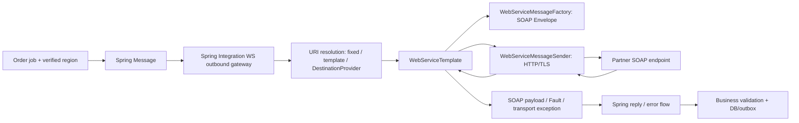
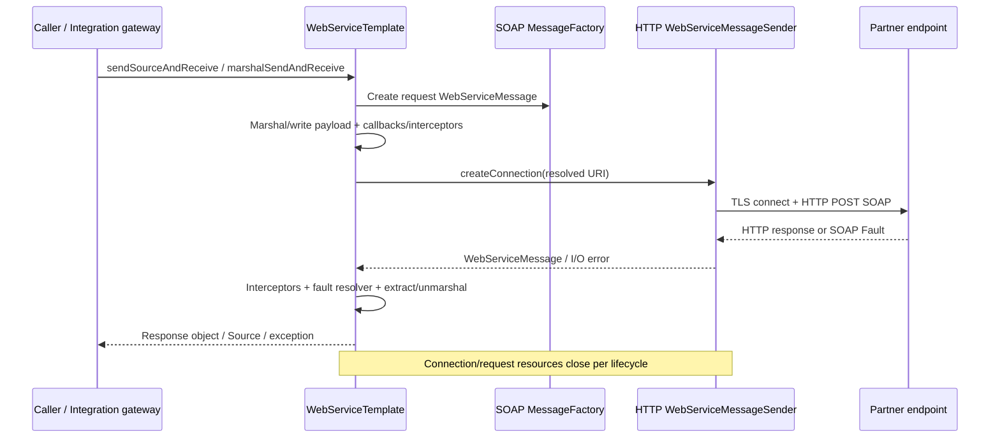
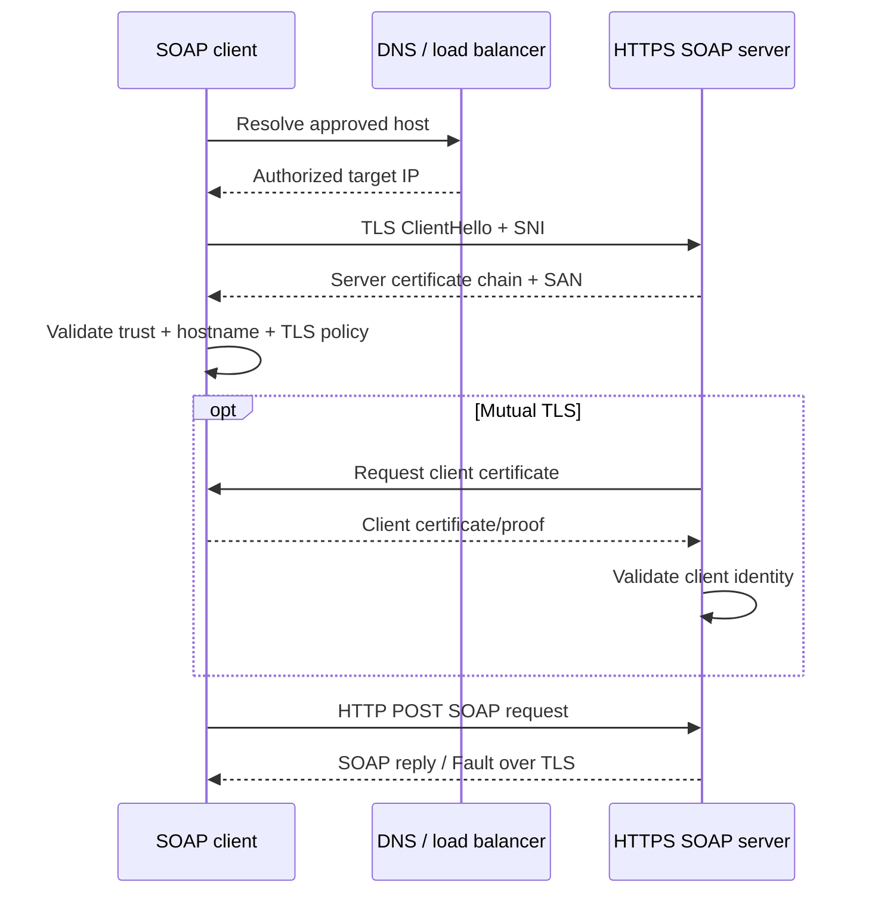
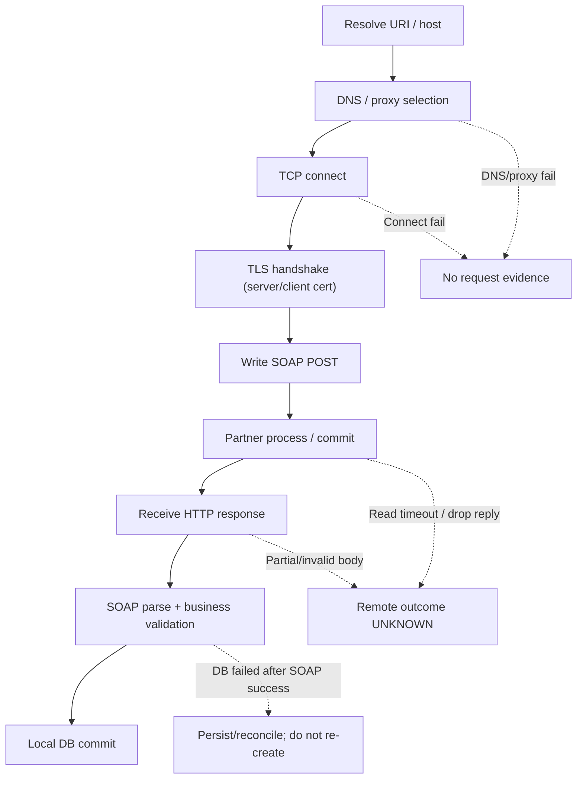
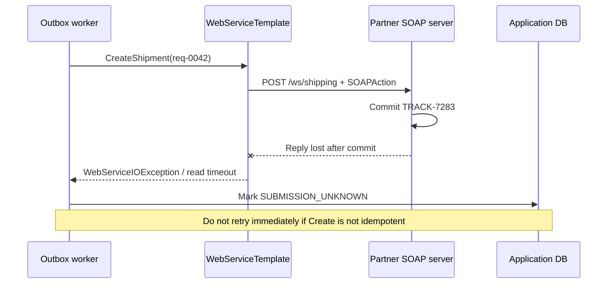
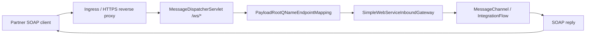

# HTTP transport and endpoint URI

## 1. Problem: valid SOAP content that fails to reach the right server

An order-processing application uses **Spring Integration** to send `CreateShipmentRequest` to a shipping partner over SOAP over HTTPS. The partner operates two regions, `VN` and `SG`, each with its own endpoint, TLS requirements, and connection limits. During rollout, seemingly unrelated incidents occur:

- One job mistakenly calls `https://partner.example.test/shipping?wsdl` instead of the **SOAP service endpoint** published in the WSDL.
- One worker builds the URI from a client-supplied `targetUrl` header, inadvertently opening connections to the internal network (**SSRF**).
- A large PDF attachment causes multiple threads to hit read timeouts; even though the caller reports an error, the partner **may already have created the shipment**.
- The client fails HTTPS connection due to CA/truststore issues; the team considers disabling certificate verification as a "quick fix".
- In a multi-replica deployment, the same job is retried against a new URL/region and creates **two shipments**.

To handle this properly, separate three responsibilities: the **endpoint URI** determines *where to call*; the **HTTP transport** governs *how to connect, send, and receive*; and **SOAP/WSDL** defines *what the request means*. The Spring Integration WS outbound gateway connects all three layers to `MessageChannel`s and application routing.

### Objectives

After this lesson, you will be able to:

1. Distinguish **WSDL discovery URL**, **SOAP endpoint URI**, **`SOAPAction`**, Body QName, and `wsa:To`.
2. Describe the call lifecycle of `WebServiceTemplate` and `WebServiceMessageSender`, HTTP POST, responses, SOAP Faults, and connection cleanup.
3. Configure `HttpUrlConnectionMessageSender` with `Duration` timeouts in Spring-WS 4.x, and know when to choose `HttpComponents5MessageSender`.
4. Build Java DSL `Ws.simpleOutboundGateway(...)`/`Ws.marshallingOutboundGateway(...)` with static URIs or URI templates.
5. Use `DestinationProvider` with a trusted registry; understand why it **cannot be combined** with URI-variable substitution.
6. Control URI encoding via `DefaultUriBuilderFactory.EncodingMode`, avoiding double-encoding or unintended host changes.
7. Secure TLS, mTLS, proxies, redirects, and SSRF; classify connect/read timeouts and retries.
8. Test URI routing with `MockWebServiceServer`, HTTP/TLS sandboxes, fault injection, and metrics.

> **Scope:** Spring Integration **6.5.x**, Spring Web Services **4.x**, Spring Framework 6.x, and Java 17+; Spring Boot with a compatible BOM. URIs like `*.example.test`, orders, tenants, regions, secrets, and figures in this lesson are simulated. `SPECIAL_NOTE` has no additional requirements. HTTP transport is analyzed in the context of the `SPRING_INTEGRATION_ADAPTERS` module: connecting external systems via adapters/gateways, pollers, and `MessageChannel`s, with the same message-contract, error, and connection-lifecycle requirements as File/SFTP/HTTP/JMS/AMQP/Kafka/databases.
> **Scope:** Spring Integration **6.5.x**, Spring Web Services **4.x**, Spring Framework 6.x, and Java 17+; Spring Boot with a compatible BOM. URIs like `*.example.test`, orders, tenants, regions, secrets, and figures in this lesson are simulated. `SPECIAL_NOTE` has no additional requirements. HTTP transport is analyzed in the context of the `SPRING_INTEGRATION_ADAPTERS` module: connecting external systems via adapters/gateways, pollers, and `MessageChannel`s, with the same message-contract, error, and connection-lifecycle requirements as File/SFTP/HTTP/JMS/AMQP/Kafka/databases.

## 2. Architecture diagram: message, URI, transport, SOAP contract



| Layer | Spring API / contract | Responsibility | Does not automatically guarantee |
| --- | --- | --- | --- |
| Messaging | `Message<?>`, `MessageChannel`, `MessagingTemplate` | Routing, request–reply, headers, handlers | That SOAP was sent merely because an async channel accepted the message |
| Integration WS gateway | `SimpleWebServiceOutboundGateway`, `MarshallingWebServiceOutboundGateway` | Bridges Spring Message ↔ Spring-WS call | Transport security or remote exactly-once |
| Endpoint resolution | `.uri(...)`, URI template, `DestinationProvider` | Selects destination URI | SSRF defense if URI comes from arbitrary input |
| Client orchestration | `WebServiceTemplate` | Callbacks, send, receive, fault resolver, extractor | Reading WSDLs to generate Java classes automatically |
| SOAP factory | `SaajSoapMessageFactory`, `SoapMessage` | Envelope, Body, Header, SOAP version, MIME | Host/TLS verification or permissions |
| HTTP sender | `HttpUrlConnectionMessageSender`/`HttpComponents5MessageSender` | HTTP(S) connections, timeouts, pooling/proxies per config | XSD or business validation |
| Domain adapter | Schema validator, authz, outbox | Contracts, business outcomes, idempotency | Replacing SOAP transport |

### Also outbound, yet distinct from `Http.outboundGateway`

Spring Integration provides `Http.outboundGateway(...)` for general **HTTP message exchanges**, typically JSON/REST. `Ws.simpleOutboundGateway(...)`/`Ws.marshallingOutboundGateway(...)` use **Spring Web Services**, understanding SOAP Envelopes, `SOAPAction`, and SOAP Faults. Both can use HTTP as transport, yet **they are not the same abstraction**.

## 3. Which URI to call: endpoint, WSDL, namespace, SOAPAction?

Example partner contract:

```text
WSDL document (for reading the contract):
  https://shipping.example.test/ws/shipping.wsdl

SOAP service endpoint (for HTTP POST):
  https://shipping.example.test/ws/shipping

SOAP 1.1 SOAPAction (operation identifier):
  urn:demo:shipping:v1/CreateShipment

XSD target namespace (XML QName identity):
  urn:demo:shipping:v1

Body root QName:
  {urn:demo:shipping:v1}CreateShipmentRequest
```

A **WSDL URL** publishes `wsdl:service/wsdl:port/soap:address` pointing to the endpoint. In practice the WSDL URL may also look like `https://shipping.example.test/ws/shipping?wsdl`; that **does not mean** SOAP HTTP POSTs should be sent to `?wsdl`. The right target is the **SOAP address per WSDL/partner**, optionally overridden via verified deployment configuration.

| Artifact | Example | Where is it used? |
| --- | --- | --- |
| WSDL location | `.../shipping.wsdl` or `...?wsdl` | Contract discovery/testing; not automatically the request endpoint |
| SOAP 1.1 service address | `https://.../ws/shipping` | `WebServiceTemplate.defaultUri` or gateway `.uri(...)` |
| `SOAPAction` | `urn:demo:shipping:v1/CreateShipment` | `SoapActionCallback`/`WebServiceHeaders.SOAP_ACTION` |
| Body QName | `{urn:demo:shipping:v1}CreateShipmentRequest` | XSD/root validation, inbound `EndpointMapping` |
| WS-Addressing `wsa:To` | Destination URI per WS-A policy | SOAP Header; must align with transport route |
| Callback `wsa:ReplyTo` | Reply address if supported by contract | SSRF defense; never blindly call client-chosen URLs |

**Action URIs are typically identifiers**, not URLs to fetch via HTTP GET. **XSD namespaces are likewise not endpoints**: `urn:demo:shipping:v1` is not a web server. At deployment time, pin WSDL/XSD versions and verify endpoints per environment/region.

### Endpoints vary by environment

| Environment | Illustrative endpoint | Rule |
| --- | --- | --- |
| Sandbox | `https://sandbox-shipping.example.test/ws/shipping` | Synthetic data, sandbox certs; never use production credentials |
| Staging | `https://staging-shipping.example.test/ws/shipping` | Contract/chaos tests, test mTLS/certificates |
| Production VN | `https://vn-shipping.example.test/ws/shipping` | Tenant/region allowlist, strict TLS |
| Production SG | `https://sg-shipping.example.test/ws/shipping` | Route from verified data; never take raw URLs from messages |

Never let an external Spring Message supply a `targetUri` pointing to `127.0.0.1`, `localhost`, `169.254.169.254`, or private/cloud metadata networks; see the security section.

## 4. What does SOAP over HTTP actually send?

For SOAP 1.1 document/literal, a typical HTTP request looks like:

```http
POST /ws/shipping HTTP/1.1
Host: vn-shipping.example.test
Content-Type: text/xml; charset=utf-8
SOAPAction: "urn:demo:shipping:v1/CreateShipment"
Accept: text/xml
Authorization: Bearer <redacted>

<?xml version="1.0" encoding="UTF-8"?>
<env:Envelope xmlns:env="http://schemas.xmlsoap.org/soap/envelope/"
              xmlns:ship="urn:demo:shipping:v1">
  <env:Body>
    <ship:CreateShipmentRequest>
      <ship:clientRequestId>req-0042</ship:clientRequestId>
      <ship:orderId>O-9001</ship:orderId>
    </ship:CreateShipmentRequest>
  </env:Body>
</env:Envelope>
```

A protocol-level successful HTTP response may be:

```http
HTTP/1.1 200 OK
Content-Type: text/xml; charset=utf-8

<env:Envelope xmlns:env="http://schemas.xmlsoap.org/soap/envelope/"
              xmlns:ship="urn:demo:shipping:v1">
  <env:Body>
    <ship:CreateShipmentResponse>
      <ship:clientRequestId>req-0042</ship:clientRequestId>
      <ship:trackingNumber>TRACK-7283</ship:trackingNumber>
      <ship:status>CREATED</ship:status>
    </ship:CreateShipmentResponse>
  </env:Body>
</env:Envelope>
```

**HTTP 200 is not business success**: the SOAP Body may contain `REJECTED`, or even a SOAP Fault from a non-compliant provider. SOAP 1.1 normally uses `text/xml` and `SOAPAction`, whereas SOAP 1.2 normally uses `application/soap+xml` and an `action` media-type parameter with a different Envelope namespace. Never just change the `Content-Type` of SOAP 1.1 hoping to "support SOAP 1.2".

The HTTP sender performs **POST** for SOAP over HTTP. `Content-Length`/`Transfer-Encoding`/`Connection`/Gzip belong to transport; avoid injecting random HTTP headers assuming the SOAP serializer's byte counts or signatures stay valid.

## 5. What stages does a `WebServiceTemplate` call pass through?



Exact steps may vary by overload, interceptors, and provider; the key distinction is that **URI resolution and transport connections** are separate from **XML/SOAP serialization**. A `WebServiceTemplate` bean is reusable across requests; `WebServiceMessage`, stream-backed payload `Source`s, transport responses, and MIME attachments have **per-request lifecycles** and must not sit inside long-lived queues.

**Two failure points to distinguish:**

1. **Before sending:** marshalling/schema validation fails, endpoint URI is invalid, or TLS handshake fails before sending the request — fix config/data and confirm whether remote side effects occurred.
2. **After sending:** read timeout, lost response, or schema-invalid reply XML — the remote **may already have processed and committed**, so never auto-retry side-effecting operations.

### Do not confuse message reply timeout with HTTP read timeout

`MessagingTemplate.setReceiveTimeout(...)` bounds **waiting for a Spring reply**. `HttpUrlConnectionMessageSender.setReadTimeout(...)` bounds **waiting to read data from the socket**. Both differ from the business SLA/end-to-end deadline; a messaging timeout does not guarantee cancelling an in-flight HTTP request or rolling back side effects at the partner.

## 6. Dependencies and endpoint config via application properties

Gradle example for Spring Boot + Spring Integration WS:

```groovy
dependencies {
    implementation 'org.springframework.boot:spring-boot-starter-integration'
    implementation 'org.springframework.integration:spring-integration-ws'
    implementation 'org.springframework.boot:spring-boot-starter-web-services'
    testImplementation 'org.springframework.boot:spring-boot-starter-test'
    testImplementation 'org.springframework.ws:spring-ws-test'
}
```

Manage versions using a **Spring Boot BOM compatible with Spring Integration 6.5**. Do not mix Spring-WS 4/Jakarta with legacy `javax.*` SOAP/JAXB runtimes; `javax.xml.transform.Source/Result` still belong to JAXP on Java 17 and work normally.

```yaml
app:
  shipping:
    endpoint: ${SHIPPING_SOAP_ENDPOINT:https://vn-shipping.example.test/ws/shipping}
    soap-action: "urn:demo:shipping:v1/CreateShipment"
    connect-timeout-ms: 5000
    read-timeout-ms: 20000
```

Values here are **illustrative only**; never commit private keys, JWTs, passwords, or truststore passwords into repositories. In production, use configuration management/secret managers and startup validators to ensure URIs are safe, HTTPS-only, and match permitted hosts/paths/regions.

## 7. `HttpUrlConnectionMessageSender`: minimal transport with timeouts

Spring Web Services 4.x provides `org.springframework.ws.transport.http.HttpUrlConnectionMessageSender`, backed by Java `HttpURLConnection`/`HttpsURLConnection`, to send SOAP HTTP POST requests. Both timeout setters accept **`java.time.Duration`**:

```java
import java.time.Duration;

import org.springframework.beans.factory.annotation.Value;
import org.springframework.context.annotation.Bean;
import org.springframework.context.annotation.Configuration;
import org.springframework.ws.client.core.WebServiceTemplate;
import org.springframework.ws.soap.SoapVersion;
import org.springframework.ws.soap.saaj.SaajSoapMessageFactory;
import org.springframework.ws.transport.http.HttpUrlConnectionMessageSender;

@Configuration
public class ShippingSoapTransportConfig {

    @Bean
    public SaajSoapMessageFactory shippingSoap11Factory() {
        SaajSoapMessageFactory factory = new SaajSoapMessageFactory();
        factory.setSoapVersion(SoapVersion.SOAP_11);
        return factory;  // Spring initializes lifecycle.
    }

    @Bean
    public WebServiceTemplate shippingWebServiceTemplate(
            SaajSoapMessageFactory shippingSoap11Factory,
            @Value("${app.shipping.endpoint}") String endpoint,
            @Value("${app.shipping.connect-timeout-ms:5000}") long connectMs,
            @Value("${app.shipping.read-timeout-ms:20000}") long readMs) {

        if (connectMs <= 0 || readMs <= 0) {
            throw new IllegalArgumentException("Timeout must be positive");
        }

        HttpUrlConnectionMessageSender sender =
                new HttpUrlConnectionMessageSender();
        sender.setConnectionTimeout(Duration.ofMillis(connectMs));
        sender.setReadTimeout(Duration.ofMillis(readMs));

        WebServiceTemplate template =
                new WebServiceTemplate(shippingSoap11Factory);
        template.setDefaultUri(endpoint);
        template.setMessageSender(sender);
        return template;
    }
}
```

This is an **outbound client**, needing no `MessageDispatcherServlet`. `setDefaultUri` applies to `WebServiceTemplate` overloads **without an explicit URI parameter**. Never treat the 5s/20s sample timeouts as fixed recommendations: tune them to your SLO, p99 latency, SOAP/MTOM payload sizes, and provider limits.

| Property | Actually bounds | Does not bound |
| --- | --- | --- |
| `connectionTimeout` | TCP connection setup time in Java `URLConnection` | Total DNS + proxy/TLS/parse/business time |
| `readTimeout` | Socket wait while reading response data | Full end-to-end deadline or remote commit |
| `MessagingTemplate.receiveTimeout` | Caller wait for a Spring reply | Cancelling side effects on the SOAP server |
| `HTTP pool acquisition timeout` | Waiting for a pooled connection (when pooled) | Network read timeout and business SLA |
| `Provider operation SLA` | External commitment | Enforcing timeouts across client layers automatically |

A value of `0` in many HTTP APIs means **wait forever**, so validate positive timeouts and enforce application-level deadlines/budgets. Under heavy traffic, the `HttpURLConnection`-based sender has pooling and observability limits; switch to `HttpComponents5MessageSender` with a managed client when connection pools, proxies, mTLS, and granular policies are required.

## 8. Sending SOAP with `WebServiceTemplate` before using IntegrationFlow

To learn transport behavior, test a plain Spring-WS client call **without an integration gateway** first. `sendSourceAndReceiveToResult(...)` sends the XML **Body payload** (not the whole SOAP Envelope) to the `defaultUri` configured in section 7:

```java
import org.springframework.beans.factory.annotation.Qualifier;
import org.springframework.stereotype.Service;
import org.springframework.ws.client.core.WebServiceTemplate;
import org.springframework.ws.soap.client.core.SoapActionCallback;
import org.springframework.xml.transform.StringResult;
import org.springframework.xml.transform.StringSource;

@Service
public class ShippingSoapClient {

    private final WebServiceTemplate webServiceTemplate;

    public ShippingSoapClient(
            @Qualifier("shippingWebServiceTemplate")
            WebServiceTemplate webServiceTemplate) {
        this.webServiceTemplate = webServiceTemplate;
    }

    public String createDemoShipment() {
        StringSource requestBody = new StringSource("""
            <ship:CreateShipmentRequest xmlns:ship="urn:demo:shipping:v1">
              <ship:clientRequestId>req-0042</ship:clientRequestId>
              <ship:orderId>O-9001</ship:orderId>
            </ship:CreateShipmentRequest>
            """);

        StringResult result = new StringResult();
        boolean received = webServiceTemplate.sendSourceAndReceiveToResult(
                requestBody,
                new SoapActionCallback(
                        "urn:demo:shipping:v1/CreateShipment"),
                result);

        if (!received) {
            throw new IllegalStateException(
                    "CreateShipment requires a SOAP reply, but response was empty");
        }

        // XML of the SOAP Body reply; still needs XSD/business validation.
        return result.toString();
    }
}
```

In this example:

- `shippingWebServiceTemplate` takes the **URI** from `defaultUri` and uses `HttpUrlConnectionMessageSender`.
- `SoapActionCallback` sets the WSDL action; it **does not change the URI**.
- `StringSource` contains only the `CreateShipmentRequest` element XML; `SaajSoapMessageFactory` builds the SOAP Envelope.
- `StringResult` captures the response body payload; it does **not** guarantee HTTP 200 or `status=CREATED` without validation.
- For **one-way** operations, design a different return contract rather than waiting for a tracking number on an operation with no response.

### Overload accepting an explicit endpoint URI

```java
// Method fragment using a validated/allowlisted URI:
boolean gotReply = webServiceTemplate.sendSourceAndReceiveToResult(
        "https://vn-shipping.example.test/ws/shipping",
        requestBody,
        new SoapActionCallback(
                "urn:demo:shipping:v1/CreateShipment"),
        result);
```

This URI overload uses the **per-invocation** destination instead of the default destination. Therefore, never set `template.setDefaultUri(productionUri)` and then pass a caller-supplied URI thinking `defaultUri` protects the destination. **Validate the actual URI being used.**

### SOAP headers vs. HTTP transport headers

Spring Integration `WebServiceHeaders.SOAP_ACTION` maps to the SOAP action, not to an arbitrary Spring `HttpHeaders` object forwarded as HTTP headers. For HTTP auth/proxies, configure the sender/client and interceptors at the right layer. Never try to put `Authorization` into a custom SOAP Header when the partner expects an HTTP Bearer token, or vice versa.

## 9. Spring Integration Java DSL: gateway + channel + HTTP sender

When coordinating transformers, filters, routers, or error flows, use a **WS outbound gateway**. Spring Integration 6.5 lets `Ws.simpleOutboundGateway()` accept `String` or `javax.xml.transform.Source` in a Spring Message using the configured sender:

```java
import java.time.Duration;

import org.springframework.beans.factory.annotation.Value;
import org.springframework.context.annotation.Bean;
import org.springframework.context.annotation.Configuration;
import org.springframework.integration.channel.DirectChannel;
import org.springframework.integration.dsl.IntegrationFlow;
import org.springframework.integration.ws.dsl.Ws;
import org.springframework.messaging.MessageChannel;
import org.springframework.ws.transport.http.HttpUrlConnectionMessageSender;

@Configuration
public class ShippingSoapOutboundFlow {

    @Bean
    public MessageChannel shippingOutboundRequests() {
        return new DirectChannel();
    }

    @Bean
    public IntegrationFlow shipViaPartner(
            MessageChannel shippingOutboundRequests,
            @Value("${app.shipping.endpoint}") String endpoint) {

        HttpUrlConnectionMessageSender sender =
                new HttpUrlConnectionMessageSender();
        sender.setConnectionTimeout(Duration.ofSeconds(5));
        sender.setReadTimeout(Duration.ofSeconds(20));

        return IntegrationFlow.from(shippingOutboundRequests)
                .handle(Ws.simpleOutboundGateway()
                        .uri(endpoint)
                        .messageSenders(sender))
                .get();
    }
}
```

A producer can use `MessagingTemplate` to wait for a reply:

```java
import org.springframework.beans.factory.annotation.Qualifier;
import org.springframework.integration.core.MessagingTemplate;
import org.springframework.integration.ws.WebServiceHeaders;
import org.springframework.messaging.Message;
import org.springframework.messaging.MessageChannel;
import org.springframework.messaging.support.MessageBuilder;
import org.springframework.stereotype.Service;
import org.springframework.xml.transform.StringSource;

@Service
public class ShipmentFlowCaller {

    private final MessageChannel requests;

    public ShipmentFlowCaller(
            @Qualifier("shippingOutboundRequests") MessageChannel requests) {
        this.requests = requests;
    }

    public Message<?> invokeDemo() {
        Message<StringSource> message = MessageBuilder
                .withPayload(new StringSource("""
                    <ship:CreateShipmentRequest
                        xmlns:ship="urn:demo:shipping:v1">
                      <ship:clientRequestId>req-0042</ship:clientRequestId>
                      <ship:orderId>O-9001</ship:orderId>
                    </ship:CreateShipmentRequest>
                    """))
                .setHeader(WebServiceHeaders.SOAP_ACTION,
                        "urn:demo:shipping:v1/CreateShipment")
                .build();

        MessagingTemplate messaging = new MessagingTemplate();
        messaging.setReceiveTimeout(25_000);
        Message<?> reply = messaging.sendAndReceive(requests, message);
        if (reply == null) {
            throw new IllegalStateException(
                    "Spring reply timeout or empty SOAP response");
        }
        return reply;
    }
}
```

`DirectChannel` dispatches synchronously. `MessagingTemplate.receiveTimeout` waits for the **Spring reply**; it does not cancel the remote SOAP transaction. When switching the request channel to `ExecutorChannel`/`QueueChannel`, `send() == true` typically only proves the message was accepted/queued, **not** that the HTTP POST to the partner succeeded.

### When JAXB objects are needed

`Ws.marshallingOutboundGateway()` requires a `Marshaller`/`Unmarshaller` matching the SOAP XSD; a single `Jaxb2Marshaller` bean can serve both:

```java
// Snippet inside an IntegrationFlow bean, given shippingMarshaller:
.handle(Ws.marshallingOutboundGateway()
        .uri(endpoint)
        .marshaller(shippingMarshaller)
        .unmarshaller(shippingMarshaller)
        .messageSenders(sender))
```

With the marshalling gateway, the payload is a **contracted JAXB object**, not a `String` containing a SOAP Envelope. Both simple and marshalling gateways share Spring-WS's URI/HTTP transport layer, so TLS/SSRF policies do not relax merely by changing payload types.

## 10. External `WebServiceTemplate`: centralizing transport configuration

Since Spring Integration 5.0, an externally configured `WebServiceTemplate` can be supplied—useful when you need proxies, mTLS, pooling, custom fault resolvers, or SOAP interceptors.

```java
import org.springframework.beans.factory.annotation.Qualifier;
import org.springframework.beans.factory.annotation.Value;
import org.springframework.context.annotation.Bean;
import org.springframework.context.annotation.Configuration;
import org.springframework.integration.dsl.IntegrationFlow;
import org.springframework.integration.ws.dsl.Ws;
import org.springframework.messaging.MessageChannel;
import org.springframework.ws.client.core.WebServiceTemplate;

@Configuration
public class ShippingWithExternalTemplateFlow {

    @Bean
    public IntegrationFlow shippingWithSharedTemplate(
            MessageChannel shippingOutboundRequests,
            @Qualifier("shippingWebServiceTemplate")
            WebServiceTemplate template,
            @Value("${app.shipping.endpoint}") String endpoint) {
        return IntegrationFlow.from(shippingOutboundRequests)
                .handle(Ws.simpleOutboundGateway(template)
                        .uri(endpoint))
                .get();
    }
}
```

**This is an alternative to the flow in section 9**—never register both `IntegrationFlow`s subscribing to the same `DirectChannel` unless intentional fanout is desired (very dangerous for `CreateShipment`). When using an external template, settings like `WebServiceMessageFactory`, `WebServiceMessageSender`, `ClientInterceptor`, `FaultMessageResolver`, and security are configured **on that template**. The external-template spec focuses on URI, header mapper, callbacks, and encoding; never assume setters from the no-template spec reconfigure a pre-built HTTP client.

If the template sets `defaultUri` while the gateway sets `.uri(endpoint)`, **specify one clear destination config** and assert `connectionTo(expectedUri)` in tests rather than relying on implicit precedence during refactors. On `WebServiceTemplate` directly, explicit-URI overloads apply to that invocation; `setDefaultUri` applies to no-URI overloads.

## 11. Three endpoint URI selection strategies

| Strategy | Primary API | Best fit | Risks |
| --- | --- | --- | --- |
| **Fixed URI** | `Ws.simpleOutboundGateway().uri("https://...")` | Single partner/region, startup-configured URL | Wrong environment, cert/host drift |
| **URI template** | `.uri("https://.../{region}/ws")` + `.uriVariableExpressions(...)` | Path/query driven by validated variables | Encoding issues, path injection, SSRF if host is variable |
| **`DestinationProvider`** | `.destinationProvider(provider)` | Runtime registry/approved tenant endpoints, controlled failover | Registry poisoning, DNS rebinding, policy outside code |

**Never combine `DestinationProvider` with URI-variable substitution.** Spring Integration 6.5 treats combining both as a configuration error. When `DestinationProvider` is used, the gateway's `encodingMode` is ignored; the provider must return a **valid, policy-encoded `URI`**.

### A fixed URI in YAML still needs validation

`app.shipping.endpoint` is typically supplied by operators/deployment platforms. Still verify `scheme=https`, host/port/path, and environment, as misconfiguration could send customer data to a sandbox or another partner's account. Never let secrets supply arbitrary endpoints outside the onboarded partner catalog.

### Distinguishing runtime reconfiguration from message-time routing

- **Startup config:** static URI and credentials per provider bean. Simple and auditable.
- **Message-time routing:** take only a **validated routing key** from the event/order/tenant and look it up in a **trusted registry**. Never take raw URLs from inside a SOAP payload or user headers.
- **Hot-reloading registries:** config versions need auditing, change approval, and atomic publication; persist the route version metadata in the outbox so retries never unexpectedly switch partners.

When multiple partners use distinct certificates/credentials, prefer **one template/sender per partner** or a factory isolating identities/credentials rather than mutating TLS/auth per thread on a shared mutable singleton.

## 12. URI templates: substituting variables in the **path** without changing the host

Suppose the partner has a fixed host but partitions by path:

```text
https://shipping.example.test/{region}/ws/shipping
```

The application permits only `region=vn` or `region=sg` after checking an enum/allowlist, while keeping **scheme/host/port fixed**. Spring Integration 6.5 Java DSL provides `uriVariableExpressions(Map<String, Expression>)`; expressions evaluate against the outbound `Message<?>`.

```java
import java.util.Map;

import org.springframework.beans.factory.annotation.Bean;
import org.springframework.context.annotation.Configuration;
import org.springframework.expression.Expression;
import org.springframework.expression.spel.standard.SpelExpressionParser;
import org.springframework.integration.dsl.IntegrationFlow;
import org.springframework.integration.ws.dsl.Ws;

@Configuration
public class ShippingUriTemplateFlow {

    @Bean
    public IntegrationFlow routeShippingByRegion() {
        Expression regionExpression = new SpelExpressionParser()
                .parseExpression("headers['approvedRegion']");
        Map<String, Expression> variables =
                Map.of("region", regionExpression);

        return IntegrationFlow.from("shippingRegionRequests")
                .handle(Ws.simpleOutboundGateway()
                        .uri("https://shipping.example.test/{region}/ws/shipping")
                        .uriVariableExpressions(variables))
                .get();
    }
}
```

**Security precondition:** `approvedRegion` is an **internal** header produced by a validated region selector, never copied raw from an HTTP caller's `headers['region']`. Example helper:

```java
import java.util.Locale;
import java.util.Set;

public final class RegionPolicy {
    private static final Set<String> ALLOWED = Set.of("vn", "sg");

    public static String approve(String candidate) {
        if (candidate == null) {
            throw new IllegalArgumentException("Missing region");
        }
        String normalized = candidate.toLowerCase(Locale.ROOT);
        if (!ALLOWED.contains(normalized)) {
            throw new IllegalArgumentException("Unsupported region");
        }
        return normalized;
    }
}
```

Producers must invoke `RegionPolicy.approve(...)` to set `approvedRegion` before sending to `shippingRegionRequests`. This helper alone cannot stop an actor permitted to forge internal headers; in production, enforce clear **trust boundaries** and revalidate at the endpoint if messages traverse untrusted brokers or connectors.

**Never template scheme/hostname from input** like `"https://{tenantHost}/ws"` checking only for non-empty strings: that invites SSRF, wrong environments, raw IPs, or attacker-controlled domains. Select hosts from an approved configuration map rather than computing them from payloads.

### URI variables vs. SOAP Body variables

`{region}` in the URI template only picks the **transport path**; it does not automatically change the SOAP payload QName, tenant authorization, or WSDL operation. If the `sg` partner requires a different `SOAPAction` or XML namespace than `vn`, route the matching **template + marshaller/contract version**, not merely the path.

## 13. URI encoding: default `TEMPLATE_AND_VALUES`

Spring Integration WS uses a URI builder to encode URI strings. Since Spring Integration 5.3, `AbstractWebServiceOutboundGateway` exposes `setEncodingMode(DefaultUriBuilderFactory.EncodingMode)`; the DSL equivalent is `.encodingMode(...)`. Default is **`TEMPLATE_AND_VALUES`**:

```java
import org.springframework.web.util.DefaultUriBuilderFactory;

// WS gateway DSL fragment:
.handle(Ws.simpleOutboundGateway()
        .uri("https://shipping.example.test/{region}/ws/shipping")
        .uriVariableExpressions(variables)
        .encodingMode(
            DefaultUriBuilderFactory.EncodingMode.TEMPLATE_AND_VALUES))
```

| Mode | Rule | When to use |
| --- | --- | --- |
| `TEMPLATE_AND_VALUES` (default) | Encodes both template and variable values per URI builder policy | Common case with dynamic variable values |
| `VALUES_ONLY` | Encodes variable values before expansion | Template contains intentionally controlled reserved characters |
| `URI_COMPONENT` | Encodes components after expansion, preserving certain reserved semantics | Specialized URL contracts; test thoroughly |
| `NONE` | Disables URI builder encoding | **Very rare**: URI is already properly built/encoded and controlled |

Why testing matters: an external order code `"A/B 100%"` placed in a path segment may be split into **two segments** or create invalid `%` escapes depending on encoding. Clarify whether the provider expects a path segment, query parameter, or SOAP Body field. Typically **business order IDs belong in the SOAP Body**, not spliced into URL paths.

### Double encoding

If a value is already encoded as `A%2FB` and the URI builder encodes `%` again, it sends `A%252FB` instead of `A%2FB`. Conversely, setting `NONE` on raw input containing `/`, `?`, or `#` alters URL structure/routing. **Never use `NONE` blindly to "fix bugs"**; test the **actual emitted URI** with Unicode, spaces, percents, slashes, and query delimiters.

With `DestinationProvider`, `encodingMode` is not applied; the provider returns the final `URI` and is responsible for canonicalization. Never mutate encoding in an interceptor after TLS signatures/actions have been computed assuming it remains safe.

## 14. `DestinationProvider`: selecting URIs from a controlled registry

Spring-WS provides `org.springframework.ws.client.support.destination.DestinationProvider`, whose core method returns `URI getDestination()`. It fits **runtime discovery** or operator/policy-driven endpoint switching, rather than accepting free-form URLs from clients.

Simple example: routing **one gateway** to whichever production endpoint an operator currently approves from an allowlist, switching between VN primary and backup endpoints sharing the **same contract and business identity**.

```java
import java.net.URI;
import java.util.Map;
import java.util.concurrent.atomic.AtomicReference;

import org.springframework.ws.client.support.destination.DestinationProvider;

public final class ApprovedShippingDestinationProvider
        implements DestinationProvider {

    private static final Map<String, URI> APPROVED_ENDPOINTS = Map.of(
            "vn-primary",
            URI.create("https://vn-shipping.example.test/ws/shipping"),
            "vn-secondary",
            URI.create("https://backup-vn-shipping.example.test/ws/shipping"));

    private final AtomicReference<URI> current =
            new AtomicReference<>(APPROVED_ENDPOINTS.get("vn-primary"));

    @Override
    public URI getDestination() {
        return current.get();
    }

    public void activateApprovedEndpoint(String configuredKey) {
        URI target = APPROVED_ENDPOINTS.get(configuredKey);
        if (target == null) {
            throw new IllegalArgumentException("Destination not approved");
        }
        current.set(target);
    }
}
```

This provider only demonstrates **selecting from a known URI allowlist**—not a real registry, mTLS/certificate rotation, or multi-tenancy. Real policies must also check endpoint health, contract scope, region, operator permissions, change auditing, and **idempotency** when failing over to a backup endpoint.

Using it in Java DSL:

```java
import org.springframework.context.annotation.Bean;
import org.springframework.integration.dsl.IntegrationFlow;
import org.springframework.integration.ws.dsl.Ws;

@Bean
public IntegrationFlow shippingWithDestinationProvider(
        ApprovedShippingDestinationProvider destinationProvider) {
    return IntegrationFlow.from("shippingProviderRequests")
            .handle(Ws.simpleOutboundGateway()
                    .destinationProvider(destinationProvider))
            .get();
}
```

**This flow is an alternative** to the fixed-URI and URI-template flows above. **Never add `.uri(...)` or `.uriVariableExpressions(...)`** to a spec using a provider. Notably, `DestinationProvider.getDestination()` **takes no Spring `Message<?>` parameter**: a shared mutable provider **cannot safely select regions per message** using `ThreadLocal` or mutating a field right before sending (race condition). For per-message routing, use **separate flows/templates per partner/region** or a URI template with validated variables instead of mutating a global destination concurrently.

### When service discovery is desired

Registries should store `partnerId`, `contractVersion`, `approvedScheme/host/port/path`, `credentialProfile`, and `healthStatus`. Operators may publish endpoints only after verifying TLS/policy/contract, never blindly trusting raw DNS SRV results or database rows. When v1 and v2 endpoints differ in QName/SOAP version, **route the contract alongside the endpoint**, not merely the host.

### `WebServiceTemplate` also has `setDestinationProvider`

`WebServiceTemplate#setDefaultUri(String)` and `setDestinationProvider(DestinationProvider)` are **two choices for the default destination** on overloads lacking a URI. Never set both expecting the later setter to silently override.

```java
// Spring-WS client config fragment:
template.setDestinationProvider(destinationProvider);
// Then call overloads without an explicit URI:
// template.sendSourceAndReceiveToResult(source, callback, result);
```

When calling an explicit-URI overload, govern that invocation's endpoint separately; a provider is not an **SSRF firewall** for arbitrary external URLs passed into the API.

## 15. `HttpComponents5MessageSender`: pooling and timeouts for high throughput

For high concurrent SOAP traffic and explicit connection pool management, Spring-WS 4.0.5+ offers `org.springframework.ws.transport.http.HttpComponents5MessageSender` backed by **Apache HttpClient 5**.

In Gradle, ensure the dependency is present if not already brought in by the project/BOM:

```groovy
dependencies {
    implementation 'org.apache.httpcomponents.client5:httpclient5'
}
```

Example using a Spring-managed sender:

```java
import java.time.Duration;

import org.springframework.context.annotation.Bean;
import org.springframework.context.annotation.Configuration;
import org.springframework.ws.transport.http.HttpComponents5MessageSender;

@Configuration
public class PooledSoapSenderConfiguration {

    @Bean
    public HttpComponents5MessageSender pooledSoapSender() {
        HttpComponents5MessageSender sender =
                new HttpComponents5MessageSender();
        sender.setConnectionTimeout(Duration.ofSeconds(5));
        sender.setReadTimeout(Duration.ofSeconds(20));
        sender.setMaxTotalConnections(64);
        return sender;
    }
}
```

`new HttpComponents5MessageSender()` creates a client with a sender-managed default connection manager implementing `InitializingBean`/`DisposableBean`; Spring handles initialization and destruction. `setMaxTotalConnections(64)` is **illustrative only** and does not replace per-route concurrency caps, pool acquisition timeouts, keep-alive/idle eviction, or provider quotas.

Attach the sender to a `WebServiceTemplate` or no-template WS gateway:

```java
// Inside @Bean WebServiceTemplate receiving pooledSoapSender:
template.setMessageSender(pooledSoapSender);

// Or inside Java DSL creating a WS outbound gateway:
.handle(Ws.simpleOutboundGateway()
        .uri(endpoint)
        .messageSenders(pooledSoapSender))
```

These two fragments are **two configuration options**—do not apply both redundantly to the same flow without clarity on which instance is active. If you pass a **custom Apache `HttpClient`** into `HttpComponents5MessageSender`'s constructor/setter, Spring-WS 4.0 **does not automatically override timeouts or install `RemoveSoapHeadersInterceptor` on that client**. You must configure pooling, timeouts, proxies, redirects, SSL, and request interceptors on the custom client itself and test SOAP transport compatibility. Never assume sender setters override externally built clients.

### Pooling vs. concurrency/bulkhead

| Limit | Purpose | Symptom if missing |
| --- | --- | --- |
| Max total connections | Avoid opening too many sockets | Exhausted file descriptors/connections |
| Per-route/host connection policy | Prevent one host from starving the pool | Provider A starves connections for provider B |
| Pool acquisition timeout | Avoid waiting indefinitely for a connection | Thread buildup before even opening a socket |
| Worker bulkhead | Cap concurrent SOAP calls | Exhausted servlet/executor threads |
| Per-partner/tenant rate limit | Stay within partner quotas | HTTP 429/503, retry storms |
| Overall call budget | Bound total network time per job | One job holds its lease too long |

**Connection pooling does not eliminate semantic timeout risks**: once a request reaches the partner, a lost response remains an **uncertain remote outcome**, regardless of modern pooling.

## 16. HTTPS and mTLS: verifying target and identity

SOAP payloads can carry shipping addresses, contract data, or payment details. **HTTPS is mandatory** for sensitive traffic; mTLS applies when partners require client certificates.



### TLS server authentication

- Verify the certificate chain against a trusted CA/truststore and match the hostname against SANs. **Never** use trust-all or disable hostname verification to bypass `PKIX path building failed`.
- Never check only the DNS hostname string while ignoring the resolved IP address. If an allowlisted host redirects or DNS-rebinds to an internal network, egress policies must detect and block it.
- TLS termination behind a load balancer requires secure proxy-to-upstream configuration; for mTLS, forward caller identity over a **trusted channel**, never trusting raw `X-Client-Cert` headers from the Internet.
- Enforce approved TLS versions and cipher suites; never accept expired certificates.

### mTLS client identity

The client needs its own keypair/certificate stored in a key/secret store. The HTTP client must load the partner- and host-specific **keystore/truststore**; manage expiration/rotation, partner certificate revocation, and failover. Never reuse the same private key across tenants without explicit agreement.

**Avoid setting JVM-global `javax.net.ssl.trustStore` or `javax.net.ssl.keyStore` indiscriminately** for a single partner: it affects all outbound HTTPS in the same JVM. For multiple partners, build separate transport clients with dedicated `SSLContext`/socket factories, proper hostname verifiers, and test against an mTLS sandbox endpoint.

### WS-Security vs. mTLS

WS-Security via `Wss4jSecurityInterceptor` protects/identifies the **SOAP message** (signatures, timestamps, `UsernameToken`, encryption). TLS/mTLS protects the **channel** and connection identity. Both layers may be required simultaneously; neither **replaces** business authorization for a tenant/order. A valid `SOAPAction` or `wsa:To` likewise never proves the principal is authorized for the operation.

## 17. Proxies, redirects, HTTP authentication, and URI safety

In enterprise networks, HTTP traffic often traverses forward proxies, API gateways, or ingress reverse proxies. These alter TLS, DNS, authentication, HTTP statuses, and URIs seen on both sides.

| Component | What to check | Risks |
| --- | --- | --- |
| Forward proxy | Permitted endpoints, proxy auth, CONNECT/mTLS | Proxy sees metadata; egress bypass |
| API gateway | Host/path rewrites, `SOAPAction`, request size, fault mapping | Returns HTML 500 instead of SOAP Fault |
| Reverse proxy | `X-Forwarded-*`, target WSDL address, HTTPS termination | WSDL advertises wrong URL/protocol |
| Redirects 301/302/307/308 | Whether policy follows redirects; resends POST/credentials | Credential leak, jump to untrusted host, duplicate side effects |
| HTTP Bearer/Basic auth | Token scope/expiry, TLS required, proper transport header | Putting secrets into SOAP Headers or logs |
| Connection keep-alive | Pool reuse, stale idle sockets | Unexpected EOF / Connection reset |

**Never automatically follow redirects to unapproved hosts/schemes/ports.** For side-effecting SOAP POSTs, transport-level redirects/replays can create duplicate requests or leak credentials. In particular, never forward `Authorization` or client-certificate identity to a new target merely because a server returned 302/307.

### SSRF via endpoint URI

SSRF does not come solely from HTTP request URLs; it also arises when routing URIs from Spring Message headers or payload XPath/SpEL:

```text
headers.targetUrl = http://127.0.0.1:8080/admin
headers.targetUrl = http://169.254.169.254/latest/meta-data/
headers.targetUrl = https://attacker.example.test/capture
```

Never pass `headers.targetUrl` verbatim into `.uri(...)` or explicit `WebServiceTemplate` calls. Accept a valid **`partnerId`/`region`** and resolve the endpoint from an allowlist. If tenant-configured partner URLs are strictly required (onboarding), enforce:

1. `https` scheme and permitted ports; block userinfo, fragments, and URL parser ambiguities.
2. Exact hostname in allowlist, checking IDN/punycode, canonicalization, and URL encoding.
3. Resolved DNS/IPs must not point to disallowed loopback/link-local/private/metadata ranges; guard against DNS rebinding and both IPv4/IPv6.
4. Redirects disabled or re-validated **on every hop**; outbound egress firewall as defense-in-depth.
5. Credentials and certificates bound strictly per profile/host; no cross-tenant or cross-environment sharing.
6. Audit endpoint changes, ownership, versions, and failover history; retries must never silently redirect side effects.

### Selector returning only allowlisted URIs

```java
import java.net.URI;
import java.util.Map;

public final class PartnerEndpointCatalog {

    private static final Map<String, URI> ENDPOINTS = Map.of(
            "vn", URI.create("https://vn-shipping.example.test/ws/shipping"),
            "sg", URI.create("https://sg-shipping.example.test/ws/shipping"));

    public static URI forRegion(String approvedRegion) {
        URI result = ENDPOINTS.get(approvedRegion);
        if (result == null) {
            throw new IllegalArgumentException("Region not onboarded");
        }
        return result;
    }
}
```

This hardcoded map illustrates **avoiding raw URL concatenation**. In production, load the catalog from signed/approved config and enforce authz so a VN user cannot arbitrarily pick the SG partner. When routing to different hosts per message, use a **router to separate flows/templates**; never mutate a singleton `WebServiceTemplate.defaultUri` concurrently across threads.

## 18. HTTP status, SOAP Faults, and `WebServiceTemplate` error policy

HTTP and SOAP are **two layers**. An HTTP 500 may contain a standard SOAP Fault, or an HTML error page from a gateway/proxy. An HTTP 200 may carry a SOAP Body reporting `REJECTED`, or even a SOAP Fault from a non-compliant provider.

| Signal | Meaning at transport layer | SOAP/business handling |
| --- | --- | --- |
| HTTP 200 + valid SOAP response | HTTP response received | Parse/XSD, verify status/`requestId`/tracking before commit |
| HTTP 202 or contract empty response | Transport accepted / one-way operation | Never infer a tracking number was created |
| HTTP 500 + SOAP Fault | HTTP error carrying valid SOAP protocol fault | Use `SoapFaultMessageResolver`, map fault code/detail |
| HTTP 500 + reverse-proxy HTML | No valid SOAP Envelope | `WebServiceTransportException`/parse policy; check ingress/proxy |
| HTTP 401/403 | HTTP auth/authorization rejected | Fix token/cert/scope; no retry storm |
| HTTP 404 | Wrong URI/path or ingress mapping | Check WSDL `soap:address` and deployment route |
| HTTP 405 | Wrong HTTP method/route | SOAP HTTP clients normally POST; check proxy/server |
| HTTP 415 | Wrong `Content-Type` or SOAP version | Fix message factory/binding; don't just tack on headers |
| HTTP 429/503 | Rate limit/outage/transient transport | Quota-bounded backoff; account for idempotency |
| Read timeout/EOF | Incomplete response | Remote outcome may already have committed |

`WebServiceTemplate` defaults to `SoapFaultMessageResolver` and **two separate check flags**:

```java
import org.springframework.ws.client.core.WebServiceTemplate;
import org.springframework.ws.soap.client.core.SoapFaultMessageResolver;

public final class SoapFaultPolicy {
    public static void configureStandard(WebServiceTemplate template) {
        template.setFaultMessageResolver(new SoapFaultMessageResolver());
        template.setCheckConnectionForError(true);
        template.setCheckConnectionForFault(true);
    }
}
```

- `checkConnectionForError=true`: treats non-2xx HTTP statuses as indicators of transport errors, while Spring-WS still distinguishes SOAP Faults.
- `checkConnectionForFault=true`: inspects connection status (typically HTTP 500) when detecting Faults, then checks the response SOAP message.
- Only for **non-standard** providers returning SOAP Faults with HTTP 200 should you consider `setCheckConnectionForFault(false)` to inspect the SOAP response message—**after writing a contract test** for that behavior.
- Never set `setCheckConnectionForError(false)` just so HTTP 403/500 "stops throwing exceptions"; that swallows real errors or tries to parse HTML as SOAP.

`SoapFaultClientException` differs from `WebServiceTransportException`/`WebServiceIOException`: one is a SOAP protocol fault, while the other is transport/I/O. Spring Integration may wrap exceptions in `MessageHandlingException`, so inspect the cause chain carefully and classify **whether remote side effects may already have occurred**.

### Empty replies are not always network errors

In `WebServiceTemplate.sendSourceAndReceiveToResult(...)`, `false` means no response was received per the API contract. In the **Spring Integration simple outbound gateway**, when the request payload is `String` and the response is empty, default `ignoreEmptyResponses=true` means **no Spring reply message is sent**. Setting `ignoreEmptyResponses(false)` can emit a reply for empty String responses; however, for `Source`/`Document` requests, the response extractor may return null, so **a reply is not guaranteed**. When the WSDL operation requires a response, treat missing replies as contract failures to fail/reconcile—never record `COMPLETED`.

## 19. Classifying timeouts by connection phase



| Failure | Characteristics | Policy |
| --- | --- | --- |
| Malformed URI | Pre-network config error | `FAILED_CONFIG`, fix URI/encoding |
| DNS NXDOMAIN | Host unresolvable | Check endpoint, TTL/DNS/egress; budgeted retry if transient |
| Connection refused | No connection to target | Check host/port/upstream; no conclusion about prior attempts |
| TLS handshake failure | Cert/trust/mTLS mismatch | Fail closed; rotate/repair; never trust-all |
| Proxy 407 | Proxy authentication required | Fix proxy credentials; never send client tokens to wrong proxy |
| Connect timeout | TCP not yet established | Retry when operation is safe / no request sent |
| Write/connection reset during upload | Unknown how many bytes server received | **May be `UNKNOWN`**; do not assert unprocessed |
| Read timeout after POST | Server may have committed | `SUBMISSION_UNKNOWN`, reconciliation |
| SOAP Fault | Server sent protocol reply | Map fault contract; do not retry all faults |
| Schema-invalid XML response | Transport may have succeeded | Do not commit invalid data; store safe evidence |
| Local DB failure after SOAP success | Remote side effect already occurred | Retry persistence/reconcile; do not call Create again |

**Never equate connect timeout with an end-to-end deadline.** With proxies, TLS, and pools, actual sequencing and timeouts depend on the HTTP client implementation. Test DNS, connect, handshake, pool acquisition, upload, server delay, and response body streaming phases in a sandbox. Java/connection timeouts do not cancel work already executing remotely.

### Timeout budgets and leases

Suppose the total internal SLA for a job is **30 seconds** (illustrative, not a fixed rule):

```text
totalBudget = 30 s
  upstream queue/claim = bounded
  pool acquisition   = bounded
  TCP connect        = 5 s max
  HTTP read          = 20 s max
  XML validation     = bounded
  local commit       = bounded
```

Do not mechanically add 5 + 20 assuming the entire call takes at most 25 seconds: redirects, retries, or handshakes can add overhead. If a job lease is 15s while read timeout is 20s, another worker can claim the job before the first call finishes. **Size leases/fencing and concurrency controls** for worst-case execution duration, and monitor `in_flight` and `oldest_pending_age`.

## 20. Remote commit after HTTP timeout: durable outbox required

Suppose the partner receives a SOAP create operation, generates a tracking number, and the network drops the response:



For side-effecting requests, `WebServiceIOException`/`SocketTimeoutException` **does not prove** the partner didn't process it. Use a stable `clientRequestId` plus partner lookup (e.g., `GetShipmentByClientRequestId`) or an idempotency key **confirmed by the provider's contract**.

| Operation | Side effect | Retry policy |
| --- | --- | --- |
| `GetShipmentStatus` | Read-only per contract | Capped exponential backoff + jitter + rate limit |
| `CreateShipment` with provider idempotency key | Yes, deduplicatable | Retry with same key within tested TTL/rules |
| `CreateShipment` without idempotency | Yes, risks duplicates | `SUBMISSION_UNKNOWN` + reconciliation/manual review |
| `CancelShipment` | May incur fees/irreversible state | Status check and authorization before retry |
| `INVALID_ORDER` SOAP Fault | Invalid request | Do not retry unchanged |
| HTTP 401/403 or expired TLS cert | Config/permission error | Fix secret/cert/scope; no retry storm |

### Outbox states (recommended)

```text
operation_id: unique(tenant_id, order_id, operation)
partner_id, endpoint_profile_id, contract_version
client_request_id: STABLE across all retries
payload_reference, payload_hash
status: REQUESTED | SENDING | COMPLETED
      | RETRY_PENDING | SUBMISSION_UNKNOWN
      | FAILED_CONFIG | FAILED_PERMANENT
attempt_count, next_retry_at, lease_until
last_error_code, partner_tracking_number
```

Workers must **claim atomically** with leases/fencing and record routing profile and request hash. Send HTTP **outside long DB transactions**, then update the DB in a short transaction; if a worker crashes after remote commit but before local update, reconcile. There is no default 2PC transaction between Spring Integration and a SOAP server. **Exactly-once remote side effects cannot be guaranteed by a unique outbox row alone.**

### Persist the endpoint profile to avoid retrying at the wrong destination

When a job is created with `partnerId=shipping-vn`, `endpointProfile=vn-primary`, and `contractVersion=v1`, an operator switching a global `DestinationProvider` to another endpoint can send the **same `clientRequestId`** to a system that does not share the idempotency ledger. Fail over only if the backup endpoint **shares business identity and dedup state**, or reconcile first. **Never retry against a new URI merely because of a network error.**

### Circuit breakers and retry advice

Spring Integration offers `RequestHandlerRetryAdvice` and circuit-breaker/rate-limiter patterns for message handlers. They improve availability/capacity, **not idempotency**. Attaching retry advice directly to a WS create gateway can replay the whole HTTP POST after a read timeout. Only apply direct handler retries to read-only/idempotent operations, or when the provider guarantees deduplication; for create operations, let the **outbox state machine** schedule retries after reconciliation.

## 21. Inbound SOAP HTTP: servlet URI and WSDL-published URL

On inbound, Spring Integration `SimpleWebServiceInboundGateway`/`MarshallingWebServiceInboundGateway` typically sit behind Spring-WS `MessageDispatcherServlet`. HTTP requests to `/ws/*` hit the servlet, then `EndpointMapping` picks the gateway by payload QName/`SOAPAction`—unlike outbound where `WebServiceTemplate` actively opens HTTP connections.



### Three easily confused addresses

| Type | Example | Role |
| --- | --- | --- |
| Public ingress SOAP URL | `https://api.example.test/ws/shipping` | External clients send SOAP POST here |
| Internal servlet/backend URL | `http://service:8080/ws/shipping` | Proxy forwards to internal app |
| Public WSDL document URL | `https://api.example.test/ws/shipping.wsdl` | Clients download service definition; `soap:address` must match public endpoint |

`MessageDispatcherServlet.setTransformWsdlLocations(true)` helps rewrite published locations per request behind a proxy, provided forwarded headers are accepted **only from trusted proxies**. If an Internet client sends `X-Forwarded-Host: attacker.example.test` and the app trusts it, the WSDL can advertise a forged endpoint.

Spring Boot may auto-configure `MessageDispatcherServlet`; manually adding another `ServletRegistrationBean` on the same path can conflict. `@Bean SimpleWebServiceInboundGateway` alone **does not open an HTTP listener**. Inbound gateways need an endpoint mapping whose QName/action keys match the WSDL.

### HTTP security for inbound

- TLS termination/mTLS identifies the client/principal; protect identity headers via trusted proxies.
- Cap request bytes, concurrency, and SOAP/MTOM attachment sizes before parsers build large DOMs.
- Server validates SOAP Body QName, schema, WS-Security, and business authorization; never treat `SOAPAction` as permission.
- Distinguish HTTP request timeouts from Spring reply timeouts; if the handler commits and the client disconnects, an **inbound idempotency ledger** must return the same result on retry.

## 22. Gzip, streaming SOAP/MTOM, and HTTP resource lifetimes

HTTP senders may support gzip/`Accept-Encoding`; Spring-WS `HttpUrlConnectionMessageSender` provides `setAcceptGzipEncoding(...)` via its superclass. That **does not mean** partners always send gzip, nor does it guard against decompression bombs.

| Data | Hazard | Control |
| --- | --- | --- |
| Small XML Body | Charset, SOAP version, wrong namespace | XSD/QName validation |
| Large SOAP XML | DOM/SAAJ heap, entity expansion | Max HTTP bytes, depth, parse time |
| Gzip-compressed SOAP response | Decompressed size far exceeds compressed size | Cap **post-decompression bytes**, not just `Content-Length` |
| MTOM/XOP | MIME multipart, Content-ID, single-use streams | Part/byte quotas, Media-Type and CID validation |
| PDF/XML attachments | Malware, path-traversal filenames, PII | Quarantine, scanning, safe storage |
| Retrying payloads from `InputStream` | Stream already consumed/closed | Storage-backed repeatable resource |

The SOAP message factory, HTTP sender, and MIME layer manage bytes/lifetimes per request. Never place raw `WebServiceMessage`, `SoapHeaderElement`, `DataHandler`, or connection-bound `InputStream`s into Kafka/JMS/durable queues to read after restarts. Persist attachments to durable object storage and pass references/idempotency metadata.

**`Content-Length` is not an absolute quota**: chunked transfer, gzip, proxy buffering, and truncated payloads exist. Enforce streaming/byte caps at each boundary to prevent heap OOMs or indefinitely held sockets.

## 23. Observability: measuring URI resolution and transport separately

For outbound SOAP, logging only "`CreateShipment` failed" is insufficient. Separate endpoint resolution, pool wait, DNS/TLS/connect/read, SOAP Faults, schema checks, and business commits.

| Metric/field | Usage |
| --- | --- |
| `ws_outbound_request_total{partner,operation,region}` | Normalized calls by partner/operation/region |
| `ws_outbound_uri_policy_rejected_total` | URIs/templates/profiles blocked by SSRF/allowlist |
| `ws_outbound_connect_timeout_total` | Failures connecting to endpoints |
| `ws_outbound_read_timeout_total` | Timeouts waiting for response after sending |
| `ws_outbound_tls_failure_total{reason}` | Certificate/hostname/mTLS failures |
| `ws_outbound_proxy_error_total{status_class}` | Proxy 407/502/503/504 |
| `ws_outbound_http_error_total{status_class}` | HTTP transport failures |
| `ws_outbound_soap_fault_total{code}` | SOAP Faults by normalized code |
| `ws_outbound_request_duration` | Total SOAP call duration |
| `ws_outbound_in_flight` | Threads/connections waiting on providers |
| `ws_outbound_pool_wait_duration` | Connection pool wait time (if client exposes metrics) |
| `ws_outbound_reply_empty_total` | Empty responses by operation |
| `ws_outbox_unknown_pending` | `SUBMISSION_UNKNOWN` job count |
| `ws_outbox_oldest_pending_age` | Age of oldest incomplete job |
| `ws_partner_business_accepted_total` | Provider business confirmations |
| `ws_local_commit_total` | Outcomes persisted to local DB |

Never put **raw URIs, customer IDs, tokens, IPs, or arbitrary `SOAPAction`s** into metric labels: cardinality explodes and data leaks. Use bounded `endpointProfileId` values like `vn-primary`, `partnerId`, `contractVersion`, and known operations. When logging HTTP statuses or SOAP Faults, redact `Authorization`, WS-Security `UsernameToken`s, private keys, cookies, full SOAP Envelopes, and attachments. Apply encryption at rest, retention, and role-based access for PII.

### Cross-system correlation

```text
operationId=ship-create-O-9001
clientRequestId=req-0042
partnerId=shipping-vn
endpointProfile=vn-primary
contractVersion=shipping-v1
stage=URI_RESOLUTION | CONNECT | SOAP_SEND | SOAP_REPLY
    | CONTRACT_VALIDATION | PARTNER_ACCEPTED | LOCAL_COMMIT
status=REQUESTED | SENDING | COMPLETED | SUBMISSION_UNKNOWN
```

**Trace IDs are not idempotency keys.** Two HTTP attempts can carry different trace IDs while keeping the exact same `clientRequestId` when the provider enforces deduplication. Avoid logging raw `URI`s if they could contain sensitive query parameters, though good SOAP transport keeps secrets out of URIs.

## 24. Unit/integration tests: verifying URIs with `MockWebServiceServer`

Spring-WS `MockWebServiceServer` provides a **mock HTTP/SOAP transport** for `WebServiceTemplate`. It lets you verify the **target URI**, SOAP Body payload, and response without real DNS/HTTPS calls.

### Testing `WebServiceTemplate` with a fixed URI

```java
import org.junit.jupiter.api.Test;
import org.springframework.ws.client.core.WebServiceTemplate;
import org.springframework.ws.soap.client.core.SoapActionCallback;
import org.springframework.ws.test.client.MockWebServiceServer;
import org.springframework.xml.transform.StringResult;
import org.springframework.xml.transform.StringSource;

import static org.junit.jupiter.api.Assertions.assertTrue;
import static org.springframework.ws.test.client.RequestMatchers.connectionTo;
import static org.springframework.ws.test.client.RequestMatchers.payload;
import static org.springframework.ws.test.client.ResponseCreators.withPayload;

class ShippingSoapUriTest {

    @Test
    void sendsSoapBodyToApprovedEndpoint() {
        WebServiceTemplate template = new WebServiceTemplate();
        template.setDefaultUri(
                "https://vn-shipping.example.test/ws/shipping");

        MockWebServiceServer mock =
                MockWebServiceServer.createServer(template);

        StringSource request = new StringSource("""
            <ship:GetShipmentStatusRequest xmlns:ship="urn:demo:shipping:v1">
              <ship:trackingNumber>TRACK-7283</ship:trackingNumber>
            </ship:GetShipmentStatusRequest>
            """);
        StringSource response = new StringSource("""
            <ship:GetShipmentStatusResponse xmlns:ship="urn:demo:shipping:v1">
              <ship:status>IN_TRANSIT</ship:status>
            </ship:GetShipmentStatusResponse>
            """);

        mock.expect(connectionTo(
                        "https://vn-shipping.example.test/ws/shipping"))
                .andExpect(payload(request))
                .andRespond(withPayload(response));

        StringResult result = new StringResult();
        boolean received = template.sendSourceAndReceiveToResult(
                new StringSource("""
                    <ship:GetShipmentStatusRequest
                        xmlns:ship="urn:demo:shipping:v1">
                      <ship:trackingNumber>TRACK-7283</ship:trackingNumber>
                    </ship:GetShipmentStatusRequest>
                    """),
                new SoapActionCallback(
                        "urn:demo:shipping:v1/GetShipmentStatus"),
                result);

        assertTrue(received);
        mock.verify();
        // Production: validate reply QName/schema and business status.
    }
}
```

`connectionTo(...)` verifies the URI actually chosen by the template; `payload(...)` compares the XML Body payload, **not the whole SOAP Envelope**. Add matchers/inspections for `SoapMessage.getSoapAction()` when testing `SOAPAction`, since `payload` only inspects the Body. Even if the template already has a custom sender, `MockWebServiceServer.createServer(template)` swaps the template's transport in tests: **it does not test** TLS, socket timeouts, proxies, or connection pooling.

### Testing URI templates on the **integration gateway** without network calls

To verify Spring Integration's `.uriVariableExpressions(...)` (not just `WebServiceTemplate`), the test context must run the flow wired to the **mocked template itself**. Example JUnit skeleton:

```java
import java.util.Map;

import org.junit.jupiter.api.Test;
import org.springframework.beans.factory.annotation.Autowired;
import org.springframework.context.annotation.Bean;
import org.springframework.context.annotation.Configuration;
import org.springframework.expression.spel.standard.SpelExpressionParser;
import org.springframework.integration.config.EnableIntegration;
import org.springframework.integration.core.MessagingTemplate;
import org.springframework.integration.dsl.IntegrationFlow;
import org.springframework.integration.ws.dsl.Ws;
import org.springframework.messaging.MessageChannel;
import org.springframework.messaging.support.MessageBuilder;
import org.springframework.test.context.junit.jupiter.SpringJUnitConfig;
import org.springframework.ws.client.core.WebServiceTemplate;
import org.springframework.ws.test.client.MockWebServiceServer;
import org.springframework.xml.transform.StringSource;

import static org.junit.jupiter.api.Assertions.assertNotNull;
import static org.springframework.ws.test.client.RequestMatchers.connectionTo;
import static org.springframework.ws.test.client.ResponseCreators.withPayload;

@SpringJUnitConfig(ShippingRegionUriIntegrationTest.Config.class)
class ShippingRegionUriIntegrationTest {

    @Configuration
    @EnableIntegration
    static class Config {
        @Bean
        WebServiceTemplate regionTemplate() {
            return new WebServiceTemplate();
        }

        @Bean
        IntegrationFlow testRegionFlow(WebServiceTemplate regionTemplate) {
            var region = new SpelExpressionParser()
                    .parseExpression("headers['approvedRegion']");
            return IntegrationFlow.from("testShippingRegionRequests")
                    .handle(Ws.simpleOutboundGateway(regionTemplate)
                            .uri("https://shipping.example.test/{region}/ws/shipping")
                            .uriVariableExpressions(
                                    Map.of("region", region)))
                    .get();
        }
    }

    @Autowired
    WebServiceTemplate regionTemplate;

    @Autowired
    MessageChannel testShippingRegionRequests;

    @Test
    void approvedRegionResolvesToCorrectPath() {
        MockWebServiceServer mock =
                MockWebServiceServer.createServer(regionTemplate);
        mock.expect(connectionTo(
                        "https://shipping.example.test/vn/ws/shipping"))
                .andRespond(withPayload(new StringSource("""
                    <ship:StatusReply xmlns:ship="urn:demo:shipping:v1">
                      OK
                    </ship:StatusReply>
                    """)));

        var request = MessageBuilder
                .withPayload(new StringSource("""
                    <ship:Ping xmlns:ship="urn:demo:shipping:v1"/>
                    """))
                .setHeader("approvedRegion", RegionPolicy.approve("VN"))
                .build();

        MessagingTemplate messaging = new MessagingTemplate();
        messaging.setReceiveTimeout(2_000);
        assertNotNull(
                messaging.sendAndReceive(testShippingRegionRequests, request));
        mock.verify();
    }
}
```

This test uses `@EnableIntegration` to load Spring Integration Java DSL infrastructure; a full Spring Boot project can swap `@SpringJUnitConfig` for `@SpringBootTest` with auto-configuration and a scoped test context. **Matchers must target the exact `regionTemplate` used by the flow.** `RegionPolicy` from section 12 guards approved regions. In a separate test, verify `RegionPolicy.approve("http://127.0.0.1")` throws before reaching `MessageChannel`.

### Testing `DestinationProvider`

Using `ApprovedShippingDestinationProvider` from section 14:

```java
var provider = new ApprovedShippingDestinationProvider();
assertEquals(
        URI.create("https://vn-shipping.example.test/ws/shipping"),
        provider.getDestination());
provider.activateApprovedEndpoint("vn-secondary");
assertEquals(
        URI.create("https://backup-vn-shipping.example.test/ws/shipping"),
        provider.getDestination());
assertThrows(IllegalArgumentException.class,
        () -> provider.activateApprovedEndpoint("http://localhost"));
```

This is a **test fragment** using JUnit `assertEquals`/`assertThrows` and `java.net.URI`. To test the full WS gateway with the provider, load the `.destinationProvider(provider)` flow, mock its template/sender, and assert `connectionTo(backupUri)`. Never use a mutating shared singleton provider for **per-message** routing in concurrent tests.

## 25. HTTPS sandbox and fault injection: what SOAP mocks cannot replace

`MockWebServiceServer` verifies URI/marshalling logic but skips **TLS handshakes, DNS, TCP, proxies, SNI, client certificates, and byte-stream timing**. Use a controlled HTTPS sandbox/proxy fault harness to test the entire path.

### End-to-end testing steps

1. Stand up a SOAP sandbox with pinned WSDL/XSD versions; expose an HTTPS endpoint with a test CA and matching hostname.
2. Use a test truststore containing the approved CA; **never** disable hostname verification or use `curl -k`.
3. For mTLS, use test client certs with explicit identities/expiries; test valid, invalid, and revoked certs.
4. Have the proxy return HTTP 401/403/404/415/429/500/502/503/504, including both **HTML error bodies** and **SOAP Fault XML** on HTTP 500.
5. Simulate connect timeouts, TLS handshake failures, upload resets, read timeouts **after sandbox commit**, delayed/partial responses, and redirects to unapproved hosts.
6. Bound connection/thread pools, SOAP Body bytes, post-gzip bytes, and MTOM quotas.
7. Reconcile **actual side effects on the sandbox** against **attempt counts** and outbox states, not just HTTP 200 counts.

Example sandbox call with `curl` using test CA and client certificate:

```bash
curl --request POST \
  --url "https://shipping-sandbox.example.test/ws/shipping" \
  --cacert "./certs/sandbox-ca.pem" \
  --cert "./certs/client-test.pem" \
  --key "./certs/client-test.key" \
  --header "Content-Type: text/xml; charset=utf-8" \
  --header 'SOAPAction: "urn:demo:shipping:v1/CreateShipment"' \
  --data-binary @"./requests/create-shipment.soap.xml"
```

This is an **illustrative command**—run it only against your own sandbox and test files; never point it at production services or commit production private keys to repos. Never use HTTP 200 from `curl` as a business assertion: parse SOAP Faults, Body QNames, and tracking numbers.

### HTTP/TLS test matrix

| Test | Expected |
| --- | --- |
| Valid WSDL endpoint | HTTPS POST to exact host/path, `SOAPAction`, and Body |
| Accidentally POSTing to `?wsdl` | Contract test flags wrong endpoint/response |
| Invalid HTTPS certificate chain | TLS fails closed; no business data sent |
| SAN hostname mismatch | TLS hostname verification rejects |
| Expired client mTLS certificate | Auth/TLS failure; rotation required |
| Bearer token with wrong audience/scope | HTTP 401/403 or SOAP Fault per policy |
| Proxy returns 407 | Config/auth failure; never leak secrets to wrong proxy |
| Redirect 307 to non-allowlisted host | Not followed; `Authorization` never forwarded |
| Redirect 301/302 turning POST into GET | Never silently mutate SOAP operation |
| DNS returns disallowed private/link-local IP | Egress policy rejects |
| Read timeout **after sandbox commit** | `SUBMISSION_UNKNOWN`; no duplicate submission |
| HTTP 500 + SOAP Fault | Fault resolver classifies accurately |
| HTTP 500 + HTML | Transport error; HTML never unmarshalled |
| SOAP 1.2 response with 1.1-only factory | Version mismatch recorded in metrics |
| Oversized XML/gzip/MTOM | Bounded resources; safe rejection/cleanup |
| 100 concurrent SOAP calls | Pool/worker bulkheads and queues stay bounded |

## 26. Comprehensive fault-injection matrix

| # | Scenario | Expected outcome |
| --- | --- | --- |
| 1 | Valid static URI `https://.../ws/shipping` | `connectionTo` matches exact endpoint |
| 2 | Confusing WSDL URL `...?wsdl` with SOAP POST endpoint | Contract/path mismatch detected |
| 3 | Valid `SOAPAction` but wrong region URI | Routing/authz rejects |
| 4 | `SOAPAction` differs from WSDL operation | Fault/contract reject; no wrong side effects |
| 5 | SOAP 1.1 `Content-Type` with SOAP 1.2 Envelope | Version mismatch |
| 6 | Endpoint profile missing from config | Fails startup or `FAILED_CONFIG`; never uses unexpected default |
| 7 | VN tenant attempts to route to SG | Region policy/authz rejects |
| 8 | Header `targetUrl=http://127.0.0.1` | SSRF guard rejects |
| 9 | URL with userinfo `user:pass@host` | Rejected or canonicalized per strict policy |
| 10 | Punycode/Unicode host mimicking allowlisted host | Strict normalization/allowlist catches it |
| 11 | DNS rebinding to private IP | Egress policy blocks |
| 12 | Redirect to host outside allowlist | Not followed, or re-validated per hop |
| 13 | Redirecting SOAP POST replays side effect | No off-contract replay |
| 14 | URI template `region=vn` | Resolves exact path |
| 15 | URI template `region=sg` | Resolves exact path |
| 16 | URI template `region` contains `/../` | `RegionPolicy` blocks |
| 17 | URI variable value has spaces/Unicode | Encoded per contract |
| 18 | Path value already encoded with `%2F` | Double-encoding `%252F` detected |
| 19 | `encodingMode(NONE)` with raw query delimiters | Tests flag URL-structure tampering risk |
| 20 | `DestinationProvider` + URI variables | Configuration error; refused at startup |
| 21 | `DestinationProvider` returns approved URL | Calls exact URI |
| 22 | `DestinationProvider` switches profile between requests | Audit/version/reconciliation policy verified |
| 23 | Multiple threads mutate a `defaultUri` singleton | Tests expose cross-tenant misrouting; design avoids this |
| 24 | Connect refused | Bounded retry / circuit breaker |
| 25 | DNS lookup failure | Proper error taxonomy; no leaked secrets |
| 26 | Untrusted TLS chain | Fails closed; no trust-all |
| 27 | TLS hostname mismatch | Fails closed |
| 28 | Expired/wrong-tenant mTLS cert | Authentication failure |
| 29 | Proxy 407/502/504 | Classified specifically as proxy transport |
| 30 | HTTP 401/403 | Credential/scope alert; no retry storm |
| 31 | HTTP 404 | Inspect URI/ingress path; do not retry creates |
| 32 | HTTP 415 | SOAP version/`Content-Type` mismatch |
| 33 | HTTP 429/503 | Rate-limit backoff/jitter; bounded attempts |
| 34 | HTTP 500 carrying valid SOAP Fault | `SoapFaultClientException`/fault mapping |
| 35 | HTTP 500 carrying HTML | Transport error; never parsed as SOAP XML |
| 36 | HTTP 200 carrying SOAP Fault from non-standard vendor | Fault handling works per tested policy |
| 37 | Empty reply for operation requiring output | Business success never committed |
| 38 | Connect timeout before request sent | Budgeted retry when safe |
| 39 | HTTP request write reset mid-upload | Remote outcome treated as potentially `UNKNOWN` |
| 40 | Read timeout after sandbox commit | `SUBMISSION_UNKNOWN` + reconcile |
| 41 | Job retry switches to endpoint not sharing dedup | No automatic retry; reconciliation required |
| 42 | Worker crashes after SOAP success before DB commit | Local state recovered without double-creating |
| 43 | Two replicas claim same outbox row | Atomic claim/fencing prevents duplicates |
| 44 | Small compressed gzip response expanding huge | Decompressed-size cap enforced |
| 45 | MTOM/PDF stream closed before retry | Rehydrated from repeatable storage |
| 46 | Pool exhausted during 100-call burst | Pool wait budget, bulkhead, metrics |
| 47 | HTTP 200 with business status `REJECTED` | Never recorded as `COMPLETED` |
| 48 | Proxy forwards user-supplied `X-Forwarded-Host` | Never publishes forged WSDL endpoint |

## 27. Troubleshooting by symptom

| Symptom | Check first | Avoid |
| --- | --- | --- |
| `No URI specified` / null destination | `WebServiceTemplate.defaultUri`, gateway `.uri(...)`, or `DestinationProvider` | Splicing URIs from unvalidated user headers |
| 404 from provider | WSDL `soap:address` vs. `?wsdl`, path/port/ingress rewrites | Repeatedly retrying `CreateShipment` |
| `405 Method Not Allowed` | SOAP HTTP POST endpoint, proxy routing | Switching SOAP POST to GET for side effects |
| `415 Unsupported Media Type` | SOAP 1.1 vs. 1.2 `MessageFactory`/`Content-Type` | Forcing `Content-Type` without changing Envelope |
| URI template variable not substituted | `uriVariableExpressions` map keys, SpEL, actual message header | Setting `DestinationProvider` alongside template variables |
| URI double-encoded `%252F` | Already encoded value? Which `EncodingMode`? | Setting `NONE` for all requests |
| URI containing `#` truncated at fragment | UriBuilder/encoding/query string | Concatenating raw URLs from user input |
| HTTP calls hitting localhost/private IPs | Routing keys and egress SSRF policy | Checking only `uri.getScheme()` |
| `PKIX path building failed` | CA/truststore/intermediates, cert chain | Trust-all or disabling hostname verification |
| `No subject alternative name` | Target host/SAN, SNI, cert deployment | Disabling hostname verifier |
| TLS handshake failed with mTLS | Client cert/keypair/trust, expiry, authorization | Falling back to plain HTTP |
| Proxy 407 | Proxy credentials and trusted proxy config | Sending partner Bearer tokens as proxy passwords |
| 502/504 at ingress | Upstream health, path, gateway timeout vs. client timeout | Raising client read timeout infinitely |
| `Connection pool shut down` | Sender/`HttpClient` singleton lifecycle, context shutdown | Creating/closing `HttpClient` per message unchecked |
| Pool exhausted / slot wait timeout | Max connections, per-route caps, concurrent workers, leases | Increasing max pool without QPS caps |
| `Read timed out` after send | Server may have committed; check `requestId`/outbox/reconcile | Retrying Create with a new ID |
| HTTP 500 with HTML | Proxy/ingress; no SOAP Fault Envelope | Parsing HTML as SOAP Fault |
| HTTP 200 yet `status=REJECTED` | SOAP Body schema and business status | Marking completed from HTTP 200 |
| `SoapFaultClientException` | SOAP fault code/detail namespace | Retrying all Faults |
| No Spring reply | `ignoreEmptyResponses`, `replyChannel`, messaging timeout, `Source` extractor | Raising timeouts indefinitely |
| Missing `Authorization` HTTP header | HTTP auth config, token supplier, proxy stripping | Inventing a non-WSDL SOAP `<Authorization>` header |
| WSDL advertises `http://internal:8080` | `transformWsdlLocations`, trusted forwarded headers | Trusting `X-Forwarded-Host` from arbitrary clients |
| Retries hitting different regions | Outbox endpoint profile, registry edits, routing key | Auto-failover when dedup state is not shared |

### 7-step investigation procedure

1. **Contract:** Do WSDL `soap:address`, `SOAPAction`, SOAP version, and Body QName match the partner/environment?
2. **URI resolution:** Fixed endpoint, template variables, or `DestinationProvider`? Are `endpointProfileId` and normalized URI audited?
3. **Network:** Are DNS, proxy, TLS/CA/SAN/mTLS, pool acquisition, connect, and read timeouts clearly distinguished?
4. **HTTP/SOAP:** Are HTTP code/content-type, SOAP Faults, non-empty replies, and XSD/business statuses contract-compliant?
5. **Message channel:** Are `DirectChannel`/executor/queue, `replyChannel`, messaging timeouts, and error flows honoring the request–reply contract?
6. **Side effects:** Did the partner create the shipment? What state are `clientRequestId`/idempotency ledger/outbox in?
7. **Recovery:** If the remote outcome is uncertain, query the provider or perform manual review before retrying; emit audits and metrics instead of losing attempt history.

## 28. Hands-on exercise: safe region-based SOAP routing

**Context:** Build a Spring Boot + Spring Integration 6.5 demo receiving shipment-creation commands, selecting region `VN`/`SG`, sending mock SOAP requests, and recording state. **Never use real endpoints or credentials.**

### Requirements

1. Configure a fixed `app.shipping.endpoint` for tests, with `HttpUrlConnectionMessageSender` 5s/20s timeouts as a baseline.
2. Write `ShippingSoapClient` sending a `StringSource` Body payload with `SoapActionCallback`, verifying the SOAP Body response matches schema.
3. Add WS outbound Java DSL with `DirectChannel` and `MessagingTemplate.sendAndReceive(...)`. Assert a Spring reply arrives for non-empty SOAP responses.
4. Route `VN`/`SG` **only** via `RegionPolicy.approve(...)` and keep the hostname fixed using URI template path `/{region}/ws/shipping`.
5. Write `MockWebServiceServer` tests asserting `connectionTo(vnUri)`/`connectionTo(sgUri)`, `SOAPAction`, and payload QName. Verify invalid inputs are blocked before transport.
6. Replace the URI template with `DestinationProvider` for **an operator-approved failover profile**, without `uriVariableExpressions`; test current destination and unknown profiles.
7. Use `HttpComponents5MessageSender` with a bounded pool; run 20 concurrent read-only status requests in a sandbox and measure `in_flight`/latency.
8. Simulate HTTP 500 SOAP Fault, HTTP 503 HTML, TLS failure, connect/read timeouts, and redirect to an unknown host; classify each accurately.
9. For `CreateShipment`, simulate sandbox commit followed by dropped reply; verify the outbox records `SUBMISSION_UNKNOWN` and **does not auto-send a second Create**.
10. Simulate a worker crash after SOAP success before DB commit; recover via lookup/reconciliation without creating a duplicate shipment.

### Acceptance criteria

- No **raw URI from client input** is ever used directly as destination; regions are strictly approved and hosts stay within an allowlist.
- URI templates avoid double-encoding on spaces, percents, and slashes; tests verify emitted URIs.
- `DestinationProvider` is never combined with URI variables; no singleton is mutated for per-message routing.
- SOAP over HTTPS enforces cert/hostname verification with no trust-all; credentials stay out of logs/repositories.
- Pool/worker limits and timeouts are bounded; separate metrics track connect/read/proxy/SOAP faults.
- Tests distinguish SOAP Faults, proxy HTML errors, and business status `REJECTED`.
- After timeouts where **remote commit may have happened**, the ledger preserves a stable `clientRequestId` without duplicate Creates.

## 29. Self-check questions

1. Why is `https://partner.example.test/ws?wsdl` not necessarily the SOAP POST endpoint?
2. What distinct roles do `SOAPAction`, WSDL `soap:address`, and XSD namespaces serve?
3. How does Spring Integration `Ws.simpleOutboundGateway` differ from `Http.outboundGateway`?
4. Inside `WebServiceTemplate`, which component handles HTTP connections and which builds the SOAP Envelope?
5. Why do Spring `Message<?>` and Spring-WS `WebServiceMessage` have different resource lifecycles?
6. What Java type do `HttpUrlConnectionMessageSender#setConnectionTimeout` and `setReadTimeout` accept in Spring-WS 4.x?
7. How do connect timeout, read timeout, and `MessagingTemplate.receiveTimeout` differ?
8. Does `WebServiceTemplate.setDefaultUri` affect overloads taking an explicit URI?
9. Why does an external `WebServiceTemplate` help centralize TLS/proxy/WS-Security/fault resolver settings?
10. When should you pick each of the three endpoint strategies (fixed URI, URI template, `DestinationProvider`)?
11. Why can't `DestinationProvider` be combined with `uriVariableExpressions`?
12. When using `DestinationProvider`, why is `encodingMode` ignored?
13. Against what object does `uriVariableExpressions(Map<String, Expression>)` evaluate expressions?
14. Why shouldn't you template `host` from raw `headers.targetUrl`?
15. How do `TEMPLATE_AND_VALUES`, `VALUES_ONLY`, `URI_COMPONENT`, and `NONE` differ in encoding behavior?
16. How can `%2F` turn into `%252F`, and how do you test for it?
17. What capabilities does `HttpComponents5MessageSender` offer that the `HttpURLConnection`-based sender does not easily provide?
18. When passing a custom Apache `HttpClient` to the sender, what must you configure yourself?
19. Why does pool max connections not replace worker bulkheads, provider rate limits, and call budgets?
20. Which parties do HTTPS certificate verification and mTLS client authentication verify?
21. Why is disabling hostname verification to bypass a `PKIX` error unsafe?
22. How do WS-Security and TLS/mTLS differ from business authorization?
23. What risks can an HTTP 307 redirect pose when a SOAP POST carries side effects and tokens?
24. If an allowlisted DNS host resolves to a metadata/private IP, what must egress policy do?
25. Why is HTTP 500 not always a SOAP Fault, and HTTP 200 not always business success?
26. How does `checkConnectionForFault(false)` help with providers returning SOAP Faults over HTTP 200?
27. Does `ignoreEmptyResponses(false)` guarantee a reply for all `Source` payloads?
28. Why can a read timeout after POST lead to `SUBMISSION_UNKNOWN`?
29. Does an outbox unique key alone guarantee exactly-once execution on a partner server? What must be added?
30. Why is retrying against a backup endpoint unsafe when deduplication state is not shared?
31. When inbound SOAP runs behind a reverse proxy, how can the public WSDL URL become wrong?
32. Which URI resolution aspects can `MockWebServiceServer` test versus what only an HTTPS sandbox can verify?
33. Which metrics distinguish DNS/TLS/connect/read timeouts, SOAP Faults, and local commits?
34. When SOAP carries large MTOM/gzip attachments, at which boundaries must limits be enforced?
35. If two replicas pick up the same outbox job, how do DB claim/lease/fencing prevent duplicates?

## 30. References

- [Spring Integration 6.5 — Web Services Support: Outbound URI Configuration, encoding, DestinationProvider, WS DSL](https://docs.spring.io/spring-integration/reference/6.5/ws.html)
- [Spring Integration 6.5 API — AbstractWebServiceOutboundGateway: URI variables, encoding mode, callbacks](https://docs.spring.io/spring-integration/docs/6.5.x/api/org/springframework/integration/ws/AbstractWebServiceOutboundGateway.html)
- [Spring Integration 6.5 API — BaseWsOutboundGatewaySpec](https://docs.spring.io/spring-integration/docs/6.5.x/api/org/springframework/integration/ws/dsl/BaseWsOutboundGatewaySpec.html)
- [Spring Integration 6.5 API — Ws Java DSL](https://docs.spring.io/spring-integration/docs/6.5.x/api/org/springframework/integration/ws/dsl/Ws.html)
- [Spring Integration 6.5 API — SimpleWebServiceOutboundGateway](https://docs.spring.io/spring-integration/docs/6.5.x/api/org/springframework/integration/ws/SimpleWebServiceOutboundGateway.html)
- [Spring Integration 6.5 API — MarshallingWebServiceOutboundGateway](https://docs.spring.io/spring-integration/docs/6.5.x/api/org/springframework/integration/ws/MarshallingWebServiceOutboundGateway.html)
- [Spring Web Services 4.0 — WebServiceTemplate API: defaultUri, DestinationProvider, fault/error handling](https://docs.spring.io/spring-ws/docs/4.0.x/api/org/springframework/ws/client/core/WebServiceTemplate.html)
- [Spring Web Services 4.0 — DestinationProvider](https://docs.spring.io/spring-ws/docs/4.0.x/api/org/springframework/ws/client/support/destination/DestinationProvider.html)
- [Spring Web Services 4.0 — HttpUrlConnectionMessageSender](https://docs.spring.io/spring-ws/docs/4.0.x/api/org/springframework/ws/transport/http/HttpUrlConnectionMessageSender.html)
- [Spring Web Services 4.0 — HttpComponents5MessageSender](https://docs.spring.io/spring-ws/docs/4.0.x/api/org/springframework/ws/transport/http/HttpComponents5MessageSender.html)
- [Spring Web Services 4.0 — SOAP client access/reference](https://docs.spring.io/spring-ws/docs/4.0.x/reference/html/)
- [Spring Web Services 4.0 — MockWebServiceServer](https://docs.spring.io/spring-ws/docs/4.0.x/api/org/springframework/ws/test/client/MockWebServiceServer.html)
- [Spring Framework 6.2 — DefaultUriBuilderFactory.EncodingMode](https://docs.spring.io/spring-framework/docs/6.2.x/javadoc-api/org/springframework/web/util/DefaultUriBuilderFactory.EncodingMode.html)
- [Spring Boot — Web Services client/server configuration](https://docs.spring.io/spring-boot/reference/io/webservices.html)
- [W3C — SOAP Version 1.2](https://www.w3.org/TR/soap12/)
- [OWASP — Server Side Request Forgery Prevention Cheat Sheet](https://cheatsheetseries.owasp.org/cheatsheets/Server_Side_Request_Forgery_Prevention_Cheat_Sheet.html)

---

**Takeaway:** In Spring Integration WS, the **endpoint URI** determines *which system receives the HTTP/SOAP request*, the **message sender** governs *transport/TLS/timeouts/pooling*, and **SOAP/WSDL/XSD** defines the *operation and payload contract*. Control all three, defend URIs against SSRF, and design **idempotency + reconciliation** for every side-effecting call where a response can be lost.
