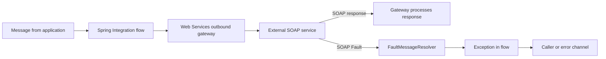
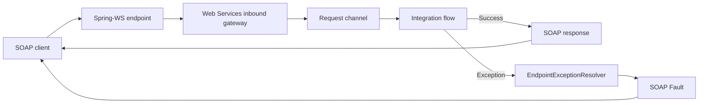

# Fault messages and SOAP errors

In Web Services integration, a SOAP call can fail in two distinct ways: the service returns a **SOAP Fault** per the SOAP contract, or the exchange encounters a failure at the transport or message-processing layer. Spring Integration bridges those errors into the message flow so the application can classify, record, route, or return errors to the caller.

This lesson focuses on both directions of the Web Services adapter:

- **Outbound gateway:** the application sends a SOAP request to an external system and receives a SOAP Fault in the response.
- **Inbound gateway:** an external system sends a SOAP request into the application; exceptions thrown in the flow can be mapped to a SOAP Fault returned to the caller.

After this lesson, you will be able to distinguish SOAP Faults from transport errors, understand how Spring-WS converts faults into exceptions, configure exception-to-fault mapping, and design error handling suited to each message's semantics.

## 1. Where do SOAP Faults sit in an integration flow?

A SOAP Fault is a structured response defined by the SOAP specification. It lives inside the SOAP Body and describes an error the endpoint wants to report to the caller. Thus, a SOAP Fault differs from failing to reach the server, timeouts, TLS errors, or unreadable responses.

An outbound flow typically looks like this:



On the inbound side, Spring-WS receives the SOAP request and passes it through the inbound gateway into a Spring Integration flow. If the flow succeeds, the gateway produces a SOAP response. If the flow throws an exception, Spring-WS's `EndpointExceptionResolver` mechanism can map that exception to a SOAP Fault.



The gateway translates between the SOAP protocol and Spring Integration messages. It does not turn every failure into a SOAP Fault: HTTP, network, or configuration errors still need separate identification.

## 2. Structure and meaning of a SOAP Fault

SOAP 1.1 and SOAP 1.2 use different element structures, yet both convey an error code, a human-readable description, and optional detail elements.

| SOAP 1.1 element | Meaning | SOAP 1.2 equivalent |
|---|---|---|
| `faultcode` | Protocol-level error group | `Code` and optional `Subcode` |
| `faultstring` | Human-readable description | `Reason` |
| `faultactor` | Component that caused the fault | `Node` or `Role` |
| `detail` | Application-contract error details | `Detail` |

Common fault groups include:

- **Client / Sender:** invalid request, missing required data, or contract violation. The caller must fix the request before resending.
- **Server / Receiver:** the endpoint failed to process the request due to a server-side error. It may be transient, but check the detail code before retrying.
- **MustUnderstand:** the endpoint could not understand or process a SOAP header marked as mandatory.
- **VersionMismatch:** the SOAP envelope uses a version incompatible with the endpoint.

Example SOAP 1.1 Fault:

```xml
<soap:Envelope xmlns:soap="http://schemas.xmlsoap.org/soap/envelope/"
               xmlns:app="https://example.com/contracts/errors">
  <soap:Body>
    <soap:Fault>
      <faultcode>soap:Client</faultcode>
      <faultstring>Order identifier is required</faultstring>
      <detail>
        <app:ValidationError>
          <app:code>ORDER_ID_REQUIRED</app:code>
          <app:field>orderId</app:field>
        </app:ValidationError>
      </detail>
    </soap:Fault>
  </soap:Body>
</soap:Envelope>
```

In this example, `faultcode` indicates the caller sent an invalid request. The `detail` section carries a machine-readable error code and the offending field so programs can handle it reliably. Applications should not parse `faultstring` text to drive business logic, because descriptions can change or be localized.

## 3. Handling SOAP Faults in an outbound gateway

Spring Integration Web Services relies on Spring-WS to send and receive SOAP messages. When a response contains a SOAP Fault, `WebServiceTemplate` invokes `FaultMessageResolver`. The default resolver, `SoapFaultMessageResolver`, turns the fault into a `SoapFaultClientException`.

Consequently, in an outbound gateway, a SOAP Fault surfaces inside the flow as an exception. When the flow runs synchronously, the exception propagates back to the caller of the gateway. With asynchronous processing or pollers, the exception may be wrapped as an `ErrorMessage` and sent to the configured error channel.

### 3.1. Using the default resolver

If the application only needs to tell a successful SOAP call from a failed one, the default resolver is usually sufficient. You can catch `SoapFaultClientException` at the adapter boundary or let it propagate to the flow's general error-handling mechanism.

Example of an application component calling the gateway and classifying a SOAP Fault:

```java
try {
    OrderReply reply = partnerSoapClient.submit(orderRequest);
    // Process successful response.
}
catch (SoapFaultClientException ex) {
    // Record SOAP Fault and translate to a domain error.
    // Fault code and reason can be read from the exception.
}
```

The method names and types of `partnerSoapClient` depend on the application's gateway interface. The key principle is handling SOAP exceptions at the integration boundary rather than forcing upper layers to understand Spring-WS internals.

### 3.2. Normalizing faults with a custom `FaultMessageResolver`

When integrating with multiple partners, each system may return different fault codes and `detail` payloads. A custom resolver translates those faults into a unified application exception.

The example below extracts the fault code and reason from the SOAP message and throws an integration-domain exception:

```java
import javax.xml.namespace.QName;

import org.springframework.ws.client.core.FaultMessageResolver;
import org.springframework.ws.soap.SoapFault;
import org.springframework.ws.soap.SoapMessage;

public class PartnerFaultMessageResolver implements FaultMessageResolver {

    @Override
    public void resolveFault(org.springframework.ws.WebServiceMessage message) {
        SoapMessage soapMessage = (SoapMessage) message;
        SoapFault fault = soapMessage.getSoapBody().getFault();

        QName faultCode = fault.getFaultCode();
        String reason = fault.getFaultStringOrReason();

        throw new PartnerSoapFaultException(faultCode, reason);
    }
}
```

The application exception can retain the fault code so downstream steps can classify it without depending on SOAP APIs:

```java
import javax.xml.namespace.QName;

public class PartnerSoapFaultException extends RuntimeException {

    private final QName faultCode;

    public PartnerSoapFaultException(QName faultCode, String reason) {
        super("Partner SOAP fault: " + reason);
        this.faultCode = faultCode;
    }

    public QName getFaultCode() {
        return faultCode;
    }
}
```

Register the resolver on the `WebServiceTemplate` used by the outbound gateway:

```java
@Bean
WebServiceTemplate partnerWebServiceTemplate(
        Marshaller marshaller,
        Unmarshaller unmarshaller,
        FaultMessageResolver partnerFaultMessageResolver) {

    WebServiceTemplate template = new WebServiceTemplate();
    template.setMarshaller(marshaller);
    template.setUnmarshaller(unmarshaller);
    template.setDefaultUri("https://partner.example.com/soap");
    template.setFaultMessageResolver(partnerFaultMessageResolver);
    return template;
}

@Bean
@ServiceActivator(inputChannel = "partnerSoapRequests")
MessageHandler partnerSoapOutboundGateway(
        WebServiceTemplate partnerWebServiceTemplate) {

    return new MarshallingWebServiceOutboundGateway(
            partnerWebServiceTemplate);
}
```

The marshaller and unmarshaller beans must match the partner's XML contract. The URI in this example is illustrative; deployed environments should read endpoints from external configuration. If the resolver throws `PartnerSoapFaultException`, the flow can handle it as a strongly typed integration error.

`FaultMessageResolver` is responsible for inspecting faults and deciding how to represent the error. Never silently swallow faults with a no-op resolver: callers would receive empty results or lack error details, leaving business state ambiguous.

### 3.3. Routing errors to an error channel

Spring Integration provides `errorChannel` for handling errors in asynchronous flows. A gateway interface can specify a default error channel:

```java
@MessagingGateway(
        defaultRequestChannel = "partnerSoapRequests",
        errorChannel = "partnerSoapErrors")
public interface PartnerSoapClient {

    OrderReply submit(OrderRequest request);
}
```

An error flow can receive `ErrorMessage`, inspect the root exception, and route the failure to the appropriate branch:

```java
@Bean
IntegrationFlow partnerSoapErrorFlow() {
    return IntegrationFlow.from("partnerSoapErrors")
            .handle(ErrorMessage.class, (error, headers) -> {
                Throwable cause = error.getPayload();

                if (cause instanceof PartnerSoapFaultException) {
                    // Classify fault by partner error code.
                    // Record correlation ID and forward to business handling.
                }
                else {
                    // Handle transport errors or other technical failures.
                }
                return null;
            })
            .get();
}
```

The handler above illustrates error classification; the application must explicitly decide what response to return to the caller, the message status, and where to persist errors. If the caller expects a structured error response, the error flow must build a contract-compliant reply. In asynchronous processing, ensure failed messages are persisted or routed for tracking rather than merely logged.

In synchronous flows, exceptions normally propagate back along the call stack. In flows using executors, pollers, or asynchronous components, verify the error channel configuration at the exact failure point. Never assume every exception automatically lands on an error channel merely because a bean named `errorChannel` exists.

## 4. Converting exceptions into SOAP Faults in an inbound gateway

On the inbound side, an external system sends requests to the application's SOAP endpoint. The Spring Integration inbound gateway forwards the payload onto the request channel. If a handler in the flow throws an exception, Spring-WS can use an `EndpointExceptionResolver` to construct a SOAP Fault.

A common setup uses `SoapFaultMappingExceptionResolver` to map exception types to fault codes and reasons:

```java
@Bean
SoapFaultMappingExceptionResolver soapFaultExceptionResolver() {
    SoapFaultMappingExceptionResolver resolver =
            new SoapFaultMappingExceptionResolver();

    Properties mappings = new Properties();
    mappings.setProperty(
            InvalidOrderException.class.getName(),
            "CLIENT,Invalid order");
    mappings.setProperty(
            OrderProcessingException.class.getName(),
            "SERVER,Unable to process order");

    resolver.setExceptionMappings(mappings);
    resolver.setOrder(1);
    return resolver;
}
```

The resolver must be registered in the application context used by Spring-WS `MessageDispatcherServlet`. `CLIENT` fits malformed or off-contract requests; `SERVER` fits internal application processing failures. For SOAP 1.2, Spring-WS maps these groups to the corresponding SOAP 1.2 codes.

For example, if an order-validation flow detects a missing order ID and throws `InvalidOrderException`, the exception resolver maps it to a Client SOAP Fault so the caller can fix the request. If the flow encounters a database failure or internal service error, the application can return a Server Fault with a safe message while logging technical details server-side.

Key checks when deploying an inbound gateway:

1. Endpoint mappings must route requests to the right inbound gateway.
2. Request and response must use the marshaller/unmarshaller or payload type expected by the flow.
3. The exception resolver must reside in the context used by `MessageDispatcherServlet` with proper ordering.
4. The flow must finish request-reply within the SOAP client's wait window. If delegating to an asynchronous channel, design a dedicated response mechanism.
5. Failures occurring before the request enters the flow—such as invalid XML or payload decoding errors—must also be covered in the SOAP Fault policy.

## 5. Error classification and retry decisions

Not every error should be retried. Retry decisions must consider the fault group, partner detail codes, business state, and request idempotency.

| Error type | Examples | Typical handling |
|---|---|---|
| SOAP Client / Sender | Missing required field, malformed data | Do not auto-retry; fix data or return error to caller |
| SOAP Server / Receiver | Partner temporarily unable to process | Bounded retries possible if operation is safe and backoff is used |
| MustUnderstand / VersionMismatch | Unsupported mandatory header, wrong SOAP version | Check contract, headers, and config; do not repeat the same request |
| Timeout or connection error | Unreachable host, dropped connection, read timeout | Bounded retries if idempotent; record unknown outcome when server commit is uncertain |
| Marshal/unmarshal error | Payload mismatches schema or fails conversion | Inspect XML contract, namespaces, and marshaller config; generally do not retry unchanged |

A SOAP Server Fault is not automatically transient. `detail` may contain a business code indicating permanent rejection. Conversely, a timeout does not prove the server did not execute the operation: the server may have persisted data while the response was lost in transit. For order creation, payment, or state updates, require an idempotency key or status-lookup mechanism before resending.

A safe retry policy typically features:

- Retrying only errors identified as recoverable.
- Capping retry attempts and using exponential backoff with jitter.
- Never retrying contract errors, authentication errors, or invalid-data errors.
- Preserving correlation IDs and idempotency keys across all attempts.
- Moving messages to an error handler or dead-letter channel for investigation once limits are exhausted.

## 6. Designing an operable error contract

A SOAP Fault that helps both callers and operations teams needs an explicit contract.

**Use stable machine-readable codes.** Put codes such as `ORDER_ID_REQUIRED`, `PARTNER_TEMPORARILY_UNAVAILABLE`, or `INVALID_CUSTOMER_STATE` inside `detail`. Never use `faultstring` prose as a routing key.

**Keep reasons short and safe.** Reasons should explain only what the caller needs to know. Never return stack traces, SQL statements, internal hostnames, tokens, passwords, or sensitive data in SOAP Faults.

**Preserve correlation IDs.** Pass a correlation ID via message headers or metadata per contract. Log it alongside fault codes, endpoints, timestamps, and outcomes to correlate logs between your application and partner systems.

**Keep technical root causes internal.** When converting a SOAP Fault into an integration-domain exception, retain the fault code and original exception where needed. When emitting a SOAP Fault to callers, expose only approved public information.

**Separate protocol errors from business outcomes.** When a request is valid but rejected by business rules, explicitly decide in the service contract whether that is a normal business response or a SOAP Fault. Do not use SOAP Faults for conditions like out-of-stock or insufficient credit if the contract models them in the standard response.

## 7. Verification and troubleshooting

When a SOAP call fails, check in this order:

1. **Check for a SOAP Fault.** Inspect the response SOAP Body. If no Fault exists, investigate transport errors, timeouts, or response-reading failures.
2. **Check the SOAP version.** Compare SOAP 1.1/1.2, envelope namespaces, and `Content-Type` used by client and server.
3. **Check fault code and `detail`.** Use stable codes in `detail` to distinguish contract, business, and technical failures.
4. **Check resolvers.** For outbound, verify `FaultMessageResolver` is attached to the active `WebServiceTemplate`. For inbound, verify Spring-WS discovers the exception resolver and maps the thrown exception.
5. **Check message context.** Record channel, correlation ID, endpoint, and exception type. For `ErrorMessage`, inspect the cause in the payload.
6. **Check retry policy.** Determine whether the operation could already have executed on the server before resending.

Never rely on HTTP status alone to determine root cause. Inspect the SOAP envelope and specific exception, because HTTP errors, SOAP Faults, and payload conversion errors have different remedies.

## 8. Hands-on exercise

Suppose an application sends `CreateOrderRequest` to a SOAP partner. The partner may return success, a SOAP Fault for missing `orderId`, a SOAP Fault for temporary service unavailability, or a timeout.

Complete the following tasks:

1. Configure an outbound gateway with a `WebServiceTemplate` and matching marshaller/unmarshaller.
2. Implement a `FaultMessageResolver` converting SOAP Faults into `PartnerSoapFaultException`, preserving fault code and reason.
3. Design an error flow distinguishing invalid-request errors, partner-side errors, and transport errors.
4. Retry only transient errors with bounded attempts. Ensure order-creation requests carry an idempotency key.
5. On an inbound gateway receiving `CreateOrderRequest`, map `InvalidOrderException` to a SOAP Client Fault and internal processing failures to a SOAP Server Fault.
6. Inspect actual SOAP responses to verify fault code, reason, and `detail` match the contract without leaking internal details.

## 9. Pre-production checklist

- [ ] SOAP version, namespaces, and contract agreed upon by both sides.
- [ ] Outbound gateway uses the proper `WebServiceTemplate` and `FaultMessageResolver`.
- [ ] Inbound gateway has an exception resolver configured for errors returned to callers.
- [ ] Fault codes in `detail` are stable and documented.
- [ ] Client/Sender errors are separated from Server/Receiver and transport errors.
- [ ] Retries are bounded with backoff and idempotency protection.
- [ ] Error flow logs correlation IDs and routes failed messages to a tracked destination.
- [ ] SOAP Faults never expose stack traces, credentials, or sensitive data.

When these points are clearly designed, SOAP Faults become a predictable part of the integration contract. Spring Integration delivers exceptions into the message flow, while the application decides which errors to return to callers, which to retry, and which to escalate to manual handling.
