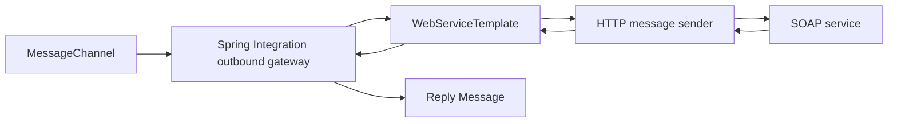

# Retries, timeouts, and correlation

When integrating SOAP with Spring Integration, a call to an external service can be slow, drop the connection, or return an error after the server has already completed the business operation. To keep the message flow reliable, three mechanisms must work together: timeouts to bound wait duration, retries for recoverable errors, and correlation to match each request with its response. Configuring any one in isolation without accounting for the other two can cause requests to exceed the SLA or execute business actions multiple times.

Within the `SPRING_INTEGRATION_ADAPTERS` module, the Web Services adapter connects Spring Integration message flows with SOAP services through inbound and outbound gateways. `SERVICE_NAME_DESCRIBE` frames this practice in the context of exchanging messages with external systems via adapters, gateways, `MessageChannel`s, and error handling. This lesson focuses on a SOAP call's lifecycle: setting time bounds, deciding when retries are safe, and maintaining identifiers across attempts.

## Where timeouts, retries, and correlation sit in a SOAP flow

With an outbound gateway, a typical flow looks like:



The outbound gateway takes a Spring `Message`, converts the payload into a SOAP request, invokes the service, and converts the SOAP response into a reply message. For synchronous calls, the gateway preserves request-response pairing within the same execution. HTTP-layer timeouts bound waiting on the remote service; retry advice can re-invoke the handler when an attempt fails; and a correlation ID identifies the same business operation across retry attempts and asynchronous flows.

Inbound gateways work in the opposite direction: receiving a SOAP request from a client, turning it into a message for the Integration flow, and creating a SOAP response from the processing result. If the client times out waiting, the server may still be processing the request. Therefore, a client retry does not imply the previous execution was cancelled.

## Distinguishing timeout types

No single timeout covers every phase of a call. Configure and observe each limit separately.

| Timeout type | What it bounds | Where it is typically configured or checked |
|---|---|---|
| Connection timeout | Time to establish a connection to the service | HTTP message sender used by `WebServiceTemplate` |
| Read/response timeout | Time waiting for response data after sending the request | HTTP message sender; often the key limit for slow SOAP services |
| Connection-pool acquisition timeout | Time waiting to borrow a connection from a pooled HTTP client | Corresponding connection manager/client config |
| `MessageChannel` send timeout | Time waiting to send a message into a channel when sending blocks | Channel config or send operation |
| Gateway reply timeout | Time the gateway waits for a reply message inside the Spring Integration flow | Corresponding endpoint gateway config |
| Business deadline | Total time the business operation may consume, including internal work, remote calls, and backoff | Application-layer or orchestration convention |

Connection timeout does not bound SOAP processing time. Read timeout does not necessarily include waiting for a connection from a pool. Gateway reply timeout likewise does not replace socket timeouts. If an inner timeout exceeds the business deadline, the caller may abandon the request while threads or the server keep running.

For example, configuring `WebServiceTemplate` with an HTTP URL connection sender in Spring Web Services:

```java
import org.springframework.context.annotation.Bean;
import org.springframework.context.annotation.Configuration;
import org.springframework.ws.transport.http.HttpUrlConnectionMessageSender;
import org.springframework.ws.client.core.WebServiceTemplate;
import org.springframework.oxm.Marshaller;
import org.springframework.oxm.Unmarshaller;

@Configuration
class SoapClientConfiguration {

    @Bean
    WebServiceTemplate webServiceTemplate(
            Marshaller marshaller,
            Unmarshaller unmarshaller) {

        var template = new WebServiceTemplate();
        template.setMarshaller(marshaller);
        template.setUnmarshaller(unmarshaller);

        var sender = new HttpUrlConnectionMessageSender();
        sender.setConnectionTimeout(2_000);
        sender.setReadTimeout(5_000);
        template.setMessageSender(sender);
        return template;
    }
}
```

Values in this example are in milliseconds. The gateway must use the `WebServiceTemplate` configured with this sender; if the gateway constructs a different template, these timeouts do not apply to its calls. When using Apache HttpComponents or a pooled client, configure timeouts on the corresponding message sender and connection manager rather than copying `HttpUrlConnectionMessageSender` settings verbatim.

Choose timeouts based on the SLA and the service's actual latency distribution. Timeouts that are too short trigger unnecessary retries during normal load spikes; timeouts that are too long tie up threads and connections, reducing capacity for incoming requests. Measure percentile latencies such as p95 and p99, then set timeouts with headroom matching the business deadline.

## Designing bounded retries

Retries fit transient errors where a subsequent attempt is likely to succeed. Typical candidates include brief connection failures, socket timeouts, intermittent DNS or network glitches, and certain server-side HTTP errors such as 502, 503, or 504. Specific rules must reflect the SOAP service contract and how Spring Web Services surfaces errors.

Never retry every exception by default. SOAP Faults representing business or contract errors do not disappear when resending the same request. For example, authentication failures, schema-invalid requests, invalid data, or business rejections belong in error handling. Some server faults may be transient; retry them only when fault codes and service documentation confirm they are recoverable.

A retry policy should clearly specify:

- **Maximum attempts:** caps total calls including the initial attempt. Avoid infinite retries.
- **Retryable exception set:** allowlist explicit transport or server errors; deny retries for unknown exceptions by default.
- **Backoff:** increase pauses between attempts to avoid hammering an overloaded service.
- **Jitter:** add randomness to backoff across multiple instances so they do not all retry simultaneously.
- **Recovery:** once attempts are exhausted, route the error to an error channel or a monitored failure flow.
- **Deadline:** total retry duration must fit within the business budget and not outlast the caller's wait window.

Spring Integration provides `RequestHandlerRetryAdvice` to apply retries to an endpoint's request handler. Spring Retry provides `RetryTemplate` along with retry and backoff policies. The example below retries only Spring Web Services I/O errors, up to three attempts, using exponential backoff:

```java
import java.util.Map;

import org.springframework.context.annotation.Bean;
import org.springframework.integration.handler.advice.RequestHandlerRetryAdvice;
import org.springframework.retry.backoff.ExponentialBackOffPolicy;
import org.springframework.retry.policy.SimpleRetryPolicy;
import org.springframework.retry.support.RetryTemplate;
import org.springframework.ws.client.WebServiceIOException;

@Bean
RequestHandlerRetryAdvice soapRetryAdvice() {
    var retryable = Map.<Class<? extends Throwable>, Boolean>of(
            WebServiceIOException.class, true
    );

    var retryPolicy = new SimpleRetryPolicy(3, retryable, true);

    var backOff = new ExponentialBackOffPolicy();
    backOff.setInitialInterval(200L);
    backOff.setMultiplier(2.0);
    backOff.setMaxInterval(2_000L);

    var retryTemplate = new RetryTemplate();
    retryTemplate.setRetryPolicy(retryPolicy);
    retryTemplate.setBackOffPolicy(backOff);

    var advice = new RequestHandlerRetryAdvice();
    advice.setRetryTemplate(retryTemplate);
    return advice;
}
```

Attach the advice to the outbound gateway endpoint that needs retries. In Java DSL, the endpoint handler spec supports advice declarations, for example:

```java
.handle(soapOutboundGateway,
        endpoint -> endpoint.advice(soapRetryAdvice))
```

Here `soapOutboundGateway` is a gateway handler/spec configured with the appropriate URI, marshaller, unmarshaller, and `WebServiceTemplate`. How the gateway spec is constructed depends on your Spring Integration WS version. Make sure the advice is attached to the outbound endpoint itself; placing it on an upstream service activator or whole flow could replay unnecessary internal steps on retry.

The sample policy is intentionally narrow: unlisted exceptions are not retried. `WebServiceIOException` generally represents I/O failures when invoking the service; other message senders may raise different exceptions. Inspect the exceptions and causes produced by your library version and add the appropriate transient errors. To retry only certain SOAP Faults or HTTP statuses, use a conditional classifier/policy inspecting fault codes or statuses rather than enabling retries for all `WebServiceException`s.

Exponential backoff in this example yields pauses of roughly 200 ms then 400 ms before subsequent attempts, capped at 2 seconds. The basic backoff policy does not necessarily include jitter; in multi-instance deployments, consider a randomized policy or explicit jitter. You can pair retries with a circuit breaker to pause calls when error rates spike instead of letting every request burn through retries.

## Calculating the deadline for the whole call

A single attempt's timeout and the business deadline are different quantities. Suppose each attempt has a 2-second connection timeout and a 5-second read timeout, up to three attempts, with 200 ms and 400 ms backoffs. In the worst case, expected duration is roughly:

```text
3 x (2 seconds + 5 seconds) + 0.2 seconds + 0.4 seconds = 21.6 seconds
```

This is only an estimate from those two timeouts; DNS, connection pool acquisition, serialization, internal processing, overhead, and other layer timeouts can change the total. If the business SLA allows only 10 seconds, this configuration is unsuitable even though each individual call looks reasonable.

Budget time across the whole flow. Once a request has consumed most of its deadline, skip further retries and transition to recovery. If multiple layers retry independently (e.g., client, Integration flow, API gateway, and target service), actual attempts multiply. Assign retry responsibility to a single clear layer and avoid stacking uncoordinated retry policies.

## Correlation IDs and request-response relationships

Correlation identifies messages belonging to the same business action or processing chain. In a SOAP flow, distinguish three scopes:

| Scope | Example | Purpose |
|---|---|---|
| Spring Integration message header | `correlationId` | Links messages inside internal flows, routers, or aggregators |
| SOAP header | WS-Addressing `MessageID` and `RelatesTo`, or a custom XML header | Carries identifiers across the SOAP service boundary |
| Business request ID | `orderRequestId`, `paymentRequestId` in the business contract | Identifies one business operation and supports idempotency/auditing |

These values may share the same underlying identifier by system agreement, but their semantics are not automatically identical. A Spring Integration message header does not automatically become a SOAP header or HTTP header. Configure a header mapper, callback, interceptor, or marshalling/unmarshalling logic to carry identifiers across the wire per contract. If the partner supports WS-Addressing, use `MessageID` on requests and `RelatesTo` on responses. If using a custom XML header, both sides must agree on namespace, element name, format, and echo rules.

Example SOAP request using WS-Addressing:

```xml
<soap:Header>
    <wsa:MessageID>urn:uuid:7c6a5a1e-7d4c-4a9f-9c11-0b3e5f2a1001</wsa:MessageID>
</soap:Header>
```

The matching response can reference the request:

```xml
<soap:Header>
    <wsa:RelatesTo>urn:uuid:7c6a5a1e-7d4c-4a9f-9c11-0b3e5f2a1001</wsa:RelatesTo>
</soap:Header>
```

This illustrates header structure; generating and processing WS-Addressing must be enabled and supported by the application's message factory, interceptor, or Spring-WS configuration. Never inject arbitrary headers if the partner service rejects them.

In synchronous request-response, the gateway holds the response within the same execution so the framework pairs replies with internal requests automatically. Correlation IDs remain valuable for logging, tracing, and matching against remote service logs. In asynchronous flows, callbacks, or multi-response handling, persist the correlation ID and look it up when responses return rather than relying on message arrival order.

If a business operation splits into multiple sub-requests, each sub-request can share the business correlation ID alongside its own sequence number. An aggregator uses a correlation strategy to group related messages, a release strategy to decide when a group is complete, and a group timeout to handle incomplete responses. An aggregator's group timeout bounds waiting for child messages; it differs from the HTTP read timeout of each individual SOAP call.

## Safe retries: idempotency and unknown outcomes

A timeout does not prove the server has not processed the request. For instance, the server receives the request, writes an order to the database, and sends the response; the network drops the response. The client hits read timeout and retries. If the server does not recognize duplicate requests, the order may be created twice.

Therefore, for operations with side effects, use a stable business request ID and server-side idempotency. The same business operation must keep the exact same ID across all retries—never generate a new ID per attempt. The server stores results by ID or enforces a unique constraint to recognize already-processed requests, returning the prior outcome instead of re-executing side effects.

Distinguish clearly:

- **Idempotent operation:** sending the same request multiple times produces the same final state, such as queries or target-state updates.
- **Non-idempotent operation:** each submission can create additional side effects, such as creating transactions, charging funds, or issuing new orders.
- **Unknown outcome:** the client loses connectivity or times out after sending; it is unknown whether the server committed.

For an unknown outcome on a non-idempotent operation, never retry blindly. Query status using the business request ID, call a result-lookup API, or route to a reconciliation queue. If the service contract supports neither idempotency nor status lookup, define explicit manual-handling or compensation procedures.

Correlation IDs and idempotency keys may derive from the same business request ID, but never treat them as one concept by default. Correlation links messages; idempotency lets the server recognize repeated business requests. A system may require both as separate IDs.

## Routing exhausted-retry errors to handling flows

When retries are exhausted, failures must enter an observable and recoverable path. Depending on flow design, use a retry advice recovery callback, an error channel, or an error flow to:

1. Record the request ID, correlation ID, endpoint, attempt count, and error category.
2. Route the message to a retry queue or dead-letter queue if business rules allow later reprocessing.
3. Mark the business state as unknown if the server may already have processed the request.
4. Trigger alerts when errors cross thresholds or when a circuit breaker opens.
5. Ensure any replay reuses the original business request ID and passes idempotency checks.

Never log full SOAP envelopes by default. Payloads can contain personal data, tokens, or sensitive business fields. Log only necessary fields, redact sensitive values, and restrict log access.

## Example operational policy

Suppose an application queries shipment status from a SOAP service. Each operation carries a unique `trackingRequestId`. The flow can be structured as follows:

1. Generate `trackingRequestId` once upon receiving the request from the internal system and store it in a message header alongside the business payload.
2. The outbound gateway maps the identifier to a SOAP header per WS-Addressing or the partner's custom header contract.
3. The HTTP sender sets a 2-second connection timeout and a 5-second read timeout; the overall flow deadline exceeds the budget for up to three attempts plus backoff.
4. Retry advice retries only transient transport failures. SOAP Faults indicating invalid data or unauthorized access go straight to the error flow.
5. Responses must reference the matching request ID. The flow checks correlation before passing results to downstream channels or aggregators.
6. If retries are exhausted, the error flow saves state and IDs for safe reconciliation or replay.

Lookups are normally idempotent and thus well-suited to bounded retries. If this example were replaced with transaction creation or payment, you would add server-side idempotency and a status check before resending after timeouts.

## Testing checklist

| Scenario | Expected outcome |
|---|---|
| Service responds within timeout | Gateway receives reply and preserves correlation ID for tracing |
| Unable to establish connection | Error classified as transport; retried within configured bounds |
| Service takes too long | Read timeout occurs; flow does not wait forever and handles unknown outcome per policy |
| SOAP Fault from invalid request | Identical request is not retried; error routed to business handling branch |
| Transient transport error then service recovers | Backoff retry succeeds within deadline |
| Retries exhausted | Recovery/error flow receives error with request ID, correlation ID, and attempt count |
| Response arrives with wrong correlation ID | Response is not paired to another request; protocol or correlation error recorded |
| Asynchronous response arrives late | Response reconciled against request state; expired messages handled per policy |
| Client times out after server commit | Retry with same idempotency key causes no second side effect |
| Multiple instances retry concurrently | Backoff/jitter and circuit breaker prevent synchronized retry storms |

In test environments, also simulate the server receiving a request and intentionally delaying or dropping the response. This is critical for catching duplicate side effects that tests which only sever connections before the server receives the request will miss.

## Principles to remember

Timeouts bound waiting at a specific layer; combine individual timeouts into an overall business deadline. Retries apply only to recoverable errors and must have attempt limits, backoff, and recovery. Correlation IDs track and pair messages across flows; crossing the SOAP boundary requires mapping them to the right header or contract field. For side-effecting operations, always treat timeouts as unknown outcomes and use idempotency or reconciliation before resending. Coordinating these three mechanisms enables the Web Services adapter to handle network failures and delayed responses while preserving business consistency.
