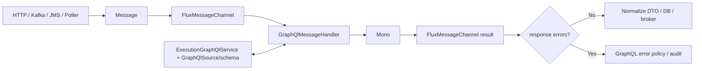
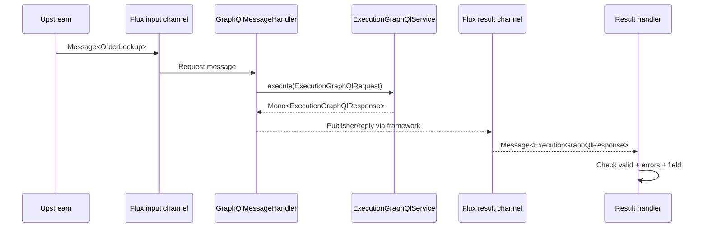
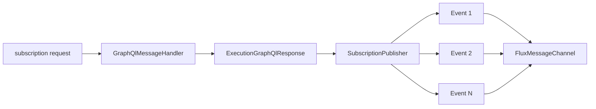
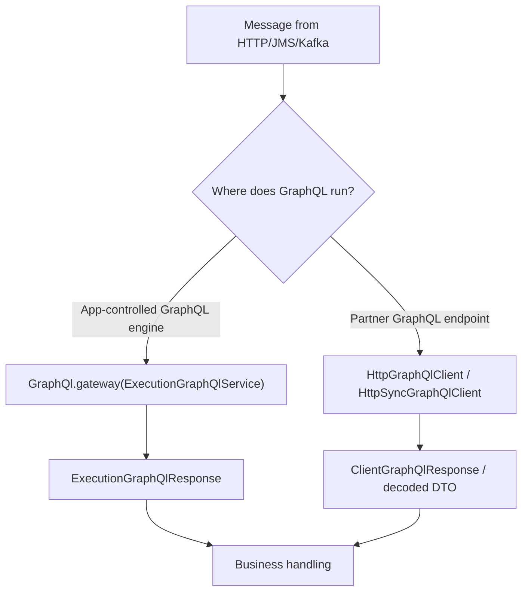
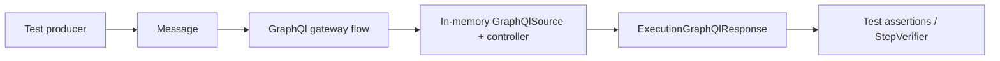

# GraphQL Outbound Gateway in Spring Integration

## 1. Problem: Bringing a GraphQL Operation into a Message Flow

A Spring Boot system receives order lookup requests from HTTP, Kafka, or JMS. Instead of having each inbound endpoint call the GraphQL processor directly, the application wants to standardize:

- How `query`, `mutation`, and `subscription` are expressed as messages.
- How `operationName` and `variables` are passed without concatenating GraphQL strings with user data.
- How `GraphQL response` is received, including both `data` and `errors`.
- How results are connected to `MessageChannel`s, transformers, routers, outbound adapters, and databases.
- How correlation ID, timeout, backpressure, audit, and security are preserved.

For example, a message contains:

```text
payload = OrderLookup(orderId="ORD-1001")
headers:
  correlationKey = workflow-123
  sourceSystem   = order-events
```

The gateway executes a configured GraphQL operation:

```graphql
query FindOrder($id: ID!) {
  order(id: $id) {
    id
    status
    amountCents
  }
}
```

with `variables = {"id": "ORD-1001"}`, and returns the response to the Spring Integration flow so consumers can inspect data and errors before deciding the next step.

The lesson **“GraphQL Outbound Gateway”** belongs to the **GraphQL Adapter** chapter of the `SPRING_INTEGRATION_ADAPTERS` module. The overall goal of the module is to connect external systems using inbound/outbound adapters, gateways, pollers, and `MessageChannel`s; practicing flows for files, SFTP, HTTP, JMS, AMQP, Kafka, databases, message contracts, errors, and connection lifecycles. In this chapter, GraphQL is a **schema-based query/mutation protocol**, while Spring Integration orchestrates messages through a gateway.

### After this lesson, you can

1. Distinguish the **Spring Integration GraphQL outbound gateway** from a **GraphQL HTTP client to a remote server**.
2. Understand `GraphQlMessageHandler`, `GraphQlMessageHandlerSpec`, `ExecutionGraphQlService`, and `GraphQlSource`.
3. Use `GraphQl.gateway(graphQlService)` to configure the query, operation name, variables, and execution ID.
4. Combine the gateway with `IntegrationFlow` and `FluxMessageChannel`; handle `ExecutionGraphQlResponse` properly.
5. Preserve payload, headers, and correlation context in a controlled manner.
6. Distinguish transport/framework errors from GraphQL errors in `response.getErrors()`, including partial data.
7. Handle mutations idempotently and subscriptions as streams, without treating a subscription as a single reply.
8. Choose `HttpGraphQlClient`/`HttpSyncGraphQlClient` when you genuinely want to access a remote GraphQL endpoint.
9. Design tests, timeouts, retries, authorization, telemetry, and production-oriented exercises.

## 2. What exactly does “outbound gateway” refer to?

**Spring Integration 6.5 includes the `spring-integration-graphql` module**. The outbound gateway components are:

```text
org.springframework.integration.graphql.outbound.GraphQlMessageHandler
org.springframework.integration.graphql.dsl.GraphQl
org.springframework.integration.graphql.dsl.GraphQlMessageHandlerSpec
```

`GraphQlMessageHandler` extends `AbstractReplyProducingMessageHandler`. It receives a message, creates or uses an `ExecutionGraphQlRequest`, calls **`ExecutionGraphQlService.execute(...)`**, and produces a response.

**Very important distinction:**

- `GraphQl.gateway(executionGraphQlService)` is a gateway to a **GraphQL execution service** (typically the GraphQL engine/schema configured within the application); **it does not automatically issue an HTTP POST to a remote GraphQL URL**.
- If the goal is to call `https://partner.example/graphql` over the network, use **Spring for GraphQL `HttpGraphQlClient`/`HttpSyncGraphQlClient`** inside a service activator or an appropriate HTTP outbound gateway. Do not pass a dummy URL into `GraphQl.gateway(...)` expecting remote transport.

The Spring Integration 6.5 documentation states that the GraphQL outbound gateway can be triggered by any message source, not just HTTP inbound. This is the advantage of Enterprise Integration Patterns: the same operation can be invoked from a file event, Kafka message, JMS command, or scheduled pipeline.

### 2.1. Flow Diagram



### 2.2. Component Table

| Component | Role | Do not confuse with |
|---|---|---|
| `Message<?>` | Input payload + headers to the gateway | Raw HTTP GraphQL request body |
| `GraphQlMessageHandler` | Reply-producing handler that executes the GraphQL operation | HTTP client managing an endpoint URL |
| `GraphQlMessageHandlerSpec` | Fluent Java DSL for operation/variables/locale/execution ID | GraphQL schema |
| `ExecutionGraphQlService` | Service that executes a GraphQL Java request | `HttpGraphQlClient` to a remote server |
| `GraphQlSource` | Application's engine/schema/data fetchers | An RSS file or REST resource |
| `ExecutionGraphQlRequest` | Prepared request contract ready for execution | Custom `MessageHeaders` |
| `ExecutionGraphQlResponse` | GraphQL result: data/errors/extensions | Validated domain DTO |
| `FluxMessageChannel` | Channel supporting Reactive Streams | Default durable queue/broker |

## 3. GraphQL Request and Response: Core Concepts

A GraphQL operation consists of a **document** containing schema fields, an operation type, and optionally an operation name and variables.

### 3.1. Query and Variables

```graphql
query FindOrder($id: ID!) {
  order(id: $id) {
    id
    status
    amountCents
  }
}
```

A request can be expressed according to the GraphQL over HTTP standard:

```json
{
  "query": "query FindOrder($id: ID!) { order(id: $id) { id status amountCents } }",
  "operationName": "FindOrder",
  "variables": {
    "id": "ORD-1001"
  }
}
```

However, with `GraphQlMessageHandler`, you do not need to build HTTP JSON like above manually: the spec configures the operation and variables to construct the request for `ExecutionGraphQlService`.

**Do not concatenate strings from user data:**

```java
// DO NOT: insert ID directly into the GraphQL document.
String query = "{ order(id: \"" + userInput + "\") { id } }";
```

Instead, keep the document static/persisted and pass `variables` separately. This reduces escaping bugs and the risk of GraphQL syntax manipulation; while still requiring authorization checks and input validation.

### 3.2. Query vs. Mutation

| Operation | Purpose | Retry/Idempotency |
|---|---|---|
| `query` | Read data according to schema | May retry certain transient errors when safe |
| `mutation` | Modify data/state | Requires idempotency key, transaction, and side-effect control |
| `subscription` | Maintain an event stream | Requires subscriber, cancellation, backpressure, and reconnect policy |

Do not treat the name `query` as an automatic HTTP GET: in `ExecutionGraphQlService`, the operation is executed by the GraphQL engine; HTTP methods only appear if you use an actual transport.

### 3.3. A Response Can Contain Both `data` *and* `errors`

A valid GraphQL response may contain:

```json
{
  "data": {
    "order": {
      "id": "ORD-1001",
      "status": null,
      "amountCents": 12500
    }
  },
  "errors": [
    {
      "message": "Access to status denied",
      "path": ["order", "status"]
    }
  ]
}
```

Conversely, a schema-invalid request may have no useful data:

```json
{
  "errors": [
    {
      "message": "Validation error ..."
    }
  ]
}
```

**Rule:** Do not just call `getData()` and assume the message succeeded. With `ExecutionGraphQlResponse`, you must check:

1. `response.isValid()` — whether the response has structurally valid data without a whole-request error.
2. `response.getErrors()` — whether there are GraphQL errors, even when `isValid() == true`.
3. `response.field("order")` — whether a specific field is null, has errors, or can be decoded.
4. Business rules: accept partial data, retry, quarantine, or return an error to the caller.

A GraphQL error is **not necessarily** a Java exception and does not necessarily go to the Spring Integration `errorChannel`. Distinguish **in-band** errors (GraphQL `errors`) from **out-of-band** errors (exception/timeout/handler failure).

## 4. Dependency and Schema Configuration for Practice

The main examples use **compatible Spring Boot 3.x / Spring Integration 6.5.x, Java 17**. To avoid version conflicts, choose a Spring Boot release with matching dependency management instead of forcing Spring Integration and Spring for GraphQL from different release trains.

### 4.1. Dependencies

**`build.gradle`:**

```gradle
dependencies {
    implementation 'org.springframework.boot:spring-boot-starter-integration'
    implementation 'org.springframework.integration:spring-integration-graphql'
    implementation 'org.springframework.boot:spring-boot-starter-graphql'
}
```

`spring-integration-graphql` provides `GraphQlMessageHandler` and the Java DSL. `spring-boot-starter-graphql` provides Spring for GraphQL components and auto-configuration utilities for applications with a schema/controller.

If the application **only** wants to use a local GraphQL engine, an exposed HTTP endpoint is not strictly needed; configuring `ExecutionGraphQlService`/`GraphQlSource` beans is sufficient for the gateway. For remote GraphQL APIs, an appropriate transport client is needed rather than just this dependency.

### 4.2. Simple GraphQL Schema

**Example file in practice project:** `src/main/resources/graphql/order-schema.graphqls`

```graphql
type Query {
  order(id: ID!): Order
}

type Order {
  id: ID!
  status: String!
  amountCents: Int!
}
```

The schema above specifies that `order` returns null if not found; if found, the fields of `Order` must not be null. This is an intentional example: when a data fetcher returns a null field violating `!`, GraphQL Java can produce a field error and perform null propagation.

### 4.3. Domain Record and QueryMapping

**`Order.java`:**

```java
public record Order(String id, String status, int amountCents) {
}
```

**`OrderGraphQlController.java`:**

```java
import org.springframework.graphql.data.method.annotation.Argument;
import org.springframework.graphql.data.method.annotation.QueryMapping;
import org.springframework.stereotype.Controller;

@Controller
public class OrderGraphQlController {

    @QueryMapping
    public Order order(@Argument String id) {
        // In-memory fixture only; production calls a service/repository.
        if ("ORD-1001".equals(id)) {
            return new Order("ORD-1001", "READY", 12_500);
        }
        return null;
    }
}
```

The names `order` and `id` must match the schema. `@QueryMapping` binds the method to a field of type `Query`; `@Argument` receives the variable bound to the field.

### 4.4. GraphQlSource and ExecutionGraphQlService

To make the mechanism transparent, beans can be declared following the pattern in the Spring Integration documentation:

```java
import org.springframework.context.annotation.Bean;
import org.springframework.context.annotation.Configuration;
import org.springframework.core.io.ClassPathResource;
import org.springframework.graphql.ExecutionGraphQlService;
import org.springframework.graphql.execution.DefaultExecutionGraphQlService;
import org.springframework.graphql.execution.GraphQlSource;
import org.springframework.graphql.data.method.annotation.support.AnnotatedControllerConfigurer;

@Configuration
public class OrderGraphQlEngineConfig {

    @Bean
    AnnotatedControllerConfigurer annotatedControllerConfigurer() {
        return new AnnotatedControllerConfigurer();
    }

    @Bean
    GraphQlSource orderGraphQlSource(
            AnnotatedControllerConfigurer configurer) {
        return GraphQlSource.builder()
                .schemaResources(
                        new ClassPathResource(
                                "graphql/order-schema.graphqls"))
                .configureRuntimeWiring(configurer)
                .build();
    }

    @Bean
    ExecutionGraphQlService executionGraphQlService(
            GraphQlSource source) {
        return new DefaultExecutionGraphQlService(source);
    }
}
```

This is an **explicit** configuration so learners can see which service the gateway invokes. In real Spring Boot applications, the GraphQL starter may already auto-configure `GraphQlSource`/`ExecutionGraphQlService`. **Choose one bean ownership mechanism**—do not declare both manual and auto-configured beans in parallel without checking bean conditions, to avoid conflicts or using the wrong schema. If there are multiple schemas/`GraphQlSource`s, use bean names and `@Qualifier`.

## 5. Java DSL: GraphQL Outbound Gateway Executing a Query

### 5.1. Request Payload

**`OrderLookup.java`:**

```java
public record OrderLookup(String orderId) {
    public OrderLookup {
        if (orderId == null || orderId.isBlank()) {
            throw new IllegalArgumentException(
                    "orderId must not be blank");
        }
    }
}
```

A request message carries an `OrderLookup` payload, not an arbitrary GraphQL document supplied by a user.

### 5.2. IntegrationFlow and GraphQl.gateway

**`OrderGraphQlGatewayConfig.java`:**

```java
import java.util.Map;

import org.springframework.context.annotation.Bean;
import org.springframework.context.annotation.Configuration;
import org.springframework.graphql.ExecutionGraphQlService;
import org.springframework.integration.config.EnableIntegration;
import org.springframework.integration.dsl.IntegrationFlow;
import org.springframework.integration.dsl.MessageChannels;
import org.springframework.integration.graphql.dsl.GraphQl;

@Configuration
@EnableIntegration
public class OrderGraphQlGatewayConfig {

    private static final String FIND_ORDER = """
            query FindOrder($id: ID!) {
              order(id: $id) {
                id
                status
                amountCents
              }
            }
            """;

    @Bean
    IntegrationFlow orderGraphQlFlow(
            ExecutionGraphQlService graphQlService) {

        return IntegrationFlow
                .from(MessageChannels.flux("orderGraphQlRequests"))
                .handle(GraphQl.gateway(graphQlService)
                        .operation(FIND_ORDER)
                        .operationName("FindOrder")
                        .variables(message -> {
                            OrderLookup lookup =
                                    (OrderLookup) message.getPayload();
                            return Map.of("id", lookup.orderId());
                        })
                        .executionId(message -> message.getHeaders()
                                .getId().toString()))
                .channel(c -> c.flux("orderGraphQlResults"))
                .get();
    }
}
```

**Explanation:**

1. `MessageChannels.flux("orderGraphQlRequests")` creates a reactive stream channel entry point following the Spring Integration documentation pattern.
2. `GraphQl.gateway(graphQlService)` creates a `GraphQlMessageHandlerSpec` for the outbound gateway.
3. `.operation(FIND_ORDER)` sets the approved static GraphQL query.
4. `.operationName("FindOrder")` selects the operation by name. If the document has only one operation, this may not be required; if the document has multiple operations, you must specify which one to execute.
5. `.variables(message -> Map.of(...))` extracts arguments from the payload and builds GraphQL variables. Do not concatenate `orderId` directly into the document.
6. `.executionId(...)` sets the GraphQL execution ID from the message ID for tracing. This ID differs from a business correlation key; production can retrieve it from a validated custom header.
7. `.channel(c -> c.flux("orderGraphQlResults"))` keeps the reply in the reactive flow so the downstream handler receives `ExecutionGraphQlResponse`.

If you use `.variablesExpression("payload.variables")` or `.operationExpression(...)`, keep in mind these are **SpEL evaluated against the request message**; property names must match the actual payload. Java lambdas are strong for type safety and refactoring when the contract is clear. Do not allow external clients to arbitrarily specify the operation document or SpEL expression.

### 5.3. How to Send Messages into the Flow

An inbound adapter or another service simply sends a message to the input channel:

```java
import org.springframework.beans.factory.annotation.Qualifier;
import org.springframework.integration.support.MessageBuilder;
import org.springframework.messaging.MessageChannel;
import org.springframework.stereotype.Component;

@Component
public class OrderLookupPublisher {
    private final MessageChannel requests;

    public OrderLookupPublisher(
            @Qualifier("orderGraphQlRequests")
            MessageChannel requests) {
        this.requests = requests;
    }

    public void request(String orderId, String correlationKey) {
        boolean accepted = requests.send(
                MessageBuilder.withPayload(new OrderLookup(orderId))
                    .setHeader("correlationKey", correlationKey)
                    .build());

        if (!accepted) {
            throw new IllegalStateException(
                    "Failed to send message to input channel");
        }
    }
}
```

`send()` returning true only confirms the channel accepted the message per its contract, **not that GraphQL has executed or a business handler has committed**. With `FluxMessageChannel`, results arrive **asynchronously** and require a subscriber/endpoint to consume them. Do not expect the `request(...)` method above to return order data synchronously.

### 5.4. Consumer Handling ExecutionGraphQlResponse

**`OrderGraphQlResultHandler.java`:**

```java
import org.springframework.graphql.ExecutionGraphQlResponse;
import org.springframework.integration.annotation.ServiceActivator;
import org.springframework.stereotype.Component;

@Component
public class OrderGraphQlResultHandler {

    @ServiceActivator(inputChannel = "orderGraphQlResults")
    public void onGraphQlResult(ExecutionGraphQlResponse response) {
        if (!response.isValid()) {
            System.err.println("Invalid GraphQL request; errors="
                    + response.getErrors().size());
            return;
        }

        if (!response.getErrors().isEmpty()) {
            // Partial data may be structurally valid yet contain field errors.
            System.err.println("GraphQL partial errors="
                    + response.getErrors().size());
            return; // Demo policy: reject partial data.
        }

        Order order = response.field("order").toEntity(Order.class);
        if (order == null) {
            // Valid query, but no order exists for this ID.
            System.out.println("Order does not exist");
            return;
        }

        System.out.println("GraphQL order status=" + order.status());
        // Production: map to DTO, write to DB, or send outbound message.
    }
}
```

This method runs when the **reply message** arrives on `orderGraphQlResults`. It receives an `ExecutionGraphQlResponse` payload, not `Mono<ExecutionGraphQlResponse>`: the gateway and reactive channel handle the publisher as described in the documentation.

This is only a demo policy—“reject partial data if there is any GraphQL error.” Business rules might allow certain partial data; if so, you must inspect `field("order")`/field errors and determine whether sufficient data is present to commit. Do not log raw GraphQL errors containing sensitive data.

## 6. Configuring Operation, Variables, and Context Properly

### 6.1. Ways to Set the Operation

`GraphQlMessageHandlerSpec` supports both static and message-driven dynamic configuration:

| Java DSL | Purpose | When to use |
|---|---|---|
| `operation(String)` | Fixed query/mutation/subscription | Best for pre-approved operations |
| `operation(Function<Message<?>, String>)` | Build document from a message | Only with a trusted registry/document whitelist |
| `operationExpression(String/Expression)` | Read document via SpEL | When the message contract is well-defined |
| `operationName(String)` | Select a named operation | Multi-operation documents |
| `operationName(Function<...>)` | Operation name per message | With an allowlist |
| `variables(Function<..., Map<String,Object>>)` | Build typed variables | Dynamic input data, static operation |
| `variablesExpression(...)` | Map variables via SpEL | Payload has matching property/map |
| `executionId(...)` / `executionIdExpression(...)` | GraphQL execution ID | Correlation/debugging |
| `locale(Locale)` | Locale in execution context | When resolvers use locale |

These APIs are listed in the Spring Integration 6.5 `GraphQlMessageHandlerSpec` Javadoc. Ensure functions return the type required by the method—especially `variables` must be a `Map<String,Object>`, not an unparsed JSON string.

### 6.2. Use Only Approved Operations

Do not allow an untrusted Kafka event to carry an arbitrary GraphQL document and call `operationExpression("payload")` without controls. Callers could attempt introspection, deeply nested queries, alias fan-out, sensitive fields, or unauthorized mutations.

A safer approach:

```text
payload.commandType = FIND_ORDER
payload.id          = ORD-1001
             |
             v
whitelisted query document: FindOrder
variables["id"] = "ORD-1001"
```

Whitelist operations, validate variables, enforce document complexity/depth limits, and place authorization on **GraphQL fields/data fetchers**. Do not assume that just because the operation is a constant, every message sender is authorized to read that order.

### 6.3. Execution ID and Correlation Headers

According to Spring Integration 6.5, the execution ID defaults to the **`id` of the request message**; it can also be configured via an expression. Distinguish:

```text
message.headers.id         = Spring-generated UUID
message.headers.correlationKey = workflow-123
graphql executionId        = e.g., that UUID
domain orderId             = ORD-1001
```

Business keys used to prevent duplicates are typically `orderId + operation/version` or a mutation idempotency key. A message UUID only identifies a single exchange and cannot replace a durable business key.

### 6.4. Locale and GraphQLContext

`.locale(Locale.forLanguageTag("vi-VN"))` sets the locale in the execution context if resolvers need formatting/localization. Locale is not a security mechanism and must not be used as tenant identity. If you need to propagate principal/tenant, establish an explicit context propagation and trust boundary rather than trusting an arbitrary `tenantId` header from the caller.

### 6.5. When the Payload Is Already an `ExecutionGraphQlRequest`

A special case explicitly documented by Spring Integration 6.5: if the **request message payload is already an `ExecutionGraphQlRequest`**, `GraphQlMessageHandler` uses that object **as-is** to call `ExecutionGraphQlService.execute(...)`. The handler's request-building steps from `operation`, `operationName`, `variables`, and `executionId` **are not re-applied**.

This is useful when upstream is already a GraphQL-aware component constructing complete requests. However, it is also a **trust boundary**: if an external input can construct an arbitrary `ExecutionGraphQlRequest`, a static operation configured on the gateway will **not prevent** the caller from changing the document. When an allowlist is required, validate upstream payloads and enforce access control at the schema/resolver level.

For typical integration flows, passing a **business DTO** in the message and letting `GraphQl.gateway(...)` choose a static document is simpler. Do not construct an `ExecutionGraphQlRequest` manually just to send an `orderId`.

## 7. Reactive Replies and Channel Selection

### 7.1. Why Does GraphQlMessageHandler Work with Mono?

According to the documentation, `GraphQlMessageHandler` calls `ExecutionGraphQlService.execute(request)` to obtain a `Mono<ExecutionGraphQlResponse>`. The framework supports subscribing to the publisher on a `ReactiveStreamsSubscribableChannel` or via the async mechanism of message-producing handlers when the output channel is non-reactive.



Do not call `.block()` inside a reactive pipeline just to get the result "easily", especially on a non-blocking event loop. If you must bridge to legacy synchronous code, establish a boundary with proper timeouts and a dedicated thread model so Reactor schedulers are not starved.

### 7.2. Which Channel for Which Goal?

| Channel/Architecture | Strengths | Considerations |
|---|---|---|
| `FluxMessageChannel` | Natural fit for `Mono/Flux` and reactive pipelines | Requires subscriber, cancellation/backpressure, and error handling |
| `DirectChannel` | Simple synchronous coordination | GraphQL execution is still async `Mono`; do not assume send=completed |
| `ExecutorChannel` | Decouples execution from upstream thread | Errors may take a different path; bound queue/concurrency |
| `QueueChannel` | In-process buffering | Not durable across restarts by default |
| Kafka/JMS/AMQP | Configurable durable transport | DTO serialization, idempotency, DLQ, and offset/ack |

For the first example, we use `FluxMessageChannel` per the official Spring Integration documentation because it clearly demonstrates reactive replies.

### 7.3. Backpressure and Concurrency

When 5,000 requests arrive simultaneously, using `FluxMessageChannel` does not automatically guarantee the DB/DataFetcher can handle 5,000 concurrent requests. You must bound producer rates, subscription counts, resolver concurrency, thread pools, database pools, request timeouts, and quotas. With upstream Kafka/JMS, ack/offset commit must be tied to **durable processing completion**, not merely sending into a Flux channel.

### 7.4. Do Not Create Nested Mono Replies

The gateway already returns a publisher per its contract. Do not use a transformer that returns `Mono<Mono<...>>` or serialize `ExecutionGraphQlResponse` into a JSON string before checking `errors`. If JSON is needed downstream of the gateway, convert `ExecutionGraphQlResponse` into a validated DTO/Map first, then serialize.

## 8. Mutation: Outbound Gateways Can Cause Side Effects

### 8.1. GraphQL Mutations Also Go Through GraphQlMessageHandler

According to the documentation, `GraphQlMessageHandler` can execute GraphQL `query`, `mutation`, and `subscription`. For example, to update an order's status:

```graphql
mutation MarkOrderReady($id: ID!, $requestKey: ID!) {
  markOrderReady(id: $id, requestKey: $requestKey) {
    id
    status
    amountCents
  }
}
```

The lab schema will need to **add**:

```graphql
type Mutation {
  markOrderReady(id: ID!, requestKey: ID!): Order!
}
```

These snippets **extend** the earlier Query schema rather than replacing `type Query`. The corresponding data fetcher/mutation controller on the execution service must also be implemented.

A similar Java DSL configuration:

```java
// Snippet illustrating another IntegrationFlow.
.handle(GraphQl.gateway(graphQlService)
        .operation("""
            mutation MarkOrderReady($id: ID!, $requestKey: ID!) {
              markOrderReady(id: $id, requestKey: $requestKey) {
                id status amountCents
              }
            }
            """)
        .operationName("MarkOrderReady")
        .variables(message -> {
            MarkOrderCommand command =
                    (MarkOrderCommand) message.getPayload();
            return Map.of(
                    "id", command.orderId(),
                    "requestKey", command.requestKey());
        }))
```

`MarkOrderCommand` is a business record defined by the application with two fields, `orderId` and `requestKey`; the snippet above is **a DSL fragment**, not a standalone class. Correlation headers can be attached, but the business ID and idempotency key belong in the message/DB contract.

### 8.2. Why Mutations Must Not Be Retried Blindly

Suppose a message requests a status transition or charge, and the execution service commits the transaction, but the reply flow times out before the consumer receives it:

```text
mutation executed --> database COMMITTED
                 --> reply timeout
                 --> upstream retries
                 --> mutation may execute again
```

If a mutation causes side effects (orders, payments, notifications), retries can duplicate those effects. You need:

- A stable `requestKey` from the source, not a fresh UUID generated on retry.
- A unique constraint or idempotency table in the mutation-executing service.
- A transaction covering both state and related events/outbox.
- A rule for returning the existing result on duplicate requests.
- Auditing and classification of duplicate/version-conflict errors.

**A GraphQL operation named `mutation` does not guarantee transactions or idempotency.** That responsibility lies with the data fetcher/business service and upstream/downstream adapters.

### 8.3. How Are Mutation Errors Represented?

If a resolver throws an exception that GraphQL Java/Spring GraphQL translates into GraphQL `errors`, the gateway may still return an `ExecutionGraphQlResponse` with non-empty `getErrors()`. Do not assume the handler threw a Java exception just because a mutation failed.

Conversely, a real network failure in a remote HTTP client or an exception in the Spring Integration flow follows its respective error mechanism. Classify errors carefully to avoid retrying a mutation that already committed.

## 9. Subscription Is Not a Single Reply

### 9.1. GraphQL Subscriptions Produce an Event Stream

```graphql
subscription OnOrderStatus($id: ID!) {
  orderStatusChanged(id: $id) {
    id
    status
  }
}
```

According to Spring Integration 6.5, for a `subscription`, `ExecutionGraphQlResponse.getData()` contains a **SubscriptionPublisher**, which requires a subscriber to process the stream or route it into a `FluxMessageChannel`.



Do not cast `getData()` of a subscription to `List<Map<...>>` and treat it as a completed response. In a subscription, data arrives continuously until the subscriber cancels, the source completes, or the stream errors.

### 9.2. Forwarding the Subscription Publisher to Another Channel

The Spring Integration documentation illustrates a service activator extracting the publisher from the response and sending it to a `FluxMessageChannel` output channel:

```java
// Pseudocode based on the documentation; requires configuring
// the subscription source/schema and output FluxMessageChannel.
@ServiceActivator(
        inputChannel = "graphQlSubscriptionResponses",
        outputChannel = "graphQlSubscriptionEvents")
public Object toSubscriptionStream(
        ExecutionGraphQlResponse response) {
    if (!response.getErrors().isEmpty()) {
        throw new IllegalStateException(
                "GraphQL subscription setup failed");
    }
    return response.getData(); // SubscriptionPublisher
}
```

The example uses `Object` in the signature to avoid tying the explanation to a specific publisher type; production code should use the exact type and verify how the framework flattens publishers in the target Spring Integration version. You must have a **real subscriber** on the output channel, plus bounded concurrency, cancellation, backpressure, and subscription lifecycle management.

### 9.3. Errors After the Subscription Is Established

There are two error paths:

- **Setup/validation error:** immediately in the response when the GraphQL document or field is invalid.
- **Streaming error:** `onError` or an error event within the publisher after the subscription has started.

A handler that inspects only the initial response **will not catch subsequent stream errors**. Use subscriber error handling, backoff-based reconnect, resume/cursors if provided by the publisher, and idempotency upon stream reconnection. Without a cursor/resume contract, you cannot promise "no lost events" when a connection drops.

### 9.4. Subscriptions to an External Server Are Different

If you need to subscribe to a remote GraphQL server, use Spring for GraphQL `WebSocketGraphQlClient`, an RSocket client, or SSE if supported by the transport; `GraphQl.gateway(ExecutionGraphQlService)` **does not open a WebSocket connection to an external URL**.

## 10. When the Real Goal Is a Remote GraphQL API

### 10.1. Comparing the Two Architectures



| Requirement | Component to Choose | Why |
|---|---|---|
| Execute queries in the app's configured GraphQL engine | `GraphQlMessageHandler` | Calls `ExecutionGraphQlService` |
| Combine inbound Kafka/JMS with an internal GraphQL schema | `GraphQl.gateway(...)` in `IntegrationFlow` | Independent of upstream transport |
| Query endpoint `https://api.partner/graphql` | `HttpGraphQlClient` or `HttpSyncGraphQlClient` | Has real HTTP transport |
| Continuous remote subscription | `WebSocketGraphQlClient`/RSocket/SSE client | Has streaming connection |
| Send raw GraphQL JSON POST with explicit HTTP mapping | Spring Integration HTTP outbound gateway | Full control over HTTP headers/status/body |

### 10.2. Remote Call Example with HttpGraphQlClient

Spring for GraphQL provides `HttpGraphQlClient` built on `WebClient`. A snippet **not using `GraphQlMessageHandler`**:

```java
import org.springframework.graphql.client.HttpGraphQlClient;
import org.springframework.web.reactive.function.client.WebClient;
import reactor.core.publisher.Mono;

WebClient webClient = WebClient.builder()
        .baseUrl("https://api.partner.example/graphql")
        .build();
HttpGraphQlClient remote = HttpGraphQlClient.create(webClient);

Mono<Order> orderResult = remote
        .document("""
            query FindOrder($id: ID!) {
              order(id: $id) {
                id status amountCents
              }
            }
            """)
        .variable("id", "ORD-1001")
        .retrieve("order")
        .toEntity(Order.class);
```

`api.partner.example` is only an illustrative address; replace it with a real endpoint. `Order` in the snippet is a client-side DTO (the record from section 4) and does not require a local GraphQL schema in the calling application.

To integrate this snippet into a Spring Integration flow, wrap the logic in a **service activator** returning `Mono<Order>` to a reactive channel, or use an HTTP outbound gateway to send JSON requests; both differ from the local `GraphQl.gateway(...)`. Do not mix up `ExecutionGraphQlService` and `HttpGraphQlClient` as if they were the same interface.

### 10.3. Security When Calling Remote GraphQL

- Keep target URLs in configuration/allowlists; never accept arbitrary GraphQL URLs from untrusted payloads.
- Enforce TLS certificate verification, timeouts, rate limits, proxies, and appropriate DNS/redirect policies.
- Use OAuth2/Bearer tokens or mTLS via client configuration/secret managers; never log tokens.
- Propagate per-request authentication in a controlled manner; avoid a single global token in multi-tenant systems when inappropriate.
- GraphQL can return HTTP 200 with `errors`; do not check only HTTP status.
- Do not auto-retry mutations when you do not know whether the prior side effect committed.
- For subscriptions, manage reconnection, backpressure, cancellation, and stream errors.

### 10.4. Query Optimization and Avoiding N+1

GraphQL lets a single request fetch many fields and nested objects. Yet each field may trigger a data fetcher/database query. DataLoader/batching, query depth/complexity limits, pagination, caching, and per-tenant quotas are critical. The gateway does not solve N+1 on behalf of resolvers.

## 11. Error Handling: GraphQL Errors, Java Exceptions, and Message Channels

### 11.1. Two Error Layers to Handle Separately

```text
Message -> GraphQlMessageHandler -> ExecutionGraphQlService
                    |
                    +-- Mono emits ExecutionGraphQlResponse
                    |       +-- isValid() / getErrors()
                    |       +-- data or partial data
                    |
                    +-- Mono onError / framework exception
                            +-- reactive onError / errorChannel policy
```

| Scenario | Observation | Recommended Action |
|---|---|---|
| Query field exists, complete data | `isValid=true`, errors empty | Decode DTO, continue |
| Order does not exist | `data.order=null`, errors may be empty | Business NOT_FOUND, do not blindly retry |
| GraphQL validation error | `isValid=false` or request errors | Fix operation/schema, do not retry immediately |
| Resolver returns partial data | `isValid=true`, `getErrors()` non-empty | Field-level policy, do not treat as full success |
| Non-nullable field returns null | GraphQL null propagation and errors | Check schema/handler |
| Authorization denied | `errors` or exception depending on layer | Classify UNAUTHORIZED/FORBIDDEN |
| Engine/service throws unexpected error | `Mono.onError` or error response | Logging, alert, retry only if genuinely transient |
| Mutation committed but reply failed | Mutation outcome uncertain | Check idempotency key/ledger |
| Subscription stream errors after start | Publisher `onError` | Reconnect/resume/backoff, emit metric |
| Remote HTTP 401/429/503 | Transport exception or status | Handle at remote client, do not confuse with GraphQL validation |

### 11.2. Pattern for Checking Errors Before Mapping Domain DTOs

```java
import org.springframework.graphql.ExecutionGraphQlResponse;

public final class GraphQlResponsePolicy {

    public Order requireOrder(ExecutionGraphQlResponse response) {
        if (!response.isValid()) {
            throw new IllegalArgumentException(
                    "GraphQL request invalid; errorCount="
                    + response.getErrors().size());
        }

        if (!response.getErrors().isEmpty()) {
            // This business flow requires all fields to be error-free.
            throw new IllegalStateException(
                    "GraphQL partial data; errorCount="
                    + response.getErrors().size());
        }

        Order order = response.field("order").toEntity(Order.class);
        if (order == null) {
            throw new OrderNotFoundException();
        }
        return order;
    }
}

// Application-defined domain exception, not from Spring GraphQL.
class OrderNotFoundException extends RuntimeException {
}
```

This is a **strict policy** for demonstration: reject partial data and do not log full GraphQL error messages. Production may permit partial data for optional fields, but must distinguish which fields are mandatory for business correctness. A null field because data does not exist is not equivalent to a null caused by a resolver error.

### 11.3. Does Spring Integration's Error Channel Catch All GraphQL Errors?

**No.** An `ExecutionGraphQlResponse` containing `errors` is still a valid **reply value** in GraphQL and does not automatically turn into an `ErrorMessage`. If you want to route certain responses to a failure branch, place a classifier/router after the gateway to inspect `isValid/getErrors`.

With a Reactor error signal, errors follow reactive subscription/error handling; if the output is non-reactive, `AbstractMessageProducingHandler` uses context-appropriate async error messaging. Inspect the actual pipeline: global `errorChannel`, message-specific `errorChannel`, Reactor error handling, and broker DLQ each have different scopes.

### 11.4. Is Retrying Safe?

| Operation | Retry Guidance |
|---|---|
| Query | Retry only transient exceptions/transport issues; apply backoff and limits |
| Mutation | Do not auto-retry without idempotency/reconciliation |
| Subscription | Retry/reconnect stream with resume/offset if server supports it |
| GraphQL schema validation error | Do not retry before fixing the document/schema |
| Authorization failure | Fix permissions/token; avoid retry storms |

Do not attach `RequestHandlerRetryAdvice` and assume retrying a mutation is safe in all situations. Design idempotency in the operation-executing service and manage an outbox if there are side effects outside the DB.

## 12. Message Contracts, Headers, and Correlation

### 12.1. Payloads and Headers Have Different Responsibilities

Gateway input:

```text
payload: OrderLookup("ORD-1001")
headers:
  id             = UUID (Spring Message ID)
  correlationKey = workflow-123
  sourceSystem   = order-events
```

Gateway output:

```text
payload: ExecutionGraphQlResponse
  data   = {order:{...}}
  errors = [...]
headers:
  correlationKey = workflow-123 (if propagated)
  id             = UUID per message lifecycle
```

Message-producing handlers typically propagate headers, but **not every header should cross trust boundaries**. When sending to HTTP/Kafka/JMS, whitelist header types/keys and verify the adapter's header mapper.

Do not put raw `GraphQlSource`, `ExecutionGraphQlResponse`, or `Mono` onto a broker without a wire schema. Instead, normalize into a DTO such as:

```java
public record OrderReadResult(
        String orderId,
        String status,
        int amountCents,
        String correlationKey) {
}
```

### 12.2. Do Not Use Message UUID as a Business Key

A retried message gets a new UUID. Domain keys should rely on `orderId` and a mutation request key, while `correlationKey` traces the workflow. Because GraphQL execution ID defaults to the message UUID, avoid confusing it with a durable business identifier.

### 12.3. Schema Versioning and Downstream Errors

GraphQL schemas can change fields, enums, and nullability. A DTO sent to a broker needs a version and compatibility policy. If downstream processed a message but the ACK was lost, side effects must be idempotent by domain key. Do not serialize raw GraphQL errors or stack traces into public messages.

### 12.4. OperationName and Context in Multi-Tenant Environments

A GraphQL document can contain two operations:

```graphql
query FindOrder($id: ID!) { order(id: $id) { id } }
query FindOrderStatus($id: ID!) { order(id: $id) { status } }
```

In this case, set `operationName` properly to select the operation. Choose `operationName` from an **allowlist**; never accept arbitrary operation documents or tenant contexts from untrusted external headers. Data fetchers must still verify field/row read permissions based on the authenticated principal.

## 13. Testing the GraphQL Gateway Without HTTP

### 13.1. Benefits of Local ExecutionGraphQlService

Because the 6.5 GraphQL outbound gateway accepts `ExecutionGraphQlService`, you can test schema, data fetchers, and message flows **in-process** without calling an HTTP/REST endpoint:



A solid test suite has two layers:

1. **GraphQL engine tests:** schema/data fetchers return expected data, errors, and nullability.
2. **Integration flow tests:** message variables/operation/headers map properly, the output channel receives the expected response, and errors/races/backpressure are handled.

Two independent layers separate GraphQL schema bugs from Spring Integration routing/header bugs.

### 13.2. Testing Schema/Query with GraphQlTester

Spring for GraphQL provides `GraphQlTester` for integration testing. For a local service, `ExecutionGraphQlServiceTester` can be used when test dependencies align.

Conceptual example:

```java
// Illustrative test code with spring-graphql-test and JUnit 5.
import org.junit.jupiter.api.Test;
import org.springframework.beans.factory.annotation.Autowired;
import org.springframework.boot.test.context.SpringBootTest;
import org.springframework.graphql.ExecutionGraphQlService;
import org.springframework.graphql.test.tester.ExecutionGraphQlServiceTester;

@SpringBootTest
class GraphQlSchemaTest {

    private final ExecutionGraphQlServiceTester tester;

    GraphQlSchemaTest(@Autowired ExecutionGraphQlService service) {
        this.tester = ExecutionGraphQlServiceTester.create(service);
    }

    @Test
    void findsOrder() {
        tester.document("""
                query FindOrder($id: ID!) {
                  order(id: $id) { id status amountCents }
                }
                """)
                .variable("id", "ORD-1001")
                .execute()
                .path("order.status")
                .entity(String.class)
                .isEqualTo("READY");
    }
}
```

To run tests in a practice project, declare compatible `spring-boot-starter-test` and `org.springframework.graphql:spring-graphql-test` dependencies, and ensure `@SpringBootTest` sees `ExecutionGraphQlService` and schema/controller fixtures. If direct GraphQL schema tests fail, fix the query/field resolver before debugging channels/gateways.

### 13.3. Testing Gateway Variable Mapping

An integration test should:

1. Send `OrderLookup("ORD-1001")` to the input channel.
2. Verify `operationName=FindOrder` and variables contain `id=ORD-1001`.
3. Wait for the response using a subscriber/`StepVerifier` or test handler on `FluxMessageChannel`.
4. Assert `response.isValid()` and `response.getErrors().isEmpty()`.
5. Assert `field("order.id")` and `field("order.amountCents")`.
6. Check that custom headers are propagated per contract.

**Timing note:** reactive outputs usually arrive after `send()`. Tests should not assert immediately after sending without synchronization/subscription. Use explicit test timeouts to avoid hanging indefinitely.

### 13.4. Testing GraphQL Errors and Partial Data

| Case | Scenario | What to Verify |
|---|---|---|
| Valid query | Valid schema and existing ID | `isValid=true`, empty errors |
| Order not found | Resolver returns null for nullable field | `data.order=null`, error not required |
| Field missing from schema | GraphQL validation error | Invalid request, error returned in GraphQL response |
| Wrong variable type | Invalid value passed for `id` | Validation/coercion error |
| Resolver exception | Data fetcher fails | `getErrors()` has field error, partial/null policy |
| Unauthorized field | User cannot read status | Error/field policy, no content leakage |
| Null field violating `!` | Resolver returns null for non-null field | Null propagation, error |
| Handler Java exception | Logic outside GraphQL throws | Reactive/error-channel policy, not just `getErrors` |
| Slow resolver | DataFetcher waits long on DB | Timeout, capacity, retry budget |
| Mutation retry | Same requestKey sent twice | Single side effect in DB |
| Subscription cancellation | Subscriber cancels | Stream cancelled, no resource leak |

Do not assert exact full raw error message strings: GraphQL Java/Spring GraphQL may change wording, error resolvers, or extensions across versions. Check error category, path, and application policy.

### 13.5. Testing Remote Clients Is a Separate Problem

With `HttpGraphQlClient`, use a mock GraphQL HTTP server capable of returning `200 + errors`, `401/403`, `429`, `503`, timeouts, malformed JSON, and partial data. For GraphQL over WebSocket, test reconnect/cancellation. Those tests belong to **remote transport** and should not be forced onto `GraphQl.gateway(ExecutionGraphQlService)` as if it were an HTTP client.

## 14. Operations: Timeout, Backpressure, Retry, and Observability

### 14.1. Recommended Metrics and Traces

| Suggested Metric | Purpose |
|---|---|
| `graphql_gateway_requests_total{operation}` | Rate of queries/mutations/subscriptions |
| `graphql_gateway_duration_ms{operation}` | End-to-end gateway latency |
| `graphql_gateway_invalid_total` | Requests with invalid document/schema |
| `graphql_gateway_partial_error_total` | Responses with data plus some field errors |
| `graphql_gateway_handler_failure_total` | Java/Reactive execution failures |
| `graphql_gateway_inflight` | In-flight operations |
| `graphql_gateway_timeout_total` | Operations exceeding SLA |
| `graphql_gateway_mutation_duplicate_total` | RequestKeys detected as duplicates |
| `graphql_gateway_subscription_active` | Active live subscriptions |
| `graphql_gateway_subscription_error_total` | Subscription stream errors |
| `graphql_remote_http_status_total` | HTTP statuses when using a remote client |
| `graphql_downstream_delivery_pending` | Undelivered outbox/broker items |

These are **application-designed suggested metric names**, not all auto-generated by Spring Integration. Avoid using query documents, variables, `orderId`, or `executionId` as metric labels due to high cardinality and data leakage risks.

### 14.2. Minimal Structured Log

```text
event=graphql_gateway_completed
operationName=FindOrder
operationType=query
correlationKeyHash=71bf...90ac
executionId=8c2a...1d7e
result=GRAPHQL_PARTIAL_ERROR
graphQlErrorCount=1
durationMs=43
```

Do not log raw GraphQL variables containing PII, tokens, sensitive query inputs, or full stack traces to public analytics systems. For errors, prefer normalized categories/field paths.

### 14.3. Timeouts Are Not Just HTTP Timeouts

| Type | Layer Involved | Limit |
|---|---|---|
| GraphQL execution deadline | Local GraphQlService/resolvers | Requires appropriate timeout/cancellation mechanism |
| DB query/transaction timeout | Resolver/backend | Not automatically bounded by channel send timeout |
| Reactive timeout | `Mono/Flux` pipeline | Must handle `onError`, cancellation, and cleanup |
| HTTP connect/read/response timeout | Only when calling remote APIs | Does not cover all business side effects |
| Broker poll/ack timeout | Upstream Kafka/JMS | Does not prove GraphQL finished |
| Subscription idle/heartbeat timeout | Long-lived streams | Needs reconnect/keepalive policy |

`MessageChannel.sendTimeout` or a `QueueChannel` receive timeout **is not** the GraphQL engine execution deadline. When using a remote HTTP client, configure transport-level and total-operation timeouts separately. When a reactive timeout occurs, blocking data fetchers do not automatically stop immediately: you need bounded resources and cancellation-aware code.

### 14.4. Limiting Query Complexity

GraphQL documents can nest many fields, aliases, and large paginations. To protect backends:

- Allow only approved operations at the gateway.
- Enforce depth/complexity/field-cost limits per schema.
- Cap page sizes, batch counts, DataLoader caches, and query duration.
- Enforce authorization on resolvers/fields and row-level ACLs.
- Use a pre-parsed query cache where appropriate, without treating caching as authorization.
- Monitor concurrency, queues, thread/DB connection pools, and subscriber counts.

### 14.5. Multiple Instances and Durability

`FluxMessageChannel` is an in-JVM coordination and reactive flow mechanism, **not a durable queue**. If the application restarts before the business handler commits, messages can be lost unless upstream supports redelivery or a durable inbox was written. For mutations, combine idempotency keys/outbox; for subscriptions, use resume/reconciliation if the publisher supports it. With Kafka/JMS, tie ack/offset commits to durable business completion rather than when `send()` into a Flux channel returns.

## 15. Scenario-Based Practice Labs

The exercises describe **example files in a practice project**. Authoring this Knowledge content only edits assigned Markdown and YAML files, without creating source code or running builds.

### Lab A — Static Query, Dynamic Variable

1. Create the `Order`/`Query.order` schema as in section 4.
2. Create `OrderGraphQlController` with an order fixture.
3. Configure `GraphQl.gateway(service).operation(FIND_ORDER)`.
4. Send `OrderLookup("ORD-1001")` to `orderGraphQlRequests`.
5. Verify `orderGraphQlResults` receives a response with the right `order.id/status/amountCents`.

**Outcome:** The GraphQL gateway accepts the payload and executes the approved operation, passing the ID via variables.

### Lab B — OperationName

1. Create a document containing two operations: `FindOrder` and `FindOrderStatus`.
2. Try omitting `operationName`.
3. Observe the response validation error per the GraphQL spec when a document requires selecting an operation.
4. Set `operationName("FindOrderStatus")`.
5. Verify the response includes only the queried fields.

**Outcome:** `operationName` selects an operation in the document, not a Java method name.

### Lab C — Header Correlation

1. Send a message with custom header `correlationKey=workflow-123`.
2. Use `.executionId(message -> message.getHeaders().getId().toString())`.
3. Verify execution ID differs from business order ID.
4. Observe reply headers matching propagation rules.
5. Produce a downstream DTO with the validated correlation key.

**Outcome:** Message ID, execution ID, correlation key, and domain ID have distinct responsibilities.

### Lab D — Query Not Finding an Entity

1. Send `OrderLookup("UNKNOWN")`.
2. Controller returns null.
3. Verify response `data.order = null` (the schema declares `order` nullable).
4. Distinguish `NOT_FOUND` from a Java exception.
5. Do not infinitely retry a non-existent ID.

**Outcome:** A schema-valid null is not necessarily a GraphQL error.

### Lab E — GraphQL Validation Error

1. Intentionally query a field that does not exist in the schema.
2. Observe `response.isValid()` and `getErrors()`.
3. Verify the reply can arrive at the gateway result channel instead of automatically going to `errorChannel`.
4. Route invalid responses to an error policy or dead-letter queue per business rules.
5. Fix the document and retry.

**Outcome:** GraphQL request errors are data inside the response, not equivalent to a Java exception.

### Lab F — Partial Data and Field Errors

1. Create a data fetcher that intentionally fails when resolving `status`.
2. Choose appropriate schema/nullability to observe partial data or null propagation.
3. Inspect `getErrors()`, `field("order.status")`, and `isValid()`.
4. Test the strict policy from `GraphQlResponsePolicy`.
5. Discuss when a business consumer can accept partial data.

**Outcome:** `isValid() == true` does not mean `getErrors().isEmpty()`.

### Lab G — Mutation Idempotency

1. Add `Mutation.markOrderReady` to the schema and controller.
2. Create `MarkOrderCommand(orderId, requestKey)`.
3. Send the mutation twice with a fixed `requestKey`.
4. Ensure the service/DB produces only one side effect via a unique constraint.
5. Simulate a crash after commit before reply, replay the same key, and verify the outcome.

**Outcome:** Mutations require business idempotency, not just retry advice.

### Lab H — Subscription and Stream Cancellation

1. Add `Subscription.orderStatusChanged` and a resolver returning a valid stream.
2. Call the gateway with a subscription document.
3. Verify `getData()` is a subscription publisher, not a completed list.
4. Route the publisher through a subscriber/Flux channel and receive multiple events.
5. Cancel the subscription and verify the stream/resources stop cleanly.

**Outcome:** Subscriptions have a long lifecycle, cancellation, and backpressure.

### Lab I — Calling Remote GraphQL

1. Create a separate mock HTTP GraphQL endpoint.
2. Use `HttpGraphQlClient` and `WebClient` to send documents/variables.
3. Test `200 + data`, `200 + errors`, and `503`.
4. Compare with `GraphQl.gateway` running against local `ExecutionGraphQlService`.
5. Document transport-specific auth/timeout/rate-limit policies.

**Outcome:** Distinguish the outbound GraphQL execution gateway from a remote HTTP GraphQL client.

### Lab J — Rate Limits and Query Complexity

1. Send many concurrent `OrderLookup` messages into the Flux channel.
2. Bound concurrency at the source/consumer.
3. Construct a query with deep nested fields or excessive pagination.
4. Apply complexity/cost/paging rules and measure latency.
5. Verify the GraphQL engine does not exhaust DB connections.

**Outcome:** Reactive channels do not automatically prevent resource exhaustion.

### Lab K — Error Retries and Message Redelivery

1. Have a resolver throw a transient exception or return a GraphQL error with a defined code.
2. Distinguish `response.getErrors()` from Reactor `onError`.
3. Retry queries only when the category permits, with backoff/jitter/budget.
4. For mutations, use `requestKey`/idempotency rather than blind retries.
5. If upstream is Kafka/JMS, verify ack happens after durable business completion.

**Outcome:** Safe retrying depends on operation type and commit point.

### Lab L — Mapping DTOs Out to Kafka/JMS

1. After the gateway, validate the response and check errors.
2. Convert `ExecutionGraphQlResponse` into `OrderReadResult`.
3. Add `schemaVersion` and a valid correlation key.
4. Serialize JSON/Avro suited to the adapter; whitelist headers.
5. Downstream consumers do not need to know `ExecutionGraphQlResponse` or GraphQL Java classes.

**Outcome:** Keep message contracts independent of the GraphQL engine implementation.

### Self-Check Questions

1. Does `GraphQl.gateway(...)` accept an `ExecutionGraphQlService` or a GraphQL HTTP URL?
2. Is `GraphQlMessageHandler` an `AbstractReplyProducingMessageHandler`?
3. Why should the query document stay static while variables are passed separately?
4. How is `operationName` used when a document has multiple operations?
5. Why doesn't a successful `MessageChannel.send()` prove that GraphQL has executed?
6. Can `ExecutionGraphQlResponse.isValid()` and `getErrors()` indicate different outcomes?
7. Why don't `GraphQL errors` automatically turn into a Spring Integration `ErrorMessage`?
8. When a mutation times out after commit, what is needed to retry safely?
9. How does a GraphQL subscription differ from a query reply?
10. When should you use `HttpGraphQlClient` instead of `GraphQlMessageHandler`?
11. Should you use a raw GraphQL document taken from a Kafka header as the operation?
12. Is `FluxMessageChannel` durable across a JVM restart?
13. If a resolver returns null for a field typed `String!`, what happens?
14. Should you put a raw `ExecutionGraphQlResponse` directly onto JMS?
15. What controls are needed to prevent overly deep queries and N+1 issues?

## 16. Common Misconceptions

| Misconception | Correct Understanding |
|---|---|
| Spring Integration's GraphQL outbound gateway always sends an HTTP POST | It invokes `ExecutionGraphQlService`; it does not open a remote HTTP connection itself |
| `GraphQl.gateway("https://...")` is how to configure an endpoint | The Java DSL takes `ExecutionGraphQlService`, not a URL in that overload |
| GraphQL client and GraphQL execution service are the same thing | `GraphQlClient` handles remote transport; `ExecutionGraphQlService` executes GraphQL Java |
| Query variables are inserted into the string by concatenation | Use `variables(Map)` separate from the document |
| A GraphQL response only has `data` or `errors` | It can have **both** |
| `response.isValid()` true means there are no errors | There can still be partial field errors |
| HTTP 200 means a mutation succeeded | Remote GraphQL can return 200 with `errors` |
| GraphQL `errors` automatically trigger the Spring Integration error channel | GraphQL errors can be a normal reply payload |
| Message ID is the domain order ID or requestKey | A message UUID can change on retry |
| Sending to a Flux channel means execution is done | Reactive results arrive later when subscribed |
| `FluxMessageChannel` is a durable queue | Not durable across restarts by default |
| A query method automatically generates schema-compliant GraphQL data | Appropriate mappings/data fetchers and nullability must match |
| Mutations are guaranteed exactly-once by the GraphQL engine | Requires separate DB idempotency and transactions |
| Retrying any GraphQL error fixes it | Validation/permission errors are usually non-transient |
| A subscription returns a List containing all events | It returns a Publisher requiring a subscriber and cancellation |
| Remote subscriptions automatically use WebSocket via `GraphQl.gateway` | Requires a streaming-capable transport client |
| No query limits are needed because GraphQL has a schema | Depth/complexity/paging/authorization limits are still required |
| Only the poller timeout bounds the entire GraphQL execution | Poller/channel/engine/HTTP timeouts are distinct |
| Just serialize `ExecutionGraphQlResponse` and send it to the broker | Convert it into an explicit DTO/wire schema |
| A `tenantId` header sent by an external source is valid access authorization | Principal/tenant must be authenticated and verified in the service |
| Adding DataLoader eliminates all N+1 problems | Batching, caching, query cost, and observability design are still needed |
| Spring Boot always auto-creates the exact `ExecutionGraphQlService` you expect | Auto-configuration may exist; verify schema/bean ownership |
| No need to check GraphQL errors if the `order` field has a value | Errors in other fields may affect business validity |

## 17. References

- [Spring Integration 6.5 — GraphQL Support](https://docs.spring.io/spring-integration/reference/6.5/graphql.html): `GraphQlMessageHandler`, outbound gateway, `ExecutionGraphQlService`, `Mono<ExecutionGraphQlResponse>`, subscription publisher, and Java DSL.
- [GraphQlMessageHandler Javadoc — Spring Integration 6.5](https://docs.spring.io/spring-integration/docs/6.5.0/api/org/springframework/integration/graphql/outbound/GraphQlMessageHandler.html): constructor, `setOperation`, `setOperationExpression`, variables, locale, execution ID.
- [GraphQlMessageHandlerSpec Javadoc — Spring Integration 6.5](https://docs.spring.io/spring-integration/docs/6.5.0/api/org/springframework/integration/graphql/dsl/GraphQlMessageHandlerSpec.html): `operation`, `operationName`, `variables`, `variablesExpression`, and `executionId`.
- [Spring for GraphQL — Request Execution](https://docs.spring.io/spring-graphql/reference/request-execution.html): `GraphQlSource`, data fetchers, request errors, partial data, subscriptions, and GraphQL execution.
- [Spring for GraphQL — Client](https://docs.spring.io/spring-graphql/reference/client.html): `HttpGraphQlClient`, `HttpSyncGraphQlClient`, `WebSocketGraphQlClient`, `GraphQlClient`, and remote subscriptions.
- [Spring for GraphQL — Server Transports](https://docs.spring.io/spring-graphql/reference/transports.html): GraphQL over HTTP/WebSocket/RSocket, HTTP status codes, and operation restrictions.
- [ExecutionGraphQlResponse Javadoc](https://docs.spring.io/spring-graphql/docs/1.4.3/api/org/springframework/graphql/ExecutionGraphQlResponse.html): response object after GraphQL Java execution.
- [GraphQlResponse Javadoc](https://docs.spring.io/spring-graphql/docs/1.4.3/api/org/springframework/graphql/GraphQlResponse.html): `isValid`, `getData`, `getErrors`, `field`, and `toMap`.
- [Spring Integration — Messaging Channels](https://docs.spring.io/spring-integration/reference/6.5/channel.html): channel semantics, publish/subscribe, and reactive channels.
- [Spring Integration — Error Handling](https://docs.spring.io/spring-integration/reference/6.5/error-handling.html): error channel, `ErrorMessage`, and exception handling.
- [GraphQL Specification](https://spec.graphql.org/): operation documents, variable coercion, response data/errors, validation, null propagation, and subscriptions.

**Key Takeaway:** The GraphQL outbound gateway in Spring Integration 6.5 is **`GraphQlMessageHandler`**, configured with **`GraphQl.gateway(ExecutionGraphQlService)`** to execute a GraphQL operation from a request message and return an **`ExecutionGraphQlResponse`** reactively. Payloads should hold business data, variables should be passed separately, and responses must check **both `isValid()` and `getErrors()`**. Mutations require idempotency, subscriptions require stream management, and **remote GraphQL HTTP endpoints** require `HttpGraphQlClient` or a dedicated HTTP transport rather than being equated with the local execution gateway.
