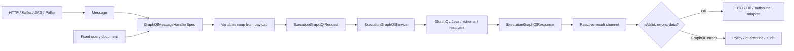
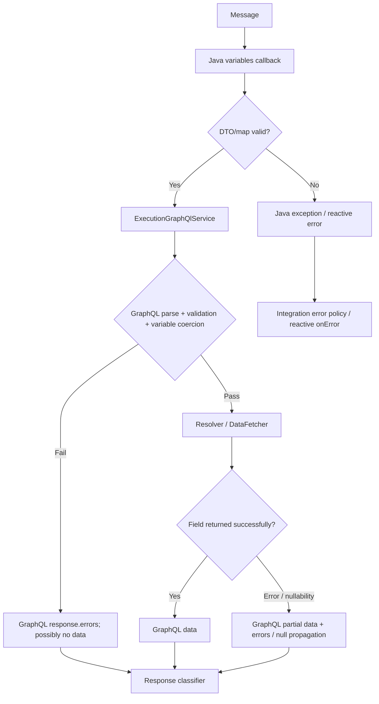

# GraphQL Query and Variables in Spring Integration

## 1. Problem: One GraphQL Document, Many Request Messages

An order-processing platform receives events from HTTP, Kafka, or JMS. Each event needs to look up a list of orders filtered by status, minimum amount, and maximum count. We could write a separate GraphQL query for each message:

```graphql
{ orders(status: PAID, minTotalCents: 10000, first: 10) {
    id status totalCents
} }
```

However, concatenating input data directly into GraphQL text makes the code hard to test and introduces escaping bugs and query-structure manipulation risks. The proper approach is to **keep a GraphQL document with variable definitions** and supply their values via a `Map<String,Object>` constructed from the request message.

```graphql
query FindOrders(
  $status: OrderStatus
  $minimum: Int
  $first: Int = 10
) {
  orders(status: $status, minTotalCents: $minimum, first: $first) {
    id
    status
    totalCents
  }
}
```

```json
{
  "operationName": "FindOrders",
  "variables": {
    "status": "PAID",
    "minimum": 10000,
    "first": 10
  }
}
```

In Spring Integration, an inbound adapter or handler creates a `Message<OrderSearch>`. The **GraphQL outbound gateway** reads the message, computes variables, invokes `ExecutionGraphQlService`, receives `ExecutionGraphQlResponse`, and sends the result to the next channel. One operation is reused across many requests without modifying the query text.

The lesson **“GraphQL Query and Variables”** belongs to the **GraphQL Adapter** chapter of the `SPRING_INTEGRATION_ADAPTERS` module. The module teaches connecting external systems using inbound/outbound adapters, gateways, pollers, and `MessageChannel`s; practicing files, SFTP, HTTP, JMS, AMQP, Kafka, databases, message contracts, error handling, and connection lifecycles. Within this lesson, the focus is on the **GraphQL document–variable–message contract**, type mapping, and result handling; calling a remote GraphQL server is clearly distinguished from a gateway using a local execution service.

### Learning Outcomes

After this lesson, you can:

1. Distinguish GraphQL field arguments, variable definitions, variable values, operation names, aliases, and fragments.
2. Declare variables of type `ID!`, `Int`, `String`, enum, list, and input object; understand the effect of `!` and `=`.
3. Understand that an **omitted variable differs from explicit null**, and know how defaults apply at variable definitions and schema arguments.
4. Use `GraphQl.gateway(executionGraphQlService)`, `operation(...)`, `operationName(...)`, `variables(...)`, and `variablesExpression(...)`.
5. Map trusted payloads/headers into `Map<String,Object>` without concatenating external data into query strings.
6. Handle `ExecutionGraphQlResponse`: `data`, `errors`, `isValid()`, null/partial data, and conversion to DTOs.
7. Distinguish validation errors, coercion errors, resolver errors, reactive pipeline exceptions, and timeouts.
8. Verify security, authorization, query complexity, pagination, tracing, and retry/idempotency.
9. Write unit/integration tests with GraphQL schema fixtures, Java DSL, and mock clients.

## 2. Architecture and Data Boundaries



**Core Spring Integration 6.5 APIs:**

| Component | Exact Responsibility | Does Not Do For You |
|---|---|---|
| `GraphQl.gateway(ExecutionGraphQlService)` | Creates a spec for the GraphQL outbound gateway | Does not call a remote HTTP GraphQL URL |
| `GraphQlMessageHandler` | Builds the request, executes GraphQL, and produces a reply | Does not define schema or business permissions |
| `operation(String)` | Provides a fixed GraphQL document | Does not validate payload data before sending |
| `operationName(String)` | Selects a named operation | Does not replace the document |
| `variables(Function<Message<?>, Map<String,Object>>)` | Computes the variables map from the request message | Does not infer variable names or domain validation |
| `variablesExpression(String)` | Evaluates SpEL to produce the map | Should not be used for externally supplied SpEL |
| `ExecutionGraphQlService` | Calls the GraphQL Java engine/schema | Not an HTTP client connecting to a partner |
| `ExecutionGraphQlResponse` | Holds data, errors, extensions | Not a business-validated DTO |
| `FluxMessageChannel` | Connects reactive steps | Not a persistent queue across JVM restarts |

With Spring Integration 6.5, the handler returns a `Mono<ExecutionGraphQlResponse>` publisher. The framework subscribes via a reactive output channel or the asynchronous mechanism of reply-producing handlers. Calling `MessageChannel.send(...)` successfully **does not mean** the GraphQL query has finished or downstream DB writes have committed.

### 2.1. Local Execution Differs from Remote GraphQL HTTP Calls

```text
Spring Integration GraphQL gateway:
  Message<OrderSearch> -> GraphQlMessageHandler
      -> ExecutionGraphQlService -> GraphQL Java schema/resolver

Remote GraphQL client:
  Message<OrderSearch> -> service activator
      -> HttpGraphQlClient / WebClient -> HTTPS partner /graphql
```

There is no `GraphQl.gateway("https://partner.example/graphql")` overload for configuring a remote endpoint. To call over the network, use Spring for GraphQL `HttpGraphQlClient` (or an HTTP outbound gateway with explicit request/response contracts). Section 12 compares these in detail.

### 2.2. Input Message Contract

```text
payload: OrderSearch(
  status=PAID,
  minTotalCents=10000,
  first=10
)
headers:
  id             = a message UUID
  correlationKey = workflow-123
  tenantAlias    = tenant authenticated upstream
```

Query documents, variables, and authorization must have **separate trust sources**: operations from approved code/registry; variables from validated payloads; access control from an authenticated principal or trusted security context. Never trust a `tenantAlias` placed into a header by an unauthenticated sender.

## 3. GraphQL Query Syntax, Arguments, and Variables

### 3.1. Fields, Arguments, and Selection Sets

```graphql
{
  order(id: "ORD-1001") {
    id
    status
    totalCents
  }
}
```

Here:

- `order` is a **field** on the root `Query`.
- `id` inside `order(id: ...)` is a **field argument**.
- `"ORD-1001"` is a document **literal**.
- `{ id status totalCents }` is the **selection set** — the fields the client requests in return.

Literals work for fixed values in fixtures, but are unsuitable for parameters that vary per message.

### 3.2. Variable Definitions and Usage Sites

```graphql
query FindOrder($id: ID!) {
  order(id: $id) {
    id
    status
  }
}
```

`$id: ID!` is a **variable definition** on the operation, while `order(id: $id)` is where the variable supplies a value to **argument `id`**. Variable names have a `$` prefix in GraphQL text, but the key in a JSON/Java map is **`"id"`**, without `$`:

```json
{"variables":{"id":"ORD-1001"}}
```

Java:

```java
Map<String, Object> variables =
        Map.of("id", "ORD-1001");
```

Do not use `Map.of("$id", "...")`; that key will not match variable `$id`. Do not confuse a variable definition with `@Argument` in a Spring GraphQL controller: the annotation receives the field argument after GraphQL Java has coerced the variable.

### 3.3. A Document with Multiple Operations

```graphql
query FindOrder($id: ID!) {
  order(id: $id) { id status }
}

query FindOrderValue($id: ID!) {
  order(id: $id) { id totalCents }
}
```

When a document has multiple operations, the request must select one via `operationName`, such as `"FindOrderValue"`. This value is the **GraphQL operation** name, not a Java bean name or schema field. A single operation can be anonymous, though naming it is still good practice for logging, persisted documents, and metrics analysis.

### 3.4. Aliases and Fragments

```graphql
query CompareOrders($a: ID!, $b: ID!) {
  firstOrder: order(id: $a) { ...OrderPreview }
  secondOrder: order(id: $b) { ...OrderPreview }
}

fragment OrderPreview on Order {
  id
  status
  totalCents
}
```

`firstOrder`/`secondOrder` are **response field aliases**, not variables. The variables are still `$a` and `$b`. Fragments help reuse selection sets, though they do not automatically turn fields into lazily fetched Java objects; the GraphQL engine resolves only the fields requested in the selection.

## 4. GraphQL Variable Types and Coercion

### 4.1. Scalars, Enums, Lists, and Input Objects

| GraphQL Type | Typical Variable Value | Notes |
|---|---|---|
| `ID!` | `"ORD-1001"` | ID is an identifier, accepting string or integer via coercion; prefer strings for stable identity |
| `String` | `"urgent"` or null | Do not treat null the same as an empty string |
| `Int` | `10000` | GraphQL Int is a **signed 32-bit** integer |
| `Float` | `12.5` | Floating point; do not use for exact monetary amounts |
| `Boolean` | `true`/`false` | Do not use string `"true"` in place of a Boolean |
| `OrderStatus` | `"PAID"` in JSON/map | Enum value must exist in the schema enum |
| `[ID!]` | `["A","B"]` | Nullable list with non-null elements |
| `[ID!]!` | `["A","B"]` or `[]` | The list itself cannot be null |
| `OrderFilterInput` | `{"statuses":["PAID"],"minTotalCents":10000}` | Nested map matching input field names |

`ID` does not imply authorization. Resolvers must still verify whether the caller is allowed to view order `ORD-1001`.

### 4.2. Where Does `!` Go?

Suppose the schema also has a hypothetical field `inspect(a: ID, b: ID!, c: [ID], d: [ID!], e: [ID!]!): String` to illustrate the **syntax** of all list/non-null combinations:

```graphql
query Examples(
  $a: ID
  $b: ID!
  $c: [ID]
  $d: [ID!]
  $e: [ID!]!
) {
  inspect(a: $a, b: $b, c: $c, d: $d, e: $e)
}
```

| Type | Can Variable Be Omitted/Null? | Can List Elements Be Null? |
|---|---|---|
| `ID` | Yes | Not applicable |
| `ID!` | No: variable requires a non-null value | Not applicable |
| `[ID]` | Yes | Yes |
| `[ID!]` | Yes | No |
| `[ID!]!` | No | No; however `[]` is valid |

For example, `$b: ID!` produces a request error if the variable is omitted or null, even if the schema argument expects a non-null ID. GraphQL does not automatically convert an empty string into a missing ID, so the application must still validate `""`/whitespace per business rules.

### 4.3. Omitted Variable vs. Null Variable

Consider the operation:

```graphql
query Search($status: OrderStatus, $first: Int = 10) {
  orders(status: $status, first: $first) {
    id
    status
  }
}
```

Three variable maps have different meanings:

```json
{}
```

```json
{"status":null}
```

```json
{"status":"PAID"}
```

- **Omitted**: the `status` key is absent from the map. If the operation or schema defines a default, GraphQL can apply defaults in specification order.
- **Explicit null**: the key exists and its value is `null`. For nullable types, resolvers can distinguish an explicit null passed by the caller; variable defaults are generally **not** applied as they are when omitted.
- **Provided value**: GraphQL coercion validates the input type; `"PAID"` is valid if the schema defines that enum value.

Especially in PATCH mutations, **“omit field” differs from “clear field with null”**. Furthermore, `Map.of("status", null)` **throws a NullPointerException in Java**, so to represent an explicit null you must use `HashMap` or a map implementation that allows null values:

```java
Map<String, Object> omitted = Map.of();

Map<String, Object> explicitNull = new HashMap<>();
explicitNull.put("status", null);

Map<String, Object> withValue = Map.of("status", "PAID");
```

### 4.4. Variable Defaults and Argument Defaults

```graphql
query FindOrders($first: Int = 10) {
  orders(first: $first) { id }
}
```

In the schema:

```graphql
type Query {
  orders(first: Int = 20): [Order!]!
}
```

If `first` is omitted, the **variable default `10`** is applied first, so the argument receives 10, not 20. If the operation has no default and supplies no value, the **argument default `20`** can apply. If the variable is explicitly null and the argument is nullable, defaults do not replace null.

This example illustrates precedence; in our main flow, both schema and operation align on default 10. Do not write conflicting defaults assuming the framework will "pick the best one."

### 4.5. Coercion Before Resolver Execution

GraphQL Java validates variable values before calling data fetchers. For example:

```json
{"variables":{"first":"ten","status":"NOT_A_STATUS"}}
```

For `$first: Int` and `$status: OrderStatus`, these values are invalid; the request can return **GraphQL errors** without invoking the main resolver. Do not assume every coercion failure throws a Java exception to the Spring Integration error channel.

For `Int`, numbers outside the 32-bit signed range are also invalid. If the domain needs large monetary amounts, declare a custom scalar such as `Long`/`BigDecimal` via GraphQL Java custom scalars or design a validated `String`/minor-unit wire representation; do not use `Float` for exact currency values.

## 5. Sample Contract: Schema and Resolver

To make this hands-on, we use a small GraphQL schema. The sample targets **compatible Java 17, Spring Boot 3.x, and Spring Integration 6.5.x**, with versions managed by BOM/dependency management. When running in practice, do not mix incompatible major versions of Spring for GraphQL and Spring Integration.

### 5.1. Dependencies

**`build.gradle`:**

```gradle
dependencies {
    implementation 'org.springframework.boot:spring-boot-starter-integration'
    implementation 'org.springframework.integration:spring-integration-graphql'
    implementation 'org.springframework.boot:spring-boot-starter-graphql'
    testImplementation 'org.springframework.boot:spring-boot-starter-test'
    testImplementation 'org.springframework.graphql:spring-graphql-test'
}
```

`spring-integration-graphql` provides the gateway; `spring-boot-starter-graphql` can auto-configure `GraphQlSource` and `ExecutionGraphQlService` from configured schemas/controllers. If you configure the engine manually, choose **one bean ownership source** to avoid duplicate beans alongside Boot auto-configuration.

### 5.2. GraphQL Schema

Example **`src/main/resources/graphql/orders.graphqls`** in the practice project:

```graphql
enum OrderStatus {
  NEW
  PAID
  SHIPPED
  CANCELLED
}

type Order {
  id: ID!
  status: OrderStatus!
  totalCents: Int!
}

type Query {
  order(id: ID!): Order
  orders(
    status: OrderStatus
    minTotalCents: Int
    first: Int = 10
  ): [Order!]!
}
```

This schema establishes several invariants:

- `order(id: ID!)` requires an ID; the result may be null if not found.
- `orders(...)` returns a non-null list of non-null elements, though the list may be empty.
- `first` is nullable, defaults to 10 when omitted, while explicit null still needs resolver policy.
- `totalCents` is `Int!`, since the demo uses small 32-bit values. Real large-currency systems need a different scalar/wire design.

### 5.3. DTO and In-Memory QueryMapping

**`OrdersGraphQlController.java`**:

```java
import java.util.List;

import org.springframework.graphql.data.method.annotation.Argument;
import org.springframework.graphql.data.method.annotation.QueryMapping;
import org.springframework.stereotype.Controller;

enum OrderStatus { NEW, PAID, SHIPPED, CANCELLED }

record OrderView(String id, OrderStatus status, int totalCents) {}

@Controller
public class OrdersGraphQlController {

    private static final List<OrderView> DATA = List.of(
            new OrderView("ORD-1001", OrderStatus.PAID, 12_500),
            new OrderView("ORD-1002", OrderStatus.NEW, 3_000),
            new OrderView("ORD-1003", OrderStatus.PAID, 48_000),
            new OrderView("ORD-1004", OrderStatus.SHIPPED, 9_000));

    @QueryMapping
    public OrderView order(@Argument String id) {
        return DATA.stream()
                .filter(row -> row.id().equals(id))
                .findFirst().orElse(null);
    }

    @QueryMapping
    public List<OrderView> orders(
            @Argument OrderStatus status,
            @Argument Integer minTotalCents,
            @Argument Integer first) {

        int limit = first == null ? 10 : first;
        if (limit < 1 || limit > 50) {
            throw new IllegalArgumentException(
                    "first must be in range [1,50]");
        }
        if (minTotalCents != null && minTotalCents < 0) {
            throw new IllegalArgumentException(
                    "minTotalCents must be non-negative");
        }

        return DATA.stream()
                .filter(row -> status == null
                        || row.status() == status)
                .filter(row -> minTotalCents == null
                        || row.totalCents() >= minTotalCents)
                .limit(limit)
                .toList();
    }
}
```

`@QueryMapping` maps the method to `Query.order` or `Query.orders`, and `@Argument` receives the argument after GraphQL Java has validated/coerced it per the schema. `OrderStatus` is a Java enum matching the GraphQL enum; Java record fields match the schema names.

**Demo limitations:** the in-memory filter has no real pagination, no ACL/tenant filtering, no snapshot consistency, and no database. Production must use bounded queries, sorting/cursors, row-level authorization, and proper services/repositories.

## 6. Message Payload and Variables Mapping in Java DSL

### 6.1. Typed Payload

**`OrderSearch.java`:**

```java
public record OrderSearch(
        OrderStatus status,
        Integer minTotalCents,
        Integer first) {

    public OrderSearch {
        if (minTotalCents != null && minTotalCents < 0) {
            throw new IllegalArgumentException(
                    "minimum must not be negative");
        }
        if (first != null && (first < 1 || first > 50)) {
            throw new IllegalArgumentException(
                    "first must be between 1 and 50");
        }
    }
}
```

A `null` value in this record means **no filter/limit provided**, not explicit null semantics. The mapping **omits** the corresponding key. If the business domain genuinely needs to distinguish omitted from explicit null, use a wrapper with `present/value` state or `ArgumentValue` in controllers where appropriate, rather than plain Java `null`.

### 6.2. Fixed Query Document

```java
private static final String FIND_ORDERS = """
        query FindOrders(
          $status: OrderStatus
          $minimum: Int
          $first: Int = 10
        ) {
          orders(
            status: $status
            minTotalCents: $minimum
            first: $first
          ) {
            id
            status
            totalCents
          }
        }
        """;
```

Note that **variable names do not have to match argument names**: `$minimum` is passed into argument `minTotalCents`. In the variables map, the key must be `"minimum"`. Variable names are checked by the GraphQL parser against the operation document, while binding to field arguments is determined by `minTotalCents: $minimum`.

### 6.3. IntegrationFlow with Variables Callback

**`OrdersQueryIntegrationConfig.java`:**

```java
import java.util.HashMap;
import java.util.Map;

import org.springframework.context.annotation.Bean;
import org.springframework.context.annotation.Configuration;
import org.springframework.graphql.ExecutionGraphQlService;
import org.springframework.integration.config.EnableIntegration;
import org.springframework.integration.dsl.IntegrationFlow;
import org.springframework.integration.dsl.MessageChannels;
import org.springframework.integration.graphql.dsl.GraphQl;

@Configuration
@EnableIntegration
public class OrdersQueryIntegrationConfig {

    private static final String FIND_ORDERS = """
            query FindOrders(
              $status: OrderStatus
              $minimum: Int
              $first: Int = 10
            ) {
              orders(
                status: $status
                minTotalCents: $minimum
                first: $first
              ) {
                id status totalCents
              }
            }
            """;

    @Bean
    IntegrationFlow ordersGraphQlFlow(
            ExecutionGraphQlService graphQlService) {

        return IntegrationFlow
                .from(MessageChannels.flux("ordersQueryRequests"))
                .handle(GraphQl.gateway(graphQlService)
                        .operation(FIND_ORDERS)
                        .operationName("FindOrders")
                        .variables(message -> {
                            OrderSearch request =
                                    (OrderSearch) message.getPayload();

                            Map<String, Object> vars = new HashMap<>();
                            if (request.status() != null) {
                                vars.put("status",
                                        request.status().name());
                            }
                            if (request.minTotalCents() != null) {
                                vars.put("minimum",
                                        request.minTotalCents());
                            }
                            if (request.first() != null) {
                                vars.put("first", request.first());
                            }
                            return vars;
                        }))
                .channel(c -> c.flux("ordersQueryResults"))
                .get();
    }
}
```

**Reading the flow left-to-right:**

1. Source produces `Message<OrderSearch>` into `ordersQueryRequests`.
2. `GraphQl.gateway(graphQlService)` uses the **`ExecutionGraphQlService`** in the Spring context (schema/QueryMapping from section 5).
3. `operation(FIND_ORDERS)` keeps the document constant across requests.
4. `operationName("FindOrders")` selects this operation; also helpful if the document later gains multiple operations.
5. `variables(message -> {...})` receives the **request message**, extracts `OrderSearch`, and returns a `Map<String,Object>`.
6. `status` is converted via `enum.name()` → e.g. `"PAID"`; GraphQL Java coerces the enum per schema.
7. `minimum` and `first` are Java `Integer`s matching GraphQL `Int`, after business constraint validation.
8. When `first==null`, the callback omits the key so GraphQL applies variable default `10`.
9. `ordersQueryResults` receives `Message<ExecutionGraphQlResponse>` replies reactively.

**Why not use `Map.of(...)` here?** The callback needs to **omit optional keys**. `Map.of` rejects nulls and is awkward when the number of fields varies. Using `HashMap` adds only populated fields; for inputs needing explicit null, `key -> null` can be put intentionally.

### 6.4. Sending Messages into the Channel

```java
import org.springframework.beans.factory.annotation.Qualifier;
import org.springframework.integration.support.MessageBuilder;
import org.springframework.messaging.MessageChannel;
import org.springframework.stereotype.Component;

@Component
public class OrderQueryPublisher {
    private final MessageChannel channel;

    public OrderQueryPublisher(
            @Qualifier("ordersQueryRequests") MessageChannel channel) {
        this.channel = channel;
    }

    public void submit(OrderSearch search, String correlationKey) {
        boolean sent = channel.send(
                MessageBuilder.withPayload(search)
                        .setHeader("correlationKey", correlationKey)
                        .build());
        if (!sent) {
            throw new IllegalStateException(
                    "Message was not accepted by input channel");
        }
    }
}
```

`channel.send(...)` only **places the message onto the channel**; it does not guarantee the query has finished. With `FluxMessageChannel`, an output subscriber/endpoint is needed; upstream Kafka/JMS ack/offset commits should not rely solely on `send()` returning if business requirements demand durable completion.

## 7. Result: GraphQL Data and Errors

### 7.1. Valid Responses

A query with status PAID and minimum 10,000 can return:

```json
{
  "data": {
    "orders": [
      {"id":"ORD-1001","status":"PAID","totalCents":12500},
      {"id":"ORD-1003","status":"PAID","totalCents":48000}
    ]
  }
}
```

A valid query matching no records:

```json
{"data":{"orders":[]}}
```

Do not treat an empty list as an exception. It is a valid result because `[Order!]!` allows `[]`.

### 7.2. GraphQL Errors Can Appear Alongside Data

```json
{
  "data": {
    "order": {
      "id": "ORD-1001",
      "status": null
    }
  },
  "errors": [
    {
      "message": "Access denied",
      "path": ["order","status"]
    }
  ]
}
```

A response having `data` **is not necessarily complete**. Depending on schema nullability, a field error can null out a subtree or the entire data; do not assume every error leaves a partial object like the JSON sample. `ExecutionGraphQlResponse.isValid()` identifies request/structural response errors; you must still check `getErrors()` even when `isValid() == true`.

### 7.3. Consumer Reading Results Safely

**`OrderQueryResultHandler.java`:**

```java
import java.util.List;
import java.util.Map;

import org.springframework.graphql.ExecutionGraphQlResponse;
import org.springframework.integration.annotation.ServiceActivator;
import org.springframework.stereotype.Component;

@Component
public class OrderQueryResultHandler {

    @ServiceActivator(inputChannel = "ordersQueryResults")
    public void handle(ExecutionGraphQlResponse response) {
        if (!response.isValid()) {
            System.err.println(
                    "GraphQL request invalid, error count="
                    + response.getErrors().size());
            return;
        }
        if (!response.getErrors().isEmpty()) {
            // Demo strict policy: reject partial data.
            System.err.println(
                    "GraphQL field errors="
                    + response.getErrors().size());
            return;
        }

        List<?> rawOrders = response.field("orders").getValue();
        if (rawOrders == null) {
            throw new IllegalStateException(
                    "Query result missing orders list");
        }

        for (Object item : rawOrders) {
            if (!(item instanceof Map<?, ?> row)) {
                throw new IllegalArgumentException(
                        "GraphQL order is not an object map");
            }
            String id = (String) row.get("id");
            String status = (String) row.get("status");
            Number total = (Number) row.get("totalCents");
            OrderView order = new OrderView(
                    id, OrderStatus.valueOf(status),
                    total.intValue());
            System.out.println(order.id() + " / " + order.status());
        }
        // Production: convert to contract DTO and persist durably if needed.
    }
}
```

This snippet uses a strict policy for illustration. On **server-side `ExecutionGraphQlResponse`**, `field("orders")` returns a `ResponseField`, which has `getValue()` but **not** `toEntityList(Class)`. The example extracts the `List` and validates each `Map`; production should use a schema-validated DTO mapper instead of raw casting. `toEntityList(Class)` is a convenience method in `ClientResponseField`/the GraphQL client API. A real business consumer might accept certain partial data if the errored fields are optional and verified; in that case, inspect errors by path, error category, and field requirements. For messages sent over Kafka/JMS/HTTP, normalize into a DTO without embedding the full GraphQL Java graph/response object.

### 7.4. Coercion and Validation Errors Are Not Always Java Exceptions

For example, a status not in the enum:

```json
{"variables":{"status":"UNKNOWN","first":10}}
```

GraphQL Java can return a GraphQL coercion request error, so the `orders(...)` resolver never runs. That error response can still arrive on the result channel as an `ExecutionGraphQlResponse`. Configuring only a Spring Integration `errorChannel` does not automatically catch all **in-band** GraphQL errors. To route them, place a classifier after the gateway: invalid request, field error/partial, or success.

## 8. Ways to Configure Variables in GraphQlMessageHandlerSpec

### 8.1. Java Callback: `variables(Function<Message<?>,Map<...>>)`

This is the approach used in section 6. Benefits: strong typing, compiler/test checks, easy validation/canonicalization, easy blocking of non-whitelisted fields. It can read from payload or verified headers:

```java
.variables(message -> {
    OrderSearch search = (OrderSearch) message.getPayload();
    Map<String, Object> values = new HashMap<>();
    if (search.status() != null) {
        values.put("status", search.status().name());
    }
    if (search.first() != null) {
        values.put("first", search.first());
    }
    return values;
})
```

This snippet is **one DSL fragment**, not a standalone runnable Java class; for operations also needing `minimum`, map all variables required by the query contract.

### 8.2. SpEL: `variablesExpression(String)`

The Spring Integration docs show this style:

```java
.handle(GraphQl.gateway(graphQlService)
        .operation("""
                query FindOrder($id: ID!) {
                  order(id: $id) { id status }
                }
                """)
        .variablesExpression("{id: payload.orderId}"))
```

The SpEL expression returns a map evaluated against the request message. **Requirement:** the payload must expose property `orderId` (e.g., `record OrderLookup(String orderId)`), and the SpEL evaluator must be able to access the getter/record accessor per configuration. If the expression returns a JSON string instead of a map, it violates the `variablesExpression` contract expected by the handler.

Pros: concise in simple flows. Cons: depends on string property paths, errors may surface only at runtime; when maps have many optional rules, a Java callback is easier to maintain.

### 8.3. Never Use SpEL from External Data

Wrong:

```text
headers.variablesExpression = user-supplied input
=> app arbitrarily evaluates it as a SpEL expression
```

Never evaluate a SpEL expression supplied by an external Kafka/HTTP event. An untrusted expression can access unintended objects/methods. Always **define expressions in reviewed code/config**, allowing external data only as values after validation.

### 8.4. Variables from a Nested DTO

When the payload has nested filters:

```java
record OrderFilter(List<String> statuses, Integer minTotalCents) {}
record SearchOrdersCommand(OrderFilter filter, Integer first) {}
```

GraphQL document:

```graphql
query SearchOrders($filter: OrderFilterInput, $first: Int = 10) {
  searchOrders(filter: $filter, first: $first) {
    id
    status
  }
}
```

Schema extension **beyond the section 5 example**:

```graphql
input OrderFilterInput {
  statuses: [OrderStatus!]
  minTotalCents: Int
}

extend type Query {
  searchOrders(filter: OrderFilterInput, first: Int = 10): [Order!]!
}
```

Then the callback should build an explicit nested map:

```java
Map<String, Object> variables = new HashMap<>();
Map<String, Object> filter = new HashMap<>();

if (command.filter() != null) {
    if (command.filter().statuses() != null) {
        filter.put("statuses", command.filter().statuses());
    }
    if (command.filter().minTotalCents() != null) {
        filter.put("minTotalCents",
                command.filter().minTotalCents());
    }
    variables.put("filter", filter);
}
if (command.first() != null) {
    variables.put("first", command.first());
}
```

This snippet is **callback-internal logic**, where `command` is `SearchOrdersCommand`. You must add the `searchOrders` resolver in the project if running the extended schema; a schema field without a matching data fetcher will not return expected data. For external enum lists, validate/convert each value, enforce max list size, and reject unknown enums to prevent overly large user filters.

### 8.5. When the Payload Is Already an ExecutionGraphQlRequest

There is an exception documented in Spring Integration 6.5: if the input payload is already an **`ExecutionGraphQlRequest`**, `GraphQlMessageHandler` **uses that request directly**; handler configurations for `operation`, `operationName`, `variables`, and `executionId` **are not re-applied**.

This works well when upstream is trusted and builds complete requests, but is **dangerous** if you assume a constant `operation(...)` restricts queries in an externally supplied `ExecutionGraphQlRequest`. Never let untrusted callers supply arbitrary requests and bypass the operation allowlist.

## 9. OperationName, Fragments, Aliases, and Conditional Fields

### 9.1. OperationName Is Not a Field Name

```graphql
query ReadOne($id: ID!) {
  order(id: $id) { id }
}
query ReadMany($first: Int = 10) {
  orders(first: $first) { id }
}
```

In Java:

```java
.operationName("ReadMany")
.variables(message -> Map.of("first", 5))
```

If a document has multiple operations without `operationName`, GraphQL rejects the request because it cannot determine which operation to run. Do not take an arbitrary `operationName` from users and run dynamic documents without an allowlist.

### 9.2. Fragments Reuse Selection Sets

```graphql
query FindOrders($first: Int = 10) {
  orders(first: $first) { ...OrderPreview }
}
fragment OrderPreview on Order {
  id
  status
  totalCents
}
```

Fragments do not alter variables or create new server endpoints. When mapping the response, still use path `"orders"` and `Order` schema fields.

### 9.3. `@include` and `@skip` with Boolean Variables

```graphql
query FindOrders($first: Int = 10, $withValue: Boolean! = false) {
  orders(first: $first) {
    id
    status
    totalCents @include(if: $withValue)
  }
}
```

If `withValue=false`, the response **omits the `totalCents` field from the object**, which differs from `totalCents:null`. A Java DTO with primitive `int totalCents` is unsuitable for decoding responses from conditionally omitted fields if the consumer must distinguish absent/null/default. Design response DTOs per selection set or use optional `Integer`/Map.

### 9.4. Aliases Change the Response Path

```graphql
query Compare($idA: ID!, $idB: ID!) {
  left: order(id: $idA) { id }
  right: order(id: $idB) { id }
}
```

The result paths are `left` and `right`, not `order`. Inspect `response.field("left")`/`response.field("right")` rather than hard-coding `response.field("order")` from a different query.

## 10. GraphQL Validation, Coercion, and Exceptions in the Flow

### 10.1. Classifying Errors by Stage



| Error Type | Example | Primary Observation Channel | Retry? |
|---|---|---|---|
| DTO validation | `first=-1` rejected by record constructor | Exception before gateway | Do not retry before fixing input |
| Java callback exception | Wrong payload cast, mapping failure | Spring Integration / reactive error path | Fix contract |
| GraphQL parse | Missing brace, syntax error | `ExecutionGraphQlResponse.errors` | Fix document |
| GraphQL schema validation | Querying non-existent field | `errors`, invalid request | Fix query/schema |
| Variable coercion | `first="ten"`, unknown enum | `errors`, resolver does not run | Fix variables |
| Resolver exception | Database failure, business exception | May be turned into field error by GraphQL | Classify transient/permanent |
| Non-null propagation | Field `Order.status!` returns null | GraphQL `errors` and nullified ancestor | Fix resolver/contract |
| Timeout in reactive flow | Execution exceeds SLA | `Mono.onError` or timeout policy | Retry only when safe |
| Remote HTTP 401/429/503 | Only when using an HTTP client | Transport/client status/exception | Per status and quota |

**Do not equate Spring Integration's `errorChannel` with GraphQL's `getErrors()`.** If `ExecutionGraphQlService` returns an `ExecutionGraphQlResponse` containing `errors`, the gateway still treats it as a valid reply payload at the reactive transport level. To classify, place a classifier/router after the result channel or handle explicitly in the consumer.

### 10.2. Nullability and Partial Results

In the sample schema:

```graphql
type Query {
  order(id: ID!): Order
}

type Order {
  id: ID!
  status: OrderStatus!
  totalCents: Int!
}
```

If the resolver for `status: OrderStatus!` fails or returns null, `status` is not allowed to be null; GraphQL Java can **null-propagate** from `Order` up to `Query.order` because `order` is nullable:

```json
{
  "data": {"order": null},
  "errors": [
    {"message":"Status resolver failed","path":["order","status"]}
  ]
}
```

If this field is inside `[Order!]!`, a non-null error in one element can null out the whole list or ancestor per schema. Thus, selections and nullability must be designed deliberately rather than reading `data` and guessing rows are missing.

### 10.3. Adding a Response Classifier for Multi-Branch Flows

Business policy pseudocode:

```java
// ILLUSTRATIVE POLICY; types defined by the project.
GraphQlQueryOutcome classify(
        ExecutionGraphQlResponse response) {
    if (!response.isValid()) {
        return GraphQlQueryOutcome.INVALID_REQUEST;
    }
    if (!response.getErrors().isEmpty()) {
        return GraphQlQueryOutcome.PARTIAL_OR_FIELD_ERROR;
    }
    return GraphQlQueryOutcome.SUCCESS;
}
```

An application needing only a strict policy can log/alert as in section 7. Complex business workflows should use a `GraphQlQueryOutcome` DTO with status, operationName, correlation, sanitized error codes, and optional data reference. Never put raw stack traces or unfiltered `GraphQlError.message` into Kafka/JMS/HTTP responses.

### 10.4. Retrying Queries Still Requires Care

GraphQL **queries** generally represent reads, yet implementations may call external services or perform expensive work. Retries should apply only to identified transient errors, with exponential backoff, jitter, a time budget, and concurrency limits. Query validation/coercion errors will not fix themselves when re-sent with the same input.

GraphQL **mutations** have side effects; if retries are needed, use idempotency keys/transactions/ledgers at the execution layer. Never use a newly generated retry `MessageHeaders.ID` as a domain unique key.

## 11. Security When Accepting External Variables

### 11.1. Variables Prevent String Concatenation, Not Authorization Checks

Unsafe example:

```java
// DO NOT: concatenate untrusted input into GraphQL source.
String document = "query { order(id: " + userSuppliedId
        + ") { id status } }";
```

Replace with:

```graphql
query FindOrder($id: ID!) {
  order(id: $id) { id status }
}
```

```java
Map<String, Object> vars =
        Map.of("id", userSuppliedId);
```

The GraphQL parser now reads a **static document**, while input is coerced as a variable. This avoids a class of string-concatenation bugs, yet **does not grant permission to read the order**. DataFetchers/services must check the authenticated principal and row/tenant ownership. A syntactically valid `id` can still point to a resource the caller is forbidden to read.

### 11.2. Do Not Let Users Supply Arbitrary Documents or SpEL

What not to do:

```text
message.headers.operation = input from untrusted HTTP/JMS/Kafka
gateway.operationExpression("headers.operation")
=> external caller runs arbitrary queries/mutations
```

And never take SpEL expression text from a header and evaluate it as code. A safer pattern is:

```text
commandType = FIND_ORDER | FIND_ORDERS
      |
      v
operation whitelist in code/registry
      |
      v
validated variables
```

If persisted GraphQL queries/document registries are needed, enforce versions, checksums, and per-operation-ID authorization; do not equate a query hash with business permission.

### 11.3. Bound Input Data

| Input | Illustrative Rule | Reason |
|---|---|---|
| `orderId` | Non-blank, bounded length and format | Avoid oversized/suspicious IDs |
| `status` | Schema enum | Avoid invalid coercion |
| `first` | 1–50 for practical requests | Protect DB and memory |
| `minimum` | Non-negative, within int32 | Fit GraphQL Int |
| List of IDs/statuses | Cap maximum item count | Prevent oversized lists |
| Nested input | Cap depth and total fields | Protect parser and resolvers |
| String filter | Cap bytes, validate Unicode | Protect search/DB |
| Tenant/permission filter | From authenticated security context | Never trust external headers |

Validating at the DTO/edge yields clear error messages and reduces wasted requests; GraphQL schema/coercion remains the next mandatory layer; resolvers/services enforce authorization. Never use SQL string concatenation from filters even after GraphQL variable coercion; use parameterized queries.

### 11.4. Query Depth, Alias Fan-Out, and N+1

A query with hundreds of aliases or nested fields can trigger massive backend data fetching. Separating `variables` from the document **does not limit GraphQL query cost**. You need:

- Persisted/allowlisted operations and depth/complexity limits.
- Pagination/cursors, max page sizes, and timeouts.
- DataLoader/batching when resolvers traverse DB relations.
- Per-tenant rate limits/concurrency and upstream adapter quotas.
- Observability keyed by **operationName** (low cardinality), not raw documents/variables.

### 11.5. Tracing and Sensitive Data

```text
event=graphql_query_completed
operationName=FindOrders
sourceSystem=order-events
correlationKeyHash=3e42...a19f
variableNames=status,minimum,first
variableCount=3
result=SUCCESS
durationMs=36
```

The sample log **omits** raw order IDs, tokens, customer names, sensitive query parameters, and full GraphQL errors. For PII fields, apply data classification, masking, retention, and access controls. GraphQL execution IDs and message IDs aid tracing and should not all be placed into high-cardinality metric labels.

## 12. When the Query Lives on a Remote GraphQL Server

### 12.1. GraphQl.gateway Is Not a Remote HTTP Client

Spring Integration 6.5 defines:

```java
GraphQl.gateway(executionGraphQlService)
```

This overload takes an `ExecutionGraphQlService`, executing the GraphQL Java schema/resolvers configured in the application. It **does not issue an HTTP POST to an endpoint URL**.

If the task is to call `https://partner.example/graphql`, use Spring for GraphQL `HttpGraphQlClient` or an HTTP outbound gateway with explicit status, headers, request body, and response mapping:

```java
import org.springframework.graphql.client.HttpGraphQlClient;
import org.springframework.web.reactive.function.client.WebClient;
import reactor.core.publisher.Mono;

WebClient webClient = WebClient.builder()
        .baseUrl("https://partner.example/graphql")
        .build();

HttpGraphQlClient client = HttpGraphQlClient.create(webClient);

Mono<java.util.List<OrderView>> result = client
        .document("""
            query FindOrders($first: Int = 10) {
              orders(first: $first) { id status totalCents }
            }
            """)
        .variable("first", 5)
        .retrieve("orders")
        .toEntityList(OrderView.class);
```

The address above is a **placeholder**, not a verified live endpoint. `OrderView` is an application-defined DTO, not necessarily the partner server's internal class. For the HTTP client, add compatible Spring WebFlux/GraphQL client dependencies to the project.

### 12.2. Operational Considerations for Remote Queries

| Aspect | Local ExecutionGraphQlService | Remote HttpGraphQlClient |
|---|---|---|
| HTTP networking | Outside the gateway's boundary | Present; requires HTTPS/TLS/proxy |
| Variables | Map/SpEL in `GraphQlMessageHandlerSpec` | `.variable(name,value)` or `.variables(map)` |
| Schema | Local `GraphQlSource`/resolvers | Managed by remote publisher |
| Timeouts | Execution/resolver/reactive deadline | Plus connect/read/response timeouts |
| HTTP status 401/429/503 | Not a local GraphQL gateway error | Transport error needing classification |
| HTTP 200 + GraphQL errors | No HTTP layer inside gateway | Still must inspect GraphQL error response |
| Authorization | Principal in local resolvers | Auth tokens/mTLS + remote permissions |

When embedding a remote client in Spring Integration, a service activator can return `Mono<OrderView>` or `Mono<List<OrderView>>` to a reactive channel, but design status/error handling properly and avoid `.block()` on a non-blocking event loop. Choose the synchronous client only when the thread model genuinely permits blocking.

### 12.3. Do Not Mix Response APIs

`GraphQlMessageHandler` returns the server execution API's `ExecutionGraphQlResponse`. `HttpGraphQlClient` uses **Spring for GraphQL client API** response types; decoding via `retrieve(...).toEntity(...)` differs from extracting via `ExecutionGraphQlResponse.field(...)`. Do not copy client methods onto server responses or vice versa.

## 13. Unit Testing Mapping and Coercion

### 13.1. Testing Variables Callbacks Without HTTP

For easier testing, extract variable-building logic into a pure function in your practice project (instead of embedding only an inline lambda in the DSL). Example:

```java
import java.util.HashMap;
import java.util.Map;

final class OrderVariables {
    private OrderVariables() {}

    static Map<String, Object> from(OrderSearch request) {
        Map<String, Object> vars = new HashMap<>();
        if (request.status() != null) {
            vars.put("status", request.status().name());
        }
        if (request.minTotalCents() != null) {
            vars.put("minimum", request.minTotalCents());
        }
        if (request.first() != null) {
            vars.put("first", request.first());
        }
        return vars;
    }
}
```

In the main flow, write:

```java
.variables(message ->
        OrderVariables.from((OrderSearch) message.getPayload()))
```

### 13.2. JUnit 5: Omitted Variables and Enums

```java
import static org.junit.jupiter.api.Assertions.*;

import java.util.Map;
import org.junit.jupiter.api.Test;

class OrderVariablesTest {

    @Test
    void omitsOptionalVariables() {
        Map<String, Object> vars =
                OrderVariables.from(new OrderSearch(null, null, null));

        assertFalse(vars.containsKey("status"));
        assertFalse(vars.containsKey("minimum"));
        assertFalse(vars.containsKey("first"));
    }

    @Test
    void mapsEnumAndInt() {
        Map<String, Object> vars =
                OrderVariables.from(
                        new OrderSearch(OrderStatus.PAID, 10_000, 5));

        assertEquals("PAID", vars.get("status"));
        assertEquals(10_000, vars.get("minimum"));
        assertEquals(5, vars.get("first"));
    }

    @Test
    void rejectsOutOfRangePageSize() {
        assertThrows(IllegalArgumentException.class,
                () -> new OrderSearch(null, null, 500));
    }
}
```

The pure tests above need no GraphQL engine, but **cannot verify GraphQL coercion/defaults**. You need real integration tests against the schema to verify variable maps match the operation.

### 13.3. Integration Test with ExecutionGraphQlServiceTester

Example test:

```java
import org.junit.jupiter.api.Test;
import org.springframework.beans.factory.annotation.Autowired;
import org.springframework.boot.test.context.SpringBootTest;
import org.springframework.graphql.ExecutionGraphQlService;
import org.springframework.graphql.test.tester.ExecutionGraphQlServiceTester;

@SpringBootTest
class OrdersGraphQlVariableTest {

    @Autowired
    ExecutionGraphQlService executionGraphQlService;

    @Test
    void filtersOrdersFromVariables() {
        var tester = ExecutionGraphQlServiceTester
                .create(executionGraphQlService);

        tester.document("""
                query FindOrders($status: OrderStatus, $first: Int = 10) {
                  orders(status: $status, first: $first) {
                    id status
                  }
                }
                """)
                .operationName("FindOrders")
                .variable("status", "PAID")
                .variable("first", 1)
                .execute()
                .path("orders[0].id")
                .entity(String.class)
                .isEqualTo("ORD-1001");
    }
}
```

The test project needs `spring-graphql-test` and the service/schema/controller beans created by Boot as in section 5. If the schema enforces authorization or uses a different dataset, seed test data accordingly. This test verifies the GraphQL resolver/variables, **not yet** the two `FluxMessageChannel`s and Java DSL gateway.

### 13.4. Integration Test of the Spring Integration Flow

A complete test should:

1. Start the context with `OrdersQueryIntegrationConfig`, schema, and controller.
2. Subscribe to `ordersQueryResults` or attach a test consumer/handler.
3. Send `OrderSearch(PAID,10000,2)` to the input channel.
4. Wait for `ExecutionGraphQlResponse` with a test timeout.
5. Assert `isValid()`, `getErrors().isEmpty()`, item count, and IDs.
6. Verify custom `correlationKey` per header propagation contract.
7. Send a second message with status `NEW`, verifying the same document with different variables.

**Important:** `MessageChannel.send()` can finish before the reactive reply reaches the consumer; do not assert results immediately when `send()` returns. Use proper test synchronization such as `StepVerifier`, a `BlockingQueue` inside a test handler, or a `CountDownLatch` with timeout.

### 13.5. Negative Tests

| Test | Input | Expectation |
|---|---|---|
| Non-null ID omitted | Missing `id` key for `$id: ID!` | Request error, resolver does not run |
| Explicit null for non-null | `id=null` | Coercion error |
| Invalid enum | `status="ARCHIVED"` | Coercion error |
| Wrong Int type | `first="five"` | Coercion error |
| Out-of-range Int | `first=2147483648` | Coercion error |
| Optional omitted | Missing `first` | Operation default 10 |
| Explicit null | `first=null` | Resolver receives null per contract, variable default not applied |
| Unknown GraphQL field | `orders{unknown}` | Validation error |
| Undefined variable | Query uses undefined `$missing` | Validation error |
| Variable type mismatch | `$id: String` passed to `id: ID!` | Validation error per compatibility rules |
| Multiple operations without operationName | Two queries in one document | Validation/selection error |
| Aliased field | `left:order(...)` | Response contains key `left` |
| Resolver exception | Data fetcher throws error | GraphQL field error, depending on nullability |
| DTO validation | `first=500` | Edge Java error before gateway |

Assert **error category, path, and validity** rather than exact full error message text, as GraphQL Java/Spring for GraphQL may change wording across versions. When testing explicit null vs. omitted, avoid `Map.of(..., null)` because Java throws NPE before the request reaches GraphQL.

## 14. Operating Queries/Variables in Spring Integration Flows

### 14.1. Metrics and Telemetry

| Suggested Metric | Meaning |
|---|---|
| `graphql_query_received_total{operation}` | Request messages arriving at gateway |
| `graphql_query_completed_total{operation,result}` | Requests with classified replies |
| `graphql_query_duration_ms{operation}` | End-to-end execution duration |
| `graphql_variable_validation_failure_total{operation,reason}` | Inputs failing before gateway |
| `graphql_variable_coercion_error_total{operation}` | GraphQL variables failing schema coercion |
| `graphql_query_partial_error_total{operation}` | Data returned with some field errors |
| `graphql_query_inflight{operation}` | Queries currently awaiting results |
| `graphql_query_timeout_total{operation}` | Queries exceeding deadline |
| `graphql_query_result_rows{operation}` | Result list size |
| `graphql_query_result_bytes{operation}` | Serialized payload size |
| `graphql_query_retry_total{reason}` | Retries after classified errors |
| `graphql_query_downstream_failure_total{adapter}` | Post-gateway failures in DB/HTTP/JMS/Kafka |

These are **suggested metrics**, not all auto-generated by the framework. Avoid putting `orderId`, raw query documents, JSON variables, full error messages, or correlation UUIDs into metric labels; use `operationName` and low-cardinality reasons/categories.

### 14.2. Upstream Pace Does Not Change GraphQL Behavior

```text
HTTP inbound gateway -> MessageChannel -> GraphQL query
Kafka inbound adapter -> MessageChannel -> GraphQL query
JMS inbound adapter  -> MessageChannel -> GraphQL query
Poller               -> MessageChannel -> GraphQL query
```

GraphQL documents/variables can be shared, but each source has different **ACK/commit semantics**:

- With HTTP inbound gateways, callers may expect synchronous reply/timeout contracts; if the query replies reactively, wire the reply channel properly without blocking the event loop arbitrarily.
- With Kafka, offset commit/ack must follow durability policies, not merely `send()` accepting the message.
- With JMS/AMQP, redelivery can re-run the query; avoid duplicate log/DB side effects.
- With pollers, `maxMessagesPerPoll` limits messages fetched per poll cycle, not query complexity or result count.

### 14.3. Timeouts and Backpressure

| Layer | Example Limit | What Must Not Be Inferred |
|---|---|---|
| Input channel | Bounded producer rate/queue | Does not guarantee resolver completion |
| Reactive pipeline | `Mono.timeout` with error policy | Does not always immediately cancel blocking DB calls |
| Execution service | Resolver deadline / GraphQL instrumentation | Does not apply transport timeouts to remote HTTP |
| Database | Query/transaction timeout, connection pool | Does not throttle request arrival from Kafka |
| Remote HTTP client | Connect/response timeout, TLS, redirects | Does not guarantee GraphQL response has no `errors` |
| Result channel | Bounded concurrency/subscribers | Not a persistent broker |

When using `FluxMessageChannel`, you need an active subscriber and backpressure control. Do not spawn tens of thousands of concurrent GraphQL operations just because a reactive channel accepts messages. Heavy queries consume DB connections, DataLoader memory, and GraphQL Java CPU.

### 14.4. Tracing: Four Types of IDs

```text
sourceMessageId = UUID from Spring Messaging
executionId     = GraphQL Java execution ID
correlationKey  = workflow-123 created by trusted upstream
businessId      = ORD-1001 in variable id
```

Spring Integration's GraphQL outbound handler defaults `executionId` to the request message's `id` unless configured otherwise. You can set a custom execution ID via `.executionId(message -> ...)`, but avoid using unprotected business IDs or tokens as public trace values. Message IDs can change on replay/transform; correlation IDs should be issued by a trusted system.

### 14.5. Runbook When a Query Returns Errors

1. Identify `operationName`, message source, schema version, and error timestamp.
2. Check input DTO/variables map: keys **must not have `$`**, enums match valid values, Ints match type/range.
3. If `isValid=false`, check document syntax, `operationName`, schema fields, and variable definitions.
4. If `getErrors()` is non-empty while `isValid=true`, check field path, resolver, nullability, and partial-data policy.
5. If no reply arrives, check Flux channel subscribers, Java callback exceptions, Reactor `onError`, timeouts, and concurrency.
6. If calling remote GraphQL, separately inspect TLS, DNS, HTTP status, tokens/quotas/redirects.
7. If data looks abnormal, verify data fetchers, ACLs, sorting/pagination, and DB snapshots.
8. If retrying, classify transient/permanent; enforce idempotency on any downstream side effect and record audits.

Never log full request variables when debugging production, especially when user IDs, addresses, access tokens, or personal information are present.

## 15. Scenario-Based Practice Labs

The labs assume a Spring Boot project, sample GraphQL schema/resolver, and Spring Integration Java DSL as shown earlier. In the current Knowledge-authoring task, **do not** run builds or create extra source files outside the assigned files; the steps below guide learners practicing on their own.

### Lab A — Query with `ID!`

1. Use `order(id: ID!): Order` in the schema.
2. Create document `query FindOrder($id: ID!) { order(id: $id) { id status } }`.
3. Provide `Map.of("id","ORD-1001")` in the variables callback.
4. Run through the GraphQL gateway and verify `data.order.id`.
5. Change the ID to a non-existent code; distinguish a valid null from a request error.

**Outcome:** Variable definitions use `$`, while the map key is simply `"id"`.

### Lab B — Enum Filtering

1. Construct `OrderSearch(OrderStatus.PAID,null,null)`.
2. Inspect the variables map produced by the callback.
3. Verify `status="PAID"` is accepted by GraphQL coercion.
4. Pass `"ARCHIVED"` in a direct GraphQL Java test and observe errors.
5. Do not swallow the error to silently convert the enum to `NEW`.

**Outcome:** Schema enums are input type contracts, not arbitrary strings.

### Lab C — Omitted vs. Explicit Null

1. Create a map **without** the `first` key.
2. Call operation `$first: Int = 10` and observe default 10.
3. Create a `HashMap` containing `first -> null`.
4. Observe GraphQL does not apply the variable default as when omitted; the demo resolver has its own null policy.
5. Try `Map.of("first", null)` and note the Java error before GraphQL.

**Outcome:** Omitted, null, and default are three distinct states.

### Lab D — Variable and Argument Defaults

1. Set schema argument `first: Int = 20`.
2. Keep operation `$first: Int = 10`.
3. Omit `first`; verify the received value is 10.
4. Remove the operation default while keeping the schema argument default.
5. Test explicit null and compare.

**Outcome:** Default precedence follows the GraphQL spec, not guesswork.

### Lab E — Int32, Boolean, and Non-Null Lists

1. Test `first=1`, `first=50`, and DTO boundaries.
2. Pass `first="five"` in a direct GraphQL test and check the coercion error.
3. Pass a value greater than 2,147,483,647 and check the int32 boundary.
4. Create a query with `$withValue: Boolean! = false` using `@include`.
5. Create an input list `[ID!]!`: test empty list, list containing null, and omitted.

**Outcome:** `!`, lists, and scalar types each have distinct rules.

### Lab F — OperationName and Multiple Queries

1. Create a document with two operations: `ReadOne` and `ReadMany`.
2. Omit `operationName` and observe the error.
3. Select `ReadMany` and pass `first=2`.
4. Verify the orders response.
5. Put `operationName` into an allowlist rather than accepting it freely from headers.

**Outcome:** `operationName` selects an operation, not an arbitrary schema field.

### Lab G — SpEL VariablesExpression

1. Create payload `OrderLookup(String orderId)`.
2. Configure `variablesExpression("{id: payload.orderId}")`.
3. Send a message with `orderId="ORD-1001"`.
4. Compare with `variables(message -> Map.of("id", ...))`.
5. Rename/remove the property and observe the SpEL runtime error.

**Outcome:** Both Java callbacks and SpEL build maps, with maintainability trade-offs.

### Lab H — Nested Input Objects

1. Extend the schema with `OrderFilterInput`.
2. Build a variables map with a nested filter, statuses list, and minimum.
3. Ensure the enum list contains valid strings and bounded length.
4. Add resolver `searchOrders` with `@Argument OrderFilterInput` record or matching type binding.
5. Test omitting nested fields, explicit nulls, and unknown input fields.

**Outcome:** Input objects must conform to the schema; not every Java map is accepted.

### Lab I — Aliases and Fragments

1. Create `query Compare($idA:ID!,$idB:ID!)` with aliases `left/right`.
2. Supply `idA`/`idB` via the map.
3. Use a fragment to reuse selection fields.
4. Inspect response paths `left.id` and `right.id`.
5. Observe why `response.field("order")` does not match the aliases.

**Outcome:** Response paths reflect aliases; variables remain separate data bindings.

### Lab J — GraphQL Errors in Replies

1. Try querying a non-existent field and passing an invalid enum variable.
2. Receive `ExecutionGraphQlResponse` on the result channel.
3. Inspect `isValid()`, `getErrors()`, and data.
4. Test a resolver error with schema-compliant null propagation.
5. Implement a strict classifier rejecting partial data and a controlled policy accepting partial data.

**Outcome:** GraphQL errors are not automatically Spring Integration exceptions.

### Lab K — Reactive Result Channels

1. Send `OrderSearch` to `ordersQueryRequests`.
2. Attach a test subscriber/`ServiceActivator` to `ordersQueryResults`.
3. Observe when `send()` returns versus when the response actually arrives.
4. Simulate a slow resolver with a bounded test timeout.
5. Verify cancellation/timeout and avoid `.block()` on event loops.

**Outcome:** `FluxMessageChannel` coordinates reactive streams, not durable queues.

### Lab L — Remote GraphQL Client

1. Create a mock GraphQL HTTP server.
2. Use `HttpGraphQlClient.create(WebClient)` to execute a query with `.variable("first",5)`.
3. Return HTTP 200 with data, then HTTP 200 with `errors`.
4. Return HTTP 401/429/503 and observe transport-level handling.
5. Compare with local `GraphQl.gateway(ExecutionGraphQlService)`.

**Outcome:** Remote transport and local GraphQL execution are two distinct architectures.

### Lab M — Per-Tenant Access Control

1. Send another tenant's `orderId` as an authenticated user.
2. Verify the resolver/service rejects it even though `ID!` is valid.
3. Attempt to alter a `tenantAlias` header from an untrusted source.
4. Verify authorization relies on the authenticated principal/security context, not an arbitrary header.
5. Log category `FORBIDDEN` without exposing sensitive data.

**Outcome:** GraphQL variable coercion and authorization protect against different threats.

### Lab N — Query Complexity and Pagination

1. Test `first` from 1 to 50.
2. Test `first=10,000` and verify edge DTO or resolver rejects it.
3. Construct an operation with many aliases and nested selections.
4. Apply query depth/complexity policies and monitor duration/DB load.
5. Use DataLoader or batching when field fetches cause N+1 queries.

**Outcome:** Variable bounds and query complexity limits must work together.

### Lab O — Kafka/JMS Integration and Post-Gateway Failures

1. Simulate a broker message containing `OrderSearch` with a correlation key.
2. Run the gateway query and transform valid responses into a DTO.
3. Simulate a DB/outbound adapter failure after the query succeeds.
4. Evaluate ack/offset/redelivery aligned with business commit points.
5. Use unique keys/outbox to prevent duplicate side effects upon redelivery.

**Outcome:** GraphQL query completion and downstream workflow completion are two distinct milestones.

### Lab P — ExecutionGraphQlRequest Passthrough

1. From a trusted upstream, build a complete `ExecutionGraphQlRequest` containing query and variables.
2. Pass this object as the payload through `GraphQlMessageHandler`.
3. Verify the handler does not re-apply the spec's `operation/variables`.
4. Compare with a normal DTO input using a static operation.
5. Discuss why passthrough must not be opened to arbitrary user documents.

**Outcome:** Understand an important exception of the GraphQL outbound gateway.

### Self-Check Questions

1. How does `$id: ID!` differ from `order(id: $id)`?
2. Why does the variables map use key `"id"` instead of `"$id"`?
3. What is the difference between omitted and explicit null?
4. What is the precedence order between operation variable defaults and schema argument defaults?
5. What is the bit width of GraphQL `Int`?
6. Does `[ID!]!` allow an empty list or null items?
7. Why doesn't `Map.of("status", null)` work?
8. When must `operationName` be configured?
9. Why are enums passed from JSON typically strings like `"PAID"`?
10. Do GraphQL parser/coercion errors always throw a Java exception to `errorChannel`?
11. Does `isValid()` being true prove `getErrors()` is empty?
12. How do server-side `ResponseField` and client-side `ClientResponseField` differ?
13. Why do variables prevent query concatenation without replacing authorization?
14. When does `GraphQl.gateway(...)` skip the spec's `operation/variables`?
15. Does `FluxMessageChannel.send()` guarantee the GraphQL query has finished?
16. Which component should you use to call a partner GraphQL URL?
17. Why do GraphQL queries still need depth/complexity limits when using variables?
18. What must you watch out for when retrying after a query succeeds but downstream delivery fails?

## 16. Common Misconceptions

| Misconception | Correct Understanding |
|---|---|
| GraphQL query and variables form one combined string | The query document keeps `$variable` placeholders; values are sent separately |
| JSON/map keys must include `$` | No; keys are the variable names without `$` |
| `VariableName` must match `FieldArgumentName` | They can differ, e.g., `$minimum -> minTotalCents` |
| GraphQL `ID` is always an HTTP URL | ID is an opaque identifier, not a resource URL |
| GraphQL `Int` is an unbounded Java `Long` | Standard GraphQL `Int` is 32-bit signed |
| Enums accept any string | Only enum values declared in the schema are accepted |
| `[ID!]!` means the list must contain at least one ID | Empty lists are valid; neither the list nor items may be null |
| Optional omitted is the same as explicit null | Defaulting/coercion and mutation semantics can differ |
| `Map.of("x", null)` is valid | Java's `Map.of` rejects null values |
| Variable defaults always equal schema argument defaults | Variable defaults apply first before applicable argument defaults |
| `@Argument` automatically grants data access permission | It binds input; resolvers/services must authorize |
| Concatenating data directly into query strings is optimal | Use variable binding and operation allowlists |
| Variables prevent overly deep queries | Complexity/depth come from the document/selection and must be bounded separately |
| `GraphQl.gateway("https://...")` calls a remote endpoint | Spring Integration's gateway accepts `ExecutionGraphQlService` |
| `variablesExpression` accepts a JSON string | It must evaluate to a variables map |
| User-supplied SpEL expressions are safe | Never evaluate untrusted SpEL |
| Static operation config still overrides an `ExecutionGraphQlRequest` input | The handler executes that request as-is |
| A response with `data` has no `errors` | GraphQL supports partial data alongside errors |
| `isValid()` true always means no errors | Always inspect `getErrors()` |
| `ExecutionGraphQlResponse.field(...).toEntityList(...)` is a server API | Server returns `ResponseField.getValue()`; list decoding helpers belong to the client API |
| GraphQL errors automatically go to Spring Integration `errorChannel` | Errors can be normal reply payloads |
| A null field always means not found | It can come from null propagation of a non-null field error |
| `send()` to `FluxMessageChannel` means committed | It only submits the message to the channel |
| `FluxMessageChannel` survives JVM restarts | Not durable by default |
| HTTP 200 from remote GraphQL means the query succeeded error-free | The body can still contain `errors` |
| Queries can always be retried infinitely | Requires timeouts, backoff, cost limits, and context |
| Mutations are as safe to retry as queries | Mutations need idempotency/reconciliation before retrying |
| Logging full variables is the best way to debug | Can leak PII/tokens and explode cardinality |
| The schema alone prevents IDOR/tenant leaks | Data fetchers must verify authenticated principals and row-level ACLs |

## 17. References

- [Spring Integration 6.5 — GraphQL Support](https://docs.spring.io/spring-integration/reference/6.5/graphql.html): `GraphQlMessageHandler`, `ExecutionGraphQlService`, variables, `operationName`, and reactive replies.
- [GraphQlMessageHandlerSpec API 6.5](https://docs.spring.io/spring-integration/docs/6.5.0/api/org/springframework/integration/graphql/dsl/GraphQlMessageHandlerSpec.html): exact signatures of `operation`, `operationName`, `variables`, and `variablesExpression`.
- [GraphQl Java DSL Factory API 6.5](https://docs.spring.io/spring-integration/docs/6.5.0/api/org/springframework/integration/graphql/dsl/GraphQl.html): `GraphQl.gateway(ExecutionGraphQlService)`.
- [GraphQlMessageHandler API 6.5](https://docs.spring.io/spring-integration/docs/6.5.0/api/org/springframework/integration/graphql/outbound/GraphQlMessageHandler.html): handler implementation and request/response.
- [Spring for GraphQL — Request Execution](https://docs.spring.io/spring-graphql/reference/request-execution.html): `GraphQlSource`, GraphQL Java, resolvers/fields/data fetchers, and errors.
- [Spring for GraphQL — Annotated Controllers](https://docs.spring.io/spring-graphql/reference/controllers.html): `@QueryMapping`, `@Argument`, input object binding, and `ArgumentValue`.
- [Spring for GraphQL — Client](https://docs.spring.io/spring-graphql/reference/client.html): `HttpGraphQlClient`, `WebClient`, and passing variables to remote GraphQL.
- [Spring for GraphQL — Testing](https://docs.spring.io/spring-graphql/reference/testing.html): `GraphQlTester` and `ExecutionGraphQlServiceTester`.
- [GraphQlResponse API — Spring for GraphQL 1.4](https://docs.spring.io/spring-graphql/docs/1.4.3/api/org/springframework/graphql/GraphQlResponse.html): `field/getData/getErrors/isValid`.
- [ResponseField API — Spring for GraphQL 1.4](https://docs.spring.io/spring-graphql/docs/1.4.x/api/org/springframework/graphql/ResponseField.html): server response field/`getValue`.
- [ClientResponseField API — Spring for GraphQL 1.4](https://docs.spring.io/spring-graphql/docs/1.4.x/api/org/springframework/graphql/client/ClientResponseField.html): client-side entity conversion.
- [GraphQL Specification, September 2026](https://spec.graphql.org/September2026/): operation selection, variable definitions/coercion/defaults, enum/list/non-null, partial data, errors, and validation.
- [Spring Integration 6.5 — Message Channels](https://docs.spring.io/spring-integration/reference/6.5/channel.html): channel semantics and reactive flows.
- [Spring Integration 6.5 — Error Handling](https://docs.spring.io/spring-integration/reference/6.5/error-handling.html): error channel and exception handling.

**Key Takeaway:** `GraphQl.gateway(ExecutionGraphQlService)` turns a **request message** into a configured GraphQL operation. Keep documents in trusted code/registries, map variables into `Map<String,Object>` with matching names and schema types, distinguish omitted/null/default, and check **both** `response.isValid()` and `response.getErrors()`. Variables avoid concatenating input into query syntax, but **do not replace validation, authorization, query cost limits, reactive error handling, or business idempotency**. If the target is a remote GraphQL API, use an appropriate HTTP/WebSocket transport client instead of mistaking the local execution gateway for an HTTP adapter.
