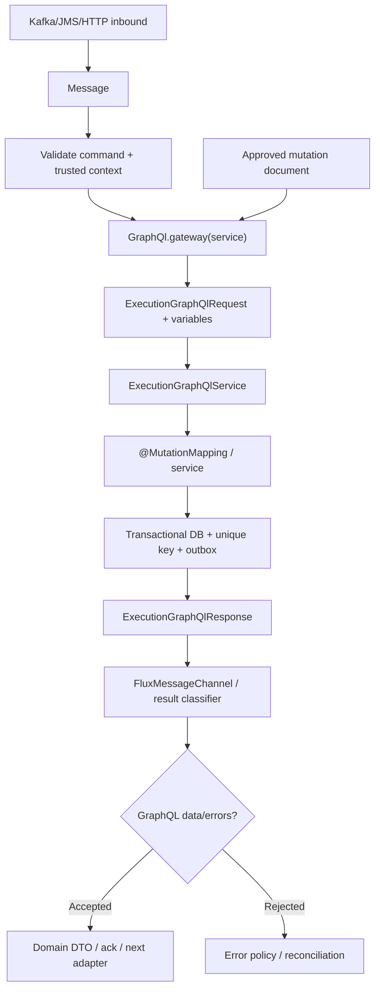
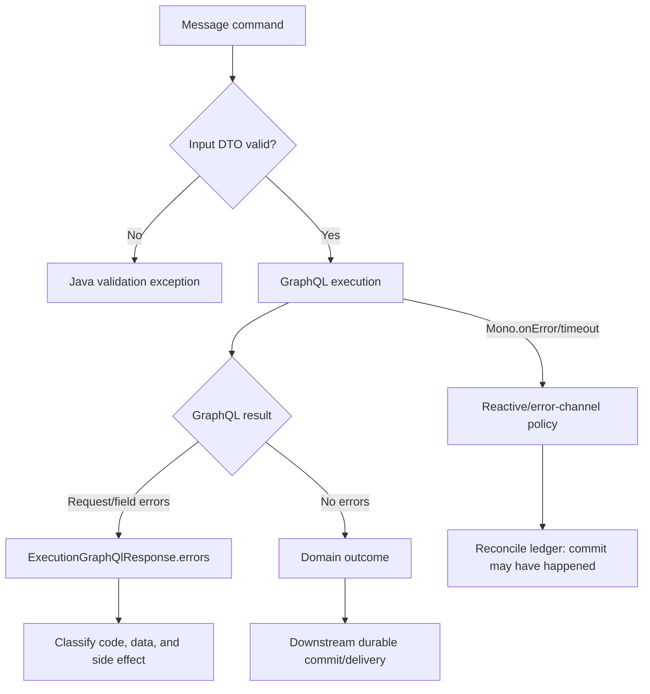
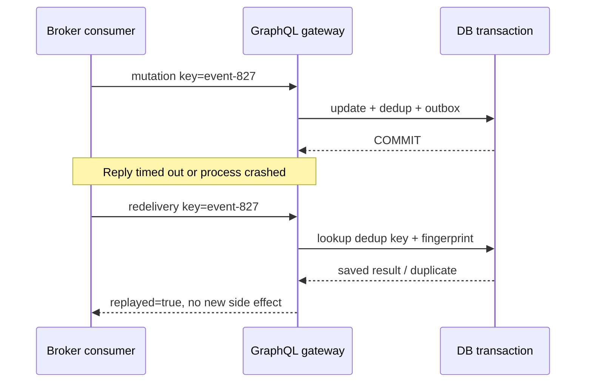
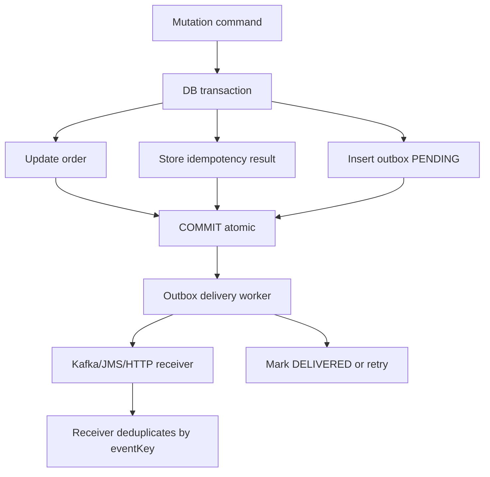

# GraphQL Mutation from Messages in Spring Integration

## 1. Problem: Receiving a Command via MessageChannel and Modifying Data with GraphQL

Suppose an order management system receives a message from Kafka or JMS:

```text
payload:
  orderId         = ORD-1001
  targetStatus    = PAID
  expectedVersion = 0
  idempotencyKey  = payment-confirmed:event-827

headers:
  correlationKey  = workflow-2026-827
  sourceSystem    = payment-events
```

The application needs to turn this command into a **GraphQL mutation** to update the order status in the GraphQL engine, return a structured result, and pass it to downstream steps in Spring Integration. Crucially, a message can be **redelivered** on broker retries, JVM restarts, transaction rollbacks, or lost replies, whereas a mutation **has side effects**. Simply converting the message into a GraphQL request and retrying every exception can update twice or emit duplicate notification events.

Example GraphQL operation:

```graphql
mutation ChangeOrderStatus($input: ChangeOrderStatusInput!) {
  changeOrderStatus(input: $input) {
    replayed
    order {
      id
      status
      version
    }
  }
}
```

Variables:

```json
{
  "input": {
    "orderId": "ORD-1001",
    "newStatus": "PAID",
    "expectedVersion": 0,
    "idempotencyKey": "payment-confirmed:event-827"
  }
}
```

Upon success, a response might look like:

```json
{
  "data": {
    "changeOrderStatus": {
      "replayed": false,
      "order": {
        "id": "ORD-1001",
        "status": "PAID",
        "version": 1
      }
    }
  }
}
```

If the same command is resent with the **same idempotency key**, the system can return the earlier result with `replayed=true` without **repeating the side effect**.

The lesson **“GraphQL Mutation from Messages”** belongs to the **GraphQL Adapter** chapter of the `SPRING_INTEGRATION_ADAPTERS` module, which connects external systems using inbound/outbound adapters, gateways, pollers, and `MessageChannel`s; practicing files, SFTP, HTTP, JMS, AMQP, Kafka, databases, message contracts, error handling, and connection lifecycles. This lesson focuses on converting a **command message** into a GraphQL mutation, handling replies, and building safe contracts for write operations.

### After this lesson, you can

1. Distinguish GraphQL `query`, `mutation`, and `subscription`, and understand why mutations do not automatically provide transactions or idempotency.
2. Know precisely that `GraphQl.gateway(ExecutionGraphQlService)` executes a **configured GraphQL engine**, without issuing remote HTTP calls itself.
3. Declare a GraphQL `Mutation` schema, input object, and response fields; map DTOs from `Message<?>` to `variables(Map)`.
4. Write a Java DSL outbound gateway with `operation`, `operationName`, `variables`, and `FluxMessageChannel`.
5. Use `@MutationMapping`, services, and transaction boundaries on the GraphQL execution side.
6. Classify `ExecutionGraphQlResponse.isValid()`/`getErrors()`/partial data and reactive exceptions.
7. Design `idempotencyKey`, command fingerprints, optimistic locking, transactions, and an outbox to prevent duplicate side effects.
8. Handle JMS/Kafka redelivery, acknowledgment, and crash-after-commit-before-reply.
9. Apply authorization, query allowlists, quotas, timeouts, tracing, and test tricky failure modes.
10. Distinguish the local GraphQL outbound gateway from `HttpGraphQlClient` for external GraphQL APIs.

## 2. GraphQL Outbound Gateway and Mutation Flow

Spring Integration **6.5** provides the `spring-integration-graphql` module:

```text
org.springframework.integration.graphql.outbound.GraphQlMessageHandler
org.springframework.integration.graphql.dsl.GraphQl
org.springframework.integration.graphql.dsl.GraphQlMessageHandlerSpec
```

`GraphQlMessageHandler` is an `AbstractReplyProducingMessageHandler` that receives `Message<?>`, builds an `ExecutionGraphQlRequest`, and calls `ExecutionGraphQlService.execute(...)`. The result is represented as `Mono<ExecutionGraphQlResponse>`.



### 2.1. Right API, Right Transport

| Need | Component | Meaning |
|---|---|---|
| Execute mutations on the app's configured GraphQL engine/schema | `GraphQl.gateway(executionGraphQlService)` | Calls the GraphQL execution service, **does not** send HTTP |
| Call a partner GraphQL endpoint over HTTPS | `HttpGraphQlClient` or `HttpSyncGraphQlClient` | Requires WebClient/transport, auth, timeouts |
| Send an HTTP POST GraphQL JSON request with explicit HTTP customization | Spring Integration HTTP outbound gateway | Explicit control over JSON, headers, status |
| Receive commands from Kafka/JMS | Inbound adapter + `MessageChannel` | Separate redelivery/ack policies |
| Process mutation results | `ExecutionGraphQlResponse`, router/handler | Distinguish data/errors and exceptions |

There is no `GraphQl.gateway("https://api.partner/graphql")` configuration to replace an HTTP client. A **remote GraphQL mutation** is a separate requirement: the same idempotency rules apply, plus transport/HTTP status risks and uncertain replies. Section 12 covers that separately.

### 2.2. Three States That Must Not Be Equated

```text
1. MessageChannel accepts command
2. GraphQL mutation resolver + database committed
3. Downstream notification delivered and acknowledged
```

`send()` returning `true` only means the channel **accepted** the message, not that the DB committed. An `ExecutionGraphQlResponse` with `data` does not guarantee subsequent side effects (Kafka/JMS/HTTP outbound) succeeded. If emitting an event after DB commit times out, the receiver **may already have processed it** even though the sender never saw an ACK.

### 2.3. Why Calling Something a Mutation Does Not Mean “Exactly-Once”

The GraphQL specification requires **top-level fields of the same mutation operation** to execute **serially**. However:

- Two separate mutation requests can still run **concurrently**.
- Two pods receiving a redelivered broker message can invoke the resolver simultaneously.
- GraphQL does not automatically wrap multiple root mutation fields in a database transaction.
- An error in one root field does not automatically roll back side effects from an earlier root field.
- Nested response fields are not all command side effects; those fields typically only read data.

Therefore, business protection must live in **database transactions, unique constraints/optimistic locking, and an idempotency ledger**, not in GraphQL's resolution order.

## 3. GraphQL Schema: Input Objects and Mutation Results

### 3.1. Self-Contained Schema for the Lab

Example **`src/main/resources/graphql/order-mutation.graphqls`** in the practice project:

```graphql
enum OrderStatus {
  CREATED
  PAID
  SHIPPED
  CANCELLED
}

type Order {
  id: ID!
  status: OrderStatus!
  version: Int!
}

input ChangeOrderStatusInput {
  orderId: ID!
  newStatus: OrderStatus!
  expectedVersion: Int!
  idempotencyKey: ID!
}

type ChangeOrderStatusResult {
  order: Order!
  replayed: Boolean!
}

type Query {
  order(id: ID!): Order
}

type Mutation {
  changeOrderStatus(input: ChangeOrderStatusInput!):
    ChangeOrderStatusResult!
}
```

**Analysis:**

- `Mutation.changeOrderStatus` is a root field with side effects; `Query.order` is a read field.
- `ChangeOrderStatusInput` is an **input type**, passing multiple fields under a single `input` argument.
- `ID!` represents an identity string/ID; it is not a URL and not an authorization key.
- `Int!` in GraphQL is **signed 32-bit**, suitable for small version numbers in the lab.
- `expectedVersion` supports optimistic concurrency; it is not the GraphQL schema version.
- `idempotencyKey` is a **required** key generated by the command sender and kept stable across retries.
- `replayed` helps callers distinguish a new execution from a repeated delivery without duplicating side effects.
- The `!` modifier enforces non-null at the GraphQL schema layer, but **does not validate business rules** like blank IDs, invalid state transitions, or missing permissions.

### 3.2. Named Mutation Document and Variables

```graphql
mutation ChangeOrderStatus($input: ChangeOrderStatusInput!) {
  changeOrderStatus(input: $input) {
    replayed
    order {
      id
      status
      version
    }
  }
}
```

In the document, `$input` has a `$` prefix. In Java `Map<String,Object>`, the corresponding key is **`"input"`**, not `"$input"`. The nested object must use exact schema keys: `orderId`, `newStatus`, `expectedVersion`, `idempotencyKey`.

```java
Map<String, Object> input = Map.of(
        "orderId", "ORD-1001",
        "newStatus", "PAID",
        "expectedVersion", 0,
        "idempotencyKey", "payment-confirmed:event-827");

Map<String, Object> variables = Map.of("input", input);
```

Do not concatenate `orderId`, status, or keys from messages into a GraphQL document via string concatenation. Variable binding handles input coercion and escaping at the GraphQL boundary. However, it does not replace **authentication/authorization/validation**, because a syntactically valid `orderId` may belong to another tenant.

### 3.3. Optional, Omitted, and Explicit Null Variables in Mutations

When implementing PATCH semantics, these three cases **differ**:

| Data | Possible Meaning |
|---|---|
| No `comment` key | Keep existing comment |
| `comment -> null` key | Explicitly clear comment |
| `comment -> "Ready"` key | Update comment |

For instance, if `comment: String` is later added to `ChangeOrderStatusInput`, you need a Java input representation that preserves omitted vs. null state. Spring for GraphQL provides `ArgumentValue<T>` and supports it on nested input objects for this case. Do not use a plain `String comment` and assume "null means leave unchanged" if the API allows clearing fields with null.

`Map.of(...)` forbids null values. When explicit null is needed, use a `HashMap` and put null explicitly; when omitted, **omit the key from the map**.

### 3.4. Nullability Does Not Guarantee Transactions

When a mutation resolver has committed, if an error occurs while resolving a non-null output field like `Order!`, GraphQL may return `errors` and null propagation. **Do not infer** that GraphQL errors mean the transaction rolled back. Actual DB state and the idempotency ledger are the source of truth for whether the command was applied.

## 4. Java 17 Domain Contract: Message Command, Input, and Result

This example uses **compatible Spring Boot 3.x, Spring Integration 6.5.x, and Java 17**. The classes below are **application-defined classes**, not built-in framework APIs.

### 4.1. Command in the Message

**`ChangeOrderStatusCommand.java`:**

```java
import java.util.Objects;

enum OrderStatus {
    CREATED, PAID, SHIPPED, CANCELLED
}

public record ChangeOrderStatusCommand(
        String orderId,
        OrderStatus targetStatus,
        int expectedVersion,
        String idempotencyKey) {

    public ChangeOrderStatusCommand {
        if (orderId == null || orderId.isBlank()
                || orderId.length() > 128) {
            throw new IllegalArgumentException("Invalid orderId");
        }
        Objects.requireNonNull(targetStatus, "targetStatus");
        if (expectedVersion < 0) {
            throw new IllegalArgumentException(
                    "expectedVersion must be non-negative");
        }
        if (idempotencyKey == null || idempotencyKey.isBlank()
                || idempotencyKey.length() > 256) {
            throw new IllegalArgumentException(
                    "Invalid idempotencyKey");
        }
    }
}
```

A type-valid command is still not allowed to execute until **principal/tenant/authorization** checks pass in the appropriate service. A custom header sent by a message producer does not by itself prove permission to modify the order.

### 4.2. Records Bound by the GraphQL Resolver

**`OrderMutationTypes.java`:**

```java
record ChangeOrderStatusInput(
        String orderId,
        OrderStatus newStatus,
        Integer expectedVersion,
        String idempotencyKey) {
}

record OrderView(
        String id,
        OrderStatus status,
        int version) {
}

record ChangeOrderStatusResult(
        OrderView order,
        boolean replayed) {
}
```

`@Argument("input") ChangeOrderStatusInput input` is bound by Spring for GraphQL from an input object with matching field names. `Integer` matches GraphQL `Int` and allows null checks before business logic (schema `Int!` rejects null/omitted). These records are assumed to be in the **same package** as the controller/service in the demo; across multiple packages, adjust visibility/imports to match your project structure.

## 5. Illustrative GraphQL Resolver and Service

### 5.1. Resolver Invoked by ExecutionGraphQlService

**`OrderMutationController.java`:**

```java
import org.springframework.graphql.data.method.annotation.Argument;
import org.springframework.graphql.data.method.annotation.MutationMapping;
import org.springframework.graphql.data.method.annotation.QueryMapping;
import org.springframework.stereotype.Controller;

@Controller
public class OrderMutationController {

    private final DemoOrderMutationService service;

    public OrderMutationController(DemoOrderMutationService service) {
        this.service = service;
    }

    @MutationMapping
    public ChangeOrderStatusResult changeOrderStatus(
            @Argument("input") ChangeOrderStatusInput input) {
        return service.changeStatus(input);
    }

    @QueryMapping
    public OrderView order(@Argument String id) {
        return service.getOrder(id);
    }
}
```

`@MutationMapping` binds the method to `Mutation.changeOrderStatus`; `@QueryMapping` binds to `Query.order`. Method/mapping names and schema fields must match. `@Argument` binds GraphQL field arguments, not Spring Message headers. Handlers can return `Mono<T>` when using reactive services, but should not block event loops with synchronous JDBC calls without an appropriate thread boundary.

### 5.2. In-Memory Service Exclusively for the Lab

To keep the example self-contained without requiring PostgreSQL, the service below uses JVM `synchronized` locking and an in-memory ledger. It demonstrates **checking duplicates before optimistic version checks**; it is **not safe for multi-pod production and not durable across restarts**.

**`DemoOrderMutationService.java`:**

```java
import java.util.HashMap;
import java.util.Map;

import org.springframework.stereotype.Service;

@Service
public class DemoOrderMutationService {

    private final Map<String, OrderView> orders = new HashMap<>();
    private final Map<String, SavedResult> resultsByKey = new HashMap<>();

    public DemoOrderMutationService() {
        orders.put("ORD-1001",
                new OrderView("ORD-1001", OrderStatus.CREATED, 0));
    }

    public synchronized OrderView getOrder(String orderId) {
        return orders.get(orderId);
    }

    public synchronized ChangeOrderStatusResult changeStatus(
            ChangeOrderStatusInput input) {

        if (input == null
                || input.orderId() == null
                || input.orderId().isBlank()
                || input.newStatus() == null
                || input.expectedVersion() == null
                || input.expectedVersion() < 0
                || input.idempotencyKey() == null
                || input.idempotencyKey().isBlank()) {
            throw new IllegalArgumentException(
                    "Invalid mutation input");
        }

        // Intent fingerprint; MUST NOT include message UUID.
        String fingerprint = input.orderId()
                + "|" + input.newStatus().name()
                + "|" + input.expectedVersion();

        SavedResult previous = resultsByKey.get(input.idempotencyKey());
        if (previous != null) {
            if (!previous.fingerprint().equals(fingerprint)) {
                throw new IllegalArgumentException(
                        "Idempotency key reused for a different command");
            }
            return new ChangeOrderStatusResult(
                    previous.result().order(), true);
        }

        OrderView current = orders.get(input.orderId());
        if (current == null) {
            throw new IllegalArgumentException("Order does not exist");
        }
        if (current.version() != input.expectedVersion()) {
            throw new IllegalStateException(
                    "Version conflict; reconciliation required");
        }
        if (!allowedTransition(current.status(), input.newStatus())) {
            throw new IllegalStateException(
                    "Invalid state transition");
        }

        OrderView next = new OrderView(
                current.id(), input.newStatus(), current.version() + 1);
        orders.put(current.id(), next);
        ChangeOrderStatusResult result =
                new ChangeOrderStatusResult(next, false);
        resultsByKey.put(input.idempotencyKey(),
                new SavedResult(fingerprint, result));
        return result;
    }

    private static boolean allowedTransition(
            OrderStatus current, OrderStatus target) {
        return switch (current) {
            case CREATED -> target == OrderStatus.PAID
                    || target == OrderStatus.CANCELLED;
            case PAID -> target == OrderStatus.SHIPPED;
            case SHIPPED, CANCELLED -> false;
        };
    }

    private record SavedResult(
            String fingerprint,
            ChangeOrderStatusResult result) {
    }
}
```

**Essence of the example:**

- For a new `idempotencyKey`, the service checks version/status, updates the order, and saves the result.
- If the **same key + same fingerprint** arrives again, it returns the stored state with `replayed=true` without incrementing `version` again.
- If the **same key arrives for a different command**, it rejects to prevent idempotency key collision/reuse.
- If a new key arrives with an old `expectedVersion`, it returns a conflict rather than silently overwriting.
- `synchronized` protects one demo instance; it never guarantees atomicity across pods, preserves state across restarts, or synchronizes with a real broker or database.
- Simple string-concatenation fingerprinting suits the demo; production should use versioned canonical serialization/SHA-256 including tenant/source/operation/command payload per contract to prevent ambiguity.

**Lab business rules:** `CREATED -> PAID/CANCELLED`, `PAID -> SHIPPED`; other transitions are rejected. Learners can extend the state machine, but must update tests and keep transition policies in the service/domain rather than scattering them across adapters.

### 5.3. Why Must the Production Service Be Transactional?

A production workflow must commit **in a single transaction**: claiming the idempotency key, verifying the fingerprint, updating the row by version, and storing the outbox event. If split into three separate operations:

```text
INSERT idempotency record -> DB success
UPDATE order             -> process crash
INSERT outbox             -> never runs
```

then even though the idempotency ledger says "command already seen," the order may not be updated or the event may never be emitted. You need transactions, atomic compare-and-set, and recovery. Section 9 details the database design.

## 6. Java DSL: From Message<Command> to GraphQL Mutation

### 6.1. Dependencies and Bean Selection

**`build.gradle`:**

```gradle
dependencies {
    implementation 'org.springframework.boot:spring-boot-starter-integration'
    implementation 'org.springframework.integration:spring-integration-graphql'
    implementation 'org.springframework.boot:spring-boot-starter-graphql'

    testImplementation 'org.springframework.boot:spring-boot-starter-test'
    testImplementation 'org.springframework.graphql:spring-graphql-test'
}
```

Spring Boot's GraphQL starter usually auto-configures `GraphQlSource`/`ExecutionGraphQlService` from schemas and `@Controller`s. If you manually create `GraphQlSource.builder()` and `DefaultExecutionGraphQlService` per the Spring Integration docs, **do not accidentally create both manual and Boot auto-configured beans simultaneously**. Pick one consistent service/schema; if multiple beans exist, use `@Qualifier`.

### 6.2. Java DSL Flow

**`OrderMutationIntegrationConfig.java`:**

```java
import java.util.Map;

import org.springframework.context.annotation.Bean;
import org.springframework.context.annotation.Configuration;
import org.springframework.graphql.ExecutionGraphQlService;
import org.springframework.integration.config.EnableIntegration;
import org.springframework.integration.dsl.IntegrationFlow;
import org.springframework.integration.dsl.MessageChannels;
import org.springframework.integration.graphql.dsl.GraphQl;

@Configuration
@EnableIntegration
public class OrderMutationIntegrationConfig {

    private static final String CHANGE_ORDER_STATUS = """
            mutation ChangeOrderStatus($input: ChangeOrderStatusInput!) {
              changeOrderStatus(input: $input) {
                replayed
                order {
                  id
                  status
                  version
                }
              }
            }
            """;

    @Bean
    IntegrationFlow orderMutationFlow(
            ExecutionGraphQlService graphQlService) {

        return IntegrationFlow
                .from(MessageChannels.flux("orderMutationRequests"))
                .handle(GraphQl.gateway(graphQlService)
                        .operation(CHANGE_ORDER_STATUS)
                        .operationName("ChangeOrderStatus")
                        .variables(message -> {
                            ChangeOrderStatusCommand command =
                                    (ChangeOrderStatusCommand)
                                            message.getPayload();
                            Map<String, Object> input = Map.of(
                                    "orderId", command.orderId(),
                                    "newStatus", command.targetStatus().name(),
                                    "expectedVersion",
                                            command.expectedVersion(),
                                    "idempotencyKey",
                                            command.idempotencyKey());
                            return Map.of("input", input);
                        })
                        .executionId(message ->
                                message.getHeaders().getId().toString()))
                .channel(c -> c.flux("orderMutationResults"))
                .get();
    }
}
```

**Step-by-step explanation:**

1. `MessageChannels.flux("orderMutationRequests")` creates a reactive input channel suited to a gateway returning `Mono<ExecutionGraphQlResponse>`.
2. `GraphQl.gateway(graphQlService)` creates `GraphQlMessageHandlerSpec`; this is **not** a remote HTTP client.
3. `operation(CHANGE_ORDER_STATUS)` stores a static, named mutation document. Never take arbitrary operation documents from Kafka/HTTP headers.
4. `operationName("ChangeOrderStatus")` selects the operation name in the document.
5. `variables(message -> {...})` reads `ChangeOrderStatusCommand` and builds the exact nested map matching GraphQL `ChangeOrderStatusInput`.
6. `targetStatus().name()` converts the Java enum into a GraphQL enum string (e.g., `"PAID"`).
7. `expectedVersion` is an `int` matching GraphQL `Int!`; versions exceeding int32 range require a custom scalar/different contract.
8. `executionId(...)` traces GraphQL execution by message UUID; it does **not** replace `idempotencyKey`.
9. `orderMutationResults` receives `ExecutionGraphQlResponse` replies. Consumers must inspect `errors` and business outcomes.

### 6.3. Sending Messages to the Gateway

**`OrderMutationPublisher.java`:**

```java
import org.springframework.beans.factory.annotation.Qualifier;
import org.springframework.integration.support.MessageBuilder;
import org.springframework.messaging.MessageChannel;
import org.springframework.stereotype.Component;

@Component
public class OrderMutationPublisher {

    private final MessageChannel input;

    public OrderMutationPublisher(
            @Qualifier("orderMutationRequests") MessageChannel input) {
        this.input = input;
    }

    public void publish(ChangeOrderStatusCommand command,
            String correlationKey) {
        boolean accepted = input.send(
                MessageBuilder.withPayload(command)
                        .setHeader("correlationKey", correlationKey)
                        .setHeader("sourceSystem", "payment-events")
                        .build());
        if (!accepted) {
            throw new IllegalStateException(
                    "Input channel did not accept command");
        }
    }
}
```

Example invocation:

```java
publisher.publish(
        new ChangeOrderStatusCommand(
                "ORD-1001",
                OrderStatus.PAID,
                0,
                "payment-confirmed:event-827"),
        "workflow-2026-827");
```

`publisher` is an `OrderMutationPublisher` instance obtained from the Spring context in a runner/test, not a built-in class-scope variable. This `publish()` method **only sends the message**; never use the boolean return of `send()` to assume the mutation committed.

### 6.4. Java DSL for Commands Arriving from Multiple Sources

```text
Kafka inbound adapter -> Message<?> -> validate/transform -> orderMutationRequests
JMS inbound adapter   -> Message<?> -> validate/transform -> orderMutationRequests
HTTP inbound gateway -> Message<?> -> validate/transform -> orderMutationRequests
Poller               -> Message<?> -> validate/transform -> orderMutationRequests
```

A JSON event from Kafka must be deserialized and validated into `ChangeOrderStatusCommand` before entering the channel. Do not cast raw `String` or `Map` to the command as if Spring Integration converted it automatically.

**On ACK/offsets:** Kafka/JMS messages are marked complete per the consumer's **processing/transaction policy**. Sending a message into `FluxMessageChannel` does not create a durable link between broker offset commit and GraphQL mutation commit. Orchestrate acks only after durable results are verified or the command is persisted to a durable inbox, avoiding lost events if the JVM stops before the result arrives.

## 7. Handling Replies: ExecutionGraphQlResponse and Business Data

### 7.1. A Mutation Can Produce a Valid Response Containing Errors

GraphQL allows a response to contain both `data` and `errors`:

```json
{
  "data": {
    "changeOrderStatus": null
  },
  "errors": [
    {
      "message": "Version conflict",
      "path": ["changeOrderStatus"]
    }
  ]
}
```

**Note on the example schema:** because `changeOrderStatus` is declared non-null, a resolver error can **null-propagate** to the entire `data`. The JSON above illustrates an error with a path; an actual response may be `"data": null`. Test according to actual nullability rather than assuming `data.changeOrderStatus` is always present when `errors` occur.

An **in-band** GraphQL error does not necessarily fail the `Mono` or become a Spring Integration `ErrorMessage`. Downstream must inspect:

- `response.isValid()`: whether the request/response is valid under execution/GraphQL contracts.
- `response.getErrors()`: request/field/resolver-level errors.
- `response.field("changeOrderStatus").getValue()`: the main field value, possibly null.
- `replayed` and `order.version`: what the business outcome means.
- Cross-checking the idempotency ledger whenever the reply is ambiguous or lost.

### 7.2. Consumer Reading Data and Headers

**`OrderMutationResultConsumer.java`:**

```java
import java.util.Map;

import org.springframework.graphql.ExecutionGraphQlResponse;
import org.springframework.integration.annotation.ServiceActivator;
import org.springframework.messaging.Message;
import org.springframework.stereotype.Component;

@Component
public class OrderMutationResultConsumer {

    @ServiceActivator(inputChannel = "orderMutationResults")
    public void consume(Message<ExecutionGraphQlResponse> reply) {
        ExecutionGraphQlResponse response = reply.getPayload();
        String correlation = reply.getHeaders()
                .get("correlationKey", String.class);

        if (!response.isValid()) {
            System.err.println("Invalid mutation request");
            return;
        }
        if (!response.getErrors().isEmpty()) {
            // Do not assume every error is transient or rolled back.
            System.err.println("Mutation GraphQL error count="
                    + response.getErrors().size());
            return;
        }

        Map<String, Object> root =
                response.field("changeOrderStatus").getValue();
        if (root == null
                || !(root.get("order") instanceof Map<?, ?> order)
                || !(root.get("replayed") instanceof Boolean replayed)) {
            throw new IllegalStateException(
                    "Mutation response missing required fields");
        }

        String orderId = (String) order.get("id");
        String status = (String) order.get("status");
        int version = ((Number) order.get("version")).intValue();

        System.out.printf(
                "correlation=%s order=%s status=%s version=%d replayed=%s%n",
                correlation, orderId, status, version, replayed);

        // Production: record result into durable workflow/outbox.
        // Do not mark broker ACK just because this log ran.
    }
}
```

This example highlights the boundary: **server-side** `ExecutionGraphQlResponse.field(...)` returns a `ResponseField` with `getValue()`, typically a `Map/List/scalar`. It does **not** have `toEntity(Class)` like `ClientResponseField` in Spring GraphQL client. In production, use a schema-validated DTO mapper instead of raw casts on untrusted data.

With a `FluxMessageChannel` subscribed via `@ServiceActivator`, replies flow through the reactive channel to the consumer. The `correlationKey` header can propagate in a message-producing handler flow depending on configuration; test explicitly instead of assuming every custom header crosses every HTTP/broker bridge.

### 7.3. When Is a Mutation Truly Complete?

| Signal | Meaning | Not Sufficient to Conclude |
|---|---|---|
| `MessageChannel.send() == true` | Input channel accepted the message | Mutation has run |
| `Mono` emits reply | Execution service emitted a result | GraphQL response has no errors |
| `response.isValid()` | Request/response is valid | Business side effects completed error-free |
| `getErrors().isEmpty()` | No GraphQL errors reported | Downstream notifications delivered |
| `data.order.version = 1` | GraphQL resolver returned version 1 | Broker ACK committed |
| DB transaction commits | Domain state is durable in one DB | Outbox event sent by worker |
| Outbox event ACKed/marked delivered | Delivery progressed per contract | Receiver avoided duplicates if reply timed out |

In real flows, define a clear **business completion point**: e.g., "order update transaction and outbox committed," or "target consumer confirmed idempotently." When checking retries after a timeout, inspect the ledger/version to determine whether the side effect already applied.

### 7.4. Headers and Execution ID

```text
message.headers.id       = UUID of message instance
headers.correlationKey   = workflow-2026-827
payload.idempotencyKey   = payment-confirmed:event-827
graphql.executionId      = UUID or custom trace ID
domain.orderId           = ORD-1001
```

**Never use `MessageHeaders.ID` as an idempotency key**: a redelivery or rebuilt message can get a new UUID. Likewise, a correlation key serves observability and workflow routing and does not inherently confirm identical commands. Deduplication keys must be generated **stably at the source** and stored with equivalence-checking data.

## 8. Classifying Failures: GraphQL Errors, Java Exceptions, and Uncertain State

### 8.1. Three Failure Classes



| Failure Group | Example | Common Representation | Retry? |
|---|---|---|---|
| Message contract | Blank `orderId`, negative version | Java constructor/transformer exception | Do not retry same payload |
| GraphQL syntax/schema | Mutation field missing from schema | GraphQL response errors | Fix document/schema |
| GraphQL variable coercion | `newStatus="UNKNOWN"`, missing `input` | GraphQL response errors | Fix variables |
| Business rejection | Order missing, invalid transition | Resolver exception -> GraphQL field errors | Do not retry blindly |
| Optimistic conflict | Stale expectedVersion | Business/GraphQL error | Reload state, reconcile |
| Reused key, different command | Fingerprint mismatch | Conflict/quarantine/security alert | Never overwrite |
| DB deadlock/transient | Transaction rolled back | May be mapped by resolver to GraphQL error | May retry **same key** after confirmed rollback |
| Timeout after commit | Reply lost | Java/reactive timeout or caller misses reply | **Unknown outcome**; check ledger first |
| Outbound broker failure | DB commits then Kafka/JMS times out | Delivery/outbox error | Retry outbox with same event key |
| Remote HTTP 401/429/503 | When using remote GraphQL HTTP client | Client transport error/status | Per auth/quota/backoff |

### 8.2. GraphQL Request Errors and Field Errors

A malformed document or missing variable for `ChangeOrderStatusInput!` can be rejected by GraphQL Java **before the resolver runs**. Meanwhile, if `@MutationMapping` runs and throws an exception, Spring for GraphQL can convert it into one or more `GraphQLError`s at the field path. Do not assume a GraphQL error always escapes as a Java exception into Spring Integration.

Spring for GraphQL supports `@GraphQlExceptionHandler`/`DataFetcherExceptionResolver` to translate exceptions into GraphQL errors with proper categories such as `BAD_REQUEST`, `FORBIDDEN`, `NOT_FOUND`, or `INTERNAL_ERROR`. **Never expose SQL, stack traces, payment details, or tokens** in public `message/extensions`.

Example domain handler:

```java
import graphql.GraphQLError;
import graphql.GraphqlErrorBuilder;

import org.springframework.graphql.data.method.annotation.GraphQlExceptionHandler;
import org.springframework.graphql.execution.ErrorType;
import org.springframework.web.bind.annotation.ControllerAdvice;

@ControllerAdvice
public class OrderGraphQlErrorAdvice {

    @GraphQlExceptionHandler
    public GraphQLError handleConflict(
            GraphqlErrorBuilder<?> errorBuilder,
            IllegalStateException ex) {
        // Policy illustration only: do not expose internal ex.getMessage()
        // in the GraphQL response.
        return errorBuilder
                .errorType(ErrorType.BAD_REQUEST)
                .message("Cannot perform state transition")
                .build();
    }
}
```

In production, define **dedicated exception types** like `VersionConflictException`, `IdempotencyKeyConflictException`, and `ForbiddenOrderException` to map categories intentionally; avoid treating every `IllegalStateException` as a business error. `@ControllerAdvice` applies across GraphQL annotated controllers; placing `@GraphQlExceptionHandler` directly on a `@Controller` scopes it to that controller. Accepting `GraphqlErrorBuilder<?>` from Spring for GraphQL preserves field path/execution context and avoids assembling errors missing metadata.

### 8.3. GraphQL Errors Do Not Default to errorChannel

An `ExecutionGraphQlResponse` containing `getErrors()` is a **reply carrying error details** and can still travel down the normal output channel. To route it:

```text
GraphQL result channel
   |
   +-- INVALID_REQUEST -> log category, alert schema/client
   +-- BUSINESS_REJECTED -> workflow failure / quarantine
   +-- UNKNOWN_OUTCOME -> reconciliation
   +-- SUCCESS -> next durable stage
```

Conversely, when the Reactor publisher emits `onError`, the pipeline needs reactive error handling or an appropriate async error channel. An `errorChannel` configured on a message/poller **does not replace** inspecting `getErrors()`. Never auto-retry an entire mutation just because an `ErrorMessage` appeared without knowing whether the DB committed.

### 8.4. Partial Data After Side Effects Is Dangerous

A mutation can:

1. Execute the update successfully.
2. Commit the transaction.
3. Fail in a resolver for response field `order.status`.
4. Return `data=null` (via non-null propagation) with `errors`.

Looking at `data=null` and concluding "not updated" is wrong. For mutations, **GraphQL errors do not equal rollback**. To decide on retries, query the command ledger/DB state by key rather than relying solely on the response body.

### 8.5. Timeouts Leave an Uncertain Outcome



Do not put infinite retries inside a consumer thread. Design retry budgets, backoff, dead-letter/reconciliation, and server-side idempotency. For a remote GraphQL service that lacks idempotency support, the safe choice is sometimes **pause + manual reconciliation** instead of resending payment-bearing commands.

## 9. Idempotency and Optimistic Locking at the Database Layer

### 9.1. Idempotency Key: *Command* Identity, Not Message Identity

A source event has a stable identity:

```text
source = payment-events
eventId = 827
operation = ChangeOrderStatus
tenant = tenant-acme
idempotencyKey = payment-events:827:ChangeOrderStatus
```

Unique key scope should include tenant/source in multi-tenant domains. If a key is reused with different content, return a **conflict** rather than applying a new command. If the same command is resent, return the previously stored result without updating version or writing another outbox event.

| Scenario | Same Key? | Same Fingerprint? | Result |
|---|---|---|---|
| First delivery | New | — | Claim, validate, commit side effect |
| Broker redelivers identical command | Yes | Yes | Return old result, do not repeat side effect |
| Producer accidentally reuses key for different command | Yes | No | Conflict, audit |
| New valid command for same order | Different | Different | Process per version/state |
| Two workers claim same key concurrently | Yes | Yes | DB unique constraint/lock picks one winner |
| Same order, two keys, same expectedVersion | Different | Different | One update wins; the other gets version conflict |

**Fingerprints** should be built from a canonical representation of `tenant/source/operation/orderId/newStatus/expectedVersion` plus a schema version. Exclude `MessageHeaders.ID`, poll/retry timestamps, correlation traces, or unstable headers. You may SHA-256 hash a canonical serialization, provided serialization rules are versioned.

### 9.2. Illustrative Database Schema

**Illustrative PostgreSQL DDL**, not built-in Spring Integration tables:

```sql
CREATE TABLE orders (
    tenant_id    VARCHAR(128) NOT NULL,
    order_id     VARCHAR(128) NOT NULL,
    status       VARCHAR(32) NOT NULL,
    version      INTEGER NOT NULL,
    updated_at   TIMESTAMPTZ NOT NULL DEFAULT now(),
    PRIMARY KEY (tenant_id, order_id)
);

CREATE TABLE mutation_idempotency (
    tenant_id        VARCHAR(128) NOT NULL,
    idempotency_key  VARCHAR(256) NOT NULL,
    operation_name   VARCHAR(128) NOT NULL,
    request_hash     CHAR(64) NOT NULL,
    result_json      JSONB NOT NULL,
    created_at       TIMESTAMPTZ NOT NULL DEFAULT now(),
    PRIMARY KEY (tenant_id, idempotency_key)
);

CREATE TABLE mutation_outbox (
    event_key       VARCHAR(512) PRIMARY KEY,
    tenant_id       VARCHAR(128) NOT NULL,
    event_type      VARCHAR(128) NOT NULL,
    payload_json    JSONB NOT NULL,
    delivery_state  VARCHAR(32) NOT NULL,
    created_at      TIMESTAMPTZ NOT NULL DEFAULT now()
);
```

The schema uses `result_json NOT NULL` because it requires **the idempotency row to commit only with a successful result**. If you need `PROCESSING/FAILED_RETRYABLE` states across separate transactions, add nullable result/lease/owner/status columns, timeouts, and a state machine; do not copy the schema above verbatim for multi-transaction workflows.

### 9.3. One Transaction Doing All Three Steps

Conceptual pseudocode:

```text
@Transactional changeStatus(tenant, command):
  fingerprint = hashCanonical(command)

  claim idempotency row via UNIQUE (tenant,key)
  if key already exists:
      read hash/result of COMMITTED row
      different hash -> IDEMPOTENCY_CONFLICT
      same hash -> return saved result (replayed=true)

  verify order belongs to tenant, principal authorized to modify
  UPDATE orders
     SET status = target, version = version + 1
     WHERE tenant_id = :tenant
       AND order_id = :id
       AND version = :expectedVersion
       AND status = :expectedStatusOrPolicy

  if updated rows = 0 -> VERSION/STATE_CONFLICT, rollback
  INSERT mutation_outbox(event_key, type, payload, PENDING)
  store result in idempotency row
  COMMIT
  return saved result (replayed=false)
```

In an actual implementation, if the result must be stored upon claiming, you can use a deferred or staged row within the transaction; `result_json NOT NULL` requires the result to be populated at actual `INSERT` time. A practical pattern is to **compute/lock state inside the transaction, build the result, then INSERT the idempotency row + outbox + UPDATE before COMMIT**, resolving races with unique keys and DB locking/retry rules. Do not copy pseudocode into runnable SQL without designing exact statement ordering, isolation levels, and conflict blocking.

**Two invariants:**

- **Atomicity:** order state, idempotency result, and outbox event succeed together or roll back together.
- **Uniqueness/concurrency:** DB unique constraints, row locks, or conditional updates prevent two instances from executing the same command. Java `synchronized` in one instance never replaces DB constraints.

### 9.4. Optimistic Locking to Prevent Lost Updates

```sql
UPDATE orders
SET status = :target_status,
    version = version + 1,
    updated_at = now()
WHERE tenant_id = :tenant_id
  AND order_id = :order_id
  AND version = :expected_version;
```

If the updated row count is 0, re-read state and classify: order missing, tenant unauthorized, version changed, or transition conflict. **Never re-apply with a newer version without re-validating the command**, as doing so could reverse another valid business transition.

Example:

```text
T0: order version=3, status=PAID
Worker A: command SHIPPED expectedVersion=3
Worker B: command CANCELLED expectedVersion=3
A UPDATE -> version=4 succeeds
B UPDATE -> 0 rows, conflict
```

If the API lacks `expectedVersion`, use a conditional state-transition CAS on current status or lock the row inside the transaction. Even though GraphQL executes root fields of a single mutation serially, **two separate requests still race** on the same row.

### 9.5. Outbox Closes the DB → Broker Gap



If the business needs to emit `OrderStatusChanged`, do not call Kafka/HTTP directly **inside** the mutation DB transaction without recovery semantics. Write an outbox row in the same transaction as the order and deliver asynchronously later. Delivery may be **at-least-once**, so receivers still need deduplication on a stable `eventKey`.

Illustrative event key:

```text
eventKey = tenant + ":" + orderId + ":v" + newVersion + ":OrderStatusChanged"
```

Keep keys unique and immutable, omitting sensitive tokens/PII if logs or headers might leak them. Delivered state must follow the destination's ACK contract; a timeout can mean the receiver processed the event while the reply was lost.

### 9.6. A Transaction Does Not Span Across Systems

A PostgreSQL transaction **does not automatically include**: Kafka offsets, JMS ACKs, GraphQL replies over the network, or HTTP requests to partners. When consistency across boundaries is needed, use inbox/outbox/saga/reconciliation instead of pretending a GraphQL mutation is a distributed ACID transaction.

## 10. Retry, Redelivery, and Completion Confirmation

### 10.1. Decision Matrix

| Error/Condition | Retry Mutation Immediately? | Recommended Action |
|---|---|---|
| GraphQL document syntax error | No | Fix operation/schema |
| Variable missing required field | No | Fix producer/DTO |
| Unauthorized/Forbidden | No | Investigate principal/tenant |
| Invalid state transition | No | Business rejection, audit |
| Version conflict | Do not blindly retry | Reload state, business reconciliation |
| Duplicate key + same fingerprint | Do not re-execute side effect | Return stored result |
| Duplicate key + different fingerprint | No | Conflict / security alert |
| DB deadlock, confirmed rollback | Yes, bounded with same key | Backoff, unique constraints |
| Reply timeout after possible commit | **Not yet** | Look up idempotency result/DB state |
| Broker redelivery | Send same key through idempotent path | Do not generate a new key |
| Outbox delivery timeout | Yes, at outbox stage | Retry with same event key, receiver deduplicates |
| Remote GraphQL 429 | Per quota | Respect `Retry-After` / rate limits |
| Remote GraphQL 503 | Careful with mutations | Query remote operation status before retrying if supported |

### 10.2. When to ACK Kafka/JMS?

Broker messages can be redelivered. Ack policy depends on architecture:

| Approach | Reasonable ACK Point | Requirements |
|---|---|---|
| Synchronously await mutation completion | After ledger/DB outcome is confirmed | Timeouts, idempotency, controlled retry |
| Persist command to durable inbox | After inbox commit succeeds | Inbox worker + DLQ/replay |
| Send to in-memory Flux channel then ACK | **Insufficient** for durability | Messages can be lost if JVM stops |
| Accept non-retryable business failure | After persisting failure outcome/quarantine | Audit and remediation workflow |

With Kafka, consumer offset commits and DB commits are usually independent systems; tolerate redelivery after DB commit. With JMS transactional sessions/broker ACKs, still reconcile broker and DB whenever there is no verified shared transaction.

### 10.3. Do Not Block the Event Loop When Waiting for Results

Because `GraphQlMessageHandler` returns `Mono<ExecutionGraphQlResponse>`, callbacks should not call `.block()` on a reactive event loop. If upstream requires a synchronous reply, use a dedicated request-reply boundary with clear timeouts, thread models, and correlation. If downstream is not yet durable, do not ACK the command merely because a reply was emitted.

### 10.4. After a Crash, State Must Be Self-Explanatory

Every command should have an audit trail:

```text
sourceEventId         = event-827
tenantAlias           = tenant-acme
idempotencyKey        = payment-confirmed:event-827
commandFingerprint    = sha256:...
businessState         = COMPLETED | REJECTED | UNKNOWN
domainVersion         = 1
outboxDeliveryState   = PENDING | DELIVERED
firstSeenAt           = UTC timestamp
lastSeenAt            = UTC timestamp
attemptCount          = bounded integer
```

`UNKNOWN` means **the client does not know the outcome**, not automatically DB failure. Reconciliation queries by key/tenant to verify whether commit occurred; only then decide whether to retry or close the case.

## 11. Security: Mutations Are Write Privileges

### 11.1. Never Trust External Message Headers

An unauthenticated Kafka producer could try sending:

```text
headers.tenantId = another-tenant
payload.orderId  = ORD-1001
payload.targetStatus = SHIPPED
```

If the resolver directly uses `tenantId` from a header to modify rows, that creates a **cross-tenant modification** vulnerability. Authenticate the producer/actor at the inbound boundary, map to a trusted principal or security context, and enforce order permissions **in the service/domain before committing**.

When the GraphQL engine is invoked from a message gateway instead of a GraphQL HTTP endpoint, you **cannot assume** an HTTP authentication filter ran or a valid `SecurityContextHolder` exists on every reactive thread. Design explicit context propagation or call the service with a validated trusted identity. Fail closed if no trusted principal exists.

### 11.2. Operation Allowlist and Variables

Keep mutation documents in approved code/registries:

```text
commandType = CHANGE_ORDER_STATUS
           |
           v
approved GraphQL mutation document
           |
           v
variables from validated DTO
```

**Never take arbitrary GraphQL documents from payloads/headers** of untrusted message senders. Notably, Spring Integration 6.5 has an exception: when the payload is already an `ExecutionGraphQlRequest`, `GraphQlMessageHandler` **uses that request as-is**, skipping the spec's `operation`/`variables` builders. A producer could exploit this to run a different mutation if arbitrary payloads are accepted and schemas/resolvers are unprotected.

### 11.3. Variables Do Not Replace Authorization

GraphQL variables pass type-safe values and reduce query-concatenation bugs. They do not check:

- Is the caller allowed to modify the order?
- Is the state transition valid per workflow rules?
- Are payment/shipping preconditions satisfied?
- Does the order belong to the active tenant?
- Is four-eyes/approval control required?
- Is a command being replayed after the caller's permissions changed?

Those checks must live in the service/domain and be enforced consistently on replays.

### 11.4. Complexity and Resource Limits

For GraphQL in general, apply allowlists, query depth/complexity limits, max input size, max list/batch items, execution timeouts, rate limits, and bounded concurrency. For mutations specifically, limit **root field counts** and prevent a single request from bundling excessive side effects. If multiple related updates need a single transaction, define **one business mutation field** executing inside a transaction rather than relying on GraphQL executing multiple root fields serially.

### 11.5. Logging, Tokens, and Sensitive Data

Never log raw GraphQL variables, tokens, raw principals, exception stack traces with PII, payment details, JWT contents, or HTTP Authorization headers. Metric labels should use `operationName`, source alias, and outcome/error category (low cardinality); correlation/keys can be hashed or masked in logs.

## 12. Mutations to Remote GraphQL Endpoints

### 12.1. When to Use HttpGraphQlClient

If the system needs to change order status via `https://partner.example/graphql`, `GraphQl.gateway(ExecutionGraphQlService)` **does not connect** to that URL. Use Spring for GraphQL `HttpGraphQlClient`, or an HTTP outbound gateway with explicit GraphQL JSON request/response contracts.

**Spring for GraphQL client** example:

```java
import java.util.Map;

import org.springframework.graphql.client.HttpGraphQlClient;
import org.springframework.web.reactive.function.client.WebClient;
import reactor.core.publisher.Mono;

WebClient webClient = WebClient.builder()
        .baseUrl("https://partner.example/graphql")
        .build();

HttpGraphQlClient client = HttpGraphQlClient.create(webClient);

Mono<ChangeOrderStatusResult> result = client
        .document("""
            mutation ChangeOrderStatus($input: ChangeOrderStatusInput!) {
              changeOrderStatus(input: $input) {
                replayed
                order { id status version }
              }
            }
            """)
        .variable("input", Map.of(
                "orderId", "ORD-1001",
                "newStatus", "PAID",
                "expectedVersion", 0,
                "idempotencyKey", "payment-confirmed:event-827"))
        .retrieve("changeOrderStatus")
        .toEntity(ChangeOrderStatusResult.class);
```

`partner.example` is a **placeholder** address; there is no assumption such an endpoint exists. `ChangeOrderStatusResult` here is a **client-side DTO**, compatible with remote JSON/schema; it does not need to share a package with the server. With Spring for GraphQL client, `retrieve(...).toEntity(...)` operates via `ClientResponseField`, unlike server-side `ExecutionGraphQlResponse.field(...).getValue()`.

### 12.2. HTTP 200 Can Still Be a Failed Mutation

GraphQL over HTTP can return HTTP 200 alongside `errors`. HTTP 503/429 may be converted into transport exceptions by the client. **Do not** check only HTTP status or only `onError` and conclude the mutation failed at the domain level.

If you need to inspect both GraphQL data and errors per policy, call `.execute()` on the client to read `ClientGraphQlResponse` before decoding; `retrieve(...)` has its own field-error handling policy. Handle both response errors and transport failures.

### 12.3. An HTTP Mutation Timeout Is an Unknown Outcome

```text
remote server commits mutation
    -> HTTP response lost
    -> client timeout
    -> outcome unknown
```

If the remote service supports idempotency keys and **status lookup by key**, query status before retrying. Otherwise, you may need to pause for manual reconciliation or run an agreed compensation workflow; blind retries can duplicate charges, orders, or transactions.

### 12.4. Securing Remote Transport

- Source endpoint URLs from configuration/allowlists; never accept arbitrary URLs from commands.
- Enforce TLS certificate verification, DNS/IP/redirect policies, outbound firewalls, and SSRF protections.
- Store OAuth2/mTLS/tokens in a secret manager; never copy Authorization headers to another host on redirects.
- Configure connect/read/response timeouts, bounded retries, circuit breakers, quotas/backoff, and `Retry-After` handling.
- Enforce per-tenant scoping and field-level permissions on the remote server.
- Rate-limit state changes and bind idempotency keys + request fingerprints per contract.
- Do not replay mutations after schema changes make variables incompatible without reconciling first.

## 13. Operations: Observability, Backpressure, and Runbooks

### 13.1. Recommended Metrics

| Suggested Metric | Purpose |
|---|---|
| `graphql_mutation_received_total{operation,source}` | Rate of incoming commands |
| `graphql_mutation_outcome_total{result}` | Success/rejected/unknown counts |
| `graphql_mutation_duration_ms{operation}` | End-to-end latency |
| `graphql_mutation_graphql_error_total{category}` | Validation/field/business errors |
| `graphql_mutation_reactive_error_total{category}` | Reactive execution failures |
| `graphql_mutation_idempotency_hit_total` | Detected duplicates |
| `graphql_mutation_key_conflict_total` | Key reuse with different fingerprint |
| `graphql_mutation_version_conflict_total` | Optimistic concurrency conflicts |
| `graphql_mutation_unknown_outcome_total` | Cases requiring reconciliation |
| `graphql_mutation_inflight` | Currently executing mutations |
| `graphql_mutation_outbox_pending_total` | Undelivered outbox events |
| `graphql_mutation_outbox_retry_total` | Delivery retry counts |
| `graphql_mutation_broker_redelivery_total` | Same command redelivered from broker |
| `graphql_mutation_reconciliation_lag_seconds` | Lag resolving unknown outcomes |

These are **suggested metric names**, not all auto-created by the framework. Avoid putting `orderId`, `idempotencyKey`, message UUID, or raw mutation variables into metric labels.

### 13.2. Minimal Sample Log

```text
event=graphql_mutation_committed
operation=ChangeOrderStatus
sourceSystem=payment-events
tenantAlias=tenant-acme
idempotencyKeyHash=bb4c...ca09
correlationKeyHash=91fa...8dc1
domainVersion=1
outcome=SUCCESS
replayed=false
durationMs=38
```

Never log secrets/tokens, payment details, or full GraphQL response records containing sensitive data. Propagate trace IDs from the inbound adapter through the DB transaction/outbox worker while protecting data per access and retention policies.

### 13.3. Backpressure

`FluxMessageChannel` supports reactive coordination but **is not a durable queue by default**, nor does it automatically cap concurrent DB mutations. Configure bounded concurrency/rate limits, queues, DB connection pools, query complexity limits, timeouts, and circuit breakers.

For side-effecting commands, a producer sending 1,000 messages per second can cause DB row contention. Partition by business key or broker partition key where helpful, while still maintaining DB atomicity. Do not treat single-partition ordering as an exactly-once guarantee across crashes and side effects.

### 13.4. Runbook When a Mutation Gets Stuck

1. Identify source event, trusted tenant, operation, hashed idempotency key in logs, and correlation.
2. Classify: invalid input, GraphQL request error, business rejection, reactive/timeout, or outbound delivery failure.
3. Look up the idempotency ledger by tenant/key; verify fingerprint and commit state.
4. Read current order version/transition state; never reset version just to "make it run again."
5. Check whether outbox has `PENDING` entries and whether receivers deduplicate by event key.
6. For unknown outcomes, reconcile against ledger/DB/remote server before retrying.
7. Replay selectively only with **same key, same fingerprint**, audit logging, and valid permissions.
8. Monitor broker redeliveries, DLQ/quarantine, retry rates, and DB conflicts.
9. Confirm no duplicate side effects or missing events remain before closing the incident.

**Never delete idempotency ledger rows to force a mutation to re-run** when you do not yet know if the order was updated. Doing so removes duplicate protection and can corrupt workflows.

## 14. Testing: Domain Service, GraphQL Execution, and IntegrationFlow

### 14.1. Unit Testing Idempotency

Testing the service from section 5 requires no Spring context. JUnit 5 example:

**`DemoOrderMutationServiceTest.java`:**

```java
import static org.junit.jupiter.api.Assertions.*;

import org.junit.jupiter.api.Test;

class DemoOrderMutationServiceTest {

    @Test
    void sameKeyAndCommandOnlyUpdatesOnce() {
        DemoOrderMutationService service =
                new DemoOrderMutationService();
        ChangeOrderStatusInput command =
                new ChangeOrderStatusInput(
                        "ORD-1001", OrderStatus.PAID, 0,
                        "payment-confirmed:event-827");

        ChangeOrderStatusResult first =
                service.changeStatus(command);
        ChangeOrderStatusResult again =
                service.changeStatus(command);

        assertFalse(first.replayed());
        assertTrue(again.replayed());
        assertEquals(1, first.order().version());
        assertEquals(1, again.order().version());
        assertEquals(OrderStatus.PAID,
                service.getOrder("ORD-1001").status());
    }

    @Test
    void reusedKeyWithDifferentCommandIsRejected() {
        DemoOrderMutationService service =
                new DemoOrderMutationService();

        service.changeStatus(new ChangeOrderStatusInput(
                "ORD-1001", OrderStatus.PAID, 0, "event-827"));

        assertThrows(IllegalArgumentException.class, () ->
                service.changeStatus(new ChangeOrderStatusInput(
                        "ORD-1001", OrderStatus.SHIPPED, 1,
                        "event-827")));
    }

    @Test
    void differentKeyWithStaleVersionIsRejected() {
        DemoOrderMutationService service =
                new DemoOrderMutationService();

        service.changeStatus(new ChangeOrderStatusInput(
                "ORD-1001", OrderStatus.PAID, 0, "event-827"));

        assertThrows(IllegalStateException.class, () ->
                service.changeStatus(new ChangeOrderStatusInput(
                        "ORD-1001", OrderStatus.SHIPPED, 0,
                        "event-828")));
    }
}
```

These tests verify behavior within **a single JVM using synchronized locks**; they do not prove database atomicity across two pods, crash recovery, transaction isolation, or broker redelivery. Write dedicated integration tests for those boundaries.

### 14.2. Testing the GraphQL Schema with ExecutionGraphQlServiceTester

Spring for GraphQL provides `ExecutionGraphQlServiceTester` to execute documents directly against `ExecutionGraphQlService`, without HTTP:

```java
import static org.junit.jupiter.api.Assertions.*;

import java.util.Map;

import org.junit.jupiter.api.Test;
import org.springframework.beans.factory.annotation.Autowired;
import org.springframework.boot.test.context.SpringBootTest;
import org.springframework.graphql.ExecutionGraphQlService;
import org.springframework.graphql.test.tester.ExecutionGraphQlServiceTester;

@SpringBootTest
class OrderGraphQlMutationTest {

    @Autowired
    ExecutionGraphQlService graphQlService;

    @Test
    void mutationBindsInputObjectAndReturnsVersion() {
        var tester =
                ExecutionGraphQlServiceTester.create(graphQlService);

        String document = """
                mutation ChangeOrderStatus($input: ChangeOrderStatusInput!) {
                  changeOrderStatus(input: $input) {
                    replayed
                    order { id status version }
                  }
                }
                """;

        Map<String, Object> input = Map.of(
                "orderId", "ORD-1001",
                "newStatus", "PAID",
                "expectedVersion", 0,
                "idempotencyKey", "graphql-test:827");

        tester.document(document)
                .operationName("ChangeOrderStatus")
                .variable("input", input)
                .execute()
                .path("changeOrderStatus.order.version")
                .entity(Integer.class)
                .isEqualTo(1);

        tester.document(document)
                .operationName("ChangeOrderStatus")
                .variable("input", input)
                .execute()
                .path("changeOrderStatus.replayed")
                .entity(Boolean.class)
                .isEqualTo(true);
    }
}
```

This is a **test in an isolated context**; avoid sharing a mutated DB/in-memory service across tests without resetting fixtures (e.g., separate `ApplicationContext` or `@DirtiesContext` as needed). Executing the same document twice tests both `@Argument("input")` binding and service duplicate logic. It **does not yet** test the GraphQL gateway Java DSL or channels.

### 14.3. Gateway Flow Integration Test

To test `Message<?> -> GraphQlMessageHandler -> FluxMessageChannel`:

1. Create a Spring context with `ExecutionGraphQlService`, schema, controller, service, and integration flow beans.
2. Attach a subscriber or test `@ServiceActivator` to `orderMutationResults`; use `CountDownLatch`/`StepVerifier` with an explicit timeout.
3. Send `Message<ChangeOrderStatusCommand>` to `orderMutationRequests`.
4. Assert reply payload is `ExecutionGraphQlResponse`, `isValid()`, and `getErrors().isEmpty()`.
5. Assert `field("changeOrderStatus.order.version").getValue() == 1` and `replayed=false`.
6. Resend the **same `idempotencyKey`** with a different message UUID; assert `replayed=true` and version remains 1.
7. Send a different command with the same key; assert business rejection is returned via the GraphQL response error policy.
8. Verify custom `correlationKey` propagates per actual flow configuration.

Do not assert results immediately after `inputChannel.send()` without a subscriber/await. The reactive gateway may not have finished executing when `send()` returns.

### 14.4. Mandatory Production Database Integration Tests

With PostgreSQL/Testcontainers or an isolated DB environment, verify:

| Scenario | Assertion Needed |
|---|---|
| Duplicate same key, same request | One order update; one outbox event |
| Duplicate key, different fingerprint | No update; conflict |
| Two transactions claim same key concurrently | Unique key/lock yields one winner |
| Two keys with same expectedVersion | One CAS update wins; one conflicts |
| DB rollback after update before outbox | No partially committed state |
| Crash after commit before reply | Retry with same key returns stored result |
| Outbox delivery failure | Order retains new version; outbox remains PENDING |
| Duplicate delivery to receiver | Receiver applies side effect only once |
| Different tenants using same textual idempotency key | Isolated per tenant unique namespace |
| Dedup row retention or purge | Replaying old commands cannot cause duplicate side effects |

Do not run two workers on an in-memory `DemoOrderMutationService` and treat that as proof of distributed database locking. Production targets **real DB transactions and unique constraints**, not Java locks.

### 14.5. GraphQL Error and Reactive Failure Tests

| Case | Input/Behavior | Expectation |
|---|---|---|
| Missing variable | Missing `input` for `$input: ...!` | Request error, resolver does not run |
| Invalid enum | `newStatus="UNKNOWN"` | Coercion error |
| Blank order ID | `orderId=" "` | Business validation rejection |
| Negative version | `expectedVersion=-1` | Business validation rejection |
| Order not found | `orderId="UNKNOWN"` | GraphQL field error or domain rejection DTO |
| Invalid transition | `CREATED -> SHIPPED` | Business rejection; no update |
| Duplicate same key | Repeat | Replayed reply, no side effect |
| Reused key, different payload | Collision | Conflict, audit |
| Resolver exception | Converted into `GraphQLError` | Result handler classifies errors |
| Response field mapping exception | Failure after commit on output field | DB committed despite response errors |
| Reactor timeout | Timeout after execution starts | Unknown outcome, reconcile |
| Kafka/JMS redelivery | Same event, different message UUID | Same idempotency result |

**Do not assert verbatim error messages or stack traces**, as GraphQL Java/Spring for GraphQL wording changes and exception resolvers may redact details. Assert error category/path and database/ledger/outbox invariants.

## 15. Scenario-Based Practice

The labs describe **steps learners perform in a Spring Boot project**, without requiring source creation or Gradle builds while authoring this Knowledge lesson.

### Lab A — From Message to Mutation

1. Set up the schema and controller from sections 3–5.
2. Create command `ChangeOrderStatusCommand("ORD-1001",PAID,0,"event-827")`.
3. Send it to `orderMutationRequests` via `MessageChannel`.
4. Verify `orderMutationResults` receives a GraphQL response with status PAID, version 1.
5. Compare `MessageHeaders.ID` against domain `idempotencyKey`.

**Outcome:** Understand that the GraphQL mutation is constructed from payload data, not a raw GraphQL string sent by upstream.

### Lab B — Nested Variables and Enums

1. Use the static mutation document `$input: ChangeOrderStatusInput!`.
2. Inspect the variables map returned by the Java callback.
3. Verify the outer key is `input`, nested key is `newStatus`, and value is `"PAID"`.
4. Try wrong key `targetStatus` and enum `"DONE"`.
5. Observe GraphQL coercion/schema errors without executing the resolver.

**Outcome:** Variable keys must match the schema; never concatenate external data into query strings.

### Lab C — OperationName

1. Create a document containing mutation `ChangeOrderStatus` and another mutation in the lab.
2. Omit `operationName` and observe the request error due to multiple operations.
3. Set `operationName("ChangeOrderStatus")`.
4. Permit only operation names from a whitelist.
5. Never accept arbitrary operation documents/headers from external producers.

**Outcome:** `operationName` selects an operation in the GraphQL document, not a Spring Java method name.

### Lab D — Redelivering the Same Command

1. Send the command the first time with `idempotencyKey="event-827"`.
2. Send the same command a second time with a new `MessageHeaders.ID`.
3. Assert version does not increment again and `replayed=true`.
4. Discuss why using message UUID as a dedup key fails.
5. Switch to a DB ledger when testing multi-pod deployments.

**Outcome:** Same key + same fingerprint produces at most one side effect.

### Lab E — Key Collision

1. Send a command updating CREATED to PAID with key `event-827`.
2. Reuse that key to transition to SHIPPED with expectedVersion 1.
3. Observe conflict and no new update.
4. Verify the order remains PAID/version 1.
5. Emit a key-conflict metric without logging raw PII.

**Outcome:** An idempotency key identifies a specific command intent, not a general lock on the order.

### Lab F — Optimistic Locking

1. Create two commands with different keys and the same `expectedVersion=0` for ORD-1001.
2. Run two workers nearly concurrently.
3. Test with a real DB: only one conditional `UPDATE` wins.
4. The losing worker reloads state and reconciles instead of overwriting.
5. Do not rely on serial execution of GraphQL root mutation fields to lock two separate requests.

**Outcome:** Conditional version updates prevent lost updates.

### Lab G — State Machine Transitions

1. Execute CREATED → PAID → SHIPPED via two commands with different keys.
2. Attempt CREATED → SHIPPED directly on a fresh fixture.
3. Attempt CANCELLED → PAID.
4. Inspect business rejections and GraphQL error classification.
5. Do not classify transition rejections as transient DB errors.

**Outcome:** Business validation must be enforced in the domain/service, not scattered across individual adapters.

### Lab H — GraphQL Errors and Partial Data

1. Have a resolver throw an exception on an invalid command.
2. Inspect `response.isValid()`, `getErrors()`, and data.
3. Add `@GraphQlExceptionHandler`/`@ControllerAdvice` with sanitized messages.
4. Simulate a response field resolver failing after the business transaction commits.
5. Check the DB before deciding to retry.

**Outcome:** A GraphQL error response does not prove the mutation produced no side effect.

### Lab I — Crash-After-Commit-Before-Reply

1. Have the mutation commit order + idempotency + outbox to the DB.
2. Simulate JVM disconnect before the caller receives the reply.
3. Resend the same command/key.
4. The ledger returns the stored result without updating version or adding an outbox row.
5. Observe completion with `replayed=true`.

**Outcome:** Unknown outcomes must be resolved via the ledger, never blind retries.

### Lab J — Transaction Rollback

1. Simulate an exception after updating the order but before inserting into the outbox.
2. With a proper DB transaction, verify **no** order update, dedup result, or outbox row is committed.
3. Retry with the same key after the confirmed rollback.
4. Compare with a non-transactional implementation.
5. Keep the non-transactional version strictly in the lab environment, never production.

**Outcome:** Atomic transactions protect business state and events together.

### Lab K — Transactional Outbox

1. Commit a mutation and a `PENDING` outbox event.
2. Force Kafka/JMS outbound delivery to fail in the worker.
3. Verify the order keeps its new status/version.
4. Retry delivery with the **same `eventKey`**; receiver deduplicates.
5. Mark `DELIVERED` per the destination's ACK policy.

**Outcome:** Event delivery failures are not a reason to re-run the GraphQL mutation.

### Lab L — Kafka/JMS Acknowledgment

1. Have Kafka/JMS inbound receive a command.
2. Try ACKing immediately after `FluxMessageChannel.send()`, then simulate a crash.
3. Analyze the risk of command loss.
4. Switch to a durable inbox or await a durable mutation outcome before ACKing.
5. Verify redelivery after a crash causes no duplicate side effects.

**Outcome:** Broker ACKs must align with a designed durable boundary.

### Lab M — Remote Mutation Over HTTP

1. Set up a mock GraphQL HTTP endpoint.
2. Use `HttpGraphQlClient` to send the operation and nested variables.
3. Test HTTP 200 with `data`, then HTTP 200 with `errors`.
4. Simulate a timeout after server commit.
5. Retry selectively only when the mock server supports status/idempotency-key queries.

**Outcome:** A local GraphQL execution gateway differs from a remote HTTP client, and timeouts do not prove rollback.

### Lab N — Multi-Tenant Authorization

1. Create an order belonging to tenant `A`; send a mutation as a principal of tenant `B`.
2. Verify service permission checks reject before updating.
3. Attempt to spoof a custom `tenantId=A` header from an untrusted event.
4. Confirm the header does not alter the authenticated context.
5. Record a sanitized GraphQL `FORBIDDEN` error without leaking order details.

**Outcome:** GraphQL variables do not automatically enforce authorization.

### Lab O — Multiple Mutation Fields in One Operation

1. Create a document with two valid root mutation fields.
2. Verify GraphQL Java executes them serially within the same operation.
3. Make the first field succeed and the second fail.
4. Verify the first field's side effect does not automatically roll back due to GraphQL errors.
5. Combine into a single business mutation/DB transaction if all-or-nothing is required.

**Outcome:** Serial execution is not a database transaction.

### Lab P — Performance and Backpressure

1. Send hundreds of commands into `FluxMessageChannel`.
2. Monitor in-flight mutations, DB connection pool, and latency.
3. Bound concurrency/rate per tenant/order key.
4. Test large inputs and query documents with many aliases.
5. Apply operation allowlists, size/complexity limits, timeouts, and alerts.

**Outcome:** Reactive channels do not automatically guarantee bounded resources.

### Lab Q — GraphQL Error Channel vs. Business Outcome

1. Send invalid variables so GraphQL Java returns a request error.
2. Verify the reply arrives on the result channel.
3. Simulate a Java callback throwing an exception before GraphQL execution.
4. Observe Spring Integration's reactive/error-channel handling.
5. Design a router separating `INVALID_REQUEST`/`BUSINESS_REJECTED`/`UNKNOWN`/`SUCCESS`.

**Outcome:** `getErrors()` and `ErrorMessage` are two distinct mechanisms.

### Lab R — Ledger Retention and Stale Replays

1. Mark a command `COMPLETED`.
2. Simulate waiting past the ledger retention period.
3. Replay an old event from the broker/backfill.
4. Verify how retention policies/long-term tombstones prevent duplicate side effects.
5. Never purge idempotency state before ensuring the source can no longer replay.

**Outcome:** Idempotency holds only as long as the server retains proof within contract bounds.

### Self-Check Questions

1. Does `GraphQl.gateway(...)` accept an `ExecutionGraphQlService` or an HTTP URL?
2. Does a GraphQL mutation guarantee a DB transaction or exactly-once execution?
3. Why is `idempotencyKey` needed from the event source instead of `MessageHeaders.ID`?
4. How is `newStatus` in the GraphQL input object produced from a Java enum?
5. How does `$input` in the document differ from the `"input"` key in the variables map?
6. When is `@MutationMapping` invoked, and when does GraphQL reject before the resolver?
7. Does serial ordering of root mutation fields in one operation stop two requests from racing?
8. Does `send() == true` prove the mutation committed?
9. When can `ExecutionGraphQlResponse` have `getErrors()` without failing the reactive publisher?
10. Why doesn't `data=null` after a mutation prove no side effect happened?
11. How must same-key/same-fingerprint and same-key/different-fingerprint be handled differently?
12. Which class of race condition does optimistic locking prevent?
13. Why must the outbox commit in the same transaction as domain state?
14. When should a Kafka/JMS consumer ACK?
15. How does `@ControllerAdvice`/`@GraphQlExceptionHandler` differ from handling Java exceptions via Spring Integration?
16. Why can't an HTTP Spring Security context be assumed valid by default in message-originated execution?
17. When should you use `HttpGraphQlClient` instead of Spring Integration's GraphQL gateway?
18. Where should you look up an unknown outcome after a timeout?

## 16. Common Misconceptions

| Misconception | Correct Understanding |
|---|---|
| A mutation is an HTTP POST automatically sent by `GraphQl.gateway` | The gateway calls `ExecutionGraphQlService`; remote calls require an HTTP client |
| Calling a GraphQL operation a mutation means it is transactional | GraphQL does not wrap operations in a DB transaction |
| Root mutation fields run serially so two requests cannot race | Serial execution applies only within a single operation |
| HTTP/MessageChannel acceptance means the command committed | It only indicates transport/channel acceptance |
| `Mono` emitting a GraphQL response means no business error | You must inspect `getErrors()` and data |
| `isValid()` true means `errors` is empty | Field errors and partial data can still exist |
| GraphQL errors automatically go to Spring Integration `errorChannel` | They can be part of a normal reply payload |
| An error response means the mutation never committed | A failure may occur after the side effect |
| Message UUID is an idempotency key | UUIDs can change on redelivery |
| Correlation ID is an idempotency key | Correlation is for tracing and can differ from command identity |
| The same key can be reused for a different command | Fingerprint mismatches must be rejected |
| Same order means same command | One order can have many valid mutations |
| Retrying a mutation on timeout is always safe | Timeouts after commit create unknown outcomes |
| Optimistic locking alone prevents duplicate events | You also need unique idempotency keys + an outbox |
| Java `synchronized` protects multiple pods | It only locks inside a single JVM |
| GraphQL execution ID is the domain `orderId` | It is an execution trace identifier |
| A unique constraint on `order_id` suffices to track commands | You need a ledger keyed by command key/fingerprint |
| DB commit also commits Kafka/JMS ACK | The two systems have separate commit points |
| Returning a result then sending to a broker outside the DB transaction is atomic | There is a crash gap; use a transactional outbox |
| An outbox guarantees exactly-once processing at the receiver | Receivers must still be idempotent/deduplicate |
| GraphQL variables enforce tenant permissions | Coercion does not replace authorization |
| A `tenantId` header from Kafka is a trusted principal | Authenticate sources and propagate security context |
| An `ExecutionGraphQlRequest` input is still overridden by static `operation` | The handler uses that request as-is |
| Server `ResponseField` has `toEntity(Class)` | That is a client API; server uses `getValue()` |
| `FluxMessageChannel` is durable by default | It does not survive JVM restarts |
| One generic retry policy handles 401, 503, and DB conflicts | Classify permanent, transient, and unknown failures separately |
| Idempotency ledgers need no retention planning | Stale replays after purging can re-trigger side effects |
| Deleting ledger rows is a safe way to reset failed commands | It can cause duplicate updates/notifications |
| GraphQL error messages are always safe to log | They may contain sensitive data and require sanitization |

## 17. References

- [Spring Integration 6.5 — GraphQL Support](https://docs.spring.io/spring-integration/reference/6.5/graphql.html): `GraphQlMessageHandler`, `ExecutionGraphQlService`, operation/variables, reactive replies, and the `ExecutionGraphQlRequest` exception.
- [GraphQlMessageHandlerSpec — Spring Integration 6.5 API](https://docs.spring.io/spring-integration/docs/6.5.0/api/org/springframework/integration/graphql/dsl/GraphQlMessageHandlerSpec.html): signatures of `operation`, `operationName`, `variables`, and `executionId`.
- [GraphQlMessageHandler — Spring Integration 6.5 API](https://docs.spring.io/spring-integration/docs/6.5.0/api/org/springframework/integration/graphql/outbound/GraphQlMessageHandler.html): gateway implementation, request/reply.
- [Spring for GraphQL — Annotated Controllers](https://docs.spring.io/spring-graphql/reference/controllers.html): `@MutationMapping`, `@Argument`, nested input binding, `@GraphQlExceptionHandler`, and `@ControllerAdvice`.
- [Spring for GraphQL — Request Execution](https://docs.spring.io/spring-graphql/reference/request-execution.html): `GraphQlSource`, `ExecutionGraphQlService`, field errors, exception resolvers, and execution strategies.
- [Spring for GraphQL — Testing](https://docs.spring.io/spring-graphql/reference/testing.html): `ExecutionGraphQlServiceTester` and `GraphQlTester`.
- [Spring for GraphQL — Client](https://docs.spring.io/spring-graphql/reference/client.html): `HttpGraphQlClient`, client responses, and remote mutations.
- [ResponseField — Spring for GraphQL API 1.4.3](https://docs.spring.io/spring-graphql/docs/1.4.3/api/org/springframework/graphql/ResponseField.html): `getValue()` and field errors.
- [Spring Integration 6.5 — Message Channels](https://docs.spring.io/spring-integration/reference/6.5/channel.html): `FluxMessageChannel`, message delivery, and channel semantics.
- [Spring Integration 6.5 — Error Handling](https://docs.spring.io/spring-integration/reference/6.5/error-handling.html): `ErrorMessage`, reactive/asynchronous exception handling.
- [GraphQL — Mutations](https://graphql.org/learn/mutations/): root mutation fields execute serially, distinct from database transactions.
- [GraphQL Specification — Execution](https://spec.graphql.org/September2026/#sec-Executing-Mutations): execution order, mutation root fields, data/errors, and null propagation.
- [GraphQL Specification — Values of Correct Type](https://spec.graphql.org/September2026/#sec-Values-of-Correct-Type): input objects, scalars/enums, non-null, and variable coercion.

**Key Takeaway:** Bringing a GraphQL mutation into Spring Integration is more than calling `GraphQl.gateway(service).operation(...).variables(...)`. Because mutations have side effects, you need **stable command identity, validation/authorization, idempotency key + fingerprint, optimistic locking, transactions, and an outbox**. Clearly distinguish GraphQL errors in `ExecutionGraphQlResponse` from Java/reactive errors, treat timeouts after possible commit as **unknown outcomes**, and only ACK/retry at durable boundaries. `FluxMessageChannel` coordinates messages without replacing a transactional inbox/outbox or durable broker. When a mutation runs on a remote server, use a GraphQL HTTP client with explicit auth/timeouts rather than assuming local `ExecutionGraphQlService` issues HTTP requests.
