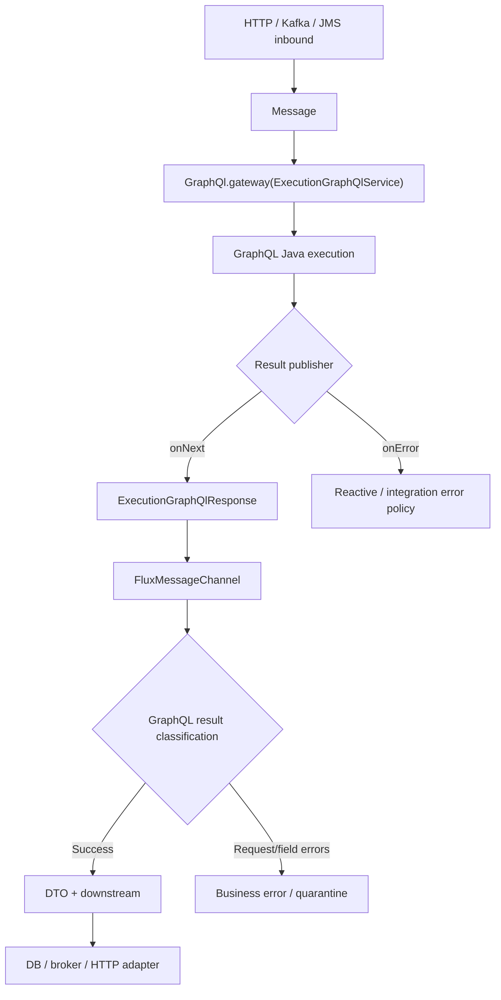
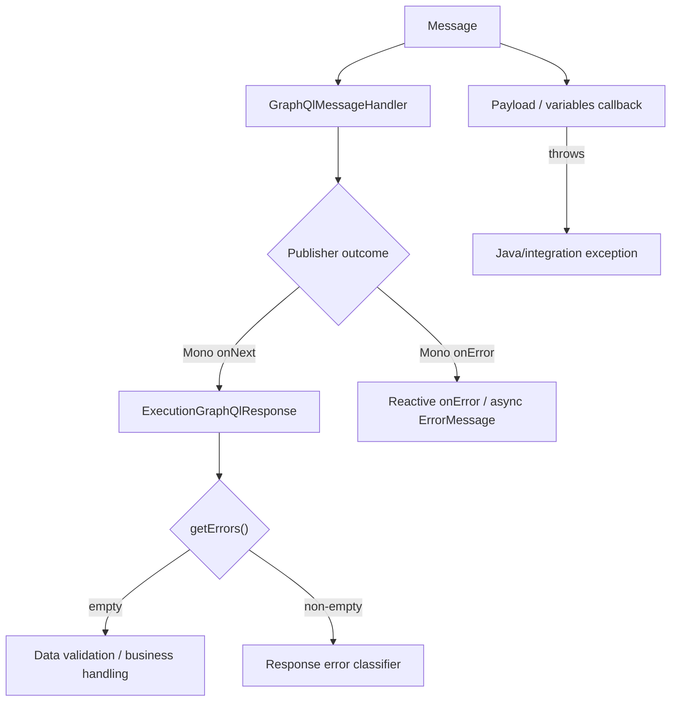
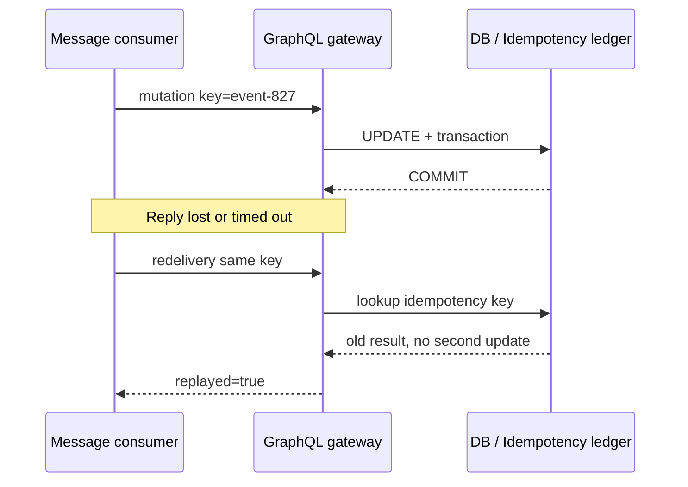

# GraphQL Response and Errors in Spring Integration

## 1. Problem: HTTP Succeeded, But Did the GraphQL Operation Truly Succeed?

A Spring Integration application receives `Message<OrderLookup>` from Kafka/JMS/HTTP, calls the GraphQL outbound gateway to look up an order's status, and forwards the result to a database or outbound adapter. In the logs, there are no Java exceptions and the gateway still produces a reply. Yet consumers sometimes see:

- `data.order = null` because no order was found — a **valid result**, not necessarily an error.
- `data.order.status = null` and `errors` with path `order.status` — a **partial result** where one field could not resolve.
- `data = null` when an error on a non-null field propagated to the root — even though the resolver had already started running.
- `errors` caused by invalid document syntax, a missing field, or schema-mismatched variables — the resolver may **never have been called**.
- The reactive publisher throws an exception or times out — **no `ExecutionGraphQlResponse`** exists to inspect.
- A GraphQL mutation committed to the DB, yet an output field failed to resolve — retrying blindly could duplicate the side effect.

In GraphQL, a **GraphQL error** is typically part of the **response payload**. In Spring Integration, **`ErrorMessage`/`errorChannel`** is the integration flow's exception-handling mechanism. These two mechanisms are not equivalent, and decision rules must keep them distinct.

```text
Message<OrderLookup>
   -> GraphQlMessageHandler
   -> ExecutionGraphQlService
   -> Mono<ExecutionGraphQlResponse>
         |
         +-- response.data / errors     (errors inside GraphQL response)
         |
         +-- reactive onError           (Java/reactive error, no normal reply)
   -> FluxMessageChannel
   -> classify / transform / route
   -> DB, JMS, AMQP, Kafka, HTTP...
```

The lesson **“GraphQL Response and Errors”** belongs to the **GraphQL Adapter** chapter in module `SPRING_INTEGRATION_ADAPTERS`. The module teaches connecting external systems via inbound/outbound adapters, gateways, pollers, and `MessageChannel`s; practicing integration with files, SFTP, HTTP, JMS, AMQP, Kafka, databases, message contracts, errors, and connection lifecycles. In this lesson, the focus is on **reading, classifying, and handling GraphQL results strictly by contract**, without equating "a reply exists" with "the entire business operation committed."

### Learning Outcomes

After this lesson, you can:

1. Describe the `data`, `errors`, and `extensions` sections in a GraphQL response.
2. Distinguish **request errors**, **field errors**, nullable `null`, partial data, and non-null propagation.
3. Properly use `ExecutionGraphQlResponse`, `GraphQlResponse.isValid()`, `getErrors()`, `field(path).getValue()`, `ResponseField.getErrors()`, and `ResponseError.getParsedPath()`.
4. Understand that GraphQL errors can travel on the **reply channel**, whereas Java/reactive exceptions take a different **error-handling** path.
5. Configure the Java DSL `GraphQl.gateway(executionGraphQlService)` and handle replies from `FluxMessageChannel`.
6. Build a classifier converting GraphQL replies into typed result DTOs instead of putting raw GraphQL responses onto a broker.
7. Use `@GraphQlExceptionHandler` or `DataFetcherExceptionResolver` to design error codes and hide internal details.
8. Distinguish the server API `ResponseField` from the client API `ClientResponseField` when calling remote GraphQL endpoints.
9. Choose suitable retry/backoff, reconciliation, and idempotency policies for queries, mutations, and subscriptions.
10. Test success, not-found, invalid request, partial result, null bubbling, timeouts, and post-commit failure responses.

## 2. Boundary: GraphQL Execution Responses vs. Spring Messages and HTTP Responses

Spring Integration **6.5** includes `GraphQlMessageHandler`, an outbound reply-producing gateway executing operations via `ExecutionGraphQlService`. The handler returns `Mono<ExecutionGraphQlResponse>`, and the framework emits replies over a message channel reactively/asynchronously.



| Concept | What It Is | What It Is Not |
|---|---|---|
| `MessageHeaders.ID` | ID of a Spring **message instance** | ID of a GraphQL field, order, or idempotency key |
| `GraphQL executionId` | Trace identity for one GraphQL execution | Confirmation of a domain commit |
| `ExecutionGraphQlResponse` | Object wrapping GraphQL Java's `ExecutionResult` | HTTP response object |
| `GraphQlResponse.getErrors()` | GraphQL request/field errors | Reactor `onError` or Spring `ErrorMessage` |
| `FluxMessageChannel` | In-JVM reactive stream channel | Durable queue persisting across restarts |
| `HttpGraphQlClient` | Spring for GraphQL client to a remote HTTP server | Local gateway's `ExecutionGraphQlService` |
| HTTP status `200` | HTTP protocol transport response | Guarantee that GraphQL has no `errors` |
| Spring `errorChannel` | Channel handling exceptions in a messaging flow | Automatic receiver of all `GraphQLError`s in replies |

**Common pitfall:** `GraphQl.gateway(executionGraphQlService)` does not call URL `https://partner.example/graphql`. It executes a GraphQL service/schema provided by the application. Only when using `HttpGraphQlClient` against an external server is there HTTP transport with HTTP statuses, TLS, proxies, and network timeouts. Both can carry GraphQL errors, but transport handling differs.

### 2.1. Payloads Going In and Out

```text
Input:
  Message<OrderLookup>
    payload = OrderLookup("ORD-1001")
    headers.correlationKey = workflow-123

GraphQL execution result:
  ExecutionGraphQlResponse
    data = { order: { id: "ORD-1001", status: "PAID" } }
    errors = []

Spring Integration output:
  Message<ExecutionGraphQlResponse>
    payload = GraphQL response object
    headers.correlationKey = workflow-123 (if propagation is configured)
```

The GraphQL result is the **payload** of a reply message; Spring Integration does not automatically create a business DTO `OrderSummary` and does not automatically route responses with `errors` to `errorChannel`. The application must add a classifier/transformer step.

## 3. GraphQL Response Forms to Distinguish

GraphQL responses follow the GraphQL spec, typically having `data`, `errors`, and `extensions` (depending on the case). Not every response includes all three fields.

### 3.1. Complete Success — Data Present, No Errors

```json
{
  "data": {
    "order": {
      "id": "ORD-1001",
      "status": "PAID",
      "totalCents": 12500
    }
  }
}
```

Expected values on Spring `GraphQlResponse`:

```text
isValid()                 -> true
getErrors().isEmpty()     -> true
field("order").getValue() -> Map containing order
```

This is the simplest case, yet emitting the reply **does not confirm** that a database/outbound consumer committed or that a broker ACKed.

### 3.2. Nullable Field Not Found — Null Without Errors

Schema:

```graphql
type Query {
  order(id: ID!): Order
}
```

Querying an order not present in the data:

```json
{
  "data": {
    "order": null
  }
}
```

`isValid() = true`, `getErrors()` is empty, and `field("order").getValue() == null`. This is typically a business **NOT_FOUND** state, not an invalid request or exception.

### 3.3. Request Error — GraphQL Could Not Execute the Operation

For example, a query selecting a non-existent field:

```graphql
query FindOrder($id: ID!) {
  order(id: $id) {
    id
    fieldDoesNotExist
  }
}
```

Illustrative response:

```json
{
  "errors": [
    {
      "message": "Validation error: fieldDoesNotExist ...",
      "locations": [{ "line": 4, "column": 5 }]
    }
  ]
}
```

Some execution APIs represent a request error with `"data": null` instead of omitting the `data` key entirely. In Spring GraphQL 1.4, both missing `data` and `data: null` yield `isValid() = false`. **Do not rely solely on HTTP status or `isValid` to tell whether a resolver ran**; request-level errors typically **have no field path**.

Typical causes:

- Syntax error in the GraphQL document.
- Field or argument does not exist in the schema.
- Variable type is incompatible with its usage site.
- Required `ID!` variable is omitted, `null`, or wrong type.
- Enum value is not defined in the schema.
- Document has multiple operations without `operationName`.

`DataFetcherExceptionResolver` does not handle request-level errors occurring **before any DataFetcher runs**.

### 3.4. Field Error with Partial Data

Suppose the schema allows `status` to be nullable:

```graphql
type Order {
  id: ID!
  status: String
  totalCents: Int!
}
```

A status resolver fails to supply a value:

```json
{
  "data": {
    "order": {
      "id": "ORD-1001",
      "status": null,
      "totalCents": 12500
    }
  },
  "errors": [
    {
      "message": "Status unavailable",
      "path": ["order", "status"]
    }
  ]
}
```

`isValid()` can be **true** because `data` is a non-null object, while `getErrors()` is **non-empty**. `field("order.id")` has a value; `field("order.status")` has a null value and an associated error. This is **partial success** at the GraphQL level, not automatically "complete business success."

### 3.5. Null Propagation — Failing Non-Null Fields Can Null Out Data

If the schema changes to:

```graphql
type Order {
  id: ID!
  status: String!
}

type Query {
  order(id: ID!): Order!
}
```

And `status` fails to resolve, GraphQL must follow non-null propagation. Because both `status` and `order` are non-null, the error propagates to the root:

```json
{
  "data": null,
  "errors": [
    {
      "message": "Cannot return null for non-nullable field",
      "path": ["order", "status"]
    }
  ]
}
```

With Spring `GraphQlResponse.isValid()`, `data = null` is considered **invalid**, yet error path `["order","status"]` is a **field path**, not a pre-execution request error. An application **must not** conclude "the resolver never ran" just because `isValid() = false`; it may have run, and for a mutation it may even have caused side effects.

### 3.6. Errors in Lists and Aliases

Query:

```graphql
query FindOrders {
  recent: orders {
    id
    status
  }
}
```

An error on the third item has path:

```json
{
  "path": ["recent", 2, "status"]
}
```

Indices are **zero-based**. The path uses the **response alias** (`recent`), not the original schema field name (`orders`). With the server API:

```java
ResponseField status = response.field("recent[2].status");
Object value = status.getValue();
var fieldErrors = status.getErrors();
```

When a field is null-bubbled, `ResponseField.getErrors()` may contain errors **at, above, or below the path**. Do not match only errors whose path string exactly equals the field being read.

### 3.7. Extensions — Metadata, Not Success/Failure

```json
{
  "data": {"order": {"id": "ORD-1001"}},
  "extensions": {
    "traceId": "trace-123",
    "cost": 3
  }
}
```

`extensions` is an agreed-upon place for implementation metadata. It **does not replace** `data/errors` and varies across GraphQL servers. Do not depend on unversioned extension keys, and never log or forward extensions containing sensitive data.

### 3.8. Decision Summary Table

| Data | Errors | `isValid()` | Typical Meaning | Action Required |
|---|---|---|---|---|
| Non-null object | Empty | True | GraphQL-level execution succeeded | Validate DTO and business rules |
| Object, nullable field null | Empty | True | No data at that field | NOT_FOUND / optional null |
| Non-null object | Has field paths | True | Partial data, field errors | Field-level policy |
| Missing data | Has request errors | False | Parse/validation/coercion failure | Fix query/input |
| `data: null` | Has field paths | False | Post-execution non-null propagation | Check side effects before retrying |
| No GraphQL response | Reactor `onError` | N/A | Exception/cancellation/timeout | Error handling + reconcile |

Note: this is a **diagnostic matrix**; you cannot infer DB transaction state from the first three columns alone.

## 4. Reading the Server-Side Spring for GraphQL API Properly

### 4.1. ExecutionGraphQlResponse Extends GraphQlResponse

In Spring for GraphQL 1.4:

```text
GraphQlResponse
  + isValid(): boolean
  + getData(): <T> T
  + getErrors(): List<ResponseError>
  + getExtensions(): Map<Object,Object>
  + field(String path): ResponseField
  + toMap(): Map<String,Object>

ExecutionGraphQlResponse extends GraphQlResponse
  + getExecutionInput(): graphql.ExecutionInput
  + getExecutionResult(): graphql.ExecutionResult
```

The two additional methods allow deeper engine/instrumentation handling, but may hold sensitive queries/variables/context. **Never directly serialize `ExecutionGraphQlResponse` or `ExecutionInput`** onto a broker as a wire contract.

### 4.2. Understanding isValid() Accurately

Per the Javadoc, `isValid() == false` if the response map **lacks `data`** or has `data = null`. With non-null `data`, the response is valid even if **some nested fields are null due to errors**. Therefore:

```java
if (response.isValid()) {
    // NOT enough to conclude "no errors."
}

if (response.getErrors().isEmpty()) {
    // NOT enough to conclude downstream committed.
}
```

Evaluate **validity + error paths + required data + domain state**.

### 4.3. ResponseField: getValue() and getErrors()

```java
import java.util.Map;
import org.springframework.graphql.ExecutionGraphQlResponse;
import org.springframework.graphql.ResponseField;

ResponseField field = response.field("order");
Map<String, Object> order = field.getValue();

if (order == null) {
    if (field.getErrors().isEmpty()) {
        // Nullable null, likely NOT_FOUND.
    }
    else {
        // Null due to error on field/ancestor/descendant.
    }
}
```

`ResponseField.getValue()` returns the raw value, typically a Map/List/scalar. When a field is null with errors, do not automatically fall back to a default business status without understanding the error.

### 4.4. What Does ResponseError Contain?

```java
for (var error : response.getErrors()) {
    String category =
            String.valueOf(error.getErrorType());
    String path = error.getPath();          // e.g., order.status
    var segments = error.getParsedPath();  // ["order", "status"]
    var locations = error.getLocations();
    var extensions = error.getExtensions();
    // error.getMessage() may contain sensitive details.
}
```

| API | Meaning |
|---|---|
| `getErrorType()` | GraphQL Java error classification/type |
| `getMessage()` | Diagnostic error description; requires sanitization/masking |
| `getPath()` | String form of field path; empty for global errors |
| `getParsedPath()` | List of field names and zero-based indices |
| `getLocations()` | Source positions in the GraphQL document, if available |
| `getExtensions()` | Metadata that may carry implementation-specific classification/codes |

Do not use `error.getMessage().contains("timeout")` as your retry trigger: messages can change, be localized, or be redacted. Prefer **contracted service-defined error categories/codes**, combined with transaction knowledge to choose policy.

### 4.5. Server ResponseField Differs from ClientResponseField

Spring GraphQL has two response API layers:

| Layer | Object | How to Extract Values |
|---|---|---|
| Local gateway using `ExecutionGraphQlService` | `ExecutionGraphQlResponse` / `ResponseField` | `field("order").getValue()` |
| Remote HTTP/WebSocket/RSocket client | `ClientGraphQlResponse` / `ClientResponseField` | `field("order").toEntity(Order.class)` / `retrieve("order").toEntity(...)` |

**Do not call `response.field("order").toEntity(Order.class)` on server-side `ExecutionGraphQlResponse`.** `toEntity` is a decoding helper on **client response fields**. When handling a local gateway, map explicitly from Map/List into domain DTOs with validation and error classification.

## 5. Schema and Resolver to Reproduce Success, Null, and Field Errors

The examples use **compatible Java 17 + Spring Boot 3.x + Spring Integration 6.5.x**, with Spring for GraphQL versions aligned via BOM. The Java/GraphQL files below are **samples for learners to create in a practice project**, not files to generate outside this Knowledge task.

### 5.1. Dependencies

**`build.gradle`:**

```gradle
dependencies {
    implementation 'org.springframework.boot:spring-boot-starter-integration'
    implementation 'org.springframework.integration:spring-integration-graphql'
    implementation 'org.springframework.boot:spring-boot-starter-graphql'

    testImplementation 'org.springframework.boot:spring-boot-starter-test'
    testImplementation 'org.springframework.graphql:spring-graphql-test'
}
```

`spring-integration-graphql` provides the gateway; `spring-boot-starter-graphql` provides GraphQL execution engine/schema/resolver configuration. In a Spring Boot app, `GraphQlSource`/`ExecutionGraphQlService` beans can be auto-configured from schemas and `@Controller`s. If declaring beans manually, pick one ownership mechanism so duplicate beans do not cause the gateway to receive the wrong execution service.

### 5.2. GraphQL Schema

**`src/main/resources/graphql/order-response.graphqls`:**

```graphql
type Query {
  order(id: ID!): Order
}

type Order {
  id: ID!
  status: String
  totalCents: Int!
}
```

With this schema:

- `order` is nullable → a non-existent ID returns `order: null` without requiring `errors`.
- `status` is nullable → a resolver failure can yield `status: null` while keeping `id/totalCents` as partial data.
- `id/totalCents` are non-null → if a resolver returns null or errors on them, GraphQL can null-bubble up to `order`.
- `Int` in GraphQL is signed 32-bit; the demo uses small amounts in cents. Production uses appropriate scalars/encodings if larger ranges are needed.

### 5.3. Resolver Producing Three Intentional Outcomes

**`OrderGraphQlController.java`:**

```java
import org.springframework.graphql.data.method.annotation.Argument;
import org.springframework.graphql.data.method.annotation.QueryMapping;
import org.springframework.graphql.data.method.annotation.SchemaMapping;
import org.springframework.stereotype.Controller;

record DemoOrder(String id, String status, int totalCents) {
}

class StatusUnavailableException extends RuntimeException {
}

@Controller
public class OrderGraphQlController {

    @QueryMapping
    public DemoOrder order(@Argument String id) {
        return switch (id) {
            case "ORD-1001" ->
                    new DemoOrder("ORD-1001", "PAID", 12_500);
            case "ORD-FAIL" ->
                    new DemoOrder("ORD-FAIL", "PENDING", 9_000);
            default -> null;
        };
    }

    @SchemaMapping(typeName = "Order", field = "status")
    public String status(DemoOrder order) {
        if ("ORD-FAIL".equals(order.id())) {
            throw new StatusUnavailableException();
        }
        return order.status();
    }
}
```

With `ORD-1001`, the GraphQL response has complete data. With a non-existent ID, `Query.order` validly returns null. With `ORD-FAIL`, the `@SchemaMapping` for `status` throws an exception; Spring for GraphQL turns it into a GraphQL error, and since `status` is nullable, the rest of `order` can remain intact.

**Important:** the exception is not necessarily propagated out of the gateway as a Java exception. It can be translated by `DataFetcherExceptionResolver` into a `GraphQLError` inside `ExecutionGraphQlResponse.getErrors()`.

### 5.4. Failing Resolver on a Non-Null Field

To observe **null bubbling to the root**, change the schema in an isolated fixture/test to:

```graphql
type Query {
  order(id: ID!): Order!
}

type Order {
  id: ID!
  status: String!
  totalCents: Int!
}
```

When `ORD-FAIL` causes `status!` to fail, `data` can become null and `isValid()` false. **Do not** treat this as a pre-resolver query validation error: inspect `getErrors().getParsedPath()` to identify error path `["order","status"]`. In tests, use a separate schema/`GraphQlSource` or reload the test context intentionally rather than modifying production schemas just to test failures.

## 6. Java DSL: GraphQL Outbound Gateway Returning ExecutionGraphQlResponse

### 6.1. Typed Request Payload

**`OrderLookup.java`:**

```java
public record OrderLookup(String orderId) {

    public OrderLookup {
        if (orderId == null || orderId.isBlank()
                || orderId.length() > 128) {
            throw new IllegalArgumentException(
                    "orderId must have a valid value");
        }
    }
}
```

`OrderLookup` is a domain DTO, not an `ExecutionGraphQlRequest`. This is beneficial: the gateway applies the configured static operation and variables rather than letting upstream supply arbitrary query documents.

### 6.2. IntegrationFlow

**`OrderGraphQlFlow.java`:**

```java
import java.util.Map;

import org.springframework.context.annotation.Bean;
import org.springframework.context.annotation.Configuration;
import org.springframework.graphql.ExecutionGraphQlService;
import org.springframework.integration.config.EnableIntegration;
import org.springframework.integration.dsl.IntegrationFlow;
import org.springframework.integration.dsl.MessageChannels;
import org.springframework.integration.graphql.dsl.GraphQl;

@Configuration
@EnableIntegration
public class OrderGraphQlFlow {

    private static final String LOOKUP_ORDER = """
            query LookupOrder($id: ID!) {
              order(id: $id) {
                id
                status
                totalCents
              }
            }
            """;

    @Bean
    IntegrationFlow lookupOrderFlow(
            ExecutionGraphQlService graphQlService) {
        return IntegrationFlow
                .from(MessageChannels.flux("orderLookupRequests"))
                .handle(GraphQl.gateway(graphQlService)
                        .operation(LOOKUP_ORDER)
                        .operationName("LookupOrder")
                        .variables(message -> Map.of(
                                "id",
                                ((OrderLookup) message.getPayload())
                                        .orderId())))
                .channel(c -> c.flux("orderLookupResponses"))
                .get();
    }
}
```

**Explanation:**

1. Input `orderLookupRequests` receives `Message<OrderLookup>` from an inbound adapter or internal producer.
2. `GraphQl.gateway(graphQlService)` uses the local `ExecutionGraphQlService`; it does not issue an HTTP POST.
3. `.operation(...)` keeps the GraphQL document fixed; `.operationName(...)` selects the operation.
4. `.variables(...)` builds `Map<String,Object>` from the **payload**. Never concatenate `orderId` into the query text.
5. The service returns `Mono<ExecutionGraphQlResponse>`; the framework forwards replies over `FluxMessageChannel`.
6. Consumers on `orderLookupResponses` inspect data/errors instead of assuming every reply succeeded.

**Reactive channel caveat:** `MessageChannel.send()` returning true means the message was accepted per contract, **not** that the GraphQL query or downstream transaction has finished. You need an active subscriber/consumer plus timeouts/backpressure if the source emits too fast.

### 6.3. Sending Request Messages

**`OrderLookupPublisher.java`:**

```java
import org.springframework.beans.factory.annotation.Qualifier;
import org.springframework.integration.support.MessageBuilder;
import org.springframework.messaging.MessageChannel;
import org.springframework.stereotype.Component;

@Component
public class OrderLookupPublisher {

    private final MessageChannel input;

    public OrderLookupPublisher(
            @Qualifier("orderLookupRequests") MessageChannel input) {
        this.input = input;
    }

    public void request(String orderId, String correlationKey) {
        boolean accepted = input.send(
                MessageBuilder.withPayload(new OrderLookup(orderId))
                        .setHeader("correlationKey", correlationKey)
                        .build());
        if (!accepted) {
            throw new IllegalStateException(
                    "Input channel did not accept message");
        }
    }
}
```

Call `request("ORD-1001", "workflow-123")` for a full response; `request("ORD-NONE", ...)` for `order:null`; and `request("ORD-FAIL", ...)` for partial data + field error.

### 6.4. Headers and Response IDs

A message carrying `headers.correlationKey` before the gateway can preserve custom headers afterward via the message-producing handler's header propagation mechanism. However, **never** equate `MessageHeaders.ID`, `GraphQL execution ID`, and domain order ID. Message UUIDs can be regenerated on transforms/replays, whereas domain IDs and correlation keys follow their own contracts.

If upstream is Kafka/JMS, do not commit offsets/ACKs merely because the message was sent to `FluxMessageChannel`. When durability is required, wait until business results are durably persisted or use a durable inbox storing commands for later processing.

## 7. Classifying Responses into Typed Business DTOs

### 7.1. Defining the Domain Outcome

Instead of letting other consumers depend on full GraphQL Java objects, normalize into one of three outcomes:

```java
public sealed interface OrderQueryOutcome
        permits OrderQueryOutcome.Found,
                OrderQueryOutcome.NotFound,
                OrderQueryOutcome.Rejected {

    record Found(OrderSummary order)
            implements OrderQueryOutcome {
    }

    record NotFound() implements OrderQueryOutcome {
    }

    record Rejected(String category, int errorCount)
            implements OrderQueryOutcome {
    }
}

record OrderSummary(
        String id, String status, int totalCents) {
}
```

This is a demo business contract. `Rejected.category` must come only from a **fixed application-controlled enum/code**, never copying raw uncontrolled `GraphQLError.message`/extensions verbatim.

### 7.2. Strict Classifier Distinguishing Request Errors and Null Bubbling

**`OrderGraphQlResponseClassifier.java`:**

```java
import java.util.Map;

import org.springframework.graphql.ExecutionGraphQlResponse;
import org.springframework.graphql.ResponseError;

public final class OrderGraphQlResponseClassifier {

    public OrderQueryOutcome classify(
            ExecutionGraphQlResponse response) {

        if (!response.isValid()) {
            boolean anyFieldPath = response.getErrors().stream()
                    .map(ResponseError::getParsedPath)
                    .anyMatch(path -> !path.isEmpty());

            // Even with isValid=false, causes differ:
            // invalid request vs. non-null field error bubbling to root.
            return new OrderQueryOutcome.Rejected(
                    anyFieldPath
                            ? "BUBBLED_FIELD_ERROR"
                            : "REQUEST_ERROR",
                    response.getErrors().size());
        }

        if (!response.getErrors().isEmpty()) {
            // Strict policy: reject partial data.
            return new OrderQueryOutcome.Rejected(
                    "FIELD_ERROR",
                    response.getErrors().size());
        }

        Map<String, Object> data = response.getData();
        if (data == null || !data.containsKey("order")) {
            return new OrderQueryOutcome.Rejected(
                    "MISSING_EXPECTED_FIELD", 0);
        }

        Object rawOrder =
                response.field("order").getValue();
        if (rawOrder == null) {
            return new OrderQueryOutcome.NotFound();
        }
        if (!(rawOrder instanceof Map<?, ?> order)) {
            return new OrderQueryOutcome.Rejected(
                    "INVALID_DATA_CONTRACT", 0);
        }

        Object id = order.get("id");
        Object status = order.get("status");
        Object total = order.get("totalCents");

        if (!(id instanceof String orderId)
                || orderId.isBlank()
                || !(status instanceof String state)
                || state.isBlank()
                || !(total instanceof Integer cents)) {
            return new OrderQueryOutcome.Rejected(
                    "INVALID_DATA_CONTRACT", 0);
        }

        return new OrderQueryOutcome.Found(
                new OrderSummary(
                        orderId, state, cents));
    }
}
```

**What is protected:**

- Request errors typically lack a field path, whereas bubbled non-null errors still have a path; the classifier does not lump both together simply because `isValid=false`.
- Partial data with errors is rejected under the **strict policy**. Other business flows may accept optional fields, provided they define that explicitly.
- `order:null` without errors becomes `NotFound` when the `order` field is present in `data`.
- `order` **missing from data** differs from the field being present as null; the classifier flags a contract mismatch.
- Raw GraphQL error messages or `ExecutionGraphQlResponse` objects never cross the Kafka/JMS/HTTP boundary.

This example assumes the `LookupOrder` query response contains those exact fields and GraphQL `Int` is represented as Java `Integer` by GraphQL Java. The mapper validates the `Map` and field types before building the DTO so non-conforming responses are not mis-cast. For currency or large numbers, use `BigDecimal`/custom scalars and explicit type validation rather than silently truncating via `Number.intValue()`.

### 7.3. Reply Channel Consumer

**`OrderGraphQlResultConsumer.java`:**

```java
import org.springframework.graphql.ExecutionGraphQlResponse;
import org.springframework.integration.annotation.ServiceActivator;
import org.springframework.messaging.Message;
import org.springframework.stereotype.Component;

@Component
public class OrderGraphQlResultConsumer {

    private final OrderGraphQlResponseClassifier classifier =
            new OrderGraphQlResponseClassifier();

    @ServiceActivator(inputChannel = "orderLookupResponses")
    public void consume(Message<ExecutionGraphQlResponse> message) {

        OrderQueryOutcome outcome =
                classifier.classify(message.getPayload());

        String correlation = message.getHeaders()
                .get("correlationKey", String.class);

        if (outcome instanceof OrderQueryOutcome.Found found) {
            OrderSummary order = found.order();
            System.out.printf(
                    "corr=%s order=%s state=%s%n",
                    correlation, order.id(), order.status());
            // Production: send DTO to channel/broker or write to DB.
        }
        else if (outcome instanceof OrderQueryOutcome.NotFound) {
            System.out.println("Order does not exist");
        }
        else if (outcome instanceof OrderQueryOutcome.Rejected error) {
            System.err.println(
                    "GraphQL category=" + error.category());
            // Production: sanitized metrics, audit, remediation.
        }
    }
}
```

The demo consumer only logs the outcome and is **not a durable handler**. If Kafka/JMS requires ACKing only after DB commit, route `OrderQueryOutcome` into a workflow with explicit state/transactions rather than relying on a log line or boolean `send()`.

### 7.4. Should You Accept Partial Data?

No single policy fits every schema:

| Failing Field | Accept Partial Data? | What Must Be Defined |
|---|---|---|
| User avatar URL on a view page | Possibly | UI fallback, no business impact |
| An optional order description field | Possibly | Not used in critical decisions |
| Payment `status` | Usually no | Never ship based on a missing status |
| `totalCents` for reconciliation | Usually no | Monetary value is mandatory |
| One item in a recommendations list | Possibly | Policy to drop item / warn |
| Mutation response after DB commit | Cannot decide from partial alone | Requires idempotency ledger/version/reconciliation |

When accepting partial data, build the classifier around **field requirements and `getErrors()` paths**, rather than just `if (response.isValid()) accept;`. For important data, emit a `PARTIAL_DEGRADED` state so downstream knows the limitations instead of treating it as complete.

## 8. Producing GraphQL Errors with @GraphQlExceptionHandler

### 8.1. Resolver Exceptions Converted to Field Errors

Spring for GraphQL provides `DataFetcherExceptionResolver` to convert exceptions from a `DataFetcher` into `GraphQLError`s. Unhandled exceptions are normally obscured under `INTERNAL_ERROR` to avoid leaking implementation details. Applications can define intentional mappings:

```java
import graphql.GraphQLError;
import graphql.GraphqlErrorBuilder;

import org.springframework.graphql.data.method.annotation.GraphQlExceptionHandler;
import org.springframework.graphql.execution.ErrorType;
import org.springframework.web.bind.annotation.ControllerAdvice;

@ControllerAdvice
public class OrderGraphQlErrorAdvice {

    @GraphQlExceptionHandler
    public GraphQLError statusUnavailable(
            GraphqlErrorBuilder<?> builder,
            StatusUnavailableException ex) {

        return builder
                .errorType(ErrorType.INTERNAL_ERROR)
                .message("Unable to retrieve order status")
                .build();
    }
}
```

Here:

- `@ControllerAdvice` applies exception mapping across GraphQL annotated controllers per Spring GraphQL.
- `GraphqlErrorBuilder<?>` comes pre-populated with `DataFetchingEnvironment` details like path/locations, creating a context-accurate GraphQL error.
- `ex.getMessage()` is **excluded** from the response; the public message is strictly controlled.
- Error category `INTERNAL_ERROR` does not mean the application should retry every request. Retry policies must consider operation type, transiency, and side effects.

For custom `DataFetcher`s **outside annotated controllers**, register a `DataFetcherExceptionResolver` on `GraphQlSource.Builder` or appropriate config instead of assuming `@ControllerAdvice` catches every exception automatically.

### 8.2. Classifying Errors by Error Type

Spring for GraphQL provides common categories:

| Category | Typical Meaning | Recommended Handling |
|---|---|---|
| `BAD_REQUEST` | Invalid business/input data | Fix data/contract |
| `UNAUTHORIZED` | Missing authentication | Fix auth; avoid retry storms |
| `FORBIDDEN` | Insufficient permissions | Fail closed and audit |
| `NOT_FOUND` | Domain resource missing, if service reports via error | Return not-found per contract |
| `INTERNAL_ERROR` | Internal or unmapped error | Alert, classify before retrying |

These values are **Spring GraphQL classifications**, not an automatic HTTP status scheme. An HTTP `200` response can contain `INTERNAL_ERROR` inside GraphQL errors. A mutation may already have committed before an output resolver failed; never retry simply upon seeing `INTERNAL_ERROR`.

### 8.3. Request Errors Do Not Hit DataFetcher @GraphQlExceptionHandler

GraphQL document parse errors, schema validation errors, and variable coercion errors happen **before any DataFetcher runs**. `DataFetcherExceptionResolver`/`@GraphQlExceptionHandler` does not handle them. Depending on transport, use appropriate interceptors to observe request failures while preserving the GraphQL response contract and preventing user-triggered errors from leaking internals.

### 8.4. Subscription Stream Errors Arrive After the Initial Response

GraphQL subscriptions produce a publisher, and errors can occur after streaming begins. A `Publisher.onError` signal is **not necessarily** handled by a setup-phase `DataFetcherExceptionResolver`; Spring for GraphQL provides `SubscriptionExceptionResolver` on supported transports. With the local Spring Integration gateway, subscribe, cancel, and monitor the publisher explicitly rather than treating the first reply as "the entire subscription succeeded."

## 9. ErrorMessage, Reactive onError, and GraphQL Errors: Three Paths to Wire Properly

### 9.1. Distinguishing How a Request Fails



| Failure | Message State | Who Handles It? |
|---|---|---|
| GraphQL validation/coercion | `ExecutionGraphQlResponse` with `errors` | Result channel classifier |
| Resolver exception mapped to `GraphQLError` | `ExecutionGraphQlResponse` with field errors | Result channel classifier |
| Java exception in transformer/variables callback | May produce no reply | Error channel / endpoint failure handling |
| Reactor `onError` from `execute()` | No normal GraphQL response | Reactive error handler / configured async error channel |
| Downstream Kafka/JMS failure | After GraphQL response | Downstream adapter retry/ack/DLQ |
| Subscription publisher error after setup | Stream already active | Subscription subscriber/error handling |

**There is no single all-catching error channel:** you must know whether the source is a synchronous `DirectChannel`, `FluxMessageChannel`, `ExecutorChannel`, poller, gateway, or broker listener. Async endpoints can throw errors **after** the sending thread returns, so upstream catch/retry blocks will not cover them.

### 9.2. Should GraphQL Errors Be Turned into Java Exceptions?

You can, but only when business policy requires fail-fast and matching recovery exists. For example, if a consumer sees `FORBIDDEN` and decides to return a domain rejection DTO to the caller, do not throw an exception that triggers infinite broker redeliveries. For a safely retryable database failure, throwing a classified exception lets recovery advice handle it.

Better yet, define explicit outcome states:

```text
SUCCESS
NOT_FOUND
PARTIAL_DEGRADED
INVALID_REQUEST
BUSINESS_REJECTED
TRANSIENT_FAILURE
UNKNOWN_OUTCOME
```

For mutations or downstream steps that might already have committed, `UNKNOWN_OUTCOME` must trigger **keyed reconciliation** before retrying. Never equate "non-empty `GraphQL.errors`" with "transaction rolled back."

### 9.3. Spring Integration errorChannel Does Not Parse GraphQL Responses

Suppose the result channel receives:

```text
Message<ExecutionGraphQlResponse>
  payload.isValid() = true
  payload.errors = [ field error ]
```

This message is still a reply. No `ErrorMessage` is automatically emitted just because `errors` is non-empty. To route GraphQL errors to a business error channel, **route by classified status** or send an explicit contract message. If you convert them into exceptions yourself, note that this is an **application design choice**, not default GraphQL outbound gateway behavior.

## 10. Calling GraphQL Over HTTP: Client Responses and Transport Statuses

### 10.1. Why Separate Local and Remote?

A pipeline can take two architectures:

```text
Local GraphQL engine:
  Message -> GraphQl.gateway(ExecutionGraphQlService)
          -> Mono<ExecutionGraphQlResponse>

Remote GraphQL service:
  Message -> HttpGraphQlClient(WebClient)
          -> HTTPS endpoint /graphql
          -> Mono<ClientGraphQlResponse>
```

Spring Integration's `GraphQlMessageHandler` uses a local `ExecutionGraphQlService`. It **does not open an HTTP connection** just because the operation is GraphQL. If the GraphQL server belongs to a partner system, use `HttpGraphQlClient`/`HttpSyncGraphQlClient` or an HTTP outbound gateway.

### 10.2. HttpGraphQlClient.execute() to Inspect GraphQL Errors Directly

**Spring for GraphQL client example**:

```java
import org.springframework.graphql.client.ClientGraphQlResponse;
import org.springframework.graphql.client.ClientResponseField;
import org.springframework.graphql.client.HttpGraphQlClient;
import org.springframework.web.reactive.function.client.WebClient;
import reactor.core.publisher.Mono;

WebClient webClient = WebClient.builder()
        .baseUrl("https://partner.example/graphql")
        .build();

HttpGraphQlClient graphQlClient =
        HttpGraphQlClient.create(webClient);

Mono<ClientGraphQlResponse> result = graphQlClient
        .document("""
            query LookupOrder($id: ID!) {
              order(id: $id) { id status totalCents }
            }
            """)
        .variable("id", "ORD-1001")
        .execute();

Mono<String> state = result.map(response -> {
    if (!response.isValid()) {
        return "REQUEST_OR_NULL_BUBBLING_ERROR";
    }
    ClientResponseField field = response.field("order");
    if (!response.getErrors().isEmpty()) {
        return "GRAPHQL_FIELD_ERROR";
    }
    if (field.getValue() == null) {
        return "NOT_FOUND";
    }
    return "FOUND";
});
```

`partner.example` is only a **placeholder**, implying no real endpoint. With a remote client, `ClientResponseField` provides `toEntity(Class)`. When decisions depend on multiple paths/errors, `execute()` gives access to the entire response before decoding.

This snippet shows basic classification; to separate request errors from non-null-bubbled field errors when `isValid=false`, inspect `response.getErrors().getParsedPath()`, just like in section 7.

### 10.3. retrieve() vs. execute()

```java
Mono<OrderSummary> order = graphQlClient
        .document("""
            query LookupOrder($id: ID!) {
              order(id: $id) { id status totalCents }
            }
            """)
        .variable("id", "ORD-1001")
        .retrieve("order")
        .toEntity(OrderSummary.class);
```

`retrieve("order")` is a shortcut for decoding a single field. When the field is missing or null with errors, the client can raise `FieldAccessException`; when decoding fails, it can raise `GraphQlClientException`. For workflows needing to distinguish nullable nulls, partial data, error paths, and business rejections, use `execute()` and inspect the response/fields explicitly.

**Do not copy** `.retrieve().toEntity()` onto `ExecutionGraphQlResponse` in the server-side gateway — that API belongs to the GraphQL client.

### 10.4. HTTP 200 Does Not Prove Success

GraphQL over HTTP can return HTTP 200 while the JSON response still contains `errors`. HTTP status alone cannot replace a GraphQL error policy. Conversely:

- HTTP `401/403` may indicate transport authentication/authorization failures.
- HTTP `429` indicates rate limits/quotas; bound retries per `Retry-After`.
- HTTP `502/503/504` may indicate transient proxy/server/network issues.
- Connection timeouts/resets can happen **after a mutation committed**.
- Malformed GraphQL response JSON causes client decoding failures.

Implementations/versions of GraphQL over HTTP vary in media types and status conventions for request errors. Never infer mutation state solely from HTTP 200 or HTTP 4xx. Before retrying a mutation, query a ledger/status endpoint by idempotency key if supported.

### 10.5. Subscription Errors Arrive After Setup

In subscriptions, the setup response can hold a `SubscriptionPublisher` instead of a plain object. Subsequent events may arrive over WebSocket, RSocket, or another streaming transport. Handle:

- Setup errors in the initial GraphQL response.
- Publisher `onError` after the stream has started.
- Cancellation, backpressure, reconnects, and resume/cursors.
- Field errors inside individual event responses.

For remote GraphQL, choose a streaming-capable transport client (WebSocket, RSocket, or SSE if supported by the server). Local `GraphQl.gateway(...)` does not open a WebSocket to a partner URL.

## 11. Operation-Dependent Retry and Recovery Rules

### 11.1. Queries: Only Transient Errors Are Worth Retrying

For read queries, certain transient backend errors can be retried. However, you must:

1. Identify stable error categories/codes rather than matching raw message strings.
2. Apply exponential backoff, jitter, max attempts, and an overall deadline.
3. Bound concurrency to avoid cascading load on a struggling backend.
4. Never retry GraphQL syntax, validation, or coercion errors.
5. If only an optional field failed, consider returning a partial degraded response instead of an expensive full retry.
6. Ensure downstream does not send duplicate notifications when a query reruns.

`RequestHandlerRetryAdvice` attached to a handler catches **message-handler exceptions**, but does not inspect `ExecutionGraphQlResponse.getErrors()` to trigger retries. To retry based on GraphQL errors, classify and map errors into an explicit retry policy.

### 11.2. Mutations: Timeout After Commit Is an Unknown Outcome

Suppose:



A GraphQL error response or timeout does not prove transaction rollback. To retry safely:

- Producer assigns a **durable idempotency key** from the source event/command.
- Service stores unique key, request fingerprint, and result in a durable ledger.
- Optimistic locking/CAS prevents two distinct commands from updating the same row concurrently.
- Domain update and outbox event commit in the same DB transaction.
- When a reply is lost, check ledger/DB version before retrying.
- Tie Kafka/JMS ACKs to durable boundaries, not `MessageChannel.send()`.

For remote services without idempotency/status lookups, manual reconciliation or compensation workflows may be needed instead of infinitely resending payment mutations.

### 11.3. Retry Table by Scenario

| Scenario | Auto-Retry? | Reason |
|---|---|---|
| Query with transient DB timeout | Bounded | Typically has no domain side effects |
| Query with unknown field | No | Fix schema/document |
| Query variables with wrong enum/Int | No | Fix input/coercion |
| Valid `NOT_FOUND` | No | Not a transient error |
| `FORBIDDEN`/`UNAUTHORIZED` | No retry storm | Fix auth/permissions |
| Query partial optional field | Per contract | Can degrade gracefully |
| Mutation version conflict | Do not blindly retry as-is | Reconcile current state |
| Mutation same key/same fingerprint | Do not repeat side effect | Return stored result |
| Mutation key reuse/different fingerprint | No | Conflict/security alert |
| Mutation timeout with unknown outcome | Not yet | Check commit/ledger |
| Outbox delivery timeout | Retry at outbox | Same event key, receiver deduplicates |
| Interrupted subscription stream | Controlled reconnect | Needs resume/cursor to avoid gaps |

### 11.4. Representing Errors Downstream

For a system publishing results via Kafka/JMS/HTTP:

```json
{
  "schemaVersion": "1",
  "operation": "LookupOrder",
  "status": "REJECTED",
  "errorCode": "GRAPHQL_FIELD_ERROR",
  "correlationKey": "workflow-123",
  "retryable": false
}
```

This is a **recommended application DTO**, not a format emitted by GraphQL or Spring Integration. `retryable` must reflect a verified policy; never mark all `INTERNAL_ERROR` cases `true`. Never place stack traces, GraphQL documents, or raw variables into public events.

## 12. Securing Responses and Error Reporting

### 12.1. Preventing Information Leakage in Messages and Extensions

GraphQL error messages can include details thrown by a DataFetcher or exception, inadvertently exposing SQL, user IDs, tokens, or tenant data. Safeguards:

- `@GraphQlExceptionHandler` returns controlled public messages.
- Unmapped errors are redacted publicly, with details logged only to access-controlled internal logs.
- Restrict `extensions`; never pass exception objects, auth tokens, raw principals, or SQL into responses.
- Whitelist fields when transforming into DTOs sent over brokers/HTTP.
- Apply structured log masking/hashing and retention rules.
- Keep metric labels to `operationName`, error category, and source alias; avoid full paths with dynamic IDs unless strictly bounded.

### 12.2. Error Paths Are Also Data to Classify

`ResponseError.getParsedPath()` can expose GraphQL field names, aliases, and list indices. Although helpful for locating failed fields, not every path is safe to expose publicly without limits. Avoid using paths from arbitrary queries as metric labels if clients can generate thousands of distinct aliases.

### 12.3. Query Shape, Authorization, and Error Policy

GraphQL variables do not replace authorization. A server may **intentionally** return `order:null` to avoid disclosing another tenant's order; never emit messages like "Order X belongs to tenant Y" when the caller lacks access.

Controls:

- Authenticate the principal at the inbound boundary.
- Enforce authorization at resolver/service/row level.
- Enforce operation allowlists, depth/complexity limits, and max pagination.
- Align field-level access and nullability with disclosure policies.
- Enforce query cost/timeouts and bounded concurrency.
- For Kafka/JMS events, never treat an arbitrary producer-sent `tenantId` header as authenticated context.

### 12.4. Do Not Turn Errors into Stack Traces Over HTTP

If an HTTP inbound gateway at the end of a flow returns GraphQL errors to callers, map them to a **public response contract** with status, stable error code, and sanitized correlation ID. Choose HTTP status per API contract / GraphQL over HTTP transport; never let a service activator exception dump SQL stack traces into an HTTP body.

## 13. Observability: Measuring Responses and Errors Meaningfully

### 13.1. Recommended Metrics

| Metric | Meaning |
|---|---|
| `graphql_gateway_request_total{operation}` | Request messages entering gateway |
| `graphql_gateway_reply_total{operation,outcome}` | Classified responses emitted |
| `graphql_gateway_request_error_total{operation}` | Parse/validation/coercion errors |
| `graphql_gateway_field_error_total{operation,category}` | Field resolution errors |
| `graphql_gateway_partial_total{operation}` | Responses with both data and errors |
| `graphql_gateway_null_bubbling_total{operation}` | Field errors nulling out data |
| `graphql_gateway_not_found_total{operation}` | Nullable domain nulls without errors |
| `graphql_gateway_reactive_error_total{operation}` | `onError`/Java exceptions |
| `graphql_gateway_timeout_total{operation}` | Operations exceeding deadline |
| `graphql_gateway_inflight{operation}` | Currently processing requests |
| `graphql_gateway_duration_ms{operation}` | End-to-end latency |
| `graphql_gateway_response_bytes{operation}` | Serialized size |
| `graphql_mutation_unknown_outcome_total` | Post-possible-commit failures needing reconciliation |
| `graphql_downstream_delivery_pending_total` | Undelivered outbox/notification items |

These are **application-recommended metrics**, not all generated automatically by Spring Integration. Keep label cardinality low. Never use message UUIDs, full GraphQL documents, `orderId`, or raw error messages as labels.

### 13.2. Recommended Structured Log

```text
event=graphql_response_classified
operationName=LookupOrder
sourceSystem=order-events
correlationKeyHash=4a72...fe1b
executionIdHash=b916...09c1
outcome=FIELD_ERROR
isValid=true
errorCount=1
fieldCategory=INTERNAL_ERROR
durationMs=42
```

If logging error paths, log normalized/whitelisted forms without raw variables. Put sensitive diagnostics in access-controlled internal logs with retention limits, never in client-visible responses.

### 13.3. Runbook: GraphQL Gateway Returning Persistent Errors

1. Identify `operationName`, schema version, message source, and timestamp of first failure.
2. Check whether a GraphQL response exists; if not, classify Java exception / Reactor `onError` / transport timeout.
3. If a response exists, inspect `isValid`, `getErrors().size()`, `getParsedPath()`, and field nullability.
4. For empty paths, check syntax, schema, variables, and `operationName` prior to DataFetcher execution.
5. For non-empty paths, check resolver, authorization, data source, and null propagation.
6. For `data:null`, verify whether it is a request error or non-null bubbling rather than assuming resolvers never ran.
7. For mutations, reconcile against the idempotency ledger/DB/outbox before retrying.
8. Inspect `FluxMessageChannel` subscribers/backpressure/timeouts and downstream adapters.
9. Check rate limits, query complexity, DataLoader/N+1, and backend capacity.
10. Run an equivalent failure test fixture, apply remediation, and confirm no business events were lost or duplicated.

### 13.4. When Multiple Sources Invoke One GraphQL Operation

```text
Kafka inbound adapter -> GraphQL query -> Classifier -> DB
JMS inbound gateway  -> GraphQL query -> Classifier -> HTTP reply
HTTP inbound gateway -> GraphQL query -> Classifier -> Kafka event
Scheduled poller     -> GraphQL query -> Classifier -> File/SFTP output
```

A single classifier can be shared if schema/operation/contracts match, yet **ACK and retry boundaries** differ per source. Never let a Kafka consumer ACK before durable completion, and never treat remote HTTP errors identically to local resolver errors.

## 14. Testing Responses and Errors

### 14.1. Testing the Schema Directly Without HTTP

Spring for GraphQL provides `ExecutionGraphQlServiceTester`. JUnit 5/Spring Boot example:

```java
import org.junit.jupiter.api.Test;
import org.springframework.beans.factory.annotation.Autowired;
import org.springframework.boot.test.context.SpringBootTest;
import org.springframework.graphql.ExecutionGraphQlService;
import org.springframework.graphql.test.tester.ExecutionGraphQlServiceTester;

@SpringBootTest
class GraphQlResponseIntegrationTest {

    @Autowired
    ExecutionGraphQlService executionService;

    @Test
    void completeResponseContainsStatus() {
        ExecutionGraphQlServiceTester tester =
                ExecutionGraphQlServiceTester.create(executionService);

        tester.document("""
                query LookupOrder($id: ID!) {
                  order(id: $id) { id status totalCents }
                }
                """)
                .variable("id", "ORD-1001")
                .execute()
                .path("order.status")
                .entity(String.class)
                .isEqualTo("PAID");
    }
}
```

In a practice project, include the schema/controller from section 5, `spring-graphql-test`, and a valid Spring Boot test context. This test verifies the GraphQL schema/resolver, **not yet the Spring Integration flow/channels**.

### 14.2. Testing Invalid Requests and Field Errors

With `ExecutionGraphQlServiceTester`:

- Send a query with `fieldDoesNotExist` and verify response errors occur without calling the resolver.
- Send `$id: ID!` without supplying variable `id` and verify coercion error.
- Send `id="ORD-FAIL"` and verify a field error with path `order.status`.
- Send a non-existent order ID and verify valid `order:null` with no errors.
- Use a `status: String!` and `order: Order!` schema fixture to verify null propagation to root.
- When asserting errors, use `GraphQlTester` `.errors().satisfy(...)` or inspect `ExecutionGraphQlResponse` directly; avoid matching exact exception message strings that change across versions.

### 14.3. Unit Testing the Classifier

Use Mockito to mock `ExecutionGraphQlResponse`/`ResponseField` and verify policies:

| Test | `isValid` | Errors | Data | Expectation |
|---|---|---|---|---|
| Complete | True | Empty | Full order | `Found` |
| Missing ID | True | Empty | Order null | `NotFound` |
| Missing field in response | True | Empty | Data missing `order` | `MISSING_EXPECTED_FIELD` |
| Bad query | False | Empty-path request error | Null | `REQUEST_ERROR` |
| Root null bubble | False | Non-empty field path | Null | `BUBBLED_FIELD_ERROR` |
| Partial status error | True | Field error | Order partly present | `FIELD_ERROR` |
| Invalid data type | True | Empty | `totalCents` not `Number` | `INVALID_DATA_CONTRACT` |

Classifier unit tests **do not replace** GraphQL engine integration tests: mocks do not prove GraphQL Java emits the exact error paths or null bubbling. Include both layers.

### 14.4. End-to-End Spring Integration Testing

A flow test should:

1. Initialize `ExecutionGraphQlService` with schema/resolvers.
2. Attach a subscriber or test service activator to `orderLookupResponses`.
3. Send `OrderLookup("ORD-1001")` with `correlationKey`.
4. Await the response with a latch/`StepVerifier`/test consumer with a timeout; **never assert immediately after `send`**.
5. Assert `Message<ExecutionGraphQlResponse>` has the expected type and headers.
6. Classify into `Found/NotFound/Rejected`, asserting codes and order fields.
7. For `ORD-FAIL`, assert error path and strict policy.
8. For Java errors in callbacks/publishers, verify reactive error handling separately from GraphQL errors.
9. For downstream database/broker failures, test ACK/retry/idempotency per the real architecture.

### 14.5. Testing Remote Clients and Transport

Use a mock HTTP GraphQL server returning:

| HTTP / Body | Expectation |
|---|---|
| `200 + data` | Client decodes properly |
| `200 + data + errors` | `execute()` reveals partial response |
| `200 + errors` | Classified as GraphQL request failure |
| `401/403` | Transport authentication/authorization handling |
| `429 + Retry-After` | Rate-limit/backoff policy |
| `503` or timeout | Transport exception; distinguish query vs. mutation retry |
| Malformed JSON | Decode error, never treat as `NOT_FOUND` |
| HTTP 200 returning HTML login page | Content-type/parse error, not GraphQL success |

A GraphQL client response and an HTTP status are **two contract layers**. Never write tests checking only HTTP 200 and conclude error logic is sound.

## 15. Scenario-Based Practice Labs

The labs below target a Spring Boot/Spring Integration practice project. Each lab is independent; authoring this Knowledge lesson does not require creating extra source files or running Gradle.

### Lab A — A Complete Success Response

1. Declare schema `Query.order` and `Order` as in section 5.
2. Implement a resolver returning `ORD-1001` with all fields.
3. Send `OrderLookup("ORD-1001")` to `orderLookupRequests`.
4. Wait for the reply from `orderLookupResponses` in a test consumer.
5. Verify `isValid=true`, `getErrors().isEmpty()`, `field("order").getValue()`, and classifier returning `Found`.

**Outcome:** Distinguish GraphQL-level success from message submission while reading raw response fields properly.

### Lab B — Nullable Null and NOT_FOUND

1. Send a non-existent order ID.
2. Keep `order(id: ID!): Order` nullable in the schema.
3. Verify `data={"order":null}` with no GraphQL errors.
4. Verify `field("order").getErrors()` is empty.
5. Ensure the classifier returns `NotFound` without triggering retry/backoff.

**Outcome:** Domain nulls are not automatically exceptions.

### Lab C — GraphQL Syntax/Schema Validation Error

1. Intentionally write a query missing a closing `}` or referencing a non-existent field.
2. Submit the document via `ExecutionGraphQlServiceTester`.
3. Verify the response is invalid, has request errors, and has an empty path.
4. Use a counter/spy to verify the `order` resolver was never called.
5. Fix the document, rerun, and confirm the request succeeds.

**Outcome:** Pre-execution request errors must be fixed in the query/contract, not retried like transient DB errors.

### Lab D — Variable Coercion Error

1. Create query `LookupOrder($id: ID!)`.
2. Omit variable `id`, then pass `id=null`.
3. Pass a wrong-typed variable against a schema with `Int!`/enum.
4. Observe that GraphQL errors do not necessarily become Java exceptions.
5. Assert empty error paths and that resolvers never run for invalid requests.

**Outcome:** Validation/coercion is a distinct stage before DataFetchers run.

### Lab E — Partial Data from Status Resolver Failure

1. Keep `status: String` nullable.
2. For `ORD-FAIL`, have `@SchemaMapping` throw `StatusUnavailableException`.
3. Verify `data.order.id` and `totalCents` still contain values.
4. Verify `errors.path = ["order","status"]` and `isValid=true`.
5. Ensure the strict classifier returns `FIELD_ERROR` instead of treating the response as success just because an order ID is present.

**Outcome:** `isValid=true` does not guarantee every field succeeded.

### Lab F — Null Bubbling to Root

1. Use a schema fixture with `status: String!` and `order: Order!`.
2. Trigger `ORD-FAIL` so the status resolver fails.
3. Observe GraphQL returning `data:null` with field error path `["order","status"]`.
4. Verify `isValid=false` on Spring `GraphQlResponse`.
5. Ensure the classifier returns `BUBBLED_FIELD_ERROR`, not `REQUEST_ERROR`.

**Outcome:** `data:null` does not prove execution never started.

### Lab G — Field Paths with Aliases and List Indices

1. Create a query with alias `recent: orders` returning multiple items.
2. Make the `status` field of the third item fail.
3. Inspect `ResponseError.getParsedPath()`.
4. Verify the list index segment is integer `2` and the alias is `recent`.
5. Use `response.field("recent[2].status").getErrors()` to check errors by path.

**Outcome:** Paths follow the **response shape**, not only schema field names.

### Lab H — Controlled Exception Mapping

1. Place `@GraphQlExceptionHandler` inside `@ControllerAdvice`.
2. Map `StatusUnavailableException` to `INTERNAL_ERROR` with a sanitized message.
3. Inspect the GraphQL error's path and locations.
4. Ensure stack traces, SQL, and tokens never appear in returned payloads.
5. Test a `DataFetcher` outside annotated controllers; register `DataFetcherExceptionResolver` when needed.

**Outcome:** Error resolvers have specific scopes and must keep internal details safe.

### Lab I — GraphQL Errors vs. ErrorMessage

1. Cause a resolver exception mapped into a GraphQL response error.
2. Observe that the reply message still arrives at `orderLookupResponses`.
3. Have a Java variables callback throw an exception before GraphQL execution.
4. Observe the corresponding Spring Integration reactive/error-channel handling.
5. Implement two distinct branches for `getErrors()` and `onError`.

**Outcome:** Spring Integration `errorChannel` does not automatically decode GraphQL errors.

### Lab J — Client retrieve() vs. execute()

1. Use a mock HTTP GraphQL server.
2. Return `200 + data` and call `retrieve("order").toEntity(...)`.
3. Return `200 + partial data + errors`, call `execute()`, and inspect fields.
4. For a null field with an error, catch `FieldAccessException` when using `retrieve`.
5. Contrast `ClientResponseField.toEntity(...)` with `ResponseField.getValue()` on the local gateway.

**Outcome:** Client/server APIs and field-error policies differ.

### Lab K — HTTP Transport Failures

1. Mock a remote server returning 401, 429, 503, timeouts, and malformed JSON.
2. Observe errors/exceptions at the `HttpGraphQlClient` layer.
3. Compare against an HTTP 200 response containing GraphQL `errors`.
4. Retry queries only for transient errors with backoff/jitter/budget.
5. Do not let HTTP statuses masquerade as fake GraphQL field errors.

**Outcome:** Maintain separate classification layers for HTTP transport and GraphQL execution.

### Lab L — Mutation Committed Despite Response Error

1. Build a mutation updating order + idempotency ledger in a DB transaction.
2. Let the mutation commit successfully.
3. Simulate an error on a non-null output field or a lost reply.
4. Observe that GraphQL errors/timeouts **do not prove rollback**.
5. Resend the same key via the idempotency ledger and confirm version/notifications do not duplicate.

**Outcome:** Side-effecting mutations must reconcile before retrying.

### Lab M — Kafka/JMS Redelivery and Downstream Failures

1. Receive commands from Kafka/JMS and invoke the GraphQL gateway.
2. Force downstream DB/broker failure after a successful GraphQL response.
3. Test ACKing immediately after `MessageChannel.send()` to see command-loss risk.
4. Persist commands to a durable inbox or ACK only after durable business completion.
5. Use unique keys/outbox to prevent duplicate side effects upon redelivery.

**Outcome:** A successful GraphQL reply differs from end-to-end workflow completion.

### Lab N — Subscription Errors After Setup

1. Build a GraphQL subscription emitting three events.
2. Have the publisher throw an error after the second event.
3. Distinguish initial setup response/errors from stream `onError`.
4. Observe subscriber behavior and cancellation/cleanup.
5. Test backoff-based reconnect with resume cursors if supported by the source.

**Outcome:** Subscriptions emit a stream of events, not a single reply.

### Lab O — Observability and Privacy

1. Instrument `operationName`, result category, latency, and field error counts.
2. Log correlation hashes instead of raw IDs; omit variables and auth tokens.
3. Verify raw exception messages do not leak into GraphQL `extensions`.
4. Bound metric cardinality when clients use dynamic aliases.
5. Walk through the section 13 runbook for three simulated incidents: invalid request, partial data, and unknown mutation outcome.

**Outcome:** Observability enables investigation without turning error payloads into data leaks.

### Self-Check Questions

1. How does `ExecutionGraphQlResponse` differ from `Message<ExecutionGraphQlResponse>`?
2. Does `GraphQl.gateway(...)` use a local execution service or call a GraphQL HTTP URL directly?
3. Why can `isValid() = true` still have non-empty `getErrors()`?
4. Why doesn't `isValid() = false` prove the DataFetcher never ran?
5. Distinguish `data.order = null` without errors from `status = null` with an error path.
6. How does non-null propagation affect response `data`?
7. Why can a field error path contain aliases and list indices?
8. At which path levels can `ResponseField.getErrors()` return errors?
9. How does `ResponseError.getParsedPath()` differ from `getPath()`?
10. Why can't `DataFetcherExceptionResolver` handle GraphQL document parse errors?
11. Do `GraphQL errors` automatically trigger Spring Integration's `errorChannel`?
12. How does server-side `ResponseField.getValue()` differ from `ClientResponseField.toEntity()`?
13. When should you use `HttpGraphQlClient.execute()` instead of `retrieve()`?
14. Does HTTP 200 guarantee a GraphQL query succeeded?
15. Why does a mutation timeout after commit require an idempotency ledger?
16. Does a successful `FluxMessageChannel.send()` prove the downstream DB committed?
17. When a subscription stream fails after starting, what component/layer must handle it?
18. Why shouldn't raw GraphQL `error.message/extensions` be forwarded into Kafka/JMS?

## 16. Common Misconceptions

| Misconception | Correct Understanding |
|---|---|
| A GraphQL response without a Java exception means success | The response can still contain `errors` |
| `isValid=true` means `errors` is empty | Partial field errors can still exist |
| `isValid=false` means resolvers never ran | Non-null bubbling can occur **after execution** |
| `data.order=null` is always an error | It can be a normal nullable null |
| GraphQL `data:null` is always a request syntax error | A field error may have bubbled to the root |
| Error paths use schema field names even with aliases | Paths use response aliases and list indices |
| List paths are 1-based | GraphQL error indices are 0-based |
| `ResponseField.getErrors()` returns only exact-path errors | It can return errors at, above, or below the field path |
| `ResponseError.getMessage()` is a stable retry classifier | Use stable categories/codes |
| `extensions` is always safe and standardized | Extensions are implementation-specific and may be sensitive |
| HTTP 200 means no GraphQL errors | GraphQL errors can sit inside an HTTP 200 body |
| `GraphQl.gateway("https://...")` is a remote HTTP gateway | Spring Integration's gateway takes `ExecutionGraphQlService` |
| HTTP client `retrieve()` and `execute()` offer the same control | `execute()` exposes the full response for inspection |
| Server `ResponseField` has `toEntity(Class)` | That belongs to `ClientResponseField` |
| `GraphQL errors` automatically turn into `ErrorMessage`s | They are usually data inside a reply |
| An `ErrorMessage` means the GraphQL response had errors | It may be a Java/Reactive exception before a response existed |
| One `errorChannel` catches all async failures | Depends on channel/handler/thread/publisher |
| A resolver error always destroys all `data` | Nullable fields preserve partial data |
| GraphQL non-null automatically rolls back a DB transaction | Non-null is only a schema/execution contract |
| `@GraphQlExceptionHandler` handles every request parse error | It handles DataFetcher errors, not pre-execution request errors |
| `@ControllerAdvice` automatically handles all non-controller DataFetchers | Separate `DataFetcherExceptionResolver` registration may be needed |
| Queries returning `NOT_FOUND` should be retried repeatedly | Not-found is usually a valid domain outcome |
| A mutation returning `data:null` means it never committed | It may have committed before an output field failed |
| `MessageHeaders.ID` is a stable idempotency key | UUIDs can change across replays |
| Spring Integration `FluxMessageChannel` is a durable broker | Not durable across restarts by default |
| ACKing Kafka/JMS immediately after sending to Flux is safe | ACKs require a durable boundary |
| A subscription finishing its first response is done | It produces an ongoing event stream with `onError`/cancel/reconnect |
| Raw GraphQL errors should be logged in full everywhere | They can expose PII, SQL, or tokens |
| Using error paths as metric labels is always safe | Dynamic aliases/paths can explode cardinality |
| Every `INTERNAL_ERROR` should be auto-retried | Consider transiency, side effects, and operation type |

## 17. References

- [Spring Integration 6.5 — GraphQL Support](https://docs.spring.io/spring-integration/reference/6.5/graphql.html): `GraphQlMessageHandler`, `ExecutionGraphQlService`, `Mono<ExecutionGraphQlResponse>`, subscription publisher, and Java DSL.
- [GraphQlMessageHandlerSpec — Spring Integration 6.5 API](https://docs.spring.io/spring-integration/docs/6.5.0/api/org/springframework/integration/graphql/dsl/GraphQlMessageHandlerSpec.html): `operation`, `operationName`, `variables`, `executionId`.
- [GraphQlResponse — Spring GraphQL 1.4.3 API](https://docs.spring.io/spring-graphql/docs/1.4.3/api/org/springframework/graphql/GraphQlResponse.html): `isValid`, `getData`, `getErrors`, `getExtensions`, `field`, `toMap`.
- [ExecutionGraphQlResponse — Spring GraphQL 1.4.3 API](https://docs.spring.io/spring-graphql/docs/1.4.3/api/org/springframework/graphql/ExecutionGraphQlResponse.html): `getExecutionInput`, `getExecutionResult`.
- [ResponseField — Spring GraphQL 1.4.x API](https://docs.spring.io/spring-graphql/docs/1.4.x/api/org/springframework/graphql/ResponseField.html): `getValue`, `getErrors`, field paths, and error propagation.
- [ResponseError — Spring GraphQL 1.4.3 API](https://docs.spring.io/spring-graphql/docs/1.4.3/api/org/springframework/graphql/ResponseError.html): `getErrorType`, `getParsedPath`, `getPath`, `getLocations`, `getExtensions`.
- [Spring for GraphQL — Request Execution](https://docs.spring.io/spring-graphql/reference/request-execution.html): GraphQL Java execution, request errors, `DataFetcherExceptionResolver`, subscription errors.
- [Spring for GraphQL — Annotated Controllers](https://docs.spring.io/spring-graphql/reference/controllers.html): `@QueryMapping`, `@SchemaMapping`, `@GraphQlExceptionHandler`, `@ControllerAdvice`.
- [Spring for GraphQL — Client](https://docs.spring.io/spring-graphql/reference/client.html): `HttpGraphQlClient`, `execute`/`retrieve`, `ClientResponseField`, `FieldAccessException`.
- [Spring for GraphQL — Testing](https://docs.spring.io/spring-graphql/reference/testing.html): `GraphQlTester` and `ExecutionGraphQlServiceTester`.
- [Spring Integration 6.5 — Error Handling](https://docs.spring.io/spring-integration/reference/6.5/error-handling.html): `ErrorMessage`, error channel, and exceptions in integration flows.
- [Spring Integration 6.5 — Message Channels](https://docs.spring.io/spring-integration/reference/6.5/channel.html): message channel semantics and reactive delivery.
- [GraphQL Specification](https://spec.graphql.org/): response format, request/field errors, aliases, null bubbling, and execution semantics.
- [GraphQL over HTTP Working Draft](https://graphql.github.io/graphql-over-http/draft/): HTTP transport, media types, and status behavior; verify against actual implementations.

**Key Takeaway:** A GraphQL gateway can return an `ExecutionGraphQlResponse` containing errors **without any Java exception**. Inspect **`isValid()` + `getErrors()` + error paths + field values** against the schema; `isValid=false` does not by itself prove execution never ran because non-null propagation can make `data=null` after resolvers execute. Separate **in-band** GraphQL errors from **out-of-band** reactive/Java exceptions, avoid mixing server and client APIs, and never retry mutations solely on error responses without verifying side effects and transactions. Normalize results into contracted DTOs, combining authorization, observability, durable ACKs/idempotency, and reconciliation for safe integration flows.
