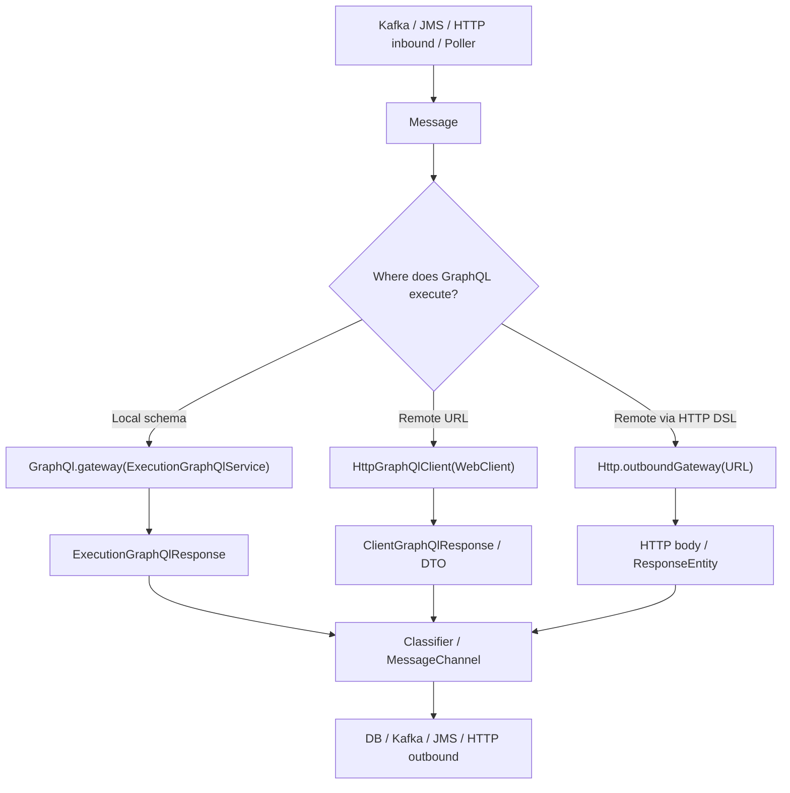
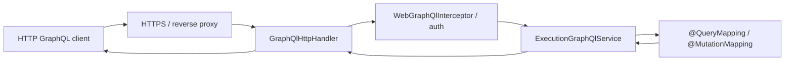
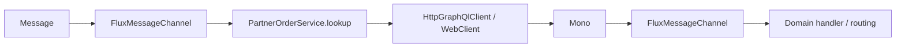
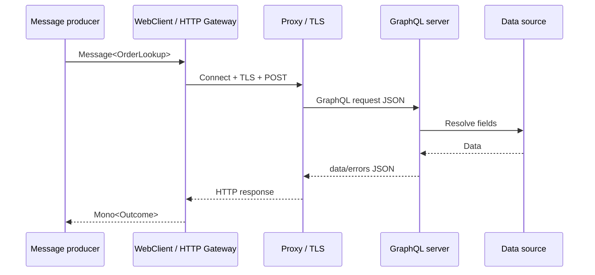

# HTTP Transport for GraphQL in Spring Integration

## 1. Problem: Sending GraphQL Operations Over HTTP Without Losing the Message Contract

An order orchestration platform receives `Message<OrderLookup>` from Kafka/JMS or an HTTP inbound gateway. A partner provides a GraphQL API at `https://partner.example/graphql` for looking up orders. The application must send **GraphQL queries over HTTPS**, receive responses, classify errors, and forward results to a database, Kafka, or another processing step.

Here there are **two contracts** to handle in parallel:

1. **GraphQL:** document, operation name, variables, schema, data/errors/extensions, nullable fields, and mutation side effects.
2. **HTTP:** method, URL, `Content-Type`, `Accept`, status, authentication, TLS, proxy, timeouts, redirects, and payload limits.

Example GraphQL query:

```graphql
query FindOrder($id: ID!) {
  order(id: $id) {
    id
    status
    totalCents
  }
}
```

The HTTP request is represented as JSON:

```http
POST /graphql HTTP/1.1
Host: partner.example
Content-Type: application/json
Accept: application/graphql-response+json, application/json;q=0.9
Authorization: Bearer <access-token>

{
  "query": "query FindOrder($id: ID!) { order(id: $id) { id status totalCents } }",
  "operationName": "FindOrder",
  "variables": { "id": "ORD-1001" }
}
```

Success response:

```http
HTTP/1.1 200 OK
Content-Type: application/graphql-response+json

{
  "data": {
    "order": {
      "id": "ORD-1001",
      "status": "PAID",
      "totalCents": 12500
    }
  }
}
```

**The goal is not merely "send a POST and receive JSON."** An HTTP `200` can still contain GraphQL `errors`, while an HTTP `4xx` from a server following newer standards can contain a valid GraphQL response that the client needs to read. For mutations, a timeout after server commit yields an **unknown outcome** and must never be blindly retried.

The lesson **“HTTP Transport for GraphQL”** belongs to the **GraphQL Adapter** chapter of module `SPRING_INTEGRATION_ADAPTERS`. The module teaches connecting external systems via inbound/outbound adapters, gateways, pollers, and `MessageChannel`s; practicing files, SFTP, HTTP, JMS, AMQP, Kafka, databases, message contracts, error handling, and connection lifecycles. This lesson focuses on **GraphQL HTTP transport** and how to wire it properly into Spring Integration, without misusing the local GraphQL gateway as a fake HTTP client.

### Learning Outcomes

After this lesson, you can:

1. Distinguish Spring Integration's `GraphQl.gateway(ExecutionGraphQlService)` from `HttpGraphQlClient` and HTTP outbound gateways.
2. Choose HTTP `POST` or `GET` per GraphQL over HTTP, and understand why **mutations must never execute via GET**.
3. Encode `query`, `operationName`, `variables`, and `extensions` in JSON request bodies or URL-encoded GET requests.
4. Use `Content-Type: application/json` for POST requests and `Accept: application/graphql-response+json` for responses properly.
5. Read HTTP status **together with** GraphQL `data/errors/extensions`, including `200 + errors` and `4xx + GraphQL error body`.
6. Configure `HttpGraphQlClient` with `WebClient`, timeouts, bearer authentication, and `execute()`/`retrieve()`.
7. Invoke GraphQL through a Spring Integration `ServiceActivator`/reactive channel or `Http.outboundGateway(...)`, understanding differences in error handling.
8. Protect tokens, URLs/redirects/DNS, request cost/body size limits, concurrency, and tenant isolation.
9. Design retries/idempotency for queries and mutations, separating transport errors from GraphQL request/field errors.
10. Test using mock HTTP servers, contract tests, status/media-type matrices, and operational scenarios.

## 2. Three GraphQL Integration Approaches That Must Not Be Conflated

### 2.1. Technology Selection Table

| Need | Component | Boundary | Output |
|---|---|---|---|
| Execute a GraphQL schema inside the current application | Spring Integration `GraphQl.gateway(ExecutionGraphQlService)` | Local GraphQL engine | `ExecutionGraphQlResponse` |
| Call an external GraphQL API over HTTPS, non-blocking | Spring for GraphQL `HttpGraphQlClient` + `WebClient` | HTTP client/server | `ClientGraphQlResponse` or DTO |
| Call an external GraphQL API over HTTPS, blocking | `HttpSyncGraphQlClient` + `RestClient` | HTTP client/server | Synchronous client response or DTO |
| Use EIP HTTP outbound gateway with manual JSON/header/status control | Spring Integration `Http.outboundGateway(url)` | HTTP client/server | HTTP body/`ResponseEntity` per configuration |
| Expose an HTTP GraphQL endpoint to other clients | Spring for GraphQL `GraphQlHttpHandler`, Boot web starter | HTTP server | Response per GraphQL over HTTP |
| Expose an arbitrary HTTP endpoint to receive messages | Spring Integration `Http.inboundGateway(...)` | HTTP-to-message | Does not parse/execute GraphQL itself |

**API Warning:** Spring Integration **6.5**'s `GraphQl.gateway(...)` takes an `ExecutionGraphQlService`. It does not mean "call `https://partner.example/graphql`." Only `HttpGraphQlClient`, `HttpSyncGraphQlClient`, or an HTTP outbound gateway creates remote HTTP transport. This choice determines dependencies, timeouts, security, and response types.

### 2.2. Overall Diagram



The three branches can share the same business destination, yet **do not share a common response API**. Local `ResponseField.getValue()` is not client `ClientResponseField.toEntity(...)`; the HTTP DSL returns text/Maps that you must parse and validate yourself.

## 3. GraphQL Over HTTP Standard: URL, Methods, and HTTP Semantics

As of **November 23, 2026**, the **GraphQL over HTTP — September 2026 Edition** specification has been published. It adds a transport contract atop the GraphQL Specification without replacing GraphQL's execution/schema rules. When integrating older servers, you still must **verify which media types and statuses each server actually supports**.

### 3.1. Endpoints Typically Use a Single URL

```text
https://partner.example/graphql
```

GraphQL generally uses **one endpoint** for many operations; names like `query FindOrder` or `mutation ChangeOrderStatus` do not correspond to REST URLs such as `/orders/{id}`. The document and variables select fields and operations rather than changing URL paths per field.

A partner might use a different path or versioned endpoint; URLs must come from approved configuration/registries, never chosen arbitrarily by an untrusted message payload.

### 3.2. POST: Primary Method for Queries and Mutations

GraphQL over HTTP requires servers to support **POST**. A standard JSON POST body contains:

| Property | Type | Meaning |
|---|---|---|
| `query` | Required String | GraphQL document containing one or more operations |
| `operationName` | Optional String | Selects an operation when the document has multiple |
| `variables` | Optional Object/map | Map of variable values; keys **have no `$` prefix** |
| `extensions` | Optional Object/map | Contract-specific extensions, e.g., persisted queries |

Valid request example:

```json
{
  "query": "query FindOrder($id: ID!) { order(id: $id) { id status totalCents } }",
  "operationName": "FindOrder",
  "variables": {
    "id": "ORD-1001"
  }
}
```

With a mutation:

```graphql
mutation UpdateOrderStatus($input: UpdateOrderInput!) {
  updateOrderStatus(input: $input) {
    id
    status
    version
  }
}
```

```json
{
  "query": "mutation UpdateOrderStatus($input: UpdateOrderInput!) { updateOrderStatus(input: $input) { id status version } }",
  "operationName": "UpdateOrderStatus",
  "variables": {
    "input": {
      "orderId": "ORD-1001",
      "status": "PAID",
      "idempotencyKey": "payment-event-827"
    }
  }
}
```

Schema `UpdateOrderInput` is illustrative and must actually be defined by the partner. Do not send field/enum names outside the contract expecting the server to translate them.

### 3.3. GET: Queries Only, When Supported by the Server

GET **may** be supported by a server for executing **queries**. Request parameters belong in the **URL query string**, URL-encoded per `application/x-www-form-urlencoded`/URLSearchParams rules:

```text
GET /graphql?query=query%20FindOrder%28%24id%3A%20ID%21%29%20%7B%20order%28id%3A%24id%29%20%7B%20id%20%7D%20%7D&operationName=FindOrder&variables=%7B%22id%22%3A%22ORD-1001%22%7D
```

This URL string illustrates encoding; production code should use a **URI builder** rather than manually concatenating `&`/`%`. In GET, `variables` is a **stringified and URL-encoded JSON object**, not ad-hoc individual query parameters like `id=...`.

**Never use GET for GraphQL mutations**, even for caching or debugging. Under HTTP semantics, GET is a safe method; GraphQL over HTTP requires rejecting mutations over GET (recommending HTTP `405 Method Not Allowed`). Never think renaming a keyword to `query` legitimizes a side-effecting resolver.

| HTTP Method | Query | Mutation | Notes |
|---|---|---|---|
| POST | Supported | Supported | JSON request; should be default |
| GET | Only when enabled on server | **Forbidden** | URL length, caching, logs/referrer, PII |
| PUT/PATCH/DELETE | Non-standard | Non-standard | Server may return 405 |

**Spring for GraphQL server:** HTTP handlers typically accept POST by default. GET support varies by version and configuration; never assume an arbitrary Spring Boot GraphQL server has GET enabled. When enabling GET, verify that the `GraphQlHttpHandler`/route for your exact version supports it and strictly forbids mutations.

### 3.4. GET Is Cacheable, But Not Free

GET lets CDNs/intermediaries cache by URL, yet exposes queries and variables in access logs, browser history, reverse proxy logs, and `Referer` headers. When GraphQL carries PII, authorization-dependent results, transactional data, or long documents, **prefer POST** with protected token/body handling. If caching is used, configure `Cache-Control`, `Vary`, authorization scopes, tenant partitioning, and keys covering the entire query+variables; never let public caches serve tenant A's data to tenant B.

### 3.5. Why Not Use GET for an “Idempotent Mutation”?

A business-idempotent mutation is still a **GraphQL mutation operation**. Having an idempotency key on the server does not turn a mutation into a safe HTTP read. GET can be re-triggered by browsers, crawlers, caches, and prefetches, so the spec still forbids executing mutations over GET.

## 4. Headers and Content Negotiation

### 4.1. Content-Type and Accept Serve Different Directions

```http
POST /graphql HTTP/1.1
Content-Type: application/json
Accept: application/graphql-response+json, application/json;q=0.9
```

- **Request `Content-Type: application/json`** states the uploaded request body is JSON-encoded.
- **Request `Accept: application/graphql-response+json`** states the client prefers the dedicated GraphQL response media type.
- Including `application/json;q=0.9` preserves compatibility with older servers not yet supporting the newer media type.
- The server response must have a `Content-Type` matching what it actually returns: `application/graphql-response+json` or legacy `application/json`.
- UTF-8 is the default for GraphQL media types when no charset is specified; send valid Unicode and control your JSON codec.

**Do not set `Content-Type: application/graphql-response+json` on a normal JSON POST request body**. That media type identifies a **GraphQL response**, not the JSON request envelope. Some GraphQL servers accept additional vendor-specific request media types; the most compatible standard remains `application/json`.

### 4.2. Why a Dedicated Media Type Exists

Suppose a reverse proxy returns an HTML error page or non-GraphQL error JSON:

```http
HTTP/1.1 502 Bad Gateway
Content-Type: text/html

<html>Bad Gateway</html>
```

This is **not** GraphQL `errors`. `application/graphql-response+json` helps clients distinguish valid GraphQL bodies from network/proxy errors. Still, nothing replaces TLS/trust boundaries: clients must check HTTP status, response `Content-Type`, and body per policy.

### 4.3. Auth, Tracing, and Idempotency Headers

Common HTTP headers:

| Header | Purpose | Rule |
|---|---|---|
| `Authorization: Bearer ...` | API authentication | Source from secure credential provider; never log |
| `Accept` | Selects response media type | Prefer GraphQL response JSON |
| `Content-Type` | POST body encoding | Standard JSON |
| `traceparent` | W3C distributed tracing | Validated context; never infer permissions |
| `X-Request-ID` | Partner-contracted correlation | Do not substitute for domain idempotency key |
| `Idempotency-Key` | Mutation deduplication **if supported by server** | Keep identical across retries with same fingerprint |
| `Cache-Control` | Cache/privacy policy | Prevent public caching of authenticated data |
| `Retry-After` (response) | Retry timing when rate-limited | Interpret per status/contract |

`Idempotency-Key` is not an automatic mandatory header in GraphQL over HTTP. Some servers accept keys inside GraphQL `input`, others via HTTP headers; **use only what the partner contract confirms**. Never let senders arbitrarily override `Authorization` or target URL hostnames via Spring Message headers.

## 5. HTTP Status and GraphQL Response: Two Verification Layers

### 5.1. A Response Can Contain Both Data and Errors

A valid GraphQL response typically contains:

```json
{
  "data": {
    "order": {
      "id": "ORD-1001",
      "status": null
    }
  },
  "errors": [
    {
      "message": "Status unavailable",
      "path": ["order", "status"],
      "locations": [{"line": 1, "column": 48}]
    }
  ],
  "extensions": {
    "traceId": "trace-abc"
  }
}
```

`data` can be null due to GraphQL non-null propagation; `errors` lists GraphQL errors (request or execution). `extensions` are implementation-specific and not for mandatory business data. Never infer from HTTP 200 that all fields are present or permissions passed.

### 5.2. Status Matrix by Standard and Practice

| Scenario | Typical / 2026 Standard HTTP Status | Body & Interpretation |
|---|---|---|
| Successful query | `200` | `data`, no `errors` |
| Query with partial data + field errors | `2xx`, typically `200` | Both `data` + `errors`; must classify |
| GraphQL document parse failure | Typically `400` under newer media type | Request errors; resolvers do not run |
| Schema validation/coercion failure | Spec suggests `422`; legacy may return `200` | Request errors |
| Mutation sent via GET | Recommended `405` | Mutation must not execute |
| Unsupported HTTP method | `405` | Check `Allow` header |
| Client Accept has no server-supported media type | `406` | Content negotiation error |
| Unsupported request Content-Type | `415` | Request JSON not parsed |
| URL too long | `414` | Switch query to POST |
| Body too large | `413` | Reduce payload / enforce policy |
| Headers too large | `431` | Reduce headers/tracing metadata |
| Missing or invalid credentials | `401`/`403` | Auth boundary or GraphQL field error per policy |
| Rate limit/overload | `429`/`503` | Backoff + quota; distinguish mutation outcome |
| Proxy/network failure | `502`/`504`/timeout | Likely not a GraphQL response |

**September 2026 Edition note:** the spec recommends HTTP **`294 Partial Success`** when a result contains **both `data` and `errors`**, even with `data:null`. However, `294` is **not yet registered with IANA**, and many existing clients/proxies still return or expect **`200`** for partial GraphQL results. It cannot be assumed as a default status from Spring GraphQL; if a project wants to adopt it, **verify compatibility across clients, proxies, caching, logging, monitoring, and response handlers** first. Clients must still inspect `data/errors` rather than relying on a numeric status alone.

Some servers using legacy `application/json` still send GraphQL document validation errors as HTTP `200 + errors`; servers using `application/graphql-response+json` typically pair request errors with HTTP `4xx`. Verify the exact server and version rather than hard-coding "GraphQL is always 200" or "4xx cannot contain a GraphQL body."

### 5.3. Distinguishing Pre-Execution Errors from Field Resolution Errors

**Request error:**

```json
{
  "errors": [
    {"message": "Cannot query field 'unknownField' on type 'Query'."}
  ]
}
```

**Execution field error with partial data:**

```json
{
  "data": {
    "order": {
      "id": "ORD-1001",
      "status": null
    }
  },
  "errors": [
    {
      "message": "Status unavailable",
      "path": ["order", "status"]
    }
  ]
}
```

Common rule: do not retry just because `errors` is non-empty. Request syntax/schema/coercion errors are deterministic failures requiring document/variable fixes. Field errors can stem from permissions, nullability, or backends. For **mutations**, a field error can happen **after DB commit**.

### 5.4. Do Not Parse HTML Bodies as GraphQL Errors

HTTP `502` with `Content-Type: text/html` or a login redirect to an HTML page must be classified as a **transport/proxy/auth anomaly**, not fed to a GraphQL `errors` parser. Only decode bodies when media type and response shape match; enforce byte limits before parsing.

### 5.5. curl Example to Observe Both Layers

```bash
curl --fail-with-body --silent --show-error \
  --request POST 'https://partner.example/graphql' \
  --header 'Content-Type: application/json' \
  --header 'Accept: application/graphql-response+json, application/json;q=0.9' \
  --header "Authorization: Bearer $ACCESS_TOKEN" \
  --data '{"query":"query FindOrder($id: ID!) { order(id: $id) { id status totalCents } }","operationName":"FindOrder","variables":{"id":"ORD-1001"}}'
```

This command is **illustrative**; `partner.example` does not imply a real server, and `ACCESS_TOKEN` must be supplied securely. `--fail-with-body` preserves the response body while returning a non-zero exit code on HTTP 4xx/5xx; do not rely solely on exit codes to infer GraphQL `errors`. On Windows PowerShell, `curl` may be an alias; use `curl.exe` or an appropriate HTTP client.

## 6. Spring for GraphQL HTTP Server: Endpoints via GraphQlHttpHandler

### 6.1. Server and Client Have Different Ownership

When an application **exposes a GraphQL API**, Spring for GraphQL uses `GraphQlHttpHandler` (MVC or WebFlux) to accept HTTP requests, run the interception chain, invoke `ExecutionGraphQlService`, and write HTTP responses. The Spring Boot starter can auto-configure this endpoint from schemas and annotated controllers.



In a Spring Integration application, you can have both **`GraphQlHttpHandler`** accepting direct requests from external systems and `IntegrationFlow`s calling the local GraphQL engine. These are distinct entry points; do not blindly route every GraphQL POST through `Http.inboundGateway`.

### 6.2. Sample Dependencies and Schema

**`build.gradle`** (server practice section):

```gradle
dependencies {
    implementation 'org.springframework.boot:spring-boot-starter-graphql'
    implementation 'org.springframework.boot:spring-boot-starter-web'
    testImplementation 'org.springframework.boot:spring-boot-starter-test'
    testImplementation 'org.springframework.graphql:spring-graphql-test'
}
```

If choosing WebFlux over Spring MVC, use `spring-boot-starter-webflux` accordingly; avoid adding both and guessing which server runs without checking auto-configuration.

**`src/main/resources/graphql/schema.graphqls`:**

```graphql
type Query {
  order(id: ID!): Order
}

type Order {
  id: ID!
  status: String!
  totalCents: Int!
}
```

**`OrderGraphQlController.java`:**

```java
import org.springframework.graphql.data.method.annotation.Argument;
import org.springframework.graphql.data.method.annotation.QueryMapping;
import org.springframework.stereotype.Controller;

record OrderView(String id, String status, int totalCents) {}

@Controller
public class OrderGraphQlController {
    @QueryMapping
    public OrderView order(@Argument String id) {
        if ("ORD-1001".equals(id)) {
            return new OrderView("ORD-1001", "PAID", 12_500);
        }
        return null;
    }
}
```

**`application.yml`:**

```yaml
spring:
  graphql:
    path: /graphql
```

These classes/schemas are **server-side** examples. Do not copy them into an app that only needs to call a partner's GraphQL server if it does not expose its own schema.

### 6.3. Using HTTP GET with Spring GraphQL Server

Across Spring for GraphQL releases, HTTP POST with JSON is the default entry point; **HTTP GET can be version-dependent and opt-in**. Newer docs describe enabling GET on `GraphQlHttpHandler` **and route predicates**. In a project pairing Spring Integration 6.5 with Spring GraphQL 1.4, verify the exact API version before copying 2.x GET opt-in snippets. Never assume setting `spring.graphql.path` enables GET.

Even when GET is enabled, it **must disallow mutations** and enforce authorization/caching just like POST.

### 6.4. Interceptors and API Security

HTTP authentication (Bearer/OAuth2/mTLS) should happen **before GraphQL execution** in the security filter chain or trusted reverse proxy; per-field/order authorization belongs in resolvers/services. `WebGraphQlInterceptor` lets the app manage request metadata/context and observe execution, but does not replace security policies.

Never return stack traces, SQL exceptions, tokens, or other tenants' data in GraphQL `errors/extensions`. Decide introspection and complexity policies based on trust level and operation allowlists.

## 7. HttpGraphQlClient: Calling GraphQL Over HTTPS with WebClient

This is the **preferred option** when a Java/Spring Integration app calls a remote GraphQL server and wants a proper GraphQL client API rather than assembling JSON manually.

### 7.1. Dependencies and Configuration

**`build.gradle`** for a **GraphQL client + Spring Integration** app:

```gradle
dependencies {
    implementation 'org.springframework.boot:spring-boot-starter-integration'
    implementation 'org.springframework.graphql:spring-graphql'
    implementation 'org.springframework.boot:spring-boot-starter-webflux'

    testImplementation 'org.springframework.boot:spring-boot-starter-test'
}
```

`spring-graphql` provides `HttpGraphQlClient`; `spring-boot-starter-webflux` provides `WebClient` and Reactor Netty HTTP client. You do not need `spring-integration-graphql` solely to send remote GraphQL HTTP requests, because that module provides the **local execution gateway**.

**`application.yml`:**

```yaml
partner:
  graphql:
    url: ${PARTNER_GRAPHQL_URL:https://partner.example/graphql}
    bearer-token: ${PARTNER_GRAPHQL_BEARER_TOKEN:}
```

`partner.example` is a lesson placeholder. In production, configuration must point to an approved endpoint; secrets must come from secure config/secret managers with rotation, never hard-coded in source or logs.

### 7.2. WebClient with Connect/Response Timeouts and Headers

**`PartnerGraphQlClientConfig.java`:**

```java
import java.time.Duration;

import io.netty.channel.ChannelOption;
import reactor.netty.http.client.HttpClient;

import org.springframework.beans.factory.annotation.Value;
import org.springframework.context.annotation.Bean;
import org.springframework.context.annotation.Configuration;
import org.springframework.graphql.client.HttpGraphQlClient;
import org.springframework.http.HttpHeaders;
import org.springframework.http.MediaType;
import org.springframework.http.client.reactive.ReactorClientHttpConnector;
import org.springframework.web.reactive.function.client.WebClient;

@Configuration
public class PartnerGraphQlClientConfig {

    @Bean
    HttpGraphQlClient partnerGraphQlClient(
            @Value("${partner.graphql.url}") String url,
            @Value("${partner.graphql.bearer-token}") String token) {

        HttpClient netty = HttpClient.create()
                .option(ChannelOption.CONNECT_TIMEOUT_MILLIS, 3_000)
                .responseTimeout(Duration.ofSeconds(10));

        WebClient.Builder builder = WebClient.builder()
                .baseUrl(url)
                .clientConnector(new ReactorClientHttpConnector(netty))
                .defaultHeader(
                        HttpHeaders.ACCEPT,
                        "application/graphql-response+json, " +
                        "application/json;q=0.9")
                .defaultHeader(
                        HttpHeaders.CONTENT_TYPE,
                        MediaType.APPLICATION_JSON_VALUE);

        if (!token.isBlank()) {
            builder.defaultHeaders(h -> h.setBearerAuth(token));
        }

        return HttpGraphQlClient.create(builder.build());
    }
}
```

**Three distinct timeout scopes:**

- `CONNECT_TIMEOUT_MILLIS` budgets TCP connection establishment.
- `responseTimeout` bounds waiting for the Reactor Netty HTTP response; it **does not** guarantee every step of the operation finishes within a total deadline.
- An **end-to-end workflow deadline** (if needed) must be enforced in the reactive flow alongside cancellation, backpressure, and DB/remote operation policies.

In a lab, a blank token may suit an unauthenticated mock HTTP server; production systems requiring authentication should fail fast if the secret is missing. A static Bearer token is a simplified example; real apps need OAuth2 authorized clients/refresh tokens, per-tenant credentials, or mTLS per design—never share one static token across tenants when disallowed.

**Response size:** cap response bytes/codec memory in WebClient/HTTP client configuration and proxies. Never assume a small GraphQL selection prevents an upstream from sending oversized JSON or unexpected HTML.

### 7.3. Query Document and DTOs

**`OrderLookup.java`:**

```java
public record OrderLookup(String orderId) {
    public OrderLookup {
        if (orderId == null || orderId.isBlank()
                || orderId.length() > 128) {
            throw new IllegalArgumentException("Invalid orderId");
        }
    }
}
```

**`PartnerOrderDto.java`:**

```java
public record PartnerOrderDto(
        String id,
        String status,
        int totalCents) {
}
```

**`RemoteOrderOutcome.java`:**

```java
public sealed interface RemoteOrderOutcome
        permits RemoteOrderOutcome.Found,
                RemoteOrderOutcome.NotFound,
                RemoteOrderOutcome.Rejected {

    record Found(PartnerOrderDto order)
            implements RemoteOrderOutcome {
    }

    record NotFound() implements RemoteOrderOutcome {
    }

    record Rejected(String category, int errorCount)
            implements RemoteOrderOutcome {
    }
}
```

The DTO/`sealed interface` are **application contracts**, not Spring GraphQL classes. The goal is to keep GraphQL client objects and HTTP transport details out of business databases and broker contracts.

### 7.4. Calling execute() to Read the Full GraphQL Response

**`PartnerOrderService.java`:**

```java
import org.springframework.graphql.client.ClientGraphQlResponse;
import org.springframework.graphql.client.ClientResponseField;
import org.springframework.graphql.client.HttpGraphQlClient;
import org.springframework.stereotype.Service;

import reactor.core.publisher.Mono;

@Service
public class PartnerOrderService {

    private static final String FIND_ORDER = """
            query FindOrder($id: ID!) {
              order(id: $id) {
                id
                status
                totalCents
              }
            }
            """;

    private final HttpGraphQlClient client;

    public PartnerOrderService(HttpGraphQlClient client) {
        this.client = client;
    }

    public Mono<RemoteOrderOutcome> lookup(OrderLookup command) {
        return client.document(FIND_ORDER)
                .operationName("FindOrder")
                .variable("id", command.orderId())
                .execute()
                .map(this::classify);
    }

    private RemoteOrderOutcome classify(
            ClientGraphQlResponse response) {

        if (!response.isValid()) {
            // May be request error or null bubbling;
            // distinguish further via error paths if needed.
            return new RemoteOrderOutcome.Rejected(
                    "INVALID_GRAPHQL_RESULT",
                    response.getErrors().size());
        }

        if (!response.getErrors().isEmpty()) {
            // Demo uses strict policy: reject partial data.
            return new RemoteOrderOutcome.Rejected(
                    "GRAPHQL_FIELD_ERROR",
                    response.getErrors().size());
        }

        ClientResponseField field = response.field("order");
        if (field.getValue() == null) {
            return new RemoteOrderOutcome.NotFound();
        }

        PartnerOrderDto dto =
                field.toEntity(PartnerOrderDto.class);
        if (dto == null || dto.id() == null) {
            return new RemoteOrderOutcome.Rejected(
                    "INVALID_DATA_CONTRACT", 0);
        }

        return new RemoteOrderOutcome.Found(dto);
    }
}
```

**Notice the error layers:**

1. `ClientGraphQlResponse.getErrors()` holds **GraphQL response errors**, which can accompany data without any Java exception.
2. HTTP/network/proxy/timeouts can trigger `Mono.onError` **before a GraphQL response exists**; the example intentionally does not swallow those inside `classify`.
3. `ClientResponseField.toEntity(...)` can throw decode errors if JSON does not match the DTO.
4. When `field("order").getValue() == null` and `getErrors()` is empty, the demo chooses `NotFound`. Other domains may distinguish omitted fields from null fields.

The example intentionally **does not** turn every `onError` into `Rejected("RETRYABLE")`. Remote callers may not know whether the server executed the request; for mutations, hiding exceptions and retrying is dangerous. Query-only flows can apply a dedicated policy with backoff and metrics, as in section 11.

### 7.5. retrieve() Is a Single-Field Shortcut

When you only need one field without inspecting all `errors`:

```java
Mono<PartnerOrderDto> order = client
        .document("""
            query FindOrder($id: ID!) {
              order(id: $id) { id status totalCents }
            }
            """)
        .variable("id", "ORD-1001")
        .retrieve("order")
        .toEntity(PartnerOrderDto.class);
```

`retrieve("order")` uses `ClientResponseField` to decode. It can fail with `FieldAccessException` if the field is missing or null with errors, or `GraphQlClientException` if decoding fails. When you need explicit handling of `null`/partial data/error paths, prefer `execute()` as shown above.

**Do not copy client `.toEntity(...)` onto local `ExecutionGraphQlResponse.field(...)`**. Server-side `ResponseField` only provides `getValue()`/`getErrors()` in that API; mixing them up is a frequent compile error.

### 7.6. Synchronous Calls with HttpSyncGraphQlClient

When an app intentionally runs on a **blocking thread** (not a Reactor event loop), Spring GraphQL 1.4 provides `HttpSyncGraphQlClient` built on `RestClient`:

```java
import org.springframework.graphql.client.ClientGraphQlResponse;
import org.springframework.graphql.client.HttpSyncGraphQlClient;
import org.springframework.web.client.RestClient;

RestClient restClient =
        RestClient.create("https://partner.example/graphql");
HttpSyncGraphQlClient syncClient =
        HttpSyncGraphQlClient.create(restClient);

ClientGraphQlResponse response = syncClient
        .document("""
            query FindOrder($id: ID!) {
              order(id: $id) { id status totalCents }
            }
            """)
        .variable("id", "ORD-1001")
        .executeSync();
```

This is an API-level example; production needs authentication, timeouts, TLS/tracing, and exception policies. Never use the sync client inside a non-blocking event loop. With a Spring Integration HTTP sync gateway, blocking thread/worker pools, request-reply timeouts, and backpressure must be designed explicitly.

## 8. Integrating HttpGraphQlClient into a Spring Integration Flow

### 8.1. Using a Service Activator Returning Mono<T>

A natural pattern is encapsulating the GraphQL HTTP client inside a service and letting Spring Integration orchestrate messages:



**`PartnerOrderFlow.java`:**

```java
import org.springframework.context.annotation.Bean;
import org.springframework.context.annotation.Configuration;
import org.springframework.integration.config.EnableIntegration;
import org.springframework.integration.dsl.IntegrationFlow;
import org.springframework.integration.dsl.MessageChannels;

@Configuration
@EnableIntegration
public class PartnerOrderFlow {

    @Bean
    IntegrationFlow partnerOrderFlow(
            PartnerOrderService service) {
        return IntegrationFlow
                .from(MessageChannels.flux("partnerGraphQlRequests"))
                .handle(service, "lookup")
                .channel(c -> c.flux("partnerGraphQlOutcomes"))
                .get();
    }
}
```

In this flow:

- Input payload is `OrderLookup`.
- `lookup(...)` returns `Mono<RemoteOrderOutcome>` without blocking for the HTTP response.
- Spring Integration supports reactive publishers over `FluxMessageChannel` and endpoint replies; downstream consumers receive results once subscribed.
- Output payloads no longer carry `ClientGraphQlResponse`, making DB writes or broker publishing clean.

**Verify** subscription/reply mapping and header propagation in integration tests on your exact Spring Integration 6.5 version. Do not assume sending to the input channel means the request has completed. When downstream runs asynchronously, errors do not always return to the original producer's thread/`errorChannel`.

### 8.2. Producer Sending Messages

```java
import org.springframework.beans.factory.annotation.Qualifier;
import org.springframework.integration.support.MessageBuilder;
import org.springframework.messaging.MessageChannel;
import org.springframework.stereotype.Component;

@Component
public class PartnerOrderPublisher {

    private final MessageChannel input;

    public PartnerOrderPublisher(
            @Qualifier("partnerGraphQlRequests")
            MessageChannel input) {
        this.input = input;
    }

    public void submit(String orderId, String correlationKey) {
        boolean accepted = input.send(
                MessageBuilder
                        .withPayload(new OrderLookup(orderId))
                        .setHeader("correlationKey", correlationKey)
                        .build());
        if (!accepted) {
            throw new IllegalStateException(
                    "Failed to send message to channel");
        }
    }
}
```

`send()` returning true only proves **channel acceptance**, not HTTP 200, GraphQL success, or DB commit.

### 8.3. Consumer Handling Outcomes Rather Than Raw Responses

```java
import org.springframework.integration.annotation.ServiceActivator;
import org.springframework.messaging.Message;
import org.springframework.stereotype.Component;

@Component
public class PartnerOrderOutcomeConsumer {

    @ServiceActivator(inputChannel = "partnerGraphQlOutcomes")
    public void accept(Message<RemoteOrderOutcome> message) {
        RemoteOrderOutcome outcome = message.getPayload();

        if (outcome instanceof RemoteOrderOutcome.Found found) {
            System.out.println(
                    "Order state=" + found.order().status());
        }
        else if (outcome instanceof RemoteOrderOutcome.NotFound) {
            System.out.println("Order does not exist");
        }
        else if (outcome instanceof RemoteOrderOutcome.Rejected rejected) {
            System.err.println(
                    "GraphQL result=" + rejected.category());
        }
    }
}
```

This demo consumer only logs. Production must tie in **durable processing** if upstream Kafka/JMS requires post-processing ACKs; if forwarding results to Kafka/JMS, enforce schema versions, serialization, and downstream idempotency. Never log sensitive order IDs, tokens, or raw GraphQL variables.

### 8.4. Reactive Transport Failures Sit Outside GraphQL Errors

When `WebClient` hits a `connect timeout` or HTTP 503, `PartnerOrderService.lookup()` emits `Mono.onError` rather than `RemoteOrderOutcome.Rejected`. Your pipeline needs one of these policies:

1. Map `onError` inside the service into a **typed transport failure** when contracts require persisting/publishing a failure DTO.
2. Let a reactive error handler/recovery advice handle retries for queries per policy.
3. Route failures to a durable DLQ/quarantine when the source is a broker and the retry budget is exhausted.

Never apply `onErrorResume(ex -> Mono.empty())` to silently drop HTTP failures: omitting a reply can quietly lose workflow commands. For mutations, transport errors can represent **unknown outcomes** requiring reconciliation.

### 8.5. An HTTP Client Does Not Provide Broker Request-Reply Durability

A `Mono<RemoteOrderOutcome>` does not automatically bind Kafka offsets or JMS acknowledgments to a DB transaction. For durable ACKs, you can:

- Decouple inbound consumption with a durable inbox: receive message, persist command to DB, ACK broker; an inbox worker calls GraphQL and persists outcomes/outbox.
- Or await workflow completion across a designed and tested request-reply boundary, ACKing only after the durable milestone.

Never treat in-memory `FluxMessageChannel` as a durable queue even though it supports Reactor backpressure.

## 9. Spring Integration HTTP Outbound Gateway: Managing GraphQL JSON Yourself

### 9.1. When to Choose the HTTP DSL Over HttpGraphQlClient?

`Http.outboundGateway(...)` makes sense when:

- You want standard EIP advice, routers, and message channels around **plain HTTP requests/responses**.
- You need explicit control over `HttpEntity/MessageHeaders`, statuses, converters, URL templates, or HTTP-specific filters.
- A partner's GraphQL endpoint has HTTP requirements poorly expressed by the built-in GraphQL client.

Trade-off: **you must package the GraphQL request yourself**, parse responses, inspect `data/errors`, separate `4xx` responses containing GraphQL bodies from HTTP errors, and construct DTOs manually.

### 9.2. Dependencies

**`build.gradle`:**

```gradle
dependencies {
    implementation 'org.springframework.boot:spring-boot-starter-integration'
    implementation 'org.springframework.integration:spring-integration-http'
    implementation 'org.springframework.boot:spring-boot-starter-web'
}
```

When using Jackson to serialize `Map`/records to JSON, verify `MappingJackson2HttpMessageConverter` or an appropriate converter is on the classpath and registered for the HTTP handler. Web starters typically include Jackson, but never assume the adapter sends the exact HTTP body without an integration test.

### 9.3. Building the Request Envelope from Payload

**`GraphQlHttpEnvelope.java`:**

```java
import java.util.Map;

public record GraphQlHttpEnvelope(
        String query,
        String operationName,
        Map<String, Object> variables) {
}
```

**`RawGraphQlHttpFlow.java`:**

```java
import java.util.Map;

import org.springframework.beans.factory.annotation.Value;
import org.springframework.context.annotation.Bean;
import org.springframework.context.annotation.Configuration;
import org.springframework.http.HttpHeaders;
import org.springframework.http.HttpMethod;
import org.springframework.integration.config.EnableIntegration;
import org.springframework.integration.dsl.IntegrationFlow;
import org.springframework.integration.http.dsl.Http;
import org.springframework.messaging.MessageHeaders;

@Configuration
@EnableIntegration
public class RawGraphQlHttpFlow {

    private static final String FIND_ORDER = """
            query FindOrder($id: ID!) {
              order(id: $id) {
                id status totalCents
              }
            }
            """;

    @Bean
    IntegrationFlow rawGraphQlHttpFlow(
            @Value("${partner.graphql.url}") String url) {

        return IntegrationFlow.from("rawGraphQlHttpRequests")
                .transform(OrderLookup.class, lookup ->
                        new GraphQlHttpEnvelope(
                                FIND_ORDER,
                                "FindOrder",
                                Map.of("id", lookup.orderId())))
                .enrichHeaders(h -> h
                        .header(
                                MessageHeaders.CONTENT_TYPE,
                                "application/json")
                        .header(
                                HttpHeaders.ACCEPT,
                                "application/graphql-response+json, " +
                                "application/json;q=0.9"))
                .handle(Http.outboundGateway(url)
                        .httpMethod(HttpMethod.POST)
                        .expectedResponseType(String.class))
                .channel("rawGraphQlHttpReplies")
                .get();
    }
}
```

**Reading the flow:**

1. Source receives `Message<OrderLookup>`.
2. Transformer builds a JSON-serializable `GraphQlHttpEnvelope` record with document, `operationName`, and variables, without concatenating ID into the document.
3. Header enricher sets `contentType`/`Accept` for the HTTP request.
4. `Http.outboundGateway(url)` executes an HTTP POST (Spring Integration 6.5 HTTP DSL).
5. `expectedResponseType(String.class)` instructs the HTTP converter to read the response body as a `String`.
6. Replies enter `rawGraphQlHttpReplies`; the app must parse JSON, inspect GraphQL `data/errors`, and construct business DTOs.

**Important on HTTP headers:** `MessageHeaders.CONTENT_TYPE` is mapped to HTTP `Content-Type` by the HTTP mapper; how `Accept`/Authorization map depends on `DefaultHttpHeaderMapper` and adapter settings. Test against a mock server to inspect the final HTTP request. When customizing the header mapper, whitelist specific header names instead of forwarding all Spring headers across the Internet.

### 9.4. An HTTP 4xx Response with a GraphQL Body May Throw

In Spring Integration 6.5, the HTTP outbound gateway builds on HTTP clients/`RestTemplate`. With its default error handler, non-2xx statuses generally throw an **exception** instead of producing a normal reply. When a server uses `application/graphql-response+json` and returns `422 + errors`, handlers on `rawGraphQlHttpReplies` may **never receive the body**.

For full GraphQL-over-HTTP compliance:

- Prefer `HttpGraphQlClient.execute()` with a policy distinguishing GraphQL responses from transport errors.
- Or customize the `RestTemplate`/error handler and HTTP outbound gateway to preserve status + body for GraphQL media types while still rejecting invalid 4xx/5xx proxy JSON/HTML.
- When customizing handlers, cap body sizes, validate content types, and parse errors per status.

**Never** turn every HTTP error into "200 GraphQL success" just to avoid exceptions, as that hides transport failures and breaks retry/monitoring logic.

### 9.5. Preserving Status and Body When Needed

Spring Integration's HTTP outbound handler offers:

```java
.handle(Http.outboundGateway(url)
        .httpMethod(HttpMethod.POST)
        .expectedResponseType(String.class)
        .extractResponseBody(false))
```

For **HTTP responses treated as successful by the client**, `extractResponseBody(false)` places a `ResponseEntity<String>` in the reply payload instead of just a body string, letting you read status, headers, and body. However, **it does not disable the `RestTemplate` error handler for 4xx/5xx**. You still need a dedicated response error policy to inspect GraphQL bodies on HTTP 422.

Using `.expectedResponseType(String.class)` alone drops status/headers from the payload (though mapped HTTP status headers may exist depending on config). Verify adapter contracts rather than relying on implicit assumptions.

### 9.6. Do Not Forward External Authorization Headers Over the Network Blindly

If an inbound Kafka/HTTP message carries a custom `Authorization` header, forwarding it straight to a partner can leak source or internal tokens. Outbound HTTP clients must select credentials for the **approved destination and trusted identity**, never copying all inbound headers by default. For tenant-specific credentials, use per-tenant authorized clients and validate hostnames/redirects.

## 10. When Is Spring Integration's HTTP Inbound Gateway Appropriate?

### 10.1. Distinguishing Two Ways to Receive Requests

**Receiving public GraphQL HTTP requests:** use `GraphQlHttpHandler`, which understands GraphQL envelopes, operations/variables, schemas, errors, and media types.

**Receiving ordinary HTTP events/commands:** use `Http.inboundGateway(...)` to convert requests into Spring `Message<?>` and execute integration steps, potentially calling a remote GraphQL client.

```text
POST /graphql          -> GraphQlHttpHandler -> ExecutionGraphQlService
POST /internal/lookup  -> Http.inboundGateway -> MessageChannel
                           -> HttpGraphQlClient -> Partner GraphQL URL
```

### 10.2. HTTP Inbound DSL for REST-Style Commands

```java
import org.springframework.context.annotation.Bean;
import org.springframework.context.annotation.Configuration;
import org.springframework.http.HttpMethod;
import org.springframework.integration.dsl.IntegrationFlow;
import org.springframework.integration.http.dsl.Http;

@Configuration
public class LookupHttpIngressConfig {

    @Bean
    IntegrationFlow lookupIngressFlow() {
        return IntegrationFlow
                .from(Http.inboundGateway("/internal/lookup")
                        .requestMapping(m -> m.methods(HttpMethod.POST))
                        .requestPayloadType(String.class))
                .channel("incomingLookupCommands")
                .get();
    }
}
```

This is only the **inbound gateway** receiving a request string; it **does not** parse JSON into `OrderLookup`, invoke GraphQL, or manage reply contracts. You must add transformers/validators to construct domain commands, route to the remote GraphQL flow, and return an HTTP reply; otherwise callers see HTTP errors/timeouts if no reply arrives in time.

### 10.3. Beware of Gateway Loops

A request chain like:

```text
HTTP /internal/lookup -> Spring Integration HTTP inbound gateway
                      -> GraphQL HTTP outbound client
                      -> same app's HTTP /graphql
                      -> resolver calls back into /internal/lookup
```

can create infinite loops, deadlocks, or load amplification. Separate **external partner hosts**, **inbound application endpoints**, and **local execution services**; enforce correlation tracing and circuit breakers to prevent loops.

## 11. Securing GraphQL Over HTTP on Both Sides

### 11.1. TLS and Target Verification

GraphQL variables can contain IDs, customer data, payment states, or tenant info. All traffic over untrusted networks must use **HTTPS** with proper certificate and hostname verification. Never disable TLS certificate verification when encountering PKIX errors, even in production-like demos.

Outbound controls:

- Source GraphQL endpoint URLs from approved config/registries; never accept arbitrary URLs from users or Kafka payloads.
- Allow only `https` in production, excluding controlled loopback lab exceptions.
- Enforce host/port allowlists and egress firewalls/proxies per architecture, not mere URI syntax validation.
- Prevent SSRF/DNS rebinding: inspect resolved DNS/IPs, redirect targets, and block private/link-local/metadata addresses per policy.
- Never auto-forward Bearer tokens across redirects to another hostname.
- Cap redirect counts and timeouts; consider disabling redirects for sensitive integrations.
- For mTLS, rotate client certificates/keys and manage truststores properly—never store private keys in repos.

**SSRF is not prevented just because `new URI(url)` parses cleanly.** An HTTP GraphQL client capable of targeting hosts must be governed like any outbound HTTP adapter.

### 11.2. Authentication Before Execution, Authorization in Resolvers

On the GraphQL HTTP server:

1. The HTTP security filter chain authenticates the caller before any GraphQL operation executes.
2. GraphQL schemas/data fetchers/services enforce authorization on objects, fields, and tenants, not merely checking token validity.
3. Tenant alias headers must be verified via trusted principals, never accepted unchecked from external callers.
4. Permission-denied errors must not reveal whether a domain object exists or which tenant owns it.
5. If a caller can read some fields but not others, GraphQL can return **partial data + field errors** per schema/policy.

HTTP `401/403` and GraphQL `UNAUTHORIZED/FORBIDDEN` errors occur at different layers. Do not collapse all of them into one Java exception and retry.

### 11.3. CORS and CSRF

CORS governs whether browser JavaScript can send or read cross-origin HTTP responses; **CORS is not an authentication mechanism**. If a GraphQL endpoint uses cookie/session authentication, enforce CSRF protection for mutations and side-effecting operations.

Using `Content-Type: application/json` often triggers browser CORS preflights in cross-origin flows; however, **never treat preflights as a substitute for CSRF tokens, `SameSite` cookies, and origin validation**. Endpoints supporting `multipart/form-data` or `application/x-www-form-urlencoded` must evaluate "simple request" and CSRF risks carefully.

GET must never execute mutations; if a resolver under `Query` still mutates data, GET caching, crawlers, or prefetches can trigger unintended side effects—**violating safe-method design**.

### 11.4. Document/Variable Limits and Query Cost

| Risk | Mitigation |
|---|---|
| Overly deep queries | Query depth/complexity cost limits |
| Alias fan-out across hundreds of fields | Alias/cost budgets, operation allowlists |
| Huge ID lists or pagination | Max list lengths, max page sizes |
| Oversized JSON documents | HTTP body size limits, max token counts |
| Deeply nested JSON inputs | Input depth and parser limits |
| Huge response objects | Max response bytes, bounded codec memory |
| N+1 database queries | DataLoader/batching + DB query limits |
| Request bursts | Per-tenant rate limits, bounded concurrency, circuit breakers |
| Excessive error messages | Cap error counts and sanitize logs |
| Multiple root mutation fields in one operation | Approved operations only; explicit transaction/side-effect policy |

**Variable binding prevents string concatenation, not query cost or authorization issues.** A static query can still exhaust resources if `first=100000` or huge nested input lists are allowed.

### 11.5. Prevent Header Mapping from Leaking Credentials

When bridging inbound HTTP/JMS/Kafka to outbound GraphQL HTTP, forward only **sanitized tracing headers** and attach Authorization from a trusted outbound credential provider. Never copy all inbound headers (cookies, secrets, `replyChannel`, `errorChannel`, unverified tenant aliases, internal/client IPs) out onto the Internet.

Downstream of the response, normalize into DTOs and whitelist headers; never send raw GraphQL `extensions` or entire HTTP responses onto a broker.

### 11.6. Protecting Logs and Observability

Never log full GraphQL documents with embedded sensitive literals, raw variables, Bearer tokens, proxy credentials, Authorization headers, full `errors.message`/stack traces, or cookies. Prefer:

```text
operationName   = FindOrder
destination     = partner-orders
method          = POST
httpStatus      = 200
graphqlOutcome  = FIELD_ERROR
errorCategory   = FORBIDDEN
correlationHash = 85c1...d2f0
durationMs      = 74
```

Do not use order IDs or raw query strings as metric labels, as they leak data and explode cardinality.

## 12. Retries, Timeouts, Idempotency, and HTTP Connection Lifecycle

### 12.1. HTTP Timeouts Can Occur at Multiple Layers



| Timeout | Scope | What It Does Not Guarantee |
|---|---|---|
| DNS resolution | Hostname lookup | Does not bound the whole operation |
| Connect timeout | Opening TCP socket | Does not bound TLS/DB |
| TLS handshake timeout | Establishing secure session | Does not bound response time |
| Response/read timeout | Waiting for HTTP data | Not a DB transaction deadline |
| Mono/reactive overall timeout | Total pipeline per operator | Does not guarantee mutation rollback |
| GraphQL resolver/DB timeout | Execution/transaction | Does not cancel HTTP retries |
| Kafka/JMS ack timeout | Receiving upstream message | Does not mean GraphQL finished |

With reactive transport, never call `.block()` on the Reactor event loop. If synchronous replies are required, use a dedicated thread boundary with timeouts and concurrency bounds, or persist commands into a durable inbox.

### 12.2. Queries and Mutations Have Different Retry Rules

**Read queries:** transient failures like 429/503, connection failures, or certain timeouts can be retried with backoff/jitter, max attempts, and a total deadline. Never retry schema validation/coercion errors, 401/403, `NOT_FOUND`, or permanent business errors.

**Mutations:** even when an HTTP client hits a timeout or connection reset, the server may **already have committed side effects**. When retrying:

- Keep the exact same `idempotencyKey` from the source event/domain command.
- Persist request fingerprints/ledgers on the server to safely detect duplicates.
- If the partner supports operation status lookups, query status before retrying after an unknown outcome.
- Enforce optimistic locking and transaction/outbox patterns where side effects occur.
- If a partner lacks idempotency and business risk is high, switch to manual reconciliation/compensation per contract instead of blind retries.

### 12.3. Error Handling Matrix

| Condition | For Queries | For Mutations |
|---|---|---|
| `200 + data` without errors | Read DTO, proceed | Verify domain outcome |
| `200/294 + partial data + errors` | May degrade per field | Side effect may have occurred; reconcile |
| `400/422 + request errors` | Fix document/variables | Do not retry same input |
| `401/403` | Fix token/permissions | Avoid retry storms |
| `404` HTTP URL | Check endpoint/path/version | Check config; do not retry blindly |
| `413/414/415/406` | Fix body/URL/media type | Fix protocol usage |
| `429` | Backoff per quota/`Retry-After` | Backoff only after confirming un-committed or idempotent |
| `503` | May retry within budget | Unknown outcome; key+ledger |
| `502/504` or connection reset | Usually transient | May have committed; reconcile |
| Malformed JSON / HTML response | Transport/codec failure | Unknown outcome if request reached server |
| Network error before connection established | Retry query within budget | Lower risk if body definitely not sent, but verify via transport evidence |

**Never create a blanket rule "retry every exception 3 times."** Failures *before* a request reaches the server differ fundamentally from failures *after* the server may have received a mutation.

### 12.4. Query-Only Retry Example

For a pure read query, a Reactor policy might look like:

```java
import java.time.Duration;
import java.util.concurrent.TimeoutException;

import reactor.core.publisher.Mono;
import reactor.util.retry.Retry;

Mono<RemoteOrderOutcome> lookupWithBoundedRetry(
        PartnerOrderService service, OrderLookup lookup) {

    return service.lookup(lookup)
            .timeout(Duration.ofSeconds(12))
            .retryWhen(Retry.backoff(2, Duration.ofMillis(250))
                    .maxBackoff(Duration.ofSeconds(2))
                    .filter(error ->
                            error instanceof TimeoutException));
}
```

This is **only a mechanism example**, not a complete production retry policy: `TimeoutException` here comes from Reactor's operator, while HTTP timeouts may be wrapped in different exception types. For `429`, read `Retry-After` and classify status/headers; for `503`, use a circuit breaker. Above all, **never copy** this directly onto side-effecting mutations without idempotency.

To enforce an overall deadline rather than a per-attempt timeout, operator placement of `timeout(...)` relative to `retryWhen(...)` matters: the snippet above sets a timeout per subscribe/attempt; for a total deadline, place an outer timeout/budget around retries and measure end-to-end elapsed time.

### 12.5. Connection Pooling and Rate Limits

Reuse a single `WebClient`/Reactor Netty client backed by a connection pool. Never create a new client per message, which wastes TCP/TLS handshakes and exhausts sockets. Manage pool size, pending acquire timeout, idle eviction, DNS TTL, TLS rotation, response body memory, and proxy settings.

Apply rate limiters and circuit breakers per **remote service + tenant + operation cost**, preventing one partner outage from stalling all internal flows. With Kafka/JMS, avoid ACKing early while HTTP requests remain pending.

### 12.6. Transactional Outbox and ACK Boundaries

```text
Inbound Kafka/JMS message
  -> durable inbox or await confirmed workflow
  -> remote GraphQL query/mutation
  -> normalize outcome
  -> domain transaction / outbox
  -> commit, then ACK per contract
```

Receiving `200` or `RemoteOrderOutcome.Found` **does not** confirm downstream events were delivered. For mutations, use server-side idempotency ledgers; for outbound notifications, use an outbox + receiver deduplication to eliminate the "DB commit then broker send timeout" gap.

## 13. Streaming, Subscriptions, and Incremental Responses Are Not Single JSON Replies

### 13.1. Scope of the 2026 HTTP Spec

GraphQL over HTTP — September 2026 Edition focuses on **request-response queries and mutations**; **subscriptions are outside its scope**. Therefore, never assume a POST JSON request with `Accept: application/graphql-response+json` can stream continuous subscription events.

GraphQL subscriptions typically require a **streaming** transport:

| Transport | Example | Considerations |
|---|---|---|
| WebSocket | GraphQL-over-WebSocket protocol | Reconnects, ping/pong, auth refresh, multiplexing |
| Server-Sent Events (SSE) over HTTP | `Accept: text/event-stream`, event stream | Long-lived HTTP responses, backpressure, client cancel |
| RSocket | Reactive bidirectional streams | Separate broker/network setup |
| Multipart HTTP streaming | `multipart/mixed` in some vendors | Protocol/part boundaries must be supported by client |

Recent Spring for GraphQL versions provide `GraphQlSseHandler` on the server and HTTP SSE client support where configured. **Verify your version and server capabilities**; never treat a single-query `HttpGraphQlClient.execute()` call as a way to receive infinite subscription events.

### 13.2. SSE Request Example

```http
POST /graphql/stream HTTP/1.1
Content-Type: application/json
Accept: text/event-stream

{
  "query": "subscription OnOrderStatus($id: ID!) { orderStatusChanged(id: $id) { id status } }",
  "variables": { "id": "ORD-1001" }
}
```

`/graphql/stream` is a **vendor/application-configured example**, not a mandatory standard path; an SSE server may use a different URL or share `/graphql` depending on design. Verify actual routes and transport.

SSE responses consist of event chunks, not a single JSON envelope. Clients must handle event boundaries, stream termination, heartbeats, retry/reconnect, cursors/`Last-Event-ID` if supported, auth rotation, and cancellation.

### 13.3. Incremental Delivery with @defer/@stream

Some GraphQL servers support incremental/multipart responses for `@defer` or `@stream`. This is an **implementation/protocol-specific capability**, not automatically part of the single-response GraphQL HTTP 2026 spec or supported identically by every `HttpGraphQlClient.execute()` setup.

Never feed a `multipart/mixed` response into an HTTP adapter configured with `expectedResponseType(String.class)` and try to parse it as one JSON object. You need a decoder that understands streaming chunks, multipart boundaries, sequencing/completion, and mid-stream errors.

### 13.4. Streaming Errors

Failures can occur at multiple points:

1. Setup errors (operation/schema/auth) before any event arrives.
2. Errors resolving an individual event, producing event-level GraphQL errors.
3. Transport drops mid-stream, triggering `onError`/reconnect.
4. Subscriber cancellation, requiring server/client resource cleanup.

Never let an open-ended subscription hold a Kafka/JMS transaction or synchronous HTTP request-reply gateway open indefinitely. Design dedicated streaming consumers with durable checkpoints and reconciliation.

## 14. Observability and Operations for HTTP GraphQL

### 14.1. Metrics to Measure

| Suggested Metric | Meaning |
|---|---|
| `graphql_http_requests_total{operation,method}` | Outbound request count |
| `graphql_http_status_total{status_class}` | HTTP 2xx/4xx/5xx/transport failures |
| `graphql_http_duration_ms{operation}` | Latency to HTTP response |
| `graphql_http_connect_timeout_total` | Timed-out connection attempts |
| `graphql_http_response_timeout_total` | Slow server/proxy responses |
| `graphql_http_graphql_error_total{category}` | GraphQL request/field errors |
| `graphql_http_partial_total{operation}` | Responses containing both data and errors |
| `graphql_http_invalid_content_type_total` | Bodies with unexpected media types |
| `graphql_http_retry_total{reason}` | Retried attempts |
| `graphql_http_inflight{partner}` | Requests currently in flight |
| `graphql_http_request_bytes` | Request envelope size |
| `graphql_http_response_bytes` | Response body size |
| `graphql_http_rate_limited_total` | 429/quota rejections |
| `graphql_mutation_unknown_outcome_total` | Mutations needing reconciliation |
| `graphql_http_sse_active` | Active live SSE streams |
| `graphql_http_sse_reconnect_total` | Stream reconnect counts |

These names are **application metric suggestions**, not all generated automatically by Spring Integration/Spring GraphQL. Keep label cardinality small; never use raw GraphQL variables, message UUIDs, query documents, or bearer tokens as metric labels.

### 14.2. Single-Call Structured Log

```text
event=graphql_http_completed
partner=partner-orders
operationName=FindOrder
httpMethod=POST
httpStatus=200
mediaType=application/graphql-response+json
graphqlOutcome=PARTIAL_ERROR
graphqlErrorCount=1
traceIdHash=982c...fa3d
durationMs=87
```

When an HTTP transport failure occurs, `httpStatus` may be absent. Record `transportOutcome=CONNECT_TIMEOUT/RESPONSE_TIMEOUT/TLS_FAILURE` rather than inventing a `500` when no HTTP response arrived.

### 14.3. Runbook for Tricky Failures

1. Identify `operationName`, partner, endpoint alias, HTTP method, media types, and request timestamp.
2. Did an HTTP response arrive? If not, inspect DNS, TLS, connect/proxy/read timeouts, and egress networking.
3. If a response arrived, inspect both status **and** `Content-Type`; never parse proxy HTML as GraphQL `errors`.
4. If the body is GraphQL, classify `data`, `errors`, error paths, and nullable fields.
5. On `400/422`, check JSON shape, schema, `operationName`, and variable coercion.
6. On `405`, check for GET mutations or unsupported HTTP methods.
7. On `406/415`, compare `Accept`/`Content-Type` against server capabilities.
8. On `401/403`, verify credentials/tenant/ACL; never log bearer tokens.
9. On `429`, check quotas, `Retry-After`, backoff, and request bursts.
10. On `502/503/504` or timeouts for **mutations**, check the idempotency ledger before retrying.
11. Verify result channel subscribers and downstream ACK/DB transaction completion.
12. Reproduce against a mock HTTP server to isolate whether the bug is in HTTP transport, the GraphQL engine, or Spring Integration header mapping.

### 14.4. Observability Layer Selection Table

| Layer | Tool/Capability | Question Answered |
|---|---|---|
| TLS/Network | HTTP client metrics/traces | Did connection and handshake succeed? |
| Reverse proxy/API gateway | Access logs, statuses, rate limits | Which server received the request? |
| GraphQL HTTP handler | Interceptors/operation metrics | Did parse/validation succeed? |
| GraphQL Java resolver | DataFetcher metrics, field errors | Which field failed? |
| Spring Integration | Channel/handler metrics, `ErrorMessage` | Was the message routed/subscribed? |
| DB/Broker | Commit/outbox/ack metrics | Are side effects and downstream delivery durable? |

Do not lump every error into a single `http_500` or `graphql_failed` counter; doing so destroys triage and retry decision data.

## 15. Testing HTTP GraphQL Transport

### 15.1. Separate Three Testing Layers

| Test Layer | Verifies | Cannot Prove |
|---|---|---|
| GraphQL schema/resolver with `ExecutionGraphQlServiceTester` | Query/variables/field errors/permissions | Actual headers, HTTP statuses, or network transport |
| HTTP client with mock server | Method/path, headers, JSON, status, media type, decode/timeouts | Real business DB commit |
| Spring Integration end-to-end | `MessageChannel`, reactive subscription, transformers, retries, ACKs | Distributed exactly-once without a real DB/broker |

To test `WebClient`/`HttpGraphQlClient` transport accurately, run a **mock HTTP server on loopback**. Never call production partners in unit tests, and never put real access tokens into test logs.

### 15.2. Testing HTTP 200 + Data with the JDK Loopback Server

A JUnit 5 test can use the JDK's `com.sun.net.httpserver.HttpServer` (in module `jdk.httpserver`) without external GraphQL servers. The snippet assumes Spring WebFlux/GraphQL client dependencies from section 7:

```java
import static org.junit.jupiter.api.Assertions.*;

import java.net.InetSocketAddress;
import java.nio.charset.StandardCharsets;
import java.time.Duration;
import java.util.concurrent.atomic.AtomicReference;

import com.sun.net.httpserver.HttpServer;
import org.junit.jupiter.api.Test;
import org.springframework.graphql.client.ClientGraphQlResponse;
import org.springframework.graphql.client.HttpGraphQlClient;
import org.springframework.web.reactive.function.client.WebClient;

class PartnerGraphQlHttpContractTest {

    @Test
    void postSendsGraphQlEnvelopeAndReadsData()
            throws Exception {

        AtomicReference<String> method = new AtomicReference<>();
        AtomicReference<String> contentType =
                new AtomicReference<>();
        AtomicReference<String> bodySeen = new AtomicReference<>();

        HttpServer server = HttpServer.create(
                new InetSocketAddress("127.0.0.1", 0), 0);

        server.createContext("/graphql", exchange -> {
            try {
                method.set(exchange.getRequestMethod());
                contentType.set(exchange.getRequestHeaders()
                        .getFirst("Content-Type"));
                bodySeen.set(new String(
                        exchange.getRequestBody().readAllBytes(),
                        StandardCharsets.UTF_8));

                byte[] body = """
                        {"data":{"order":{"id":"ORD-1001",
                        "status":"PAID","totalCents":12500}}}
                        """.getBytes(StandardCharsets.UTF_8);

                exchange.getResponseHeaders().set(
                        "Content-Type",
                        "application/graphql-response+json");
                exchange.sendResponseHeaders(200, body.length);
                try (var output = exchange.getResponseBody()) {
                    output.write(body);
                }
            }
            finally {
                exchange.close();
            }
        });

        server.start();
        try {
            String url = "http://127.0.0.1:"
                    + server.getAddress().getPort() + "/graphql";
            HttpGraphQlClient client = HttpGraphQlClient.create(
                    WebClient.create(url));

            ClientGraphQlResponse result = client
                    .document("""
                        query FindOrder($id: ID!) {
                          order(id: $id) { id status totalCents }
                        }
                        """)
                    .variable("id", "ORD-1001")
                    .execute()
                    .block(Duration.ofSeconds(5));

            assertNotNull(result);
            assertTrue(result.isValid());
            assertTrue(result.getErrors().isEmpty());
            assertEquals("ORD-1001",
                    result.field("order.id").getValue());
            assertEquals("POST", method.get());
            assertTrue(contentType.get().startsWith(
                    "application/json"));
            assertTrue(bodySeen.get().contains(
                    "\"variables\""));
            assertTrue(bodySeen.get().contains("ORD-1001"));
        }
        finally {
            server.stop(0);
        }
    }
}
```

In this test, `.block(Duration...)` runs **on the JUnit test thread** to await completion; it is not a recommendation to use `block()` in production Reactor event loops. The mock server response is under your control and needs no credentials. Using loopback does not make this a full SSRF test.

For exact JSON assertions, production tests should use Jackson `ObjectMapper.readTree(...)` to assert `query`/`operationName`/`variables.id` instead of plain `String.contains(...)`. The example above is kept minimal to highlight the actual HTTP request body sent.

### 15.3. Testing Accept and Media Type Negotiation

Have the mock server record the request's `Accept` header and return these cases:

1. `Accept: application/graphql-response+json`, response with matching media type.
2. `Accept: application/graphql-response+json, application/json;q=0.9`, server picks the newer type.
3. Legacy server returning only `application/json` — client still parses per compatibility contract.
4. Client requests an unsupported media type — verify `406` when the server enforces it.
5. Server returns `text/html` with 502 — do not decode as a GraphQL response.
6. Server returns `application/graphql-response+json` with a JSON body lacking `data/errors` shape — treat as a protocol anomaly.

**Criterion:** never confuse response media type with request `Content-Type`. For JSON POST requests, request `Content-Type` stays `application/json` even when expecting `application/graphql-response+json` back.

### 15.4. HTTP Status + GraphQL Body Matrix

| Test | Status | Content-Type | Body | What to Assert |
|---|---|---|---|---|
| Success | 200 | GraphQL response JSON | data | Decode into DTO |
| Nullable not found | 200 | GraphQL response JSON | `order=null` | `NotFound`, no retry |
| Partial data | 200 | GraphQL response JSON | data+errors | Strict policy rejects/handles partial |
| Partial per newer spec if server supports | 294 | GraphQL response JSON | data+errors | Client/intermediary compatibility |
| GraphQL parse error | 400 | GraphQL response JSON | errors | Request error, resolver did not run |
| Validation/coercion error | 422 | GraphQL response JSON | errors | Body parseable, no retry |
| Legacy request error | 200 | `application/json` | errors | Do not treat 200 as success |
| Mutation via GET | 405 | Varies | May error on method | Mutation did not execute |
| Unsupported Accept | 406 | Varies | Error | Fix media negotiation |
| Unsupported request type | 415 | Varies | Error | Fix `Content-Type` |
| Unauthorized | 401/403 | Varies | Auth error | Do not leak tokens |
| Rate limit | 429 | Varies | `Retry-After` | Backoff, quota |
| Proxy failure | 502 | `text/html` | HTML | Transport failure, do not parse as GraphQL |
| Timeout | None | None | None | Exception, deadline, reconcile mutation |

Do not force all rows above through a single "HTTP 200" assertion. With `HttpGraphQlClient`, how non-2xx responses map to GraphQL responses vs. transport exceptions depends on client version and response media type. Write **version-accurate contract tests** rather than guessing from a theoretical table.

### 15.5. Testing Spring Integration HTTP Outbound Gateway

With `RawGraphQlHttpFlow` from section 9:

1. Send `OrderLookup` into `rawGraphQlHttpRequests`.
2. Mock server records method/path/headers/body.
3. Assert `POST /graphql`, `Content-Type: application/json`, and configured `Accept`.
4. Assert body `query` is the GraphQL document, `variables.id=ORD-1001`, with no tokens.
5. Return HTTP 200 + GraphQL errors; verify the result handler parses errors rather than succeeding.
6. Return HTTP 422 + `application/graphql-response+json`; verify the default error handler throws so the body skips the normal reply channel.
7. If you need to receive 422 bodies, configure a custom HTTP response error policy and test **both 422 GraphQL bodies and 502 HTML proxy responses**.
8. With `extractResponseBody(false)`, assert the reply payload includes status/body on successful responses.

Never enable a global "ignore all HTTP errors" switch just to pass a 422 test: it could cause proxy 401/503/HTML login pages to be read as successful GraphQL responses.

### 15.6. Integration Tests with Broker and Database

A thorough test should:

- Send messages into the Spring Integration input channel.
- Await results from the reactive output channel via subscriber/`CountDownLatch`/`StepVerifier` with a timeout.
- Assert custom headers propagate per trust policy.
- Simulate HTTP failures before/after server processing.
- For mutations, resend the same stable idempotency key in a new message with a new UUID; verify the DB side effect happens only once.
- Simulate failures forwarding results to Kafka/JMS; never equate GraphQL HTTP success with downstream ACK.
- Verify bounded queues/concurrency and no in-memory message loss when producers ACK prematurely.

## 16. Scenario-Based Practice Labs

The labs below target an illustrative Spring Boot/Spring Integration project. While authoring this Knowledge lesson, **do not create source/test files or run builds**; write instructional guidance only.

### Lab A — Standard POST Query

1. Create a mock GraphQL HTTP endpoint on loopback.
2. Send POST with `Content-Type: application/json` and JSON containing `query/variables`.
3. Set `Accept: application/graphql-response+json, application/json;q=0.9`.
4. Receive a 200 response with data and read it using `HttpGraphQlClient.execute()`.
5. Assert request method, path, content type, and variables.

**Outcome:** Understand the GraphQL request-response contract over HTTP.

### Lab B — Query Variables and operationName

1. Create a GraphQL document with two named queries.
2. Omit `operationName` and observe the GraphQL request error.
3. Select `FindOrder` via `operationName`.
4. Pass ID via `variables` instead of concatenating into the document.
5. Test an ID with quotes/special characters and verify proper JSON escaping.

**Outcome:** Operation selection and variable binding stay independent of HTTP URLs.

### Lab C — GET for Queries When Supported

1. Enable GET on a mock GraphQL endpoint.
2. Put `query`, `variables`, and `operationName` in the URL using a URI builder.
3. Inspect URL-encoded JSON variables.
4. Test an oversized URL and observe `414` policy.
5. Disable GET and confirm the client switches back to POST.

**Outcome:** GET is a conditional choice with caching/PII/URL-length trade-offs.

### Lab D — Mutations Over GET Must Be Rejected

1. Create document `mutation UpdateOrderStatus`.
2. Send it via GET to a spec-enforcing mock server/GraphQL handler.
3. Verify `405` (or contract-appropriate 4xx) without calling the resolver.
4. Resend via POST with proper JSON.
5. Use a stable idempotency key on the mutation and verify side effects.

**Outcome:** GET must never execute mutations, even idempotent ones.

### Lab E — Content-Type and Accept

1. Send a JSON POST body with `Content-Type: application/json`.
2. Try omitting `Content-Type` and observe server rejection.
3. Try mistakenly setting `Content-Type: application/graphql-response+json` on the request body.
4. Try sending an `Accept` header containing only unsupported types.
5. Verify `406/415` handling without infinite retries.

**Outcome:** Content negotiation requires understanding both request and response directions.

### Lab F — GraphQL Errors Despite HTTP 200

1. Have the mock server return `200 + application/json + errors`.
2. Verify `HttpGraphQlClient.execute()` receives the response errors.
3. Compare with `200 + data + errors`.
4. Apply a strict classifier rejecting partial data.
5. Never judge success from HTTP status alone.

**Outcome:** GraphQL execution errors live inside the response body, not solely as HTTP failures.

### Lab G — GraphQL 422 Responses

1. Have the mock server return `422` with `Content-Type: application/graphql-response+json` and errors.
2. Use `HttpGraphQlClient.execute()` and note how your client/version handles it (response vs. exception).
3. Use Spring Integration `Http.outboundGateway` with its default error handler.
4. Observe that the GraphQL body may not reach the HTTP DSL result channel.
5. Test a controlled custom HTTP status/error policy.

**Outcome:** Non-2xx responses with GraphQL media types must be handled differently from proxy errors.

### Lab H — Code 294 Partial Success

1. Configure the mock server to return `294` + `application/graphql-response+json` + data/errors.
2. Observe how your actual WebClient/GraphQL client/proxies handle that code.
3. Compare with `200 + data/errors`.
4. Note caching, observability, and compatibility risks for a not-yet-widely-registered status code.
5. Decide whether to use it based on partner contracts rather than assuming default support.

**Outcome:** Know the newer spec recommendation without blindly depending on HTTP 294.

### Lab I — WebClient Timeout Configuration

1. Have the mock server delay responses.
2. Configure `CONNECT_TIMEOUT_MILLIS` and `responseTimeout`.
3. Attach an overall workflow deadline.
4. Distinguish connect failures, response timeouts, and GraphQL field errors.
5. Verify a timeout does not automatically roll back a committed server mutation.

**Outcome:** Timeouts differ in scope and outcome.

### Lab J — Authentication and Token Rotation

1. Configure the mock GraphQL endpoint to require a Bearer token.
2. Supply the token from a lab secret manager/secure env rather than hard-coding it in source.
3. Test 401/403 and expired tokens.
4. Design bounded token refresh/retry at the auth layer.
5. Test redirecting to another hostname and verify `Authorization` is not forwarded.

**Outcome:** Permissions, credential lifecycles, and redirect policies are core transport security.

### Lab K — SSRF and Egress Allowlists

1. Define an allowlist of permitted GraphQL hosts.
2. Attempt to inject `http://127.0.0.1`/metadata IPs as a URL from an external payload.
3. Verify the client refuses requests without trusted configuration.
4. Test DNS/redirects altering the destination; ensure policies validate targets post-redirect.
5. Verify TLS certificate validation is never disabled "just to make it work."

**Outcome:** GraphQL endpoint URLs require the same controls as any outbound HTTP adapter.

### Lab L — Spring Integration HTTP Outbound Gateway

1. Send `Message<OrderLookup>` to `rawGraphQlHttpRequests`.
2. Have the transformer build `GraphQlHttpEnvelope`.
3. Have the header enricher set `Content-Type`/`Accept`; HTTP DSL sends POST.
4. Receive the body with `expectedResponseType(String.class)`.
5. Parse into a DTO and compare with `HttpGraphQlClient`.

**Outcome:** The HTTP DSL is flexible, while leaving GraphQL envelopes and error parsing to you.

### Lab M — extractResponseBody(false)

1. Build an HTTP outbound gateway returning `ResponseEntity<String>`.
2. Return 200 and inspect status, headers, and body.
3. Return 204/empty body and inspect reply payload/headers.
4. Return 422 and verify the default HTTP error handler still throws.
5. Customize `RestTemplate`/error policies only after writing tests separating GraphQL bodies from proxy HTML.

**Outcome:** Preserving HTTP status does not automatically read all 4xx GraphQL errors.

### Lab N — Budgeted Query Retries

1. Have the mock server return 503 twice, then 200.
2. Apply backoff with max attempts and a time budget for the query.
3. Record attempt metrics and total latency.
4. Test a 422 validation error and confirm no retry occurs.
5. Test 429 with `Retry-After` and apply a quota-aware policy.

**Outcome:** Retry only classified transient errors, never all failures.

### Lab O — Mutation Timeout After Commit

1. Mock a mutation service writing a transaction with an idempotency ledger.
2. Drop the HTTP response after commit.
3. Have the client hit a timeout and enter `UNKNOWN_OUTCOME`.
4. Query the ledger by stable idempotency key before resending.
5. Replay the same key and verify only one side effect and outbox event occur.

**Outcome:** A mutation timeout does not prove rollback.

### Lab P — Spring Integration Reactive Pipeline

1. Send `OrderLookup` into `partnerGraphQlRequests`.
2. Service activator returns `Mono<RemoteOrderOutcome>`.
3. Consumer on `partnerGraphQlOutcomes` receives the result.
4. Use a test subscriber/`CountDownLatch` to wait for the async reply.
5. Simulate downstream DB failure and verify broker ACK/redelivery at durable boundaries.

**Outcome:** Reactive channels do not replace broker durability, ACKs, or transactions.

### Lab Q — SSE Subscriptions

1. Build a mock SSE endpoint emitting two GraphQL events.
2. Send a request with `Accept: text/event-stream` per endpoint contract.
3. Use a streaming-capable client to read each event rather than parsing as one JSON object.
4. Cancel the stream mid-way and verify resource cleanup.
5. Simulate disconnect/reconnect and resume only when a cursor contract exists.

**Outcome:** Subscriptions/streaming are not single HTTP request-response calls.

### Lab R — Multi-Layer Observability

1. Instrument HTTP status, latency, and response `Content-Type`.
2. Add GraphQL error category/path and `operationName`.
3. Log correlation hashes without raw variables or credentials.
4. Trigger three faults: proxy HTML 502, GraphQL validation 422, and partial data 200.
5. Follow the section 14 runbook to pinpoint whether each failure occurred in transport, the GraphQL engine, or the integration flow.

**Outcome:** Triage is far more accurate than looking only at an HTTP status column.

### Self-Check Questions

1. Does `GraphQl.gateway(ExecutionGraphQlService)` open an HTTPS connection itself?
2. When should you use `HttpGraphQlClient` versus Spring Integration's HTTP outbound gateway?
3. How do `query`, `operationName`, and `variables` differ in a GraphQL HTTP request?
4. Why is the map property named `id` instead of `$id`?
5. Which operations must GraphQL HTTP support over POST?
6. Can a mutation execute over GET if it has an idempotency key?
7. How are GET variables encoded, and why do they carry PII/caching risks?
8. How do request `Content-Type` and response `Accept` differ?
9. Why is `application/graphql-response+json` helpful on 4xx statuses?
10. Does HTTP 200 prove GraphQL `getErrors().isEmpty()`?
11. Why can't `294 Partial Success` be assumed compatible everywhere by default?
12. Why might the HTTP DSL throw an exception on 422 even when the body has GraphQL errors?
13. Does `extractResponseBody(false)` make `RestTemplate` ignore HTTP 4xx errors?
14. How does `ClientGraphQlResponse` differ from `ExecutionGraphQlResponse` in API?
15. Why shouldn't an inbound message's `Authorization` header be forwarded directly to partners?
16. How must an HTTP timeout after a mutation commit be handled?
17. Does `FluxMessageChannel.send()` confirm a downstream DB commit?
18. When should you use SSE or WebSocket instead of a single HTTP JSON response?
19. Does GraphQL HTTP 2026 standardize streaming subscriptions directly?
20. Why don't query variables replace authorization and query complexity limits?

## 17. Common Misconceptions

| Misconception | Correct Understanding |
|---|---|
| GraphQL is just REST POST with a different body | It adds schema, operations, variables, data, and errors atop HTTP |
| Spring Integration's `GraphQl.gateway(...)` calls a partner URL | It takes `ExecutionGraphQlService` to run a local GraphQL engine |
| Calling remote GraphQL requires `spring-integration-graphql` | `HttpGraphQlClient` and `WebClient` suffice |
| `HttpGraphQlClient` and `Http.outboundGateway` return the same response class | Client returns `ClientGraphQlResponse`; HTTP DSL returns body/`ResponseEntity` |
| Queries and mutations use HTTP methods named after operations | POST serves both queries and mutations; GET is query-only when enabled |
| Mutations are safe over GET if they carry an idempotency key | GET **must not** execute mutations |
| GraphQL GET is always enabled by default on Spring servers | GET may be opt-in and version-dependent |
| GET variables are individual query params like `id=...` | `variables` is a single URL-encoded JSON object |
| GET never exposes inputs because of HTTPS | Query strings can appear in logs, history, and `Referer` headers |
| POST GraphQL requests must set `Content-Type: application/graphql-response+json` | POST JSON bodies use `application/json` |
| `Accept` and `Content-Type` are the same | `Accept` negotiates response format; `Content-Type` describes request body |
| Legacy `application/json` and newer media types always share status codes | Request error status codes can differ |
| GraphQL always returns HTTP 200 | Newer specs use 4xx/5xx for request/transport failures |
| HTTP 200 means GraphQL succeeded | `errors` can accompany `data` |
| HTTP 4xx guarantees no GraphQL body exists | A GraphQL error response can accompany dedicated media types |
| Every partial GraphQL response must return HTTP 294 | 294 is a newer recommendation not yet universally supported/registered |
| `ResponseField.toEntity(...)` works in the local server API | That belongs to the client field API |
| `retrieve()` is always enough for error-aware workflows | `execute()` exposes the full response and errors |
| No Java exception means GraphQL had no errors | GraphQL errors can arrive inside the reply payload |
| GraphQL errors automatically trigger Spring Integration `errorChannel` | Responses must be classified explicitly |
| `Http.outboundGateway` understands GraphQL responses natively | The HTTP DSL does not parse/route `data/errors` automatically |
| `expectedResponseType(String)` always keeps status alongside body | It extracts just the body; check `extractResponseBody` |
| `extractResponseBody(false)` automatically lets 4xx bodies pass | The default HTTP error handler can still throw |
| Map-to-JSON in HTTP DSL always works automatically | Requires proper converters and `Content-Type` |
| An HTTP 502 HTML page is a GraphQL error | It is a non-GraphQL transport/proxy response |
| Any JSON string containing `errors` is a trusted GraphQL response | Verify status, content type, shape, and trusted endpoint |
| An HTTP timeout proves the server never processed the request | Timeouts can happen after DB commit |
| Retrying any mutation 3 times is safe | Requires idempotency/ledgers and reconciliation |
| Message UUID makes a good idempotency key | UUIDs change across replays/rebuilds |
| HTTP response success means Kafka/JMS ACKed | ACK belongs to downstream and broker boundaries |
| `FluxMessageChannel` persists messages across restarts | Not durable by default |
| Using `WebClient` prevents SSRF | Still enforce URL, DNS/IP, redirect, and egress controls |
| Enabling TLS lets you disable hostname verification | Loses endpoint identity verification and is unsafe |
| Inbound `Authorization` headers should auto-forward | Use trusted outbound credentials |
| CORS solves authentication and CSRF | CORS is a browser policy, not app security |
| GraphQL variables prevent overly deep queries | Complexity comes from documents/selections and needs separate limits |
| Subscriptions always use one-shot POST/JSON | Require SSE/WebSocket/RSocket/multipart streaming |
| HTTP 2026 standardized all streaming subscriptions | Subscriptions are outside the HTTP spec referenced here |
| HTTP status metrics alone suffice for debugging | You also need media types, GraphQL errors, latency, and business outcomes |

## 18. References

- [GraphQL over HTTP — September 2026 Edition](https://http-spec.graphql.org/September2026/): official transport spec covering POST/GET, JSON requests, `Content-Type`/`Accept`, and statuses/media types; subscriptions are out of scope.
- [GraphQL TSC — Announcing the GraphQL over HTTP specification (12/11/2026)](https://graphql.org/blog/2026-11-12-announcing-the-graphql-over-http-spec/): rationale for `application/graphql-response+json`, request error handling, and the 294 recommendation.
- [GraphQL.org — Serving over HTTP](https://graphql.org/learn/serving-over-http/): practical guide to POST/GET, headers, response errors, and legacy compatibility.
- [GraphQL.org — HTTP Errors and Debugging](https://graphql.org/learn/debug-errors/): HTTP 200 + GraphQL errors and common transport failures.
- [GraphQL Specification](https://spec.graphql.org/): operations, variable coercion, data/errors, nullability, and execution semantics.
- [Spring Integration 6.5 — GraphQL Support](https://docs.spring.io/spring-integration/reference/6.5/graphql.html): `GraphQlMessageHandler`, `GraphQl.gateway(ExecutionGraphQlService)`, local execution, and reactive results.
- [Spring Integration 6.5 — HTTP Java DSL](https://docs.spring.io/spring-integration/reference/6.5/http/java-config.html): `Http.inboundGateway`, `Http.outboundGateway`, HTTP methods, and expected response types.
- [Spring Integration 6.5 — HTTP Outbound Components](https://docs.spring.io/spring-integration/reference/6.5/http/outbound.html): `ResponseEntity`, non-2xx behavior, response extraction, and header mapping.
- [Spring Integration 6.5 — BaseHttpMessageHandlerSpec API](https://docs.spring.io/spring-integration/docs/6.5.0/api/org/springframework/integration/http/dsl/BaseHttpMessageHandlerSpec.html): `httpMethod`, `expectedResponseType`, `extractResponseBody`, header mapper.
- [Spring for GraphQL — Client](https://docs.spring.io/spring-graphql/reference/client.html): `HttpGraphQlClient`, `HttpSyncGraphQlClient`, `WebClient`, `execute/retrieve`, and subscription-capable clients.
- [Spring for GraphQL 1.4.3 — HttpSyncGraphQlClient API](https://docs.spring.io/spring-graphql/docs/1.4.3/api/org/springframework/graphql/client/HttpSyncGraphQlClient.html): blocking client over `RestClient`.
- [Spring for GraphQL — Server Transports](https://docs.spring.io/spring-graphql/reference/transports.html): `GraphQlHttpHandler`, POST/GET, status/media types, and SSE by version.
- [Spring for GraphQL — Request Execution](https://docs.spring.io/spring-graphql/reference/request-execution.html): GraphQL Java engine, operation restrictions, request/field errors, and security.
- [Spring for GraphQL — Testing](https://docs.spring.io/spring-graphql/reference/testing.html): `GraphQlTester` and HTTP/GraphQL test workflows.
- [Spring Integration 6.5 — Error Handling](https://docs.spring.io/spring-integration/reference/6.5/error-handling.html): `ErrorMessage`, error channels, and async/reactive failures.
- [Spring Integration 6.5 — Message Channels](https://docs.spring.io/spring-integration/reference/6.5/channel.html): channel delivery, `FluxMessageChannel`, and request/reply semantics.
- [RFC 9110 — HTTP Semantics](https://www.rfc-editor.org/rfc/rfc9110): safe methods, status codes, headers, content negotiation, and caching.

**Key Takeaway:** GraphQL over HTTP is a **GraphQL execution contract layered over an HTTP transport contract**. For remote APIs, prefer `HttpGraphQlClient`/`WebClient`, or deliberately use Spring Integration `Http.outboundGateway` when you need direct control over JSON/status/headers. JSON POST is the primary choice; GET is query-only when supported by the server and **must never execute mutations**. Distinguish request `Content-Type: application/json` from response `Accept: application/graphql-response+json`, read **HTTP status + response media type + GraphQL data/errors**, and note that the newer 294 code cannot be assumed supported everywhere. On timeouts/retries—especially for mutations—check idempotency/ledgers and commit boundaries before resending. Keep TLS, credentials, URL allowlists, query costs, body sizes, backpressure, and durable ACKs explicit at every boundary.
