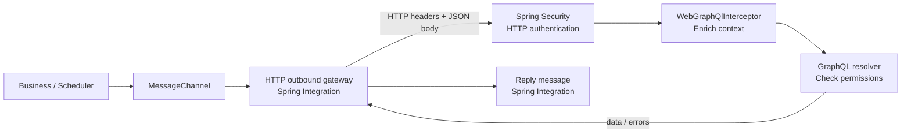

# Headers, Authentication, and Context in the GraphQL Adapter

## Lesson Objectives

When connecting a Spring Integration application to a GraphQL API, the `query` or `mutation` body is only part of the request. The application must also send proper HTTP headers, authenticate the caller's identity, propagate observability metadata, and ensure the GraphQL side relies only on trusted context.

After this lesson, you can:

- Distinguish **HTTP headers**, **Spring Integration `MessageHeaders`**, **GraphQL variables**, and **`GraphQLContext`**.
- Send Bearer tokens, `Content-Type`, `Accept`, and correlation IDs through an HTTP outbound gateway.
- Choose an appropriate identity-propagation pattern between two systems without forwarding tokens beyond permitted boundaries.
- Inject validated metadata into `GraphQLContext` on the GraphQL server.
- Distinguish HTTP-layer authentication errors from GraphQL execution errors in `errors`, and design safe logging and testing.

> **Scope:** Spring Integration orchestrates message flows and provides HTTP inbound/outbound gateways to call GraphQL over HTTP. Spring for GraphQL processes queries on the GraphQL server side, including `WebGraphQlInterceptor` and `GraphQLContext`. These two components have distinct roles; the examples below use Spring Integration's HTTP outbound gateway to connect to a GraphQL API.

## 1. Problem: Calling GraphQL on Behalf of a Business Request

Suppose service `order-orchestrator` receives an order lookup request. A Spring Integration flow builds a GraphQL operation to query service `order-graphql`. The system needs to:

1. Send a query to fetch order `O-1024`.
2. Prove the identity of the calling service or delegated user.
3. Correlate logs on both sides with a correlation ID.
4. Ensure returned data belongs only to the tenant the authenticated identity is authorized to access.

An illustrative HTTP request:

```http
POST /graphql HTTP/1.1
Host: orders.example.test
Authorization: Bearer <access-token>
Content-Type: application/json
Accept: application/graphql-response+json, application/json
X-Correlation-Id: req-7f83

{
  "operationName": "GetOrder",
  "query": "query GetOrder($id: ID!) { order(id: $id) { id status } }",
  "variables": { "id": "O-1024" }
}
```

Where:

- `Authorization` passes authentication credentials to the HTTP server.
- `Content-Type` declares the body is JSON; `Accept` expresses the response media types the client can handle.
- `X-Correlation-Id` tracks a request across systems, **not** proof of caller authorization.
- `operationName`, `query`, and `variables` are GraphQL operation data and do not replace HTTP authentication.

**Note:** `<access-token>` above is an illustrative placeholder. Never store real tokens in source code, documentation, logs, or public configuration.

## 2. Distinguishing Information Layers

| Layer | Where It Lives | Purpose | Example |
| --- | --- | --- | --- |
| **Spring Integration payload** | `Message<?>` inside the integration flow | Carries the body for the HTTP gateway to send | JSON string containing `query` and `variables` |
| **Spring Integration MessageHeaders** | Metadata on `Message<?>` | Coordinates messages and supplies adapter metadata mapped to HTTP | `replyChannel`, `errorChannel`, `contentType`, `Authorization` |
| **HTTP request headers** | On the wire from client → GraphQL endpoint | Protocol metadata, auth, media-type negotiation, tracing | `Authorization`, `Content-Type`, `Accept`, `traceparent` |
| **GraphQL variables** | JSON body of the GraphQL request | Business parameters declared in the operation | `{"id":"O-1024"}` |
| **GraphQLContext** | On the GraphQL server, scoped to a single GraphQL execution | Shares contextual data with data fetchers/resolvers | `correlationId`, verified tenant info |
| **GraphQL response extensions** | Response body, if returned by the server | Supplementary metadata per API convention | Business error codes in `errors[].extensions` |

Keep two boundaries in mind:

**Boundary 1 — `MessageHeaders` → HTTP headers.** When a message enters an HTTP outbound gateway, `DefaultHttpHeaderMapper` decides which headers become HTTP headers. Internal routing headers like `replyChannel` and `errorChannel` are not HTTP headers for partners. If you customize the header list, verify which headers still get mapped.

**Boundary 2 — HTTP headers → `GraphQLContext`.** A GraphQL server can read HTTP headers and put selected values into `GraphQLContext` via an interceptor. Copying a header into context **does not automatically authenticate or verify** its value. For instance, `X-Tenant-Id: tenant-A` sent by a client remains untrusted data until the server verifies the authenticated identity's permission for that tenant.



The diagram illustrates the logical path of a request. Spring Security and interceptors run on the GraphQL server side; not every system uses the exact same filter order or framework shown here.

## 3. Designing HTTP Headers for a GraphQL Request

### Common Headers

| Header | Usage | Notes |
| --- | --- | --- |
| `Authorization` | Usually `Bearer <token>` | Validated on server per configured auth mechanism; never log tokens |
| `Content-Type` | `application/json` when sending a JSON GraphQL body | Do not confuse with `Accept` |
| `Accept` | `application/graphql-response+json` or `application/json` per API support | Media type can affect how the server represents HTTP errors |
| `X-Correlation-Id` | Correlate requests/replies/logs across services | Restrict length and characters; never use as an authorization key |
| `traceparent` | Propagate W3C trace context when tracing is enabled | Prefer automatic instrumentation; avoid malformed manual trace IDs |
| `Accept-Language` | Suggest response locale if supported by the API | Client metadata only |
| `X-Tenant-Id` | Tenant hint in custom protocols | Must be checked against authenticated identity/permissions before data access |

### Customizing Header Mapping

Spring Integration uses `DefaultHttpHeaderMapper` for HTTP adapters/gateways. By default, standard HTTP headers are mapped. When configuring a custom list, that list can **override the default**. Therefore:

- Explicitly specify which headers genuinely need to be sent to the GraphQL API.
- If you want to retain standard HTTP request headers alongside custom ones, include the `HTTP_REQUEST_HEADERS` pattern together with allowed custom headers.
- Never blindly copy all upstream headers to a partner—especially `Cookie`, `Authorization`, or internal headers outside the integration contract.
- Verify header mapping with a mock HTTP server; do not assume a header is sent just because it exists in `MessageHeaders`.

An XML configuration snippet illustrating a header list on an HTTP outbound gateway:

```xml
<int-http:outbound-gateway
    id="partnerGraphqlGateway"
    channel="graphqlRequests"
    url="https://partner.example.test/graphql"
    http-method="POST"
    expected-response-type="java.lang.String"
    mapped-request-headers="HTTP_REQUEST_HEADERS, X-Correlation-Id" />
```

In Java DSL flows, an equivalent `DefaultHttpHeaderMapper` can be configured. The XML snippet only illustrates **header mapping**; the Java implementation below uses the Java DSL gateway with default mapping.

## 4. Authentication: Which Identity Gets Sent?

Before adding `Authorization`, clearly determine who the GraphQL caller principal is:

| Scenario | Token Sent | Security Conditions |
| --- | --- | --- |
| **Service-to-service** | `order-orchestrator`'s token, typically via OAuth 2.0 client credentials | GraphQL API validates service identity, `audience`, and matching `scope` |
| **On-behalf-of user** | Downstream token issued by the identity provider or a valid exchanged token | Policy allows delegation; audience, lifetime, and scope match downstream |
| **No user identity needed** | No user token sent; use service identity if required by the API | Avoid attaching user privileges to background jobs without a user |
| **Public GraphQL** | Possibly no `Authorization` | Only when the API explicitly allows anonymous access |

Do not forward `Authorization` verbatim from HTTP inbound to HTTP outbound by default: a token issued for service A may not be accepted or authorized at service B. Authenticating at a gateway also does not replace **authorization** inside GraphQL resolvers/services.

On the GraphQL server side:

1. Spring Security or an equivalent layer validates the token: signature, issuer, audience, expiration, and required claims.
2. The server extracts subject, scopes/roles, and valid tenants from the authenticated identity.
3. Resolvers or business services enforce permissions per operation/resource; the same `/graphql` URL can serve fields with different access levels.
4. If a header supplies extra hints such as a requested tenant, the server verifies it against the subject's actual entitlements.

**Never use `query`, `variables`, `extensions`, custom headers, or correlation IDs in place of authentication.** Even if the client sends `tenantId` in `variables`, the server must still enforce tenant access constraints.

## 5. Spring Integration Example: Calling a GraphQL HTTP Outbound Gateway

The example below uses Spring Integration HTTP and Java DSL. The system already has a component providing valid access tokens (for example, an OAuth 2.0 client manager); do not fabricate dummy tokens in application code.

### 5.1. Defining the Flow and Messaging Gateway

```java
import org.springframework.context.annotation.Bean;
import org.springframework.context.annotation.Configuration;
import org.springframework.http.HttpHeaders;
import org.springframework.http.HttpMethod;
import org.springframework.integration.annotation.Gateway;
import org.springframework.integration.annotation.IntegrationComponentScan;
import org.springframework.integration.annotation.MessagingGateway;
import org.springframework.integration.dsl.IntegrationFlow;
import org.springframework.integration.http.dsl.Http;
import org.springframework.messaging.handler.annotation.Header;
import org.springframework.messaging.handler.annotation.Payload;

@Configuration
@IntegrationComponentScan
class GraphqlOutboundConfiguration {

    @Bean
    IntegrationFlow partnerGraphqlFlow() {
        return IntegrationFlow.from("partnerGraphqlRequests")
            .handle(Http.outboundGateway(
                    "https://partner.example.test/graphql")
                .httpMethod(HttpMethod.POST)
                .expectedResponseType(String.class))
            .get();
    }
}

@MessagingGateway
interface PartnerGraphqlGateway {

    @Gateway(requestChannel = "partnerGraphqlRequests")
    String execute(
        @Payload String jsonBody,
        @Header(HttpHeaders.AUTHORIZATION) String authorization,
        @Header(HttpHeaders.CONTENT_TYPE) String contentType,
        @Header(HttpHeaders.ACCEPT) String accept,
        @Header("X-Correlation-Id") String correlationId);
}
```

Explanation:

- `partnerGraphqlRequests` is the flow's input channel. Calling `PartnerGraphqlGateway.execute(...)` builds a Spring Integration message and awaits a reply.
- `Http.outboundGateway(...)` issues an HTTP POST and returns the response along the reply path. Use an **outbound gateway** when you need the GraphQL response back; a one-way outbound channel adapter does not fit this request/reply pattern.
- `expectedResponseType(String.class)` lets the example receive raw JSON and inspect both `data` and `errors`.
- Headers passed to the messaging gateway are processed by the HTTP header mapper before sending the request. If using a custom mapper, configure and test the header list accordingly.
- Endpoints, timeouts, retries, and token retrieval must be configured per environment; `example.test` is illustrative only.

### 5.2. Building the Body with a JSON Serializer and Reading `errors`

```java
import java.util.Map;
import com.fasterxml.jackson.databind.JsonNode;
import com.fasterxml.jackson.databind.ObjectMapper;
import org.springframework.http.MediaType;

// Assume gateway, objectMapper, and accessToken are provided.
String query = """
    query GetOrder($id: ID!) {
      order(id: $id) { id status }
    }
    """;

String requestBody = objectMapper.writeValueAsString(Map.of(
    "operationName", "GetOrder",
    "query", query,
    "variables", Map.of("id", "O-1024")
));

String rawResponse = gateway.execute(
    requestBody,
    "Bearer " + accessToken,
    MediaType.APPLICATION_JSON_VALUE,
    "application/graphql-response+json, application/json",
    "req-7f83"
);

JsonNode result = objectMapper.readTree(rawResponse);
if (result.has("errors") && !result.path("errors").isEmpty()) {
    // Classify errors per API contract, even when HTTP status is 200.
    throw new IllegalStateException("GraphQL returned errors");
}
JsonNode order = result.path("data").path("order");
// Check for null or missing fields before mapping to business data.
```

In production, replace the illustrative `IllegalStateException` with a structured error classifier, record safe error codes, and support `partial data` when permitted by contract. Never dump raw responses containing PII, tokens, or sensitive data into logs.

**Body construction note:** keep `query` as a defined operation and pass business values via `variables`. Use `ObjectMapper` for proper JSON escaping instead of manual string concatenation. `variables` is not the place for access tokens.

## 6. GraphQL Server: Passing HTTP Metadata into `GraphQLContext`

`GraphQLContext` is the per-execution context accessible from resolvers and data fetchers. Spring for GraphQL provides `WebGraphQlInterceptor` to inspect transport requests, customize `ExecutionInput`, and add response headers.

The following example puts only a **correlation ID** into context. If the client-supplied value is invalid, the server generates a fresh ID to keep control characters or oversized strings out of logs.

```java
import java.util.Map;
import java.util.UUID;
import org.springframework.graphql.server.WebGraphQlInterceptor;
import org.springframework.graphql.server.WebGraphQlRequest;
import org.springframework.graphql.server.WebGraphQlResponse;
import org.springframework.stereotype.Component;
import reactor.core.publisher.Mono;

@Component
class CorrelationGraphQlInterceptor implements WebGraphQlInterceptor {

    @Override
    public Mono<WebGraphQlResponse> intercept(
            WebGraphQlRequest request, Chain chain) {

        String provided = request.getHeaders().getFirst("X-Correlation-Id");
        String correlationId =
            provided != null && provided.matches("[A-Za-z0-9_-]{1,64}")
                ? provided
                : UUID.randomUUID().toString();

        request.configureExecutionInput((input, builder) ->
            builder.graphQLContext(
                Map.of("correlationId", correlationId)).build());

        return chain.next(request).doOnNext(response ->
            response.getResponseHeaders()
                .set("X-Correlation-Id", correlationId));
    }
}
```

With Spring Boot + Spring for GraphQL, a `WebGraphQlInterceptor` bean is automatically wired into the GraphQL web handling chain. If other interceptors exist, check context key conventions to avoid overwriting keys.

In the resolver, retrieve correlation ID from `GraphQLContext`; identity and tenant must still be verified via security mechanisms:

```java
import org.springframework.graphql.data.method.annotation.Argument;
import org.springframework.graphql.data.method.annotation.ContextValue;
import org.springframework.graphql.data.method.annotation.QueryMapping;
import org.springframework.security.core.annotation.AuthenticationPrincipal;
import org.springframework.security.oauth2.jwt.Jwt;
import org.springframework.stereotype.Controller;

@Controller
class OrderGraphQlController {

    private final OrderService orders;

    OrderGraphQlController(OrderService orders) {
        this.orders = orders;
    }

    @QueryMapping
    Order order(
        @Argument String id,
        @AuthenticationPrincipal Jwt jwt,
        @ContextValue("correlationId") String correlationId) {

        String tenantId = jwt.getClaimAsString("tenant_id");
        // readAuthorized enforces subject, tenant, and read permission checks.
        return orders.readAuthorized(jwt.getSubject(), tenantId, id);
    }
}
```

`Order` and `OrderService.readAuthorized(...)` are illustrative business types/methods to define in a real app. Using `@AuthenticationPrincipal Jwt` assumes the GraphQL endpoint is protected by Spring Security OAuth2 Resource Server. Reading the claim is meaningful only after the system verifies the token and agrees on the `tenant_id` claim semantics; the resolver must still enforce per-order read authorization.

If you only need to copy a benign HTTP header into context, Spring for GraphQL also provides `HttpRequestHeaderInterceptor`:

```java
@Bean
HttpRequestHeaderInterceptor headerInterceptor() {
    return HttpRequestHeaderInterceptor.builder()
        .mapHeader("Accept-Language")
        .build();
}
```

This is a **mapping** step, not authentication. Never map tokens or sensitive data arbitrarily into context or responses.

### 6.1. Securing `/graphql`

A concise configuration for a **stateless HTTP API using Bearer JWT without cookie sessions**:

```java
@Bean
SecurityFilterChain graphqlApiSecurity(HttpSecurity http) throws Exception {
    return http
        .csrf(csrf -> csrf.ignoringRequestMatchers("/graphql"))
        .authorizeHttpRequests(auth -> auth
            .requestMatchers("/graphql").authenticated()
            .anyRequest().permitAll())
        .oauth2ResourceServer(oauth -> oauth.jwt(
            Customizer.withDefaults()))
        .build();
}
```

Add the required Spring Security imports and configure issuer/JWK, audience validation, and application-specific authorization. Only exempt stateless Bearer-token endpoints from CSRF per your deployment model; if cookies/sessions are used, evaluate and maintain proper CSRF protection. Securing the URL only checks whether the caller can reach `/graphql`, which is insufficient for per-query, per-mutation, or per-field authorization. Place fine-grained checks in services/resolvers, e.g., via `@PreAuthorize` with tenant conditions.

### 6.2. Context in Asynchronous Flows

Never store `GraphQLContext` or per-request data in mutable singleton fields or static variables: concurrent requests can interleave and leak data across users. In WebFlux, Reactor `Context` and Spring Security context have their own propagation mechanisms; in Spring MVC, `ThreadLocal` is not guaranteed to survive thread hops. Use Spring for GraphQL's supported context propagation or pass required values explicitly as parameters instead of reading arbitrary `ThreadLocal`s inside async callbacks.

## 7. Responses, Errors, and Retry Policy

GraphQL can return HTTP 200 with a body containing `errors`. With `application/graphql-response+json`, parse/validation errors can also use HTTP 4xx codes. Clients must therefore handle **both HTTP status and GraphQL content**.

| Outcome | Typical Meaning | Recommended Handling |
| --- | --- | --- |
| HTTP 401 | Missing/expired/invalid credentials | Check token source; refresh token only per defined policy |
| HTTP 403 | Denied at HTTP/security layer | Check permissions, audience, scope; avoid infinite retries |
| HTTP 200 + `data` | Operation processed and returned data | Validate schema and required fields |
| HTTP 200 + `errors` | GraphQL resolver/logic returned errors, possibly with partial `data` | Handle each error per contract; avoid treating as full success |
| HTTP 400/4xx from bad query/JSON | Invalid request | Fix operation/serialization; do not retry verbatim |
| HTTP 429, 502, 503, or timeout | Rate limiting or transient failure | Bounded backoff; honor `Retry-After` when supported |

Example GraphQL response with partial data:

```json
{
  "data": {
    "order": null
  },
  "errors": [
    {
      "message": "Access denied",
      "path": ["order"],
      "extensions": { "code": "FORBIDDEN" }
    }
  ]
}
```

`extensions.code` in this example is an illustrative API convention, not a mandatory standard set of GraphQL error codes. Integrations should map error codes according to partner contracts.

**Especially for mutations:** do not auto-retry after a timeout without knowing whether the server executed the action. Use an idempotency key or deduplication mechanism if supported by the API, and define explicit retry conditions in the integration contract.

## 8. Logging, Security, and Operations

For flows originating from file/SFTP, HTTP, JMS, Kafka, or databases passing through Spring Integration to GraphQL, design a unified metadata policy:

- **Correlation:** attach a correlation ID at entry, preserve it across intermediate channels, and selectively pass it to HTTP headers. Log correlation ID, operation name, target destination, latency, HTTP status, and error count; never log credentials.
- **Secret protection:** mask `Authorization`, `Cookie`, `Set-Cookie`, and sensitive fields across adapter logs, exceptions, wiretaps, and distributed traces. Never put access tokens into GraphQL query strings or metric labels.
- **Provenance separation:** track which claims are self-asserted by upstream versus verified by an identity provider. Self-asserted data may only act as a hint or must be re-verified.
- **Least privilege:** issue short-lived tokens with minimal scopes and tight target audiences. Do not share one credential across all tenants if authorization models require isolation.
- **Connection lifecycle:** configure connect/read timeouts, bounded retries, and concurrency; monitor 401/403/429/5xx codes; centralize token refresh so concurrent requests do not stampede refresh endpoints.
- **Error handling:** separate HTTP transport failures from GraphQL `errors`; route sanitized error details to `errorChannel` or the flow's designated error handler.

Distinguish `MessageHeaders.ID`, `MessageHeaders.TIMESTAMP`, and business correlation IDs. Spring Integration's message ID is generated per message and can change across transformations; business correlation IDs should have their own stable contract.

## 9. Integration Testing Checklist

Minimum test cases to verify header and context propagation:

| Test Case | Input Data | Expectation |
| --- | --- | --- |
| Standard headers | Valid JSON, valid token | HTTP POST has proper `Content-Type` and `Authorization`; GraphQL returns `data` |
| Custom mapping | Add `X-Correlation-Id` on message | Partner receives the exact ID; internal headers are omitted |
| Missing token | Omit `Authorization` | Blocked by security policy; no private data returned |
| Wrong-audience token | Valid JWT with mismatched audience/scope | Rejected before or during authorization checks |
| Tenant spoofing | Tenant A token, client sends `X-Tenant-Id: B` | Cannot access tenant B's data |
| Resolver error | HTTP returns body with `errors` | Flow detects errors instead of marking success |
| Timeout after mutation | No response | Does not unconditionally resend mutation |
| Concurrent A/B | Two requests with different contexts | No tenant/correlation ID leakage between requests |
| Logging | Tracing and error paths enabled | No tokens or sensitive payloads exposed |

Use a mock HTTP server to capture outbound requests, verify bodies/headers, and simulate status codes. On the GraphQL server, use `WebGraphQlTester` or transport-level tests to verify interceptors, context, and authorization policies. Never test by putting real tokens into logs or committed fixtures.

## 10. Practice Exercise

**Scenario:** A flow receives an `OrderRequested` event from a broker, calls GraphQL `order(id: ...)`, and forwards the result to a processing channel. Each event includes `correlationId` and `tenantHint`, while service identity comes from OAuth 2.0.

1. Design the GraphQL request with `query` and `variables`; place the Bearer token in the HTTP header. List explicitly which headers should map from message to HTTP.
2. Add a GraphQL-side interceptor to place the validated correlation ID into `GraphQLContext`, and use the verified tenant from the security identity to restrict access.
3. Simulate in turn an expired token, GraphQL returning HTTP 200 with `errors`, and a timeout after a mutation. Identify which cases may be retried, which must be rejected, and what may safely be logged.

**Completion criteria:** learners can trace the origin of every value inside the resolver, prove tenant isolation does not rely solely on client headers, and never equate HTTP 200 with a successful GraphQL operation.

## References

- [Spring Integration — HTTP Header Mappings](https://docs.spring.io/spring-integration/reference/http/header-mapping.html)
- [Spring Integration — Configuring HTTP Endpoints with Java](https://docs.spring.io/spring-integration/reference/http/java-config.html)
- [Spring for GraphQL — Server Transports and WebGraphQlInterceptor](https://docs.spring.io/spring-graphql/reference/transports.html)
- [Spring for GraphQL — Annotated Controllers](https://docs.spring.io/spring-graphql/reference/controllers.html)
- [Spring for GraphQL — Security](https://docs.spring.io/spring-graphql/reference/security.html)
- [Spring for GraphQL — Request Execution and Context Propagation](https://docs.spring.io/spring-graphql/reference/request-execution.html)
