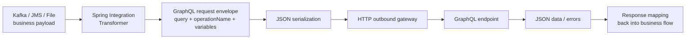
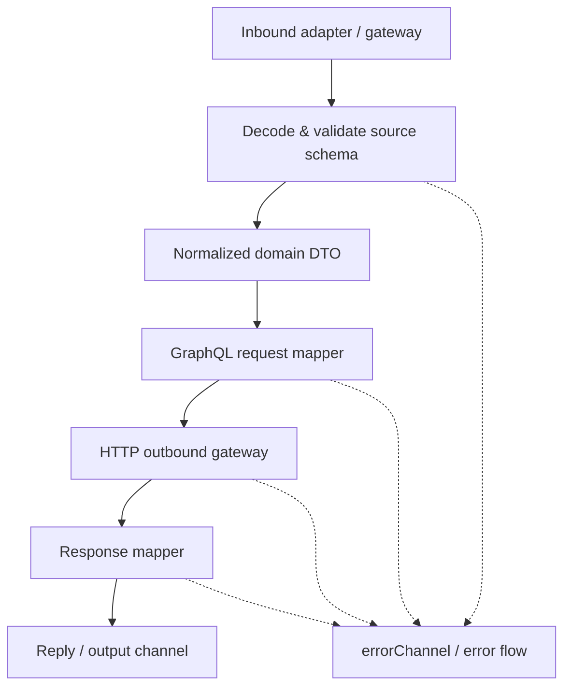

# Mapping Payload to Request Document in the GraphQL Adapter

## Objectives

In the **SPRING_INTEGRATION_ADAPTERS** module, Spring Integration connects external systems via inbound/outbound adapters, gateways, pollers, and `MessageChannel`s. When a flow receiving data from files, SFTP, HTTP, JMS, AMQP, Kafka, or databases needs to call a GraphQL API, the incoming payload is usually **not** in the format accepted by the GraphQL endpoint. We must transform the payload into a valid GraphQL request, send it through an HTTP outbound gateway, and handle the response.

After this lesson, you can:

- Distinguish **business payload**, **GraphQL document**, **variables**, and **HTTP request body**.
- Map fields from messages into GraphQL queries/mutations matching the target system's schema.
- Construct requests with `operationName`, `query`, and `variables` without concatenating business values into the query.
- Handle `ID`, enums, input objects, lists, required fields, and `null` values.
- Place transformers properly in a Spring Integration flow while preserving necessary metadata in message headers.
- Test mapping outputs and distinguish pre-request errors from GraphQL errors after calling the API.

> **Scope:** Examples use GraphQL over HTTP. Spring Integration provides the message flow, transformers, gateways, and error-handling mechanisms; executing the GraphQL document belongs to the GraphQL server. Operations in this lesson are illustrative examples based on sample schemas and must be verified against the real target system's schema.

## 1. Practical Problem

Suppose an application receives events from Kafka or AMQP when order information needs synchronization. Internal payload:

```json
{
  "eventId": "evt-817",
  "orderId": "O-1024",
  "tenantHint": "shop-42",
  "correlationId": "flow-5f23"
}
```

The destination is a GraphQL API exposing this operation:

```graphql
query GetOrder($id: ID!) {
  order(id: $id) {
    id
    status
    total
  }
}
```

GraphQL APIs over HTTP typically accept a JSON body like:

```json
{
  "operationName": "GetOrder",
  "query": "query GetOrder($id: ID!) { order(id: $id) { id status total } }",
  "variables": {
    "id": "O-1024"
  }
}
```

Key point: internal `orderId` became variable `id`. Fields `tenantHint`, `correlationId`, and `eventId` do not automatically become GraphQL variables. They are included in the request only if the schema or integration contract genuinely requires them. Correlation IDs belong more appropriately in HTTP headers, while tenants used for access control must be checked against an authenticated identity.

Mapping diagram:



The payload transformation step forms the boundary between the internal event model and the partner's GraphQL contract. If the internal model changes, only the mapper needs adjustment; transport and channel steps can remain unchanged.

## 2. Four Frequently Confused Concepts

| Component | Example | Role |
| --- | --- | --- |
| **Inbound message payload** | `OrderLookupEvent(orderId, tenantHint, …)` | Source data sent upstream into Spring Integration |
| **GraphQL document** | `query GetOrder($id: ID!) { … }` | Declares operation, variable types, and requested fields per GraphQL schema |
| **GraphQL variables** | `{"id":"O-1024"}` | Values supplied to the document's variables at execution time |
| **GraphQL-over-HTTP request body** | `{"query":"…","operationName":"GetOrder","variables":{…}}` | JSON envelope sent via HTTP POST to the endpoint |
| **Spring Integration MessageHeaders** | `Authorization`, `X-Correlation-Id`, `replyChannel` | Message metadata; the HTTP gateway maps selected headers to HTTP headers |

**A GraphQL document is not the JSON request body.** In JSON, `query` is a string containing the GraphQL document, while `variables` is a separate JSON object. When a document has only one operation, `operationName` can be omitted. When it contains multiple operations, specify which operation name to execute.

GraphQL operations can be `query`, `mutation`, or `subscription`; this lesson focuses on HTTP queries/mutations. Subscriptions typically need different transports and connection lifecycles, such as WebSockets per the GraphQL server's protocol.

## 3. Starting from the GraphQL Schema Contract

You cannot infer field names, data types, or input structures from Java payload property names. Mappers must follow the **schema published by the target API**.

Abbreviated sample schema:

```graphql
type Query {
  order(id: ID!): Order
  orders(filter: OrderFilterInput, limit: Int = 20): [Order!]!
}

type Mutation {
  updateOrder(input: UpdateOrderInput!): Order!
}

type Order {
  id: ID!
  status: OrderStatus!
  total: Float!
}

enum OrderStatus {
  NEW
  PAID
  CANCELLED
}

input OrderFilterInput {
  status: OrderStatus
  customerId: ID
}

input UpdateOrderInput {
  id: ID!
  status: OrderStatus!
  reason: String
}
```

From the schema above, mapping decisions must be decided upfront:

| Input from Source System | Position in GraphQL | Rule |
| --- | --- | --- |
| `orderId` | `variables.id` for `GetOrder` | Required, must be non-blank |
| `status` | `variables.filter.status` or `variables.input.status` | Accept only published enum values |
| `customerId` | `variables.filter.customerId` | Optional, strictly per operation contract |
| `reason` | `variables.input.reason` | Distinguish omitted from intentional `null` |
| `tenantHint` | Usually absent from document | Send only if explicitly contracted; still enforce authorization |
| `correlationId` | HTTP header for flow observability | Not a query variable |

For instance, field names `customerId` and `status` inside `OrderFilterInput` are dictated by the schema. If the server defines `customer_id`, the mapper must emit that exact name even if the Java property is named `customerId`.

## 4. Safe Mapping: Fixed Document, Values in Variables

Suppose the order ID is `O-1024`. The problematic approach is concatenating values into the document:

```java
// Avoid concatenating payload values directly into the GraphQL document string.
String query = "query { order(id: \"" + event.orderId() +
    "\") { id status } }";
```

This easily produces malformed documents on special characters, hinders caching/review, and opens query-syntax manipulation if escaping fails. Instead, use GraphQL variables declared on the operation:

```graphql
query GetOrder($id: ID!) {
  order(id: $id) {
    id
    status
    total
  }
}
```

and pass values separately:

```json
{
  "id": "O-1024"
}
```

Key benefits:

- Queries can be reviewed and tested as stable artifacts.
- Business values cannot alter the operation's structure.
- Operation names are easy to log without logging full payloads.
- The document can be reused across many requests differing only in variables.
- Can integrate with persisted queries per API contract if needed.

**Placing variables properly does not replace validation.** You must still validate lengths, ID formats, enum values, tenants, permissions, and query execution costs in the appropriate layers.

## 5. Java Example: Building a Request Envelope from Payload

Below is a three-part design: source payload, request envelope, and mapper. The example uses Java 17+, Jackson, and Spring Integration; `GraphqlEnvelope` is an HTTP request DTO, not a new GraphQL document.

### 5.1. Defining Source Data and Envelope

```java
import java.util.Map;

public record OrderLookupEvent(
    String eventId,
    String orderId,
    String tenantHint,
    String correlationId
) {}

public record GraphqlEnvelope(
    String query,
    String operationName,
    Map<String, Object> variables
) {}
```

With these records, Jackson versions supporting Java records serialize JSON using the component names: `query`, `operationName`, `variables`. On older Java/Jackson versions, use compatible DTOs or configure serializers accordingly.

### 5.2. Mapper Responsible for the GraphQL Contract

```java
import com.fasterxml.jackson.core.JsonProcessingException;
import com.fasterxml.jackson.databind.ObjectMapper;
import java.util.Map;
import java.util.Objects;

public final class OrderGraphqlRequestMapper {

    private static final String DOCUMENT = """
        query GetOrder($id: ID!) {
          order(id: $id) {
            id
            status
            total
          }
        }
        """;

    private final ObjectMapper objectMapper;

    public OrderGraphqlRequestMapper(ObjectMapper objectMapper) {
        this.objectMapper = Objects.requireNonNull(objectMapper);
    }

    public String toRequestJson(OrderLookupEvent event) {
        Objects.requireNonNull(event, "event");
        String orderId = event.orderId();

        if (orderId == null || orderId.isBlank()) {
            throw new IllegalArgumentException(
                "orderId is required for GetOrder");
        }

        GraphqlEnvelope envelope = new GraphqlEnvelope(
            DOCUMENT,
            "GetOrder",
            Map.of("id", orderId.trim())
        );

        try {
            return objectMapper.writeValueAsString(envelope);
        } catch (JsonProcessingException ex) {
            throw new IllegalStateException(
                "Cannot serialize GetOrder request", ex);
        }
    }
}
```

Notes:

1. The mapper validates `orderId` before sending the request; the server validates again against the schema.
2. `id` is the GraphQL variable name and does not have to match property `orderId`.
3. The document is constant: independent of any individual request's payload.
4. `eventId`, `tenantHint`, and `correlationId` do not appear in the request body because they are not part of the operation.
5. Mapping exceptions are handled by Spring Integration per the active flow's semantics; for custom error messaging, configure an `errorChannel` or error flow.

**Sample output:** with `orderId = "O-1024"`, `toRequestJson` produces JSON with `query` matching the document, `operationName = "GetOrder"`, and `variables.id = "O-1024"`. Whitespace and newlines from the text block inside `query` do not change the GraphQL operation's meaning.

### 5.3. Wiring the Mapper into a Spring Integration Flow

Example HTTP outbound gateway receiving the JSON string produced by the transformer:

```java
import com.fasterxml.jackson.databind.ObjectMapper;
import org.springframework.context.annotation.Bean;
import org.springframework.context.annotation.Configuration;
import org.springframework.http.HttpMethod;
import org.springframework.http.MediaType;
import org.springframework.integration.dsl.IntegrationFlow;
import org.springframework.integration.http.dsl.Http;

@Configuration
class OrderGraphqlIntegrationConfig {

    @Bean
    OrderGraphqlRequestMapper orderGraphqlRequestMapper(
            ObjectMapper objectMapper) {
        return new OrderGraphqlRequestMapper(objectMapper);
    }

    @Bean
    IntegrationFlow orderGraphqlFlow(
            OrderGraphqlRequestMapper requestMapper) {

        return IntegrationFlow.from("orderLookupRequests")
            .transform(OrderLookupEvent.class,
                requestMapper::toRequestJson)
            .enrichHeaders(headers -> headers
                .header("Content-Type", MediaType.APPLICATION_JSON_VALUE)
                .header("Accept",
                    "application/graphql-response+json, application/json"))
            .handle(Http.outboundGateway(
                    "https://orders.example.test/graphql")
                .httpMethod(HttpMethod.POST)
                .expectedResponseType(String.class))
            .get();
    }
}
```

This flow consists of:

- **Input channel:** `orderLookupRequests` receives `Message<OrderLookupEvent>`.
- **Transformer:** turns the payload into a JSON string containing the request envelope.
- **Header enricher:** adds HTTP `Content-Type` and `Accept`.
- **Outbound gateway:** sends a POST to the GraphQL endpoint and receives the JSON response string for downstream steps.

Authentication headers such as `Authorization` and correlation IDs should be attached by a trusted component before the outbound gateway calls the API. Translating Spring `MessageHeaders` into HTTP headers follows the HTTP header mapper configuration, especially for custom headers. Never automatically copy tokens received from another source to a GraphQL API not intended to receive them.

For request/reply flows, use `@MessagingGateway` to submit payloads and required metadata onto the input channel:

```java
import org.springframework.integration.annotation.Gateway;
import org.springframework.integration.annotation.MessagingGateway;
import org.springframework.messaging.handler.annotation.Header;
import org.springframework.messaging.handler.annotation.Payload;

@MessagingGateway
public interface OrderGraphqlGateway {

    @Gateway(requestChannel = "orderLookupRequests")
    String fetch(
        @Payload OrderLookupEvent event,
        @Header("Authorization") String bearerAuthorization,
        @Header("X-Correlation-Id") String correlationId);
}
```

Example call site:

```java
// tokenService retrieves an access token issued for the orders GraphQL API.
// Do not blindly forward the inbound request's token.
String accessToken = tokenService.tokenForOrdersApi();

String jsonResponse = gateway.fetch(
    event,
    "Bearer " + accessToken,
    event.correlationId()
);
```

`tokenService` and `gateway` at the call site are pre-wired dependencies. This illustrates connecting mapping to transport; exact token issuance depends on the application's identity/OAuth 2.0 setup.

## 6. Advanced Case: Mutation with a Nested Input Object

GraphQL mutations often take an input object. Source payload might look like:

```json
{
  "orderId": "O-1024",
  "newStatus": "PAID",
  "reason": "Payment confirmed"
}
```

Document matching the sample schema:

```graphql
mutation UpdateOrder($input: UpdateOrderInput!) {
  updateOrder(input: $input) {
    id
    status
  }
}
```

Outbound JSON:

```json
{
  "query": "mutation UpdateOrder($input: UpdateOrderInput!) { updateOrder(input: $input) { id status } }",
  "operationName": "UpdateOrder",
  "variables": {
    "input": {
      "id": "O-1024",
      "status": "PAID",
      "reason": "Payment confirmed"
    }
  }
}
```

The Java mapper can build the nested structure:

```java
Map<String, Object> updateInput = new LinkedHashMap<>();
updateInput.put("id", source.orderId());
updateInput.put("status", source.newStatus());
updateInput.put("reason", source.reason());

GraphqlEnvelope request = new GraphqlEnvelope(
    UPDATE_ORDER_DOCUMENT,
    "UpdateOrder",
    Map.of("input", updateInput)
);

String body = objectMapper.writeValueAsString(request);
```

`source`, `UPDATE_ORDER_DOCUMENT`, and `objectMapper` are illustrative components defined in an actual mapper service. Import `java.util.LinkedHashMap` and `java.util.Map` when using the snippet standalone. For mutations, the mapper must validate allowed enum states before sending; idempotency and retries belong to business and transport contracts.

### Mapping Multiple Operations and operationName

A GraphQL document can hold multiple named operations:

```graphql
query GetOrder($id: ID!) {
  order(id: $id) { id status }
}

query ListOrders($limit: Int!) {
  orders(limit: $limit) { id status }
}
```

If sending this entire document, the body must include `operationName` such as `GetOrder` or `ListOrders` so the server knows which operation to run. In integration flows, however, it is usually easier to operate by storing each approved operation in its own constant or query registry rather than letting inbound payloads pick arbitrary GraphQL text.

## 7. Data Types and Conversion Rules

GraphQL input types depend on the schema; not every Java type serialized to JSON is valid for GraphQL.

| GraphQL Type | Corresponding JSON Value | Mapping Rule |
| --- | --- | --- |
| `String` | `"hello"` | String; validate format if it is a special identifier |
| `ID` | Usually `"O-1024"`, or integer via GraphQL input coercion | Prefer strings to avoid stripping leading zeros and integer bounds |
| `Int` | `20` | GraphQL `Int` is signed 32-bit; check bounds if Java uses `long` |
| `Float` | `19.95` | Finite JSON number; do not assume exact monetary decimal precision |
| `Boolean` | `true` / `false` | Real JSON boolean, not string `"true"` |
| `Enum` | `"PAID"` | JSON string matching exact schema enum name, not display label |
| `[ID!]!` | `["O-1","O-2"]` | Non-null list with non-null elements |
| Input object | `{"id":"O-1","status":"PAID"}` | Object with field names and nested structure matching schema |
| Custom scalar | Server-dependent, e.g., ISO-8601 string for `DateTime` | Check target API scalar docs |

**Note on currency:** if the schema uses `Float` for `total`, Jackson can still serialize Java `BigDecimal` as a JSON number, yet precision and rounding rules require an explicit contract. If the API publishes a custom `Decimal` scalar, follow the exact format required by the server.

### Required Fields, Nulls, and Omitted Fields

In GraphQL, the meanings of these three states can differ:

1. **Key absent from variables/input object:** no value passed; schema defaults apply if defined.
2. **Key present with `null`:** intentionally passing null; valid only for nullable fields.
3. **Key present with a concrete value:** server validates type and business rules.

Example with input field `reason: String`:

```json
{"input": {"id": "O-1024", "status": "PAID"}}
```

differs from:

```json
{"input": {"id": "O-1024", "status": "PAID", "reason": null}}
```

When omitting an optional field:

```java
Map<String, Object> input = new LinkedHashMap<>();
input.put("id", source.orderId());
input.put("status", source.newStatus());

if (source.hasReasonField()) {
    input.put("reason", source.reason());  // May be intentionally null.
}
```

For DTOs that must distinguish **missing field** from **present-null field** in inbound JSON, a plain `String reason` cannot represent both states. Use `JsonNode.has("reason")` or a presence-tracking wrapper to preserve the exact contract. Avoid `Map.of(...)` with null values because `Map.of` forbids nulls.

If a field is defined as `ID!` or `UpdateOrderInput!`, never send null. Validating in the mapper fails fast, while the server still enforces final schema validation.

## 8. Mapping from Various Inbound Adapters

Each source places data into `Message<?>` differently. The GraphQL mapper should sit after payload decoding and normalization into a unified business object.

| Source | Initial Payload Could Be | Normalization Before GraphQL Mapper |
| --- | --- | --- |
| File/SFTP | `File`, byte array, CSV/XML/JSON | Read file, parse source schema, check encoding/format |
| HTTP inbound gateway | JSON DTO, `String` | Deserialize request, validate, and map to domain command |
| JMS/AMQP/Kafka | Event object, byte array, `String` | Deserialize per schema, check version and event idempotency |
| JDBC/DB polling | Row `Map`/DTO | Normalize nulls, temporal types, and keys |
| TCP or stream | Frame/byte array | Decode framing, determine message boundaries |

Illustrative logical flow model:



Do not mix CSV/Kafka/HTTP-specific parsing logic into the function building the GraphQL document. Separating responsibilities lets you unit-test GraphQL mapping independently of source transport.

**Metadata:** `correlationId`, tracing context, principals, or routing info typically live in `MessageHeaders` once verified/sanitized. Transformers usually preserve incoming headers, yet header mapping across the HTTP gateway is a separate mechanism. Explicitly verify which headers are permitted across the HTTP adapter rather than assuming all internal metadata appears on the wire.

## 9. Response Mapping: Completing the Two-Way Contract

Even though the main focus is request mapping, a request/reply flow must specify the expected response format so downstream steps do not break.

GraphQL responses typically contain `data` and/or `errors`:

```json
{
  "data": {
    "order": {
      "id": "O-1024",
      "status": "PAID",
      "total": 125.0
    }
  }
}
```

An error response can still return HTTP 200 with `errors`:

```json
{
  "data": { "order": null },
  "errors": [
    {
      "message": "Not authorized",
      "path": ["order"],
      "extensions": { "code": "FORBIDDEN" }
    }
  ]
}
```

At minimum, a response mapper must:

- Parse JSON into a defined structure; check `data`, `errors`, and nullability.
- Classify GraphQL errors in the body, even when HTTP status is 200.
- Separate transport errors (timeouts, HTTP 401/403/5xx) from resolver/GraphQL execution errors.
- Forward only required business fields into target DTOs; avoid dumping raw GraphQL responses into business messages unless contracted.
- Specify explicitly whether partial data is accepted when both `data` and `errors` appear.

Preliminary check example:

```java
JsonNode root = objectMapper.readTree(rawResponse);
JsonNode errors = root.path("errors");

if (errors.isArray() && !errors.isEmpty()) {
    throw new GraphqlBusinessException(
        "GraphQL operation returned errors");
}

JsonNode orderNode = root.path("data").path("order");
if (orderNode.isMissingNode() || orderNode.isNull()) {
    throw new GraphqlBusinessException(
        "GetOrder returned no order");
}
```

Symbols `GraphqlBusinessException`, `objectMapper`, and `rawResponse` here belong to the illustrative application. In production, map errors via `extensions.code` and the API contract while avoiding sensitive leaks in exceptions/logs.

## 10. Mapping Errors, Safety, and Operations

Determine whether an error occurred before or after sending the HTTP request:

| Stage | Example Error | Handling |
| --- | --- | --- |
| Decode source payload | Malformed JSON, mismatched event schema version | Reject/send to DLQ per source policy; do not call GraphQL |
| Validate business mapping | Blank `orderId`, invalid enum | Emit clear cause; do not endlessly retry same payload |
| Serialize request | Custom scalar fails serialization | Fix mapper/serializer or classify bad data |
| HTTP transport | Timeout, 401/403, 429, 5xx | Classify retryability; avoid retrying auth failures |
| GraphQL validation | Wrong field name, wrong variable type | Fix document/schema contract; do not retry verbatim |
| GraphQL execution | Resolver fails or returns partial data | Inspect `errors`, compensate/handle per business rules |
| Response mapping | Missing required field, wrong data type | Report contract violation keeping correlation info for investigation |

For mutations, a timeout after POST leaves uncertainty as to whether the server applied the mutation. Never auto-retry side-effecting mutations without idempotency or partner-supported status verification.

Key operational rules:

- **Pick operations from an allowlist:** data sources must not dictate arbitrary GraphQL documents if the app is only authorized to run approved business queries/mutations.
- **Bound inputs:** cap string lengths, list item counts, page sizes, and allowed query depth/cost.
- **Schema contracts:** track changes to field names, input types, required/non-null constraints, enums, and custom scalars; review mappers whenever APIs evolve.
- **Do not log secrets:** avoid logging `Authorization`, access tokens, full variables containing PII, or sensitive full responses.
- **Observability:** log operation name, correlation ID, logical endpoint, latency, mapping outcome, HTTP status, and safe GraphQL error codes.
- **Error channels:** in Spring Integration, separate transformer, HTTP gateway, and response-handler exceptions to route appropriately to `errorChannel`; with synchronous `DirectChannel`, errors generally propagate back to the caller unless handled.

## 11. Contract-Based Mapping Tests

Test suites should assert **JSON structure** rather than exact raw JSON strings, because object key ordering and whitespace do not alter request semantics.

JUnit 5 and Jackson example:

```java
@Test
void mapsOrderIdIntoGraphqlVariables() throws Exception {
    ObjectMapper json = new ObjectMapper();
    OrderGraphqlRequestMapper mapper =
        new OrderGraphqlRequestMapper(json);

    OrderLookupEvent event = new OrderLookupEvent(
        "evt-817", "O-1024", "shop-42", "flow-5f23");

    JsonNode request = json.readTree(mapper.toRequestJson(event));

    assertEquals("GetOrder", request.path("operationName").asText());
    assertEquals("O-1024",
        request.path("variables").path("id").asText());
    assertTrue(request.path("query").asText()
        .contains("query GetOrder($id: ID!)"));
    assertFalse(request.path("variables").has("tenantHint"));
    assertFalse(request.path("variables").has("correlationId"));
}
```

This snippet assumes imports `org.junit.jupiter.api.Test` and `org.junit.jupiter.api.Assertions.*` plus the DTO/mapper from section 5.

Recommended test cases:

| Test Case | Payload / Scenario | Expectation |
| --- | --- | --- |
| Happy path | `orderId = "O-1024"` | Request contains `query`, right `operationName`, `variables.id` |
| Missing ID | `orderId = null` or blank string | Mapper rejects before HTTP call |
| Special characters | ID containing characters needing escaping | JSON serializer preserves value; document remains unmodified |
| No metadata leakage | Payload has `tenantHint` and `correlationId` | Absent from GraphQL variables unless schema requires them |
| Invalid enum | `status = "Paid"` instead of `PAID` | Validated/rejected or mapped per approved enum table |
| Optional omitted | `reason` not supplied | No `reason` field in input object |
| Explicit null | Intentionally clearing `reason` | `reason: null` present only when schema allows |
| Nested input | Mutation containing `input.id/status` | Nested JSON object matches schema |
| Header mapping | Correlation ID in message header | Matching HTTP header present if configured as allowed |
| Error response | HTTP 200 with `errors` | Request not treated as successful solely from HTTP status |

Use a mock HTTP server with the Spring Integration flow to verify both the payload **after the transformer** and what actually goes out on the wire, avoiding confusion between unit mapper tests and adapter header/body configuration.

## 12. Practice Exercise

**Scenario:** A flow receives `OrderStatusRequested` events from JMS. Payloads contain `orderId`, `newStatus`, `reason`, `correlationId`, and `tenantHint`. The application must call the GraphQL mutation `updateOrder(input: UpdateOrderInput!)`.

Requirements:

1. Write `OrderStatusRequestMapper` generating only the fixed mutation and an `input` variable matching the schema. For `reason`, distinguish absent from explicit null.
2. Validate `orderId` is non-blank and `newStatus` belongs to the allowed enum; invalid values must route to an error branch before making HTTP calls.
3. Build a Spring Integration flow with an inbound channel, transformer, HTTP outbound gateway, and response handler. Place correlation ID in appropriate metadata and keep Bearer tokens outside GraphQL variables.
4. Write tests verifying request JSON, schema compatibility, GraphQL errors on HTTP 200, and timeouts after mutations.

**Completion criteria:** request bodies strictly match `query/operationName/variables`, protocol metadata stays separate from business data, payloads cannot manipulate GraphQL syntax, and errors are detected at every stage of the flow.

## References

- [Spring Integration Reference — Message Transformation](https://docs.spring.io/spring-integration/reference/transformer.html)
- [Spring Integration Reference — HTTP Support](https://docs.spring.io/spring-integration/reference/http.html)
- [Spring Integration Reference — HTTP Header Mapping](https://docs.spring.io/spring-integration/reference/http/header-mapping.html)
- [GraphQL — Queries and Mutations](https://graphql.org/learn/queries/)
- [GraphQL — Input Objects](https://graphql.org/learn/schema/#input-types)
- [GraphQL over HTTP — Specification](https://graphql.github.io/graphql-over-http/draft/)
