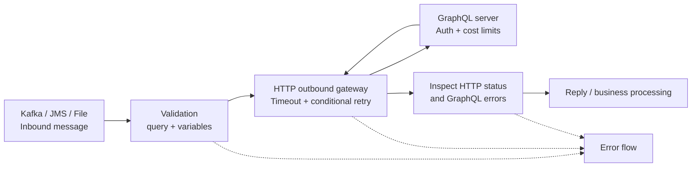
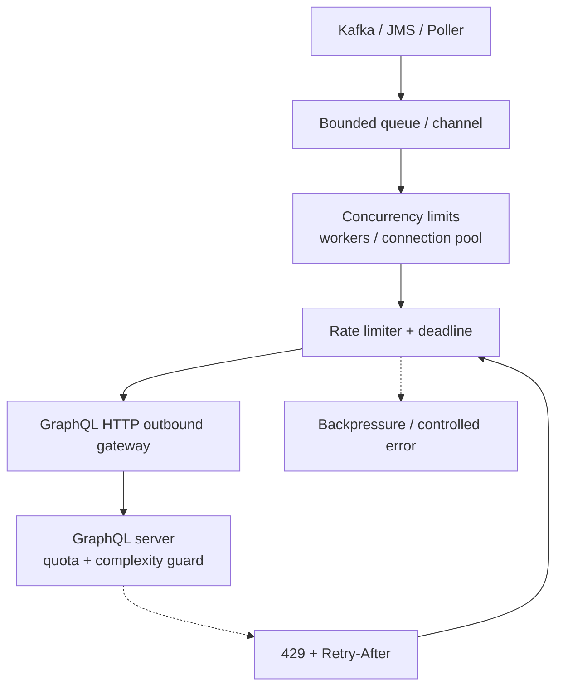

# Timeout, Retry, and Query Limits in the GraphQL Adapter

## Lesson Objectives

In the **SPRING_INTEGRATION_ADAPTERS** module, Spring Integration connects external systems via inbound/outbound adapters, gateways, pollers, and `MessageChannel`s. When a flow reading from files, SFTP, HTTP, JMS, AMQP, Kafka, or databases calls a GraphQL API, simply sending a valid `query` or `mutation` is not enough: the flow must also **not wait indefinitely**, **not repeat side-effecting operations**, and **not issue overly expensive queries**.

After this lesson, you can:

- Distinguish connect timeout, read/response timeout, connection-pool acquisition timeout, and overall flow deadline.
- Design retries based on error type, GraphQL operation type, and remaining request time budget.
- Apply bounded `RequestHandlerRetryAdvice` to an HTTP outbound gateway executing **read-only queries**.
- Explain why retrying mutations after a timeout can cause duplicate writes.
- Cap pagination, lists, request sizes, query depth, query complexity, concurrency, and call rates.
- Separate HTTP status codes from `errors` inside GraphQL responses, while testing timeouts, retries, and resource guards.

> **Scope:** GraphQL is a query protocol; for GraphQL over HTTP, Spring Integration typically uses an HTTP outbound gateway and transformer. HTTP client and Spring Integration timeout/retry mechanisms do not automatically understand `query`, `mutation`, or the complexity of a GraphQL document. You must therefore combine limits on the **client/flow** with policies on the **GraphQL server**.

## 1. Problem: How Many Times Can One Event Call GraphQL?

Suppose a flow receives an event from Kafka:

```json
{
  "eventId": "evt-912",
  "orderId": "O-1024",
  "correlationId": "flow-a38"
}
```

The flow builds a GraphQL request and sends an HTTP POST:

```graphql
query GetOrder($id: ID!) {
  order(id: $id) {
    id
    status
  }
}
```

Under normal conditions, the API responds in 200 ms. When the target service slows down, several things can happen:

1. Cannot connect within 2 seconds because the network or endpoint is unresponsive.
2. Connects, but waits too long for the response.
3. HTTP returns `429 Too Many Requests` with a `Retry-After` hint.
4. HTTP returns `200`, yet the GraphQL body contains `errors`.
5. The request times out while the GraphQL server is still executing the operation.

If the flow always retries every error, a single event can multiply into many HTTP requests, slowing down an already overloaded API even further. For mutations, a response timeout can even cause the client to send a write command a second time after the first already succeeded.



The goal is not maximizing retry counts, but preserving **bounded latency**, **correct outcomes**, and **system recoverability** when a partner has an outage.

## 2. Timeout Types and Where They Apply

| Limit | Where Timing Starts | Protects Against | Notes |
| --- | --- | --- | --- |
| **Connect timeout** | When HTTP client opens connection to endpoint | Hanging TCP connection setup | Does not represent total GraphQL processing time |
| **Connection-pool acquisition timeout** | When borrowing a connection from the pool | Connection exhaustion from excessive concurrency | Applies only to pooled HTTP clients with that timeout configured |
| **Read/response timeout** | When client waits for data on the connection | Slow server or stalled network | Exact semantics vary by HTTP client; usually not an end-to-end deadline |
| **Overall deadline** | When the business request starts | Retries/backoff/queueing exceeding SLA | Must actively carry remaining time budget across steps |
| **Server execution timeout** | Inside the GraphQL server | Runaway resolvers or data queries | Client timeout does not guarantee server work is cancelled |
| **Queue/poller time budget** | While message waits on channel or broker | Message backlog and rising end-to-end latency | Must be controlled at messaging and ops layers |

Timeouts are independent yet interact. For example, a client with `readTimeout = 4s` can still take 20 seconds if it tries 5 times. Conversely, a server stopping resolvers after 10 seconds will not satisfy a client's 3-second SLA.

### 2.1. Calculating the Time Budget Before Configuring Retries

A conservative estimate for an HTTP call without pool wait is:

\[
T_{\text{worst}} \approx N\,(T_{\text{connect}} + T_{\text{read}}) + \sum_{i=1}^{N-1} T_{\text{backoff},i}
\]

Where `N` is the **total number of attempts**, including the initial call. This is a simplified estimate; TLS handshakes, DNS, connection pools, serialization, and downstream queues also factor into real budgets.

Example:

- Maximum 3 attempts: 1 initial call plus 2 retries.
- Connect timeout: 1 second.
- Read timeout: 3 seconds.
- Backoff before retries: 200 ms, then 400 ms.

Then:

\[
T_{\text{worst}} \approx 3\times(1+3)+0.2+0.4=12.6\text{ s}
\]

If the business SLA deadline is only **8 seconds**, this configuration can breach the SLA even though each individual timeout looks short. Reduce attempts, lower per-attempt timeouts, or cut off retries against the remaining deadline.

**Rule:** low-level timeouts protect a single I/O operation; deadlines protect the execution time of the **entire** request. Never treat a `readTimeout` as an overall deadline.

## 3. Choosing Retries by GraphQL Operation and Error Type

GraphQL over HTTP usually uses POST for both queries and mutations. Therefore, **HTTP method POST is not enough** to tell whether a request is safe to resend.

### 3.1. How Do Queries and Mutations Differ?

| Operation | Expected Semantics | Retry After Timeout |
| --- | --- | --- |
| `query GetOrder` reading data | Per GraphQL contract, queries do not mutate business state | Consider retrying when read-only and cost is bounded |
| `mutation CreatePayment` | Creates/modifies data | Do not auto-retry without knowing if the prior call committed |
| `mutation UpdateOrder` with contracted idempotency key | Server recognizes and skips duplicate execution | Retry only after verifying idempotency contract and timeout budget |
| Expensive queries or non-read-only queries | Can cause heavy load or unintended side effects | Heavily restrict or disable retries |

Example of a once-only mutation:

```graphql
mutation ChargeOrder($input: ChargeOrderInput!) {
  chargeOrder(input: $input) {
    paymentId
    status
  }
}
```

If the response is lost after `chargeOrder` debits funds, the client cannot tell **"server never processed it"** apart from **"server processed it, client missed the response"** from timeout info alone. Safe retries require an explicit contract, such as a server-persisted idempotency key with status and stored result, or querying transaction status before deciding to resend.

**Note:** `Idempotency-Key` or `X-Idempotency-Key` are convention-based headers on some APIs, not mandatory GraphQL features. Use them only when the server explicitly documents and enforces that contract.

### 3.2. Error and Retry Decision Matrix

| Symptom | Typical Meaning | Strategy |
| --- | --- | --- |
| Connect/read timeout on read-only query | Network glitch or slow server | Bounded retries, backoff + jitter, honor deadline |
| Missing DNS, bad TLS/certificate config | Misconfiguration or permanently unreachable endpoint | Fix config; repeated retries rarely help |
| HTTP 429 | Quota/rate limit exceeded | Honor `Retry-After` and quota; stop past deadline |
| HTTP 502/503/504 | Potentially transient gateway/backend issue | Consider retrying queries; requires quota, backoff, and circuit breaker |
| HTTP 400 from bad document/variables | Formatting or GraphQL validation error | Fix request/schema; do not retry verbatim |
| HTTP 401/403 | Authentication/authorization failure | Do not retry same credentials; handle token/permissions per policy |
| HTTP 200 with GraphQL `errors` | Resolver or business failure, sometimes with partial data | Classify per `errors[].extensions` contract; do not retry by default |
| Timeout after mutation | Unknown commit state | Do not retry blindly; use idempotency or reconciliation |

HTTP 429, 503, or any status code alone **does not automatically** prove a retry is safe. You must also evaluate operation type, attempt count, rate limits, time budget, and the specific business flow.

### 3.3. Backoff, Jitter, and Attempt Limits

Instead of retrying immediately, use capped exponential backoff:

\[
T_{\text{backoff},k}=\min(T_{\text{base}}\times 2^{k-1},\,T_{\text{max}})
\]

For example, `base = 200 ms`, `max = 2 s` gives retry delays of 200, 400, 800, 1,600, and 2,000 ms. Add random **jitter** so multiple clients do not stampede simultaneously after an outage. Honor server `Retry-After` headers when contracted; stop if waiting would exceed the deadline.

A retry policy must define at least: which errors are retryable, total attempts, backoff schedule, overall deadline, concurrency bounds, and final failure handling. Layers should not retry independently unaware of one another; HTTP gateway retries combined with Kafka/JMS consumer retries multiply request counts exponentially.

## 4. Spring Integration Example: HTTP Outbound Gateway with Timeouts

Example using REST transport carrying a JSON request envelope:

```json
{
  "operationName": "GetOrder",
  "query": "query GetOrder($id: ID!) { order(id: $id) { id status } }",
  "variables": {
    "id": "O-1024"
  }
}
```

The Java snippets below illustrate Spring Integration Java DSL, Spring Framework HTTP clients, and Spring Retry. Declare actual libraries per your project version; if using another HTTP client, connect/read timeout configuration APIs may differ.

### 4.1. Configuring Timeouts on the HTTP Client

```java
import org.springframework.context.annotation.Bean;
import org.springframework.context.annotation.Configuration;
import org.springframework.http.client.SimpleClientHttpRequestFactory;

@Configuration
class GraphqlHttpTimeoutConfig {

    @Bean
    SimpleClientHttpRequestFactory graphqlRequestFactory() {
        SimpleClientHttpRequestFactory factory =
            new SimpleClientHttpRequestFactory();

        factory.setConnectTimeout(1_000); // 1 second
        factory.setReadTimeout(3_000);    // 3 seconds
        return factory;
    }
}
```

`SimpleClientHttpRequestFactory` is handy for illustrating basic timeouts. Under high load, use a pooled HTTP client to cap connections and configure pool acquisition timeouts. Calibrate values against real GraphQL endpoint latency and application SLAs.

Note: these timeouts **do not** automatically configure timeouts on resolvers, database queries, or the entire message flow.

### 4.2. Enabling Retries Only for Controlled Query Flows

```java
import java.net.ConnectException;
import java.net.SocketTimeoutException;

import org.springframework.context.annotation.Bean;
import org.springframework.integration.handler.advice.RequestHandlerRetryAdvice;
import org.springframework.retry.support.RetryTemplate;

@Bean
RequestHandlerRetryAdvice graphqlQueryRetryAdvice() {
    RetryTemplate retryTemplate = RetryTemplate.builder()
        .maxAttempts(3)                      // Includes initial attempt
        .exponentialBackoff(200L, 2.0, 800L) // ms
        .retryOn(ConnectException.class)
        .retryOn(SocketTimeoutException.class)
        .traversingCauses()
        .build();

    RequestHandlerRetryAdvice advice = new RequestHandlerRetryAdvice();
    advice.setRetryTemplate(retryTemplate);
    return advice;
}
```

`RequestHandlerRetryAdvice` applies retries around a message handler when the handler throws an exception. Some HTTP clients wrap `SocketTimeoutException` or `ConnectException` inside another exception; `traversingCauses()` inspects the cause chain. Always verify the actual exceptions thrown by your HTTP client version. The sample policy **does not** retry HTTP 429/503 and **does not** handle GraphQL `errors` inside a successful HTTP body; adding those requires explicit classification plus deadline and quota constraints.

Attach the advice to a dedicated query endpoint:

```java
import org.springframework.context.annotation.Bean;
import org.springframework.http.HttpMethod;
import org.springframework.integration.dsl.IntegrationFlow;
import org.springframework.integration.handler.advice.RequestHandlerRetryAdvice;
import org.springframework.http.client.SimpleClientHttpRequestFactory;
import org.springframework.integration.http.dsl.Http;

@Bean
IntegrationFlow graphqlQueryFlow(
        SimpleClientHttpRequestFactory graphqlRequestFactory,
        RequestHandlerRetryAdvice graphqlQueryRetryAdvice) {

    return IntegrationFlow.from("graphqlQueryRequests")
        .handle(
            Http.outboundGateway(
                    "https://orders.example.test/graphql")
                .httpMethod(HttpMethod.POST)
                .requestFactory(graphqlRequestFactory)
                .expectedResponseType(String.class),
            endpoint -> endpoint.advice(graphqlQueryRetryAdvice))
        .get();
}
```

Key details:

- Input channel `graphqlQueryRequests` receives a validated, serialized JSON request envelope payload along with required HTTP headers like `Content-Type: application/json` and `Authorization` supplied by a trusted component.
- `Http.outboundGateway(...)` is a request/reply endpoint; if the HTTP call succeeds, the reply payload can be the JSON response string for downstream parsing.
- The advice is attached **directly to the outbound handler**. For mutations, use a separate flow without this advice or apply a mutation-specific idempotency policy.
- Never use `example.test` in production. URLs, timeouts, token sources, connection pools, and metrics must come from environment configuration.
- Because the advice only wraps the HTTP handler, these retries cannot inspect `errors` inside the JSON response. To retry classified GraphQL errors, handle that explicitly in the response-mapping stage with its own policy.

Example calling the input channel via a messaging gateway:

```java
import org.springframework.http.HttpHeaders;
import org.springframework.integration.annotation.Gateway;
import org.springframework.integration.annotation.MessagingGateway;
import org.springframework.messaging.handler.annotation.Header;
import org.springframework.messaging.handler.annotation.Payload;

@MessagingGateway
interface GraphqlQueryGateway {
    @Gateway(requestChannel = "graphqlQueryRequests")
    String execute(
        @Payload String graphqlJson,
        @Header(HttpHeaders.CONTENT_TYPE) String contentType,
        @Header(HttpHeaders.AUTHORIZATION) String authorization,
        @Header("X-Correlation-Id") String correlationId);
}
```

If a custom header mapper is configured, permit mapping `X-Correlation-Id`; never assume all `MessageHeaders` automatically go out over HTTP. `Bearer` tokens must match the GraphQL API's audience/scope—never automatically forward tokens from another HTTP inbound request.

### 4.3. When Retries Are Exhausted

Once attempts are exhausted, the handler raises an error via Spring Integration's exception handling. For synchronous callers over `DirectChannel` or messaging gateways, exceptions can propagate to the caller; for poller/task-executor flows, error handling depends on endpoint and `errorChannel` configuration. Decide explicitly:

- Should the broker retry the event, or move it to a DLQ?
- If HTTP already retried multiple times, will broker redelivery re-run the entire event?
- Which correlation ID links all attempts back to the original event?
- If the flow handles mutations, is outcome/idempotency evidence recorded before redelivery?

`RecoveryCallback`, `errorChannel`, and dead-letter/reconciliation mechanisms help, yet do not guarantee exactly-once processing in every scenario.

## 5. GraphQL Responses: HTTP Status and Errors Must Be Checked Separately

A standard GraphQL response may return successful data:

```json
{
  "data": {
    "order": {
      "id": "O-1024",
      "status": "PAID"
    }
  }
}
```

Or HTTP 200 with a resolver error:

```json
{
  "data": {
    "order": null
  },
  "errors": [
    {
      "message": "Order service unavailable",
      "path": ["order"],
      "extensions": {
        "code": "DOWNSTREAM_UNAVAILABLE"
      }
    }
  ]
}
```

`errors[].extensions.code` is an **API convention**, not a mandatory GraphQL standard code set. Across GraphQL-over-HTTP media types and implementations, parse/validation error HTTP statuses vary; checking only HTTP 200 or 500 is insufficient.

Minimal response classifier example:

```java
import com.fasterxml.jackson.databind.JsonNode;
import com.fasterxml.jackson.databind.ObjectMapper;

JsonNode body = objectMapper.readTree(responseJson);

if (body.has("errors") && body.get("errors").isArray()
        && body.get("errors").size() > 0) {
    // Classify only by error codes defined in the API contract.
    throw new GraphqlOperationException(
        "GetOrder failed; inspect sanitized error codes");
}

JsonNode order = body.path("data").path("order");
if (order.isMissingNode()) {
    throw new GraphqlOperationException(
        "Missing data.order in GraphQL response");
}
```

`GraphqlOperationException`, `objectMapper`, and `responseJson` are illustrative components. In real applications, also check `null`, partial data, field values, and retryability per contract. **Never turn every GraphQL error into a retry**: `FORBIDDEN`, `BAD_USER_INPUT`, and invalid documents will not succeed by resending.

In the section 4 flow, `RequestHandlerRetryAdvice` sees only exceptions from the HTTP handler, so exceptions thrown by a downstream classifier will not be automatically retried by the handler advice. That helps avoid accidental retry loops.

## 6. Query Limits: Beyond Timeouts

A very short GraphQL query string can still request huge amounts of data via nested fields. Example:

```graphql
query ExpensiveExample {
  customers {
    orders {
      items {
        product {
          reviews {
            author {
              profile
            }
          }
        }
      }
    }
  }
}
```

The problem is not just depth, but **fan-out**: 100 customers × 50 orders × 20 items per order can generate hundreds of thousands of intermediate objects depending on data and resolver behavior. These are rough numbers; actual cost depends on schema, SQL batching, caching, and pagination limits.

### 6.1. Limit Layers to Combine

| Limit | How Applied | Purpose |
| --- | --- | --- |
| **Request body size** | Byte limit at HTTP ingress / reverse proxy | Reject oversized bodies before parsing |
| **Max query depth** | GraphQL AST analysis / server instrumentation | Block overly deep nested queries |
| **Max query complexity/cost** | Field weights and list size multipliers | Block high fan-out even at shallow depth |
| **Pagination cap** | Upper bound on `first`, `limit`, `pageSize` | Control node count per request |
| **Max aliases/fields** | Selection-set structural limits | Prevent repeating sibling fields to bypass depth limits |
| **Max batch operations** | Limit batching if supported by the API | Prevent stuffing too many operations into one HTTP call |
| **Request rate/quota** | Rate limits per client, token/tenant, operation | Protect endpoints and ensure fairness |
| **Max in-flight requests** | Bulkheads, connection pools, worker threads | Prevent concurrency from exhausting downstream resources |
| **Execution timeout** | Deadlines/cancellation on servers and data sources | Stop runaway resolvers or SQL queries |
| **Response size** | Server/client limits; paginate or stream as needed | Avoid excessive memory buffering |

**No single limit fits every schema.** Values like depth = 8 or complexity = 500 are starting examples to tune after measurement. Real costs must account for data loading, database queries, downstream calls, and memory.

### 6.2. Client-Side Pagination Limits

Suppose the target API exposes:

```graphql
type Query {
  orders(first: Int!, after: String): OrderConnection!
}

type OrderConnection {
  edges: [OrderEdge!]!
  pageInfo: PageInfo!
}

type OrderEdge {
  node: Order!
  cursor: String!
}

type PageInfo {
  hasNextPage: Boolean!
  endCursor: String
}
```

Paginated query:

```graphql
query ListOrders($first: Int!, $after: String) {
  orders(first: $first, after: $after) {
    edges {
      node {
        id
        status
      }
      cursor
    }
    pageInfo {
      hasNextPage
      endCursor
    }
  }
}
```

Client caps `first` before sending:

```java
static int boundedPageSize(int requested) {
    if (requested < 1) {
        throw new IllegalArgumentException(
            "page size must be positive");
    }
    return Math.min(requested, 50); // Sample contract: max 50.
}
```

Client-side limits reduce unnecessary load, yet **the server must also enforce the cap**. Another client could skip the Java helper and send `first = 1000000`. When fetching multiple pages, enforce total page/record caps and remaining time budgets to avoid infinite pagination loops if data or cursors shift.

### 6.3. Depth, Complexity, and Aliases

GraphQL Java supports instrumentation to inspect and reject queries before execution, such as **max query depth** and **max query complexity** guards. Spring for GraphQL exposes extension points to register GraphQL Java instrumentation depending on framework version. Configure and measure against your real schema.

Illustrative cost calculation logic:

\[
\operatorname{cost}(\text{orders}) \approx
\text{pageSize}\times
\left(\operatorname{cost}(\text{order})+
\operatorname{cost}(\text{nested fields})\right)
\]

If `orders(first: 50)` also loads `items(first: 100)` per order, cost scales by `50 × 100` even when depth is modest.

Therefore:

- Depth limits must pair with complexity/cost limits.
- Complexity calculations must include pagination multipliers, aliases, and nested lists instead of simply counting fields in the document.
- Validate documents with a GraphQL parser/validator; regex checks on raw query strings fail against fragments, variables, and aliases.
- For APIs serving known business operations, consider allowlists or persisted operations per server contract so arbitrary messages never dictate the full document.

### 6.4. Rate Limiting and Concurrency in Spring Integration Flows

Clients must also limit in-flight HTTP requests:



The diagram illustrates defense layers you can implement; Spring Integration does not automatically provide a GraphQL rate limiter merely by enabling the HTTP gateway.

Specifically:

- Tune `maxMessagesPerPoll`, fixed delays, executor concurrency, and channel capacity on inbound adapters/pollers to match real throughput.
- When using `ExecutorChannel` or async workers, monitor queue depth and define overflow policies; never use unbounded queues.
- Connection pool limits bound open sockets, not request rates. Request rate and concurrent in-flight requests are distinct metrics.
- Place circuit breakers and bulkheads around the HTTP handler to contain prolonged GraphQL API outages. Retries must stay bounded and never override circuit breaker policy.
- With Kafka/JMS sources, combine consumer redelivery/retries with HTTP gateway retries so attempts do not multiply uncontrollably.
- On HTTP 429, do not immediately retry in bursts; slow down sending based on quotas and `Retry-After` within your deadline.

## 7. Server-Side: Controlling Resolver Cost and Execution Time

A Spring Integration client controls only the requests **it emits**. The GraphQL server must protect itself against other clients and non-conforming requests.

Common server-side measures:

1. **Authentication and authorization:** verify identity, roles/scopes, resources, and tenants. Well-bounded unauthorized queries must still be blocked.
2. **Pre-execution validation:** validate schema, variables, max depth, and complexity.
3. **Field/list caps:** cap `first`, `limit`, and input collection sizes; set small pagination defaults.
4. **DataLoader/batching:** reduce N+1 queries on nested resolvers while still keeping cost limits and DB timeouts.
5. **Execution timeouts:** enforce deadlines on GraphQL execution and underlying calls; cancel work where possible.
6. **Quotas:** rate-limit by client, API key/tenant, operation type, and/or query cost.
7. **Observability:** log `operationName`, estimated cost, latency, error codes, and correlation IDs, limiting PII and tokens in logs.

When a client times out or closes the socket, the server may still be executing a mutation or SQL query. Aborting the HTTP exchange **does not** roll back an already committed transaction. Design idempotency and deadlines on both sides.

## 8. End-to-End Retries Across Different Adapter Sources

A message can be redelivered from the source layer, meaning "3 HTTP attempts" is not the final ceiling.

| Inbound Source | Source of Duplicates/Redelivery | Recommended Handling |
| --- | --- | --- |
| File/SFTP poller | File remains in folder, filter changes, or job restarts | Track processed files reliably; guard against duplicate processing |
| HTTP inbound gateway | Upstream client retries after timeout | Use contracted request IDs / idempotency |
| JMS/AMQP | Broker redelivery after rollback/nack | Configure DLQ, delivery count limits, and idempotency for downstream mutations |
| Kafka | Consumer rebalance, uncommitted offsets, retry topics | Define commit/retry/DLT rules; treat message delivery as at-least-once |
| JDBC/DB polling | Watermark/processing state not yet updated | Use recoverable claim/checkpoint updates |
| Other inbound gateways/`MessageChannel`s | Retry advice or exception handlers across multiple layers | Budget total attempts system-wide; avoid nested retries |

Example: JMS consumer redelivers up to 4 times, and HTTP handler retries up to 3 times. If every failure triggers full redelivery, a single event can call GraphQL up to **12 times** (4 deliveries × 3 HTTP attempts), excluding upstream retries. For mutations, each call can cause duplicate side effects if the API lacks idempotency.

Therefore, beyond `maxAttempts`, store event/business IDs, processing states, or contracted idempotency keys, and explicitly define when to ACK/commit offsets versus route to a DLQ.

## 9. Logging, Metrics, and Security During Retries

Useful operational signals:

| Metric/Log Field | Why It Matters |
| --- | --- |
| `graphql.operation.name` | Shows which operation is slow or erroring |
| `http.status_code` | Spots 401/403/429/5xx codes |
| `graphql.error.code` (allowlisted) | Safely classifies GraphQL errors |
| `request.duration` and p95/p99 | Guides timeout sizing from real latency distributions |
| `retry.attempt` and `retry.reason` | Surfaces retry storms or misconfigurations |
| `timeout.type` | Separates connect, read, and deadline timeouts |
| `inflight.requests` and queue length | Measures concurrency, bulkheads, and backpressure |
| `estimated.query.cost` | Tracks server workload by query shape |
| `correlationId` and event ID | Links attempts back to the originating event |

Log only what is needed for investigation. `Authorization`, cookies, tokens, variables with PII, raw customer-containing responses, and sensitive query parameters must be filtered or masked. Never create high-cardinality metric labels from order IDs, user IDs, or full documents; that causes cardinality explosions.

Retries should share the same business correlation ID to link attempts, while each attempt can carry its own trace span/attempt number to measure per-attempt latency.

## 10. Testing Timeouts, Retries, and Query Limits

Use a mock HTTP server or test harness with controllable latency to verify actual outbound requests. When testing retries, **count actual HTTP calls**: asserting only the final exception is not enough.

| Test Case | Simulated Scenario | Expectation |
| --- | --- | --- |
| Fast query | HTTP 200 + valid `data` | 1 attempt, returns result |
| Connect timeout | Unresponsive address/socket | Stops after timeout; retries exact policy count |
| Read timeout | Server accepts request then responds slowly | Read-only query retries boundedly; stays within deadline |
| HTTP 401/403 | Bad token / missing permissions | No infinite retries; reports auth/security failure |
| HTTP 429 | Server sends `Retry-After` | Retries only if policy permits and deadline allows; no tight loop |
| HTTP 503 | Temporary service outage | Retries only if classified and request is safe |
| HTTP 200 + `errors` | GraphQL resolver returns business error | Not auto-retried by HTTP advice |
| Mutation lost response | Server writes successfully, client times out | No extra side effects; verified via idempotency/reconciliation |
| Pagination > max | Payload requests `first = 10000` | Mapper caps/blocks; server also enforces cap |
| Overly deep/expensive query | Nested lists, many aliases | Server rejects before running costly resolvers |
| High concurrent load | Burst of fast-arriving messages | Queue/concurrency/rate limits hold, metrics emit, overflow policy runs |
| Broker redelivery | HTTP retries exhausted, event redelivered | Total attempts bounded and idempotency preserved |

**Meaningful tests** should verify at minimum: attempt counts, reasonable backoff intervals, query vs. mutation retry separation, zero token leaks in logs, and `errors` responses handled as business failures where required.

### Example Verification by Attempt Count

A mock HTTP server is configured to reject the first two calls and return 200 on the third. If your policy only retries `ConnectException` and `SocketTimeoutException` like section 4, **HTTP 503 will not trigger retries**; the test must expect 1 attempt. To retry HTTP 503, intentionally extend your classifier and policy while checking deadlines and operation types.

This avoids a classic mistake: writing a test expecting retries on every HTTP error while the real configuration only retries transport exceptions.

## 11. Practice Exercise

**Scenario:** A pipeline receives `OrderSyncRequested` from Kafka, reads the order via GraphQL `query GetOrder`, and may send `mutation MarkSynced` to another GraphQL service. The SLA per event is 8 seconds. The GraphQL service occasionally returns HTTP 429 or takes 3–5 seconds.

Requirements:

1. Propose connect timeout, read timeout, total attempts, and backoff for the **query** to fit within the 8-second SLA. Calculate the worst-case time budget using section 2's formula.
2. Separate query and mutation flows. Explain why mutations cannot share retry advice with queries without idempotency.
3. Enforce `first ≤ 50` on a GraphQL list query; explain how the server must additionally guard depth, complexity, and aliases.
4. Simulate HTTP 200 with GraphQL `errors`, HTTP 429 with `Retry-After`, and read timeouts, recording exact attempt counts for each case.
5. Simulate Kafka redelivery after HTTP query retries occur. Calculate maximum total HTTP calls and design duplicate protection for the mutation step.

**Completion criteria:** the flow stops within an explainable time bound, never retries unsafe mutations without safety guarantees, prevents unbounded GraphQL fan-out, and emits observability data distinguishing timeouts, HTTP errors, GraphQL errors, and broker redeliveries.

## References

- [Spring Integration Reference — HTTP Support](https://docs.spring.io/spring-integration/reference/http.html)
- [Spring Integration Reference — Retry Advice](https://docs.spring.io/spring-integration/reference/handler-advice/classes.html)
- [Spring Integration Reference — Error Handling](https://docs.spring.io/spring-integration/reference/error-handling.html)
- [Spring Framework — SimpleClientHttpRequestFactory](https://docs.spring.io/spring-framework/docs/current/javadoc-api/org/springframework/http/client/SimpleClientHttpRequestFactory.html)
- [Spring Retry — RetryTemplate](https://docs.spring.io/spring-retry/docs/current/apidocs/org/springframework/retry/support/RetryTemplate.html)
- [GraphQL — Learn: Queries and Mutations](https://graphql.org/learn/queries/)
- [GraphQL — Learn: Pagination](https://graphql.org/learn/pagination/)
- [GraphQL Java — Instrumentation](https://www.graphql-java.com/documentation/instrumentation/)
- [GraphQL over HTTP — Draft Specification](https://graphql.github.io/graphql-over-http/draft/)
