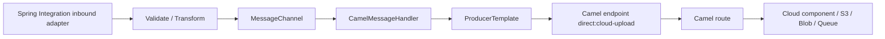
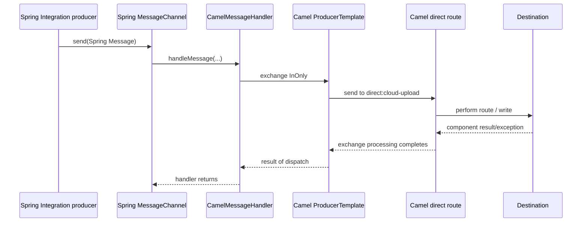
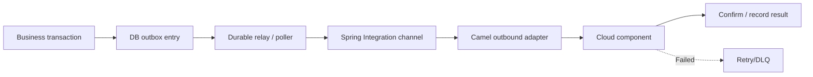

# Apache Camel outbound channel adapter

## 1. Why does Spring Integration need to connect to Apache Camel?

In the **SPRING_INTEGRATION_ADAPTERS** module, Spring Integration uses **inbound/outbound adapters**, **gateways**, **pollers**, and **MessageChannels** to connect external systems such as files, SFTP, HTTP, JMS, AMQP, Kafka, and databases. The **Adapter Cloud** chapter broadens the perspective to cloud services and systems that already have connectors in another framework.

A development team may have already structured its business logic with Spring Integration but wants to use an **Apache Camel component** to interact with a cloud service or external product. Instead of building an HTTP client from scratch, introducing an extra intermediate broker just to pass messages between two libraries in the same JVM, or rewriting the entire flow into Camel, you can use Spring Integration's **Apache Camel outbound channel adapter**.

Business example:

- Inbound HTTP/SFTP/Kafka creates a Spring `Message<?>` representing an invoice storage request.
- A `MessageChannel` routes the request to **`CamelMessageHandler`**.
- The handler creates an **Apache Camel exchange** and sends it to the `direct:cloud-upload` endpoint.
- The Camel route validates the object key, transforms the payload, and calls the appropriate cloud storage component.
- Spring Integration remains responsible for the steps before the adapter; Camel is responsible for the route and component beyond the boundary.



**Core point:** The Apache Camel outbound channel adapter is an **in-application bridge** from a Spring Integration `MessageChannel` to a Camel `Endpoint`. The bridge itself is not a cloud storage service, does not automatically provide cloud credentials, and does not automatically guarantee retry/durable delivery.

### Lesson Objectives

After this lesson, you will be able to:

1. Distinguish Spring Integration `Message`/`MessageChannel` from Camel `Message`/`Exchange`/`Endpoint`.
2. Understand `CamelMessageHandler`, `ProducerTemplate`, and the default `ExchangePattern.InOnly`.
3. Configure an outbound channel adapter using `@Bean` + `@ServiceActivator` or Java DSL `Camel.handler()`.
4. Create a `direct:...` Camel route and test the flow from a Spring channel to Camel.
5. Control **payload, header mapping, endpoint URI, and exchange pattern**.
6. Extend a Camel route to cloud services such as AWS S3 without hardcoding credentials.
7. Design timeout, retry, error handling, idempotency, backpressure, monitoring, and lifecycle.
8. Avoid confusion between **one-way adapter**, **outbound gateway**, **async delivery**, and **durable commit**.

## 2. Two different integration models

### 2.1. Spring Integration: MessageChannel at the center

Spring Integration connects endpoints via `MessageChannel`. A message typically consists of:

```text
Spring Message<T> {
    payload: T,
    headers: MessageHeaders
}
```

Key channel types:

| Channel | How it works | Notes |
|---|---|---|
| `DirectChannel` | Sends messages synchronously to a subscriber on the sender thread | A slow handler can block the receiving path. |
| `ExecutorChannel` | Dispatches to a subscriber via an executor | Provides concurrency and a task queue; not durable on its own. |
| `QueueChannel` | Places messages into a queue for a poller to read | In-memory by default; requires a persistent store if replay is required. |
| `PublishSubscribeChannel` | Sends to multiple subscribers | Requires dedicated design for broadcast and error semantics. |

An **outbound channel adapter** usually consumes messages one-way. It can terminate a Spring Integration flow at the handoff point to an external system. In contrast, an **outbound gateway** is used when the business flow requires a returned result.

### 2.2. Apache Camel: Exchange and Endpoint at the center

Apache Camel organizes processing steps as a **Route**:

```text
from("direct:cloud-upload")
    -> validate
    -> transform
    -> to("cloud-service:destination")
```

- `Endpoint` is identified by a URI, such as `direct:cloud-upload`, `log:example`, or the URI of a Camel cloud component.
- `ProducerTemplate` is the API for sending an **exchange** to an endpoint.
- `Exchange` holds the body, headers, properties, exchange pattern, and processing/error state.
- `ExchangePattern.InOnly` corresponds to **one-way sending**, requiring no business reply.
- `ExchangePattern.InOut` corresponds to **request-reply**: the caller expects a result from the route.

**Camel `direct:` is an internal endpoint that invokes a route consumer synchronously** within the same CamelContext; it is neither a cloud network nor a persistent queue. Camel `seda:` provides an asynchronous in-JVM queue, but it is **not a durable broker** either.

### 2.3. Where is the bridge?



The diagram illustrates **a synchronous configuration over `DirectChannel` and Camel `direct:`**. When using `ExecutorChannel`, `seda:`, or an asynchronous component, the completion order and timing may differ. Even in a synchronous setup, `send()` returning does not substitute for a **durable ack/commit** from the cloud destination.

## 3. Core component: CamelMessageHandler

According to the Spring Integration documentation, `CamelMessageHandler` is an implementation of `AbstractReplyProducingMessageHandler` that can be used for:

- **One-way (default)**: `ExchangePattern.InOnly`; suitable for an outbound channel adapter.
- **Request-reply**: `ExchangePattern.InOut`; corresponds to an outbound gateway when a reply is needed.
- **Async mode**: uses `ProducerTemplate.asyncSend(...)`, allowing results to be handled as a `CompletableFuture` in reply-based scenarios.

The handler can select an endpoint using:

1. A statically configured URI via `setEndpointUri(...)`.
2. A SpEL expression via `setEndpointUriExpression(...)` if runtime endpoint selection is genuinely needed.
3. An inline `LambdaRouteBuilder` via `setRoute(...)`.
4. The `ProducerTemplate` default endpoint if no other endpoint is configured.

The **static URI, URI expression, and inline route** options are mutually exclusive alternatives; do not configure multiple of them simultaneously on the same handler.

### 3.1. Important classes

| Spring Integration / Camel class | Role |
|---|---|
| `org.springframework.integration.camel.outbound.CamelMessageHandler` | Handler that receives a Spring message and invokes a Camel endpoint. |
| `org.springframework.integration.camel.dsl.Camel` | Java DSL factory: `handler()`, `gateway()`, `route(...)`. |
| `org.springframework.integration.camel.support.CamelHeaderMapper` | Maps Spring headers ↔ Camel headers. |
| `org.apache.camel.ProducerTemplate` | Sends a Camel exchange to an endpoint. |
| `org.apache.camel.CamelContext` | Registry, components, endpoints, routes, and Camel lifecycle. |
| `org.apache.camel.builder.RouteBuilder` | Declares Camel routes using the Java DSL. |
| `org.apache.camel.ExchangePattern` | Distinguishes `InOnly` and `InOut`. |

Spring Integration does **not** provide a symmetric Apache Camel inbound channel adapter by name just because an outbound adapter exists; the Camel → Spring direction can be built using Camel Bean Binding or endpoints/bridges with a matching contract.

### 3.2. Choosing the right module

In modern Spring Integration, this bridging capability lives in the module:

```text
org.springframework.integration:spring-integration-camel
```

Do not confuse it with the Camel component **`camel-spring-integration`** — that is a different integration direction in the Camel ecosystem, not the dependency name for `CamelMessageHandler`.

Do not add `camel-http`, `camel-aws2-s3`, or `camel-sftp` if the route does not use those components. When a route needs a cloud connector, add the **corresponding Camel component** and configure it separately.

## 4. Hands-on example: forwarding messages to Camel in one application

To understand the bridge, we will build a **complete lab without needing a real cloud account**:

```text
Spring MessageChannel "toCamel"
    -> CamelMessageHandler (InOnly)
    -> Camel endpoint "direct:cloud-upload"
    -> Camel RouteBuilder
    -> in-memory DemoCloudSink
```

The name `cloud-upload` expresses the business goal; the sink in this lab is simply in-memory for testing purposes. Later in the lesson, we will replace the demo storage step with a real Camel cloud component.

### 4.1. Prerequisites and dependencies

This example targets **Java 17+, Spring Boot 3.x, Spring Integration 6.x, and Apache Camel 4.x** belonging to **a compatible version set**. Do not randomly copy versions from two different BOMs and assume they will work together.

Illustrative Maven dependencies (with versions managed by a **compatible** Spring Boot BOM and Camel Spring Boot BOM/dependencies BOM):

```xml
<dependencies>
    <dependency>
        <groupId>org.springframework.boot</groupId>
        <artifactId>spring-boot-starter-integration</artifactId>
    </dependency>

    <dependency>
        <groupId>org.springframework.integration</groupId>
        <artifactId>spring-integration-camel</artifactId>
    </dependency>

    <dependency>
        <groupId>org.apache.camel.springboot</groupId>
        <artifactId>camel-spring-boot-starter</artifactId>
    </dependency>

    <dependency>
        <groupId>org.apache.camel.springboot</groupId>
        <artifactId>camel-direct-starter</artifactId>
    </dependency>
</dependencies>
```

**Important:** The snippet above assumes the application's `dependencyManagement` already imports compatible Spring Boot and Camel BOMs. Otherwise, Maven requires pinned/tested explicit versions; do not add arbitrary versions that cause mismatches between `camel-core` and the starters.

The Camel Spring Boot starter provides a Spring-managed `CamelContext` and automatically discovers `RouteBuilder` beans. `camel-direct-starter` enables using the `direct:` component in a Spring Boot environment.

### 4.2. Spring Boot application

File `BridgeApplication.java`:

```java
package example.camelbridge;

import org.springframework.boot.SpringApplication;
import org.springframework.boot.autoconfigure.SpringBootApplication;
import org.springframework.integration.annotation.EnableIntegration;

@SpringBootApplication
@EnableIntegration
public class BridgeApplication {

    public static void main(String[] args) {
        SpringApplication.run(BridgeApplication.class, args);
    }
}
```

In a standalone Camel-only app with no web server or long-running consumer keeping the process alive, you may need to set **`camel.main.run-controller=true`** per the Camel Spring Boot guide to maintain the lifecycle. For a project that only runs integration tests, do not include that setting in the default test configuration.

### 4.3. Creating the channel and outbound adapter

File `CamelOutboundConfiguration.java`:

```java
package example.camelbridge;

import org.apache.camel.ExchangePattern;
import org.springframework.context.annotation.Bean;
import org.springframework.context.annotation.Configuration;
import org.springframework.integration.annotation.ServiceActivator;
import org.springframework.integration.camel.outbound.CamelMessageHandler;
import org.springframework.integration.camel.support.CamelHeaderMapper;
import org.springframework.integration.channel.DirectChannel;
import org.springframework.messaging.MessageChannel;

@Configuration
public class CamelOutboundConfiguration {

    @Bean("toCamel")
    public MessageChannel toCamel() {
        return new DirectChannel();
    }

    @Bean
    @ServiceActivator(inputChannel = "toCamel")
    public CamelMessageHandler camelOutboundAdapter() {
        CamelHeaderMapper mapper = new CamelHeaderMapper();

        // By default, CamelHeaderMapper can map all
        // Spring MessageHeaders. Only allow the necessary metadata through.
        mapper.setOutboundHeaderNames(
            "eventId", "objectKey", "contentType");

        CamelMessageHandler handler = new CamelMessageHandler();
        handler.setEndpointUri("direct:cloud-upload");
        handler.setExchangePattern(ExchangePattern.InOnly);
        handler.setHeaderMapper(mapper);

        return handler;
    }
}
```

**Why use the no-argument constructor?** When no `ProducerTemplate` is provided, `CamelMessageHandler` can create a template via the `CamelContext` bean resolved from the Spring application context. That is why a properly configured and started `CamelContext` is required.

You can inject `ProducerTemplate` from the Camel configuration and call the `new CamelMessageHandler(producerTemplate)` constructor if you need to manage the template separately. **Do not create a new standalone CamelContext per message**: routes and endpoints must belong to a stable application lifecycle.

**Why is a header allowlist needed?** If the default mapper is used for all headers, items such as `replyChannel`, `errorChannel`, unverified tenant metadata, or objects containing Java framework references can be forwarded into Camel. Only map fields actually required by the contract, and validate their values inside the Camel route.

### 4.4. Demo sink for data verification

File `DemoCloudSink.java`:

```java
package example.camelbridge;

import java.util.Arrays;
import java.util.concurrent.ConcurrentHashMap;
import java.util.concurrent.ConcurrentMap;

import org.springframework.stereotype.Component;

@Component
public class DemoCloudSink {

    private final ConcurrentMap<String, byte[]> stored =
        new ConcurrentHashMap<>();

    public void put(String objectKey, byte[] content) {
        stored.put(objectKey,
            Arrays.copyOf(content, content.length));
    }

    public byte[] get(String objectKey) {
        byte[] found = stored.get(objectKey);
        return found == null ? null
            : Arrays.copyOf(found, found.length);
    }

    public int size() {
        return stored.size();
    }
}
```

`ConcurrentHashMap` allows the demo to handle concurrent writes, but:

- Data is lost when the JVM restarts.
- `put` on the same key overwrites the previous content; it is not a complete idempotency policy.
- There is no encryption, retention, replication, or cloud IAM.
- There is no acknowledgment from AWS S3/Azure Blob/GCS.

**Do not use this sink as an audit store or in production.** It only exists to make results easy to assert in integration tests.

### 4.5. Camel RouteBuilder receiving from `direct:cloud-upload`

File `CloudUploadRoute.java`:

```java
package example.camelbridge;

import org.apache.camel.builder.RouteBuilder;
import org.springframework.stereotype.Component;

@Component
public class CloudUploadRoute extends RouteBuilder {

    private final DemoCloudSink sink;

    public CloudUploadRoute(DemoCloudSink sink) {
        this.sink = sink;
    }

    @Override
    public void configure() {
        from("direct:cloud-upload")
            .routeId("spring-integration-to-camel-cloud")
            .process(exchange -> {
                String eventId = exchange.getMessage()
                    .getHeader("eventId", String.class);

                String objectKey = exchange.getMessage()
                    .getHeader("objectKey", String.class);

                byte[] bytes = exchange.getMessage()
                    .getBody(byte[].class);

                if (eventId == null || eventId.isBlank()) {
                    throw new IllegalArgumentException(
                        "Missing eventId");
                }

                // Demo policy: only store under the events/ prefix.
                if (objectKey == null
                        || !objectKey.matches(
                            "events/[A-Za-z0-9._/-]{1,100}")
                        || objectKey.contains("..")
                        || objectKey.endsWith("/")) {
                    throw new IllegalArgumentException(
                        "Invalid objectKey");
                }

                if (bytes == null || bytes.length == 0
                        || bytes.length > 64 * 1024) {
                    throw new IllegalArgumentException(
                        "Invalid payload size");
                }

                sink.put(objectKey, bytes);
            });
    }
}
```

When Camel Spring Boot auto-configuration scans `@Component RouteBuilder`, the route is registered in the **same CamelContext**. `direct:cloud-upload` is an endpoint with a consumer from this route. `CamelMessageHandler` sends to that endpoint using `ProducerTemplate`.

Key points to understand:

1. A Camel route does **not** automatically create a Spring `MessageChannel`; it receives an `Exchange` from `direct:`.
2. The `eventId`/`objectKey` headers are transferred to the Camel message by Spring Integration's `CamelHeaderMapper`.
3. The `byte[]` payload becomes the body; Camel does not share Spring's `MessageHeaders.ID` concept.
4. Validation must run before invoking expensive or side-effecting services.
5. A `direct:` route must have an active consumer; when a consumer is missing, sending may block/timeout or fail depending on the endpoint configuration.
6. The sample code only writes to memory and **does not prove cloud upload**.

### 4.6. Sending a Spring Message through the channel

A Java snippet using `MessageChannel` directly:

```java
package example.camelbridge;

import java.nio.charset.StandardCharsets;
import java.util.UUID;

import org.springframework.beans.factory.annotation.Qualifier;
import org.springframework.messaging.Message;
import org.springframework.messaging.MessageChannel;
import org.springframework.messaging.support.MessageBuilder;
import org.springframework.stereotype.Service;

@Service
public class CloudUploadPublisher {

    private final MessageChannel toCamel;

    public CloudUploadPublisher(
            @Qualifier("toCamel") MessageChannel toCamel) {
        this.toCamel = toCamel;
    }

    public String publish(String content) {
        String eventId = UUID.randomUUID().toString();
        String key = "events/" + eventId + ".txt";

        byte[] bytes =
            content.getBytes(StandardCharsets.UTF_8);

        Message<byte[]> request = MessageBuilder
            .withPayload(bytes)
            .setHeader("eventId", eventId)
            .setHeader("objectKey", key)
            .setHeader("contentType", "text/plain")
            .build();

        boolean dispatched = toCamel.send(request);

        if (!dispatched) {
            throw new IllegalStateException(
                "Spring channel did not accept message");
        }

        // This is the intended object key of the request,
        // NOT confirmation that the cloud has durably written it.
        return key;
    }
}
```

Here, the message flow uses `DirectChannel`, Camel `direct:`, and a synchronous demo route. In the lab, `publish(...)` returns after the demo sink has been called if no error occurs. However, when a real cloud route involves retries, asynchronous callbacks, or an intermediate broker, `publish()` returning **does not substitute for** receiving the result from the destination.

If the application needs upload *confirmation* and wants to retrieve a version/ETag or response object, see the **outbound gateway** `Camel.gateway()` in section 7.

## 5. Unit/integration test: proving the adapter forwarded the message

Create `CamelOutboundBridgeTest.java`:

```java
package example.camelbridge;

import static org.junit.jupiter.api.Assertions.*;

import java.nio.charset.StandardCharsets;
import java.util.UUID;

import org.junit.jupiter.api.Test;
import org.springframework.beans.factory.annotation.Autowired;
import org.springframework.boot.test.context.SpringBootTest;

@SpringBootTest
class CamelOutboundBridgeTest {

    @Autowired
    CloudUploadPublisher publisher;

    @Autowired
    DemoCloudSink sink;

    @Test
    void deliversMessageToCamelRoute() {
        String payload = "cloud outbound bridge test "
            + UUID.randomUUID();

        String key = publisher.publish(payload);

        byte[] recorded = sink.get(key);

        assertNotNull(recorded);
        assertArrayEquals(
            payload.getBytes(StandardCharsets.UTF_8),
            recorded);
    }
}
```

What this test verifies:

- The Spring Boot application context creates the Spring Integration channel and `CamelContext`.
- The `@ServiceActivator` handler is registered for `toCamel`.
- `CamelMessageHandler` successfully invokes Camel `direct:cloud-upload`.
- The body and required headers reach the route.
- The demo route stores the payload in memory as expected.

**Do not use this test to conclude** that S3/Azure Blob/GCS uploaded successfully, that no data is lost on crash, or that production IAM/TLS is configured correctly. Testing the adapter with a fake sink and testing the cloud component with real credentials or an emulator are kept separate to isolate failures.

### 5.1. Recommended negative tests

| Test | Expectation |
|---|---|
| Missing `CamelContext` bean | Handler/route initialization fails; reports missing dependency/config. |
| Missing Camel route consumer for `direct:cloud-upload` | Does not silently pretend the message was saved; send fails/times out per config. |
| Missing `eventId` | Validator rejects before side effects. |
| `objectKey` with invalid prefix or containing `..` | Not written to sink; error logs do not contain raw secrets. |
| Empty payload or exceeding the 64 KiB demo limit | Rejected according to policy. |
| Camel route throws an exception | Verify how errors propagate through `DirectChannel` and the actual error flow. |
| Using `ExecutorChannel` instead of `DirectChannel` | Errors may occur after `send()` has returned; requires async error handler/recovery. |
| Using `seda:` instead of `direct:` | Verify queue capacity, delay, and risk of data loss on restart. |
| Sender repeats the same `objectKey` | Verify overwrite/idempotency policy; do not assume "exactly once". |

## 6. Equivalent configuration with Spring Integration Java DSL

`Camel.handler()` is the DSL factory for **one-way/InOnly**. Instead of declaring `@Bean @ServiceActivator` as in section 4.3, you can declare a flow:

```java
package example.camelbridge;

import org.springframework.context.annotation.Bean;
import org.springframework.context.annotation.Configuration;
import org.springframework.integration.camel.dsl.Camel;
import org.springframework.integration.dsl.IntegrationFlow;

@Configuration
public class CamelOutboundDslConfiguration {

    @Bean
    public IntegrationFlow camelOutboundFlow() {
        return IntegrationFlow.from("toCamel")
            .handle(Camel.handler()
                .endpointUri("direct:cloud-upload"))
            .get();
    }
}
```

**This is an alternative approach**; do not register it simultaneously with `camelOutboundAdapter()` from section 4.3 on the same `toCamel` when using `DirectChannel`. If two subscribers register together, `DirectChannel` does not automatically broadcast to both; dispatching may pick one subscriber according to the channel mechanism.

Key differences:

- `Camel.handler()` creates a Camel handler in **`ExchangePattern.InOnly`** mode.
- `Camel.gateway()` configures **`ExchangePattern.InOut`**.
- `Camel.route(...)` allows declaring an inline route instead of a URI/RouteBuilder when the contract fits.
- The DSL above uses **default header mapping**. To enforce a strict allowlist, configure `headerMapper` through the version-appropriate spec/API or use a `CamelMessageHandler` bean as in the main example.

Do not confuse `IntegrationFlow.from("toCamel")` with Camel's `RouteBuilder.from("direct:cloud-upload")`: they belong to **two different frameworks and two different endpoint systems**.

## 7. One-way adapter, outbound gateway, and async mode

### 7.1. InOnly without a business reply

With `InOnly`:

```text
Spring Message -> Camel outbound adapter -> Camel Route
               -> Cloud operation / destination
               (no Spring reply message by contract)
```

If the route produces a result body, a one-way flow does not automatically turn it into a response for the Spring Integration caller. On a synchronous `DirectChannel` + `direct:` path, exceptions may propagate back to the caller depending on the Camel error handler and Spring Integration semantics, but **no business reply is guaranteed**.

### 7.2. InOut when a result is required

Suppose the business logic needs the S3 object version, cloud request ID, or status from a Camel component. In that case, you need an outbound gateway:

```java
@Bean
IntegrationFlow camelRequestReply() {
    return IntegrationFlow.from("cloudRequests")
        .handle(Camel.gateway()
            .endpointUri("direct:cloud-query"))
        .channel("cloudReplies")
        .get();
}
```

In this case, the `direct:cloud-query` route must actually perform request-reply; the caller must configure timeouts, response contract, and error handling. **Do not refer to `Camel.gateway()` as a one-way outbound channel adapter**, even though it uses the same underlying handler.

### 7.3. Async mode is not a durability guarantee

`CamelMessageHandler` can use `ProducerTemplate.asyncSend(...)` when async is enabled. However, three concepts must be kept distinct:

| Concept | Actual meaning |
|---|---|
| **Asynchronous invocation** | The caller does not necessarily wait for all downstream work. |
| **Queue buffering** | Tasks/messages may wait in an executor/queue before processing. |
| **Durable acceptance** | Data has been acknowledged by storage/broker and can be recovered after a crash. |

Async does not imply durable. A `CompletableFuture` is not a business acknowledgment either if it only wraps the status of sending to an internal endpoint. For critical cloud uploads, you must verify the status/ETag/version or appropriate confirmation from the SDK/component and persist the job state durably.

### 7.4. Exchange properties and headers

A Camel `Exchange` has separate **headers** and **properties**:

- **Headers** travel with the Camel message and can be read/modified by components.
- **Exchange properties** are attached to the exchange and serve as route-level context.
- Spring `MessageHeaders` do not automatically become Camel exchange properties.

The handler supports configuring `exchangeProperties` or `exchangePropertiesExpression` (SpEL must return a `Map`). Set only the necessary properties and do not use them to carry private keys/tokens or personal data without reason.

## 8. Header mapping: broad by default, production needs an allowlist

The official documentation notes that `CamelHeaderMapper` **maps all headers by default** between Spring Integration and Camel. This is convenient for experimentation, but in a cloud bridge, data crossing the boundary must be explicitly constrained:

```text
Spring MessageHeaders
  eventId        -> Camel header eventId
  objectKey      -> Camel header objectKey
  contentType    -> Camel header contentType

  replyChannel   -X-> Do not forward
  errorChannel   -X-> Do not forward
  arbitrary user -X-> Do not forward
```

Configuration from this lesson:

```java
CamelHeaderMapper mapper = new CamelHeaderMapper();

mapper.setOutboundHeaderNames(
    "eventId", "objectKey", "contentType");

CamelMessageHandler handler = new CamelMessageHandler();
handler.setEndpointUri("direct:cloud-upload");
handler.setHeaderMapper(mapper);
```

`setOutboundHeaderNames(...)` selects the **Spring headers mapped out to Camel**. `setInboundHeaderNames(...)` selects the **Camel headers mapped back to Spring** during request-reply. Do not confuse this outbound/inbound direction with inbound/outbound adapters in cloud systems.

### 8.1. Use headers for metadata, not for authorization

A header such as `tenantId`, `bucketName`, or `objectKey` might be supplied by a caller. If the caller is untrusted, it cannot dictate:

- Which cloud bucket writes are permitted to.
- The IAM principal/role.
- Allowed key prefixes belonging to another tenant.
- The target HTTP endpoint or database schema.
- Overwrite/delete permissions.

Attach tenant/authorization context from an **authenticated trust boundary** and construct object keys according to server-side policy. The cloud route must also validate key/prefix/size before calling the component.

### 8.2. Do not put the entire payload in headers

Some cloud messages have multi-megabyte payloads; copying the payload into headers increases memory and serialization overhead, pushes Kafka/JMS headers or cloud metadata past size limits, and unnecessarily exposes data.

Recommended practice:

- Payload: bytes/stream/reference to the object.
- Headers: `eventId`, `objectKey`, `contentType`, or allowlisted trace IDs.
- Security context: server-verified principal/tenant, not taken from client message text.
- Secrets: credential chain/secret manager/managed identity, **never written into headers/logs**.

## 9. From a Camel direct route to real cloud storage

In the lab, `direct:cloud-upload` calls `DemoCloudSink`. To upload a real object, keep the Spring Integration outbound adapter unchanged and **replace the Camel route consumer** with the corresponding cloud component.

For example, the Camel AWS S3 component uses a URI like:

```text
aws2-s3://<bucket>?operation=putObject&amazonS3Client=#amazonS3Client
```

With Camel Spring Boot, add **`camel-aws2-s3-starter`** compatible with the Camel BOM. An AWS SDK v2 `S3Client` should be managed via an `amazonS3Client` bean or a credential provider configuration supported by the component. Example fragment **replacing the demo route** — do not run two routes on the same `direct:cloud-upload` simultaneously:

```java
package example.camelbridge;

import org.apache.camel.builder.RouteBuilder;
import org.springframework.stereotype.Component;

@Component
public class S3ArchiveRoute extends RouteBuilder {

    @Override
    public void configure() {
        from("direct:cloud-upload")
            .routeId("cloud-put-object")
            .validate(header("objectKey").isNotNull())
            .setHeader("CamelAwsS3Key", header("objectKey"))
            .to("aws2-s3://application-audit-archive"
                + "?operation=putObject"
                + "&amazonS3Client=#amazonS3Client");
    }
}
```

**Additional requirements to run against real AWS:**

1. Add the matching version of the AWS2 S3 Camel module and configure `amazonS3Client`/credential provider.
2. Grant an IAM role with `s3:PutObject` scoped only to the permitted bucket/prefix; do not embed static access keys in source code.
3. Configure bucket, region, encryption, retention, and network/TLS policies appropriate for the environment.
4. Validate `objectKey`/size/MIME and authorization **before the Camel route** or right at the start of the route; this fragment only checks not-null to illustrate header propagation.
5. Add timeouts/retries, quotas, metrics, and a duplicate-object handling policy.
6. Check returned status/metadata and the component's actual confirmation point; one-way `InOnly` does not automatically return a response to the Spring caller.
7. **Do not** enable both the demo `CloudUploadRoute` and `S3ArchiveRoute` on the same `direct:cloud-upload` simultaneously. Keep only one active consumer for the direct endpoint.

**Warning about dynamic keys:** cloud keys can contain `..`, special characters, or strings that certain component versions interpret as expressions. Always normalize/validate input-derived keys and upgrade components to patched versions. Bucket names and endpoint URIs must come from trusted configuration, not be arbitrarily constructed from untrusted message headers.

### 9.1. Why is Camel useful for Adapter Cloud?

Camel has many components for cloud/object storage, queues, and SaaS systems. Spring Integration only needs to define a common contract:

```text
CloudUploadCommand {
    eventId
    trustedTenant
    objectKey
    payload bytes / stream reference
}
```

The Camel route is responsible for mapping to each component's specific headers/operations. When switching from AWS S3 to Azure Blob or Google Cloud Storage, the Spring Integration layer before the bridge can stay unchanged **if** you maintain a stable normalized contract and rewrite the corresponding Camel route.

However, do not claim all cloud components share identical semantics: object size limits, multipart uploads, retries, consistency, request IDs, checksums, and overwrite behavior can all differ.

### 9.2. When should you call a cloud component directly from Spring Integration?

If Spring Integration already provides a stable adapter for a specific destination and requirements are simple, using that adapter can reduce the number of frameworks you have to operate. The Camel bridge is valuable when:

- You need a Camel component for which Spring Integration has no equivalent adapter.
- Your team already has tested Camel routes/transformations in use.
- You want to leverage the Camel endpoint ecosystem or Camel-specific EIPs.
- You want to migrate a system incrementally without rewriting all Spring message flows.

Conversely, adding Camel just for a simple HTTP POST can introduce unnecessary dependencies, lifecycle complexity, error models, and security configuration.

## 10. Dynamic endpoint URIs: flexibility paired with risk

`CamelMessageHandler` supports `setEndpointUriExpression(...)` to determine the endpoint at runtime. This feature is useful when selecting among a few preconfigured destinations, but **very dangerous** if external headers or payloads are turned into an unchecked URI.

Example **anti-pattern**:

```java
// DO NOT do this: the URL is completely controlled by the sender.
handler.setEndpointUriExpression(
    parser.parseExpression("headers.destinationUri"));
```

If `destinationUri` contains a URI pointing to an unintended HTTP, file, cloud, or internal endpoint, an attacker can cause **SSRF, writing to the wrong bucket, reading files, or abusing other components** depending on what components are on the classpath.

Safe approach:

1. Select the destination using an allowlisted **route key**, not an arbitrary URI.
2. Map the route key to a server-configured URI.
3. Permit only required component schemes and approved cloud accounts/regions/buckets.
4. Never place secrets in URIs or error logs.
5. Manage configured URIs via profiles/secret managers/proper IAM.
6. Test dynamic route endpoints with negative tests, including URI encoding and query parameters.

`Camel.route(...)` or an internal Camel router can help keep URIs static in code/config while enabling policy-based routing, instead of passing untrusted endpoints directly to `ProducerTemplate`.

## 11. Errors, retries, and one-way semantics

### 11.1. Errors can occur at multiple layers

```text
Spring inbound
  -> Spring MessageChannel
  -> CamelMessageHandler
  -> ProducerTemplate
  -> Camel direct route
  -> Cloud client / network
  -> Cloud storage confirmation
```

| Layer | Common failures | What to observe |
|---|---|---|
| Spring channel | No subscriber, full queue, send timeout | Channel send failure, `MessagingException`. |
| Handler | Missing CamelContext/endpoint, misconfigured header mapper | Bean initialization, mapping diagnostics. |
| Camel direct | No active consumer, route not started | Route status, direct endpoint errors. |
| Camel processor | Validation failed, conversion error | Exchange exception, Camel error handler. |
| Cloud component | Credentials, region, bucket, permission, throttling | SDK errors, 403/429/5xx, retry metrics. |
| Transport | DNS, TLS, connect/read timeout, proxy | Client telemetry, timeout and root cause. |
| Destination | Object key conflict, quota, checksum, retention policy | Storage response/version/ETag, audit logs. |
| Async/durable boundary | In-memory queue lost on crash | Pending tasks, retry inbox/DLQ. |

**A subtle point:** with synchronous `DirectChannel` and Camel `direct:`, exceptions can propagate to the caller, but exact propagation depends on the Camel route error handler and Spring Integration configuration. When processing via `ExecutorChannel` or a Camel async queue, exceptions can occur **after the caller has already returned**; you must use an error channel, Camel `onException`/error handler, and corresponding durable recovery.

### 11.2. Retries must classify errors

Do not apply infinite retries to every exception:

| Error category | Handling strategy |
|---|---|
| 401/403, invalid credentials/permissions | Fail fast, alert/fix configuration; do not spam retries. |
| Invalid object key, contract-violating payload | Quarantine/reject; deterministic failure. |
| Cloud throttling/429 or transient 5xx | Exponential backoff + jitter, bounded attempts and total deadline. |
| Connect/read timeout | Retry selectively; the previous operation **may have already succeeded**. |
| DB/broker unavailable | Durable queue/inbox, bounded replay, DLQ when policy is exceeded. |
| Missing route/endpoint | Deployment/config failure; do not continuously replay to a broken endpoint. |

**Avoid double-retries:** if Spring Integration has a `RequestHandlerRetryAdvice` and the Camel route has `onException(...).maximumRedeliveries(...)`, the two layers can multiply the number of cloud requests. For instance, 3 attempts at each layer can produce up to 9 executions of the operation, before even counting SDK-level retries. Choose **one layer to own primary retries** or define a clear end-to-end retry budget.

### 11.3. At-least-once and idempotency

Suppose an upload command times out after the cloud service has already saved the object. A caller retrying the same key can:

- Overwrite the existing object.
- Create a new object version if bucket versioning is enabled.
- Trigger multiple downstream events.
- When using multipart upload, leave behind resources requiring cleanup depending on component/policy.

The design needs:

- A stable `eventId` or idempotency key from the business source.
- A deterministic object key when controlled overwrite is desired.
- Content hash/checksum/conditional writes if supported by the component and required by the contract.
- Persistence of command state (`PENDING`, `IN_FLIGHT`, `SUCCEEDED`, `FAILED`) with appropriate transaction/inbox semantics.
- Retry limits and dead-letter/quarantine for manual intervention.
- Distinction between **request accepted**, **remote API responded**, and **remote object verified**.

Do not promise **exactly once** merely because an outbound channel adapter is configured. End-to-end reliability depends on the source, broker, route, cloud API, and specific deduplication mechanisms.

## 12. Transaction boundaries, backpressure, and lifecycle

### 12.1. Spring transactions do not automatically flow into Camel exchanges

If the Spring Integration caller is inside a DB transaction, sending a Camel `InOnly` message does not make the cloud write participate in that same transaction. If the database commit fails after S3 has already written successfully (or vice versa), state between the two systems can diverge.

A more suitable architecture is typically:



A database outbox or durable queue ensures **requests are not lost** between commit time and the cloud call; idempotency is still required because replays can produce duplicates.

### 12.2. Queues, pollers, and executors

| Way to connect to the bridge | Behavior | Pitfalls |
|---|---|---|
| `DirectChannel` | Handler runs synchronously on sender thread | Slow cloud calls block the inbound flow. |
| `ExecutorChannel` | Hands off to a worker pool | In-JVM tasks/queues can be lost on crash; rejection when full. |
| `QueueChannel` + poller | Decouples ingress from outbound via a message queue | Non-durable by default; poller rate affects throughput. |
| Durable broker/inbox | Replayable after restart per contract | Requires acks, duplicate handling, retention, and DLQ. |

Camel `direct:` is a synchronous handoff. Camel `seda:` creates an in-memory asynchronous queue. Do not treat `seda:` as a cloud delivery guarantee. If cloud commands must be processed when the remote service is slow or offline, use a durable queue/outbox with rate limiting and backpressure.

### 12.3. One application with two lifecycles

```text
Spring ApplicationContext
   ├── Spring Integration endpoint/channel lifecycle
   └── CamelContext lifecycle
         ├── routes
         ├── components
         ├── endpoints
         └── ProducerTemplate(s)
```

At startup:

1. Spring creates beans, handlers, and channels.
2. `CamelContext` is auto-configured/started by Camel Spring Boot.
3. Camel routes are discovered and started.
4. Only after the route consumer is ready should messages be sent to `direct:...`.
5. Readiness checks should verify **both the handler and the Camel route and destination**, not merely that the Spring Boot process is running.

At shutdown:

- Stop accepting new requests or drain traffic away from the instance.
- Drain in-flight tasks/broker messages within the deadline.
- Close routes/templates/clients properly according to lifecycle.
- Persist/replay unfinished jobs from the durable queue.
- Do not rely on graceful shutdown to save data during `SIGKILL` or a process crash.

Requests failing because a Camel route has not started yet must not be "solved" by sleeping for a fixed interval before each send; proper readiness and lifecycle coordination is the right solution.

## 13. Cloud integration security

### 13.1. Least-privilege IAM/credentials

When a route writes to AWS S3, Azure Blob, Google Cloud Storage, or an equivalent cloud system:

- Prefer **workload identity/managed identity/role-based authentication**; never hardcode secrets in Java/XML/URIs.
- Grant `PutObject` or the equivalent operation only for permitted buckets/containers and prefixes.
- Prevent accidental public read/write; enforce encryption, retention, and access logging per policy.
- Restrict network egress to required endpoints/cloud accounts.
- Verify TLS hostnames/certificates; do not disable validation for lab convenience.
- Separate test/staging/production credentials and enforce rotation.

### 13.2. Avoid leaking data in headers, URIs, and logs

Camel components may log endpoint URIs or exchange contents during debugging. Never put passwords, access tokens, or raw credentials in URIs/logs. Do not enable `log:...showHeaders=true` or unrestricted body logging when data contains invoices, PII, or secrets.

- Redact before forwarding.
- Use a header allowlist.
- Do not log raw `Throwable.toString()` if exceptions contain HTTP response bodies or sensitive object keys.
- Protect dead-letter storage with encryption/IAM/retention.
- Avoid using raw `objectKey` or unbounded tenant IDs as metric labels.

### 13.3. Untrusted paths and keys

An object key like `../../secret.txt` is not necessarily filesystem traversal in S3, yet it can still violate **prefix/tenant policies**, and if a subsequent route writes to a local file, it can become real path traversal.

Therefore:

- Generate keys server-side from a validated `eventId` or tenant prefix.
- Reject control characters, invalid path segments, excessive lengths, and policy-violating keys.
- Do not take bucket/container names from arbitrary headers.
- Audit component behavior when keys contain expressions, escape characters, or URL encoding.
- Only use Camel components and patched versions that have passed security review.

## 14. Observability: measuring both frameworks

| Metric/trace group | What to track |
|---|---|
| Spring inbound received/sent | How many Spring messages reach `toCamel`. |
| Spring channel send errors | Subscriber failures, timeouts, rejected tasks. |
| Camel route exchanges completed/failed | Count route success/failure and latency. |
| Camel route status | Started/stopped/suspended, consumer availability. |
| ProducerTemplate / component metrics | Time to send to endpoints and exceptions. |
| Cloud API status | 4xx/5xx/throttling, latency, request IDs. |
| Durable queue/outbox | Queue depth, oldest pending age, retries, DLQ. |
| Storage confirmation | Count of verified/committed objects, missing/mismatch. |
| JVM CPU/heap/thread pools | Bottlenecks, saturation, GC pressure. |

**Correlation** should span across the boundary:

```text
Spring Message header: eventId
    -> Camel message header: eventId
    -> Cloud object metadata / trace linkage (if policy allows)
    -> Durable status record
```

`Spring MessageHeaders.ID` can change whenever a new message is created; do not use it as an immutable event ID across retries/replays. `eventId` must be generated per the business contract and kept stable across attempts.

Do not monitor only `spring_channel_send_total` and infer upload success. At the end of the pipeline, there must be proper **confirmation** from the cloud component/API and a durable status update point.

## 15. Common troubleshooting

| Symptom | Likely cause | Check first |
|---|---|---|
| `CamelMessageHandler` class not found | Missing `spring-integration-camel` | Dependency/version alignment. |
| Missing `CamelContext` bean | Camel Boot starter not configured | Starter, auto-configuration, bean lifecycle. |
| No consumer for `direct:cloud-upload` | Camel `RouteBuilder` not scanned/started, wrong URI | Camel route list/status, package scanning. |
| Message enters Camel without `objectKey` | Filtered out by header mapper or not set by producer | Outbound header allowlist and request headers. |
| Internal headers get forwarded | Using default mapper for all headers | Switch to an explicit allowlist. |
| `DirectChannel` has two handlers with erratic results | Both DSL and annotated adapter registered | Keep only one subscriber or use intentional broadcast. |
| `send()` returns success, cloud lacks object | Async route/queue/other sink accepted without committing | Cloud response, durable queue, error handler. |
| Permission denied 403 | Misconfigured IAM role/bucket policy | Credential provider, access logs, policy. |
| Duplicate uploads or overwrites | Retry after timeout, non-idempotent key | Object key/idempotency policy, cloud versioning. |
| Async error never reaches caller | Worker executes after `send()` returns | Error channel, Camel `onException`, DLQ. |
| URI points to wrong cloud account | Dynamic URI/header without allowlist | Trusted config, endpoint URI validation. |
| Startup fails to wait for route readiness | `CamelContext`/route not started yet | Readiness, lifecycle ordering, no fixed sleeps. |

### Diagnostic runbook

```text
1. Has Spring Integration inbound created Message<?>?
2. Does toCamel have exactly one subscriber?
3. Was the CamelMessageHandler bean initialized with CamelContext?
4. Is ExchangePattern InOnly or InOut?
5. Did CamelHeaderMapper transfer eventId/objectKey/contentType?
6. Is the Camel route direct:cloud-upload started and does it have a consumer?
7. Is the cloud Camel component present on the classpath?
8. Are endpoint URI, IAM, TLS, region/bucket/object key valid?
9. Did the exception originate in Spring, Camel, or the cloud client?
10. Are retries/DLQ and cloud commit/ack recorded in durable status?
```

## 16. Production test matrix

| Layer | Scenario | Expected outcome |
|---|---|---|
| Spring channel | Valid message sent via `toCamel` | Single handler receives it, no duplicate subscribers. |
| Header mapping | `eventId`, `objectKey` forwarded | Camel route reads accurate metadata. |
| Header privacy | `errorChannel`, `replyChannel` not forwarded | Camel does not see unnecessary internal refs. |
| Routing | `direct:cloud-upload` does not exist | Observable error/timeout, no false success. |
| Validation | Empty/oversized payload or invalid key prefix | Fails fast without calling cloud API. |
| One-way | `InOnly` returns no business reply | Caller understands the contract. |
| Request-reply | `InOut` route returns result | Gateway receives reply when present, clear timeout. |
| Cloud IAM | Missing bucket/prefix permission | Rejected without leaking credentials. |
| Transient failure | 429/5xx/timeout | Bounded retry, backoff+jitter, DLQ after budget. |
| Fatal failure | 403 or invalid payload | No infinite retries. |
| Duplicate | Replay same event ID/key | Follows published idempotency/overwrite policy. |
| Queue overload | Full worker pool/queue | Rejection/metrics; no silent discard. |
| Restart | JVM dies while in-flight | Durable outbox/inbox allows replay. |
| Observability | Trace across Spring/Camel/cloud | Consistent correlation ID, no PII leaked. |
| Security | User-controlled URI/key with special characters | Blocked or normalized per allowlist. |
| Multi-tenant | Source from tenant A attempts to write to tenant B | Blocked by server validation/IAM. |

## 17. Implementation checklist

1. **Confirm the need:** is a Camel component genuinely required, or is an existing Spring Integration adapter sufficient?
2. **Pin versions:** Spring Boot, Spring Integration, Camel core/starters, and BOMs must be compatible.
3. **Set up CamelContext:** ensure route discovery, startup/shutdown, and endpoint consumers are ready.
4. **Choose the pattern:** `Camel.handler()`/`InOnly` for one-way, `Camel.gateway()`/`InOut` when a reply is needed.
5. **Prefer static endpoints:** use `direct:...` with explicit routes; avoid dynamic URIs from untrusted input.
6. **Standardize payloads:** body type, encoding, content type, size, and object key per contract.
7. **Map only necessary headers:** do not forward all `replyChannel`/`errorChannel` headers or secrets.
8. **Enforce IAM/cloud policies:** role/workload identity, bucket/prefix, region, TLS, and retention.
9. **Classify errors:** invalid input vs transient network/cloud vs permission/config errors.
10. **Bound retries:** total budget, exponential backoff/jitter, no unbounded multiplicative retries across Spring/Camel/SDK.
11. **Add persistence:** outbox/durable queue if uploads must not be lost on crash.
12. **Design idempotency:** stable event ID, object key, overwrite/versioning, and deduplication.
13. **Limit concurrency:** thread pools, cloud connection quotas, queue sizes, timeouts, and max in-flight.
14. **Observe both frameworks:** Spring channel, Camel route, cloud API, and sink commit.
15. **Test negative paths:** missing route, missing component, wrong IAM, malformed headers, timeouts, quotas, restarts.
16. **Establish a runbook:** know where to inspect Spring error channels, Camel exchange exceptions, and cloud request IDs.

## 18. Summary

The **Apache Camel outbound channel adapter** is a mechanism for a Spring Integration flow to **send messages to an Apache Camel endpoint within the same application**:

- `CamelMessageHandler` bridges from a `MessageChannel` to a Camel `ProducerTemplate`/`Endpoint`.
- By default, the handler uses **`ExchangePattern.InOnly`**. Java DSL `Camel.handler()` fits a **one-way outbound adapter**; `Camel.gateway()` fits **request-reply**.
- `direct:` is an **internal, synchronous** route call, not a cloud service or durable queue.
- `CamelHeaderMapper` controls which headers cross the boundary; **production should use an allowlist** rather than forwarding all headers.
- When a cloud service such as AWS S3 is needed, you only replace or extend the Camel route with the appropriate component while keeping the Spring Integration message contract stable.
- **Dispatch success is not a durable commit**: timeouts, retries, outbox/DLQ, idempotency, IAM, observability, and lifecycle must be designed across the entire pipeline.

Within **SPRING_INTEGRATION_ADAPTERS**, this adapter adds an integration option when Spring Integration handles the business flow through inbound adapters, gateways, pollers, and `MessageChannel`, while Apache Camel provides a specialized outbound endpoint or cloud component.

### Official references

- [Spring Integration — Apache Camel Support](https://docs.spring.io/spring-integration/reference/camel.html)
- [Spring Integration — CamelMessageHandler API](https://docs.spring.io/spring-integration/docs/6.4.2/api/org/springframework/integration/camel/outbound/CamelMessageHandler.html)
- [Spring Integration — Camel Java DSL API](https://docs.spring.io/spring-integration/api/org/springframework/integration/camel/dsl/Camel.html)
- [Spring Integration — CamelHeaderMapper API](https://www.springframework.org/spring-integration/docs/6.5.0/api/org/springframework/integration/camel/support/CamelHeaderMapper.html)
- [Spring Integration — Outbound Channel Adapter](https://docs.spring.io/spring-integration/reference/channel-adapter.html)
- [Spring Integration — Error Handling](https://docs.spring.io/spring-integration/reference/error-handling.html)
- [Apache Camel — Spring Boot Integration](https://camel.apache.org/camel-spring-boot/4.18.x/spring-boot.html)
- [Apache Camel — Direct Component](https://camel.apache.org/components/4.18.x/direct-component.html)
- [Apache Camel — AWS2 S3 Component](https://camel.apache.org/components/4.18.x/aws2-s3-component.html)
- [Apache Camel — Error Handler](https://camel.apache.org/manual/error-handler.html)
- [Apache Camel — Enterprise Integration Patterns](https://camel.apache.org/components/4.18.x/eips/enterprise-integration-patterns.html)
