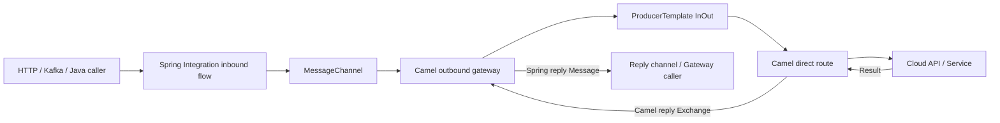
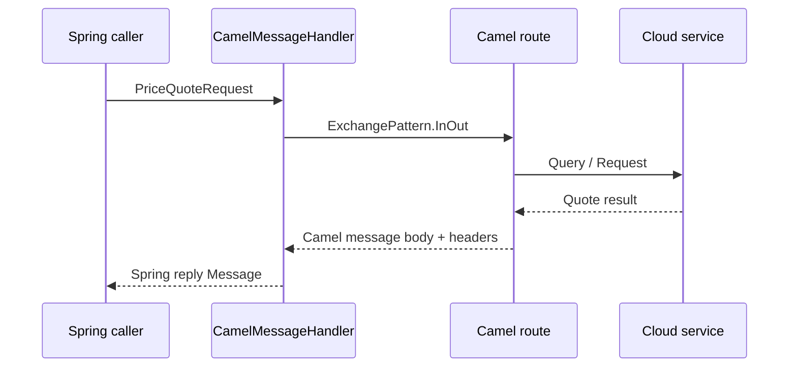
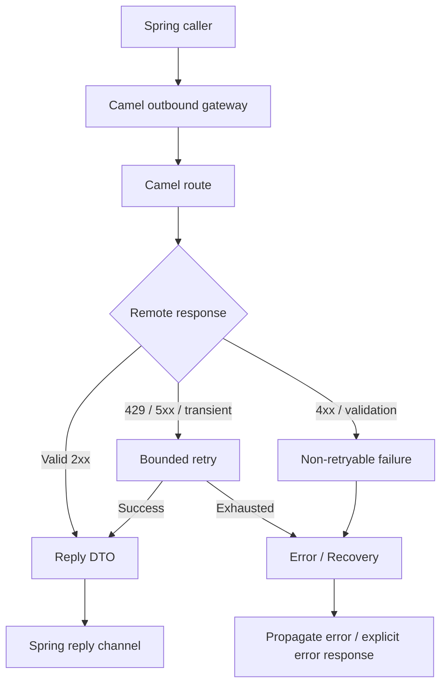

# Apache Camel outbound gateway

## 1. Context: when Spring Integration needs a result from Apache Camel

In the **SPRING_INTEGRATION_ADAPTERS** module, Spring Integration connects external systems using inbound/outbound adapters, gateways, pollers, and `MessageChannel`. Flows exchanging data over files, SFTP, HTTP, JMS, AMQP, Kafka, and databases all require clear message contracts, error handling, and connection lifecycles. The **Adapter Cloud** chapter extends this integration model to cloud services and existing connectors available in **Apache Camel**.

Suppose an order-processing system uses Spring Integration. Before confirming an order, the system needs to **query a pricing service invoked through a Camel route**:

1. Spring Integration receives a `PriceQuoteRequest` from HTTP, Kafka, or an internal gateway.
2. The message is placed onto `camelPriceRequests`.
3. The **Apache Camel outbound gateway** converts the Spring message into an **`InOut`** Camel exchange.
4. The Camel route calls the pricing processor (in the lab) or a cloud HTTP service (in production).
5. Camel puts the response body and required headers onto the exchange.
6. The bridge converts the result back to Spring Integration, then returns it to the caller or continues the flow.



**Key point:** An outbound gateway is used when **the caller needs a business result** such as a price quote, record status, ETag, cloud request ID, or confirmation decision. If you only need to forward data one-way without a reply, using an **outbound channel adapter** is more appropriate.

### Learning Outcomes

After this lesson, you will be able to:

- Distinguish `CamelMessageHandler` in `InOnly` and `InOut` modes.
- Combine Spring `@MessagingGateway`, `MessageChannel`, and a Camel outbound gateway.
- Use `Camel.gateway()` in Java DSL, or configure `CamelMessageHandler` with `ExchangePattern.InOut`.
- Design a Camel `RouteBuilder` that receives a request, builds a response DTO, and returns the result.
- Configure bidirectional `CamelHeaderMapper` using an allowlist.
- Separate timeouts across Spring gateway, Camel `direct:`, and the HTTP/cloud client.
- Handle Camel route errors, remote service errors, retries, idempotency, and duplicate replies.
- Test request-reply for both success and failure cases.
- Manage security, observability, cloud IAM, rate limits, and lifecycle.

## 2. Components sitting between request and reply

### 2.1. Two different messaging systems

| Spring Integration | Apache Camel | Meaning |
|---|---|---|
| `Message<T>` | `org.apache.camel.Message` | Body/payload and headers, though not the same class. |
| `MessageHeaders` | Camel message headers | Requires `CamelHeaderMapper` for conversion. |
| `MessageChannel` | `Endpoint` | Where Spring dispatches messages vs where Camel receives exchanges. |
| `@MessagingGateway` | `ProducerTemplate` / Camel route | Java-facing invocation API vs component sending to an endpoint. |
| Request/reply channels | `ExchangePattern.InOut` | Bidirectional exchange contract. |
| `ErrorMessage`, `errorChannel` | Camel exception/error handler | Two error mechanisms that cannot be equated mechanically. |

Spring Integration `Message<?>` is immutable with respect to payload/headers; a Camel `Exchange` is the context used by a Camel route and can have its body, headers, properties, exception, or exchange pattern updated. The bridge is responsible for turning the Camel result into a suitable Spring reply.

### 2.2. `CamelMessageHandler` is the shared component

The Spring Integration `spring-integration-camel` module provides:

```java
org.springframework.integration.camel.outbound.CamelMessageHandler
```

The handler extends `AbstractReplyProducingMessageHandler` and uses `ProducerTemplate` to send to a Camel `Endpoint`. Notable options:

| Option | Purpose |
|---|---|
| `setEndpointUri(String)` | Sets a fixed Camel endpoint URI. |
| `setEndpointUriExpression(Expression)` | Selects an endpoint via SpEL; must be protected against URIs controlled by untrusted input. |
| `setRoute(LambdaRouteBuilder)` | Declares an inline Camel route instead of a URI. |
| `setExchangePattern(ExchangePattern)` | `InOnly` or `InOut`. |
| `setExchangePatternExpression(Expression)` | Selects the pattern per message; must restrict the value set. |
| `setHeaderMapper(HeaderMapper<org.apache.camel.Message>)` | Selects headers in both directions. |
| `setExchangeProperties(Map)` | Adds Camel exchange properties per internal policy. |
| `setExchangePropertiesExpression(Expression)` | Evaluates properties via SpEL returning a `Map`. |

**Do not configure `setEndpointUri`, `setEndpointUriExpression`, and `setRoute` simultaneously on the same handler**: they are mutually exclusive ways to choose the endpoint. If `ProducerTemplate` is not injected, the handler can create it using the `CamelContext` found in the Spring application context.

### 2.3. InOnly and InOut are two different contracts



| Aspect | `InOnly` (channel adapter) | `InOut` (outbound gateway) |
|---|---|---|
| Intended use | One-way send | Send and receive result |
| Spring DSL | `Camel.handler()` | `Camel.gateway()` |
| Camel exchange pattern | `ExchangePattern.InOnly` | `ExchangePattern.InOut` |
| Spring reply | No business reply promised | Reply path when route produces a result |
| Best suited for | Fire-and-forget publishing, telemetry | Price queries, object checks, commands needing status |
| Risks | Final outcome unknown if async | Must handle timeouts, errors, late replies, latency |

**InOut does not equate to a transaction**, and **a successful reply does not by itself prove data was durably committed across all involved services**. You need to understand the reply schema and confirmation point of the actual cloud API.

## 3. Prerequisites, dependencies, and version choices

An easy-to-follow learning setup:

- Java 17+.
- Spring Boot 3.x compatible with Spring Integration 6.x, Apache Camel 4.x.
- Spring Integration `spring-integration-camel` module.
- Camel Spring Boot starter and Camel `direct:` component.
- JUnit Jupiter and Spring Boot Test for integration tests.

With Maven **already configured with compatible dependency management/BOMs**:

```xml
<dependencies>
    <dependency>
        <groupId>org.springframework.boot</groupId>
        <artifactId>spring-boot-starter-integration</artifactId>
    </dependency>
    <dependency>
        <groupId>org.springframework.integration</groupId>
        <artifactId>spring-integration-camel</artifactId>
    </dependency>
    <dependency>
        <groupId>org.apache.camel.springboot</groupId>
        <artifactId>camel-spring-boot-starter</artifactId>
    </dependency>
    <dependency>
        <groupId>org.apache.camel.springboot</groupId>
        <artifactId>camel-direct-starter</artifactId>
    </dependency>
    <dependency>
        <groupId>org.springframework.boot</groupId>
        <artifactId>spring-boot-starter-test</artifactId>
        <scope>test</scope>
    </dependency>
</dependencies>
```

The example omits explicit versions to avoid pinning numbers incompatible with your project's BOM. When Camel dependency management is absent, you must pin a **consistent, tested Camel version set**. Spring Integration 7.x/Spring Boot 4.x have their own baselines and compatibility requirements; check the release notes rather than blindly copying Boot 3 config.

`camel-spring-boot-starter` creates/manages `CamelContext` and discovers Camel route beans. `camel-direct-starter` adds the internal `direct:` component. This example **does not yet require** real cloud credentials: the lab route returns a DTO within the same JVM.

## 4. Request-reply contract for the lab

We will build an illustrative pricing API:

```text
PriceQuoteRequest
  sku: string
  quantity: int

PriceQuoteReply
  sku: string
  quantity: int
  unitPriceCents: long
  totalCents: long
  correlationId: string
  decision: string
```

Requirements:

- `sku` only accepts product codes from the demo catalog.
- `quantity` must be within bounds; do not arbitrarily call a remote service with unbounded input.
- `correlationId` is generated by the caller/server per the trust boundary and passed via header from Spring to Camel.
- The Camel route sets `PriceQuoteReply` as the body and adds the `quoteSource` header.
- The Spring caller receives an exact `PriceQuoteReply` type, not a raw `Exchange`.

### 4.1. Request record

File `PriceQuoteRequest.java`:

```java
package example.camelgateway;

public record PriceQuoteRequest(
    String sku,
    int quantity
) {}
```

### 4.2. Reply record

File `PriceQuoteReply.java`:

```java
package example.camelgateway;

public record PriceQuoteReply(
    String sku,
    int quantity,
    long unitPriceCents,
    long totalCents,
    String correlationId,
    String decision
) {}
```

These two records are **internal DTOs for this lesson**. In production, do not send Java serialization classes over the network by default; cloud HTTP services typically use JSON/Protobuf/dedicated schemas. Control schema compatibility, monetary types, quantities, and arithmetic carefully.

In this example, money uses **cents as `long`** to avoid `float`/`double` arithmetic. For multi-currency or true decimal amounts, you need currency codes, scale, and rounding rules defined by contract.

## 5. Spring Boot app and Java Messaging Gateway

### 5.1. Creating the application

File `CamelGatewayApplication.java`:

```java
package example.camelgateway;

import org.springframework.boot.SpringApplication;
import org.springframework.boot.autoconfigure.SpringBootApplication;
import org.springframework.integration.annotation.EnableIntegration;
import org.springframework.integration.annotation.IntegrationComponentScan;

@SpringBootApplication
@EnableIntegration
@IntegrationComponentScan
public class CamelGatewayApplication {

    public static void main(String[] args) {
        SpringApplication.run(CamelGatewayApplication.class, args);
    }
}
```

`@IntegrationComponentScan` enables the framework to detect `@MessagingGateway` interfaces. A plain interface does not automatically become a Spring bean just because `@SpringBootApplication` is present if the corresponding scanning mechanism is not enabled.

### 5.2. Gateway interface on the Spring side

File `PriceQuoteClient.java`:

```java
package example.camelgateway;

import org.springframework.integration.annotation.Gateway;
import org.springframework.integration.annotation.MessagingGateway;
import org.springframework.messaging.handler.annotation.Header;

@MessagingGateway
public interface PriceQuoteClient {

    @Gateway(
        requestChannel = "camelPriceRequests",
        requestTimeout = 5_000,
        replyTimeout = 15_000)
    PriceQuoteReply quote(
        PriceQuoteRequest request,
        @Header("correlationId") String correlationId);
}
```

When invoked:

```java
PriceQuoteReply quote = priceQuoteClient.quote(
    new PriceQuoteRequest("BOOK-01", 3),
    "req-52d2");
```

Spring Integration builds a request message with body `PriceQuoteRequest`, header `correlationId`, and a temporary reply channel for the call. After the Camel gateway finishes processing, the response is returned from the `quote(...)` method.

**Distinguishing the term "gateway":**

- `@MessagingGateway` is the **Spring-facing API**: it turns a Java method into a Spring messaging flow.
- `Camel.gateway()`/`CamelMessageHandler` with `InOut` is the **outbound gateway to Camel**.

You can use the outbound gateway directly from an `IntegrationFlow` without `@MessagingGateway` if the input comes from a Kafka/HTTP/file adapter and the output continues into another `MessageChannel`.

### 5.3. Timeout semantics on Spring Messaging Gateway

`requestTimeout` and `replyTimeout` are timeouts **at the Spring messaging boundary**:

- `requestTimeout` applies to sending into the request channel, especially when the channel can block.
- `replyTimeout` is how long the gateway method waits for a reply from the messaging flow when waiting is required by the mechanism.
- They **do not automatically configure** the connect/read timeout of a cloud HTTP client.
- With synchronous **`DirectChannel` + Camel `direct:`**, the handler can block directly on the caller thread. In that case `replyTimeout` **cannot always interrupt a hung remote call**; timeouts must be set on the network/cloud client.
- Across an async boundary, the method may time out before the remote operation completes. In that case, a **late reply** must be treated as a realistic possibility rather than assuming "definitely not executed".

**Do not rely on `replyTimeout=15_000` alone as a guarantee that a cloud call will finish under 15 seconds.**

## 6. Configuring the outbound gateway with CamelMessageHandler

The main lab uses `@Bean` and `@ServiceActivator` to explicitly control:

- Camel endpoint URI.
- `ExchangePattern.InOut`.
- Spring→Camel request header allowlist.
- Camel→Spring reply header allowlist.

File `CamelPriceGatewayConfiguration.java`:

```java
package example.camelgateway;

import org.apache.camel.ExchangePattern;
import org.apache.camel.ProducerTemplate;
import org.springframework.context.annotation.Bean;
import org.springframework.context.annotation.Configuration;
import org.springframework.integration.annotation.ServiceActivator;
import org.springframework.integration.camel.outbound.CamelMessageHandler;
import org.springframework.integration.camel.support.CamelHeaderMapper;
import org.springframework.integration.channel.DirectChannel;
import org.springframework.messaging.MessageChannel;

@Configuration
public class CamelPriceGatewayConfiguration {

    @Bean("camelPriceRequests")
    public MessageChannel camelPriceRequests() {
        return new DirectChannel();
    }

    @Bean
    @ServiceActivator(inputChannel = "camelPriceRequests")
    public CamelMessageHandler camelPriceOutboundGateway(
            ProducerTemplate producerTemplate) {

        CamelHeaderMapper mapper = new CamelHeaderMapper();

        // Only necessary Spring request headers go to Camel.
        mapper.setOutboundHeaderNames(
            "correlationId", "trustedTenantId");

        // Only these Camel reply headers return to Spring.
        mapper.setInboundHeaderNames(
            "quoteSource", "cloudRequestId");

        CamelMessageHandler handler =
            new CamelMessageHandler(producerTemplate);

        handler.setEndpointUri(
            "direct:cloud-price-lookup"
            + "?block=true&timeout=2000&failIfNoConsumers=true");

        // This is what turns the handler into an OUTBOUND GATEWAY.
        handler.setExchangePattern(ExchangePattern.InOut);
        handler.setHeaderMapper(mapper);

        return handler;
    }
}
```

**Key points in this snippet:**

1. `@ServiceActivator(inputChannel="camelPriceRequests")` registers the handler to consume messages from the Spring channel.
2. `new CamelMessageHandler(producerTemplate)` uses the Camel `ProducerTemplate` managed by Spring/Camel.
3. `setExchangePattern(InOut)` requests request-reply processing.
4. `CamelHeaderMapper` has **two separate directional lists**, not one direction reused for both request and reply.
5. `block=true&timeout=2000&failIfNoConsumers=true` are **Camel `direct:` endpoint options** for handling missing consumers; they are **not** the overall cloud API timeout.
6. When the Camel route returns a body, `CamelMessageHandler` builds a Spring reply for a message that has a reply channel.
7. `DirectChannel` is not a queue; the handler and `direct:` route run on a synchronous call path in the lab.
8. **Register only one subscriber** on `camelPriceRequests`. Do not add another DSL gateway on the same `DirectChannel` if you want all requests to go through the same handler.

**Security note:** `trustedTenantId` is only meaningful if the Spring side derives it from an **authenticated** user/organization identity. Never trust an HTTP header or payload field carrying this name at face value.

### 6.1. Do not confuse the bidirectional mapper

| Method on `CamelHeaderMapper` | Direction | Example |
|---|---|---|
| `setOutboundHeaderNames(...)` | Spring message → Camel request | `correlationId`, `trustedTenantId`. |
| `setInboundHeaderNames(...)` | Camel response → Spring reply | `quoteSource`, `cloudRequestId`. |

These lists accept **header names or patterns**. Do not map all Spring headers by default because `replyChannel`, `errorChannel`, or framework references may be inappropriate when sent into Camel and cloud components. On the reply path, do not pass every arbitrary cloud response header back into the application either.

## 7. Creating a Camel RouteBuilder that actually returns a result

File `PriceQuoteCamelRoute.java`:

```java
package example.camelgateway;

import java.util.Map;

import org.apache.camel.builder.RouteBuilder;
import org.springframework.stereotype.Component;

@Component
public class PriceQuoteCamelRoute extends RouteBuilder {

    private static final Map<String, Long> CATALOG = Map.of(
        "BOOK-01", 1250L,
        "PEN-02", 199L,
        "BAG-03", 6400L);

    @Override
    public void configure() {
        from("direct:cloud-price-lookup")
            .routeId("cloud-price-lookup")
            .process(exchange -> {
                PriceQuoteRequest request =
                    exchange.getMessage()
                        .getBody(PriceQuoteRequest.class);

                String correlationId =
                    exchange.getMessage().getHeader(
                        "correlationId", String.class);

                if (request == null
                        || request.sku() == null
                        || request.sku().isBlank()) {
                    throw new IllegalArgumentException(
                        "Missing SKU");
                }

                if (request.quantity() < 1
                        || request.quantity() > 1_000) {
                    throw new IllegalArgumentException(
                        "Invalid quantity");
                }

                if (correlationId == null
                        || correlationId.isBlank()
                        || correlationId.length() > 100) {
                    throw new IllegalArgumentException(
                        "Missing or invalid correlationId");
                }

                Long unitPrice = CATALOG.get(request.sku());

                if (unitPrice == null) {
                    throw new IllegalArgumentException(
                        "SKU not found");
                }

                long total = Math.multiplyExact(
                    unitPrice, request.quantity());

                PriceQuoteReply reply = new PriceQuoteReply(
                    request.sku(),
                    request.quantity(),
                    unitPrice,
                    total,
                    correlationId,
                    "APPROVED");

                // The Camel route updates the exchange's response body.
                exchange.getMessage().setBody(reply);

                // Only allowlisted Camel headers make it back
                // into the Spring reply.
                exchange.getMessage().setHeader(
                    "quoteSource", "demo-catalog");
            });
    }
}
```

Camel `direct:cloud-price-lookup` receives the exchange directly within the **same CamelContext**. Inside the route, `exchange.getMessage().getBody(...)` reads the request, and `setBody(reply)` sets the result for `InOut`. Camel does not automatically turn this into an HTTP response: the Spring Integration gateway is the component that returns the reply to the caller.

**Lab limitation:** this is an **in-process pricing stub** with no network requests. It lets you thoroughly verify the Spring↔Camel bridge before adding credentials, TLS, REST, brokers, or cloud SDKs. `CATALOG` does not replace a real cloud pricing service.

### 7.1. Tracing body and headers across the boundary

```text
Spring request
  payload: PriceQuoteRequest("BOOK-01", 3)
  headers:
    correlationId: "req-52d2"
    replyChannel: <temporary Spring channel>

After outbound mapping
Camel request
  body: PriceQuoteRequest("BOOK-01", 3)
  headers:
    correlationId: "req-52d2"
  exchange pattern: InOut

Camel response
  body: PriceQuoteReply(... totalCents=3750 ...)
  headers:
    correlationId: "req-52d2"
    quoteSource: "demo-catalog"

Spring reply
  payload: PriceQuoteReply(...)
  headers: allowed Camel response fields + framework metadata
```

This is a **contract diagram**, not an exact dump of every internal header. Actual headers added by Spring Integration/Camel can vary by version and configuration; in particular, never pass `replyChannel`/`errorChannel` arbitrarily into Camel.

### 7.2. Quick test case

```java
PriceQuoteReply reply = priceQuoteClient.quote(
    new PriceQuoteRequest("BOOK-01", 3),
    "req-52d2");

// Expected:
// reply.sku()            = "BOOK-01"
// reply.quantity()       = 3
// reply.unitPriceCents() = 1250
// reply.totalCents()     = 3750
// reply.correlationId()  = "req-52d2"
// reply.decision()       = "APPROVED"
```

**Do not confuse** the returned amount with money guaranteed to be collected or a recorded financial transaction. This is only the result of a **query**.

## 8. Equivalent configuration with Spring Integration Java DSL

Spring Integration provides factory methods:

- `Camel.gateway()` creates a `CamelMessageHandlerSpec` with `ExchangePattern.InOut`.
- `Camel.handler()` creates a spec with `ExchangePattern.InOnly`.
- `Camel.route(...)` declares an inline route with `InOut`.

Configuration snippet **replacing** the `camelPriceOutboundGateway()` bean in section 6:

```java
package example.camelgateway;

import org.springframework.context.annotation.Bean;
import org.springframework.context.annotation.Configuration;
import org.springframework.integration.camel.dsl.Camel;
import org.springframework.integration.dsl.IntegrationFlow;

@Configuration
public class CamelGatewayDslConfiguration {

    @Bean
    public IntegrationFlow quoteViaCamel() {
        return IntegrationFlow.from("camelPriceRequests")
            .handle(Camel.gateway()
                .endpointUri("direct:cloud-price-lookup"))
            .get();
    }
}
```

**Do not enable** both `CamelGatewayDslConfiguration` and `CamelPriceGatewayConfiguration` on the same `camelPriceRequests` when using `DirectChannel`; the two endpoints will compete for subscriptions. If you choose the DSL, remove the annotated bean in section 6 or use a different channel.

Checklist when using the DSL:

1. DSL `Camel.gateway()` already sets `InOut`; **do not call `Camel.handler()` and expect a reply**.
2. Default header mapping can be broad; if a strict allowlist is needed, configure the spec per your API version or use an explicitly configured handler bean as in section 6.
3. Section 7 still requires the Camel route consumer `direct:cloud-price-lookup`.
4. The reply does not need a separate `.channel("...")` when the `@MessagingGateway` caller creates a temporary reply channel and the flow ends with a reply-producing handler.
5. If there are additional `transform/filter` steps after the Camel gateway, the output must match the Spring message/DTO contract expected by the Java caller.

### 8.1. Flows that need further response processing

Example without a Java gateway, forwarding the response to another channel:

```java
@Bean
IntegrationFlow quoteAndAudit() {
    return IntegrationFlow
        .from("quoteAuditRequests")
        .handle(Camel.gateway()
            .endpointUri("direct:cloud-price-lookup"))
        .filter(PriceQuoteReply.class,
            quote -> quote.totalCents() >= 0)
        .channel("quoteAuditResults")
        .get();
}
```

This snippet is simply **another flow**; `quoteAuditResults` needs a declared consumer. A filter can **drop the reply** if the condition fails, causing a request-reply caller to block or time out. For a query flow, an invalid response should usually produce an **explicit error** instead of being silently filtered out.

### 8.2. When to use Java DSL vs a handler bean?

| Approach | Best when | Notes |
|---|---|---|
| `Camel.gateway().endpointUri(...)` | Short flow, fixed endpoint | Watch out for default mapper and lifecycle. |
| `@ServiceActivator` + `CamelMessageHandler` | Explicit control over mapper, exchange pattern, properties | More boilerplate lines, but easier to review. |
| `Camel.route(...)` | Declaring a Camel route inline inside a Spring Integration flow | Avoid declaring a duplicate consumer route on the same URI. |
| `setEndpointUriExpression(...)` | Selecting from a small set of endpoints via runtime policy | Use an allowlist only; never take URIs from untrusted input. |

## 9. Mapping reply headers and exchange properties

### 9.1. The two header systems are not identical

Spring messages have `MessageHeaders` and Camel messages have a Map of headers. By default, the handler may map **all** headers, but production systems should constrain this because:

- `replyChannel`/`errorChannel` are internal messaging references, not cloud metadata.
- Caller-supplied headers might contain tokens, personal data, or self-asserted tenant IDs.
- Camel components can use headers to determine the HTTP method, object key, bucket, or URI.
- Reply headers can contain vendor-specific metadata and values that should not be forwarded out to an HTTP response/broker.

`CamelHeaderMapper` supports:

```java
CamelHeaderMapper mapper = new CamelHeaderMapper();

// Spring request -> Camel request
mapper.setOutboundHeaderNames(
    "correlationId", "trustedTenantId");

// Camel reply -> Spring reply
mapper.setInboundHeaderNames(
    "quoteSource", "cloudRequestId");
```

**For an InOut endpoint, the inbound mapper is essential**; do not configure only request mapping and assume all necessary reply metadata will appear in the Spring reply.

### 9.2. Headers are not Exchange properties

In Camel:

- `exchange.getMessage().getHeader(...)` reads a Camel message header.
- `exchange.getProperty(...)` reads a Camel exchange property.
- `ExchangeProperty` values do not automatically become Spring `MessageHeaders` on reply.

`CamelMessageHandler` provides `setExchangeProperties(...)` and `setExchangePropertiesExpression(...)` to pass context into the Camel exchange. Only pass required values from an authenticated source; never put secrets or raw Java principal objects into properties because other processors might log or serialize them.

### 9.3. Which correlation ID is stable?

- Spring `MessageHeaders.ID` is a framework message identifier that can change when a new message is created.
- A business-generated `correlationId` defined by contract can remain stable across requests and retries.
- Camel Exchange ID does not necessarily equal the Spring message ID or the cloud request ID.
- The cloud request ID returned by the provider is **a separate identifier** used for lookup on the provider side.

Do not use an arbitrary ID to imply deduplication is already in place. An idempotency key needs a stable rule for the **same business request** and must be enforced at the destination or an appropriate durable inbox.

## 10. Timeouts: three different clocks

A cloud request-reply can pass through three layers:

```text
Spring caller
  -> requestChannel send / reply wait
  -> Camel direct consumer startup/wait
  -> Camel HTTP/SDK connection + response
  -> Reply mapping
```

| Layer | Which timeout is needed | What not to assume |
|---|---|---|
| Spring `@MessagingGateway` | `requestTimeout`, `replyTimeout` | Does not automatically abort a blocking remote call on `DirectChannel`. |
| Camel `direct:` | `block`, `timeout`, `failIfNoConsumers` | Only governs whether a route consumer is ready. |
| Cloud HTTP/client | Connect timeout, response/read timeout, total deadline | Not controlled by `direct:timeout`. |
| Camel retry/error handler | Max redeliveries, delay/backoff | Total latency must stay within budget. |
| Downstream broker/DB | Publish/commit timeouts | Publishing to a broker does not mean the consumer has processed it. |

### 10.1. Example timeout budget

Suppose the business expects a response within **10 seconds**:

```text
Total budget:       10_000 ms
Connection setup:    1_000 ms
Remote response:     5_000 ms
Small retry margin:  2_000 ms
Serialization/queue: 2_000 ms
```

This is an **illustrative allocation model**, not a timeout configuration that applies verbatim to every Camel component. In production, enforce an actual overall request limit on the HTTP client/SDK, and ensure retries do not push execution past the budget and cause late replies or duplicate commands.

If the `direct:` route has already started and the remote HTTP server hangs, increasing `direct:timeout` will **not** help. You must fix the timeout on the remote client.

### 10.2. Timeouts and "unknown outcomes"

When a caller times out:

1. The request may **not have been sent yet**.
2. The request may have **reached the Camel route** without reaching the remote service.
3. The cloud service may have **already processed it successfully**, but the reply was lost or arrived late.
4. The Spring gateway may have stopped waiting while the worker is still running.

Therefore, do not automatically treat a timeout as a definite failure. For object creation/deletion or payment commands, you need idempotency keys, durable command state, and a query/reconciliation mechanism.

## 11. Error handling in Spring and Camel

### 11.1. Two error models

**Spring Integration** uses `MessagingException`, `ErrorMessage`, `errorChannel`, and handler advice.

**Apache Camel** uses `Exchange` exception/error state, `onException(...)`, redelivery/error handlers, dead-letter endpoints, and related policies.



With synchronous `DirectChannel` and Camel `direct:`, a route exception not marked `handled(true)` by Camel can usually propagate back to the Spring handler/caller. With `ExecutorChannel` or Camel async processing, errors may occur after the caller has stopped waiting. Configure error channels/recovery at the right boundary and verify behavior for your version.

### 11.2. Guidance on Camel `onException`

Illustrative policy inside Camel `RouteBuilder.configure()`:

```java
@Override
public void configure() {

    onException(IllegalArgumentException.class)
        .maximumRedeliveries(0)
        .handled(false);

    from("direct:cloud-price-lookup")
        .routeId("cloud-price-lookup")
        .process(exchange -> {
            // Validate + call remote + create reply...
        });
}
```

This is a **replacement fragment** for `configure()` in section 7's route, not code to run concurrently. `handled(false)` prevents accidentally turning a contract exception into a "false success" exchange. Exact exception wrapping returned to the Java caller must be confirmed via integration tests.

Some business scenarios prefer returning an **error DTO** instead of throwing. In that case:

- Define a clear schema: `success`/`errorCode`/`requestId`.
- Map the Camel response to the exact Spring reply type; **do not return an object of an unexpected type**.
- Ensure any HTTP inbound gateway maps `errorCode` to the appropriate HTTP status.
- Never return 200 OK for every case simply because Camel `handled(true)` cleared the exception.

### 11.3. Avoiding multiplicative retries across Spring, Camel, and SDK

Suppose:

```text
Spring RequestHandlerRetryAdvice: 3 attempts
Camel redelivery:                 3 attempts
Cloud HTTP client retry:          2 attempts
Theoretical max cloud calls:      3 × 3 × 2 = 18
```

As timeouts and latency rise, a command with side effects can be sent repeatedly. Designate **one primary retry owner** and a **total deadline**. If multi-layer retries are unavoidable, bound the combined attempt count, backoff, jitter, quotas, and idempotency.

| Error group | Retryability | Notes |
|---|---|---|
| Invalid schema/quantity input | No | Deterministic validation error. |
| Remote 401/403, bad IAM | Usually no | Credentials/permissions need fixing; avoid retry storms. |
| HTTP 429, throttling | Conditional | Exponential backoff; honor `Retry-After` if present. |
| HTTP 502/503/504 | Conditional | Total deadline, circuit breaker, and monitoring. |
| DNS/connect timeout | Conditional | Distinguish endpoint outage from misconfiguration. |
| Read timeout after POST | Duplicate risk | Remote may have committed; requires idempotency. |
| Camel route not started | Config/lifecycle | Wait for readiness or fail fast; do not retry indefinitely. |
| Reply of wrong type | Do not retry blindly | Contract mismatch; fix schema/converter. |

### 11.4. Error channel is not the reply channel

The Spring reply channel delivers **request-reply results**. The error channel is where certain components can publish an `ErrorMessage` when a failure occurs.

- `ErrorMessage` carries a `Throwable` payload.
- `MessagingException.getFailedMessage()` can help identify the failing message.
- Errors on `DirectChannel` can propagate directly to the Java caller.
- Asynchronous errors can be routed to the `errorChannel` header or the global `errorChannel` when a publisher is involved.
- The global error channel is **not** a durable dead-letter queue by default.

If you want to return an error to the Java caller, design exception mapping or an error reply per contract; simply logging exceptions to a separate error channel **does not resolve** a caller waiting for a response.

## 12. Real cloud HTTP service: moving from demo to remote API

In the lab, the Camel route computes quotes from an in-memory `Map`. To call a real HTTP service, you can use the Camel `http` component and a JSON converter. This is **an alternative replacing the demo route**, not a second consumer registered on `direct:cloud-price-lookup`.

Camel modules typically needed:

```xml
<dependency>
    <groupId>org.apache.camel.springboot</groupId>
    <artifactId>camel-http-starter</artifactId>
</dependency>
<dependency>
    <groupId>org.apache.camel.springboot</groupId>
    <artifactId>camel-jackson-starter</artifactId>
</dependency>
```

Conceptual fragment inside `RouteBuilder`:

```java
import org.apache.camel.Exchange;
import org.apache.camel.builder.RouteBuilder;
import org.apache.camel.model.dataformat.JsonLibrary;

// An alternative replacing the demo route.
// The actual endpoint must point to your trusted service.
from("direct:cloud-price-lookup")
    .routeId("cloud-price-http")
    .process(exchange -> {
        PriceQuoteRequest request =
            exchange.getMessage()
                .getBody(PriceQuoteRequest.class);

        if (request == null || request.quantity() < 1) {
            throw new IllegalArgumentException(
                "Invalid quote request");
        }
    })
    .marshal().json(JsonLibrary.Jackson)
    .setHeader(Exchange.HTTP_METHOD, constant("POST"))
    .setHeader(Exchange.CONTENT_TYPE, constant("application/json"))
    .to("https://pricing.internal.example/api/quotes"
        + "?throwExceptionOnFailure=true")
    .unmarshal().json(
        JsonLibrary.Jackson, PriceQuoteReply.class);
```

**This is an integration fragment** and cannot run without a real cloud service, endpoint, credentials, JSON schema, and timeouts. `PriceQuoteReply` in the lab is a Java record; verify that your application's Jackson version/config can deserialize the actual response and that the cloud schema matches the contract. If the provider returns a different DTO, create a provider-side DTO and map it into your domain `PriceQuoteReply` rather than coupling directly to the cloud format.

When moving to remote calls:

- Configure **connect/read/response/total timeouts** according to your Camel HTTP component/version and client.
- Use HTTPS with certificate/hostname verification; never trust-all.
- Use OAuth2/workload identity/service tokens via a secret store; never hardcode into URIs or source code.
- Never construct arbitrary HTTP target URIs from untrusted requests.
- Configure `throwExceptionOnFailure` and map 4xx/5xx per policy.
- Do not automatically treat HTTP 202 Accepted as "final quote received"; status polling/querying may be needed.
- Record `cloudRequestId`/trace IDs if the provider returns the header and storing it is permitted.
- Use a circuit breaker or concurrency limits when the cloud service slows down.

### 12.1. Why is Camel gateway helpful in the Adapter Cloud chapter?

Camel includes ready-made components for many providers and protocols. The Spring Integration side keeps:

```text
Spring request contract
  -> Camel outbound gateway
  -> Camel route
  -> Cloud provider-specific request
  <- Provider-specific response
  <- Camel response mapper
  <- Spring domain reply
```

Business examples:

- Query object status from object storage and return `exists`/`size`.
- Query a cloud pricing API and receive a quote.
- Call a fraud-check service and receive a decision.
- Send a command to a SaaS API requiring a confirmation response.
- Invoke a Camel component that has no equivalent Spring Integration outbound gateway.

Not every Camel component returns results **using InOut**. For a provider that only supports one-way publishing, never fabricate a fake "success" reply and treat it as a business acknowledgment.

## 13. Security: endpoint URIs, headers, and cloud credentials

### 13.1. Dynamic URIs carry SSRF and misrouting risks

`setEndpointUriExpression(...)` allows selecting a Camel endpoint from a Spring message; this is useful, yet can also turn untrusted data into:

```text
headers.destinationUri = "http://internal-admin-service/..."
```

This is an **anti-pattern** if `destinationUri` comes directly from an external HTTP request, Kafka message, or Syslog body. Depending on available Camel components, an attacker can redirect traffic to internal HTTP services, local files, another cloud bucket, or unintended protocols.

Safe approach:

1. Accept only an allowlisted **route key**.
2. Map the route key to server-configured URIs.
3. Constrain component scheme, host, tenant, region/bucket, and IAM.
4. Enforce egress network policies; disallow arbitrary outbound network access.
5. Do not log endpoint URIs if they contain tokens or query secrets.
6. Test with malformed URIs, encoding tricks, spoofed hosts, and cross-tenant routing.

### 13.2. Request headers do not grant authority on their own

`@Header("trustedTenantId")` is only meaningful when set server-side after authentication. If a client sends `trustedTenantId=admin`, that header is **unverified**.

Separate clearly:

- **Authenticated principal/tenant** from a trusted security boundary.
- **Business parameters** such as SKU and quantity supplied by the caller.
- **Routing metadata** such as correlation ID and event ID.
- **Credentials** for the cloud client via IAM/managed identity/secret store, never stuffed into business messages.

Never allow user-supplied headers to choose the cloud project/account, object key prefix, or authorization scope.

### 13.3. Replies must also be validated

Even when the request is valid, the remote response is still data from an external system:

- Validate HTTP status and content type.
- Cap response bytes and JSON depth/field count where applicable.
- Validate expected fields, enums, currencies, and amount ranges.
- Never deserialize untrusted polymorphic Java types arbitrarily.
- Never log full raw bodies on error responses; they may contain PII/tokens.
- Never pass all vendor headers back to Spring or the HTTP caller.
- Never evaluate expressions or shell commands derived from a reply body.

## 14. Concurrency, ordering, transactions, and durability

### 14.1. Synchronous gateways make callers wait

`DirectChannel` + `Camel direct:` + a synchronous cloud API means the calling thread may be held for the entire request-reply duration. If the cloud service has high latency, the system must account for:

- Concurrent inbound requests.
- HTTP connection pool and thread pool sizing.
- Maximum wait time.
- Queue depth, backlog, and cancellation.
- Per-tenant rate limiting/bulkheads.
- Caller state when the remote finishes after the caller stopped waiting.

Adding threads unboundedly does not make the provider faster; it usually just increases saturation.

### 14.2. ExecutorChannel/SEDA do not guarantee replies

If you introduce `ExecutorChannel` on the Spring side or Camel `seda:`:

- Processing may switch to another thread.
- Queuing can delay the reply.
- Reply timeouts become critical because the caller waits on a different thread.
- On timeout, the worker may still complete afterward.
- In-memory queues are **not durable** across restarts.

If a business operation cannot finish within a short request budget, **switch the contract to an asynchronous command** with a job ID, durable queue/outbox, and status query endpoint instead of stretching synchronous waits indefinitely.

### 14.3. Transactions do not span Spring and the cloud automatically

A Spring Data/JDBC transaction does not automatically include a Camel route and cloud API. For example:

```text
Spring DB transaction begins
 -> Camel gateway calls remote cloud write
 -> cloud writes successfully
 -> local DB transaction rolls back
```

The cloud and local DB end up inconsistent. For commands with side effects, use **outbox/inbox/saga or reconciliation** as required. Never promise atomic commits just because all code runs in one Spring ApplicationContext.

### 14.4. Do not use timeouts to decide payment retries

A cloud write timeout can represent an **unknown outcome**. Retrying without an idempotency key risks duplicate execution. Because the lab is a pricing query, side effects are minimal; when applying this pattern to upload/create/delete/payment operations, change the policy:

- Domain-generated, durably stored idempotency keys.
- Conditional writes or optimistic concurrency if supported by the provider.
- Retries with backoff/jitter and a deadline.
- Persist correlation with the provider request ID.
- Reconcile outcomes after a timeout before issuing further side effects.

## 15. End-to-end testing in the application

### 15.1. Integration test for request-reply

File `CamelPriceGatewayTest.java`:

```java
package example.camelgateway;

import static org.junit.jupiter.api.Assertions.*;

import org.junit.jupiter.api.Test;
import org.springframework.beans.factory.annotation.Autowired;
import org.springframework.boot.test.context.SpringBootTest;

@SpringBootTest
class CamelPriceGatewayTest {

    @Autowired
    PriceQuoteClient priceQuoteClient;

    @Test
    void returnsTypedQuoteFromCamelRoute() {
        PriceQuoteReply reply = priceQuoteClient.quote(
            new PriceQuoteRequest("BOOK-01", 3),
            "req-52d2");

        assertEquals("BOOK-01", reply.sku());
        assertEquals(3, reply.quantity());
        assertEquals(1250L, reply.unitPriceCents());
        assertEquals(3750L, reply.totalCents());
        assertEquals("req-52d2", reply.correlationId());
        assertEquals("APPROVED", reply.decision());
    }

    @Test
    void rejectsInvalidQuantity() {
        RuntimeException failure = assertThrows(
            RuntimeException.class,
            () -> priceQuoteClient.quote(
                new PriceQuoteRequest("BOOK-01", 0),
                "req-bad"));

        assertNotNull(failure);
        // Exception type/wrapping may depend on
        // Camel + Spring Integration version.
    }

    @Test
    void rejectsUnknownSku() {
        assertThrows(RuntimeException.class,
            () -> priceQuoteClient.quote(
                new PriceQuoteRequest("UNKNOWN", 1),
                "req-no-sku"));
    }
}
```

Here, **avoid asserting an overly specific exception class** unless you have verified the exact behavior of your Spring Integration/Camel version. The exception may be wrapped in `MessagingException` or a Camel route exception. What matters is that **no fake "APPROVED" reply** is produced when validation fails.

### 15.2. Bidirectional header mapping should have dedicated tests

A request test can attach a correlation ID and verify the route reads it (in the lab, the correlation ID appears in the reply body). To verify that the `quoteSource` reply header is returned to Spring:

1. Use a test gateway method returning `Message<PriceQuoteReply>` where supported by the contract.
2. Or call `MessagingTemplate.sendAndReceive(...)` on `camelPriceRequests` to obtain the `Message<?>`.
3. Assert the payload has the expected type and `reply.getHeaders().get("quoteSource")` equals `"demo-catalog"`.
4. Assert that non-allowlisted headers (such as sensitive internal headers) are not forwarded.
5. Test a Camel reply carrying a non-allowlisted header and confirm it does **not** return to Spring.

Keep in mind that certain Spring framework headers are added internally after mapping; tests should check **the presence or absence of policy-governed headers** rather than comparing the entire `MessageHeaders` map in order.

### 15.3. Testing timeouts and errors with a mock cloud service

Before deploying against a real provider, test these cases:

| Scenario | Expectation |
|---|---|
| Camel route returns valid DTO | Spring gateway receives `PriceQuoteReply`. |
| Camel body returns wrong type | Fails/converts per contract; never silently accepts unexpected data. |
| Camel route throws exception | Java caller receives an observable failure. |
| No consumer for `direct:...` | Camel fails/times out per `block/failIfNoConsumers`. |
| Missing `correlationId` header | Validation fails; no fake quote returned. |
| `quoteSource` reply header | Mapped via the inbound header allowlist. |
| `errorChannel` header on Spring request | Not arbitrarily mapped into Camel. |
| Remote API 401/403 | No retry storm; reports access/config issue. |
| Remote API 429/503 | Bounded retry with backoff/jitter if policy permits. |
| Remote API timeout after side effect | Marked as unknown outcome; verifies idempotency/reconciliation. |
| Slow remote call exceeding Spring `replyTimeout` | Test late reply; do not assume the operation was cancelled. |
| Camel route not started yet | Readiness detects it; fails per policy. |
| Incompatible Spring/Camel versions | Clear startup/test failure; do not upgrade components piecemeal. |

**Never run load tests against production cloud** or use real credentials in unit tests; use a mock HTTP server, valid Testcontainers/emulators, or Camel `MockEndpoint` with a dedicated test route.

## 16. Observability and troubleshooting

### 16.1. Monitoring both frameworks

| Signal | Interpretation |
|---|---|
| Spring gateway call count/latency | How many method calls and how long they wait for replies. |
| Spring channel send failures | Channel busy, no subscriber, dispatch failure. |
| Camel route exchanges completed/failed | How many `InOut` exchanges the route processed. |
| Camel endpoint consumer status | Whether `direct:...` has a started route consumer. |
| Cloud HTTP status/latency | 2xx, 4xx, 429, 5xx, DNS/TLS errors. |
| Cloud request ID | Used for correlation with provider-side logs. |
| Retry attempts/redeliveries | Whether retries are multiplying across layers. |
| Timeout and late reply count | Caller timed out while processing continued. |
| Thread/connection pool utilization | Blocking bottlenecks/bulkhead saturation. |
| Durable job/outbox/DLQ backlog | Recovery for commands with side effects. |

Logging correlation IDs is valuable, but they must be length-bounded, sanitized, and **free of secrets/PII**. Avoid using arbitrary SKUs, raw queries, or cloud response bodies as metric labels because cardinality can explode.

### 16.2. Common errors

| Symptom | Possible cause | What to check |
|---|---|---|
| Cannot find `Camel.gateway()` | Missing `spring-integration-camel` or old version | Dependencies and API version. |
| Missing `PriceQuoteClient` bean | `@IntegrationComponentScan` not enabled | Package scan/`@MessagingGateway`. |
| Missing `CamelContext` | Camel Boot auto-config not active | Starters and bean initialization. |
| `direct:...` missing consumer | Route not scanned/started or wrong URI | Camel route status, endpoint name. |
| Spring gateway method waits forever | Reply not produced, blocking remote call | `InOut`, handler, remote timeout, thread dump. |
| Spring caller receives `null` | Reply didn't arrive in time, async flow lacks reply | Trace reply channel, `replyTimeout`, and late replies. |
| One-way send only, no reply | Using `Camel.handler()`/`InOnly` | Switch to `Camel.gateway()`. |
| Reply missing `quoteSource` | Inbound mapper lacks header in allowlist | `setInboundHeaderNames`. |
| Camel route missing `correlationId` | Outbound mapper blocked it or caller didn't set it | `setOutboundHeaderNames`, request message. |
| Error caught by Camel `handled(true)` but client sees "success" | Error handler swallowed exception | Explicit error DTO/status mapping. |
| Cloud HTTP hangs but `direct` timeout has no effect | Timeout configured on wrong layer | Configure HTTP client/SDK timeouts. |
| Multiple remote calls for one request | Double/triple retries | Spring advice, Camel redelivery, SDK retry. |
| No errors seen on `errorChannel` | Synchronous flow propagates exceptions directly | Check caller stack, async boundary. |
| Dynamic URI hits wrong cloud account | Untrusted header/SpEL | URI allowlist and IAM/network policy. |

### 16.3. 10-step runbook

```text
1. Did the caller invoke the right @MessagingGateway bean?
2. Do the request payload type and headers match the contract?
3. Does camelPriceRequests have exactly one subscriber?
4. Is CamelMessageHandler using InOut or defaulting to InOnly?
5. Does HeaderMapper have the proper outbound + inbound allowlists?
6. Does ProducerTemplate belong to the right CamelContext?
7. Is the Camel direct route started with an active consumer?
8. Where are cloud client timeouts, status codes, and exceptions occurring?
9. Were the reply body and headers properly set by the Camel route?
10. Did the Spring reply channel return before the deadline or was it a late reply?
```

If the route runs and the body is created yet `@MessagingGateway` keeps waiting, check `ExchangePattern`, reply channel, handler registration, and message conversion first before increasing thread pools or changing cloud credentials.

## 17. Production readiness checklist

1. **Choose the right pattern:** one-way `Camel.handler()/InOnly` or request-reply `Camel.gateway()/InOut`.
2. **Manage versions:** compatible Spring Boot/Integration/Camel BOM and component starters.
3. **Lock down the DTO contract:** request, reply, validation, error codes, schema version, and serialization.
4. **Keep endpoint URIs trusted:** only map allowed route keys; never take arbitrary URIs from callers.
5. **Enable bidirectional header allowlists:** Spring→Camel and Camel→Spring, stripping internal channel refs/secrets.
6. **Establish clear correlation IDs:** do not confuse Spring message ID, Camel Exchange ID, and cloud request ID.
7. **Define per-layer timeouts:** Spring messaging, Camel direct, and HTTP/cloud client; enforce a total deadline.
8. **Validate actual replies:** correct type, monetary amounts/units, response status, and content type.
9. **Classify errors:** validation/permanent, remote transient, quota, auth, unknown outcome.
10. **Avoid multiplicative retries:** one primary policy and idempotency for side-effecting operations.
11. **Bound resources:** bulkheads, connections, executor queues, max in-flight, request/response sizes.
12. **Protect the cloud:** least-privilege IAM, TLS, managed identity/secret store, egress ACLs.
13. **Control durable state:** when replay/commit is required, use an appropriate outbox/inbox/broker.
14. **Test negative paths:** missing route, bad mapper, timeouts, cloud 429/5xx/403, wrong reply type, restarts.
15. **Observe both frameworks:** Spring gateway/channel, Camel route/exchange, cloud API, and sink acknowledgment.
16. **Define readiness:** accept traffic only when `CamelContext`/routes and dependencies are healthy.
17. **Do not equate reply with commit:** understand what the cloud API actually confirmed and what still requires reconciliation.

## 18. Summary

The **Apache Camel outbound gateway** lets Spring Integration **call a Camel endpoint and receive a response** without rewriting the entire flow in Apache Camel:

- `CamelMessageHandler` uses `ProducerTemplate` to send a Spring message into a Camel exchange.
- By default the handler is **`InOnly`**; for request-reply you must set **`ExchangePattern.InOut`** or use the **`Camel.gateway()`** DSL.
- Spring **`@MessagingGateway`** is the Java-facing API; the Camel outbound gateway behind it handles calling the Camel route.
- `CamelHeaderMapper` supports both **Spring→Camel request** and **Camel→Spring reply** with separate allowlists.
- Camel `direct:` is **internal communication within the same CamelContext**, not an HTTP/cloud API and does not create a durable queue.
- Spring gateway timeouts, Camel direct timeouts, and remote cloud HTTP client timeouts are **distinct**.
- Exceptions can propagate synchronously or arrive via an error channel across an async boundary; do not use `handled(true)` to mask errors as successful replies.
- Retries, idempotency, security, and durability must be designed end-to-end across Spring Integration → Camel → cloud provider.

Within **SPRING_INTEGRATION_ADAPTERS**, this pattern is especially valuable when Spring Integration ingests data via inbound adapters, gateways, pollers, and `MessageChannel`, while Apache Camel provides ready connectors to cloud or SaaS systems **that return a result**. The ultimate goal is not merely delivering a message to an endpoint, but **receiving the right response on time and clearly explaining failures or unknown states**.

### Official references

- [Spring Integration — Apache Camel Support](https://docs.spring.io/spring-integration/reference/camel.html)
- [Spring Integration — CamelMessageHandler API](https://www.springframework.org/spring-integration/docs/6.5.x/api/org/springframework/integration/camel/outbound/CamelMessageHandler.html)
- [Spring Integration — Camel DSL API](https://docs.spring.io/spring-integration/api/org/springframework/integration/camel/dsl/Camel.html)
- [Spring Integration — CamelHeaderMapper API](https://docs.spring.io/spring-integration/docs/6.5.0/api/org/springframework/integration/camel/support/CamelHeaderMapper.html)
- [Spring Integration — Messaging Gateway](https://docs.spring.io/spring-integration/reference/gateway.html)
- [Spring Integration — Message Channels](https://docs.spring.io/spring-integration/reference/channel.html)
- [Spring Integration — Error Handling](https://docs.spring.io/spring-integration/reference/error-handling.html)
- [Apache Camel — Direct Component](https://camel.apache.org/components/4.18.x/direct-component.html)
- [Apache Camel — HTTP Component](https://camel.apache.org/components/4.18.x/http-component.html)
- [Apache Camel — Error Handler](https://camel.apache.org/manual/error-handler.html)
- [Apache Camel — Spring Boot](https://camel.apache.org/camel-spring-boot/4.18.x/spring-boot.html)
