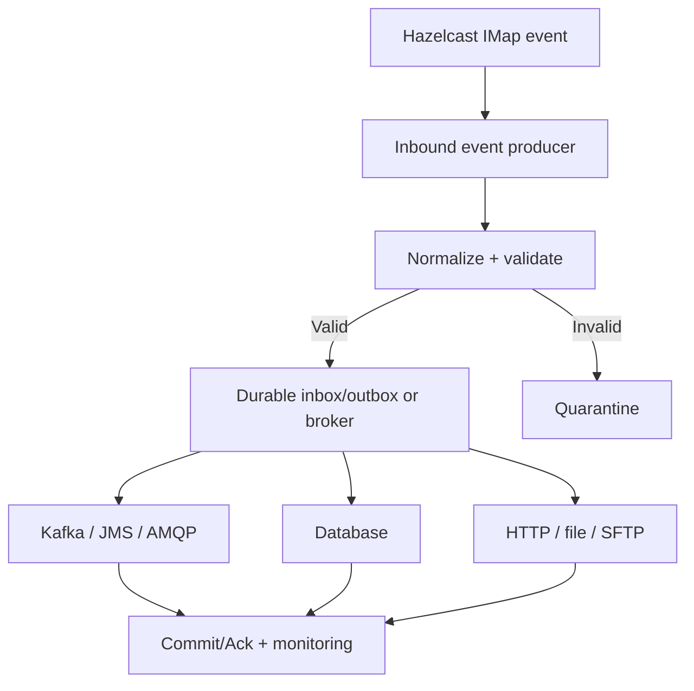

# Hazelcast inbound channel adapter

## 1. Introduction: ingesting distributed events into Spring Integration

In the **SPRING_INTEGRATION_ADAPTERS** module, Spring Integration connects external systems using inbound/outbound adapters, gateways, pollers, and `MessageChannel`. Learners practice flows across files, SFTP, HTTP, JMS, AMQP, Kafka, and databases while also needing to understand **message contracts, error handling, and connection lifecycles**. In the **Adapter Cloud** chapter, the Hazelcast inbound channel adapter serves as an example of bringing data/events from a distributed in-memory data grid cluster into Spring Integration for processing or forwarding.

**Hazelcast** provides distributed objects such as `IMap`, `MultiMap`, `IList`, `ISet`, `IQueue`, `ITopic`, and `ReplicatedMap`. Another instance in the cluster can mutate map data or publish to a topic. Through the **Hazelcast inbound channel adapter**, a Spring Integration application can listen for mutations and emit `Message<?>` onto an internal channel.

Business example:

1. A service updates an order's status in a Hazelcast `IMap`.
2. A listener registered by `HazelcastEventDrivenMessageProducer` receives the corresponding event.
3. The inbound adapter creates a Spring Integration message carrying the event payload and metadata.
4. The message enters a `MessageChannel`.
5. Downstream steps validate, transform, route, and forward to Kafka/JMS/AMQP, a database, HTTP, or file/SFTP as needed.


**Key point:** The inbound adapter receives **events from Hazelcast**; it does not turn a cache into a message broker with retention and replay like Kafka. If a callback is lost, a node disconnects, or downstream crashes, you cannot assume the adapter will replay all missed history.

### What will you learn?

- Distinguish Hazelcast distributed objects, event listeners, and Spring `MessageChannel`.
- Recognize the **event-driven**, **continuous query**, **cluster monitor**, and **distributed SQL polling** variants.
- Use `spring-integration-hazelcast`, XML namespaces, and Java configuration.
- Configure `HazelcastEventDrivenMessageProducer` for `IMap` with `ADDED`, `UPDATED`, and `REMOVED`.
- Understand `cache-listening-policy="SINGLE"` and `"ALL"`, and avoid assuming exactly-once semantics.
- Read `HazelcastHeaders`, validate payloads, and normalize events before use.
- Test a flow from `IMap.put(...)` to an inbound `QueueChannel`.
- Handle backpressure, serialization, security, monitoring, errors, and the Hazelcast cluster lifecycle.
- Distinguish **listening to `IQueue` events** from **actually dequeuing items via `IQueue.poll()`**.

## 2. Model: Hazelcast event → Spring Integration message

### 2.1. Hazelcast side

A `HazelcastInstance` joins or connects to a cluster. Distributed objects expose APIs:

| Hazelcast object | Main purpose | Listenable changes |
|---|---|---|
| `IMap<K,V>` | Distributed key/value map | Added, updated, removed, evicted, and bulk clear events as supported by the adapter/version. |
| `MultiMap<K,V>` | Single key with multiple values | Added, removed, and map events supported by the adapter. |
| `ReplicatedMap<K,V>` | Replicated map | Added, updated, removed, evicted. |
| `IList<E>` | Distributed list | Item added/removed. |
| `ISet<E>` | Distributed set | Item added/removed. |
| `IQueue<E>` | Distributed queue | Item added/removed; the listener **only receives notifications** and does not automatically dequeue the payload like a consumer. |
| `ITopic<E>` | Pub/sub topic | Message published; does not have `ADDED/UPDATED` cache events like a map. |

The adapter uses the corresponding Hazelcast listeners, such as `EntryListener`, `ItemListener`, and `MessageListener`. It does not need to poll an `IMap` on a fixed schedule to detect changes when using **event-driven inbound**.

### 2.2. Spring Integration side

```text
Hazelcast entry event
    -> Hazelcast listener callback
    -> HazelcastEventDrivenMessageProducer
    -> Spring Message<?> {
         payload: event-specific data,
         headers: Hazelcast metadata + framework metadata
       }
    -> MessageChannel
    -> ServiceActivator / Filter / Router / Transformer
```

**`MessageChannel` is the integration boundary.** It decouples the adapter from business processing:

- `DirectChannel`: subscribers are dispatched synchronously on the channel caller's thread.
- `ExecutorChannel`: subscribers run via an executor thread pool, with concurrency/queue bounds per configuration.
- `QueueChannel`: messages are placed in a queue for a poller or test to consume later.
- `PublishSubscribeChannel`: broadcasts messages to multiple subscribers when explicit fan-out is required.

**The event-driven Hazelcast inbound adapter does not itself require a Spring poller.** A polling schedule only matters when you choose a `QueueChannel` with a polling consumer, or when using the **Distributed SQL inbound adapter**, which is polling-based.

### 2.3. Why is this in the Adapter Cloud chapter?

Hazelcast can run embedded, in a dedicated cluster, on Kubernetes, or as a managed/cloud deployment. The adapter lets Spring Integration observe data and mutations **across the Hazelcast boundary**, but it **does not automatically connect to every cloud provider**. Connections, cluster discovery, authentication, TLS, serialization, and network routing must be configured for your actual Hazelcast deployment.

## 3. Four Hazelcast inbound adapter groups

Spring Integration provides the following inbound components, each serving a distinct purpose:

| Group | Class/namespace | Triggered by | Input |
|---|---|---|---|
| **Event-driven** | `HazelcastEventDrivenMessageProducer` / `<int-hazelcast:inbound-channel-adapter>` | Entry/item/topic event | `IMap`, `MultiMap`, `ReplicatedMap`, `IList`, `ISet`, `IQueue`, `ITopic`. |
| **Continuous Query** | `HazelcastContinuousQueryMessageProducer` / `<int-hazelcast:cq-inbound-channel-adapter>` | Entry event matching predicate | `IMap` with query predicate. |
| **Cluster Monitor** | `HazelcastClusterMonitorMessageProducer` / `<int-hazelcast:cm-inbound-channel-adapter>` | Membership, object, migration, lifecycle, client events | `HazelcastInstance` and cluster events. |
| **Distributed SQL** | `HazelcastDistributedSQLMessageSource` / `<int-hazelcast:ds-inbound-channel-adapter>` | Spring poller | Queries `IMap` data via `distributed-sql`, returning a result set per poll. |

**Do not equate** the three event-driven groups with Distributed SQL polling:

- Event-driven: when an event occurs, the callback fires if the listener is active and receives the event.
- Continuous Query: observes changes matching a predicate; it does not query the entire map on every poll.
- Cluster Monitor: cluster administration notifications, not business transaction records.
- Distributed SQL polling: periodically reads map state; if state has not changed, subsequent polls can return the same results. There is no default change-offset/ack like an event log.

In this lesson, **the primary example is event-driven `IMap`**. The other groups are introduced in sections 9–11 as related variants.

## 4. Event types and cache-listening-policy

### 4.1. Selecting events for the right distributed object

According to the Spring Integration documentation, `cache-events` on the event-driven adapter specifies the list of events to listen for; the default is `ADDED`.

| Distributed object | Cache events supported by the adapter |
|---|---|
| `IMap` / `MultiMap` | `ADDED`, `REMOVED`, `UPDATED`, `EVICTED`, `EVICT_ALL`, `CLEAR_ALL`. |
| `ReplicatedMap` | `ADDED`, `REMOVED`, `UPDATED`, `EVICTED`. |
| `IList` / `ISet` / `IQueue` | `ADDED`, `REMOVED`. |
| `ITopic` | Does not configure cache event types; uses a topic message listener. |

Example:

```xml
<int-hazelcast:inbound-channel-adapter
    channel="orderEvents"
    cache="ordersMap"
    cache-events="ADDED, UPDATED, REMOVED"/>
```

Do not declare `UPDATED` for an `IQueue` or assume every map fires `CLEAR_ALL` with identical semantics. The Hazelcast and Spring Integration versions in use must be compatible.

**ADDED** is a new entry, **UPDATED** is an updated entry, and **REMOVED** is an entry removed by the corresponding operation. `EVICTED` differs from `REMOVED`: eviction can occur due to memory/TTL policy. When handling an event, always inspect the **event type** before interpreting `value`/`oldValue`; some event types do not populate both fields.

### 4.2. `SINGLE` and `ALL`

`cache-listening-policy` has two values:

| Policy | Meaning in Spring Integration Hazelcast | When appropriate |
|---|---|---|
| `SINGLE` | Default; filters/delivers events across adapters on the same distributed object using Spring Integration's "unique/local" policy. | When you want to reduce duplicate processing across adapters. |
| `ALL` | Hazelcast inbound adapters listening on the same object/event can all receive notifications. | When fan-out/broadcast to multiple applications/instances is needed. |

The Spring Integration documentation notes that `ALL` allows all matching adapters to receive events and `SINGLE` aims for unique per-event delivery. However, this is **not an end-to-end exactly-once guarantee** nor a durable consumer group like Kafka:

- During a process restart, callbacks occurring while offline may be missed.
- During partition migration/rebalancing, event distribution must be re-tested.
- Two listeners are not two transactional subscribers with independent acks.
- If the same event is retried/replayed downstream, duplicates can still happen.
- Conditions around **local node vs member/client** and the Hazelcast version affect how the policy behaves.

**Rule:** if every mutation on critical data must be processed once, design idempotency, a durable log/outbox, and recovery rather than relying solely on `cache-listening-policy="SINGLE"`.

### 4.3. When should you use ALL?

In a lab with a single Hazelcast member and one inbound adapter, `ALL` demonstrates listeners receiving events without depending on multi-adapter distribution behavior. In multi-instance production, it can cause **every instance to process the same event**, especially if all instances write to Kafka/DB.

Therefore, enabling `ALL` across multiple replicas requires:

1. Confirming you genuinely want fan-out.
2. Providing idempotency/partition keys where needed.
3. Measuring duplicate ratios and traffic.
4. Avoiding duplicate alerts from multiple instances.
5. Testing cluster membership changes and adapter restarts.

## 5. Payloads and Hazelcast headers

### 5.1. Do not assume the payload is always the map value

A Hazelcast `IMap` entry event can produce a payload of type:

```java
org.springframework.integration.hazelcast.message.EntryEventMessagePayload<K, V>
```

This type represents three logical fields:

- `key`: the entry key.
- `value`: the new or current value if provided by the event.
- `oldValue`: the previous value if provided by the event.

Depending on the **Spring Integration version**, the class may expose fields or accessors differently; current APIs model it as a record, whereas older APIs exposed fields. Do not cast every payload to `String` or `Map` when the adapter is actually sending an event payload object.

For item/topic/cluster monitor adapters, the payload type can **differ** from an entry event. Applications should implement a normalization step keyed by **distributed object type + event type**, rather than sending a raw Java framework object to Kafka/HTTP without a schema.

### 5.2. Using `HazelcastHeaders` constants

Spring Integration defines helpful headers:

```java
import org.springframework.integration.hazelcast.HazelcastHeaders;
import org.springframework.messaging.Message;

public final class HazelcastEventInspector {

    public static void inspect(Message<?> message) {
        Object eventType = message.getHeaders()
            .get(HazelcastHeaders.EVENT_TYPE);

        Object cacheName = message.getHeaders()
            .get(HazelcastHeaders.CACHE_NAME);

        Object member = message.getHeaders()
            .get(HazelcastHeaders.MEMBER);

        Object publishingTime = message.getHeaders()
            .get(HazelcastHeaders.PUBLISHING_TIME);

        // Do not log raw payloads or all headers by default.
        System.out.println("cache=" + cacheName
            + ", eventType=" + eventType
            + ", hasMember=" + (member != null)
            + ", hasPublishingTime=" + (publishingTime != null));
    }
}
```

These constants represent framework metadata keys, not arbitrary keys from a user map:

| Header | Purpose |
|---|---|
| `HazelcastHeaders.CACHE_NAME` | Associated distributed object/cache name. |
| `HazelcastHeaders.EVENT_TYPE` | Event type. |
| `HazelcastHeaders.MEMBER` | Member info when supplied by the event. |
| `HazelcastHeaders.PUBLISHING_TIME` | Publish timestamp when supplied by the event. |

**Do not assume all four headers are present or have the same type for every event kind.** Item/topic/member events have their own contracts; verify empirically with unit/integration tests for your specific inbound adapter type and version.

### 5.3. Normalizing into a business DTO

A production system might define:

```java
package example.hazelcast;

import java.time.Instant;

public record OrderChange(
    String eventId,
    String mapName,
    String orderId,
    String eventType,
    String previousStatus,
    String currentStatus,
    Instant receivedAt
) {}
```

When building the DTO:

- Accept only `orderId` values belonging to the defined domain.
- Verify `eventType` is within the `ADDED/UPDATED/REMOVED` allowlist.
- Allow `previousStatus`/`currentStatus` to be null when the event omits them.
- Distinguish `receivedAt` from the update timestamp in Hazelcast.
- A consumer-generated `eventId` **does not by itself deduplicate** the same mutation replayed after a restart.
- Never forward Java objects like `Member`, `EntryEvent`, or the full `MessageHeaders` to a broker by default.

## 6. JavaConfig Lab: IMap → HazelcastEventDrivenMessageProducer → QueueChannel

This lab uses:

- Java 17+.
- Compatible Spring Boot and Spring Integration/Hazelcast versions; the example APIs follow modern Spring Integration Hazelcast support.
- A standalone **embedded Hazelcast member** for the learning environment.
- `IMap<String,String>` named `orders`.
- An event-driven producer listening for `ADDED`, `UPDATED`, and `REMOVED`.
- A bounded `QueueChannel` for testing event reads with `receive(timeout)`.

**Safety note:** do not start an embedded member with default discovery/ports in production without network and cluster policies. This lab only illustrates the mechanism and does not configure a real cloud-managed Hazelcast service.

### 6.1. Maven dependencies

When the application already has compatible Spring Boot dependency management:

```xml
<dependencies>
    <dependency>
        <groupId>org.springframework.boot</groupId>
        <artifactId>spring-boot-starter-integration</artifactId>
    </dependency>

    <dependency>
        <groupId>org.springframework.integration</groupId>
        <artifactId>spring-integration-hazelcast</artifactId>
    </dependency>

    <dependency>
        <groupId>org.springframework.boot</groupId>
        <artifactId>spring-boot-starter-test</artifactId>
        <scope>test</scope>
    </dependency>
</dependencies>
```

`spring-integration-hazelcast` is a **separate module**; it is not included automatically just by having `spring-boot-starter-integration`. Hazelcast core and related dependencies are managed according to a compatible version set; if your BOM does not manage this module, pin the Spring Integration Hazelcast version to match the remaining modules.

**Do not arbitrarily mix Spring Boot 3 / Spring Integration 6 with Boot 4 / Integration 7.** In particular, class/record signatures and Java baselines can change across release lines. Lab code must be compiled and tested against your application's official BOM when adopted.

### 6.2. Main application

File `HazelcastInboundApplication.java`:

```java
package example.hazelcast;

import org.springframework.boot.SpringApplication;
import org.springframework.boot.autoconfigure.SpringBootApplication;
import org.springframework.integration.annotation.EnableIntegration;

@SpringBootApplication
@EnableIntegration
public class HazelcastInboundApplication {

    public static void main(String[] args) {
        SpringApplication.run(HazelcastInboundApplication.class, args);
    }
}
```

`@EnableIntegration` enables Spring Integration configuration components; the Spring Boot integration starter also provides related auto-configuration. We do not create an HTTP controller in this lab: events originate from the Hazelcast `IMap`.

### 6.3. HazelcastInstance and IMap

File `HazelcastLabConfiguration.java`:

```java
package example.hazelcast;

import com.hazelcast.config.Config;
import com.hazelcast.core.Hazelcast;
import com.hazelcast.core.HazelcastInstance;
import com.hazelcast.map.IMap;

import org.springframework.context.annotation.Bean;
import org.springframework.context.annotation.Configuration;

@Configuration
public class HazelcastLabConfiguration {

    @Bean(destroyMethod = "shutdown")
    public HazelcastInstance hazelcastInstance() {
        Config config = new Config();

        // LAB cluster name to avoid accidentally joining another group.
        config.setClusterName("si-hazelcast-lab");

        // Lab-only: disable automatic multicast discovery.
        config.getNetworkConfig()
            .getJoin()
            .getMulticastConfig()
            .setEnabled(false);

        config.getNetworkConfig()
            .getJoin()
            .getTcpIpConfig()
            .setEnabled(false);

        // This is an embedded member, NOT a cloud client.
        return Hazelcast.newHazelcastInstance(config);
    }

    @Bean("ordersMap")
    public IMap<String, String> ordersMap(
            HazelcastInstance hazelcastInstance) {
        return hazelcastInstance.getMap("orders");
    }
}
```

This is a **minimal lab**. Hazelcast 5 has many other discovery settings (such as cloud/Kubernetes/TCP-IP/auto-detection) that must be checked against your version and environment; disabling multicast/TCP-IP in the lab is **not a production hardening recipe**. When learning with multiple nodes, configure cluster discovery properly and avoid creating two clusters with the same name by accident.

When using Hazelcast Cloud or a managed service, create a **Hazelcast client** following your provider's guide:

- Cluster name + endpoints supplied by the provider.
- Proper authentication/credentials and TLS.
- Bounded retries, connect timeouts, and reconnect behavior.
- Network/firewall/IP allowlists and least privilege.
- Never hardcode secrets into source code.

**A Spring `IMap` bean alone does not guarantee the instance has joined the right cluster.** Readiness must verify stable cluster membership/connectivity.

### 6.4. Bounded QueueChannel for testing

File `HazelcastInboundChannels.java`:

```java
package example.hazelcast;

import org.springframework.context.annotation.Bean;
import org.springframework.context.annotation.Configuration;
import org.springframework.integration.channel.QueueChannel;
import org.springframework.messaging.PollableChannel;

@Configuration
public class HazelcastInboundChannels {

    @Bean("hzOrderEvents")
    public PollableChannel hzOrderEvents() {
        // Bounded in-JVM message buffer, used for the lab.
        return new QueueChannel(128);
    }
}
```

We choose `QueueChannel(128)` so tests can call `receive(...)` and inspect messages. Note:

- The queue is **in-JVM** and does not survive a process crash.
- If the queue fills up, the Hazelcast callback may block, fail, or face resource pressure depending on the send path/timeout; do not treat this queue as a guarantee against event loss.
- In production, for continuous processing, use a dedicated consumer/poller or `DirectChannel`/`ExecutorChannel` with an explicit design.
- Under high load, do not increase queue capacity indefinitely due to memory, latency, and GC pressure.

### 6.5. Event-driven inbound producer

File `HazelcastOrderEventConfiguration.java`:

```java
package example.hazelcast;

import com.hazelcast.map.IMap;

import org.springframework.beans.factory.annotation.Qualifier;
import org.springframework.context.annotation.Bean;
import org.springframework.context.annotation.Configuration;
import org.springframework.integration.hazelcast.CacheListeningPolicyType;
import org.springframework.integration.hazelcast.inbound.HazelcastEventDrivenMessageProducer;
import org.springframework.messaging.MessageChannel;

@Configuration
public class HazelcastOrderEventConfiguration {

    @Bean
    public HazelcastEventDrivenMessageProducer orderEventProducer(
            @Qualifier("ordersMap") IMap<String, String> ordersMap,
            @Qualifier("hzOrderEvents") MessageChannel channel) {

        HazelcastEventDrivenMessageProducer producer =
            new HazelcastEventDrivenMessageProducer(ordersMap);

        producer.setOutputChannel(channel);
        producer.setCacheEventTypes("ADDED,UPDATED,REMOVED");

        // ALL for a single-adapter lab; in multi-node setups,
        // account for fan-out and duplicate risks.
        producer.setCacheListeningPolicy(
            CacheListeningPolicyType.ALL);

        return producer;
    }
}
```

**Points to remember:**

1. The constructor takes a distributed object reference: here `ordersMap` is an `IMap`.
2. `setOutputChannel(...)` specifies the Spring Integration channel receiving events.
3. `setCacheEventTypes(...)` selects the event list to observe. If omitted, the event-driven adapter defaults to `ADDED`.
4. `setCacheListeningPolicy(...)` affects how adapters listen/receive events; it does not create message acknowledgments or transactions.
5. The bean belongs to the Spring context and has a listener lifecycle. If you manually instantiate the producer with `new` outside the container without initializing/starting it, it will not become an active endpoint.
6. `IMap.put(...)` can emit `ADDED` or `UPDATED` depending on whether the key already exists and the operation; `IMap.remove(...)` can emit `REMOVED`.
7. **No `@Poller` is needed** for the Hazelcast event-driven producer to receive callbacks.

### 6.6. Example writing data to IMap

File `OrderStateWriter.java`:

```java
package example.hazelcast;

import com.hazelcast.map.IMap;
import org.springframework.beans.factory.annotation.Qualifier;
import org.springframework.stereotype.Service;

@Service
public class OrderStateWriter {

    private final IMap<String, String> ordersMap;

    public OrderStateWriter(
            @Qualifier("ordersMap") IMap<String, String> ordersMap) {
        this.ordersMap = ordersMap;
    }

    public void demo() {
        ordersMap.put("order-42", "CREATED");
        ordersMap.put("order-42", "PAID");
        ordersMap.remove("order-42");
    }
}
```

The `put/remove` operations happen on the Hazelcast distributed map. The inbound adapter **does not receive HTTP requests** and does not itself write to the map: it only **listens for changes** made by writers or other applications.

When testing with the same map name, watch out for leftover data from a previous run turning the first `put` into `UPDATED` instead of `ADDED`.

## 7. End-to-end testing with QueueChannel

### 7.1. Integration test receiving events

File `HazelcastInboundTest.java`:

```java
package example.hazelcast;

import static org.junit.jupiter.api.Assertions.*;

import com.hazelcast.map.IMap;
import java.util.UUID;

import org.junit.jupiter.api.Test;
import org.springframework.beans.factory.annotation.Autowired;
import org.springframework.beans.factory.annotation.Qualifier;
import org.springframework.boot.test.context.SpringBootTest;
import org.springframework.integration.hazelcast.HazelcastHeaders;
import org.springframework.integration.hazelcast.message.EntryEventMessagePayload;
import org.springframework.messaging.Message;
import org.springframework.messaging.PollableChannel;

@SpringBootTest
class HazelcastInboundTest {

    @Autowired
    @Qualifier("ordersMap")
    IMap<String, String> ordersMap;

    @Autowired
    @Qualifier("hzOrderEvents")
    PollableChannel events;

    @Test
    void receivesMapMutationAsSpringMessage() {
        String key = "order-" + UUID.randomUUID();

        ordersMap.put(key, "CREATED");

        Message<?> message = events.receive(5_000);

        assertNotNull(message);
        assertInstanceOf(
            EntryEventMessagePayload.class,
            message.getPayload());

        assertNotNull(message.getHeaders()
            .get(HazelcastHeaders.EVENT_TYPE));

        assertEquals("orders", message.getHeaders()
            .get(HazelcastHeaders.CACHE_NAME));

        // On API versions supporting record accessors,
        // you can check payload.key()/value().
        // Verify the version's contract before relying on it.
    }

    @Test
    void receivesUpdateAndRemove() {
        String key = "order-" + UUID.randomUUID();

        ordersMap.put(key, "CREATED");
        assertNotNull(events.receive(5_000));

        ordersMap.put(key, "PAID");
        Message<?> updated = events.receive(5_000);
        assertNotNull(updated);

        ordersMap.remove(key);
        Message<?> removed = events.receive(5_000);
        assertNotNull(removed);

        // Check EVENT_TYPE using the actual type/string of
        // your version, rather than assuming every
        // implementation returns a constant String.
    }
}
```

This test assumes an isolated test application, one producer, one channel, and **no other polling consumer competing for messages**. When running tests in parallel or sharing a Hazelcast cluster, stray events may interleave; for deterministic tests you need:

- Dedicated cluster and map names.
- No leftover data from earlier tests.
- Assertions keyed by **event key/correlation**, skipping unrelated events using a collector with a bounded timeout.
- Waiting for the listener to be registered and ready before publishing.
- A test profile with isolated discovery configuration.
- Cleaning up resources after tests; avoid calling `Hazelcast.shutdownAll()` indiscriminately if the JVM hosts other cluster clients.

**Do not treat this test as proof of absolute event delivery.** It proves the lab configuration receives events while the adapter operates normally; it does not test crashes, network partitions, or durable replay.

### 7.2. Payload/key/value in newer versions

In newer Spring Integration APIs, `EntryEventMessagePayload<K,V>` is modeled as a record with:

```java
// Read using the record API of your current version.
if (message.getPayload() instanceof
        EntryEventMessagePayload<?, ?> entry) {

    Object key = entry.key();
    Object currentValue = entry.value();
    Object previousValue = entry.oldValue();

    // May be null: remove/evict events or event field config.
}
```

**Version compatibility:** in older releases, `EntryEventMessagePayload` had public fields rather than record accessor methods. Do not copy `entry.key()` into an older release line without checking Javadoc and dependency versions. If your application must support multiple versions, normalize behind a dedicated, tested adapter layer rather than scattering reflection in business flows.

### 7.3. Testing exact operations and ordering

A sequence:

```text
put("order-42", "CREATED")
put("order-42", "PAID")
remove("order-42")
```

**Can** produce `ADDED`, `UPDATED`, `REMOVED`. However:

- Tests can break if the key already existed.
- Event callbacks may execute on another thread and be enqueued after `put` returns.
- In a multi-member/multi-partition cluster, global completion order across keys should not be assumed.
- With `ALL` and multiple listeners, multiple copies can appear across applications.
- Any test using a shared queue without a key-filtering guard needs data isolation.

**Tests should assert the key, event type, and payload against the real contract**, rather than only checking `receive(...) != null` when multiple event sources exist.

## 8. Handling messages in real-world flows

In the lab, `QueueChannel` is inspected directly. In production, you typically need a consumer reading the queue and translating it into domain events.

### 8.1. Polling consumer on QueueChannel

This is an **extension replacing direct `receive()` testing**. Once you enable the consumer below, do not expect the section 7 test to still receive every message because the consumer will compete for reads on the same queue.

```java
package example.hazelcast;

import org.slf4j.Logger;
import org.slf4j.LoggerFactory;
import org.springframework.integration.annotation.Poller;
import org.springframework.integration.annotation.ServiceActivator;
import org.springframework.integration.hazelcast.HazelcastHeaders;
import org.springframework.messaging.Message;
import org.springframework.stereotype.Component;

@Component
public class HazelcastOrderEventConsumer {

    private static final Logger log =
        LoggerFactory.getLogger(HazelcastOrderEventConsumer.class);

    @ServiceActivator(
        inputChannel = "hzOrderEvents",
        poller = @Poller(
            fixedDelay = "200",
            maxMessagesPerPoll = "10"))
    public void onEvent(Message<?> message) {
        Object eventType = message.getHeaders()
            .get(HazelcastHeaders.EVENT_TYPE);

        Object cache = message.getHeaders()
            .get(HazelcastHeaders.CACHE_NAME);

        // Log only system-defined metadata;
        // do not print raw payload/oldValue/Member.
        log.info("Hazelcast event: cache={}, type={}",
            cache, eventType);

        // 1. Validate event payload type/key/value.
        // 2. Normalize into OrderChange.
        // 3. Persist/publish per transaction and ack policy.
    }
}
```

**Two distinct types of polling:**

- The event-driven Hazelcast producer **does not poll the map**.
- `@ServiceActivator` on `QueueChannel` **polls the internal message queue** to drain events already pushed by the producer.

If the handler is slow, the queue can fill up, putting backpressure on the listener callback. `fixedDelay` and `maxMessagesPerPoll` cannot magically bypass a DB/Kafka bottleneck.

### 8.2. Use DirectChannel or ExecutorChannel?

| Choice | Pros | Risks |
|---|---|---|
| `DirectChannel` | Low overhead, synchronous exception tracing | Slow subscribers block the callback thread, affecting Hazelcast event dispatch. |
| `ExecutorChannel` + bounded pool | Offloads blocking I/O from callbacks | Queueing/rejections and task loss on crash; out-of-order completion. |
| `QueueChannel` + poller | Bounded buffer and explicit pull rate | In-JVM queue is non-durable; poller requires configuration/recovery. |
| Durable queue/broker | Replay, DLQ, and contract-based acks | Must configure persistence, retries, idempotency, and retention. |

Do not use `CallerRunsPolicy` without considering the impact: when the executor fills up, running DB/HTTP handlers on the Hazelcast callback thread can stall event distribution. `DiscardPolicy` silently drops tasks. Use bounded pools/queues, alerts, and explicit recovery paths.

### 8.3. Message flow to Kafka or a database

A production diagram:



**Do not equate a Hazelcast map event with a committed business event.** If the business requires a complete audit of every state transition, emit a domain event or outbox record **inside the source system's transaction**, then publish to a broker with retention and acks. Cache listeners are useful for **projections, invalidation, and notifications**, but lack many guarantees of a durable event log.

## 9. XML configuration for the event-driven inbound adapter

If your project uses Spring Integration XML namespaces, you can declare the adapter in XML instead of the Java `HazelcastEventDrivenMessageProducer` bean.

Illustrative file `src/main/resources/hazelcast-inbound.xml`:

```xml
<?xml version="1.0" encoding="UTF-8"?>
<beans xmlns="http://www.springframework.org/schema/beans"
       xmlns:xsi="http://www.w3.org/2001/XMLSchema-instance"
       xmlns:int="http://www.springframework.org/schema/integration"
       xmlns:int-hazelcast="http://www.springframework.org/schema/integration/hazelcast"
       xsi:schemaLocation="
         http://www.springframework.org/schema/beans
         https://www.springframework.org/schema/beans/spring-beans.xsd
         http://www.springframework.org/schema/integration
         https://www.springframework.org/schema/integration/spring-integration.xsd
         http://www.springframework.org/schema/integration/hazelcast
         https://www.springframework.org/schema/integration/hazelcast/spring-integration-hazelcast.xsd">

    <int:channel id="orderEvents">
        <int:queue capacity="128"/>
    </int:channel>

    <int-hazelcast:inbound-channel-adapter
        channel="orderEvents"
        cache="ordersMap"
        cache-events="ADDED, UPDATED, REMOVED"
        cache-listening-policy="ALL"/>

    <bean id="hazelcastInstance"
          class="com.hazelcast.core.Hazelcast"
          factory-method="newHazelcastInstance"/>

    <bean id="ordersMap"
          factory-bean="hazelcastInstance"
          factory-method="getMap">
        <constructor-arg value="orders"/>
    </bean>
</beans>
```

**Notes:**

1. `cache="ordersMap"` references a **distributed object bean**, not a URI, arbitrary map name string, or hostname.
2. `channel="orderEvents"` points to the Spring Integration channel.
3. `cache-events` and `cache-listening-policy` are configured on the producer by the namespace parser.
4. `<int:queue capacity="128"/>` creates a bounded `QueueChannel`. If there is a consumer, a corresponding `poller` is needed; this XML illustrates ingress only.
5. `Hazelcast.newHazelcastInstance()` by default may participate in environment-based discovery/configuration. **Only use that snippet in an isolated lab**; production must construct the instance/client bean according to controlled cluster/network/TLS policies.
6. If you use the JavaConfig in section 6, **do not load this XML concurrently** with the same `ordersMap`/producer beans, as that would create duplicate beans or duplicate listeners.

### 9.1. Loading XML when choosing XML configuration

```java
package example.hazelcast;

import org.springframework.boot.SpringApplication;
import org.springframework.boot.autoconfigure.SpringBootApplication;
import org.springframework.context.annotation.ImportResource;
import org.springframework.integration.annotation.EnableIntegration;

@SpringBootApplication
@EnableIntegration
@ImportResource("classpath:hazelcast-inbound.xml")
public class HazelcastXmlApplication {

    public static void main(String[] args) {
        SpringApplication.run(HazelcastXmlApplication.class, args);
    }
}
```

This is an **alternative** to `HazelcastInboundApplication`/JavaConfig — do not throw all configuration classes into the same package for unconditional Spring component scanning. Managing `HazelcastInstance.shutdown()` in XML/Java contexts should also be verified to avoid leaking cluster members or clients after tests.

## 10. Continuous Query inbound: listening only to entries matching a predicate

Suppose a `customers` map holds entries where only a subset requires processing. Instead of receiving every event and filtering in Spring, **Hazelcast Continuous Query inbound** lets you listen for changes matching a predicate.

### 10.1. XML fragment

```xml
<int:channel id="activeCustomerEvents"/>

<int-hazelcast:cq-inbound-channel-adapter
    channel="activeCustomerEvents"
    cache="customersMap"
    cache-events="UPDATED, REMOVED"
    predicate="status = 'ACTIVE'"
    include-value="true"
    cache-listening-policy="SINGLE"/>
```

Attributes:

| Attribute | Meaning |
|---|---|
| `cache` | `IMap` bean to observe. |
| `predicate` | Query predicate/map-entry filter, required. |
| `cache-events` | Event types to receive; default `ADDED`. |
| `include-value` | Whether to include `value` and `oldValue` in results; default `true`. |
| `cache-listening-policy` | `SINGLE` or `ALL`. |
| `channel` | Output Spring channel. |

**Do not assume arbitrary predicate syntax is permitted.** Syntax, field indexing, and behavior when an entry updates from "matching" to "non-matching" must be tested against your Hazelcast version. The predicate here is an instructional example dependent on the object schema stored in the map.

### 10.2. JavaConfig fragment

```java
import com.hazelcast.map.IMap;
import org.springframework.integration.hazelcast.inbound.HazelcastContinuousQueryMessageProducer;

// Replaces the event-driven producer when filtered events are needed.
HazelcastContinuousQueryMessageProducer producer =
    new HazelcastContinuousQueryMessageProducer(
        customersMap, "status = 'ACTIVE'");

producer.setOutputChannel(activeCustomerEvents);
producer.setCacheEventTypes("UPDATED,REMOVED");
producer.setIncludeValue(false);
```

This fragment assumes `customersMap` and `activeCustomerEvents` beans already exist. `setIncludeValue(false)` reduces event data; **do not** write handlers that expect `value/oldValue` to always be present when disabled. If downstream code needs to re-read the map by key, accept the race condition: the entry may change between receiving the event and calling `map.get(key)`.

### 10.3. Does CQ replace transactional CDC?

**No.** Continuous Query provides filtered events over a distributed map. It is not Change Data Capture with durable offsets, snapshot/incremental sync, full replay, or a database transaction log. For reliable database synchronization, consider a CDC connector or transactional broker log with proper semantics rather than a predicate listener alone.

## 11. Cluster Monitor inbound: listening to cluster changes

A Hazelcast cluster emits events beyond map data:

- `MEMBERSHIP`: nodes joining or leaving.
- `DISTRIBUTED_OBJECT`: distributed objects created or destroyed.
- `MIGRATION`: partition distribution changes.
- `LIFECYCLE`: instance/cluster lifecycle state changes.
- `CLIENT`: client connections where supported.

A cluster monitor adapter uses `HazelcastInstance` rather than `IMap`:

```xml
<int:channel id="hzClusterEvents"/>

<int-hazelcast:cm-inbound-channel-adapter
    channel="hzClusterEvents"
    hazelcast-instance="hazelcastInstance"
    monitor-types="MEMBERSHIP, DISTRIBUTED_OBJECT"/>
```

Conceptually equivalent JavaConfig:

```java
import com.hazelcast.core.HazelcastInstance;
import org.springframework.integration.hazelcast.inbound.HazelcastClusterMonitorMessageProducer;
import org.springframework.messaging.MessageChannel;

// Inside @Configuration, with HazelcastInstance and channel
// already injected:
HazelcastClusterMonitorMessageProducer producer =
    new HazelcastClusterMonitorMessageProducer(hazelcastInstance);

producer.setOutputChannel(hzClusterEvents);
producer.setMonitorEventTypes("MEMBERSHIP,DISTRIBUTED_OBJECT");
```

**Separation of concerns:**

- Cluster monitor events are signals for **operations, topology, health, and capacity**.
- Map entry events are signals for **business logic**.
- Never treat "a member left the cluster" as proof that all prior operations rolled back or committed.
- During a partition split/merge, the event stream can be interrupted; inspect current state and reconcile.

A Spring Integration flow can route cluster monitor messages to alerting/metrics, but must prevent alert storms during network flaps; do not turn every membership event into an un-deduplicated incident.

## 12. Distributed SQL inbound: polling, not an event listener

**`HazelcastDistributedSQLMessageSource`** executes queries against an `IMap` on a Spring poller schedule. It differs from the event-driven producers in section 6.

XML example:

```xml
<int:channel id="pendingJobsSnapshot"/>

<int-hazelcast:ds-inbound-channel-adapter
    channel="pendingJobsSnapshot"
    cache="jobsMap"
    distributed-sql="status = 'PENDING'"
    iteration-type="ENTRY">
    <int:poller fixed-delay="1000"
                max-messages-per-poll="1"/>
</int-hazelcast:ds-inbound-channel-adapter>
```

Meaning:

- `distributed-sql` is a condition/query supported by the adapter API, not automatically Hazelcast's entire newer SQL engine.
- `iteration-type` chooses result shape: `ENTRY`, `KEY`, `LOCAL_KEY`, or `VALUE` (default `VALUE`).
- `<int:poller>` controls the schedule for calling `MessageSource.receive()`.
- If `jobsMap` still holds a `PENDING` entry, multiple polls can return the same entry. Marking as processed, cursoring, or deduplication must be **designed by the application**.

Java fragment:

```java
import com.hazelcast.map.IMap;
import org.springframework.integration.hazelcast.DistributedSQLIterationType;
import org.springframework.integration.hazelcast.inbound.HazelcastDistributedSQLMessageSource;

HazelcastDistributedSQLMessageSource source =
    new HazelcastDistributedSQLMessageSource(
        jobsMap, "status = 'PENDING'");

source.setIterationType(DistributedSQLIterationType.ENTRY);

// Register source in @InboundChannelAdapter with @Poller,
// or IntegrationFlow.from(source, ... poller ...).
```

**Architectural note:** if your goal is to **consume items one by one from a Hazelcast `IQueue`**, use `IQueue.poll()` or an appropriate consumer API; do not listen for item `ADDED` events and assume the event listener has **dequeued** the item.

A simple polling pattern when external producers push items directly into a Hazelcast `IQueue`:

```java
import com.hazelcast.collection.IQueue;
import java.util.function.Supplier;
import org.springframework.context.annotation.Bean;
import org.springframework.integration.annotation.InboundChannelAdapter;
import org.springframework.integration.annotation.Poller;

@Bean
@InboundChannelAdapter(
    channel = "workItems",
    poller = @Poller(fixedDelay = "500", maxMessagesPerPoll = "1"))
Supplier<String> workItemSource(IQueue<String> sourceQueue) {
    return sourceQueue::poll;
}
```

This is a **Spring Integration generic polling inbound adapter over a Hazelcast `IQueue`**, not the event-driven `<int-hazelcast:inbound-channel-adapter>`. Crucially, `poll()` removes the item from the queue **before** downstream commits; design claim/ack/retry/idempotency or use a durable broker if data cannot be lost on consumer crash.

## 13. Errors, backpressure, and delivery guarantees

### 13.1. A Hazelcast listener is not a durable event log

```text
IMap.put(...)
  -> Hazelcast partition/member processing
  -> listener callback
  -> Hazelcast inbound producer
  -> Spring MessageChannel
  -> downstream
  -> Kafka / database / file write
```

Each milestone is distinct:

1. The mutation in `IMap` succeeds.
2. The event is dispatched to the listener.
3. The adapter creates a Spring message.
4. The channel accepts the message.
5. The downstream handler begins processing.
6. The destination commits or acks.

**Do not collapse these steps into one distributed transaction.** If a database write fails after the map was updated, the map does not automatically roll back. If the JVM crashes after step 4, in-memory queues can be lost. If the adapter had not started yet or the cluster experienced disruption at step 2, historical events are not automatically replayed in full on reconnect.

### 13.2. Event loss and duplicates

Scenarios to test:

- Subscriber/adapter starts after a mutation has occurred.
- Listener unregisters/re-registers during app restarts.
- Member restarts or cluster split/merge events.
- Map entries with TTL/eviction.
- `SINGLE/ALL` behavior when scaling across multiple instances.
- Downstream retries after timeouts.
- Consumer receives an event but crashes before committing.
- Producers update multiple keys/partitions concurrently.

A system requiring high reliability should:

- Treat the Hazelcast map as a **state store**, and maintain a separate durable **domain event log/outbox** for critical state transitions.
- Support replay from Kafka/broker/database inbox or snapshot + reconciliation.
- Build an idempotent consumer: use stable event IDs/valid version sequences from the source, not just a random UUID generated at the consumer.
- Handle out-of-order events: compare versions or fetch the latest state per contract.
- Configure retention/acks/DLQ according to the real downstream technology.

### 13.3. The error channel does not capture every failure

In Spring Integration:

- `ErrorMessage` carries a `Throwable` payload.
- Some endpoints/event producers can publish exceptions to an error channel depending on configuration/framework behavior.
- Exceptions on `DirectChannel` can propagate directly back to the sender thread.
- Asynchronous errors from pollers/`ExecutorChannel` typically flow through the corresponding component's error publishing.
- A generic `errorChannel` does not persist errors durably on its own.
- No `ErrorMessage` exists for events lost **before reaching the Spring Integration adapter**.

Example metadata-safe error consumer:

```java
import org.springframework.integration.annotation.ServiceActivator;
import org.springframework.messaging.Message;
import org.springframework.messaging.MessagingException;
import org.springframework.messaging.support.ErrorMessage;

public class HazelcastErrorObserver {

    @ServiceActivator(inputChannel = "hazelcastErrors")
    public void onError(ErrorMessage error) {
        Throwable failure = error.getPayload();
        Message<?> source = error.getOriginalMessage();

        if (source == null && failure instanceof MessagingException me) {
            source = me.getFailedMessage();
        }

        // Record error class and safe correlation only; never
        // log full payloads/cache entries containing PII.
        String reason = failure.getClass().getSimpleName();
        boolean originalPresent = source != null;

        // Production: metrics/alerting/bounded recovery store.
    }
}
```

This fragment is **only the error consumer**: you must create the `hazelcastErrors` channel and wire the corresponding error publisher to receive messages. Do not assume that merely adding `@ServiceActivator` routes every callback exception there. In particular, if the underlying Hazelcast API swallows or logs a listener exception, a Spring error channel cannot infer missed events.

### 13.4. Avoid blocking the Hazelcast callback thread

With `DirectChannel` and a slow HTTP/DB handler, the listener callback can be held on a Hazelcast thread. With `ExecutorChannel` or `QueueChannel`, callback blocking is reduced, but you introduce queue capacity limits, rejections, and memory loss on crash.

Good principles:

1. Minimize heavy work on callback threads.
2. Normalize payloads quickly; avoid direct remote calls during bursts.
3. Use **bounded** queues/bulkheads and measure queue depth.
4. If events cannot be lost, **do not rely on in-memory queues** as durable ingress; use a durable broker/outbox/ingress log.
5. Classify errors into transient vs invalid payload; retry with backoff, jitter, and limits.
6. Never use `DiscardPolicy` to drop tasks silently.
7. Never treat `SINGLE` as a form of ack/nack.
8. Monitor packet drops, cluster connections, and partition state rather than application counters alone.

## 14. Serialization and schema evolution

Hazelcast distributed data structures can store Java objects or different serialized formats depending on configuration. A model version change can cause listeners to fail deserializing or misread schemas.

### 14.1. Common pitfalls

| Issue | Symptom | Remediation |
|---|---|---|
| One node updates a Java class before other nodes | Deserialization failures or type mismatches | Schema versioning and planned rolling upgrades. |
| Custom serializer not deployed to all nodes | Deserialization errors | Pin serializer IDs/configuration across members and clients. |
| Map value payload too large | Event processing and memory pressure | Size limits; avoid copying heavy objects unnecessarily. |
| Missing `oldValue` | NPEs or faulty logic | Handle nulls; test event types and config. |
| Vendor-specific Java object sent to Kafka/HTTP | Consumer cannot parse schema | Normalize to a JSON/Avro/Protobuf DTO. |
| Value contains tokens/PII | Exposed in debug/event logs | Redaction, access controls, encryption policies. |

Do not send `HazelcastInstance`, `Member`, full `EntryEvent`, or Java-serialized objects over outbound adapters without a contract. Use a versioned `OrderChange`/DTO with stable fields and bounded sizes.

### 14.2. Do not use map update events as your sole audit log

A map retains only the **latest state** per key. If state changes `NEW → PAID → SHIPPED` while a consumer is offline, the final snapshot may only reflect `SHIPPED`. To trace every state transition, you need a dedicated event source/outbox with retention and replay; an inbound listener only reflects notifications it happened to receive.

## 15. Security when connecting to a Hazelcast cluster/cloud

### 15.1. Never expose Hazelcast member ports to the Internet

Hazelcast cluster/member communication uses dedicated ports and network discovery and can allow distributed data manipulation. An unauthenticated client can perform unauthorized reads/writes or flood the cluster if misconfigured.

Do the following:

- Place cluster/private endpoints inside private networks or protected links.
- Enable TLS/mTLS and authentication suitable for your **Hazelcast version/edition/managed service**.
- Apply IP/network allowlists and security groups.
- Manage credentials with a secret store/workload identity; never hardcode them.
- Set capacity limits on maps/queues/listeners and network connection pools.
- Prevent auto-discovery into same-named clusters in uncontrolled environments.
- Enforce tenant boundaries on mapped/replicated data.
- Configure serializer allowlists/schemas to reject arbitrary untrusted object types.
- Separate event-reading privileges from map/cluster mutation privileges where supported by your edition/technology.

**Note:** not every Hazelcast security or CP subsystem feature is available in every edition/version. Verify license/feature policies rather than extrapolating production security from a local cluster example.

### 15.2. Never trust event metadata for authorization

`HazelcastHeaders.CACHE_NAME` and event keys/values are **data created or passed by applications/clusters**, not authenticated security principals. If a tenant can choose map keys or data fields, never use them to:

- Select an arbitrary S3 bucket.
- Set an HTTP destination URI.
- Choose another tenant's Kafka topic.
- Trigger privileged administrative operations.
- Inject raw secrets into logs/headers.
- Mark an event as "audited" before an actual commit.

Derive `trustedTenantId` from a verified boundary and enforce route allowlists and IAM on the corresponding outbound adapters.

### 15.3. Limit observability/logging exposure

Map events can carry sensitive data:

- Do not log `message.getPayload().toString()` by default.
- Do not dump entire `MessageHeaders` or Hazelcast `Member` objects.
- Do not use raw keys or userIds as high-cardinality metric labels.
- Escape control characters in event text before writing to UIs/logs.
- Enforce retention, encryption at rest, and restricted read permissions on DLQs/quarantine stores.

## 16. Monitoring, readiness, and lifecycle

### 16.1. Key metrics

| Metric | Purpose |
|---|---|
| Hazelcast client/member connectivity | Is the adapter connected to the intended cluster? |
| Cluster membership and partition state | Identify when topology shifts occur. |
| Listener registration status | Has the adapter started and registered its listener? |
| Events received/sent by type | Detect shifts in `ADDED/UPDATED/REMOVED` ratios. |
| Hazelcast event queue metrics | Measure dispatch pressure at the Hazelcast layer. |
| Spring channel queue depth | Measure backlog after the inbound producer. |
| Executor active/rejections | Assess concurrency and downstream overload. |
| Deserialization/validation failures | Catch schema drift or malformed payloads. |
| Broker/database commit latency | Measure time to durable persistence. |
| Duplicate/out-of-order event counts | Evaluate `SINGLE/ALL` policies and retries. |
| DLQ/retention/backlog | Track replay readiness and incident recovery. |

### 16.2. Readiness must account for Hazelcast

```text
Spring context initialized
    -> HazelcastInstance connected/member active
    -> Distributed object obtained
    -> Listener registered and running
    -> Spring output channel has consumer/capacity
    -> Downstream destination ready
```

"Spring Boot process started" does **not** prove the event listener is active or the cluster has enough members. If map mutations occur before the listener is registered, events can be missed. Readiness should reflect the real operational milestones and client/member deployment model.

### 16.3. Shutdown

When stopping the application:

1. Stop accepting new work or drain traffic/mutation sources as planned.
2. Drain messages already queued if time permits.
3. Stop/unregister listeners per the producer lifecycle.
4. Close the Hazelcast client/member via `shutdown()` under clear ownership.
5. Ensure broker/DB producers flush/close and pending events have a replay source if needed.
6. Do not expect shutdown hooks to run on `SIGKILL`/OOM or power loss.

When using a **shared `HazelcastInstance`** managed by infrastructure, do not shut down the instance inside a service activator; assign **a single lifecycle owner**.

## 17. Troubleshooting

| Symptom | Common causes | What to check |
|---|---|---|
| No events arriving | Wrong map bean/name, listener not started, wrong cluster, filtered events | Cluster name/UUID, `outputChannel`, event types, lifecycle. |
| Receiving only `ADDED` | Forgot `cache-events`; default is `ADDED` | Set `ADDED,UPDATED,REMOVED` as needed. |
| Receiving events multiple times | `ALL` across multiple adapters, downstream retries, restarts | Listener count, cluster topology, idempotency. |
| Events from other nodes missing | Join policy, local-vs-all behavior, partition topology | `SINGLE/ALL` and multi-member integration tests. |
| `IQueue` still has items after events | Listener only observes add/remove | Use `IQueue.poll()` or a proper consumer contract. |
| `QueueChannel` full | Slow or missing consumer/poller | Queue capacity, poller, sink latency. |
| Handler throws exception without error channel event | Synchronous failure or adapter doesn't publish to that channel | Stack trace, listener/endpoint error strategy. |
| Map event missing value | `REMOVED`/`EVICTED` event or config/serialization | Event type, payload type, null handling. |
| `IMap` readable but listener silent | Adapter not started or subscription disconnected | Listener registration/reconnect, client/member logs. |
| Flaky tests when run in parallel | Shared cluster/map/queue | Isolated cluster, unique map/keys, filter test events. |
| SQL poll returns identical data repeatedly | Snapshot query without ack/offset | Deduplication/mark-as-processed, query/poller policy. |
| Managed Hazelcast cloud won't connect | Misconfigured TLS/credentials/network discovery | Client config, DNS/firewall, cluster name, certs. |
| Bad data after rolling upgrade | Incompatible serializer/model schema | Versions, serializers, schema tests. |

### 17.1. Step-by-step troubleshooting runbook

```text
1. Is HazelcastInstance on the right cluster/member/client?
2. Does the ordersMap bean point to the distributed object "orders"?
3. Was the inbound producer initialized and started by Spring?
4. Do configured event types include the operation under test?
5. Does SINGLE/ALL match the topology?
6. Is the Hazelcast callback actually receiving events?
7. Does the output MessageChannel have capacity or a subscriber?
8. Does the payload/header contract match the version?
9. Is the ServiceActivator/poller processing messages?
10. Is outbound Kafka/DB/HTTP committing and acking?
11. On error/restart, is there a reconciliation/replay path?
```

If **`IMap.put(...)` succeeds but `QueueChannel.receive(...)` returns nothing**, do not raise the poller frequency first: confirm the producer registered its listener, the cluster matches, the event type is enabled, and the right channel is wired. If the queue **has messages but Kafka has no records**, the issue likely lies in the consumer, poller, or outbound handler rather than Hazelcast.

## 18. Deployment test matrix

| Area | Test | Expectation |
|---|---|---|
| Connectivity | `HazelcastInstance` joins expected cluster | Map beans point to right cluster; listener ready. |
| Event-driven map | Put new key | `ADDED` event observed. |
| Event-driven map | Put existing key | `UPDATED` event when operation applies. |
| Event-driven map | Remove key | `REMOVED` event; `value`/`oldValue` may be null. |
| Default behavior | Omit `cache-events` | Only `ADDED` per documented default. |
| Listener policy | 1 adapter with `ALL` | Events enter expected output channel. |
| Listener policy | Multiple adapters `ALL` | Test duplicates/fan-out per topology. |
| Listener policy | Multiple adapters `SINGLE` | Verify behavior/version/locality; do not infer exactly-once. |
| Payload | Various map event types | Expected `EVENT_TYPE` header and payload schema. |
| Serialization | Mismatched node serializer/schema | Clear error/recovery without logging raw secrets. |
| Continuous Query | Entries matching predicate | Only matching subset emits events; test entering/leaving predicate. |
| Cluster Monitor | Member join/leave | Monitor events produce messages per `monitor-types`. |
| Distributed SQL | Poll an unchanged map | Can return repeated snapshots; verify dedup/policy. |
| `IQueue` | Listen for `ADDED` | Notification does not auto-dequeue item. |
| `IQueue` consumer | `poll()` | Item is actually removed from queue per semantics. |
| Backpressure | Slow consumer, bounded queue full | Metrics/rejections; no OOM or silent drops. |
| Restart | Adapter offline during map update | No replay guarantee; reconciliation required. |
| Multi-node | Member migration/partition rebalance | Check event duplication/loss and state reconciliation. |
| Security | Invalid cluster credentials/TLS | Fail closed; never use trust-all to "fix". |
| End-to-end | Valid event → Kafka/DB | Confirm success only after commit/ack. |

## 19. Production checklist

1. **Pick the right inbound pattern:** event-driven, continuous query, cluster monitor, or distributed SQL polling.
2. **Pin versions:** compatible Spring Boot/Spring Integration/Hazelcast; test on upgrades.
3. **Authenticate the cluster:** network, discovery, TLS/credentials, member/client identity, tenant isolation.
4. **Reference the right distributed object bean:** do not confuse map name strings with bean references.
5. **Set `cache-events` explicitly:** default `ADDED` can miss updates and removals.
6. **Choose `SINGLE/ALL` intentionally:** never treat them as exactly-once or durable consumer groups.
7. **Define payload schemas:** `EntryEventMessagePayload`/item/topic/monitor payloads differ.
8. **Use `HazelcastHeaders` constants:** do not guess key names or map types.
9. **Bound memory/concurrency:** bounded channels, executors, queue depth, and consumer throughput.
10. **Keep listeners non-blocking:** offload slow downstream calls while still managing overflow.
11. **Classify errors:** invalid input, deserialization, cluster disconnect, consumer failure, sink failure.
12. **Design durability:** event log/outbox/broker when replay, acks, and zero data loss are required.
13. **Guard against duplicates/out-of-order:** stable event IDs/versions/cursors and idempotent sinks.
14. **Protect data:** TLS/IAM/network controls, redaction, header allowlists, retention, and quotas.
15. **Test startup/restart:** listener registration, readiness, cluster rebalancing, and shutdown.
16. **Observe end-to-end:** events received from Hazelcast, messages entering Spring, commits in Kafka/DB/file/HTTP.
17. **Never confuse `IQueue` notifications with consumption:** only queue polling or an acked consumer removes work per contract.
18. **Distinguish snapshots from change events:** Distributed SQL polls can return identical rows repeatedly.

## 20. Summary

The **Hazelcast inbound channel adapter** enables Spring Integration to turn **mutations or queried data from Hazelcast distributed objects** into Spring messages for downstream flows.

- **`HazelcastEventDrivenMessageProducer`** listens to `IMap`, `MultiMap`, `IList`, `ISet`, `IQueue`, `ITopic`, or `ReplicatedMap` for configured event types.
- **`cache-events`** defaults to `ADDED` only; add `UPDATED`/`REMOVED` when required by business logic.
- **`cache-listening-policy`** offers `SINGLE` and `ALL`; neither provides durable acks, consumer groups, or exactly-once guarantees.
- **`HazelcastHeaders`** and `EntryEventMessagePayload` expose event metadata; payload types should be normalized before forwarding externally.
- **Continuous Query** filters events by predicate; **Cluster Monitor** observes topology events; **Distributed SQL inbound** uses a poller to read state rather than listening to change events.
- **`IQueue` item listeners** only notify on add/remove; dequeuing items as work requires a consumer using `poll()` or an appropriate queue mechanism.
- **Channel dispatch does not equal a durable commit**: high-reliability targets require idempotency, outbox/broker durability, retries/DLQ, security, metrics, readiness, and replay.

In **SPRING_INTEGRATION_ADAPTERS**, the Hazelcast adapter serves as an additional event/state source alongside pipelines connecting **files, SFTP, HTTP, JMS, AMQP, Kafka, and databases**. Design each boundary around data contracts, security, error handling, and recovery—rather than treating cache notifications as a guaranteed persistent event record.

### Official references

- [Spring Integration — Hazelcast Support](https://docs.spring.io/spring-integration/reference/hazelcast.html)
- [Spring Integration — Hazelcast Support 6.3](https://docs.spring.io/spring-integration/reference/6.3/hazelcast.html)
- [Spring Integration — Hazelcast inbound package API](https://docs.spring.io/spring-integration/docs/6.5.x/api/org/springframework/integration/hazelcast/inbound/package-summary.html)
- [Spring Integration — Hazelcast headers API](https://docs.spring.io/spring-integration/api/org/springframework/integration/hazelcast/HazelcastHeaders.html)
- [Spring Integration — EntryEventMessagePayload API](https://docs.spring.io/spring-integration/api/org/springframework/integration/hazelcast/message/EntryEventMessagePayload.html)
- [Spring Integration — Message Channels](https://docs.spring.io/spring-integration/reference/channel.html)
- [Spring Integration — Channel Adapter / Pollers](https://docs.spring.io/spring-integration/reference/channel-adapter.html)
- [Spring Integration — Error Handling](https://docs.spring.io/spring-integration/reference/error-handling.html)
- [Hazelcast — Spring Hazelcast Support](https://docs.hazelcast.com/hazelcast/5.5/spring/spring-hazelcast-support)
- [Hazelcast — Platform Documentation](https://docs.hazelcast.com/hazelcast/latest/)
