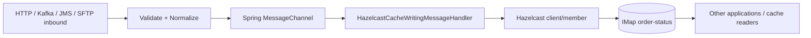
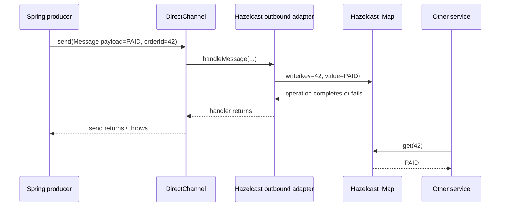

# Hazelcast outbound channel adapter

## 1. Overview: sending Spring Messages into Hazelcast

In the **SPRING_INTEGRATION_ADAPTERS** module, Spring Integration connects external systems using **inbound/outbound adapters**, **gateways**, **pollers**, and **MessageChannels**. A system might receive requests over HTTP, files, SFTP, JMS, AMQP, or Kafka, validate the message contract, and then write transient state to a distributed data store. In the **Adapter Cloud** chapter, the **Hazelcast outbound channel adapter** is the bridge from a Spring Integration message flow to Hazelcast **distributed objects**.

For example, an order-processing application receives an `ORDER_PAID` event from Kafka. After checking the payload and permissions, it wants to update the order status in an `IMap<String, String>` named `order-status`. Another service connected to the same Hazelcast cluster can read the updated state. Spring Integration does not require every handler to fetch `HazelcastInstance` and call `IMap.put(...)` manually; instead, the outbound adapter accepts the Spring message, resolves the key/value, and writes to the configured Hazelcast object.



**Outbound** here means **moving from Spring Integration out to Hazelcast**. It is not an outbound HTTP request, nor an automatic way to ship logs to a cloud provider. Hazelcast may run embedded, in a private network, on Kubernetes, or as a managed deployment; cluster connectivity and security are handled separately.

**Lesson objectives:**

1. Understand `HazelcastCacheWritingMessageHandler` and the difference between inbound and outbound channel adapters.
2. Know the distributed objects supported by the outbound adapter: `IMap`, `MultiMap`, `ReplicatedMap`, `IList`, `ISet`, `IQueue`, and `ITopic`.
3. Configure `cache`, `cache-expression`, `HazelcastHeaders.CACHE_NAME`, `key-expression`, and `extract-payload`.
4. Build **JavaConfig** and **XML** examples that write order statuses through a Spring `MessageChannel`.
5. Test end-to-end with Spring Boot Test and read back from the `IMap` to confirm the result.
6. Distinguish **key-value writes**, **adding items to a queue/list/set**, and **publishing to a topic**.
7. Design error handling, retries, idempotency, TTL, serialization, monitoring, security, and cloud connectivity.
8. Avoid equating **successful channel send**, **completed Hazelcast mutation**, and **durable business commit**.

> **Guiding principle:** an outbound channel adapter is a one-way forwarding mechanism. It does not generate a business reply, does not turn a Hazelcast cache into a durable event log, and does not guarantee exactly-once delivery across multiple participating systems.

## 2. Architecture and component responsibilities

### 2.1. Spring Integration receives and routes messages

A basic message:

```java
Message<String> message = MessageBuilder
    .withPayload("PAID")
    .setHeader("orderId", "order-42")
    .setHeader("eventId", "evt-123")
    .build();
```

In Spring Integration:

- **`payload`** is the data to write: `"PAID"` in this example.
- **`headers`** carry metadata: `orderId` to resolve the key and `eventId` for correlation.
- **`MessageChannel`** delivers the message to a subscriber or handler.
- **`@ServiceActivator`** or Java DSL `.handle(...)` subscribes the outbound handler to the channel.
- **Hazelcast outbound adapter** translates the message into an operation on the distributed object.

Notably, Spring's `MessageHeaders.ID` identifies the current message instance; it does not replace a stable business event ID across retries and replays.

### 2.2. Hazelcast supports multiple data structures

| Distributed object | Meaning | How to understand outbound writes |
|---|---|---|
| `IMap<K,V>` | Distributed key-value map | Writes `value` at `key`; duplicate keys may overwrite. |
| `MultiMap<K,V>` | Multiple values per key | Appends values under a key; counts and duplicates depend on configuration. |
| `ReplicatedMap<K,V>` | Replicated key-value map | Writes key/value; replication/consistency differs from `IMap`. |
| `IList<E>` | Item list | Appends an item; lists may contain duplicates. |
| `ISet<E>` | Item set | Adds an item with set semantics; equivalent items may not increase size. |
| `IQueue<E>` | Distributed queue | Enqueues an item; a separate consumer must call `poll()/take()`. |
| `ITopic<E>` | Publish/subscribe | Publishes messages to active listeners; not a durable log on its own. |

**Do not apply `key-expression` to every object type.** Spring Integration documents `key-expression` as an option for map-like operations (`IMap`/`MultiMap`/`ReplicatedMap`); lists, sets, queues, and topics do not use key-value pairs the same way.

### 2.3. Position of the outbound adapter in a pipeline



This is the **simple model with `DirectChannel`**. A handler running synchronously can make the caller wait for the Hazelcast operation. When `ExecutorChannel`, queues, retries, or network reconnects are involved, completion ordering can vary.

**Do not read `MessageChannel.send(...) == true` as a permanent confirmation:** that boolean only indicates dispatch was accepted per the channel's semantics. With `DirectChannel` and a standard handler, synchronous exceptions can propagate to the caller, yet that says nothing about Kafka or database commits in other systems.

## 3. Exact Spring Integration components

### 3.1. Required module

The Hazelcast support dependency is:

```xml
<dependency>
    <groupId>org.springframework.integration</groupId>
    <artifactId>spring-integration-hazelcast</artifactId>
</dependency>
```

`spring-boot-starter-integration` **does not automatically include** the Hazelcast adapter unless your project explicitly pulls this module into the dependency graph.

### 3.2. Class performing the write

Spring Integration uses:

```java
import org.springframework.integration.hazelcast.outbound.HazelcastCacheWritingMessageHandler;
```

This is a `MessageHandler`: it is invoked when a Spring channel receives a message and does not create a `@MessagingGateway` or a polling source on its own.

Key setters exposed by the API:

```java
HazelcastCacheWritingMessageHandler handler =
    new HazelcastCacheWritingMessageHandler();

handler.setDistributedObject(distributedObject);
handler.setKeyExpression(spelExpression);
handler.setExtractPayload(true);

// Or select the cache via an expression instead of a fixed object.
handler.setCacheExpression(cacheExpression);
```

Choose **one primary way to resolve the distributed object**, avoiding conflicting configuration:

- `setDistributedObject(...)`: uses a configured `IMap`/`IQueue`/... bean.
- `setCacheExpression(...)`: resolves the object via an appropriate SpEL expression.
- `HazelcastHeaders.CACHE_NAME`: uses the header when neither a fixed cache nor a cache expression is configured.

Although the class name contains **CacheWriting**, its scope is not limited to `IMap`; it supports queues, lists, sets, and topics as listed in section 2.

### 3.3. Java annotation and XML namespace

Java:

```java
@Bean
@ServiceActivator(inputChannel = "writeOrderStatus")
HazelcastCacheWritingMessageHandler orderStatusWriter() {
    // ...
}
```

XML:

```xml
<int-hazelcast:outbound-channel-adapter
    channel="writeOrderStatus"
    cache="ordersMap"
    key-expression="headers['orderId']"
    extract-payload="true"/>
```

These two configurations are **alternatives for the same flow**. Do not register both subscribers simultaneously on a `DirectChannel` expecting two copies; `DirectChannel` is not a broadcast channel.

## 4. Contract of outbound properties

Per the Spring Integration Hazelcast documentation, the outbound adapter supports:

| Property | Required? | Meaning |
|---|---|---|
| `channel` | Yes in XML | Name of the input Spring `MessageChannel`. |
| `cache` | One of the object-selection options | Reference to a created distributed object bean, e.g., `ordersMap`. |
| `cache-expression` | Alternative to `cache` | SpEL expression selecting the object based on the message. |
| `HazelcastHeaders.CACHE_NAME` | Fallback when neither above is set | Header supplying the distributed object name per adapter rules. |
| `key-expression` | For map-like objects | Extracts the key from the Spring message, e.g., `headers['orderId']` or `payload.id`. |
| `extract-payload` | No; defaults to `true` | `true`: writes the payload; `false`: converts both payload and headers per the adapter converter. |

### 4.1. `cache`: fixed reference

Example:

```text
ordersMap: IMap<String,String> bean
writeOrderStatus: DirectChannel
adapter: cache=ordersMap
```

Its advantage is that it is easy to review, test, and restrict write access. For a microservice writing order statuses to a single map, this is usually the clearest and safest choice.

**`cache="ordersMap"` in XML is a bean name**, not an endpoint URI. The underlying Hazelcast map name could be `order-status`, created via `hazelcastInstance.getMap("order-status")`.

### 4.2. `cache-expression`: dynamic object selection

The documentation gives the example:

```xml
<int-hazelcast:outbound-channel-adapter
    channel="dynamicWrites"
    cache-expression="headers['CACHE_HEADER']"
    key-expression="payload.key"
    extract-payload="true"/>
```

This selects the target object from a header or expression. Verify that the expression returns the exact type/value accepted by your adapter version and **ensure the selected cache/name belongs to an allowlist**.

**Never** take a `cacheName` header directly from an untrusted HTTP request, JMS, or Kafka message to let callers write to arbitrary Hazelcast maps in the cluster. That poses a cross-tenant and data-corruption risk.

A better policy:

```text
untrusted request.target = "orders"
    -> authenticate + authorize tenant
    -> validate enum target
    -> server-side mapping:
         "orders" -> ordersMap
         "audit"  -> auditMap
    -> outbound adapter
```

### 4.3. `HazelcastHeaders.CACHE_NAME`

If neither `cache` nor `cache-expression` is configured, the adapter can read the distributed object name from the header:

```java
import org.springframework.integration.hazelcast.HazelcastHeaders;

Message<String> request = MessageBuilder
    .withPayload("PAID")
    .setHeader(HazelcastHeaders.CACHE_NAME, "order-status")
    .setHeader("orderId", "order-42")
    .build();
```

**This is a dynamic routing option**, not meant to run alongside another fixed-cache adapter subscribed to the same channel. When an application works with multiple distributed object types, ensure the header only carries permitted values and that the Hazelcast instance and permissions match.

### 4.4. `key-expression`

For `IMap` and map-like types, the handler requires a key. Example:

```java
SpelExpressionParser parser = new SpelExpressionParser();

handler.setKeyExpression(
    parser.parseExpression("headers['orderId']"));
```

Or if the payload is a DTO with a matching accessor:

```java
handler.setKeyExpression(
    parser.parseExpression("payload.orderId"));
```

**Do not force the parser to guess a key** from the entire Spring message. If the header is missing, the expression may evaluate to `null`, causing a failure when writing to the map. Validate the key before dispatching so one message without an ID does not break the flow or enter endless retries.

### 4.5. `extract-payload=true/false`

Example message:

```text
Spring Message<String>
payload = "PAID"
headers =
  orderId: "order-42"
  eventId: "evt-123"
  traceId: "trace-567"
  replyChannel: <framework reference>
```

With `extract-payload="true"` (default), the value written is **`"PAID"`**.

With `extract-payload="false"`, the adapter converts **both the payload and headers** into the data to write. This can be useful when downstream consumers genuinely need metadata, but it increases serialization risks, internal header leakage, and storage overhead.

**Recommendation:** prefer `extract-payload=true` and explicitly normalize the payload into a well-defined DTO. If you want `eventId`/`tenantId` in the cache, make them **explicit fields** in the DTO instead of storing the entire default `MessageHeaders`.

## 5. Main hands-on lab: Spring Integration writing order status to an IMap

This lab runs inside a standalone Spring Boot application with no cloud account needed:

- Java 17+, compatible Spring Boot/Spring Integration/Hazelcast versions.
- An embedded Hazelcast member dedicated to the lab.
- `IMap<String,String>` named `order-status`.
- Spring `DirectChannel` named `writeOrderStatus`.
- `HazelcastCacheWritingMessageHandler` writing `payload` under the key from the `orderId` header.
- A Java service sending messages to the channel.
- A Spring Boot Test verifying the data is actually present in the map.

These snippets form **one cohesive sample program** if placed in package `example.hzout`, with versions/BOMs aligned to your project. Extensions in later sections are alternatives—do not enable all of them simultaneously.

### 5.1. Maven dependencies

Assuming `dependencyManagement` manages compatible Spring Boot, Spring Integration, and Hazelcast versions:

```xml
<dependencies>
    <dependency>
        <groupId>org.springframework.boot</groupId>
        <artifactId>spring-boot-starter-integration</artifactId>
    </dependency>

    <dependency>
        <groupId>org.springframework.integration</groupId>
        <artifactId>spring-integration-hazelcast</artifactId>
    </dependency>

    <dependency>
        <groupId>org.springframework.boot</groupId>
        <artifactId>spring-boot-starter-test</artifactId>
        <scope>test</scope>
    </dependency>
</dependencies>
```

Do not add an arbitrary version for `spring-integration-hazelcast` when a BOM already manages the remaining modules. Hazelcast serialization and cluster discovery evolve across versions; pin and test dependencies as a coherent set. Spring Boot 4 and Spring Integration 7 have a different baseline from Boot 3/Integration 6; check the documentation for the release line in use.

### 5.2. Spring Boot application

File `HazelcastOutboundApplication.java`:

```java
package example.hzout;

import org.springframework.boot.SpringApplication;
import org.springframework.boot.autoconfigure.SpringBootApplication;
import org.springframework.integration.annotation.EnableIntegration;

@SpringBootApplication
@EnableIntegration
public class HazelcastOutboundApplication {

    public static void main(String[] args) {
        SpringApplication.run(
            HazelcastOutboundApplication.class, args);
    }
}
```

`@EnableIntegration` enables Spring Integration infrastructure and endpoint configuration. No HTTP controller is needed if you only want to test the message flow through a Java service.

### 5.3. Embedded HazelcastInstance for the lab

File `HazelcastLabConfig.java`:

```java
package example.hzout;

import com.hazelcast.config.Config;
import com.hazelcast.core.Hazelcast;
import com.hazelcast.core.HazelcastInstance;
import com.hazelcast.map.IMap;

import org.springframework.context.annotation.Bean;
import org.springframework.context.annotation.Configuration;

@Configuration
public class HazelcastLabConfig {

    @Bean(destroyMethod = "shutdown")
    public HazelcastInstance hazelcastInstance() {
        Config config = new Config();
        config.setClusterName("si-hz-outbound-lab");

        // Configuration for an isolated lab environment;
        // do not use default discovery in production.
        config.getNetworkConfig().getJoin()
            .getMulticastConfig().setEnabled(false);
        config.getNetworkConfig().getJoin()
            .getTcpIpConfig().setEnabled(false);

        return Hazelcast.newHazelcastInstance(config);
    }

    @Bean("ordersMap")
    public IMap<String, String> ordersMap(
            HazelcastInstance hazelcastInstance) {
        return hazelcastInstance.getMap("order-status");
    }
}
```

Notes:

1. This is an **embedded member**, not a Hazelcast Cloud client.
2. Keep the lab cluster name distinct from production to avoid accidental joins. For multi-node setups, configure discovery and networking per the actual topology.
3. Disabling multicast/TCP-IP in the lab does not replace TLS, credentials, network ACLs, or firewalls in real deployments.
4. `destroyMethod="shutdown"` lets Spring manage the instance lifecycle; never shut it down after each message.
5. Protect Hazelcast member/client ports; never expose cluster ports to the Internet.
6. When using managed Hazelcast, build the `HazelcastInstance` with the provider's client configuration rather than an embedded member.

### 5.4. DirectChannel and outbound adapter

File `HazelcastOutboundConfig.java`:

```java
package example.hzout;

import com.hazelcast.map.IMap;

import org.springframework.beans.factory.annotation.Qualifier;
import org.springframework.context.annotation.Bean;
import org.springframework.context.annotation.Configuration;
import org.springframework.expression.spel.standard.SpelExpressionParser;
import org.springframework.integration.annotation.ServiceActivator;
import org.springframework.integration.channel.DirectChannel;
import org.springframework.integration.hazelcast.outbound.HazelcastCacheWritingMessageHandler;
import org.springframework.messaging.MessageChannel;

@Configuration
public class HazelcastOutboundConfig {

    @Bean("writeOrderStatus")
    public MessageChannel writeOrderStatus() {
        return new DirectChannel();
    }

    @Bean
    @ServiceActivator(inputChannel = "writeOrderStatus")
    public HazelcastCacheWritingMessageHandler orderStatusWriter(
            @Qualifier("ordersMap") IMap<String, String> ordersMap) {

        HazelcastCacheWritingMessageHandler handler =
            new HazelcastCacheWritingMessageHandler();

        handler.setDistributedObject(ordersMap);
        handler.setKeyExpression(
            new SpelExpressionParser()
                .parseExpression("headers['orderId']"));
        handler.setExtractPayload(true);

        return handler;
    }
}
```

**How it works:**

- The Spring context defines a `writeOrderStatus` bean of type `DirectChannel`.
- `@ServiceActivator` wires `HazelcastCacheWritingMessageHandler` to the channel.
- `setDistributedObject(ordersMap)` fixes the target `IMap` object.
- `setKeyExpression(...)` extracts the key from the `orderId` header.
- `setExtractPayload(true)` uses the `String` payload as the map value.
- When the channel dispatches a message, the handler writes to the Hazelcast map.

With this setup, **no poller is needed**. The outbound adapter reacts when a producer sends a message to the channel, unlike a polling inbound adapter that pulls from a source.

### 5.5. Publisher service

File `OrderStatusPublisher.java`:

```java
package example.hzout;

import java.util.Set;
import java.util.UUID;

import org.springframework.beans.factory.annotation.Qualifier;
import org.springframework.messaging.MessageChannel;
import org.springframework.messaging.support.MessageBuilder;
import org.springframework.stereotype.Service;

@Service
public class OrderStatusPublisher {

    private static final Set<String> ALLOWED = Set.of(
        "CREATED", "PAID", "SHIPPED", "CANCELLED");

    private final MessageChannel writeOrderStatus;

    public OrderStatusPublisher(
            @Qualifier("writeOrderStatus")
            MessageChannel writeOrderStatus) {
        this.writeOrderStatus = writeOrderStatus;
    }

    public String publish(String orderId, String status) {
        if (orderId == null
                || !orderId.matches("[A-Za-z0-9_-]{1,80}")) {
            throw new IllegalArgumentException(
                "Invalid orderId");
        }

        if (status == null || !ALLOWED.contains(status)) {
            throw new IllegalArgumentException(
                "Invalid status");
        }

        String eventId = UUID.randomUUID().toString();

        boolean dispatched = writeOrderStatus.send(
            MessageBuilder.withPayload(status)
                .setHeader("orderId", orderId)
                .setHeader("eventId", eventId)
                .build());

        if (!dispatched) {
            throw new IllegalStateException(
                "Order status channel rejected message");
        }

        // Event ID is for demo correlation; it does not prove
        // durability or support deduplication after a crash.
        return eventId;
    }
}
```

Why validate **before** the outbound handler?

- Prevents empty/null, overly long, or arbitrary keys that cause cardinality explosions.
- Prevents statuses outside the enum from entering the cache.
- Avoids retrying deterministic input errors that will never succeed.
- Defines the payload contract independently of how Hazelcast serializes values.

**Note:** the `UUID` is generated on **each invocation** by the receiver. If the same business event is replayed by Kafka/JMS after a restart, a fresh UUID will not identify it as a duplicate. True idempotency requires a stable ID from the source and a version/deduplication policy.

### 5.6. End-to-end testing

File `HazelcastOutboundTest.java`:

```java
package example.hzout;

import static org.junit.jupiter.api.Assertions.*;

import com.hazelcast.map.IMap;
import java.util.UUID;

import org.junit.jupiter.api.Test;
import org.springframework.beans.factory.annotation.Autowired;
import org.springframework.beans.factory.annotation.Qualifier;
import org.springframework.boot.test.context.SpringBootTest;

@SpringBootTest
class HazelcastOutboundTest {

    @Autowired
    OrderStatusPublisher publisher;

    @Autowired
    @Qualifier("ordersMap")
    IMap<String, String> ordersMap;

    @Test
    void writesPayloadToIMapUsingHeaderKey() {
        String orderId =
            "order-" + UUID.randomUUID();

        String eventId =
            publisher.publish(orderId, "PAID");

        assertNotNull(eventId);
        assertEquals("PAID", ordersMap.get(orderId));
    }

    @Test
    void laterWriteForSameKeyUpdatesMapValue() {
        String orderId =
            "order-" + UUID.randomUUID();

        publisher.publish(orderId, "CREATED");
        assertEquals("CREATED", ordersMap.get(orderId));

        publisher.publish(orderId, "SHIPPED");
        assertEquals("SHIPPED", ordersMap.get(orderId));
    }

    @Test
    void invalidStatusNeverReachesMap() {
        String orderId =
            "order-" + UUID.randomUUID();

        assertThrows(IllegalArgumentException.class,
            () -> publisher.publish(orderId, "UNKNOWN"));

        assertNull(ordersMap.get(orderId));
    }

    @Test
    void invalidOrderIdIsRejectedBeforeSend() {
        assertThrows(IllegalArgumentException.class,
            () -> publisher.publish("../admin", "PAID"));
    }
}
```

These tests verify:

1. Spring Boot creates the expected `HazelcastInstance` and `IMap` bean.
2. `@ServiceActivator` is registered on `writeOrderStatus`.
3. `key-expression` reads `orderId` from the header.
4. `extract-payload=true` writes `"PAID"` rather than the whole Spring `Message`.
5. Writing again with the same key updates the map value.
6. Invalid input is rejected before invoking Hazelcast.

These tests **do not** prove durability across cluster restarts or replication across members. With `DirectChannel`, behavior is observable synchronously in the lab; with `ExecutorChannel` or an async queue, you cannot assume `ordersMap.get(...)` reflects the write immediately after `send()`.

### 5.7. Keeping tests isolated

Key practices:

- Use dedicated cluster and map names, and never connect to production cloud.
- Use randomized keys to avoid overwriting other tests' data.
- Avoid ordering-dependent tests sharing the same key in one `IMap`.
- Avoid unintended listeners/event consumers that contend with or slow down tests.
- Ensure the Spring context shuts down `HazelcastInstance` after tests.
- When testing concurrency, account for overwrites if multiple writers update the same key simultaneously.
- Never rely on `Thread.sleep(...)` as a readiness signal; inspect actual instance and endpoint state.

## 6. Equivalent XML configuration

If the application uses the Spring Integration XML namespace, the outbound adapter looks like:

```xml
<int-hazelcast:outbound-channel-adapter
    channel="writeOrderStatus"
    cache="ordersMap"
    key-expression="headers['orderId']"
    extract-payload="true"/>
```

### 6.1. Complete XML file for the lab

Example `src/main/resources/hazelcast-outbound.xml`:

```xml
<?xml version="1.0" encoding="UTF-8"?>
<beans xmlns="http://www.springframework.org/schema/beans"
       xmlns:xsi="http://www.w3.org/2001/XMLSchema-instance"
       xmlns:int="http://www.springframework.org/schema/integration"
       xmlns:int-hazelcast="http://www.springframework.org/schema/integration/hazelcast"
       xsi:schemaLocation="
         http://www.springframework.org/schema/beans
         https://www.springframework.org/schema/beans/spring-beans.xsd
         http://www.springframework.org/schema/integration
         https://www.springframework.org/schema/integration/spring-integration.xsd
         http://www.springframework.org/schema/integration/hazelcast
         https://www.springframework.org/schema/integration/hazelcast/spring-integration-hazelcast.xsd">

    <int:channel id="writeOrderStatus"/>

    <bean id="hzInstance"
          class="com.hazelcast.core.Hazelcast"
          factory-method="newHazelcastInstance"
          destroy-method="shutdown">
        <constructor-arg>
            <bean class="com.hazelcast.config.Config"/>
        </constructor-arg>
    </bean>

    <bean id="ordersMap"
          factory-bean="hzInstance"
          factory-method="getMap">
        <constructor-arg value="order-status"/>
    </bean>

    <int-hazelcast:outbound-channel-adapter
        channel="writeOrderStatus"
        cache="ordersMap"
        key-expression="headers['orderId']"
        extract-payload="true"/>

</beans>
```

**Explanation:**

- `cache="ordersMap"` is a bean reference.
- `key-expression` extracts the key from the message header.
- `extract-payload="true"` keeps the value as just `String`.
- `<int:channel>` omits a queue sub-element, so it uses synchronous point-to-point semantics matching `DirectChannel`.
- The XML Hazelcast `hzInstance` uses default configuration **solely to illustrate syntax**. Default discovery/ports may be insecure or join unintended clusters; production must replace this with an infrastructure-managed client/instance bean.

**Do not load** this XML concurrently with section 5's JavaConfig for the same `hzInstance`/`ordersMap`/`writeOrderStatus`. If both an XML adapter and a `@ServiceActivator` attach to one `DirectChannel`, dispatch behavior may be unpredictable.

### 6.2. Importing XML into Spring Boot

```java
package example.hzout;

import org.springframework.boot.SpringApplication;
import org.springframework.boot.autoconfigure.SpringBootApplication;
import org.springframework.context.annotation.ImportResource;
import org.springframework.integration.annotation.EnableIntegration;

@SpringBootApplication
@EnableIntegration
@ImportResource("classpath:hazelcast-outbound.xml")
public class HazelcastXmlApplication {

    public static void main(String[] args) {
        SpringApplication.run(
            HazelcastXmlApplication.class, args);
    }
}
```

This is an **alternative configuration**, not an extra layer to run alongside `HazelcastOutboundApplication` and all the JavaConfig classes. When using XML, you can keep the Java `OrderStatusPublisher` service as long as the `writeOrderStatus` channel is defined by XML.

## 7. Java DSL: attaching the outbound handler to an IntegrationFlow

For projects using the Java DSL, you can build a flow from an input channel and call `.handle(...)` with the handler bean:

```java
package example.hzout;

import com.hazelcast.map.IMap;
import org.springframework.beans.factory.annotation.Qualifier;
import org.springframework.context.annotation.Bean;
import org.springframework.context.annotation.Configuration;
import org.springframework.expression.spel.standard.SpelExpressionParser;
import org.springframework.integration.dsl.IntegrationFlow;
import org.springframework.integration.hazelcast.outbound.HazelcastCacheWritingMessageHandler;

@Configuration
public class HazelcastDslAlternative {

    @Bean
    public HazelcastCacheWritingMessageHandler hzDslWriter(
            @Qualifier("ordersMap")
            IMap<String, String> ordersMap) {
        HazelcastCacheWritingMessageHandler handler =
            new HazelcastCacheWritingMessageHandler();

        handler.setDistributedObject(ordersMap);
        handler.setKeyExpression(
            new SpelExpressionParser()
                .parseExpression("headers['orderId']"));
        handler.setExtractPayload(true);

        return handler;
    }

    @Bean
    public IntegrationFlow ordersToHazelcast(
            HazelcastCacheWritingMessageHandler hzDslWriter) {
        return IntegrationFlow.from("writeOrderStatus")
            .handle(hzDslWriter)
            .get();
    }
}
```

**This is an alternative** to `@ServiceActivator` in section 5.4; do not enable both on the same input channel.

In a complete flow, `.handle(hzDslWriter)` is typically the **terminal endpoint of the outbound branch**: the handler produces no business reply. If additional steps are needed after writing to Hazelcast, design a separate flow, emit an event after the write via a mechanism with a clear outcome contract, or use an appropriate gateway/service.

**Do not confuse** an outbound adapter `.handle(...)` with a request-reply `@MessagingGateway`. Hazelcast's `IMap.put(...)` has a return value in its API, but the one-way adapter does not automatically turn the previous value or write status into a Spring reply for the caller.

## 8. Other distributed objects: non-uniform behavior

### 8.1. IMap

```text
Message: payload=PAID, orderId=order-42
    -> handler key-expression=headers['orderId']
    -> IMap.put("order-42", "PAID")
```

When writing to an existing key, the value may be overwritten; the mutation typically emits an `UPDATED` event to matching listeners. If the key did not exist, it may emit `ADDED`. The current map state **is not an update history log**.

### 8.2. MultiMap

`MultiMap<K,V>` supports multiple values per key. The outbound adapter uses `key-expression` as with a map; determine whether the collection type/configuration allows duplicates and whether deduplication is required.

Applications should never assume:

- Each key holds only one record.
- Sending the same payload twice always stores two distinct values.
- Value ordering is stable like an event log.
- Putting into a `MultiMap` is a transaction spanning Kafka and Hazelcast.

If each key should hold a single latest state, `IMap` is usually more appropriate than `MultiMap`.

### 8.3. ReplicatedMap

`ReplicatedMap` fits certain read-heavy replication scenarios, but its replication and consistency characteristics differ from `IMap`. When writing rapidly changing state or needing strong ordering, evaluate consistency, topology, serializers, and conflict behavior.

### 8.4. IList / ISet

For `IList` and `ISet`, the adapter writes **elements** and does not need `key-expression`:

```java
import com.hazelcast.collection.ISet;
import org.springframework.integration.hazelcast.outbound.HazelcastCacheWritingMessageHandler;

ISet<String> seenOrders =
    hazelcastInstance.getSet("seen-orders");

HazelcastCacheWritingMessageHandler handler =
    new HazelcastCacheWritingMessageHandler();

handler.setDistributedObject(seenOrders);
handler.setExtractPayload(true);
```

This snippet is **only a fragment**; to work, the handler must be subscribed to a channel or flow. `ISet` has set semantics so duplicate values may not increase element count, yet this **does not replace business idempotency** unless the value is a normalized business key.

`IList` permits duplicates and has list semantics, but global execution ordering across updates from multiple network nodes/clients cannot be inferred merely from receiving a response on one thread.

### 8.5. IQueue: enqueuing work vs listening for events

A queue-based flow:


Example:

```java
import com.hazelcast.collection.IQueue;
import org.springframework.integration.hazelcast.outbound.HazelcastCacheWritingMessageHandler;

IQueue<String> workQueue =
    hazelcastInstance.getQueue("work-items");

HazelcastCacheWritingMessageHandler handler =
    new HazelcastCacheWritingMessageHandler();

handler.setDistributedObject(workQueue);
handler.setExtractPayload(true);
```

The outbound adapter inserts items into `IQueue`, while a **separate consumer** must pull them. Do not confuse this with the Hazelcast inbound **event listener** observing `ADDED` on `IQueue`: that listener only sees notifications and **does not dequeue** items.

Even though `IQueue` is distributed, calling `poll()` and committing to a DB only after processing still leaves a crash window: the item has already been removed from the queue before business work finishes. If jobs cannot be lost, use a claim/ack/retry protocol, persistent store, or broker with appropriate semantics.

### 8.6. ITopic: publishing is not durable storage

```java
import com.hazelcast.topic.ITopic;
import org.springframework.integration.hazelcast.outbound.HazelcastCacheWritingMessageHandler;

ITopic<String> topic =
    hazelcastInstance.getTopic("notifications");

HazelcastCacheWritingMessageHandler handler =
    new HazelcastCacheWritingMessageHandler();

handler.setDistributedObject(topic);
handler.setExtractPayload(true);
```

`ITopic` sends notifications to currently subscribed listeners. Never assume an offline subscriber will receive missed history on reconnect. If the business requires replay, retention, or consumer offsets, use a broker/event log designed for it and evaluate `ReliableTopic` or version-specific Hazelcast features rather than inferring guarantees from the name "Topic".

### 8.7. Quick decision table

| Requirement | Consider | Limitations |
|---|---|---|
| Lookup current state by ID | `IMap` | Overwrites; does not retain full history. |
| Multiple values per key | `MultiMap` | Requires duplicate/cleanup rules. |
| Replicated map for specialized reads | `ReplicatedMap` | Consistency/replication must be evaluated. |
| Ordered list of items | `IList` | Allows duplicates; unbounded memory growth risk. |
| Membership/unique values | `ISet` | Uniqueness by equality/serialization, not business idempotency. |
| Consumers pulling queued jobs | `IQueue` | Dequeue before commit risks losing jobs on crash. |
| Immediate notification broadcast | `ITopic` | No default replay for late subscribers. |
| Long-term audit event storage | Kafka/DB outbox/event log | Hazelcast notifications/caches are not substitutes. |

## 9. Dynamic cache selection: powerful capability, high risk

### 9.1. Valid options

The Spring Integration docs list three ways to choose the distributed object:

1. Fixed `cache` bean/reference.
2. SpEL `cache-expression`.
3. `HazelcastHeaders.CACHE_NAME` header when neither of the above is configured.

Prefer a **fixed cache** when the application targets a single destination. Dynamic cache selection is useful when one handler serves a permitted set of objects, but requires:

- Authenticated and authorized input.
- An allowlist of cache names/objects.
- Verification of matching object types (not sending key-values into a queue or vice versa).
- Bounds on the number of newly created distributed objects.
- Consistent serializers/schemas per object.
- No leakage of tenants or sensitive data across maps.

### 9.2. Never take arbitrary Hazelcast object names from callers

**Anti-pattern:**

```text
HTTP request: {"cacheName":"tenantB-secrets","key":"x"}
    -> pass cacheName directly to HazelcastHeaders.CACHE_NAME
    -> outbound adapter
```

A caller could pick an unauthorized map name. Even if the Hazelcast client has broad write privileges, the application must **enforce domain authorization**.

Solution:

```java
enum TargetMap {
    ORDER_STATUS,
    ORDER_AUDIT
}

String allowedName(TargetMap target) {
    return switch (target) {
        case ORDER_STATUS -> "order-status";
        case ORDER_AUDIT -> "order-audit";
    };
}
```

This is an **example mapping enum→valid name**; it must be applied **after authorization**. Do not convert arbitrary user strings into an enum that bypasses permissions; the security boundary must determine the permitted tenant and operation first.

### 9.3. Which header metadata should reach the cache?

Useful headers for monitoring/correlation:

| Header | Purpose | Should it be stored with the value? |
|---|---|---|
| `orderId` | Map key | Usually no need to duplicate inside the value unless required by schema. |
| `eventId` | Correlation/idempotency | Can be a controlled DTO field. |
| `traceId` | Distributed tracing | Avoid unbounded raw trace labels/high cardinality. |
| `trustedTenantId` | Tenant authorization | Only when attached server-side from an authenticated boundary. |
| `HazelcastHeaders.CACHE_NAME` | Dynamic object routing | Do not store arbitrarily as business "truth". |
| `replyChannel`/`errorChannel` | Internal framework | **Never** pass directly into value/cache serialization. |
| `Authorization`/tokens | Secrets | **Never**; manage via security context/secret store. |

`extract-payload=false` can store more metadata than expected; in production, use it only with an explicit schema and policy approval.

## 10. Error handling: where do failures come from?

### 10.1. Error classification

An outbound flow can fail at multiple layers:

| Layer | Typical failures | Handling approach |
|---|---|---|
| Spring producer | Missing or schema-invalid payload/key | Reject before adapter; never retry infinitely. |
| MessageChannel | No subscriber, full queue, timeout | Instrument channel; fix configuration/capacity. |
| SpEL | `key-expression` references wrong property or evaluates to null | Test expressions/schemas; quarantine invalid messages. |
| Adapter | Wrong object type selected or initialization failure | Check bean references and routing logic. |
| Hazelcast client/member | Disconnected, timeout, cluster unavailable | Bounded retries, reconnect/readiness checks, bounded recovery. |
| Serialization | Missing serializer, schema mismatch | Fix schema/version; do not retry identical payload forever. |
| Map operation | Overwrite/TTL/policy conflict | Business conflict handling, version checks. |
| Queue/topic | Full queue or listener/subscriber unavailable | Backpressure/recovery; never fake delivery. |
| Other downstream | DB/Kafka/HTTP commit failure | Separate transaction/outbox/ack handling. |

**Do not equate** every failure with an `ErrorMessage`. With `DirectChannel`, a handler exception can propagate directly to the caller; with `ExecutorChannel`/pollers, failures can happen on another thread and be routed by a configured error publisher to an error channel. A global `errorChannel` does not automatically capture every network driver failure.

### 10.2. Fail fast on invalid input

Examples to reject immediately:

```text
orderId = null
orderId = ""
orderId = "../../otherTenant"
status = "UNKNOWN"
cacheName = "private-map-not-allowed"
```

Deterministic errors must not be retried 100 times automatically. Run validation before `writeOrderStatus` or inside the publishing service.

### 10.3. When Hazelcast temporarily loses connectivity

A client may encounter timeouts or an unavailable cluster. Distinguish:

- The operation definitely **did not execute**.
- The operation was sent, but the response was lost: **unknown outcome**.
- The operation completed in Hazelcast, but the app crashed before recording internal state.
- Retrying the same map key could overwrite a newer value.
- Retrying into `IQueue`/`MultiMap`/`IList` could **insert duplicate items**.

Therefore, retry only when allowed by the contract, bound attempts/deadlines/backoff, and use idempotency/version checks whenever side effects exist.

### 10.4. Illustrative ErrorMessage consumer

If the flow defines a `hazelcastOutboundErrors` channel **and** wires the corresponding error publisher/advice, you can add:

```java
package example.hzout;

import org.slf4j.Logger;
import org.slf4j.LoggerFactory;
import org.springframework.integration.annotation.ServiceActivator;
import org.springframework.messaging.Message;
import org.springframework.messaging.MessagingException;
import org.springframework.messaging.support.ErrorMessage;
import org.springframework.stereotype.Component;

@Component
public class HazelcastOutboundErrorConsumer {

    private static final Logger log =
        LoggerFactory.getLogger(
            HazelcastOutboundErrorConsumer.class);

    @ServiceActivator(inputChannel = "hazelcastOutboundErrors")
    public void onError(ErrorMessage error) {
        Throwable failure = error.getPayload();

        Message<?> failed = error.getOriginalMessage();
        if (failed == null &&
                failure instanceof MessagingException ex) {
            failed = ex.getFailedMessage();
        }

        log.error("Hazelcast outbound error: type={}, hasMessage={}",
            failure.getClass().getSimpleName(),
            failed != null);

        // Production: metrics, alerts, bounded recovery/DLQ.
        // Never log raw payloads or credentials by default.
    }
}
```

**This is only a consumer**, not an automatic publisher setup. With `DirectChannel`, callers must catch/observe synchronous exceptions or attach specific retry/error advice; across an async boundary, configure the `errorChannel` header or an error publisher. Do not assume every Hazelcast exception will land on the channel above just because this bean exists.

## 11. Retries, idempotency, versioning, and consistency

### 11.1. IMap.put is not a business transaction

With `IMap`, a write has Hazelcast's semantics. However, a business flow might span:

```text
Kafka consume event
 -> SQL business transaction
 -> Spring Integration outbound adapter
 -> Hazelcast IMap write
 -> Kafka offset commit
```

These steps **do not automatically participate in an atomic distributed transaction**. Possible outcomes include:

1. Database commits, but the Hazelcast update has not occurred yet.
2. Hazelcast updates, but the Kafka offset is not committed, causing replay.
3. Retrying an older event overwrites a newer state.
4. A cluster partition causes a client timeout with an unknown outcome.

If Hazelcast is strictly a **cache/projection**, the right model is typically a **source of truth** (database/event log) plus a cache rebuild mechanism. If Hazelcast serves as a critical state store, clarify persistence, backups, and durability in your exact configuration—never infer zero data loss simply from the word "distributed".

### 11.2. Idempotency by object type

| Object | Risk on retry | Mitigation |
|---|---|---|
| `IMap` | Stale event overwrites newer state | Version/sequence numbers and conditional updates, or rebuild from source of truth. |
| `MultiMap` | Value appended multiple times | Deduplicate by event ID, review collection semantics. |
| `IList` | Duplicate items | Event ID and consumer/store deduplication. |
| `ISet` | May avoid equal items, though equality might diverge from domain identity | Normalized keys and stable identity. |
| `IQueue` | Duplicate jobs | Idempotent consumer, claim/ack/retry strategy. |
| `ITopic` | Duplicate or missed notifications | Subscriber idempotency or a durable broker. |

### 11.3. Do not use last-write-wins when business ordering matters

Consider two messages:

```text
event #105: order-42 = SHIPPED
event #104: order-42 = PAID
```

If #104 is retried after #105, a plain `IMap.put` can revert the state from `SHIPPED` back to `PAID`. To prevent that, store `version` alongside the value and perform conditional updates (`EntryProcessor`/CAS or equivalent Hazelcast API logic), rather than mapping the key to a bare `String`.

Suggested DTO:

```java
public record VersionedOrderState(
    String orderId,
    long version,
    String status,
    String eventId
) {}
```

The `IMap.put` adapter example only demonstrates a simple write. **When conditional atomic updates are required**, implement a custom service/handler calling a Hazelcast entry processor or matching API, rather than assuming the outbound adapter has a CAS parameter that does not exist in its API.

## 12. TTL, eviction, memory, and cluster capacity

### 12.1. The adapter does not control all cache policies

`HazelcastCacheWritingMessageHandler` mainly determines **the target object, key, and value**. Other settings are usually configured on the Hazelcast map itself:

- TTL / maximum idle time.
- Eviction policy and memory budget.
- Backups and persistence/store integration.
- Partitioning and split-brain behavior.
- In-memory format, serialization, and indexing.
- Cluster topology and client retries.

Do not assume a `setTtl(...)` setter exists on `HazelcastCacheWritingMessageHandler`; the handler's main API does not expose such a method.

### 12.2. Example TTL in map configuration

Illustrative example at the Hazelcast layer:

```java
import com.hazelcast.config.Config;
import com.hazelcast.config.MapConfig;

Config config = new Config();

MapConfig mapConfig = new MapConfig("order-status");
mapConfig.setTimeToLiveSeconds(3600);

config.addMapConfig(mapConfig);

// Use this config when creating the HazelcastInstance in the lab.
```

A 3,600-second TTL means records can disappear after the configured duration; thus `IMap` should not serve as a **long-term audit log**. If critical state must never be lost, persist it first in a durable system with proper retention and backups, treating the cache as a projection.

### 12.3. Bounded memory and payload size

Key risks:

- Message payloads holding large files or complex Java object graphs increase serialization cost.
- `extract-payload=false` accidentally pushes numerous headers into the cache.
- `IList`/`MultiMap` grow without bound if not cleaned up.
- `IQueue` fills up or consumers fall behind.
- `ITopic` has too many listeners receiving notifications faster than they can process them.

Limits should be enforced at the **source**, **Spring channels**, **Hazelcast object configuration**, and **downstream**. Do not treat a huge queue as a solution to overload; it often just delays failure and increases memory pressure.

## 13. Connectivity, security, and cloud deployment

### 13.1. Embedded member vs Hazelcast client

The lab uses:

```java
Hazelcast.newHazelcastInstance(config);
```

This starts a **member**. In managed or cloud deployments, Spring Integration typically uses a **Hazelcast client** connecting to an existing cluster.

Example client configuration fragment (illustrating creation only; endpoints, credentials, and TLS must come from infrastructure):

```java
import com.hazelcast.client.HazelcastClient;
import com.hazelcast.client.config.ClientConfig;
import com.hazelcast.core.HazelcastInstance;

ClientConfig config = new ClientConfig();
config.setClusterName("approved-cluster");

// In production: configure network addresses, discovery,
// TLS, and authentication per your provider/version.
HazelcastInstance client =
    HazelcastClient.newHazelcastClient(config);
```

**Do not copy this fragment as a production security setup**: it lacks TLS, identity, timeouts/retries, a secret source, and an endpoint allowlist. Never embed cluster secrets or private keys in Java string literals.

### 13.2. Trust boundary when receiving external Spring messages

A Spring inbound HTTP/Kafka/JMS/SFTP flow may carry headers controlled by an external sender. Distinguish clearly:

| Metadata | Trusted directly? | Notes |
|---|---|---|
| `orderId` | No | Validate domain format, length, tenant scope. |
| `cacheName` | No | Server-side allowlist only; never allow arbitrary object selection. |
| `status` | No | Enum/schema validation. |
| `tenantId` | No if client-supplied | Derive from authenticated principal or known topic/source. |
| `eventId` | Depends on source/trust | Validate and keep stable for dedup/replay. |
| `traceId` | Never for auth | Use for correlation; avoid high-cardinality metrics. |
| Cloud/Hazelcast credentials | Never inside messages | Use secret manager or managed identity. |

### 13.3. Cluster security

- Never expose Hazelcast member/client ports to the Internet without protective architecture.
- Use private networking, ACLs/security groups, and TLS/mTLS where supported by your edition/deployment.
- Verify cluster identity and discovery settings to prevent joining the wrong environment.
- Configure Hazelcast authentication and authorization according to your version/edition/managed provider.
- Protect backups/snapshots and PII-bearing event payloads with IAM, retention, and encryption.
- Never deserialize arbitrary Java objects from untrusted sources without a schema/serializer policy.
- Apply egress controls when the application also forwards data to HTTP/Kafka/SFTP/cloud targets.

**A matching cluster name is not authentication.** It is merely a connection setting; transport and principals must be secured according to a real security model.

### 13.4. Header injection and data leakage

`extract-payload=false` can push headers into cached entries, easily leaking `Authorization`, `replyChannel`, `errorChannel`, user attributes, or framework metadata.

Production should:

1. Keep `extract-payload=true`.
2. Use a DTO with an explicit field allowlist.
3. Redact secrets and cap payload sizes.
4. Never log entire `Message<?>`/`IMap` values.
5. Store audit/correlation IDs in appropriately access-controlled stores.
6. Never use raw cache keys as unbounded metric labels.

## 14. Serialization and version compatibility

A Hazelcast client/member serializes values across the network. Java objects lacking a matching serializer or having mismatched class schemas can cause outbound writes to fail.

### 14.1. Common failure examples

| Issue | Symptom | Remediation |
|---|---|---|
| Value class lacks a matching serializer | Hazelcast serialization error | Define versioned serializers/schemas. |
| Nodes A/B run different model versions | Deserialization failure or wrong types | Planned rolling upgrades and compatibility tests. |
| `extract-payload=false` writes framework headers | Hard to serialize/read or leaks metadata | Use a normalized DTO keeping only required fields. |
| Oversized object graph | CPU/GC/memory pressure | Cap byte sizes; avoid deep object graphs. |
| Unexpected key type | Cache misses, duplicate keys | Standardize `String`/numeric keys and equality. |
| Inconsistent cache names | Writes to wrong object or resolution error | Pin beans, schemas/versions, and allowlists. |

### 14.2. Schemas should stay independent of Spring Message

For a serious cache projection:

```java
public record OrderCacheValue(
    String orderId,
    long version,
    String status,
    String sourceEventId
) {}
```

Never store `Message<...>`, `HazelcastInstance`, `Member`, or framework `Throwable` instances as domain cache values. In polyglot or multi-platform systems, consider JSON/Compact/Avro/Protobuf or a serialization contract compatible with your Hazelcast version. Test round-trips against the **exact client/server version set** used in production.

## 15. Performance, backpressure, and concurrency

### 15.1. DirectChannel with synchronous map writes

```text
HTTP request thread / Kafka consumer
    -> DirectChannel
    -> Hazelcast handler
    -> Hazelcast remote operation
    -> returns or throws
```

Pros:

- Easy to see where exceptions occur.
- Easy to assert `ordersMap.get(key)` right after `send()` returns in the lab.
- No extra task queue inside the JVM.

Cons:

- If Hazelcast slows down or the cluster reconnects, upstream threads block.
- For Kafka consumers, long processing times can disrupt polling/commits.
- For HTTP, request latency spikes; external HTTP timeouts may trigger even if the write later succeeds.
- If retries exist at both source and downstream, duplicate or stale writes can arise.

### 15.2. ExecutorChannel

`ExecutorChannel` decouples the sender from the execution thread, but requires a **bounded `ThreadPoolTaskExecutor`**:

```text
Spring source -> ExecutorChannel (bounded queue)
              -> Hazelcast outbound handler
```

When the queue fills, tasks may be rejected, blocked, or run on the caller depending on the rejection policy. `CallerRunsPolicy` can block the sender thread; `DiscardPolicy` can drop tasks silently. Never deploy an unbounded executor and call it "backpressure handled".

### 15.3. QueueChannel + poller

`QueueChannel` buffers messages for scheduled polling. However:

- By default, the queue is in-memory.
- If the JVM crashes before the Hazelcast write, buffered messages can be lost.
- Slow poller processing grows the queue and increases latency.
- If keys repeat, completion order differing from source order can overwrite newer versions with older ones.

When **replay after restart** is required, use a durable queue/outbox with real acknowledgments and idempotency. Hazelcast's `HazelcastMessageStore` or `IQueue` may play a role, but their durability must be verified against backup/persistence settings and crash behavior—never assume every deployment defaults to persistent storage.

### 15.4. Size/throughput estimation

Suppose an application targets:

```text
Incoming rate       = 1,000 status updates/second
Average payload     = 200 bytes
Approx. value rate  = 200,000 bytes/second
                    = ~0.2 MB/s payload, excluding overhead
```

Also account for:

- Key serialization and headers (if included).
- Hazelcast partition and network replication.
- RTT and max in-flight operations.
- TTL, eviction, and indexing overhead.
- Member/backup counts and inter-node traffic.
- Downstream event listeners.
- Retry bursts, reconnects, and spill/replay mechanisms.

Do not blindly increase thread counts without knowing whether the remote cluster is bottlenecked on CPU, network, or memory.

## 16. Hazelcast lifecycle and readiness

### 16.1. Startup sequence

```text
Spring ApplicationContext starting
    -> Hazelcast client/member configured
    -> HazelcastInstance ready/connected
    -> IMap bean resolved
    -> outbound handler initialized
    -> channel subscriber registered
    -> start accepting Spring messages
```

A "started" Java process has not necessarily joined the intended Hazelcast cluster. Readiness should verify:

1. The instance/client is connected to the right cluster.
2. The distributed object name/type matches expectations.
3. The handler has been initialized by Spring.
4. The input channel has exactly one subscriber.
5. If the source is Kafka/HTTP, ingress only begins high-volume reads once the target meets readiness policy.
6. Metrics and error recovery are observable when the cluster disconnects.

### 16.2. Shutdown sequence

- Stop accepting new work or drain queues within the deadline.
- Allow in-flight Hazelcast operations to complete within bounds.
- Flush/persist retry state or outbox records as needed.
- Close the Hazelcast client/member through a single lifecycle owner.
- Never call `Hazelcast.shutdownAll()` inside a message-handling service activator.
- Do not rely on shutdown hooks during container kills, node OOMs, or power loss.

When sharing a `HazelcastInstance` managed by infrastructure, only the designated context owner should invoke `shutdown()`.

## 17. When should you NOT use the Hazelcast outbound adapter?

Although convenient, not every business requirement belongs in a direct cache write:

| Requirement | Should you use the simple outbound adapter? |
|---|---|
| Fast-read projection or transient state | Yes, when a source of truth exists for rebuilds. |
| Cluster flags or membership state | Possibly, after evaluating TTL and consistency. |
| Immediate fan-out notifications | Possible with `ITopic`; do not assume replay. |
| Enqueuing work to a distributed queue | Possible with `IQueue`; consumer and crash recovery must be explicit. |
| Audit events that must not be lost | **Do not rely solely on cache writes**; use a durable log/outbox. |
| Atomic DB + cache transaction | No; use transactional patterns and reconciliation. |
| State updates needing complex CAS versioning | Needs a custom handler/service/conditional update API. |
| Storing multi-GB files/objects | Unsuitable as cache values; use object storage or file adapters. |
| Exchanging data with non-Java/non-Hazelcast systems | Consider Kafka/JMS/AMQP/HTTP or schema-neutral APIs. |

Spring Integration provides dedicated outbound adapters and gateways for HTTP, JMS, AMQP, Kafka, file/SFTP, and databases. Choose technology based on delivery, retention, transaction, latency, and security properties—not merely because a component exists.

## 18. Test matrix

| Category | Test | Expected result |
|---|---|---|
| Bean wiring | Handler subscribed to `writeOrderStatus` | Exactly one subscriber. |
| Map write | Payload `PAID` with `orderId` header | `IMap.get(orderId) == "PAID"`. |
| Overwrite | Write `CREATED` then `SHIPPED` on same key | Current value is `SHIPPED`. |
| Missing key | Missing `orderId` | Observable rejection/error; no null key written. |
| Invalid status | Payload outside allowlist | Rejected before handler. |
| `extract-payload=true` | With `eventId` and framework headers | Map stores only the `String` value. |
| `extract-payload=false` | Write per tested object contract | No leaked secrets or internal headers. |
| XML fixed cache | `cache="ordersMap"` | Writes to the expected object bean. |
| Dynamic cache | Valid authorized header | Writes to the permitted object. |
| Dynamic cache abuse | Header selects unauthorized map | Rejected before adapter. |
| `MultiMap` | Write multiple values per key | Follows configured collection semantics. |
| `ISet` | Send same value repeatedly | Verifies uniqueness/equality policy. |
| `IQueue` | Send item then consumer polls | Item reaches queue; crash window evaluated. |
| `ITopic` | Listeners active before publish | Only active listeners receive notifications. |
| Serialization | Client/member differ on model version | Contract test across rolling upgrade. |
| Cluster offline | Hazelcast unavailable | Timeout/error/recovery, no silent success. |
| Timeout unknown outcome | Write response lost | Retries avoid stale overwrites or duplicates. |
| Backpressure | Queue/worker pool full | Rejections/alerts, no memory explosion. |
| Multi-instance | Two producers update same key | Version/race handled per domain rules. |
| Restart | App dies between ingress and Hazelcast write | Durable inbox/outbox if loss is unacceptable. |
| Security | Wrong cluster/cert/tenant | Fails closed; no trust-all. |
| Lifecycle | Shutdown/restart | Clean client close; clear source replay/readiness. |

## 19. Troubleshooting

### 19.1. Common issues

| Symptom | Possible cause | What to check |
|---|---|---|
| `HazelcastCacheWritingMessageHandler` missing | Missing `spring-integration-hazelcast` | Maven dependencies, classpath, version. |
| Spring send succeeds with no key written | Missing subscriber or wrong input channel | `@ServiceActivator` registration, bean names. |
| Null key error | Wrong `key-expression` or missing header | Payload/header contract, validation. |
| Wrong cache target | `cache` points to wrong bean or bad dynamic header | Bean references, map names, allowlist. |
| Value becomes unexpected object | `extract-payload=false` | Payload-vs-message policy, serializer. |
| `IMap` holds stale state | Concurrent writers or stale retry | Event versions, conditional updates. |
| `MultiMap`/`IList` grows too fast | Duplicate retries, missing retention | Deduplication, cleanup, quotas. |
| Queue item popped then lost | Consumer called `poll()` then crashed | Claim/ack/recovery, persistent broker. |
| Offline `ITopic` subscriber misses events | Pub/sub notifications do not replay | Durable event log when needed. |
| Network timeout | Cluster unreachable or overloaded | DNS, TLS, firewall, members, metrics. |
| Serialization exception | Model/serializer mismatch | Versions, schemas, class allowlists. |
| Channel send returns true but downstream lacks data | Async boundary or missing sink commit | End-to-end trace, ack/commit. |
| Both XML and JavaConfig active | Duplicate beans/handlers, wrong dispatch | Enable only one mode per channel. |
| Map entries disappear unexpectedly | TTL/eviction | Hazelcast map config, memory pressure. |

### 19.2. Ordered diagnostic runbook

```text
1. Did Spring inbound construct the expected Message<?>?
2. Did payload, headers, and orderId pass validation?
3. Does the writeOrderStatus channel have exactly one subscriber?
4. Was HazelcastCacheWritingMessageHandler initialized?
5. Does key-expression return a valid key?
6. Is extract-payload set to true or false?
7. Which object does cache / cache-expression / CACHE_NAME resolve to?
8. Is HazelcastInstance connected to the right cluster and object type?
9. Did the map/queue/topic operation complete or time out?
10. Are there stale writers, TTL expiration, eviction, or serialization errors?
11. Do downstream readers use the same key, schema, and cluster?
12. If data was lost, are the outbox/broker/replay paths working?
```

If **the channel has a subscriber and throws no errors yet readers see no value**, check **cluster name, distributed object name, key type, and TTL/eviction** before enlarging thread pools. If the current value is wrong under multiple writers, check **ordering, duplicates, and versioning** before changing serializers.

## 20. Production checklist

1. **Confirm the pattern:** one-way outbound write to Hazelcast, not an inbound event listener or gateway.
2. **Pin versions:** compatible Spring Boot, Spring Integration, and Hazelcast; test serializers and rolling upgrades.
3. **Pick the right distributed object:** match `IMap`/`MultiMap`/`IList`/`ISet`/`IQueue`/`ITopic` semantics.
4. **Target objects explicitly:** use fixed `cache` where possible; allow dynamic caches only with allowlists and authorization.
5. **Validate `key-expression`:** nulls, types, lengths, tenant scope, and key cardinality.
6. **Keep `extract-payload=true`:** if metadata is needed, normalize into a DTO rather than dumping internal headers.
7. **Secure the cluster:** private networking, TLS/credentials/managed identity per environment.
8. **Bound payloads and queues:** size limits, bounded queues, max in-flight, timeouts, and backpressure.
9. **Configure the map:** TTL, eviction, memory budget, and backups/persistence matching real SLAs.
10. **Classify errors:** deterministic validation vs transient cluster/network/serialization errors.
11. **Bound retries:** backoff/jitter, deadlines, and protection against duplicate/stale overwrites.
12. **Define idempotency/versioning:** stable event IDs and conditional updates whenever ordering matters.
13. **Use a durable source:** outbox/broker when events cannot be lost; treat cache as a projection where appropriate.
14. **Enforce security controls:** tenant authorization, key/cache allowlists, serialization schemas, and PII protection.
15. **Observe endpoints:** Spring channels, handler errors, Hazelcast cluster latency/reconnects, map size/TTL.
16. **Test negative cases:** invalid keys/caches, cluster offline, full queues, restarts, out-of-order writes.
17. **Avoid premature success reporting:** distinguish channel dispatch, map mutation, and business commit.
18. **Manage lifecycle:** readiness, shutdown/drain, and a single owner for `HazelcastInstance`.

## 21. Summary

The **Hazelcast outbound channel adapter** sends Spring Integration messages into a Hazelcast **distributed object**, allowing flows connected to HTTP, JMS, AMQP, Kafka, file/SFTP, and databases to update caches or publish notifications without mixing Hazelcast boilerplate throughout business logic.

- `HazelcastCacheWritingMessageHandler` is the core class, configured via `@ServiceActivator`, XML `<int-hazelcast:outbound-channel-adapter>`, or Java DSL `.handle(...)`.
- Target objects can be resolved via `cache`, `cache-expression`, or `HazelcastHeaders.CACHE_NAME`; production prefers fixed targets or allowlists.
- `key-expression` is required for map-like objects; `extract-payload=true` is the default and usually the safest choice.
- `IMap` writes key-values, `MultiMap` stores multiple values, `IList`/`ISet` append elements, `IQueue` accepts jobs, and `ITopic` publishes notifications—**their semantics differ**.
- With `DirectChannel`, operations run on the sender thread; with async channels or queues, backpressure and error reporting must be handled at the right boundaries.
- **A successful Hazelcast mutation is not a durable business transaction.** Auditability, replay, and strict ordering require an event log/outbox, idempotency, versioning, and reconciliation.
- Running Hazelcast in the cloud requires network isolation, deployment-appropriate TLS/authentication, tenant-scoped access, and cluster availability monitoring.

Within **SPRING_INTEGRATION_ADAPTERS**, treat the outbound adapter as **an explicit integration boundary**: message validation sits in front, a distributed object with its own consistency/TTL/lifecycle sits behind, and each downstream system requires independent error, security, and recovery contracts.

### Official references

- [Spring Integration — Hazelcast Support](https://docs.spring.io/spring-integration/reference/hazelcast.html)
- [Spring Integration 6.3 — Hazelcast Outbound Channel Adapter](https://docs.spring.io/spring-integration/reference/6.3/hazelcast.html)
- [Spring Integration — HazelcastCacheWritingMessageHandler API](https://docs.spring.io/spring-integration/docs/6.5.x/api/org/springframework/integration/hazelcast/outbound/HazelcastCacheWritingMessageHandler.html)
- [Spring Integration — HazelcastHeaders API](https://docs.spring.io/spring-integration/api/org/springframework/integration/hazelcast/HazelcastHeaders.html)
- [Spring Integration — Service Activator](https://docs.spring.io/spring-integration/reference/service-activator.html)
- [Spring Integration — Message Channels](https://docs.spring.io/spring-integration/reference/channel.html)
- [Spring Integration — Error Handling](https://docs.spring.io/spring-integration/reference/error-handling.html)
- [Hazelcast — Spring Hazelcast Support](https://docs.hazelcast.com/hazelcast/5.6/spring/spring-hazelcast-support)
- [Hazelcast — Data Structures](https://docs.hazelcast.com/hazelcast/latest/data-structures/data-structures)
- [Hazelcast — Platform Documentation](https://docs.hazelcast.com/hazelcast/latest/)
