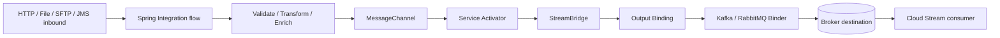
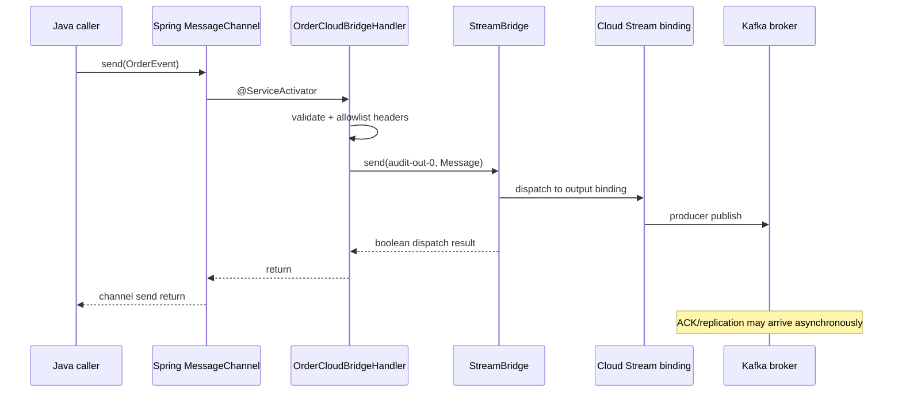
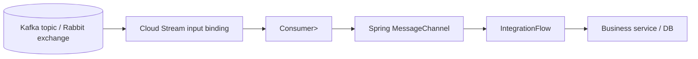
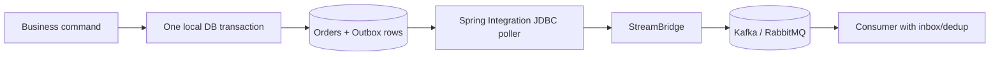

# Cloud stream bridge in an integration flow

## 1. Context: connecting Spring Integration to Spring Cloud Stream

In **SPRING_INTEGRATION_ADAPTERS**, Spring Integration connects external systems using inbound/outbound adapters, gateways, pollers, and `MessageChannel`. Common examples include files, SFTP, HTTP, JMS, AMQP, Kafka, or databases. When an application already has an event processing/routing flow but wants to use **Spring Cloud Stream's binder abstraction** to publish or consume over Kafka/RabbitMQ, you need a **cloud stream bridge in the integration flow**.

Scenario:

1. The system receives an order from HTTP or SFTP.
2. A Spring Integration flow validates, transforms the payload, and enriches metadata.
3. The flow passes the message to a **service activator**.
4. The service activator calls **`StreamBridge.send(...)`** with an output binding.
5. Spring Cloud Stream uses the configured binder to send the message to the broker.
6. Another consumer reads from the destination, validates the schema, and processes it further.



This is a **framework-level bridge** between Spring Integration and Spring Cloud Stream. `StreamBridge` is **not** a broker, nor the name of a remote cloud service. It is the Spring Cloud Stream API for **sending data from a source that is not a function/supplier binding** to a binder-managed output binding.

Usage examples:

- Receive a file over SFTP and publish an "import completed" notification to Kafka.
- An HTTP inbound gateway receives an order and forwards commands asynchronously via RabbitMQ.
- Poll a database/outbox with Spring Integration and publish domain events to a broker.
- Receive Syslog/Hazelcast events and forward normalized events to an event bus.
- Invoke an upstream Camel/Hazelcast adapter, then publish the result to a cloud stream.

**Learning objectives:**

1. Distinguish Spring `MessageChannel`, Cloud Stream `binding`, `destination`, `binder`, and `StreamBridge`.
2. Configure `StreamBridge.send(bindingName, data)` with a Spring POJO or `Message<?>`.
3. Design a flow with a custom input, transformer, service activator, and output binding.
4. Set `spring.cloud.stream.bindings.<name>.destination`, content type, binder, and output bindings.
5. Test with the **Spring Cloud Stream Test Binder**, without needing Kafka in unit/integration tests.
6. Connect a consumer binding back into a Spring Integration flow.
7. Restrict dynamic destinations, headers, tenant routing, and security surfaces.
8. Handle producer errors, retries, async sends, broker acknowledgments, idempotency, and durable outboxes.
9. Monitor throughput, backpressure, serialization, health, and lifecycle.

> **Principle:** `StreamBridge.send(...)` returning `true` does not guarantee the broker has replicated/committed the message, and certainly does not mean a downstream consumer has successfully processed it.

## 2. Four concepts that should not be confused

### 2.1. Spring Integration MessageChannel

A Spring message consists of `payload` and `headers`:

```java
Message<String> message = MessageBuilder
    .withPayload("ORDER_PAID")
    .setHeader("eventId", "evt-123")
    .setHeader("orderId", "order-42")
    .build();
```

`MessageChannel` is the connector between Spring Integration endpoints. For example:

| Channel | How it dispatches | Notes |
|---|---|---|
| `DirectChannel` | Calls the subscriber synchronously on the sender thread | Handler can block; exceptions can propagate back to the caller. |
| `ExecutorChannel` | Hands work to an executor | Async boundary, task queue/rejections; not durable on its own. |
| `QueueChannel` | Enqueues messages for a poller to read | Usually in-memory unless a message store is configured. |
| `PublishSubscribeChannel` | Fans out to multiple subscribers | Not a broker consumer group. |

Spring Integration knows how to **connect and process** messages inside the application. It does not automatically know which Kafka topic a channel named `eventsToCloud` should publish to without a matching handler/binder.

### 2.2. Spring Cloud Stream binder

The **binder** integrates with specific messaging middleware, for example:

- Kafka binder: output destination is typically a **Kafka topic**.
- RabbitMQ binder: output destination typically maps to an **exchange** per binder conventions.
- Other binders: Kinesis, Pulsar, or provider-supported platforms, each with its own semantics.

The binder handles binding lifecycle, payload conversion, producer/consumer properties, broker connectivity, and certain error/retry/telemetry capabilities.

Do not assume that because they all use the word "stream", every binder shares the same **partitioning, durability, acknowledgment, ordering, or transaction model**.

### 2.3. Binding name vs destination

Example:

```yaml
spring:
  cloud:
    stream:
      bindings:
        audit-out-0:
          destination: orders.audit.v1
          content-type: application/json
```

**`audit-out-0`** is the **logical output binding** name inside the application. **`orders.audit.v1`** is the **physical destination** used by the binder. These two names can differ.

```text
streamBridge.send("audit-out-0", event)
                  ^^^^^^^^^^^ logical binding name

spring.cloud.stream.bindings.audit-out-0.destination
                               |
                               v
                        orders.audit.v1
                         physical topic
```

Confusing `bindingName` with `destination` can cause a dynamic binding to be created with a destination matching the binding name unexpectedly, instead of sending to the intended topic.

### 2.4. StreamBridge

Central class:

```java
import org.springframework.cloud.stream.function.StreamBridge;
```

Common overloads:

```java
boolean send(String bindingName, Object data);

boolean send(String bindingName, Object data,
             org.springframework.util.MimeType outputContentType);

boolean send(String bindingName, String binderName,
             Object data);

boolean send(String bindingName, String binderName,
             Object data,
             org.springframework.util.MimeType outputContentType);
```

`data` can be a Java POJO, bytes, or a Spring `Message<?>`. `StreamBridge` applies conversion/content type, partitioning, and binding configuration similarly to how outputs from `Function`/`Supplier` work in Spring Cloud Stream.

**Do not assume** `send(...)` has an overload returning `CompletableFuture`; the core API returns `boolean`. When provider acknowledgments are required, use binder-supported callback/confirmation mechanisms.

## 3. When do you need StreamBridge?

### 3.1. Data sources that are not Cloud Stream functions

Spring Cloud Stream recommends the **functional model** with `Supplier`, `Function`, and `Consumer`. For example, a function:

```java
@Bean
Function<String, String> uppercase() {
    return String::toUpperCase;
}
```

With this function, the framework can create bindings named `uppercase-in-0` and `uppercase-out-0`. You do not need to call `StreamBridge` manually just to pass a function's output to a binder.

However, when data arrives from:

- A Spring Integration `@InboundChannelAdapter` for a file/database poller,
- An HTTP `@RestController`,
- An internal `@MessagingGateway`/`MessageChannel`,
- A scheduled job or SDK callback,
- A Hazelcast/Syslog listener or custom integration component,

`StreamBridge` is the right way to feed messages into a Spring Cloud Stream binder.

### 3.2. Comparing publishing approaches

| Approach | Best when | Notes |
|---|---|---|
| `StreamBridge` inside a service activator | A Spring Integration flow has processed data and needs to publish to a binder | Clear boundary, easy to unit test and manage errors. |
| `StreamBridge` inside `@RestController` | Small endpoint with minimal steps | Better to separate validation/tracing/publishing into a service. |
| `Supplier/Function` bean | The whole pipeline is already a functional Cloud Stream app | Follows its own binding naming conventions. |
| Spring Integration Kafka/JMS/AMQP outbound adapter | Binder/protocol-specific API needed or flow already uses the adapter directly | Avoids extra abstraction when no binder is needed. |
| `KafkaTemplate` / `RabbitTemplate` | Need producer-specific APIs, callbacks, transactions, or fine-grained control | You manage more protocol-level configuration yourself. |

`StreamBridge` is **not** a drop-in replacement for a Spring Integration `outbound gateway`: sending to a broker is **one-way** unless you design a separate reply/correlation flow.

## 4. Message contract across the boundary

A business message might contain:

```text
Spring Message<OrderEvent>:
  payload:
    eventId: "evt-abc"
    orderId: "order-42"
    status: "PAID"
    occurredAt: "2026-11-23T02:15:10Z"
  headers:
    contentType: "application/json"
    correlationId: "req-88"
    source: "order-service"
    replyChannel: <internal framework reference>
```

**Only essential information** should cross to the binder/broker:

- Payload: a DTO with an explicit schema version.
- Headers: `eventId`, `correlationId`, verified `trustedTenantId`, controlled trace context.
- Content type: agreed serializer format between producer and consumer.
- Partition key: `orderId` or a validated key when per-order ordering is needed.

Do not forward the entire Spring `MessageHeaders` as a JSON payload or arbitrary header map. `replyChannel`, `errorChannel`, and framework objects may not serialize, can leak internal details, and have no meaning on the broker.

### 4.1. Defining the event schema

In the lab:

```java
package example.cloudbridge;

import java.time.Instant;

public record OrderEvent(
    String eventId,
    String orderId,
    String status,
    Instant occurredAt
) {}
```

A real application often adds `schemaVersion`, `sourceSystem`, tenant, and a business sequence/version. If events drive ordered state updates, include a **stable version** from the source rather than relying solely on timestamps or UUIDs.

### 4.2. When to use a POJO vs a Message?

You can call:

```java
streamBridge.send("audit-out-0", event);
```

or:

```java
Message<OrderEvent> outgoing = MessageBuilder
    .withPayload(event)
    .setHeader("eventId", event.eventId())
    .setHeader("orderId", event.orderId())
    .setHeader("correlationId", "req-88")
    .build();

streamBridge.send("audit-out-0", outgoing);
```

With a POJO, the binding's content type or the `MimeType` overload controls conversion. With `Message<?>`, headers can carry the content type and metadata to preserve. Validate every header before publishing.

### 4.3. Do not confuse conversion with native serialization

Per the binding properties:

- `content-type: application/json`: guides conversion when native encoding is not enabled.
- `producer.use-native-encoding=true`: the producer client/binder uses its own serializer; Cloud Stream skips the same JSON payload conversion.
- `consumer.use-native-decoding=true`: the consumer must have a matching deserializer.

Do not enable native encoding and still expect automatic POJO→JSON conversion like the default configuration. If consumers are written in other languages, test the actual **wire format** against a broker/emulator rather than only comparing Java objects.

## 5. Lab: Spring Integration flow → StreamBridge → Kafka binding

To study **cloud stream bridge in an integration flow** cleanly, we build a Spring Boot application:

```text
OrderEventPublisher (Java caller)
     |
     v
orderEvents (DirectChannel)
     |
     v
OrderEventValidator @ServiceActivator
     |
     v
StreamBridge.send("audit-out-0", Message<OrderEvent>)
     |
     v
Cloud Stream Kafka binder
     |
     v
orders.audit.v1 topic
```

The lab runs with the **Spring Cloud Stream Test Binder** so no Kafka instance is needed during integration tests. When deploying to production, swap the test binder for the Kafka binder and a real broker.

### 5.1. Maven dependencies

This example targets Java 17+, Spring Boot 3.x, Spring Integration 6.x, and **Spring Cloud Stream 4.x** from a compatible Spring Cloud release train. With Boot 4/Stream 5.x, use the matching versions and Java baseline from the Spring Cloud compatibility matrix. Do not mix BOMs across different release lines.

Maven dependencies **without explicit versions** assuming `dependencyManagement` imports compatible Spring Boot and Spring Cloud BOMs:

```xml
<dependencies>
    <dependency>
        <groupId>org.springframework.boot</groupId>
        <artifactId>spring-boot-starter-integration</artifactId>
    </dependency>

    <dependency>
        <groupId>org.springframework.cloud</groupId>
        <artifactId>spring-cloud-stream</artifactId>
    </dependency>

    <!-- Kafka binder for real runtime; RabbitMQ binder
         can be substituted when RabbitMQ is the target. -->
    <dependency>
        <groupId>org.springframework.cloud</groupId>
        <artifactId>spring-cloud-stream-binder-kafka</artifactId>
    </dependency>

    <dependency>
        <groupId>org.springframework.boot</groupId>
        <artifactId>spring-boot-starter-test</artifactId>
        <scope>test</scope>
    </dependency>

    <dependency>
        <groupId>org.springframework.cloud</groupId>
        <artifactId>spring-cloud-stream-test-binder</artifactId>
        <scope>test</scope>
    </dependency>
</dependencies>
```

To avoid connecting to a broker in tests, enable the **test binder** with `@EnableTestBinder` as shown in section 7. Running against real Kafka requires a broker, topic/policy setup, connectivity, and proper credentials.

You do **not** need `@EnableBinding(Source.class)`, `BinderAwareChannelResolver`, or `@StreamListener` from older Cloud Stream models just to use `StreamBridge`. With modern `StreamBridge`, you can publish without defining a `Supplier` bean.

### 5.2. application.yml

```yaml
spring:
  application:
    name: order-cloud-bridge

  cloud:
    stream:
      # Pre-create the output binding at startup to catch
      # config/binding errors earlier.
      output-bindings: audit-out-0

      bindings:
        audit-out-0:
          destination: orders.audit.v1
          content-type: application/json
          producer:
            # For binders supporting async producer errors;
            # still requires a dedicated error consumer/recovery.
            error-channel-enabled: true

      kafka:
        binder:
          brokers: ${KAFKA_BOOTSTRAP_SERVERS:localhost:9092}
```

**Explanation:**

1. `audit-out-0` is the **binding name** used in Java code.
2. `orders.audit.v1` is the actual Kafka topic when using the Kafka binder.
3. `output-bindings` eagerly creates the output binding **at startup** even without a matching Supplier/Function output.
4. `content-type` guides content conversion; payload/headers must still match the consumer contract.
5. `producer.error-channel-enabled` requests the producer error channel mechanism if supported by the binder; it does **not** automatically write to a DLQ or recover.
6. `brokers` uses an environment variable; production requires TLS/SASL/IAM/secrets and matching broker ACLs.

Do not treat `output-bindings` as where destinations are configured: that field only lists **binding names**. The actual target goes under `spring.cloud.stream.bindings.<bindingName>.destination`.

### 5.3. Spring Boot application

File `CloudStreamBridgeApplication.java`:

```java
package example.cloudbridge;

import org.springframework.boot.SpringApplication;
import org.springframework.boot.autoconfigure.SpringBootApplication;
import org.springframework.integration.annotation.EnableIntegration;

@SpringBootApplication
@EnableIntegration
public class CloudStreamBridgeApplication {

    public static void main(String[] args) {
        SpringApplication.run(
            CloudStreamBridgeApplication.class, args);
    }
}
```

You do not need to manually define a Kafka `ProducerFactory` when using the standard binder; the binder manages the producer from configuration. If special callbacks or protocol-specific features are needed, consult binder-specific APIs rather than creating a separate producer outside the binder.

### 5.4. Internal MessageChannel

File `CloudBridgeChannels.java`:

```java
package example.cloudbridge;

import org.springframework.context.annotation.Bean;
import org.springframework.context.annotation.Configuration;
import org.springframework.integration.channel.DirectChannel;
import org.springframework.messaging.MessageChannel;

@Configuration
public class CloudBridgeChannels {

    @Bean("orderEvents")
    public MessageChannel orderEvents() {
        return new DirectChannel();
    }
}
```

`orderEvents` is an **internal Spring Integration channel**, distinct from the `audit-out-0` output binding. This channel name does not automatically correspond to a broker topic.

We use `DirectChannel` so synchronous validation/failure outcomes are straightforward to observe in tests. If switched to `ExecutorChannel` or `QueueChannel`, you must manage workers/pollers, timeouts, error publishing, and durability accordingly.

### 5.5. Service Activator implementing the bridge

File `OrderCloudBridgeHandler.java`:

```java
package example.cloudbridge;

import java.util.Set;

import org.springframework.cloud.stream.function.StreamBridge;
import org.springframework.integration.annotation.ServiceActivator;
import org.springframework.messaging.Message;
import org.springframework.messaging.support.MessageBuilder;
import org.springframework.stereotype.Component;

@Component
public class OrderCloudBridgeHandler {

    public static final String OUTPUT_BINDING = "audit-out-0";

    private static final Set<String> ALLOWED_STATUSES =
        Set.of("CREATED", "PAID", "SHIPPED", "CANCELLED");

    private final StreamBridge streamBridge;

    public OrderCloudBridgeHandler(StreamBridge streamBridge) {
        this.streamBridge = streamBridge;
    }

    @ServiceActivator(inputChannel = "orderEvents")
    public void publish(Message<OrderEvent> incoming) {
        OrderEvent event = incoming.getPayload();

        if (event == null
                || event.eventId() == null
                || !event.eventId().matches("[A-Za-z0-9_-]{1,100}")
                || event.orderId() == null
                || !event.orderId().matches("[A-Za-z0-9_-]{1,100}")
                || event.status() == null
                || !ALLOWED_STATUSES.contains(event.status())
                || event.occurredAt() == null) {
            throw new IllegalArgumentException(
                "Invalid OrderEvent contract");
        }

        // Build a new message with an allowlisted set of headers.
        // Do not forward replyChannel/errorChannel/Authorization.
        Message<OrderEvent> outbound = MessageBuilder
            .withPayload(event)
            .setHeader("eventId", event.eventId())
            .setHeader("orderId", event.orderId())
            .setHeader("sourceSystem", "order-service")
            .build();

        boolean accepted =
            streamBridge.send(OUTPUT_BINDING, outbound);

        if (!accepted) {
            throw new IllegalStateException(
                "Cloud Stream output binding rejected message");
        }

        // accepted=true is NOT a broker commit ACK and
        // does not mean a consumer has processed the event.
    }
}
```

**Design details:**

- `@ServiceActivator` is the actual outbound endpoint of the Spring Integration flow.
- `StreamBridge` is registered by Spring Cloud Stream to send to the binder.
- Validation runs **before** the binder so deterministic errors do not trigger endless retries.
- Only necessary metadata crosses the boundary, avoiding internal headers or tokens.
- `OUTPUT_BINDING` is a **trusted configuration constant**, never taken arbitrarily from input.
- `accepted=false` is converted into an exception so callers/flows see the failure.
- Even when `accepted=true`, **asynchronous producer send failures** can still occur at the broker; binder-level error handling is required.

With the test binder, data appears in `OutputDestination`. With the real Kafka binder, inspect publish status from the producer/binder and broker rather than relying solely on test binder passes.

### 5.6. Publisher feeding the Spring channel

File `OrderEventPublisher.java`:

```java
package example.cloudbridge;

import java.time.Instant;
import java.util.UUID;

import org.springframework.beans.factory.annotation.Qualifier;
import org.springframework.messaging.MessageChannel;
import org.springframework.messaging.support.MessageBuilder;
import org.springframework.stereotype.Service;

@Service
public class OrderEventPublisher {

    private final MessageChannel channel;

    public OrderEventPublisher(
            @Qualifier("orderEvents") MessageChannel channel) {
        this.channel = channel;
    }

    public String publish(String orderId, String status) {
        String eventId = UUID.randomUUID().toString();

        OrderEvent event = new OrderEvent(
            eventId, orderId, status, Instant.now());

        boolean dispatched = channel.send(
            MessageBuilder.withPayload(event).build());

        if (!dispatched) {
            throw new IllegalStateException(
                "orderEvents channel rejected message");
        }

        return eventId;
    }
}
```

**Warning about event IDs:** the lab publisher generates a fresh UUID on every call. If the same business event is replayed after a restart, a new UUID will **not** help consumers detect duplicates. Production needs a **stable event ID** from the business source, ideally generated when writing the outbox row inside the same DB transaction.

### 5.7. End-to-end contract



**Do not read the `boolean` arrow as a broker ACK.** A `true` return from `StreamBridge.send` indicates dispatch succeeded across the framework/binding boundary per its configuration semantics; broker and consumer status may only be determined afterward.

## 6. Writing the same flow with Java DSL

The `@ServiceActivator` style in section 5 suffices for a single channel and handler. If your project uses **Spring Integration Java DSL**, you can declare a flow that receives data and calls a service bean:

```java
package example.cloudbridge;

import org.springframework.context.annotation.Bean;
import org.springframework.context.annotation.Configuration;
import org.springframework.integration.dsl.IntegrationFlow;

@Configuration
public class CloudStreamFlowAlternative {

    @Bean
    public IntegrationFlow cloudBridgeFlow(
            OrderCloudBridgeHandler handler) {
        return IntegrationFlow.from("orderEvents")
            .handle(handler, "publish")
            .get();
    }
}
```

**This is an alternative** to `@ServiceActivator(inputChannel="orderEvents")` in section 5.5. Do not enable both the annotated endpoint and the DSL endpoint on the same `DirectChannel`: two subscribers will compete rather than both receiving the message.

For more complex flows, place steps like `filter`, `transform`, `headerEnricher`, and `router` before `.handle(...)`:

```text
IntegrationFlow
  -> validate
  -> transform OrderCommand -> OrderEvent
  -> enrich eventId / schemaVersion / trusted tenant
  -> route by event type
  -> ServiceActivator calling StreamBridge
```

The terminal `.handle(...)` does not produce a business reply. If an HTTP inbound gateway expects a reply, define an explicit response/receipt that **never claims to be a broker commit** before real confirmation arrives.

### 6.1. Using a lambda GenericHandler if needed

A minimal alternative snippet:

```java
@Bean
IntegrationFlow bareCloudBridge(StreamBridge bridge) {
    return IntegrationFlow.from("bareEvents")
        .handle((payload, headers) -> {
            boolean sent = bridge.send("audit-out-0", payload);
            if (!sent) {
                throw new IllegalStateException(
                    "Output binding rejected message");
            }
            // One-way handler; produces no Spring reply.
            return null;
        })
        .get();
}
```

This only illustrates the API. It **drops all incoming headers** because it sends raw `payload`, performs no schema validation, and defines no correlation. For learning and production alike, the explicit `OrderCloudBridgeHandler` version is usually better.

### 6.2. Do not confuse the two binding creation mechanisms

`IntegrationFlow.from("orderEvents")` selects an **internal** Spring Integration channel. It does **not** automatically create the `audit-out-0` output binding.

`StreamBridge.send("audit-out-0",...)` selects a Spring Cloud Stream **outbound broker binding**. If the name is unconfigured, the framework may automatically create a dynamic binding.

## 7. Testing with Spring Cloud Stream Test Binder

Spring Cloud Stream provides the **Spring Integration Test Binder** (`spring-cloud-stream-test-binder` module), letting you test flows and bindings without a real Kafka or RabbitMQ cluster. It supplies `InputDestination` and `OutputDestination` backed by in-JVM infrastructure.

### 7.1. Test dependency

```xml
<dependency>
    <groupId>org.springframework.cloud</groupId>
    <artifactId>spring-cloud-stream-test-binder</artifactId>
    <scope>test</scope>
</dependency>
```

In modern Spring Cloud Stream versions, enable the test binder via `@EnableTestBinder` or version-appropriate `TestChannelBinderConfiguration`. Do not use `spring-cloud-stream-test-support` and `MessageCollector` from very old guides.

### 7.2. Complete SpringBootTest

File `CloudStreamBridgeTest.java`:

```java
package example.cloudbridge;

import static org.junit.jupiter.api.Assertions.*;

import java.nio.charset.StandardCharsets;

import com.fasterxml.jackson.databind.JsonNode;
import com.fasterxml.jackson.databind.ObjectMapper;

import org.junit.jupiter.api.Test;
import org.springframework.beans.factory.annotation.Autowired;
import org.springframework.boot.test.context.SpringBootTest;
import org.springframework.cloud.stream.binder.test.EnableTestBinder;
import org.springframework.cloud.stream.binder.test.OutputDestination;
import org.springframework.messaging.Message;

@SpringBootTest
@EnableTestBinder
class CloudStreamBridgeTest {

    @Autowired
    OrderEventPublisher publisher;

    @Autowired
    OutputDestination output;

    @Autowired
    ObjectMapper objectMapper;

    @Test
    void springIntegrationFlowPublishesJsonToBinding()
            throws Exception {

        String eventId =
            publisher.publish("order-42", "PAID");

        Message<byte[]> delivered =
            output.receive(5_000, "orders.audit.v1");

        assertNotNull(delivered);

        String json = new String(
            delivered.getPayload(), StandardCharsets.UTF_8);

        JsonNode payload =
            objectMapper.readTree(json);

        assertEquals(eventId,
            payload.path("eventId").asText());
        assertEquals("order-42",
            payload.path("orderId").asText());
        assertEquals("PAID",
            payload.path("status").asText());
        assertTrue(payload.hasNonNull("occurredAt"));
    }

    @Test
    void invalidStatusIsRejectedBeforeStreamBridge() {
        assertThrows(IllegalArgumentException.class,
            () -> publisher.publish(
                "order-bad", "NOT_A_STATUS"));
    }
}
```

**Explanation:**

- `@SpringBootTest` builds the Spring context with Spring Integration, Cloud Stream, and all beans.
- `@EnableTestBinder` activates the in-JVM test binder.
- `OrderEventPublisher` sends a message through `orderEvents`.
- `@ServiceActivator` validates and invokes `StreamBridge`.
- `OutputDestination.receive(5_000,"orders.audit.v1")` pulls the message from the configured **destination**.
- `ObjectMapper.readTree(...)` validates **serialized JSON**, not just a local Java object.

Tests sharing an `OutputDestination` can interfere with one another if run in parallel or if leftover messages remain from earlier tests. For deterministic tests, isolate contexts/destinations per test, avoid parallelizing tests that share outputs, or filter results by event ID with a bounded timeout.

**Test binder limitations:** it does not test Kafka ACLs, replication factors, topic partitions, producer acks, broker message size limits, or network partitions. Those cases require real Kafka integration tests (e.g., approved containers/emulators in your test environment).

### 7.3. Recommended negative test cases

| Test | Expectation |
|---|---|
| Invalid order status | Throws before binder; nothing published. |
| Missing/empty `orderId` | Not published; clear error reason. |
| Invalid `eventId` | Not published; handler does not silently invent a default event ID. |
| Unchanged v1 payload schema | Consumer parses JSON fields per contract. |
| Wrong content type | Contract test catches conversion mismatch. |
| Wrong output binding name | Checks against unintended dynamic destination creation. |
| Broker unavailable | App observes proper error or async failure; no false business commit. |
| Producer error channel receives event | Error consumer handles it without leaking payloads. |
| Multiple events for same order ID | Partition/ordering test against real Kafka. |
| Restart with pending outbox | Controlled replay with stable event IDs. |

### 7.4. Unit testing without a full Spring context

Beyond integration tests, you can unit test `OrderCloudBridgeHandler` with a mocked `StreamBridge` to assert the **binding name** and validated messages. When the mock returns `false`, the handler must throw:

```java
// Fragment illustrating unit test logic with Mockito:
StreamBridge bridge = mock(StreamBridge.class);

when(bridge.send(eq("audit-out-0"), any(Message.class)))
    .thenReturn(false);

OrderCloudBridgeHandler handler =
    new OrderCloudBridgeHandler(bridge);

assertThrows(IllegalStateException.class,
    () -> handler.publish(
        MessageBuilder.withPayload(
            new OrderEvent(
                "evt-1",
                "order-1",
                "PAID",
                Instant.parse("2026-11-23T02:15:10Z")))
            .build()));
```

This fragment requires JUnit, Mockito, Spring Messaging, and `Instant` imports. It only verifies how the handler reacts to `send=false`; it does not test the broker and does not replace integration tests.

## 8. Dynamic bindings and dynamic destinations

### 8.1. StreamBridge creates bindings on demand

If the application calls:

```java
streamBridge.send("temporaryExport", event);
```

and `temporaryExport` is not configured as a binding, Spring Cloud Stream can create a **dynamic output binding** with a matching destination. The framework caches created bindings for subsequent sends.

This is convenient for business routing, but dangerous if untrusted input is passed directly as the binding name.

**Risks:**

- Unexpectedly auto-creating Kafka topics or RabbitMQ exchanges if the broker permits auto-provisioning.
- Wrong tenant/topic, leading to data exfiltration.
- Increased metadata, network connections, and producer resources.
- Many dynamic bindings causing cache eviction and frequent recreation.
- High-cardinality metrics and operational cost.

### 8.2. Default cache size

Spring Cloud Stream documentation states a **default `dynamic-destination-cache-size` of 10**. Exceeding that limit can evict older dynamic bindings, causing binding recreation and extra overhead.

```yaml
spring:
  cloud:
    stream:
      dynamic-destination-cache-size: 10
```

Do not bump the cache size to thousands just to "eliminate misses" if the binding name source is actually uncontrolled. Prefer a **fixed set of logical bindings** routed to approved destinations.

### 8.3. Configuring a dynamic destinations allowlist

You can use the property:

```yaml
spring:
  cloud:
    stream:
      dynamic-destinations:
        - approved.audit.events
        - approved.billing.events
```

Per configuration docs, when this list is set, only listed destinations can be bound dynamically. However, verify with your version and binder that the property is enforced in your topology and test **rejection** of unlisted names. Do not rely on this property alone for tenant authorization.

### 8.4. Map route keys to fixed bindings

Instead of:

```java
// DO NOT do this: the request dictates the binding name.
streamBridge.send(userRequest.getTarget(), event);
```

use a fixed set of names:

```java
enum EventClass {
    ORDER_AUDIT,
    BILLING_AUDIT
}

String approvedBinding(EventClass kind) {
    return switch (kind) {
        case ORDER_AUDIT -> "audit-out-0";
        case BILLING_AUDIT -> "billing-out-0";
    };
}
```

Configure `billing-out-0` → an approved destination and verify the principal/tenant before selecting. Never infer that an input string successfully parsed into an enum has been **authorized**.

## 9. Multiple binders: Kafka and RabbitMQ

An application may need to publish to two brokers:

```text
Spring Integration flow
    -> StreamBridge
         -> Kafka binder -> audit topic
         -> Rabbit binder -> work exchange
```

Spring Cloud Stream provides the overload:

```java
streamBridge.send(
    "audit-out-0",
    "kafkaBinder",
    auditEvent);

streamBridge.send(
    "jobs-out-0",
    "rabbitBinder",
    jobCommand);
```

**Prerequisites:**

1. Both binder dependencies are on the classpath.
2. `kafkaBinder` and `rabbitBinder` match declared binder configuration names.
3. Binding/destination properties map accurately.
4. Serialization/headers and security credentials are configured per broker.
5. Error/ack/transaction semantics are tested per binder.

Per the docs, if an output binding **has already been created** (e.g., via `output-bindings` or already bound to another binder), passing `binderName` in a later call **does not necessarily override the previously bound binder**. Assign the binder in binding config so dynamic calls never "switch brokers" unexpectedly.

### 9.1. Example two-binder configuration

```yaml
spring:
  cloud:
    stream:
      binders:
        kafkaBinder:
          type: kafka
          environment:
            spring:
              cloud:
                stream:
                  kafka:
                    binder:
                      brokers: kafka.internal.example:9092

        rabbitBinder:
          type: rabbit
          environment:
            spring:
              rabbitmq:
                host: rabbit.internal.example

      bindings:
        audit-out-0:
          destination: orders.audit.v1
          binder: kafkaBinder
          content-type: application/json

        jobs-out-0:
          destination: order.jobs.v1
          binder: rabbitBinder
          content-type: application/json
```

**This is an illustrative structure;** real deployments need dependencies, connection settings, TLS/SASL, and environment-supplied credentials. Kafka and RabbitMQ do not share security properties and cannot achieve atomic cross-broker transactions simply by passing through the same `StreamBridge`.

## 10. Reverse direction: Cloud Stream consumer into a Spring Integration flow

Sometimes a flow needs to consume broker events via a Cloud Stream binder and then use **Spring Integration EIPs** to transform, filter, or route them.

You can define a `Consumer<Message<OrderEvent>>` bean that receives from the binder and sends into a Spring channel:



### 10.1. Function bean as an ingress bridge

Java fragment:

```java
package example.cloudbridge;

import java.util.function.Consumer;

import org.springframework.beans.factory.annotation.Qualifier;
import org.springframework.context.annotation.Bean;
import org.springframework.context.annotation.Configuration;
import org.springframework.messaging.Message;
import org.springframework.messaging.MessageChannel;
import org.springframework.integration.channel.DirectChannel;

@Configuration
public class CloudInboundAlternative {

    @Bean("cloudIngress")
    MessageChannel cloudIngress() {
        return new DirectChannel();
    }

    @Bean
    Consumer<Message<OrderEvent>> receiveOrders(
            @Qualifier("cloudIngress") MessageChannel cloudIngress) {

        return incoming -> {
            boolean accepted = cloudIngress.send(incoming);

            if (!accepted) {
                throw new IllegalStateException(
                    "cloudIngress channel rejected message");
            }
        };
    }
}
```

A consumer/service activator is required on `cloudIngress`; otherwise `DirectChannel` has no subscriber and may throw `MessageDeliveryException`.

In an app with multiple function beans, configure explicitly:

```yaml
spring:
  cloud:
    function:
      definition: receiveOrders

    stream:
      bindings:
        receiveOrders-in-0:
          destination: orders.work.v1
          group: order-workers
          content-type: application/json
```

**Note on the two settings:** `definition` here is `spring.cloud.function.definition`, while `spring.cloud.stream.bindings` manages destination and group. If the app only publishes via `StreamBridge` with no function beans, `definition` is unnecessary.

### 10.2. Consumer-side IntegrationFlow

```java
@Bean
IntegrationFlow cloudBusinessFlow(OrderService service) {
    return IntegrationFlow.from("cloudIngress")
        .handle(service, "process")
        .get();
}
```

`OrderService.process(OrderEvent)` needs its own validation, idempotency, and transactions. Failures in the function consumer may be retried or routed to a DLQ by the binder per configuration; do not assume throwing an exception in an asynchronous handler will nack the broker if the boundary has already returned.

### 10.3. Using a functional IntegrationFlow instead of manual StreamBridge

Spring Cloud Stream also supports **Spring Integration flow as a function**. An `IntegrationFlow` can be exposed as a `Function` via `IntegrationFlow.from(SomeFunction.class, ...)`; the framework binds its input/output through naming conventions.

Illustrative example:

```java
@Bean
IntegrationFlow uppercaseFlow() {
    return IntegrationFlow
        .from(MessageFunction.class,
            spec -> spec.beanName("uppercase"))
        .<String, String>transform(String::toUpperCase)
        .bridge()
        .get();
}

interface MessageFunction
    extends java.util.function.Function<
        Message<String>, Message<String>> {
}
```

**This is an alternative implementation**, especially when the entire source→destination pipeline is already a functional Cloud Stream flow. With this approach, `StreamBridge` is not needed to send the function's output. Pick one consistent model rather than mixing multiple binding-creation mechanisms on the same destination unintentionally.

### 10.4. Avoiding infinite loops between inbound and outbound

If the same app consumes `orders.audit.v1` and publishes back into `orders.audit.v1` without a guard, it can create a loop:

```text
Broker topic -> Consumer -> IntegrationFlow -> StreamBridge
       ^                                     |
       |_____________________________________|
```

Guard against this by:

- Separating input vs output destinations by role.
- Using hop counts or routing policies when multi-stage fan-out is genuinely needed.
- Enforcing duplicate detection/idempotency keys.
- Never routing back to the source just because a sender-supplied header is named `destination`.
- Monitoring sudden amplification ratios between consumed rate and produced rate.

## 11. Pollers, batches, and the cloud stream bridge

When the source is **pollable**, the flow needs a poller **upstream**; `StreamBridge` still simply publishes when invoked.

Architectural example:

```text
FileReadingMessageSource / JDBC outbox / SFTP inbound
  -> @InboundChannelAdapter + @Poller
  -> MessageChannel
  -> Transformer
  -> StreamBridge
  -> Kafka topic
```

A poller must not dump "millions of messages instantly" just because a backlog is large. Account for:

- `fixedDelay`/cron and `maxMessagesPerPoll`.
- Source concurrency and transactions.
- Binder producer throughput, backpressure, and broker quotas.
- Message sizes and actual producer batching behavior.
- The duplicate window if the source marks rows processed before the broker confirms.

### 11.1. Outbox polling example

Pseudo-code:

```text
repeat every 500ms:
    rows = claim_up_to_100_pending_outbox_rows()
    for row in rows:
        StreamBridge.send("audit-out-0", row.event)
        wait_for_required_confirmation_if_contract_demands()
        mark_delivered_with_transaction_or_retry_metadata()
```

**Do not** mark an outbox row `DELIVERED` the instant `StreamBridge.send(...)` returns `true` if the contract requires durable Kafka broker ACKs that have not yet been verified. A complete relay design manages claim leases, publish confirmations, retries, and idempotency to avoid lost records or double sends.

### 11.2. Consumer functions and pollers differ

- Cloud Stream `Supplier` has default polling semantics in the functional model.
- Spring Integration `@InboundChannelAdapter` uses the poller you configure.
- `StreamBridge` does not itself poll files or databases.
- Cloud Stream `Consumer` is invoked by the binder when broker data arrives.
- Cloud Stream `PollableMessageSource` is a separate abstraction for pollable consumers.

Do not put `@Poller` on `StreamBridge` expecting it to scan all destinations automatically.

## 12. Delivery semantics: send, ACK, commit, and actual processing

Event chain:

```text
Spring source
  -> MessageChannel
  -> StreamBridge
  -> Binder producer
  -> Broker append/replication
  -> Consumer group receive
  -> Business transaction
  -> Consumer offset/ack
```

Each step has its own failure points:

| Milestone | What is known | What cannot be inferred |
|---|---|---|
| Spring channel accepted | Internal subscriber/queue accepted per channel semantics | That the broker received it. |
| `StreamBridge.send==true` | Dispatch across bridge/binding succeeded at call time | That the broker replicated or consumer processed it. |
| Producer callback success | Middleware reported success per producer/binder contract | That the consumer's business DB committed. |
| Broker ACK | Broker accepted the record per acks/quorum policy | That all consumers read it. |
| Consumer received | Listener/framework received the record | That the DB transaction committed. |
| Consumer ack/offset commit | Broker treats the record as processed per ack contract | That side effects in other systems were atomic. |

### 12.1. Why do Kafka and RabbitMQ differ?

- Kafka appends records to topic partitions; semantics depend on `acks`, idempotent producers, retries, transactions, and offset management.
- RabbitMQ publishes to exchanges; queue routing, publisher confirms/returns, and consumer acknowledgments are distinct mechanisms.
- Binders expose different error channel, retry, and telemetry properties.
- Cloud Stream unifies most of the application API, but **does not erase** physical differences.

### 12.2. At-least-once and idempotency

When a producer times out after the broker already appended a record, relay retries can emit duplicates. When a consumer processes a record and crashes before committing offsets, the record can be redelivered.

Always:

1. Generate a stable `eventId` at the business source.
2. Persist an idempotency/inbox record at the consumer with a unique constraint and proper transaction.
3. Execute side effects only if the event has not yet been processed.
4. Design replay/backoff with bounded max attempts.
5. Never use `MessageHeaders.ID` or a fresh UUID per retry as the deduplication key.
6. Preserve business ordering by key/version when ordering matters.

### 12.3. Cross-system transactions

Example:

```text
UPDATE orders SET status='PAID'
  -> StreamBridge.send(...)
  -> commit local DB
```

If the broker publish succeeds but the DB rolls back, consumers see an event that does not match real state. Conversely, if the DB commits and the producer fails, the event is lost without recovery.

The **Outbox pattern** is a common solution:



An outbox closes the DB-write vs event-creation window using a local transaction, but does not automatically create end-to-end exactly-once delivery. The relay still needs handling for **unknown publish outcomes**, duplicates, leases/claims, and confirmations.

## 13. Errors: synchronous failure and asynchronous failure

### 13.1. When errors occur before sending

Examples:

- `OrderEvent` payload lacks `orderId` or has an invalid `status` enum.
- Content conversion fails to produce bytes.
- No matching output binding/binder exists.
- Kafka/RabbitMQ connection or authentication config is wrong.
- Spring `MessageChannel` has no subscriber or is full.

On `DirectChannel`, exceptions from `@ServiceActivator` can propagate directly to the caller. Across `ExecutorChannel` or a poller, error handling may happen on another thread.

### 13.2. Producer error channel

Spring Cloud Stream binding property:

```yaml
spring:
  cloud:
    stream:
      bindings:
        audit-out-0:
          destination: orders.audit.v1
          producer:
            error-channel-enabled: true
```

When a binder supports asynchronous producer results, send failures can be emitted as `ErrorMessage` to the corresponding **producer error channel**. This does **not** automatically send the record to a DLQ.

Exact channel names, wiring, and exception payloads must be verified for your binder and version. For instance, the Kafka binder documents `KafkaSendFailureException` carrying `failedMessage` and `ProducerRecord`; the Rabbit binder has returned messages and negative publisher confirms depending on configuration.

**Do not** simply listen to an arbitrary channel named `errors` and assume all producer failures are captured. Verify the binder-registered channel and any auto-bridging to the global error channel in your actual implementation.

### 13.3. Illustrative error consumer

```java
package example.cloudbridge;

import org.slf4j.Logger;
import org.slf4j.LoggerFactory;
import org.springframework.integration.annotation.ServiceActivator;
import org.springframework.messaging.Message;
import org.springframework.messaging.MessagingException;
import org.springframework.messaging.support.ErrorMessage;
import org.springframework.stereotype.Component;

@Component
public class CloudStreamErrorObserver {

    private static final Logger log =
        LoggerFactory.getLogger(CloudStreamErrorObserver.class);

    // Example listening on the global errorChannel.
    // Verify the binder actually publishes errors to this channel.
    @ServiceActivator(inputChannel = "errorChannel")
    public void observe(ErrorMessage error) {
        Throwable cause = error.getPayload();
        Message<?> failed = error.getOriginalMessage();

        if (failed == null &&
                cause instanceof MessagingException exception) {
            failed = exception.getFailedMessage();
        }

        log.error(
            "Cloud stream error: type={}, failedMessagePresent={}",
            cause.getClass().getSimpleName(),
            failed != null);

        // Production: metrics, classified retries, bounded DLQ.
        // Never log raw failedMessage or Throwable.toString()
        // by default: they may contain PII/tokens/bodies.
    }
}
```

**This is observation only**, not durable recovery. A failure can happen before a business message exists, in which case `failed` is null. Also, not every binder error publishes to the global channel identically.

### 13.4. Errors that should not be retried

| Error | Handling strategy |
|---|---|
| Malformed JSON/schema or missing required header | Reject/quarantine; fix producer or contract. |
| Unauthorized topic/tenant or bad credentials | Alert/fix configuration; avoid retry storms. |
| Wrong binding name or dynamic destination outside allowlist | Fail fast and fix configuration. |
| Invalid partition key/content type | Reject with a reason code. |
| Kafka timeout/temporary unavailability | Bounded retry with backoff/jitter and stable event ID. |
| Broker throttling/quota exceeded | Rate limiting/bulkheads; backoff per policy. |
| Persistent producer failure | DLQ/outbox recovery; never drop silently. |

### 13.5. Avoiding multiplicative retries

Suppose:

```text
Spring Integration retry advice:  3 attempts
Cloud Stream producer retry:      3 attempts
Kafka/Rabbit client retry:        2 attempts
--------------------------------------------
Possible send attempts:          3 x 3 x 2 = 18
```

This illustrates the call multiplier, not a default configuration. Configuring retries at multiple layers can cause high latency, duplicates, broker overload, and "retry storms". Choose one place to control primary retries and enforce a total budget.

## 14. StreamBridge async mode and backpressure

### 14.1. Synchronous by default

Per the official documentation, `StreamBridge` defaults to using the sender thread via Spring Integration's mechanism. Therefore:

```java
boolean sent =
    streamBridge.send("audit-out-0", message);
```

can block during binding/dispatch/conversion and certain producer operations. Still, do not infer that it always waits for a broker ACK with identical semantics across all binders.

### 14.2. Async mode

The API exposes:

```java
streamBridge.setAsync(true);

// Subsequent sends may use async dispatch.
streamBridge.send("audit-out-0", message);
```

**Critically important:**

- `setAsync(true)` mutates behavior **on the `StreamBridge` bean**, not just for a single call.
- Never toggle `setAsync(true/false)` per message in a multithreaded application.
- Async sends widen the gap between dispatch and actual publish; failure channels/callbacks and recovery are mandatory.
- Crossing thread boundaries can lose tracing context unless Micrometer Context Propagation is configured.
- Async does not mean in-memory queues are durable.
- Never treat the `boolean` returned in async mode as a commit ACK.

If the application needs strict delivery, build a **durable outbox/relay** or use a producer API with explicit confirmations. Do not enable async merely to "make HTTP requests faster" when nothing persists and tracks failures behind it.

### 14.3. Queues and thread pools

An architecture using `ExecutorChannel`:

```text
Spring inbound adapter
  -> bounded ExecutorChannel
  -> StreamBridge
  -> binder
```

must control:

- Worker counts and queue capacity.
- Rejection/backpressure policy.
- Broker producer buffer memory and send timeouts.
- Source poll rate.
- In-flight messages after HTTP reply timeouts.
- Latency to durable confirmation.
- Shutdown/drain/replay on JVM crash.

`CallerRunsPolicy` can slow down or block the source; `DiscardPolicy` can silently lose messages. Pick a policy based on SLAs and source durability.

## 15. Header mapping, partition keys, and ordering

### 15.1. Why preserve orderId?

If events for the same order must be processed in sequence, the producer should choose **the same partition key** for all events belonging to that order.

Example producer partitioning configuration by payload:

```yaml
spring:
  cloud:
    stream:
      bindings:
        audit-out-0:
          producer:
            partition-key-expression: payload.orderId
            partition-count: 12
```

This is **Spring Cloud Stream producer partition configuration**. How messages map to physical partitions also depends on the binder, broker topic partition count, and consumer configuration.

**Never promise total ordering across an entire topic.** Kafka only guarantees ordering within each partition per broker contract; RabbitMQ and other binders have their own ordering semantics that concurrency and retries can affect.

### 15.2. Stable business keys

Avoid choosing:

```text
partition key = fresh eventId for every order update
```

because events for one order will scatter across partitions. `orderId` is a better fit for per-order ordering, though you must check multi-tenant uniqueness, Kafka key serializers, and binder partitioning.

### 15.3. Header allowlist

Headers to consider forwarding:

| Header | Keep? | Reason |
|---|---|---|
| `eventId` | Yes | Domain correlation/deduplication. |
| `orderId` | Yes when needed | Tracing/partitioning policy. |
| `schemaVersion` | Yes | Consumer compatibility. |
| `trustedTenantId` | Yes if set by trusted boundary | Isolation and authorization. |
| `contentType` | Yes per conversion contract | Payload deserialization. |
| `replyChannel` | **No** | Internal Java channel reference. |
| `errorChannel` | **No** | Internal error infrastructure. |
| `Authorization`/API tokens | **No** | Secrets. |
| Arbitrary caller headers | **No by default** | Can leak data or steer binder behavior. |

Never use a raw `tenantId` from an HTTP header as authority to choose a Kafka topic. Source identity must come from a verified authentication system.

## 16. Security when bridging to cloud brokers

### 16.1. Kafka

- Use TLS and SASL/mTLS per cluster policy.
- Grant the producer principal `WRITE` access only to required topics.
- Do not auto-create arbitrary topics in production if IAM forbids it.
- Configure `acks`/replication, retries, and message size limits per requirements.
- Enforce network egress/private endpoints and verify server certificates.
- Never put passwords or SASL secrets in source code or application logs.

### 16.2. RabbitMQ

- Use TLS and least-privilege user/vhost/permissions.
- Publish only to permitted exchanges with allowlisted routing keys.
- Enable publisher confirms/returns if the business needs routing/acceptance status.
- Configure DLX/DLQ/consumer acks per binder-specific semantics.
- Prevent creating unbounded dynamic exchanges/queues from untrusted input.

### 16.3. Multi-tenant

A multi-tenant application must:

1. Authenticate callers/sources.
2. Attach `trustedTenantId` server-side.
3. Map tenant → approved binding/destination per policy.
4. Enforce ACLs/credentials preventing cross-tenant publishing.
5. Limit rate, bytes, and in-flight messages per tenant.
6. Never log raw payloads/headers containing PII.
7. Audit publish successes/failures using correlation IDs and appropriate broker metadata.

### 16.4. SSRF, routing injection, and sensitive headers

`StreamBridge` does not open HTTP URLs directly like a Camel dynamic endpoint, yet **dynamic destinations** can still be abused to route data to another topic/queue. Therefore you must prevent **routing injection**. Never treat a "topic name as just a string" as inherently safer than a URL.

If downstream consumers read raw text containing commands or URLs, handle log injection, output escaping, and schema validation at the consumer. A producer does not make an event "trusted" merely by sending it through a cloud binder.

## 17. Monitoring and readiness

### 17.1. Metrics to observe

| Area | Metric / signal |
|---|---|
| Spring inbound | Messages created; SFTP/file/HTTP/DB read errors. |
| Spring channels | Send counts/errors, queue depth, dispatch latency. |
| `StreamBridge` | Bindings created, send attempts/returns, dynamic cache churn. |
| Binder | Producer errors, retries, timeouts, in-flight, buffer pressure. |
| Kafka | Broker ACK latency, topic partition status, record metadata (if configured). |
| RabbitMQ | Publisher confirms/returns, exchange routing, queue depth. |
| Outbox | Pending count, oldest event age, retry count, lease timeouts. |
| Consumer | Lag, processing rate, DLQ count, commit/ack errors. |
| System | CPU, memory, thread pools, network, TLS failures. |

### 17.2. Do not measure "publish success" with a single counter

Example:

```text
stream_bridge_send_attempts_total
stream_bridge_send_returned_true_total
binder_producer_error_total
broker_confirmed_publishes_total
outbox_pending
consumer_business_commits_total
```

Different counters update at **different times**. Name them accurately for what is actually observed—never label `sendReturnedTrue` as `kafkaReplicated`.

### 17.3. Readiness

A readiness check can evaluate:

- Are the Spring context and `@ServiceActivator` endpoint registered?
- Has the `audit-out-0` output binding been created and bound to the expected broker?
- Are credentials/TLS/ACLs still valid?
- Are Kafka/RabbitMQ producers connected per health checks?
- Are queues/outboxes within capacity budgets?
- Do downstream consumers have capacity, or is the event bus backing up?
- Is the dynamic binding count growing unexpectedly?

**A Spring Boot process returning HTTP 200** does not prove the publisher is bound to the right Kafka topic. Using `output-bindings` catches some errors early at startup, yet runtime broker outages can still happen later.

### 17.4. Lifecycle shutdown

```text
Stop accepting inbound work
  -> drain or persist pending messages
  -> finish broker producer in-flight work
  -> capture unresolved outcomes in outbox/recovery
  -> close binder connections
  -> stop Spring context
```

When the JVM is terminated by `SIGKILL`, OOM, or power loss, graceful shutdown cannot rescue in-memory data. If events must not be lost, use a durable source/outbox.

## 18. Troubleshooting

| Symptom | Possible cause | Investigation |
|---|---|---|
| Cannot inject `StreamBridge` | Missing Spring Cloud Stream dependency/auto-config | BOM, classpath, beans. |
| `StreamBridge.send` returns true, expected topic missing | Confused `bindingName` with `destination`, or binder is async | `audit-out-0` mapping, producer errors/broker metadata. |
| Broker auto-created a strange topic | Called dynamic binding with wrong name | Dynamic bindings and `output-bindings`. |
| Test binder sees messages, prod Kafka does not | Different IAM/network/TLS/topic policy | Kafka binder/prod credentials. |
| Payload is not JSON as consumer expects | `content-type`/native encoding/serializer mismatch | Wire format, schema. |
| `eventId` missing at consumer | Header filtered/not serialized by binder | Binder header mode, DTO fields, contract tests. |
| Kafka partitioning ignores order | Wrong partition key expression or producer config | `payload.orderId`, broker partitions, key mapping. |
| Error channel receives no messages | Binder producer errors not enabled or failure published elsewhere | `producer.error-channel-enabled`, version-specific channels. |
| `send=false` yet caller returns HTTP 202 | Boolean return not checked | Service activator error propagation. |
| Duplicate events | Retries/outbox replay/consumer offset commits | Stable event IDs, idempotency. |
| Outbox backlog growing | Slow broker, worker/thread saturation | Producer latency, poll rate, quotas. |
| Dynamic binding cache churn | Too many binding names | Cache size/allowlist, constrain destinations. |
| HTTP requests timing out | Blocking `DirectChannel` handler | Broker/timeouts, async architecture, outbox. |
| One app loops consuming and publishing | Same input and output destination | Routing guards, topic design. |
| Spring Boot starts fine while broker is disconnected | Insufficient readiness checks | Binder health/producer telemetry. |

### 18.1. 12-step runbook

```text
1. Did the Spring inbound endpoint create Message<?>?
2. Does the internal MessageChannel have exactly one subscriber?
3. Did the OrderEvent payload and headers pass validation?
4. Was the @ServiceActivator invoked?
5. Does the StreamBridge bean exist and is the output binding name right?
6. What is the actual binding destination?
7. Is the binder using Kafka, RabbitMQ, or another binder?
8. Are content type, native encoding, and partition key accurate?
9. Did StreamBridge.send return false, throw an exception, or return true?
10. Does the binder report async producer errors, record metadata, or confirms?
11. Did the broker topic/queue receive and replicate/route properly?
12. How is the consumer group processing/committing, handling DLQs/replay, and enforcing idempotency?
```

If **the Spring channel receives no messages**, do not investigate the Kafka broker first. If the Spring channel and `StreamBridge` work yet the broker lacks records, focus on binding/binder/producer/broker semantics. If the broker has the record yet the business DB has not updated, investigate the consumer, transaction, and offset handling.

## 19. Comprehensive test matrix

| Category | Scenario | What to verify |
|---|---|---|
| Wiring | `orderEvents` has subscriber `OrderCloudBridgeHandler` | Message processed once per the lab flow. |
| Validation | Empty `orderId` | Rejected before binding. |
| Validation | Disallowed `status` | Rejected before binding. |
| Serialization | `OrderEvent` POJO | Accurate JSON fields/schema in Test Binder. |
| Output binding | `audit-out-0` → `orders.audit.v1` | `OutputDestination` receives on expected destination. |
| Dynamic destination | Invoke unconfigured binding | Creates binding per policy; never unbounded. |
| Allowlist | Disallowed destination name | Observable rejection/failure. |
| Multiple binders | Kafka/Rabbit binder names | Message reaches the intended middleware. |
| Headers | `eventId`/`orderId` kept as needed | Consumer reads selected metadata. |
| Header privacy | Internal reply/error channels | Not forwarded arbitrarily. |
| Content type | JSON and native encoding | Producer/consumer wire format compatibility. |
| Ordering | Multiple events for one order | Keyed routing; no global order promised. |
| Blocking | Slow broker | Observable deadlines/backpressure. |
| Async | `setAsync(true)` | Test failure reporting/tracing context; never equate `true` with ACK. |
| Retries | Broker 503/throttling/timeouts | Backoff/jitter/limits, stable `eventId`. |
| DLQ | Producer failures exceed retry budget | Durable recovery per policy; no silent loss. |
| Kafka integration | Topic ACK/replication | Verified only via real broker tests. |
| Rabbit integration | Publisher confirms/returns | Routed to queue per config and confirms. |
| Outbox | App dies after DB commit before publish | Replayed without losing events. |
| Consumer | Event redelivered | Idempotency/inbox prevents duplicate side effects. |
| Security | Caller picks unauthorized tenant/topic | Does not write to other destinations. |
| Shutdown | Workers still have in-flight items | Drained/persisted/marked unresolved; restart recovery. |

## 20. Production checklist

1. **Choose the right model:** use `StreamBridge` when the source is Spring Integration or a custom callback; use Cloud Stream functions when the whole flow is functional.
2. **Pin the dependency set:** Spring Boot, Spring Cloud Stream, Spring Integration, and binder versions must be compatible.
3. **Lock down binding names:** e.g., `audit-out-0`; configure physical `destination` separately.
4. **Pre-create output bindings** via `output-bindings` for startup validation and to avoid cold first-send issues.
5. **Control dynamic destinations:** allowlists, quotas, cache size; never use untrusted binding names.
6. **Define payload schemas:** `eventId`, version, `orderId`, `status`, timestamp, and serialization.
7. **Header allowlist:** exclude internal channels, credentials/PII, and arbitrary routing metadata.
8. **Partition policy:** per-key ordering when required; never assume total ordering.
9. **Check booleans and exceptions:** handle `send=false` as a dispatch failure, never ignore it.
10. **Separate producer ACKs from dispatch:** track asynchronous failures and broker confirmations as needed.
11. **Define retry policies:** bounded backoff; avoid unbounded multiplicative retries across layers.
12. **Add a durable outbox/inbox** whenever events cannot be lost or cross-system transactions exist.
13. **Keep event IDs stable:** replays must not regenerate random UUIDs for the same business event.
14. **Enable TLS/ACL/IAM:** restrict producers to writing only permitted destinations.
15. **Size capacity:** source poll rates, bounded executors/queues, broker producer buffers, and DLQs.
16. **Monitor all layers:** Spring channels, `StreamBridge`, binder, broker, consumers, and business commits.
17. **Test separately:** Test Binder for framework flows and Kafka/Rabbit integration tests for wire/ack/security.
18. **Test real failures:** broker offline, timeouts, slow consumers, schema mismatches, restarts, duplicates.
19. **Prevent feedback loops:** never publish infinitely back into an input binding on the same topic.
20. **Respect lifecycle:** readiness, graceful shutdown/drain, and crash recovery.

## 21. Summary

The **cloud stream bridge in an integration flow** enables Spring Integration to connect traditional message sources to Spring Cloud Stream **binder-based messaging** without rewriting the entire flow:

- Spring Integration handles **inbound adapters, pollers, transformations, routing, service activators, and `MessageChannel`**.
- `StreamBridge` connects a service activator to an **output binding**, after which the binder publishes to Kafka, RabbitMQ, or matching middleware.
- **Binding name differs from destination**: `audit-out-0` is the logical name; `orders.audit.v1` is the physical target.
- `StreamBridge.send(...)` supports POJOs/`Message<?>`, content types, and binder selection; it can create dynamic bindings, so names and cache sizes must be bounded.
- **Spring Cloud Stream Test Binder** tests integration flows without a real broker; broker integration tests remain mandatory to verify wire formats, ACLs, and acknowledgments.
- A `Consumer` binding can also feed broker events back into a Spring `MessageChannel` to continue an EIP-based flow.
- **`send(true)` is not a broker/business commit.** Retries, producer errors, outbox/inbox, idempotency, and security determine real-world reliability.

In **SPRING_INTEGRATION_ADAPTERS**, this pattern is especially effective for bridging file/SFTP/HTTP/JMS/AMQP/Kafka/database flows with event streaming while keeping **message contracts, error handling, and connection lifecycles** explicit at every boundary.

### Official references

- [Spring Cloud Stream — Producing and Consuming Messages / StreamBridge](https://docs.spring.io/spring-cloud-stream/reference/spring-cloud-stream/producing-and-consuming-messages.html)
- [Spring Cloud Stream — Binding Properties](https://docs.spring.io/spring-cloud-stream/reference/spring-cloud-stream/binding-properties.html)
- [Spring Cloud Stream — Testing with Spring Integration Test Binder](https://docs.spring.io/spring-cloud-stream/reference/spring-cloud-stream/spring_integration_test_binder.html)
- [Spring Cloud Stream — Error Handling](https://docs.spring.io/spring-cloud-stream/reference/spring-cloud-stream/overview-error-handling.html)
- [Spring Cloud Stream — Kafka Binder Usage](https://docs.spring.io/spring-cloud-stream/reference/kafka/kafka-binder/usage.html)
- [Spring Cloud Stream — Kafka Binder Error Channels](https://docs.spring.io/spring-cloud-stream/reference/kafka/kafka-binder/error-channels.html)
- [Spring Integration — Service Activator](https://docs.spring.io/spring-integration/reference/service-activator.html)
- [Spring Integration — Message Channels](https://docs.spring.io/spring-integration/reference/channel.html)
- [Spring Integration — Channel Adapter](https://docs.spring.io/spring-integration/reference/channel-adapter.html)
- [Spring Integration — Error Handling](https://docs.spring.io/spring-integration/reference/error-handling.html)
