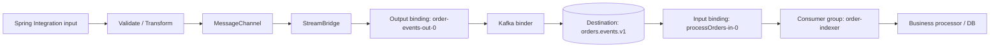
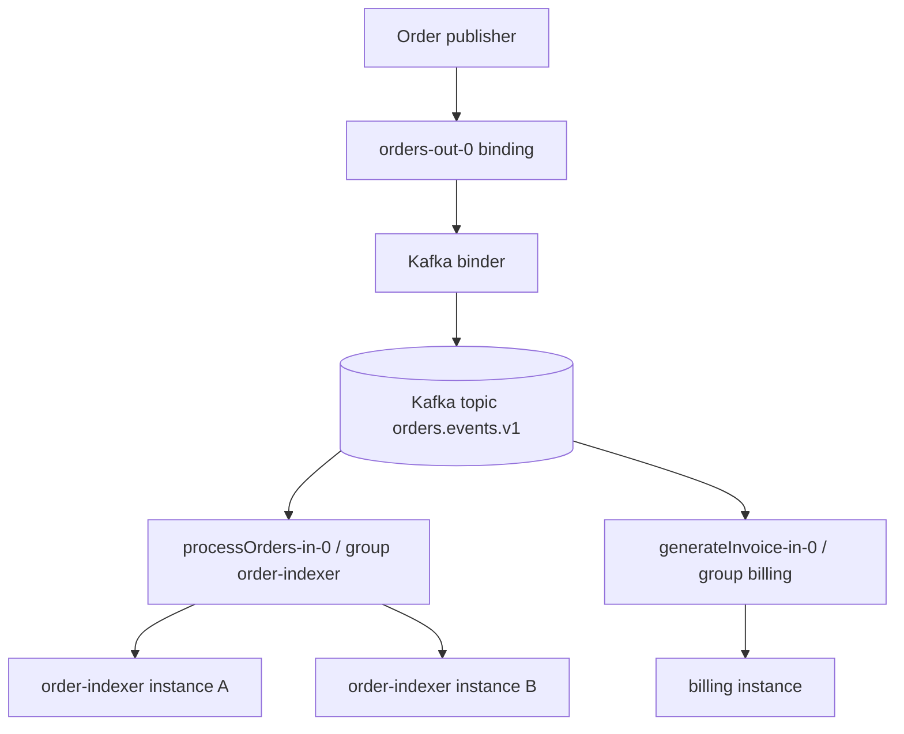
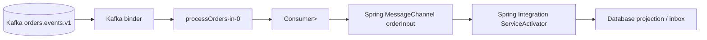
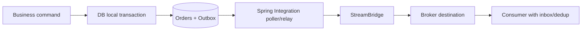

# Message broker binders and destinations

## 1. Why distinguish binders from destinations?

In the **SPRING_INTEGRATION_ADAPTERS** module, Spring Integration connects external systems via inbound/outbound adapters, gateways, pollers, and `MessageChannel`. Data can flow from files, SFTP, HTTP, or databases into JMS, AMQP, or Kafka, and continue onward to other applications. When using **Spring Cloud Stream** to integrate a **message broker**, the concepts of **binder**, **binding**, **destination**, and **consumer group** must be distinguished accurately.

A typical scenario:

1. Spring Integration receives an order update from HTTP or a JDBC poller.
2. An `IntegrationFlow` transforms the data into an `OrderEvent` with a clear schema.
3. A `@ServiceActivator` uses `StreamBridge` to send to an output **binding** named `order-events-out-0`.
4. The Kafka **binder** is configured for that binding and knows how to connect to the broker.
5. The binder publishes to **destination** `orders.events.v1`, which is a Kafka topic in this example.
6. A consuming application has an input binding `processOrders-in-0`, the same destination, and consumer group `order-indexer`.
7. Instances in the same group coordinate consumption; other groups receive an independent stream per broker semantics.



**Common pitfall:** `order-events-out-0` is a **logical name inside the application**, whereas `orders.events.v1` is the **target name at the middleware**. `Kafka binder` is not a topic name, and `order-indexer` is not a Kafka topic name.

### Lesson objectives

After this lesson, you will be able to:

- Distinguish **Binder**, **Binding**, **Destination**, **Producer**, **Consumer**, and **Consumer Group**.
- Understand the differences between Kafka topics/partitions and RabbitMQ exchanges/queues.
- Read and write `spring.cloud.stream.bindings.<bindingName>.*` correctly.
- Configure output bindings and input bindings across two applications.
- Send messages from a Spring Integration channel through `StreamBridge`.
- Receive messages via `Consumer<Message<OrderEvent>>` and route them into Spring Integration.
- Test with the Spring Cloud Stream **Test Binder** without a real broker.
- Select binders when using Kafka + RabbitMQ or multiple brokers of the same type.
- Handle serialization, content types, headers, partitioning, retries, DLQs, acknowledgments, and idempotency.
- Control dynamic destinations, authorization, tenant routing, and lifecycle.

## 2. Core vocabulary

### 2.1. A binder is the middleware integration layer

A **Binder** is an implementation of the Spring Cloud Stream Binder SPI responsible for connecting application bindings to the corresponding middleware. The binder handles creating producer/consumer bindings, mapping to physical targets, wiring clients, and applying broker-specific settings.

Binder examples:

| Binder | Middleware | Typical physical targets |
|---|---|---|
| Kafka binder | Apache Kafka | Topics and partitions. |
| RabbitMQ binder | RabbitMQ | Exchanges + queues/bindings. |
| Spring Integration Test Binder | In-JVM test messaging | Test destinations; does not connect to a real broker. |
| Provider/extension binders | Specific middleware | Follows that binder's semantics. |

**A binder is not a message broker.** `spring-cloud-stream-binder-kafka` is a library running inside your application, whereas the **Kafka cluster** is an external service. When the broker is down or ACLs are misconfigured, having the binder dependency on the classpath cannot recover lost data by itself.

### 2.2. A binding is the application's logical port

A **binding** links an application-level input/output to middleware through a binder.

Examples:

```text
processOrders-in-0     -> input binding
order-events-out-0     -> output binding
```

Configuring both bindings:

```yaml
spring:
  cloud:
    stream:
      bindings:
        processOrders-in-0:
          destination: orders.events.v1
          group: order-indexer
        order-events-out-0:
          destination: orders.events.v1
```

Two bindings with different names share the same physical destination. The input binding consumes; the output binding publishes. Renaming a bean/function can change the derived binding name by convention, so always test configuration when refactoring.

### 2.3. A destination is the logical address on the broker side

Spring Cloud Stream uses the property:

```text
spring.cloud.stream.bindings.<bindingName>.destination
```

The destination is interpreted by the binder:

- For **Kafka**: typically maps to a **topic**, e.g., `orders.events.v1`.
- For **RabbitMQ**: typically maps to an **exchange**, not the final receiving queue.
- For other binders: physical meaning depends on the binder.

If `destination` is omitted, the framework defaults to using the **binding name** as the destination. This fallback is handy for prototypes, yet easily creates misnamed topics/exchanges when binding names change.

### 2.4. A consumer group is how work is shared

An input binding can specify:

```yaml
spring:
  cloud:
    stream:
      bindings:
        processOrders-in-0:
          destination: orders.events.v1
          group: order-indexer
```

Instances sharing a **group** share work within that group; distinct groups receive independent streams under a publish-subscribe model. Specifically:

| Scenario | Expected behavior |
|---|---|
| 3 instances in group `order-indexer` | Each message is delivered to one consumer in the group per broker mechanics, not all 3. |
| 2 instances in group `billing-audit` | This group receives a stream independent of `order-indexer`. |
| Consumer without `group` | Typically treated as anonymous/ephemeral; semantics depend on broker/binder. |
| Two apps accidentally share `group` | They compete for the same stream despite serving different business roles. |

**Groups do not guarantee exactly-once business processing.** Records can still be redelivered after crashes, timeouts, or offset handling; business consumers still require idempotency.

### 2.5. Quick comparison

| Term | Belongs to | Answers the question |
|---|---|---|
| `MessageChannel` | Spring Integration | Inside the JVM, which handler receives the message? |
| `Binding name` | Spring Cloud Stream | What is the application's input/output named? |
| `Binder` | Spring Cloud Stream integration | Which middleware type is used to communicate? |
| `Destination` | Middleware via binder | Which topic or exchange is published to/subscribed to? |
| `Group` | Consumer subscription | Which instances share processing? |
| `Partition` | Broker/binder sharding | Which shard/partition receives the message? |
| `DLQ/DLT` | Error recovery | Where are unprocessable records isolated? |

## 3. Diagram of two applications and two consumer groups

An order system has a producer and two downstream services:



- Group `order-indexer` and group `billing` maintain independent cursor/offset/ack states per Kafka/RabbitMQ semantics.
- Two `order-indexer` instances **do not by default each receive a copy of every record**.
- `billing` receives its own stream; failures in one group do not cause `order-indexer` to fail.
- `orders-out-0` is the producer's output binding; `processOrders-in-0` and `generateInvoice-in-0` are input bindings of the consuming applications.
- The destination can remain consistent across environments or vary by profile/deployment; application code should use stable logical binding names.

### 3.1. Never use group to identify untrusted tenants

A user-supplied group name is not an authentication principal. Never let an HTTP request header pick an arbitrary `group` or `destination` to read another tenant's data. Broker credentials/ACLs and server-side authorization govern access rights.

## 4. Kafka binder: destination is a topic

### 4.1. Basic mapping

```text
Binding:     order-events-out-0
Binder:      kafka
Destination: orders.events.v1
                 |
                 v
Kafka topic orders.events.v1
  partition 0 | partition 1 | partition 2 | ...
```

Kafka has **partitions**, **producer acks**, **consumer group offsets**, and **retention policies**. The Kafka binder maps destination to topic, group to Kafka consumer group, and partitioning to partitions.

Example producer config:

```yaml
spring:
  cloud:
    stream:
      bindings:
        order-events-out-0:
          destination: orders.events.v1
          binder: kafka
          content-type: application/json
          producer:
            partition-key-expression: payload.orderId
            partition-count: 6
```

**Note:** when only one binder is on the classpath, `binder: kafka` is usually optional. With multiple binders, explicit naming prevents routing to the wrong middleware.

### 4.2. Kafka groups and ordering

In Kafka:

1. A topic is divided into partitions.
2. Each partition is typically assigned to one consumer instance within a group at a time.
3. Within a single partition, record order is preserved per broker semantics.
4. Across multiple partitions, there is no single total order across the whole topic.
5. During group rebalances, partition ownership shifts between instances; consumers must handle duplicates and recovery.

To preserve update order for the same order, use a stable key like `orderId` so events for that order land on the same partition. However, align consumer concurrency, retry, and error policies as well; uncontrolled parallel processing can still execute side effects out of order.

### 4.3. Kafka destination provisioning

Depending on permissions and configuration, the binder may auto-provision topics or expect them to already exist. Production typically uses IaC/operators to define:

- Partition counts and replication factors.
- Retention, compaction, and cleanup policies.
- ACLs for producer/consumer groups.
- Maximum record size.
- TLS/SASL and network access.
- Monitoring for consumer lag and ISR/under-replicated partitions.

**Do not rely on auto-provisioning to define production topology** when your organization requires change review and control. A destination name might be accepted in app config yet rejected by the broker for lacking `Create`/`Write` permissions.

## 5. RabbitMQ binder: destination is usually an exchange

An important distinction:

```text
Binding: processOrders-in-0
Destination: orders.events.v1
Group: order-indexer
             |
             v
RabbitMQ exchange: orders.events.v1
             |
             v
Queue: orders.events.v1.order-indexer
             |
             v
Consumer instance(s)
```

By default, the RabbitMQ binder typically provisions a **topic exchange** from the destination. When `group` is set, it provisions a queue named `<destination>.<group>` (plus any configured prefix) and binds it to the exchange. Without a group, it typically uses an anonymous auto-delete queue.

### 5.1. Differences from Kafka

| Feature | Kafka binder | RabbitMQ binder |
|---|---|---|
| Default destination | Topic | Exchange. |
| Consumer group | Kafka group ID + offsets | Queue tied to group; consumers share the queue. |
| Delivery mechanism | Partition assignment, reading offsets | Exchange routing to queue, queue delivery/acks. |
| History retention | Topic retention allows re-reading by offset | Messages are normally removed after ack; determined by topology/queue policy. |
| Multiple groups | Each group tracks its own offsets on the same topic | Each group typically gets its own queue bound to the exchange. |
| No group | Anonymous subscription/consumer per binder | Anonymous, auto-delete queue by default. |
| DLQ | Dead-letter topic per Kafka binder | DLX + dead-letter queue per Rabbit settings. |
| Ordering | Per partition under proper conditions | Per queue/consumer; affected by concurrency, requeues, and priority. |

**Warning:** `destination: orders.events.v1` does not mean the Rabbit consumer reads directly from a queue named `orders.events.v1`. With default group-based topology, the queue name normally includes the group suffix.

### 5.2. Rabbit consumer example

```yaml
spring:
  cloud:
    stream:
      bindings:
        processOrders-in-0:
          destination: orders.events.v1
          group: order-indexer
          binder: rabbit
          content-type: application/json
          consumer:
            concurrency: 2
```

When using the real Rabbit binder, add the dependency, connection settings, and user/vhost permissions. `concurrency: 2` only configures the number of consumer threads/containers in the binder; it does not guarantee double throughput or unaffected ordering.

### 5.3. When the broker has pre-created queues/exchanges

You may need:

```yaml
spring:
  cloud:
    stream:
      bindings:
        processOrders-in-0:
          destination: precreated.exchange
          group: existing.queue
      rabbit:
        bindings:
          processOrders-in-0:
            consumer:
              bind-queue: false
              declare-exchange: false
              queue-name-group-only: true
```

This is the **approach for pre-provisioned Rabbit infrastructure**. The `existing.queue` queue and `precreated.exchange` exchange must already exist and be bound with the right routing key externally. Do not use this fragment unless you control the broker topology, or the consumer may receive no messages.

### 5.4. Group is not a routing key

- `group` identifies the consumer group / queue subscription.
- `destination` selects the exchange.
- Routing keys and binding keys are distinct RabbitMQ concepts.
- Kafka has no RabbitMQ-style exchanges or routing keys.

Never set `group=highPriority` assuming RabbitMQ will route high-priority messages specially; design explicit routing keys, exchanges, queues, and binder-specific properties.

## 6. Naming bindings in the functional model

Modern Spring Cloud Stream uses the Spring Cloud Function model with `Supplier`, `Function`, and `Consumer`.

### 6.1. Naming rules

| Function bean | Input binding | Output binding |
|---|---|---|
| `Consumer<OrderEvent> processOrders` | `processOrders-in-0` | No output. |
| `Supplier<OrderEvent> orderSupplier` | No input. | `orderSupplier-out-0`. |
| `Function<String,String> normalize` | `normalize-in-0` | `normalize-out-0`. |

The `-in-0` and `-out-0` suffixes denote the first input/output position. For function composition or multiple inputs, naming becomes more involved and must follow your version's documentation.

```java
@Bean
Consumer<OrderEvent> processOrders() {
    return order -> {
        // Validate, idempotency, business processing.
    };
}
```

Configuration:

```yaml
spring:
  cloud:
    function:
      definition: processOrders
    stream:
      bindings:
        processOrders-in-0:
          destination: orders.events.v1
          group: order-indexer
```

`spring.cloud.function.definition` is the **function name**, not the destination or binding name.

### 6.2. When renaming a function

If you rename the `processOrders` bean to `indexOrders` while keeping:

```yaml
bindings:
  processOrders-in-0:
    destination: orders.events.v1
```

the old config will no longer apply to the new input binding. This is a subtle deployment bug: the app starts, yet the consumer subscribes to a default destination like `indexOrders-in-0`.

**Test binding names as part of your deployment contract** before and after refactoring functions.

### 6.3. Overriding implicit naming

Spring Cloud Stream provides binding aliases/property mappings for certain cases, but the cleanest configuration usually follows the `<function>-in-0` and `<function>-out-0` convention while setting `destination` explicitly. Never rely on function names as production Kafka topic names.

## 7. Property structure: common vs binder-specific

### 7.1. Configuration hierarchy

```text
spring.cloud.stream
  .bindings.<bindingName>.destination
  .bindings.<bindingName>.group
  .bindings.<bindingName>.content-type
  .bindings.<bindingName>.binder
  .bindings.<bindingName>.consumer.*
  .bindings.<bindingName>.producer.*

spring.cloud.stream.kafka.bindings.<bindingName>.consumer.*
spring.cloud.stream.kafka.bindings.<bindingName>.producer.*

spring.cloud.stream.rabbit.bindings.<bindingName>.consumer.*
spring.cloud.stream.rabbit.bindings.<bindingName>.producer.*
```

**Common binding properties** apply across most binders. **Extended binder properties** apply only to Kafka, RabbitMQ, or the specific middleware.

### 7.2. Essential properties table

| Property | Applies to | Meaning |
|---|---|---|
| `bindings.<name>.destination` | Input/output | Physical destination; defaults to the binding name. |
| `bindings.<name>.group` | Input | Consumer group; does not apply to output. |
| `bindings.<name>.binder` | Input/output | Specific binder; falls back to default binder when unambiguous. |
| `bindings.<name>.content-type` | Input/output | Content type guiding conversion, commonly JSON by default. |
| `bindings.<name>.consumer.concurrency` | Input | Consumer concurrency level. |
| `bindings.<name>.consumer.max-attempts` | Input | Total processing attempts including initial attempt under common retry policy. |
| `bindings.<name>.consumer.use-native-decoding` | Input | Lets the client/binder deserializer handle native bytes. |
| `bindings.<name>.producer.use-native-encoding` | Output | Lets the client/binder serializer handle native payloads. |
| `bindings.<name>.producer.partition-key-expression` | Output | SpEL expression to compute the partition key. |
| `bindings.<name>.producer.partition-count` | Output | Target logical partition count for producer partitioning. |
| `output-bindings` | Outputs from non-function sources | Pre-creates output bindings before the first send. |
| `default-binder` | Application-wide | Default binder when multiple binders are available. |
| `binders.<name>.type` | Multi-binder | Binder type for a named binder configuration. |

`group` is meaningful only for input bindings. Never set `group` on an output binding expecting the producer to "publish to a consumer group".

### 7.3. Example separating producer and consumer apps

Producer:

```yaml
spring:
  cloud:
    stream:
      output-bindings: order-events-out-0
      bindings:
        order-events-out-0:
          destination: orders.events.v1
          content-type: application/json
```

Consumer:

```yaml
spring:
  cloud:
    function:
      definition: processOrders
    stream:
      bindings:
        processOrders-in-0:
          destination: orders.events.v1
          group: order-indexer
          content-type: application/json
```

Only the destination, schema, and compatible binders need to align; the two applications do not have to share the same binding name.

## 8. Dependencies/BOM: choosing compatible release lines

Java 17+, Spring Boot 3.x, Spring Integration 6.x, and Spring Cloud Stream 4.x must belong to a declared compatible Spring Cloud release train. With Spring Boot 4.x/Cloud Stream 5.x, the Java baseline and dependency management may differ. **Never copy a specific version from an old blog post and mix it with newer frameworks.**

Maven dependencies below assume compatible Spring Boot and Spring Cloud BOMs are imported in `dependencyManagement`:

```xml
<dependencies>
    <dependency>
        <groupId>org.springframework.boot</groupId>
        <artifactId>spring-boot-starter-integration</artifactId>
    </dependency>
    <dependency>
        <groupId>org.springframework.cloud</groupId>
        <artifactId>spring-cloud-stream</artifactId>
    </dependency>
    <!-- Pick the runtime binder; e.g., Kafka. -->
    <dependency>
        <groupId>org.springframework.cloud</groupId>
        <artifactId>spring-cloud-stream-binder-kafka</artifactId>
    </dependency>
    <dependency>
        <groupId>org.springframework.boot</groupId>
        <artifactId>spring-boot-starter-json</artifactId>
    </dependency>
    <dependency>
        <groupId>org.springframework.boot</groupId>
        <artifactId>spring-boot-starter-test</artifactId>
        <scope>test</scope>
    </dependency>
    <dependency>
        <groupId>org.springframework.cloud</groupId>
        <artifactId>spring-cloud-stream-test-binder</artifactId>
        <scope>test</scope>
    </dependency>
</dependencies>
```

If choosing RabbitMQ instead of Kafka, use `spring-cloud-stream-binder-rabbit`. In a multi-binder project, include both dependencies and specify `binder` on each binding.

**Do not** use legacy `@EnableBinding`, `@StreamListener`, or `BinderAwareChannelResolver` as the primary path in a modern Spring Cloud Stream project; use the functional model and `StreamBridge`.

## 9. Lab A: Spring Integration outbound → StreamBridge → Kafka topic

In this lab, we build a **producer application**:

```text
OrderEventPublisher
  -> Spring DirectChannel "toBroker"
  -> @ServiceActivator OrderOutboundHandler
  -> StreamBridge.send("order-events-out-0", Spring Message)
  -> Kafka binder
  -> destination "orders.events.v1"
```

The lab does not need to open an HTTP port: tests invoke the Java service directly. This keeps the focus on the binder/destination contract.

### 9.1. Event DTO

File `OrderEvent.java`:

```java
package example.binder;

import java.time.Instant;

public record OrderEvent(
    String eventId,
    String orderId,
    String status,
    long version,
    Instant occurredAt
) {}
```

`eventId` must remain stable across retries; `version` enables ordering and rejecting stale updates when required by the domain. The demo publisher generates new events, whereas production should read event IDs/versions from a source of truth or outbox.

### 9.2. Spring Boot application

File `BrokerBridgeApplication.java`:

```java
package example.binder;

import org.springframework.boot.SpringApplication;
import org.springframework.boot.autoconfigure.SpringBootApplication;
import org.springframework.integration.annotation.EnableIntegration;

@SpringBootApplication
@EnableIntegration
public class BrokerBridgeApplication {

    public static void main(String[] args) {
        SpringApplication.run(
            BrokerBridgeApplication.class, args);
    }
}
```

### 9.3. MessageChannel

File `BrokerChannels.java`:

```java
package example.binder;

import org.springframework.context.annotation.Bean;
import org.springframework.context.annotation.Configuration;
import org.springframework.integration.channel.DirectChannel;
import org.springframework.messaging.MessageChannel;

@Configuration
public class BrokerChannels {

    @Bean("toBroker")
    public MessageChannel toBroker() {
        return new DirectChannel();
    }
}
```

`toBroker` is an **internal Spring Integration channel**. `order-events-out-0` is a **Cloud Stream binding**. A channel does not become a Kafka topic simply by sharing a name.

### 9.4. Outbound service activator

File `OrderOutboundHandler.java`:

```java
package example.binder;

import java.util.Set;

import org.springframework.cloud.stream.function.StreamBridge;
import org.springframework.integration.annotation.ServiceActivator;
import org.springframework.messaging.Message;
import org.springframework.messaging.support.MessageBuilder;
import org.springframework.stereotype.Component;

@Component
public class OrderOutboundHandler {

    public static final String BINDING =
        "order-events-out-0";

    private static final Set<String> STATUSES =
        Set.of("CREATED", "PAID", "SHIPPED", "CANCELLED");

    private final StreamBridge bridge;

    public OrderOutboundHandler(StreamBridge bridge) {
        this.bridge = bridge;
    }

    @ServiceActivator(inputChannel = "toBroker")
    public void onOrder(Message<OrderEvent> incoming) {
        OrderEvent event = incoming.getPayload();
        validate(event);

        // Build a fresh outbound Message with allowlisted headers.
        // Never forward replyChannel/errorChannel/credentials.
        Message<OrderEvent> outbound = MessageBuilder
            .withPayload(event)
            .setHeader("eventId", event.eventId())
            .setHeader("orderId", event.orderId())
            .setHeader("schemaVersion", "1")
            .build();

        boolean sent = bridge.send(BINDING, outbound);

        if (!sent) {
            throw new IllegalStateException(
                "StreamBridge rejected order event");
        }

        // sent == true is NOT a durable broker ACK,
        // nor confirmation that a business consumer committed.
    }

    private static void validate(OrderEvent event) {
        if (event == null
                || event.eventId() == null
                || !event.eventId().matches("[A-Za-z0-9_-]{1,100}")
                || event.orderId() == null
                || !event.orderId().matches("[A-Za-z0-9_-]{1,100}")
                || event.status() == null
                || !STATUSES.contains(event.status())
                || event.version() <= 0
                || event.occurredAt() == null) {
            throw new IllegalArgumentException(
                "Invalid OrderEvent contract");
        }
    }
}
```

**Explanation:**

- `@ServiceActivator` connects messages from `DirectChannel` to the handler.
- `StreamBridge` selects the **logical binding name**, not the Kafka topic directly.
- Binding configuration maps `order-events-out-0` to `orders.events.v1`.
- Fail-fast validation runs before publishing.
- The header allowlist keeps Spring internal references and secrets off the broker.
- `boolean sent` only indicates send status at the framework boundary; producer confirmation is separate.

### 9.5. Publisher calling the channel

File `OrderEventPublisher.java`:

```java
package example.binder;

import java.time.Instant;
import java.util.UUID;

import org.springframework.beans.factory.annotation.Qualifier;
import org.springframework.messaging.MessageChannel;
import org.springframework.messaging.support.MessageBuilder;
import org.springframework.stereotype.Service;

@Service
public class OrderEventPublisher {

    private final MessageChannel toBroker;

    public OrderEventPublisher(
            @Qualifier("toBroker") MessageChannel toBroker) {
        this.toBroker = toBroker;
    }

    public String publish(String orderId, String status,
                          long version) {
        String eventId = UUID.randomUUID().toString();

        OrderEvent event = new OrderEvent(
            eventId, orderId, status, version, Instant.now());

        boolean dispatched = toBroker.send(
            MessageBuilder.withPayload(event).build());

        if (!dispatched) {
            throw new IllegalStateException(
                "Spring channel rejected event");
        }

        return eventId;
    }
}
```

**Do not regenerate event IDs when replaying the same business event.** The demo creates a `UUID` for standalone illustration; real systems should publish from an outbox record holding a stable ID.

### 9.6. Producer application.yml

```yaml
spring:
  application:
    name: order-producer

  cloud:
    stream:
      output-bindings: order-events-out-0

      bindings:
        order-events-out-0:
          destination: orders.events.v1
          content-type: application/json
          producer:
            partition-key-expression: payload.orderId
            partition-count: 6

      kafka:
        binder:
          brokers: ${KAFKA_BOOTSTRAP_SERVERS:localhost:9092}
```

`output-bindings` creates the output binding at startup even without a `Supplier`/`Function` output. It reduces the risk of initializing the binder lazily on the first send during a critical request. Still, the broker can become unavailable after startup.

**Production prerequisites:** broker ACLs, TLS/SASL, topic partitions/replication, and secret management must be configured separately; calling `send(...)` does not add them.

## 10. Lab B: Cloud Stream input binding → Spring Integration

A consumer app can share the `OrderEvent` schema while running as a separate deployment:



### 10.1. Declaring the consumer function

File `OrderConsumerBridge.java`:

```java
package example.binder.consumer;

import java.util.function.Consumer;

import org.springframework.beans.factory.annotation.Qualifier;
import org.springframework.context.annotation.Bean;
import org.springframework.context.annotation.Configuration;
import org.springframework.integration.channel.DirectChannel;
import org.springframework.messaging.Message;
import org.springframework.messaging.MessageChannel;

import example.binder.OrderEvent;

@Configuration
public class OrderConsumerBridge {

    @Bean("orderInput")
    MessageChannel orderInput() {
        return new DirectChannel();
    }

    @Bean
    Consumer<Message<OrderEvent>> processOrders(
            @Qualifier("orderInput") MessageChannel input) {
        return message -> {
            boolean dispatched = input.send(message);
            if (!dispatched) {
                throw new IllegalStateException(
                    "orderInput channel rejected event");
            }
        };
    }
}
```

The consumer function receives messages from the binder and forwards them into a Spring Integration channel. We do **not** call `StreamBridge` to consume here: the framework invokes `Consumer` through the input binding.

**Warning:** place this code in a **separate consumer application/profile** from the producer lab in real deployments. If one app hosts both producer and consumer on the same topic, guard against loops and function-name collisions; do not enable every configuration together unintentionally.

### 10.2. Business processing on the Spring Integration side

File `OrderProjectionHandler.java`:

```java
package example.binder.consumer;

import org.springframework.integration.annotation.ServiceActivator;
import org.springframework.messaging.Message;
import org.springframework.stereotype.Component;

import example.binder.OrderEvent;

@Component
public class OrderProjectionHandler {

    @ServiceActivator(inputChannel = "orderInput")
    public void apply(Message<OrderEvent> incoming) {
        OrderEvent event = incoming.getPayload();

        if (event == null || event.orderId() == null
                || event.version() <= 0) {
            throw new IllegalArgumentException(
                "Invalid event for projection");
        }

        // Production:
        // 1. Transactional inbox / idempotency check by eventId.
        // 2. Reject stale versions; preserve per-order ordering.
        // 3. Update DB/materialized view.
        // 4. Commit according to binder ack/offset contract.
    }
}
```

This is a **demo handler** with no database transaction or inbox yet. If `apply(...)` merely validates and returns, tests only prove the message reached the handler—**not** that business state committed.

### 10.3. Consumer application configuration

```yaml
spring:
  application:
    name: order-indexer

  cloud:
    function:
      definition: processOrders

    stream:
      bindings:
        processOrders-in-0:
          destination: orders.events.v1
          group: order-indexer
          content-type: application/json
          consumer:
            concurrency: 2
            max-attempts: 3
            back-off-initial-interval: 1000
            back-off-max-interval: 10000
            back-off-multiplier: 2.0

      kafka:
        binder:
          brokers: ${KAFKA_BOOTSTRAP_SERVERS:localhost:9092}
```

Here `processOrders` is the **function bean name**. `processOrders-in-0` is the input binding; `orders.events.v1` is the topic; `order-indexer` is the consumer group.

**Never set** `group` on an output binding. Group is only meaningful for inputs/consumers.

### 10.4. Second independent group

If a billing service also needs the stream:

```yaml
spring:
  cloud:
    stream:
      bindings:
        generateInvoice-in-0:
          destination: orders.events.v1
          group: billing
```

When `billing` differs from `order-indexer`, these are two independent subscriptions. If you accidentally assign `group: order-indexer` to the billing service, the two services will split messages between them instead of each receiving every event—causing hard-to-spot business data loss.

## 11. Testing with the Test Binder

Spring Cloud Stream provides the **Spring Integration Test Binder** in module:

```text
org.springframework.cloud:spring-cloud-stream-test-binder
```

It runs in-JVM to test binding names, destinations, serialization, and message contracts without real Kafka or RabbitMQ.

### 11.1. Testing the producer

File `OrderProducerBindingTest.java`:

```java
package example.binder;

import static org.junit.jupiter.api.Assertions.*;

import java.nio.charset.StandardCharsets;
import java.util.UUID;

import com.fasterxml.jackson.databind.JsonNode;
import com.fasterxml.jackson.databind.ObjectMapper;

import org.junit.jupiter.api.Test;
import org.springframework.beans.factory.annotation.Autowired;
import org.springframework.boot.test.context.SpringBootTest;
import org.springframework.cloud.stream.binder.test.EnableTestBinder;
import org.springframework.cloud.stream.binder.test.OutputDestination;
import org.springframework.messaging.Message;

@SpringBootTest
@EnableTestBinder
class OrderProducerBindingTest {

    @Autowired
    OrderEventPublisher publisher;

    @Autowired
    OutputDestination output;

    @Autowired
    ObjectMapper mapper;

    @Test
    void sendsJsonToConfiguredDestination()
            throws Exception {

        String orderId = "order-" + UUID.randomUUID();
        String eventId =
            publisher.publish(orderId, "PAID", 2);

        Message<byte[]> outbound =
            output.receive(5_000, "orders.events.v1");

        assertNotNull(outbound);

        String json = new String(
            outbound.getPayload(), StandardCharsets.UTF_8);

        JsonNode event = mapper.readTree(json);

        assertEquals(eventId,
            event.path("eventId").asText());
        assertEquals(orderId,
            event.path("orderId").asText());
        assertEquals("PAID",
            event.path("status").asText());
        assertEquals(2L,
            event.path("version").asLong());
    }

    @Test
    void rejectsInvalidStatus() {
        assertThrows(IllegalArgumentException.class,
            () -> publisher.publish(
                "order-invalid", "UNKNOWN", 1));
    }
}
```

**Key takeaway:** `OutputDestination.receive(5_000, "orders.events.v1")` reads by **physical destination**, not `order-events-out-0`, once destination mapping is configured.

### 11.2. Testing the consumer

In a separate **consumer application/profile**, you can test:

```java
@SpringBootTest
@EnableTestBinder
class OrderConsumerBindingTest {
    @Autowired InputDestination input;

    @Test
    void routesBrokerEventToSpringIntegration() {
        String body = """
            {
              "eventId":"evt-101",
              "orderId":"order-42",
              "status":"PAID",
              "version":2,
              "occurredAt":"2026-11-23T02:15:10Z"
            }
            """;

        Message<byte[]> message = MessageBuilder
            .withPayload(body.getBytes(StandardCharsets.UTF_8))
            .setHeader("contentType", "application/json")
            .build();

        input.send(message, "orders.events.v1");

        // Needs a spy/probe or fake repository in
        // OrderProjectionHandler to assert the handler ran.
        // Calling input.send() alone does not prove DB commit.
    }
}
```

This fragment requires JUnit/Spring Boot/Test Binder/`InputDestination`/`MessageBuilder`/`Message`/`StandardCharsets` imports. For full business testing, replace the placeholder with a fake/spy `OrderProjectionHandler` or a real store in a test profile and assert the resulting state.

### 11.3. Test Binder limitations

| What Test Binder verifies | What Test Binder does NOT verify |
|---|---|
| Function/binding wiring, destination names | Kafka topic ACLs, replication, or partition counts. |
| POJO→bytes content conversion | Kafka native serializer with a real broker if configured differently. |
| Spring Integration service activators | Rabbit exchange/queue bindings outside the JVM. |
| Validation, routing, and header allowlists | Production TLS/SASL/secrets. |
| `InputDestination`/`OutputDestination` | Broker acks, consumer rebalances, or network partitions. |

To verify Kafka/Rabbit semantics, add **integration tests against a real broker or an environment supporting those features**. Never use the Test Binder as proof of exactly-once delivery.

### 11.4. Avoiding test cross-talk

The Test Binder can retain messages between tests within one Spring context. Use unique event IDs, test isolation, avoid running tests in parallel over shared output/input destinations if order matters, and match messages by correlation/ID rather than just "not null".

## 12. Multiple binders in the same application

An application might do both:

```text
Spring Integration
   -> audit-out-0  --Kafka binder--> Kafka topic
   -> jobs-out-0   --Rabbit binder-> Rabbit exchange
```

### 12.1. Configuring a binder per binding

```yaml
spring:
  cloud:
    stream:
      binders:
        kafkaAudit:
          type: kafka
          environment:
            spring:
              cloud:
                stream:
                  kafka:
                    binder:
                      brokers: kafka.internal.example:9092

        rabbitJobs:
          type: rabbit
          environment:
            spring:
              rabbitmq:
                host: rabbit.internal.example

      output-bindings: audit-out-0;jobs-out-0

      bindings:
        audit-out-0:
          destination: audit.events.v1
          binder: kafkaAudit
          content-type: application/json

        jobs-out-0:
          destination: jobs.commands.v1
          binder: rabbitJobs
          content-type: application/json
```

**Requirement:** both Kafka and Rabbit binder dependencies must be present in the application. `kafkaAudit`/`rabbitJobs` are **binder configuration names**, whereas `kafka`/`rabbit` are **binder types**.

When declaring explicit binder configurations, Spring Cloud Stream changes how default binders are selected; list and configure every binder in use explicitly. Never assume automatic binder selection will guess right simply because both are on the classpath.

### 12.2. StreamBridge sends via fixed bindings

```java
streamBridge.send("audit-out-0", auditEvent);

streamBridge.send("jobs-out-0", jobCommand);
```

Because binding configuration already picks the binder, the application never lets incoming HTTP messages dictate broker URIs. This keeps authorization and routing easy to audit.

### 12.3. Two Kafka clusters also require multi-binder config

An application may need to write to Kafka cluster East and Kafka cluster West. Even though both use the Kafka binder type, you still need **two binder configurations** with distinct broker properties and separate binding mappings.

Do not simply list both clusters' bootstrap servers in a single `brokers` string expecting dual delivery: in Kafka, bootstrap servers belong to **one cluster**, not to broadcasting the same event to two independent clusters.

### 12.4. No atomic transactions across binders

Two calls:

```java
streamBridge.send("audit-out-0", auditEvent);
streamBridge.send("jobs-out-0", jobCommand);
```

do not participate in an atomic transaction spanning Kafka and RabbitMQ. The first send can succeed while the second fails. Use outbox/saga/reconciliation patterns, or separate a single source-of-truth stream with downstream fan-out per contract.

## 13. Producer/consumer groups, partitions, and scaling

### 13.1. Fan-out across groups, load balancing within a group

```text
Topic orders.events.v1
    |
    +--> Group order-indexer
    |      +-- instance 1
    |      +-- instance 2
    |
    +--> Group billing
           +-- instance 1
           +-- instance 2
```

Within group `order-indexer`, a record is assigned to one instance/partition owner per the broker; group `billing` receives its own stream. **Redelivery and retries can still cause multiple processing attempts** within the same group.

### 13.2. Concurrency and partitions

Suppose a Kafka topic has 3 partitions while 8 consumer threads are deployed in one group; at most 3 threads can actively process independent partitions at a time because only 3 partitions exist. Conversely, adding partitions increases parallelism but alters partition key distribution and affects ordering.

With RabbitMQ, multiple consumers on one queue increase throughput, yet can disrupt ordering on requeues/retries and asynchronous side effects.

### 13.3. Configuring producer partition keys

```yaml
spring:
  cloud:
    stream:
      bindings:
        order-events-out-0:
          producer:
            partition-key-expression: payload.orderId
            partition-count: 6
```

**Goal:** events for the same `orderId` land on the same partition. Verify the binder-specific Kafka partition algorithm, actual topic partition count, and consumer concurrency. Do not use a fresh `eventId` per event if you want per-order ordering.

### 13.4. Partitioning is not authorization

A tenant ID or order ID selecting a partition **does not** restrict who can read the topic. When multi-tenant isolation is required, configure broker ACLs/topic ownership, consumer principals, and server-side authorization separately.

## 14. Content type, serializers, and schemas

### 14.1. Content conversion

Spring Cloud Stream bindings specify:

```yaml
spring:
  cloud:
    stream:
      bindings:
        order-events-out-0:
          content-type: application/json
        processOrders-in-0:
          content-type: application/json
```

When native encoding/decoding is off, the framework performs message conversion per contract. Producers must verify **wire bytes**; consumers must verify DTO schemas.

### 14.2. Native encoding/decoding

```yaml
spring:
  cloud:
    stream:
      bindings:
        order-events-out-0:
          producer:
            use-native-encoding: true
        processOrders-in-0:
          consumer:
            use-native-decoding: true
```

In native mode, payloads are handled by the binder/client serializer/deserializer. **Do not** merely flip these two flags expecting POJOs to auto-convert to JSON; configure compatible Kafka serializers/deserializers and test against a real broker.

### 14.3. Schema evolution

An event should include:

```json
{
  "schemaVersion": 1,
  "eventId": "evt-101",
  "orderId": "order-42",
  "status": "PAID",
  "version": 2,
  "occurredAt": "2026-11-23T02:15:10Z"
}
```

Never use arbitrary Java serialization as a cross-service contract. For critical events, consider Avro/Protobuf/JSON Schema with a schema registry, and test backward/forward compatibility before rollout.

### 14.4. Header mapping

Forward only permitted metadata:

| Header | Usually keep? | Notes |
|---|---|---|
| `eventId` | Yes | Stable ID for correlation/dedup. |
| `orderId` | Possibly | Routing/partitioning; avoid high-cardinality metrics. |
| `schemaVersion` | Yes | Tells the consumer how to decode. |
| `traceparent` | Yes per tracing policy | Bound trust and length. |
| `trustedTenantId` | Yes when source is authenticated | Never take from an arbitrary HTTP header. |
| `replyChannel`/`errorChannel` | No | Framework-specific Java objects. |
| `Authorization`/API tokens | No | Secrets. |
| Self-asserted `destination` | Never use directly as route authority | Invites cross-tenant/routing injection. |

## 15. Error channels, retries, and DLQ

### 15.1. Two main failure categories

1. **Producer-side failure:** Spring handler cannot publish, or the broker rejects/times out.
2. **Consumer-side failure:** the broker delivered the record, but business code throws an exception, deserialization fails, or the DB is unavailable.

Spring Integration's `errorChannel` and Cloud Stream's producer/consumer error infrastructure can bridge together, yet **not every error automatically lands on one shared channel**. Some failures arrive via callbacks, binder-specific error channels, or logs/metrics.

### 15.2. Consumer retries

Common properties:

```yaml
spring:
  cloud:
    stream:
      bindings:
        processOrders-in-0:
          consumer:
            max-attempts: 3
            back-off-initial-interval: 1000
            back-off-max-interval: 10000
            back-off-multiplier: 2.0
```

`max-attempts` **includes the initial attempt**. A deterministic schema error should not be retried multiple times before failing; classify exceptions and recoverability.

### 15.3. Kafka DLT/DLQ

**Kafka binder-specific** configuration:

```yaml
spring:
  cloud:
    stream:
      bindings:
        processOrders-in-0:
          destination: orders.events.v1
          group: order-indexer

      kafka:
        bindings:
          processOrders-in-0:
            consumer:
              enable-dlq: true
              dlq-name: orders.events.v1.dlt
```

When retries are exhausted and configured properly, the binder can send the record to a dead-letter topic. With the Kafka binder, DLQ typically requires a **named consumer group** and specific partition count/serializer compatibility. Do not just set `enable-dlq: true` and consider DLQ solved: you need topic policies, permissions, retention, serializers, monitoring, and a replay procedure.

### 15.4. RabbitMQ DLX/DLQ

With the Rabbit binder, the equivalent extension:

```yaml
spring:
  cloud:
    stream:
      bindings:
        processOrders-in-0:
          destination: orders.events.v1
          group: order-indexer

      rabbit:
        bindings:
          processOrders-in-0:
            consumer:
              auto-bind-dlq: true
```

This requires appropriate exchange/queue provisioning permissions. On pre-provisioned infrastructure, verify dead-letter exchange/queue routing rather than assuming auto-creation is allowed.

### 15.5. A DLQ is not an infinite trash bin

Every DLQ needs:

- Bounded retention/TTL and storage capacity.
- Restricted access controls; raw messages may contain PII/secrets.
- Controlled error codes, schema version, original destination, and correlation metadata.
- A replay policy with retry caps after fixes.
- Backlog/age metrics and alerts.
- Rules preventing malformed records from looping back into the source topic infinitely.

Never republish all exceptions back to the same destination without idempotency and feedback-loop guards.

### 15.6. Producer `send(true)` is not a broker ACK

`StreamBridge.send(...)` returns a `boolean` indicating dispatch status. With an asynchronous Kafka producer or Rabbit publisher confirms/returns, send failures can be reported later.

Do not mark an outbox row `DELIVERED` solely because `send(true)` returned if your SLA requires a **broker-confirmed durable publish**. When strict confirmation is needed, use binder-appropriate callbacks, transactions, or producer APIs, persist the confirmation durably, and handle unknown outcomes on timeout.

## 16. Outbox, idempotency, and transaction boundaries

### 16.1. Data-loss window

```text
DB transaction committed
    -> application tries StreamBridge.send(...)
    -> process crashes before broker confirmation
```

Nothing in `StreamBridge` rolls back the DB transaction or replays the event after a process crash.

### 16.2. Transactional outbox



Inside the local transaction, write business state and an outbox row containing a stable event ID. A relay polls pending rows, publishes, and updates state per the acknowledgment contract. If the publish outcome is unknown, the row can be retried—so consumers must be idempotent.

### 16.3. Idempotent consumer

Suppose a consumer handles `evt-101` twice:

- First attempt updates the DB successfully but crashes before broker offset/ack.
- Broker redelivers `evt-101`.
- An inbox table with unique key `eventId` prevents duplicate side effects.
- Ack/commit happens per policy only after the business transaction completes.

**Exactly-once broker semantics** (where supported) do not automatically expand into an atomic transaction across Kafka + HTTP + DB + RabbitMQ. Explicitly define every boundary.

### 16.4. Stale events and versions

`orders.events.v1` receives:

```text
version 7: PAID
version 8: SHIPPED
version 7 (redelivery): PAID
```

If the consumer blindly overwrites DB state with the latest-arriving event, state can regress. Use domain version/sequence numbers and conditional updates where needed. Partition keys help with ordering but do not replace stale-version checks.

## 17. Dynamic destinations and routing authority limits

`StreamBridge` can create an output binding when called with an unconfigured name:

```java
streamBridge.send("someDynamicDestination", event);
```

This is convenient when targeting many destinations, but unsafe if the name comes directly from an HTTP request or external payload.

### 17.1. Risks

- Kafka auto-creating new topics/exchanges outside any whitelist.
- Cross-tenant data exfiltration.
- Proliferating bindings/producer objects, inflating memory and connections.
- Junk destination names polluting observability.
- When the binding cache is bounded, churn/eviction causes overhead.

### 17.2. Selecting names from a server-side allowlist

```java
enum EventRoute {
    ORDER_EVENTS, BILLING_EVENTS
}

String bindingFor(EventRoute route) {
    return switch (route) {
        case ORDER_EVENTS -> "order-events-out-0";
        case BILLING_EVENTS -> "billing-out-0";
    };
}
```

Use the route only after the caller/tenant is authenticated and authorized. Never assume parsing a string into an enum grants permission to send.

### 17.3. Dynamic destination properties

```yaml
spring:
  cloud:
    stream:
      dynamic-destinations:
        - approved.order.events
        - approved.billing.events
      dynamic-destination-cache-size: 10
```

Spring Cloud Stream supports dynamic destination allowlists and cache sizing; the documented default cache size is **10**. Test with your version and binder to verify unlisted destinations are actually rejected. **Never rely on this property as your sole security layer**; broker ACLs remain mandatory.

### 17.4. Versioning destination names

Recommended convention:

```text
orders.events.v1
billing.commands.v2
audit.security.v1
```

Names should reflect **domain + message intent + version** when contracts require it. Renaming a destination is a topology change that may require migrating consumers gradually and dual-publishing temporarily with deduplication/reconciliation.

## 18. Security for binders, groups, and destinations

### 18.1. Producers and consumers need distinct privileges

| Principal | Permissions to grant |
|---|---|
| Order producer | Write to `orders.events.v1`, not every topic. |
| Order indexer | Read `orders.events.v1` with group `order-indexer` and required group permissions. |
| Billing service | Read the same destination with group `billing`; no Write permission by default. |
| DLQ operator | Read/replay DLT per procedure, with audit logs. |
| Kafka/Rabbit admin | Topology/ACL changes; separated from application service accounts. |

### 18.2. Kafka

- TLS/SASL or mTLS per cluster policy.
- Verify server certificates; never trust-all.
- Proper ACLs for Topic Read/Write and Group Read.
- Disable topic auto-creation in production.
- Manage broker credentials with a secret manager.
- Restrict egress networking to broker endpoints.

### 18.3. RabbitMQ

- Use TLS, vhosts, and role-scoped exchange/queue permissions.
- Restrict `configure` permissions if the app should not provision topology.
- Check publisher confirms/returns when required by SLA.
- Separate DLQ/DLX permissions and retention.
- Never allow user input to pick arbitrary routing keys, exchanges, or vhosts.

### 18.4. Tenant isolation

A producer serving tenants A and B must not trust a caller-supplied `tenantId` header. Derive `trustedTenantId` from the authentication boundary and apply server-side routing policies; for strict isolation, use separate destinations or credentials/namespaces/ACLs and restrict consumer groups accordingly.

## 19. Throughput, backpressure, and ordering

### 19.1. Bounded integration flow

```text
HTTP/File/SFTP/JDBC poller
    -> DirectChannel / ExecutorChannel
    -> validate / normalize
    -> StreamBridge
    -> producer buffer
    -> broker
```

Boundaries needing capacity budgets:

- Input poll rates and batch sizes.
- `ExecutorChannel` thread pool + queue capacity.
- `StreamBridge` conversion/serialization overhead.
- Producer buffer memory, batch size, linger, and retries.
- Kafka partitions/replicas or Rabbit exchange/queue throughput.
- Consumer concurrency and downstream DB latency.

A default Spring Integration `QueueChannel` is typically **in-memory**; it has no built-in consumer acks or replay after a JVM crash. When events cannot be lost, use a durable outbox/broker before telling callers "durably accepted".

### 19.2. Synchronous vs asynchronous failures

With `DirectChannel`, the handler can throw synchronously to the caller on validation/send errors. However, broker publish failures can occur **after `send` returns**. Binder-specific monitoring, callbacks, or error channels are required.

With `ExecutorChannel`, queueing returns before the handler runs; callers cannot equate queue acceptance with publish success.

### 19.3. Sample capacity math

Suppose:

```text
Producer rate:     2,000 events/s
Average payload:     800 bytes
Raw body rate:       1.6 MB/s
```

The 1.6 MB/s figure is **payload only**, excluding headers, serialization, TLS, broker protocol framing, replication, retries, consumer redeliveries, and storage overhead. With Kafka replication factor 3, network and storage budgets differ sharply from raw app byte counts.

### 19.4. Event ordering

Never promise global ordering when scaling partitions or consumers. When business domains require ordering, use stable partition keys, versions, idempotent consumers, and careful retry/replay policies. In RabbitMQ, multiple consumers and requeues can also cause completion order to diverge from publish order.

## 20. Readiness, lifecycle, and operational investigation

### 20.1. Startup

```text
Spring Boot starts
 -> Binder discovered and configured
 -> Input/output bindings created
 -> Broker connections/topology ready
 -> Spring Integration endpoints registered
 -> Begin receiving from upstream
```

Do not check only whether the Java process started. Without `output-bindings`, `StreamBridge` may lazily create an output binding on the **first send**, surfacing broker configuration errors late.

### 20.2. Shutdown

- Stop accepting new messages from HTTP/pollers/consumers.
- Allow in-flight publishes to finish within a deadline.
- Persist unconfirmed outcomes to outbox/recovery state.
- Close producer/binder resources.
- Preserve offset/ack/retry state per contract.
- Provide crash recovery if the process is killed abruptly.

### 20.3. Observability

| Metric / signal | Meaning |
|---|---|
| Spring channel send/handler errors | Is internal flow dispatching cleanly? |
| `StreamBridge` send attempts/false/exceptions | Failures at the bridge boundary. |
| Binding state | Are output/input bindings started and bound properly? |
| Kafka producer errors/latency | Actual broker publishing health. |
| Kafka consumer lag/rebalances | Are groups falling behind or shifting partition ownership? |
| Rabbit queue depth/unacked | Are consumers keeping up or missing acks? |
| Retry/DLQ rates and oldest age | Are failing records accumulating? |
| Outbox pending count/age | Events lacking durable confirmation. |
| Schema conversion failures | Producer/consumer contract mismatches. |
| TLS/auth/ACL errors | Invalid principals or unreachable clusters. |

Never use raw destination names or user input as metric labels if dynamic destinations are unconstrained; avoid high cardinality.

## 21. Troubleshooting: locating the exact failure point

| Symptom | Possible cause | How to diagnose |
|---|---|---|
| `StreamBridge` bean not created | Missing Cloud Stream dependency/auto-config | Dependency graph/BOM. |
| `StreamBridge.send==true` yet topic missing | Binding name != destination, async publish, wrong broker | Binding mapping, producer callbacks, broker ACLs. |
| Kafka topic named `processOrders-in-0` | Missing `destination` or function renamed | `bindings.processOrders-in-0.destination`. |
| Rabbit consumer expects queue named like topic | Confused destination with queue | Check exchange `destination` and queue `destination.group`. |
| Two services steal each other's messages | Unintentionally sharing a consumer group | Assign distinct groups per business role. |
| Every replica processes every message | Anonymous group or distinct groups | Configure one shared named group for replicas. |
| High Kafka consumer thread count, low throughput | Too few partitions or slow downstream | Partitions, assignments, DB latency. |
| Kafka producer ACL errors | Wrong topic or principal | SASL/TLS, broker Topic Write ACLs. |
| Rabbit no-route/returns | Wrong exchange/queue/binding key | Topology, publisher returns. |
| Payload fails to deserialize | Content type/native serializer mismatch | Wire bytes and schema version. |
| Event missing `eventId`/trace | Filtered header or different serializer | Header allowlist, DTO fields. |
| DLT has no records | Binder DLQ property or group missing | `enable-dlq`, retry/error handling, named group. |
| Excessive retries | Layered retries multiplying | Spring/Cloud Stream/binder/client policies. |
| Wrong binder (Kafka vs Rabbit) | Multiple binders without `binder` set | `binders.<name>` and binding selection. |
| Dynamic topics proliferating | Binding name supplied by external input | Allowlists/ACLs/dynamic cache. |
| App started but receives no events | Wrong consumer function definition/binding | `spring.cloud.function.definition`, `-in-0`, group. |
| Broker has event but DB unchanged | Consumer unacked/exception/transaction | Group lag, DLQ, business logs. |

### 21.1. 12-question runbook

```text
1. Did the initial message enter the Spring Integration channel?
2. Is there exactly one subscriber/handler on that channel?
3. Do payload/headers match the schema and contain no secrets?
4. Which binding name does StreamBridge use?
5. Which destination does that binding map to?
6. Is the actual binder type/config Kafka or Rabbit?
7. Is the output binding started with valid broker credentials/ACLs?
8. Do wire bytes and contentType match the consumer?
9. Are the consumer function bean and -in-0 binding named consistently?
10. Does the consumer group accidentally collide with another service?
11. Where are retries, producer errors, DLQ/DLT, and broker ACKs configured?
12. Are business DB commits, offsets/acks, and idempotency working properly?
```

If no Spring Integration message exists, do not investigate the broker yet. If `StreamBridge` dispatches yet the broker lacks records, check binder/topic/exchange/ACLs and async errors. If the broker holds the record yet the consumer misses it, check destination/group/partition/topology. If the consumer receives it yet business state doesn't update, check transactions, inbox tables, and idempotency.

## 22. Test matrix

| Test | Expectation |
|---|---|
| Producer uses `order-events-out-0` | `OutputDestination` receives on `orders.events.v1`. |
| `destination` omitted | System may use binding name as destination; test catches misnaming. |
| Invalid event | Rejected before reaching the broker. |
| JSON schema version | Consumer decodes DTO fields accurately. |
| Header allowlist | `replyChannel`/`Authorization` are not sent. |
| Kafka group A, two replicas | Work distributed within group by partition assignment. |
| Kafka group A + group B | Two groups maintain independent subscriptions. |
| Rabbit destination + group | Exchange and queue mapped per binder conventions. |
| Rabbit anonymous group | Ephemeral queue per policy; no durable replay assumed. |
| Multiple binders | Sends to Kafka/Rabbit per binding. |
| Partition key | Same `orderId` routes to same logical partition per config. |
| Low partition count | Concurrency cannot exceed physical partition parallelism. |
| Kafka broker offline | Errors/timeouts/async producer failures observed. |
| Missing Rabbit exchange | Clear config/provisioning/return error. |
| Consumer throws | Retry and DLQ behavior matches binder policy. |
| DLT replay | Does not create duplicate DB side effects. |
| Content type mismatch | Fails observably without silently corrupting payloads. |
| Native encoding | Serializer/deserializer align on wire format. |
| Destination injection | External input cannot pick topics/queues outside allowlist. |
| Tenant A reads tenant B topic | Broker ACLs block access. |
| Crash after DB commit, before publish | Outbox enables replay. |
| Crash after business commit, before ack | Inbox/idempotency prevents double processing. |
| Runtime broker disconnect | Health/readiness/alerts detect it; clear recovery. |
| Dynamic binding overflow | Quota/cache/churn metrics trigger; no OOM. |

## 23. Production checklist

1. **Distinguish binder/binding/destination/group clearly** in design docs and variable names.
2. **Pick middleware by semantics:** Kafka topics/partitions/retention vs Rabbit exchanges/queues/acks.
3. **Pin compatible BOM versions** for Spring Boot, Integration, Cloud Stream, and binders.
4. **Configure `destination` explicitly**; never rely on binding-name fallbacks in production.
5. **Set `group` on business consumers**; avoid anonymous groups when durable broker subscriptions are needed.
6. **Never share groups across independent business roles**; only replicas of the same function share a group.
7. **Specify `binder` explicitly** when multiple middleware types or clusters exist.
8. **Separate common and binder-specific config** under the right prefixes.
9. **Control topic/exchange provisioning** via IaC, ACLs, and policies.
10. **Lock down schemas and content types**; native serializers must be tested.
11. **Forward only allowlisted headers**; keep credentials and internal channels off the broker.
12. **Use stable event IDs**, domain versions, and business-aligned partition keys.
13. **Bound concurrency/buffers** and monitor consumer lag/queue depth.
14. **Separate dispatch results from broker ACKs**; never treat `send(true)` as a durable commit.
15. **Classify errors and retries**; prevent retry storms across layers.
16. **Configure binder-appropriate DLQ/DLT** with retention, permissions, monitoring, and replay.
17. **Use outbox/inbox patterns** when guarantees must cross transaction boundaries.
18. **Keep dynamic destinations allowlisted** and enforce broker ACLs.
19. **Secure network/TLS/authentication** per your Kafka/Rabbit deployment.
20. **Test at two levels**: Test Binder for application wiring and broker integration tests for topology/acks.
21. **Ensure readiness/shutdown/recovery**; do not accept unprocessable work without durable buffering.
22. **Maintain a runbook** pinpointing whether failures live in Spring channels, bindings, binders, brokers, consumers, or databases.

## 24. Summary

**Message broker binders and destinations** form the foundation when combining Spring Cloud Stream with Spring Integration:

- A **Binder** is the implementation connecting your app to Kafka, RabbitMQ, or other middleware; it is **not** the broker itself.
- A **Binding** is the application's logical input/output, such as `processOrders-in-0` or `order-events-out-0`.
- A **Destination** is the middleware target: typically a **topic** in Kafka and an **exchange** in RabbitMQ.
- A **Consumer group** lets replicas of the same function share work; different groups receive independent streams. **A group is not an exactly-once guarantee.**
- `StreamBridge` sends data from a Spring Integration `MessageChannel` to an output binding; a Cloud Stream `Consumer` can feed data from an input binding into a Spring Integration flow.
- Common `bindings.<name>.*` properties and binder-specific properties must use the right prefixes; **`group` applies to input bindings**.
- Kafka partitioning/offsets differ from RabbitMQ exchanges/queues/acks. Correctness depends on real broker behavior, not just the abstraction.
- **Test Binder** verifies application wiring and content conversion; real broker tests verify ACLs, topology, producer ACKs, redelivery, and DLQs.
- True reliability requires **idempotency, outbox/inbox, bounded retries, schemas, observability, and security** across every boundary.

In **SPRING_INTEGRATION_ADAPTERS**, a precise grasp of binders and destinations ensures flows spanning **files, SFTP, HTTP, JMS, AMQP, Kafka, and databases** connect to cloud messaging cleanly: knowing where messages arrive, where they are published, who shares processing, and how to recover when failures strike.

### Official references

- [Spring Cloud Stream — Binder abstraction](https://docs.spring.io/spring-cloud-stream/reference/spring-cloud-stream/binders.html)
- [Spring Cloud Stream — Overview of binder abstraction](https://docs.spring.io/spring-cloud-stream/reference/spring-cloud-stream/overview-binder-abstraction.html)
- [Spring Cloud Stream — Binding properties](https://docs.spring.io/spring-cloud-stream/reference/spring-cloud-stream/binding-properties.html)
- [Spring Cloud Stream — Binder configuration properties](https://docs.spring.io/spring-cloud-stream/reference/spring-cloud-stream/binder-configuration-properties.html)
- [Spring Cloud Stream — Multiple binders](https://docs.spring.io/spring-cloud-stream/reference/spring-cloud-stream/multiple-binders.html)
- [Spring Cloud Stream — Partitioning](https://docs.spring.io/spring-cloud-stream/reference/spring-cloud-stream/overview-partitioning.html)
- [Spring Cloud Stream — Producing and consuming messages / StreamBridge](https://docs.spring.io/spring-cloud-stream/reference/spring-cloud-stream/producing-and-consuming-messages.html)
- [Spring Cloud Stream — Spring Integration Test Binder](https://docs.spring.io/spring-cloud-stream/reference/spring-cloud-stream/spring_integration_test_binder.html)
- [Spring Cloud Stream — Kafka binder options](https://docs.spring.io/spring-cloud-stream/reference/kafka/kafka-binder/config-options.html)
- [Spring Cloud Stream — RabbitMQ existing queues/exchanges](https://docs.spring.io/spring-cloud-stream/reference/rabbit/rabbit_overview/existing-destinations.html)
- [Spring Cloud Stream — RabbitMQ consumer properties](https://docs.spring.io/spring-cloud-stream/reference/rabbit/rabbit_overview/rabbitmq-consumer-properties.html)
- [Spring Integration — Service Activator](https://docs.spring.io/spring-integration/reference/service-activator.html)
- [Spring Integration — Message Channels](https://docs.spring.io/spring-integration/reference/channel.html)
- [Spring Integration — Error Handling](https://docs.spring.io/spring-integration/reference/error-handling.html)
