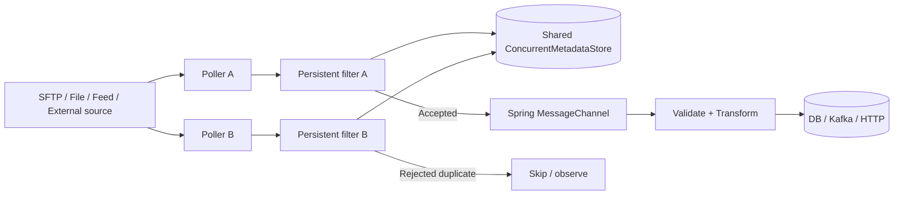
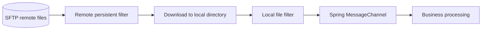
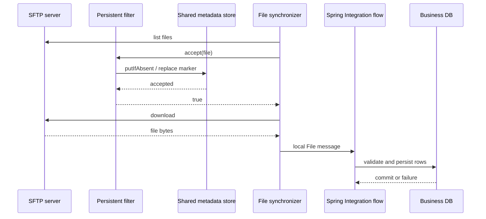

# Distributed metadata store

## 1. Problem: when an app runs across multiple instances, who remembers "already processed"?

In the **SPRING_INTEGRATION_ADAPTERS** module, Spring Integration connects external systems via inbound/outbound adapters, gateways, pollers, and `MessageChannel`. Data may flow across files, SFTP, HTTP, JMS, AMQP, Kafka, or databases. When an app has only a single instance, a small in-memory list of "seen" files may suffice for a demo. When deploying multiple replicas across VMs, Kubernetes, or the cloud, that approach is no longer safe:

- Pod A scans the SFTP directory and sees `orders-2026-11-23.csv`.
- Pod B scans the same directory immediately afterward.
- If each pod keeps its own state, **both** may download, emit messages, and write to the DB.
- Restarting a pod wipes in-RAM state, causing files to be reprocessed.
- If metadata is marked too early and the process dies before committing to the DB, the file may be **permanently skipped** on subsequent polls.

The **Distributed metadata store** in Spring Integration solves part of this problem by storing **shared key–value metadata** across multiple applications/instances, persisting across restarts and, with `ConcurrentMetadataStore`, supporting atomic per-key operations. It coordinates **accept-once filters**, idempotent receivers, and progress/checkpoint state.



**Practical scope:** a metadata store typically holds only **markers of what was seen/selected**, versions, or progress. It is **not itself a distributed message broker, transactional outbox, distributed lock, or exactly-once business transaction**.

### Lesson objectives

After this lesson, you will be able to:

1. Explain `MetadataStore`, `ConcurrentMetadataStore`, `SimpleMetadataStore`, and persistent implementations.
2. Distinguish **per-key atomicity** from **business transactions/processing**.
3. Configure `JdbcMetadataStore`, `RedisMetadataStore`, and `HazelcastMetadataStore` for multiple applications.
4. Use `SftpPersistentAcceptOnceFileListFilter` and `FileSystemPersistentAcceptOnceFileListFilter` with a shared store.
5. Design key prefixes/regions/canonical paths to avoid key collisions across jobs, tenants, or environments.
6. Understand `putIfAbsent`, `replace`, `get`, `put`, `remove`, and how to test concurrency.
7. Integrate with Spring Integration `@InboundChannelAdapter`, `@Poller`, `MessageChannel`, `@ServiceActivator`, and idempotent receivers.
8. Handle crash windows, stale claims, TTLs, rollbacks, retries, duplicates, and out-of-order processing.
9. Monitor and secure metadata backends in the cloud.
10. Build a safe rollout, migration, and failure-recovery runbook checklist.

## 2. How metadata differs from messages and business state

### 2.1. A small key–value instead of storing the whole event

Example of an observed file:

```text
metadata key:
  sftp:orders:v1:/incoming/2026/11/orders-42.csv

metadata value:
  2026-11-23T02:15:10Z  (remote modified timestamp)

business payload:
  [entire CSV content or OrderEvent records]
```

Metadata might store **the filename + modification timestamp**, while the file remains on SFTP/local disk and business records are persisted in a DB/Kafka. Knowing "the file was accepted by the filter" does not prove its records were committed to the DB.

### 2.2. Four kinds of state to keep separate

| Kind | Example | Tool |
|---|---|---|
| **Source checkpoint** | File path + modified time, RSS publish date | `MetadataStore`/persistent file filter. |
| **Business dedup/inbox** | `eventId` + processing status + transaction commit | DB table with unique constraint, inbox, or explicit idempotency mechanism. |
| **Message buffering** | Unconsumed `Message<?>` | `MessageStore`/durable queue/broker, **not** `MetadataStore`. |
| **Distributed coordination** | Leadership/lock/lease with owner and timeout | `LockRegistry`, DB lease/CAS, broker partition ownership. |

The same Redis, JDBC, or Hazelcast backend can power **different abstractions**, but sharing a backend does not make them identical:

- `MetadataStore`: key→String value to remember markers.
- `MessageStore`: stores `Message<?>`, message groups, and channel buffering.
- `LockRegistry`: acquires and releases locks with an ownership contract.
- Durable broker: holds records, offsets/acks, and broker-managed redelivery.

### 2.3. Why "distributed" does not automatically mean "durable"

A store shared by three instances might be backed by a Redis cache without AOF/RDB, a Hazelcast map without persistence, or a database that loses connectivity. When the entire backend restarts, metadata can be lost even though pods previously shared state.

Evaluate each dimension separately:

1. **Shared visibility:** do all replicas read/write the same namespace?
2. **Atomic conditional updates:** can two writers claim the same key?
3. **Persistence:** does state survive a service/backend restart or failover?
4. **Durability:** is it fsynced/replicated per SLA?
5. **Recovery:** is there snapshot/replay or a way to rebuild keys?
6. **Consistency:** which state do clients read during split-brain/failover?

These are six independent questions that cannot be replaced by the single label "distributed metadata".

## 3. Spring Integration APIs: MetadataStore and ConcurrentMetadataStore

### 3.1. `MetadataStore`

Interface:

```java
package org.springframework.integration.metadata;

public interface MetadataStore {

    void put(String key, String value);

    String get(String key);

    String remove(String key);
}
```

Common implementation conventions:

- `get(key)` returns the value or `null` if the key does not exist.
- `put(key,value)` overwrites the value **unconditionally**.
- `remove(key)` deletes the key and returns the previous value if present.

**Classic race condition** with `get` followed by `put`:

```java
// ANTI-PATTERN: not atomic across multiple nodes.
if (store.get("order:42") == null) {
    store.put("order:42", "SEEN");
    processOrder();
}
```

Both `Pod A` and `Pod B` can read `null` before either calls `put`, so both execute `processOrder()`.

### 3.2. `ConcurrentMetadataStore`

This interface extends `MetadataStore` and adds:

```java
public interface ConcurrentMetadataStore extends MetadataStore {

    String putIfAbsent(String key, String value);

    boolean replace(
        String key,
        String oldValue,
        String newValue);
}
```

Contract:

- `putIfAbsent(key, value)`: **atomic** per key; returns `null` when inserted, or returns the **existing value** if the key already exists.
- `replace(key, oldValue, newValue)`: atomic compare-and-set (CAS); succeeds when the current value matches `oldValue`.
- `put` is an unconditional overwrite; never use it instead of CAS for ownership or claiming.
- `remove` is an unconditional delete; it does not mean "delete only if owner == X".

Read return semantics carefully before coding:

```java
String previous =
    metadataStore.putIfAbsent("sftp:orders:42", "CLAIMED");

// Only one contender wins when the backend is truly shared
// and the implementation honors the atomic contract.
if (previous == null) {
    // I won the claim.
} else {
    // Already claimed/present; DO NOT process redundantly.
}
```

**Atomic on one key is not atomic across the whole pipeline.** Inserting a claim and calling HTTP/writing a DB remain two separate operations.

### 3.3. `SimpleMetadataStore` also implements ConcurrentMetadataStore, but...

`SimpleMetadataStore` uses an in-memory collection inside **a single JVM/application context**. Two threads sharing the same instance can use `putIfAbsent` safely, but two containers with separate `SimpleMetadataStore` instances do not coordinate at all.

```text
Pod A: SimpleMetadataStore [order42=SEEN]
Pod B: SimpleMetadataStore [         ]
                         ^ separate memories
```

**Conclusion:** `ConcurrentMetadataStore` is the **required API** for shared atomic key operations; to achieve **distributed behavior**, you must pick a **truly shared, properly configured implementation/backend**.

### 3.4. When no `metadataStore` bean is declared

Per the Spring Integration reference, some endpoints needing metadata will:

1. Look up a bean named/ID `metadataStore` in the application context if no dedicated store was injected.
2. Fall back to an in-memory `SimpleMetadataStore` if none is found.

This explains why a single-pod lab looks fine while multi-replica production processes duplicates after restarts.

**However, not every custom filter/endpoint auto-discovers the bean by the same rule.** For persistent filters accepting `ConcurrentMetadataStore` in their constructor, **inject it explicitly** rather than merely naming a bean `metadataStore` and assuming every default filter picks it up.

## 4. Choosing the right implementation

| Implementation | Where does state live? | Shared across pods? | Key points |
|---|---|---|---|
| `SimpleMetadataStore` | RAM of one JVM | **No** | Good for unit tests/dev; lost on restart. |
| `PropertiesPersistingMetadataStore` | Properties file | Unsafe if each pod has a local file; shared files also face cross-process atomicity issues | Per docs, flushes on normal close; provides `flush()`. |
| `RedisMetadataStore` | Redis hash/region | Yes, if sharing Redis and namespace | Fast; configure Redis durability; `replace` has Redis Cluster limitations. |
| `JdbcMetadataStore` | RDBMS table | Yes, if sharing DB/table/region | Transactions/unique keys, schema migrations, and lock settings. |
| `HazelcastMetadataStore` | Hazelcast `IMap` | Yes, if sharing cluster/map | CAS/metadata listeners; durability depends on map persistence/backups. |
| `MongoDbMetadataStore` | MongoDB collection | Yes, if sharing DB/collection | Check indexes, write concern, versions, and failover. |
| `ZookeeperMetadataStore` | ZooKeeper nodes | Yes, if sharing ensemble/path | Distinct consistency/coordination model and lifecycle. |
| `DynamoDbMetadataStore` | AWS DynamoDB via Spring Cloud AWS | Yes | Conditional writes, IAM, capacity/region, and AWS-specific contracts. |

A "persistent" implementation in the docs can store metadata outside the JVM; **actual durability depends on the backend**.

### 4.1. Choosing by need

- **Already running PostgreSQL/MySQL:** `JdbcMetadataStore` is often easiest to operate, especially if sharing state transactions in the same DB.
- **Already running true HA Redis:** `RedisMetadataStore` suits low-latency markers/filters, provided you test CAS/cluster topology and retention.
- **Already using a Hazelcast cluster:** `HazelcastMetadataStore` leverages a shared `IMap`; evaluate replication, split-brain, and backups.
- **Single-instance dev/test:** `SimpleMetadataStore` teaches the contract; never use it to prove distributed safety.
- **Need exact business transaction semantics:** an inbox table with a unique constraint inside the **same DB transaction** is usually clearer than an external metadata claim.

## 5. Designing keys, regions, and values before writing code

### 5.1. Keys must state their scope clearly

A metadata key should encode:

```text
<environment>:<application>:<flow-version>:<source>:<resource-id>
```

Examples:

```text
prod:order-import:v2:sftp:/incoming/2026/11/file-0042.csv
prod:order-import:v2:idempotent:event-123
staging:order-import:v2:sftp:/incoming/2026/11/file-0042.csv
```

If staging and production share a Redis region without the environment in the key, one environment can cause the other to skip files. If two SFTP directories contain the same simple filename, use **canonical remote directory + filename** or a filter mode that includes the full path.

**Upgrade note:** Spring Integration 7.0 changes key generation in some remote `AbstractPersistentAcceptOnceFileListFilter` implementations to include the longer path (directory + filename). When upgrading from older release lines, test **key prefix compatibility** and potential reprocessing. Never wipe all metadata just to "fix" duplicates without a migration plan.

### 5.2. Regions vs prefixes

- **`JdbcMetadataStore`** includes `REGION` in the primary key of `INT_METADATA_STORE`; `setRegion("...")` partitions keys.
- **`RedisMetadataStore`** uses the Redis hash key as a **region**; pass a custom `key` to the constructor to avoid sharing the default `MetaData` hash.
- **`HazelcastMetadataStore`** can use a dedicated `IMap` per state domain.
- **Persistent file filters** accept a `prefix`, prepended to the key generated from the file/path.

All support namespace isolation, yet **none automatically enforce per-tenant ACLs**. Regions organize data; they do not replace IAM or service identities.

### 5.3. Values should be small and unambiguous

Examples:

```text
key = prod:orders:remote:/incoming/order-42.csv
value = 1700700000000                # file modified timestamp

key = prod:orders:event:event-123
value = DONE:2026-11-23T03:00:00Z   # domain state per policy
```

For idempotency state, adding fields like `status`, `ownerToken`, `leaseUntil`, or `version` usually calls for an **atomically updatable schema**. Colon-delimited strings are fine for examples; production needs a well-defined format, parsing/validation, and CAS/transactions.

Never store raw payloads containing PII, API tokens, passwords, or entire Spring `Message<?>` objects in a metadata store. **A metadata store is neither a document store nor a `MessageStore`.**

## 6. Lab 1: Atomic metadata claim before processing an event

We begin with the core contract without connecting real SFTP or Kafka yet. Goal: when two threads/instances claim `eventId` concurrently, only one proceeds.

### 6.1. Bean with SimpleMetadataStore for local unit tests

File `LocalMetadataConfiguration.java`:

```java
package example.metastore;

import org.springframework.context.annotation.Bean;
import org.springframework.context.annotation.Configuration;
import org.springframework.integration.metadata.ConcurrentMetadataStore;
import org.springframework.integration.metadata.SimpleMetadataStore;

@Configuration
public class LocalMetadataConfiguration {

    @Bean("metadataStore")
    public ConcurrentMetadataStore metadataStore() {
        // Single-JVM lab ONLY: NOT shared across pods.
        return new SimpleMetadataStore();
    }
}
```

For multi-node production demos, swap this bean for `JdbcMetadataStore` or `RedisMetadataStore` **pointing to one shared backend**; never enable multiple beans with the same name simultaneously.

### 6.2. Atomic claim service

File `EventClaimService.java`:

```java
package example.metastore;

import org.springframework.integration.metadata.ConcurrentMetadataStore;
import org.springframework.stereotype.Service;

@Service
public class EventClaimService {

    private final ConcurrentMetadataStore metadataStore;

    public EventClaimService(ConcurrentMetadataStore metadataStore) {
        this.metadataStore = metadataStore;
    }

    public boolean claim(String eventId) {
        if (eventId == null
                || !eventId.matches("[A-Za-z0-9_-]{1,100}")) {
            throw new IllegalArgumentException(
                "Invalid eventId");
        }

        String key = "demo:orders:event:" + eventId;

        return metadataStore.putIfAbsent(
            key, "CLAIMED") == null;
    }
}
```

**Correct:** `putIfAbsent` eliminates the `get`-then-`put` race, provided contenders share **the same store** with an atomic implementation.

**Insufficient on its own:** the `CLAIMED` marker lacks completion status, lease/TTL, and recovery. If the process dies right after claiming, the event could stay blocked forever. This snippet demonstrates **atomic key insertion**, not a complete high-reliability work-processing algorithm.

### 6.3. Spring Integration service activator

File `EventClaimHandler.java`:

```java
package example.metastore;

import org.springframework.integration.annotation.ServiceActivator;
import org.springframework.messaging.Message;
import org.springframework.stereotype.Component;

@Component
public class EventClaimHandler {

    private final EventClaimService claims;

    public EventClaimHandler(EventClaimService claims) {
        this.claims = claims;
    }

    @ServiceActivator(inputChannel = "candidateEvents")
    public void handle(Message<String> message) {
        Object rawId =
            message.getHeaders().get("eventId");

        if (!(rawId instanceof String eventId)) {
            throw new IllegalArgumentException(
                "Missing eventId header");
        }

        boolean first = claims.claim(eventId);

        if (!first) {
            // Demo: log/count duplicate without raw payload.
            return;
        }

        // Demo: claim succeeded.
        // Production MUST NOT conclude business is DONE here.
        // Durable inbox/transactions and failure recovery are required.
    }
}
```

A Spring channel for the lab:

```java
@Bean("candidateEvents")
MessageChannel candidateEvents() {
    return new DirectChannel();
}
```

With `DirectChannel`, the handler runs on the caller's send thread. With `ExecutorChannel`, exception/ack handling shifts to another thread and `send()` may return before the claim executes.

### 6.4. Never implement idempotency with get-then-put

```text
Time    Pod A                   Pod B
t0      get(k) -> null
t1                              get(k) -> null
t2      put(k, "DONE")
t3                              put(k, "DONE")
t4      process()               process()
```

Use `putIfAbsent`:

```text
Time    Pod A                       Pod B
t0      putIfAbsent(k, CLAIMED)    ...
t1      returns null (winner)
t2                                  putIfAbsent(k, CLAIMED)
t3                                  returns "CLAIMED" (loser)
```

The key is protected **within a single atomic backend**. If Pod A and Pod B connect to **two different Redis clusters**, the same API cannot prevent duplicate processing.

## 7. Lab 2: JdbcMetadataStore shared across multiple instances

`JdbcMetadataStore` is a strong fit when your organization runs a reliable RDBMS and wants transactions and unique constraints. In Spring Integration, the JDBC store implements `ConcurrentMetadataStore` over a standard metadata table.

### 7.1. Dependencies

Maven (assuming compatible Spring Boot BOM/Spring Integration versions):

```xml
<dependencies>
    <dependency>
        <groupId>org.springframework.boot</groupId>
        <artifactId>spring-boot-starter-integration</artifactId>
    </dependency>

    <dependency>
        <groupId>org.springframework.integration</groupId>
        <artifactId>spring-integration-jdbc</artifactId>
    </dependency>

    <dependency>
        <groupId>org.springframework.boot</groupId>
        <artifactId>spring-boot-starter-jdbc</artifactId>
    </dependency>

    <!-- Pick the real database driver used in deployment. -->
    <dependency>
        <groupId>org.postgresql</groupId>
        <artifactId>postgresql</artifactId>
        <scope>runtime</scope>
    </dependency>
</dependencies>
```

Do not mix incompatible Spring Integration 6/7 and Boot 3/4 versions. Pin the BOM to a supported release train, and recompile/retest when upgrading versions.

### 7.2. Metadata schema

Spring Integration ships vendor-specific DDL scripts. Basic structure:

```sql
CREATE TABLE INT_METADATA_STORE (
    METADATA_KEY   VARCHAR(255) NOT NULL,
    METADATA_VALUE VARCHAR(4000),
    REGION         VARCHAR(100) NOT NULL,
    CONSTRAINT INT_METADATA_STORE_PK
        PRIMARY KEY (METADATA_KEY, REGION)
);
```

Explanation:

- `METADATA_KEY`: metadata key.
- `METADATA_VALUE`: string value.
- `REGION`: region/namespace.
- **Composite primary key** prevents duplicate keys within the same region.
- Flows in different regions can reuse the same logical key without overwriting each other.

The DDL above is an **illustrative shape from the docs**; pick the exact script/migration for your **RDBMS and Spring Integration version**. Never copy H2 syntax blindly into PostgreSQL, MySQL, or SQL Server. Production should use controlled Flyway/Liquibase/IaC migrations and never change the table prefix without migrating the DDL.

### 7.3. JavaConfig with `JdbcMetadataStore`

File `JdbcMetadataConfiguration.java`:

```java
package example.metastore;

import javax.sql.DataSource;

import org.springframework.context.annotation.Bean;
import org.springframework.context.annotation.Configuration;
import org.springframework.integration.jdbc.metadata.JdbcMetadataStore;
import org.springframework.integration.metadata.ConcurrentMetadataStore;

@Configuration
public class JdbcMetadataConfiguration {

    @Bean("metadataStore")
    public ConcurrentMetadataStore metadataStore(
            DataSource dataSource) {

        JdbcMetadataStore store =
            new JdbcMetadataStore(dataSource);

        store.setRegion("orders-import-v1");

        // Only if the table prefix was migrated in DDL.
        // store.setTablePrefix("MYAPP_");

        return store;
    }
}
```

Pods must share the `DataSource` (same **database, schema, table, and region**), not merely the same bean name. `JdbcMetadataStore` also supports `setLockHint(...)` per SQL dialect (defaulting to `FOR UPDATE`) and checks the metadata table at startup in newer versions.

**Important:** `JdbcMetadataStore` requires transaction management. Ensure a Spring JDBC transaction manager is configured and metadata/poller operations join transactions as designed. If metadata and domain records reside in the same DB under **two different `DataSource`s or transaction managers**, never assume they are atomic together.

### 7.4. Diagnostic SQL query

```sql
SELECT
    METADATA_KEY,
    METADATA_VALUE,
    REGION
FROM INT_METADATA_STORE
WHERE REGION = 'orders-import-v1'
ORDER BY METADATA_KEY;
```

Use this query only for authorized debugging; never copy the metadata table publicly or dump all keys in production logs. When the table grows large, add `LIMIT`/pagination, proper indexes, and DB access controls.

### 7.5. When a poller transaction rolls back

If `JdbcMetadataStore` is used by an inbound adapter within the **exact transaction** managed by the poller, the metadata write can roll back along with the transaction. That helps if processing inside the same DB transaction fails.

**However**, downloading from SFTP, calling HTTP, publishing to Kafka, or uploading to cloud storage are external side effects; they do not automatically roll back with JDBC. One DB transaction is not a distributed transaction across every adapter.

Example:

```text
BEGIN DB TRANSACTION
  select/claim file metadata row
  update local DB
COMMIT

separate remote call:
  HTTP / SFTP / Kafka
```

If business logic must coordinate multiple systems, design outbox/inbox/saga/reconciliation; never slap `@Transactional` on a method and claim exactly-once.

## 8. Lab 3: RedisMetadataStore for multiple replicas

### 8.1. Dependencies

```xml
<dependencies>
    <dependency>
        <groupId>org.springframework.boot</groupId>
        <artifactId>spring-boot-starter-integration</artifactId>
    </dependency>

    <dependency>
        <groupId>org.springframework.integration</groupId>
        <artifactId>spring-integration-redis</artifactId>
    </dependency>

    <dependency>
        <groupId>org.springframework.boot</groupId>
        <artifactId>spring-boot-starter-data-redis</artifactId>
    </dependency>
</dependencies>
```

`spring-boot-starter-data-redis` configures `RedisConnectionFactory` via Spring Data Redis/Lettuce for compatible Boot versions. Spring Integration Redis is a separate module.

### 8.2. Bean using a dedicated Redis hash key

File `RedisMetadataConfiguration.java`:

```java
package example.metastore;

import org.springframework.context.annotation.Bean;
import org.springframework.context.annotation.Configuration;
import org.springframework.data.redis.connection.RedisConnectionFactory;
import org.springframework.integration.metadata.ConcurrentMetadataStore;
import org.springframework.integration.redis.metadata.RedisMetadataStore;

@Configuration
public class RedisMetadataConfiguration {

    @Bean("metadataStore")
    public ConcurrentMetadataStore metadataStore(
            RedisConnectionFactory redisConnectionFactory) {

        // Second argument is the Redis hash key/region,
        // NOT an individual metadata entry key.
        return new RedisMetadataStore(
            redisConnectionFactory,
            "si:prod:orders:metadata:v1");
    }
}
```

Per the API, `RedisMetadataStore(RedisConnectionFactory, String key)` uses `key` as the region/Redis hash holding entries. If omitted, the documented default region is `MetaData`. **Never let multiple applications share the default hash** and collide on keys accidentally.

Example `application.yml` (dev environment only, no hardcoded secrets):

```yaml
spring:
  data:
    redis:
      host: ${REDIS_HOST:localhost}
      port: ${REDIS_PORT:6379}
      timeout: 2s
```

Production security also requires TLS/authentication, private networking, secrets/managed identity, and Redis platform-appropriate failover behavior.

### 8.3. Redis Cluster: critical limitation of `replace()`

The Spring Integration Redis documentation explicitly notes: **`RedisMetadataStore.replace()` cannot be used with Redis Cluster** when it relies on `WATCH` for CAS; Redis Cluster does not support the `WATCH` pattern required by this implementation.

This directly impacts:

- `AbstractPersistentAcceptOnceFileListFilter` when comparing old/new timestamps.
- Any flow calling `ConcurrentMetadataStore.replace` to update claims or versions.
- Reusing filter state after restarts or migrations.

**Do not** assume that because `putIfAbsent` works on Redis Cluster, **the full `ConcurrentMetadataStore` contract** works safely there. Test your exact **Redis standalone/Sentinel/Cluster topology** and operations, or choose `JdbcMetadataStore`/another backend when full CAS is needed.

### 8.4. Redis persistence and TTL

Redis can run purely in memory or with AOF/RDB persistence depending on configuration, with varying durability/snapshot guarantees. The metadata store **does not automatically manage per-entry TTLs** just because it uses a Redis hash.

- Configure backend persistence and replicas/failover per SLA.
- Design retention-aware metadata cleanup rather than wiping hashes blindly.
- With a shared hash, setting a Redis key-level TTL expires **the entire region**, not a single file entry.
- If per-entry TTL/leases are required, use a backend/model that supports atomic per-entry expiry under a dedicated schema and test concurrency/failover.
- Never treat Redis cache eviction as a business retention policy.

### 8.5. Redis metadata store vs RedisMessageStore

`RedisMetadataStore` stores metadata strings for filters and idempotency. `RedisMessageStore` or `RedisChannelMessageStore` persists messages, message groups, and queue state under a different abstraction.

**Never** back a `QueueChannel` with `RedisMetadataStore` expecting it to persist `Message<?>` objects and redeliver on ack; they do not share interfaces or semantics.

## 9. Lab 4: HazelcastMetadataStore on a distributed IMap

If your application already uses Hazelcast from the Adapter Cloud chapter, you can use `HazelcastMetadataStore`:

```java
package example.metastore;

import com.hazelcast.core.HazelcastInstance;
import com.hazelcast.map.IMap;

import org.springframework.context.annotation.Bean;
import org.springframework.context.annotation.Configuration;
import org.springframework.integration.hazelcast.metadata.HazelcastMetadataStore;
import org.springframework.integration.metadata.ConcurrentMetadataStore;

@Configuration
public class HazelcastMetadataConfiguration {

    @Bean("metadataStore")
    public ConcurrentMetadataStore metadataStore(
            HazelcastInstance hazelcastInstance) {

        IMap<String, String> map = hazelcastInstance
            .getMap("si-prod-orders-meta-v1");

        return new HazelcastMetadataStore(map);
    }
}
```

**Prerequisite:** a client/member `HazelcastInstance` is already created and joined to **the right cluster** with TLS, auth, and network policies. This snippet does not provision a Hazelcast Cloud account/cluster. `HazelcastMetadataStore` also offers a constructor taking `HazelcastInstance` and defaulting to map `SPRING_INTEGRATION_METADATA_STORE`.

`HazelcastMetadataStore` implements `ListenableMetadataStore`: you can register a `MetadataStoreListener` to observe adds/updates/removes as supported by the implementation. **Do not confuse metadata listeners with a durable audit event log** — when a listener is offline, events may not replay.

### 9.1. MetadataStore vs HazelcastMessageStore

- `HazelcastMetadataStore`: key/value markers for filters, checkpoints, and deduplication.
- `HazelcastMessageStore`: stores `Message<?>` and message groups for aggregators or channels.
- `Hazelcast LockRegistry`: manages distributed locks; it does not replace either store above.

Durability of Hazelcast metadata depends on backups, persistence, map configuration, and deployment. By default, a distributed in-memory map is not a durable database.

## 10. Real-world use case: SFTP persistent accept-once filter

This is the canonical use case for a **Distributed metadata store** in Spring Integration.

### 10.1. Without a shared store

```text
SFTP /incoming/orders.csv
   |
   +-- Pod A: local AcceptOnce => ACCEPT => download + process
   |
   +-- Pod B: local AcceptOnce => ACCEPT => download + process
```

Both pods lack shared state, so the same file can be ingested twice.

### 10.2. With a shared ConcurrentMetadataStore

```text
SFTP /incoming/orders.csv
   |
   +-- Pod A: SftpPersistentAcceptOnceFileListFilter --+
   |                                                   |
   +-- Pod B: SftpPersistentAcceptOnceFileListFilter --+--> Shared store
                                                       |
                                                one accepted
                                                one rejected
```

`SftpPersistentAcceptOnceFileListFilter` extends the persistent file list filter backed by `ConcurrentMetadataStore`. Acceptance normally checks **filename/path** and **remote modified timestamp**, allowing modified files to be re-accepted.

**This is deduplication at file selection**, not downstream JDBC/Kafka commit. The two steps have distinct failure windows.

### 10.3. Remote filter bean

File `SftpFilterConfiguration.java`:

```java
package example.metastore;

import org.springframework.context.annotation.Bean;
import org.springframework.context.annotation.Configuration;
import org.springframework.integration.metadata.ConcurrentMetadataStore;
import org.springframework.integration.sftp.filters.SftpPersistentAcceptOnceFileListFilter;

@Configuration
public class SftpFilterConfiguration {

    @Bean("ordersRemoteFilter")
    public SftpPersistentAcceptOnceFileListFilter ordersRemoteFilter(
            ConcurrentMetadataStore metadataStore) {

        // Prefix isolates flows and key versions.
        return new SftpPersistentAcceptOnceFileListFilter(
            metadataStore,
            "sftp:orders:v1:remote:");
    }
}
```

Each pod must:

- Connect to the same SFTP source/directory.
- Use the same **shared** metadata backend/region.
- Use the **same filter prefix and key rules** for the same job.
- Separate tenants/flows into distinct namespaces.
- Use a metadata store supporting full CAS semantics, especially when handling updated file mtimes.
- Account for clock/timezone and remote timestamp granularity on the SFTP server; do not assume all servers share the same mtime precision.

### 10.4. XML inbound adapter referencing the filter

This example **assumes** a secure `sftpSessionFactory` and the `ordersRemoteFilter` bean above already exist. Namespace boilerplate is shown to make the configuration clear:

```xml
<?xml version="1.0" encoding="UTF-8"?>
<beans xmlns="http://www.springframework.org/schema/beans"
       xmlns:xsi="http://www.w3.org/2001/XMLSchema-instance"
       xmlns:int="http://www.springframework.org/schema/integration"
       xmlns:int-sftp="http://www.springframework.org/schema/integration/sftp"
       xsi:schemaLocation="
         http://www.springframework.org/schema/beans
         https://www.springframework.org/schema/beans/spring-beans.xsd
         http://www.springframework.org/schema/integration
         https://www.springframework.org/schema/integration/spring-integration.xsd
         http://www.springframework.org/schema/integration/sftp
         https://www.springframework.org/schema/integration/sftp/spring-integration-sftp.xsd">

    <int:channel id="ordersFiles"/>

    <int-sftp:inbound-channel-adapter
        id="ordersSftpInbound"
        channel="ordersFiles"
        session-factory="sftpSessionFactory"
        remote-directory="/incoming/orders"
        local-directory="file:/var/app/orders"
        filter="ordersRemoteFilter"
        auto-create-local-directory="true">

        <int:poller
            fixed-delay="3000"
            max-messages-per-poll="10"/>
    </int-sftp:inbound-channel-adapter>

</beans>
```

**Explanation:**

- `filter="ordersRemoteFilter"` filters **before downloading files from SFTP**.
- `local-directory` is where files are synchronized locally before becoming Spring messages.
- `ordersFiles` is the `MessageChannel` after the inbound adapter.
- The poller still has to run; the metadata store does not poll directories on its own.
- SFTP session options (host, auth, host-key verification, connection pool, timeouts) are provided by `sftpSessionFactory`.
- If consumers are slow, a `DirectChannel` can block the poller; size pools and add error recovery.

### 10.5. Two filter layers, not one

An SFTP file-synchronizing inbound adapter typically involves:

1. **Remote filter**: which remote files may be **fetched** from the SFTP server?
2. **Local filter**: which local files may be **emitted** as Spring messages?



If a remote file changes and is re-fetched while the local filter still holds a stale marker, it may **download without emitting** a new message. Conversely, if the local filter is only in-memory, a restart can re-emit old files sitting on disk.

For the local filesystem, Spring Integration provides `FileSystemPersistentAcceptOnceFileListFilter`:

```java
import org.springframework.integration.file.filters.FileSystemPersistentAcceptOnceFileListFilter;

FileSystemPersistentAcceptOnceFileListFilter localFilter =
    new FileSystemPersistentAcceptOnceFileListFilter(
        metadataStore,
        "sftp:orders:v1:local:");
```

Attach the local filter via `local-filter` (XML) or the source spec (Java DSL) per your version and needs. **Use a different prefix from the remote filter** because the two metadata entries have different contracts and keys; sharing a store with overlapping namespaces causes one to overwrite the other's markers.

**Container filesystem note:** each pod typically has its own `/var/app/orders`; shared remote metadata ensures only one pod downloads a file, meaning other pods lack a local copy. If the downloading pod crashes before emitting the message, **no other pod will automatically process it**. Durable staging or reconciliation/recovery is needed.

### 10.6. Bounding fetches per poll

Use `max-fetch-size` on the SFTP inbound adapter/source per API version so one pod does not download too many files before peer pods get a turn. `max-messages-per-poll` limits how many Spring messages the poller emits per poll, which is not necessarily equal to the number of remote files downloaded.

Never set `max-fetch-size=1` and conclude the system is now exactly-once: it only paces fetches and balances work more fairly across pods.

## 11. When files change: mtime, hashes, and paths

### 11.1. Persistent file filter defaults

With `SftpPersistentAcceptOnceFileListFilter`, metadata typically tracks **file path/name and remote modified timestamp**. If a file keeps the same name with a newer mtime, the filter can accept it again.

```text
/incoming/orders.csv @ T1  -> accepted
/incoming/orders.csv @ T1  -> rejected
/incoming/orders.csv @ T2  -> accepted (file changed)
```

Do not assume different byte contents always change mtime; some tools preserve timestamps on upload or rename. When business rules require content identity, use checksums, object versions, or a dedicated business key.

### 11.2. Directory key collisions

Two directories:

```text
/incoming/tenantA/orders.csv
/incoming/tenantB/orders.csv
```

If the key were only `orders.csv`, one file would block the other. Thus full paths or source-scoped prefixes are needed. In Spring Integration 7.0+, remote persistent file filters include the longer path in keys per the upgrade guide. On 6.x, review `forRecursion` and the filter's exact key-building logic.

### 11.3. Incomplete remote uploads

A metadata filter prevents duplicates; it does **not** guarantee a file upload has finished. Mitigations include:

- SFTP producers write `*.writing` and atomically rename to `*.csv` when done.
- Filter by final extension or ready-marker files.
- Use an age filter or size/mtime stability rules per SLA.
- Verify checksums or manifests when required by the business.

If a partial file is fetched after inserting a marker, recovery must ensure the filter reverts/cleans up per framework behavior; never treat accept-once as source-completeness validation.

## 12. Danger zone: accept-once first, business commit later

### 12.1. Distinct milestones for a single file



Here **order matters**: the filter stores the marker **before** business processing. Having the key in `MetadataStore` only means the file **was accepted by the filter**, not that every row in the file reached the DB.

### 12.2. Crash window matrix

| Where did the crash happen? | Likely metadata state | Risk | Recovery |
|---|---|---|---|
| Before filter accepts | No marker | Polled again and read | Normal. |
| After filter accepts, before download | Marker exists | File skipped after restart | Check local staging; reset marker per recovery policy. |
| Mid-download | Marker may exist | Local file incomplete/truncated | Framework supports reversing on fetch errors; hard crashes may still need cleanup. |
| After download, before emit | Remote marker exists, local file exists | Nobody processes if pod and local disk vanish | Durable staging or reconciliation. |
| After emit, before DB commit | Marker exists, business incomplete | Lost processing | Inbox/outbox, requeue, or controlled marker reset. |
| After DB commit, before audit/ack | Marker exists, business complete | Retry causes duplicates | Transactional idempotent consumer. |
| Metadata backend loses state | Marker gone | Already-processed files re-ingested | Rebuild/reconcile from business logs. |

Per Spring Integration docs, when a remote fetch fails, reversible file filters can roll back on certain error paths. However, **downstream failures after the synchronizer emits a message do not automatically roll back the remote filter**. That is why a separate reset/replay plan is mandatory.

### 12.3. Why deleting the key on exception is not always safe

Suppose `Node A` claims a key and stalls; another recovery mechanism lets `Node B` reclaim it. If A catches an exception and calls `remove(key)` **unconditionally**, it can delete the claim B just acquired, letting Node C start processing a third time.

```text
A obtains CLAIM owner=A
A becomes slow
Recovery decides A is expired
B obtains CLAIM owner=B
A catches exception -> remove(key)  // accidentally deletes B's claim
C obtains CLAIM
```

`ConcurrentMetadataStore` offers `replace(key, expectedOld, newValue)`, but **no atomic remove-if-value-matches** in its core API. When ownership/leases are required, use a DB row with conditional update/delete, a lock/lease backend with fencing tokens, or a dedicated schema supporting atomic operations.

### 12.4. When should you reset a persistent filter?

Only when:

1. You have verified the exact source object/path and timestamp.
2. You know clearly whether business state committed.
3. You are certain no other worker is currently processing the same item.
4. You record operator/reason audit metadata and scope the reset tightly.
5. Downstream is idempotent enough to tolerate duplicates if judgment was off.

Never run `DEL all keys` or `TRUNCATE INT_METADATA_STORE` in production just to make one file "reappear". Use the filter's reset API or tightly scoped metadata operations by exact key/prefix/version.

## 13. Idempotent Receiver Enterprise Integration Pattern

A **persistent file filter** guards *source selection*. An **idempotent receiver** guards *message processing* and usually keys off a **business key** (event ID, invoice ID, source file version).

### 13.1. Do not rely on `get(key)==null` alone

A hand-rolled check:

```java
// UNSAFE when multiple replicas compete.
if (metadataStore.get(eventId) == null) {
    businessService.process(event);
    metadataStore.put(eventId, "DONE");
}
```

still has a race condition: two replicas both observe `null`. Moving `putIfAbsent` before `process` still leaves a crash window between claiming and business commit. True **end-to-end idempotency** requires choosing when to persist markers and how to recover.

### 13.2. `IdempotentReceiverInterceptor`

Spring Integration provides `IdempotentReceiverInterceptor` backed by a `MessageSelector`; `MetadataStoreSelector` can use `ConcurrentMetadataStore` to decide whether a message has been seen.

XML example (assuming `metadataStore` and `orderService` beans exist):

```xml
<int:channel id="candidateEvents"/>
<int:channel id="duplicateEvents"/>

<int:service-activator
    id="processOrderEndpoint"
    input-channel="candidateEvents"
    ref="orderService"
    method="process"/>

<int:idempotent-receiver
    endpoint="processOrderEndpoint"
    metadata-store="metadataStore"
    key-expression="headers['eventId']"
    discard-channel="duplicateEvents"/>
```

Meaning:

- `endpoint` targets the **Spring Integration endpoint** being advised.
- `key-expression` derives the idempotency key from the Spring message.
- `metadata-store` references the `ConcurrentMetadataStore`.
- `discard-channel` receives rejected duplicate messages per policy.
- Without a discard channel or `throw-exception-on-rejection`, the interceptor can **still pass duplicates to the handler**, marked with header `duplicateMessage=true` — it does **not drop by default**.
- Invalid/missing `eventId` headers must be validated beforehand; never let every ID-less message collide on a `null` key.

**Important:** the interceptor is *advice around a `MessageHandler`*, not a durable broker consumer with acks. Test how markers are inserted/updated and how rollbacks/retries behave when the business handler throws.

### 13.3. `MetadataStoreSelector` comparing versions

Spring Integration supports `compareValues` to accept a newer message when its value satisfies a comparison against the stored value (e.g., a higher line number or version). This helps when you do not want a new key per version.

However:

- Never compare version strings lexicographically if they are unpadded numbers.
- Rely on valid `long`/structured values parsed with error handling.
- Verify CAS support on your chosen backend.
- For Redis Cluster, remember the `RedisMetadataStore.replace()` limitation.
- `compareValues` only governs updating the marker; it does not roll back side effects if the business handler fails.

### 13.4. What should idempotency do on duplicates?

| State | How the application can respond |
|---|---|
| `UNSEEN` | Allow processing; create a durable claim/transaction if needed. |
| `IN_PROGRESS` | Avoid concurrent execution; inspect lease and retry eligibility. |
| `SUCCEEDED` | Skip or return cached result per contract. |
| `FAILED_RETRYABLE` | Allow retry after backoff/deadline. |
| `FAILED_PERMANENT` | Quarantine/DLQ and operator review. |
| `UNKNOWN_OUTCOME` | Reconcile external result before retrying. |

A single `SEEN` marker cannot distinguish the five subsequent states. For critical business flows, design an **inbox table** or command-state machine rather than cramming all state logic into a filter.

## 14. CAS with owner tokens: advanced pattern, not a complete lease

### 14.1. State transitions using `replace()`

Example service illustrating conditional updates:

```java
package example.metastore;

import java.util.UUID;

import org.springframework.integration.metadata.ConcurrentMetadataStore;

public final class ClaimTransitions {

    private final ConcurrentMetadataStore store;

    public ClaimTransitions(ConcurrentMetadataStore store) {
        this.store = store;
    }

    public String begin(String eventId) {
        String key = "orders:v1:event:" + eventId;

        String token = UUID.randomUUID().toString();
        String claimed = "IN_PROGRESS:" + token;

        return store.putIfAbsent(key, claimed) == null
            ? claimed : null;
    }

    public boolean markDone(
            String eventId, String claimedValue) {
        return store.replace(
            "orders:v1:event:" + eventId,
            claimedValue,
            "SUCCEEDED");
    }

    public boolean markFailed(
            String eventId, String claimedValue) {
        return store.replace(
            "orders:v1:event:" + eventId,
            claimedValue,
            "FAILED_RETRYABLE");
    }
}
```

`claimedValue` acts as a **simple CAS-level owner/fencing marker** to stop an old worker from overwriting a newer worker's state. However, this is **not yet a monotonically increasing fencing token validated by the target resource**; do not call this example "end-to-end safe fencing".

### 14.2. What this example leaves unsolved

- Claims have no TTL, so a crashed node leaves `IN_PROGRESS` forever.
- No atomic `FAILED_RETRYABLE -> IN_PROGRESS(newOwner)` transition with lease/time checks.
- No attempt count or retry deadline tracking.
- No atomic transaction bridging the business DB and metadata backend.
- No guarantee `SUCCEEDED` is written after a cloud operation confirms.
- No guard against a stale worker still executing side effects even when CAS `markDone` fails.

For a production-safe lease:

1. Persist `ownerToken`, `leaseUntil`, and `version` in a DB/model with conditional updates.
2. Use **server-side time**/lease semantics defined by the backend, not local wall clocks alone.
3. On lease expiration, new claims must use CAS/transactions so two owners cannot both win.
4. Side-effect endpoints should validate fencing/version tokens where possible.
5. Persist completion + business data in an appropriate transaction, or use outbox/saga patterns.
6. Maintain durable recovery and alerts for stale claims.

### 14.3. When should you NOT roll your own lease?

If the source is Kafka, JMS, or AMQP, the framework/broker already provides **consumer groups, offsets, acks, and redelivery**. Before building custom leases in a metadata store, evaluate whether broker semantics paired with an **idempotent inbox** in your domain DB suffice. Rolling per-message leases manually often makes systems more complex and fragile.

## 15. Testing: local races, multi-instance, and crashes

### 15.1. Unit testing atomicity within one JVM

File `MetadataClaimTest.java`:

```java
package example.metastore;

import static org.junit.jupiter.api.Assertions.*;

import java.util.ArrayList;
import java.util.List;
import java.util.concurrent.CountDownLatch;
import java.util.concurrent.ExecutorService;
import java.util.concurrent.Executors;
import java.util.concurrent.Future;

import org.junit.jupiter.api.Test;
import org.springframework.integration.metadata.ConcurrentMetadataStore;
import org.springframework.integration.metadata.SimpleMetadataStore;

class MetadataClaimTest {

    @Test
    void onlyOneThreadCanInsertSameKey() throws Exception {
        ConcurrentMetadataStore store =
            new SimpleMetadataStore();

        int count = 16;
        CountDownLatch start = new CountDownLatch(1);
        ExecutorService pool =
            Executors.newFixedThreadPool(count);

        try {
            List<Future<Boolean>> results =
                new ArrayList<>();

            for (int i = 0; i < count; i++) {
                results.add(pool.submit(() -> {
                    start.await();
                    return store.putIfAbsent(
                        "order:event:42",
                        "CLAIMED") == null;
                }));
            }

            start.countDown();

            int winners = 0;
            for (Future<Boolean> result : results) {
                if (result.get()) {
                    winners++;
                }
            }

            assertEquals(1, winners);
            assertEquals(
                "CLAIMED",
                store.get("order:event:42"));
        }
        finally {
            pool.shutdownNow();
        }
    }

    @Test
    void compareAndSetRejectsStaleOwner() {
        ConcurrentMetadataStore store =
            new SimpleMetadataStore();

        assertNull(store.putIfAbsent(
            "event-88", "IN_PROGRESS:ownerA"));

        assertFalse(store.replace(
            "event-88", "IN_PROGRESS:ownerB",
            "SUCCEEDED"));

        assertTrue(store.replace(
            "event-88", "IN_PROGRESS:ownerA",
            "SUCCEEDED"));

        assertEquals(
            "SUCCEEDED",
            store.get("event-88"));
    }
}
```

These tests verify **CAS behavior within one instance** and API logic. They **do not prove** multi-pod coordination. `SimpleMetadataStore` uses an internal concurrent map, so it passes concurrency tests while still failing if each deployed pod gets its own isolated store.

### 15.2. Real integration test with two application contexts

To prove a shared store:

1. Provision **one** test PostgreSQL/Redis/Hazelcast backend.
2. Start **two** Spring application contexts or two processes with separate client connections.
3. Give each context a `ConcurrentMetadataStore` bean pointing to **the same database/region**.
4. Have both call `putIfAbsent(sameKey, ...)` behind a barrier.
5. Assert exactly one contender wins.
6. Verify CAS `replace` and consistent readback across both connections.
7. Restart context A: context B still sees the key.
8. Restart the backend under its durability profile: does state survive?
9. For SFTP, run two pollers competing on one source directory feeding an idempotent downstream sink.
10. Test Redis Cluster **explicitly** if deploying clustered: exercise both `putIfAbsent` and `replace`; never assume both are supported.

If using Testcontainers, pin images and never test against production brokers/databases. No build/test was executed in this lesson; these steps serve as a **test plan** for QA and rollout.

### 15.3. Negative test cases

| Test | What to verify |
|---|---|
| Two contexts accidentally connect to two Redis instances | Test detects namespace/backend mismatch. |
| Two contexts share Redis with different hash keys | State is not shared; intentional or caught as misconfig. |
| JDBC uses different `REGION`s | Keys are independent; duplicates not prevented across regions. |
| Calling `replace` on Redis Cluster | Fails/unsupported per implementation, never silently passes. |
| Metadata DB timeout | Fails closed or enters durable recovery; no silent duplicate processing. |
| Crash after claim, before fetch | Stale marker is detected and recovered. |
| Crash after business commit, before ack | Idempotency blocks duplicate side effects on retry. |
| Same filename in different directories | No key collision when path/prefix is configured properly. |
| Same filename with newer mtime | Re-ingested per policy or clearly flagged as duplicate. |
| Incomplete remote upload | Ready-marker/rename filter blocks partial reads. |
| Shared metadata region cleared | Reconciliation tooling handles reprocessing safely. |
| Local filter diverges from remote filter | File does not download successfully only to be skipped locally. |
| Multiple pods + ephemeral local directories | If owning pod dies, work is not silently abandoned. |

## 16. Metadata stores in JDBC/FTP/SFTP/File/Feed flows

### 16.1. File inbound

`FileReadingMessageSource` can use `FileSystemPersistentAcceptOnceFileListFilter` to track path + modified time of local files.

```java
FileSystemPersistentAcceptOnceFileListFilter filter =
    new FileSystemPersistentAcceptOnceFileListFilter(
        metadataStore, "local:invoice:v1:");
```

When multiple replicas share a filesystem/NFS mount, a shared `ConcurrentMetadataStore` coordinates file selection. Races can still occur if files are deleted/moved or processes crash; pair with a file-ready policy and durable sink.

### 16.2. FTP/FTPS inbound

`FtpPersistentAcceptOnceFileListFilter` follows the same pattern as SFTP: remote file name/path + mtime with a shared store preventing multi-pod duplicate fetches. **Do not** call it a transactional FTP server acknowledgment.

### 16.3. SFTP streaming inbound

A streaming adapter can supply an `InputStream` payload from a remote file. Metadata filters remember which file was selected, yet streams can fail mid-read. Close sessions/streams properly per lifecycle; if downstream reads partially and fails, intentionally replay or reset markers.

### 16.4. Feed inbound and non-transactional sources

RSS/Atom/feed adapters typically store publish dates/IDs of seen entries because the source lacks Kafka-like transactions or acks. `MetadataStore` preserves checkpoints across polls and restarts; if feeds reorder entries or have clock skew, comparing a single timestamp is not enough.

### 16.5. Database polling vs metadata store

For a JDBC polling source, the database can usually track `PENDING -> CLAIMED -> DONE` inside a transaction. In that case, an **explicit DB transaction and unique constraint** is easier to reason about than polling rows, writing a Redis metadata key, and then updating the DB.

Choose `MetadataStore` when adapting/coordinating external non-transactional sources; avoid duplicating DB state unnecessarily.

## 17. Transaction semantics: choosing the right completion point

### 17.1. Same JDBC transaction

`JdbcMetadataStore` can share the poller's `DataSourceTransactionManager` and domain DB so the metadata entry rolls back when the transaction rolls back, provided all JDBC operations share **the same `DataSource` and transaction boundary**.

However, not every `@ServiceActivator` or async channel joins the poller's transaction automatically. For example, `ExecutorChannel` crosses a thread boundary where standard transaction contexts do not propagate. Always verify **where transactions begin and commit** on your actual flow.

### 17.2. No distributed transaction with remote SFTP

```text
SFTP: remote file -> local disk
DB:   metadata insert -> business rows
HTTP: update external API
Kafka: publish event
```

These resources **do not automatically form one XA transaction**. Address this with:

- **Transactional inbox/outbox** for the DB portion.
- Idempotency keys on external side effects.
- Reconciliation/durable job state for unknown outcomes.
- Bounded retries, backoff, and DLQ/quarantine.
- SFTP file staging/renames/manifests or a processed directory where appropriate.
- Accepting at-least-once delivery and building idempotent consumers.

### 17.3. When metadata was written but business processing fails

Never blindly run:

```java
try {
    process(message);
}
catch (Exception ex) {
    metadataStore.remove(key); // RISK: may delete another worker's claim
    throw ex;
}
```

First verify claim ownership, DB commit state, and backend atomic delete semantics. Use transaction rollback or conditional status updates where available; when manual resets are required, scope them precisely and audit them.

## 18. TTL, cleanup, and migration

### 18.1. Metadata cannot grow unboundedly

At 100,000 files/day, creating one key per file yields roughly **36.5 million entries** per year (excluding reprocessed files). Actual footprint depends on key length, values, Redis hash/JDBC row indexes, and backend overhead.

Establish clearly:

- How long is the retention policy?
- After retention expires, do old files still sit on the source?
- Can the business DB still deduplicate if metadata keys are purged?
- Does cleanup run in rate-limited batches/cursors rather than massive deletes?
- How long must markers remain for audit compliance?
- Is there a migration path from legacy key/prefix versions?

### 18.2. TTL and getting the semantics right

A TTL on a Redis **hash key** can wipe the entire region. `JdbcMetadataStore` does not automatically prune rows by a per-entry TTL. Hazelcast map TTL/eviction can discard metadata under cache policy.

If keys vanish too early, old files still sitting on SFTP appear "new" and get reprocessed. **Never set TTLs based solely on storage capacity**; align them with source retention windows and downstream business deduplication.

### 18.3. Safe cleanup

A solid cleanup runbook:

1. Target the exact environment/region/prefix and sample 20 keys.
2. Verify age, ownership, source state, and business commits.
3. Quiesce affected pollers or apply a bounded migration protocol.
4. Back up/snapshot metadata where feasible.
5. Delete in small, rate-limited batches.
6. Watch duplicate event/DB write metrics after cleanup.
7. Roll back/recover from backups or rely on idempotent sinks if needed.

Never delete/truncate a shared metadata table just to "retest one key". Never let a housekeeping job pick namespaces from user-provided strings.

### 18.4. Rolling upgrades and key migration

Suppose 6.x wrote `sftp:orders:v1:orders.csv` while 7.x writes `sftp:orders:v1:/incoming/orders.csv`. During a rolling deployment when both versions run together, they may **not recognize each other's markers**, causing duplicates.

Mitigation approaches:

- Pause pollers for a controlled cutover and migrate keys after testing.
- Introduce a new prefix and intentionally allow controlled replay into an idempotent sink.
- Use a shared canonicalization strategy supported by your version.
- Never run two incompatible key formats against the same source without downstream protection.
- Monitor duplicate rates closely during rollouts.

### 18.5. Never delete `IN_PROGRESS` markers blindly

A cleanup job inspecting only timestamps inside values might delete the marker of a slow, active worker. Use leases, heartbeats, fencing, or a work-state table to know whether an owner is active and how far side effects progressed. **Plain `MetadataStore` does not define lease semantics by itself.**

## 19. Security, credentials, and sensitive data

### 19.1. Metadata can indirectly expose PII

A key like:

```text
sftp:orders:/incoming/customer-email@example.com.csv
```

still reveals customer identity without storing file contents. Likewise, event IDs can carry sensitive values or reveal internal details.

Best practices:

- Use opaque keys or hashes/HMACs per policy when raw paths are unnecessary.
- Never put full paths containing user data into metric labels.
- Cap `METADATA_VALUE` size and validate parsing/length.
- Never store access tokens, passwords, JWTs, session IDs, or raw Spring `MessageHeaders`.
- Encrypt data at rest and in transit, and enforce retention.
- Audit marker deletion and reset operations.

### 19.2. Redis

- Private endpoints, TLS/AUTH/ACLs, credential rotation.
- Separate hash regions/key prefixes across environments and teams.
- Grant only required Redis commands/keys as supported by your provider.
- Audit eviction policies: evicted metadata causes duplicates.
- Test Redis failover and `replace` compatibility on your actual topology.
- Never run `FLUSHDB`/`FLUSHALL` to reset an individual flow.

### 19.3. JDBC

- Grant the app DB user only needed `SELECT`/`INSERT`/`UPDATE`/`DELETE` on the metadata table; run DDL migrations under a separate role.
- Use TLS for DB connections and pull secrets from a vault/managed identity.
- Index on primary key/region; enforce quotas and connection pool sizing.
- Keep sensitive keys/values out of SQL logs.
- Review Flyway/Liquibase migrations.
- When sharing a DB with domain data, separate schemas/roles and transaction managers explicitly.

### 19.4. Hazelcast, MongoDB, ZooKeeper, and cloud stores

- Use private networking and edition/provider-appropriate authentication and TLS.
- A cluster name or namespace is **not a credential**.
- Scope write permissions on maps/collections/znodes/tables per application.
- Configure persistence/backups and split-brain/failover per SLA.
- Never use metadata listeners as your sole audit log.
- For DynamoDB, enforce least-privilege IAM and provision conditional write capacity appropriately.

### 19.5. Fail open or fail closed?

When the metadata backend is unavailable:

- **Fail open:** keep processing without checking/recording markers → risks duplicates and contract violations.
- **Fail closed:** pause or divert to retries/durable queues → prevents duplicates but can back up the source.

For file imports with non-idempotent side effects, you typically must **fail closed or use durable buffering**. For telemetry where duplicates are tolerable and deduplicated downstream, failing open may be an explicit SLA choice. Never **fail open silently** when operators believe the flow is protected by a distributed store.

## 20. Backpressure and performance

### 20.1. One metadata operation per file still has a cost

`SftpPersistentAcceptOnceFileListFilter` performs backend lookups and conditional updates. When a poller lists 100,000 files, store and network round-trips add up quickly. Always:

- Scope remote listings/fetches via API patterns.
- Place cheap age/filename filters ahead of accept-once where possible.
- Tune poll frequency to source volume.
- Cap `max-fetch-size` and `max-messages-per-poll` to match downstream capacity.
- Monitor latency of `putIfAbsent`/`replace`/`get`.
- Avoid huge monolithic regions or noisy-neighbor hot keys.
- Avoid holding open DB transactions across external HTTP/SFTP calls whenever possible.

### 20.2. Relationship between poll rate and processing

```text
Source produces     = 2,000 files/minute
Downloader capacity = 1,200 files/minute
DB processing       =   900 files/minute
```

Even though the metadata store blocks duplicate fetches, **backlogs still grow** when sources outpace downstream. Adding poller threads will not fix a DB bottleneck; it only increases concurrency, lock contention, and local disk staging exhaustion.

### 20.3. Signals worth measuring

| Signal | Why |
|---|---|
| Metadata `get`/`putIfAbsent`/`replace` latency | Detect Redis/JDBC/Hazelcast bottlenecks. |
| CAS conflict counts | Key contention across nodes, hot sources. |
| Accepted/rejected file rates | Spot duplicates or unexpected reprocessing. |
| Marker count/age | Capacity planning, stale claims, and cleanup. |
| Redis evictions/DB deadlocks | Metadata may vanish or updates fail. |
| SFTP remote listing/download duration | Distinguish source bottlenecks from store bottlenecks. |
| Local disk staging usage | Guard against crashes and full disks. |
| Business DB committed rows | True completion milestone. |
| Kafka/JMS broker ACK/DLQ | Delivery milestone distinct from metadata accept. |
| Duplicates/replays after restarts | Verify real-world recovery behavior. |

Never use raw keys, paths, or user IDs as metric labels: cardinality can explode and leak PII. Use flow, region, environment, and latency buckets instead.

## 21. Readiness, deployment, and shutdown

### 21.1. Startup

```text
Spring ApplicationContext start
    -> Metadata backend reachable + authenticated
    -> Schema/map/hash region available
    -> MetadataStore bean initialized
    -> Persistent file filters wired
    -> Inbound adapters/pollers started
    -> Business sink/backpressure ready
```

A Spring Boot process reporting "started" does not prove it is using **the right shared store**. If the `metadataStore` bean is missing and the framework falls back to `SimpleMetadataStore`, the flow still runs—and duplicate bugs only surface when scaling or restarting.

Readiness checks should verify the bean implementation, connection/region/table, permissions, and a **safe health check** (without writing arbitrary probes into production namespaces).

### 21.2. Graceful shutdown

1. Pause pollers/inbound adapters to stop accepting new jobs.
2. Drain in-flight work within a defined deadline.
3. Persist completion/claim state per contract.
4. Flush stores that require flushing (e.g., file-backed stores where applicable).
5. Close Redis/JDBC/Hazelcast client connections per Spring lifecycle.
6. Ensure durable replay/recovery exists if the process is killed without graceful shutdown.

Per the docs, `PropertiesPersistingMetadataStore` persists state on normal application context close by default; crashing before flush can lose recent markers and cause files to be reprocessed. A shared distributed store with proper durability is usually a better fit for multi-replica deployments.

### 21.3. Multi-region / cloud

When deploying across two regions with potential network partitions:

- A shared metadata backend across regions needs clear latency, consistency, and failure-mode expectations.
- Active-active or multi-master Redis may not preserve single-key CAS everywhere like a single primary.
- Two independent Hazelcast clusters do not automatically share markers.
- Asynchronous DB replication can lag, leaving markers invisible in a failover region.
- Cross-region failover demands idempotent downstreams and reconciliation.

Never assume "one `RedisMetadataStore` per region" gives system-wide distributed coordination.

## 22. Troubleshooting

| Symptom | Possible cause | What to check |
|---|---|---|
| Files reprocessed after restart | Fell back to `SimpleMetadataStore`, lost markers, or key rule changed | `metadataStore` bean, backend durability, prefix. |
| Two pods ingest the same file | Different regions/Redis hashes/DBs, or local stores | Shared backend/namespace and CAS conflicts. |
| JDBC startup fails | `INT_METADATA_STORE` missing, wrong prefix/permissions | DDL migration, user/schema. |
| JDBC CAS timeouts/deadlocks | Transactions/lock hints/DB contention | Isolation level, query plans, pool/lock timeouts. |
| Redis Cluster `replace` errors | `WATCH` unsupported by implementation | Redis topology, alternative backend. |
| Redis metadata disappears | Cache eviction, TTL, flush, or state-losing failover | Redis config/eviction/AOF/replicas. |
| SFTP file sits on server without being fetched | Old persistent marker or filter pattern | Key/mtime, reset policy, and logs. |
| File re-downloads without emitting Spring message | Blocked by local filter | `local-filter`, local file mtime, prefix. |
| Partial download skipped afterward | Crash after filter accepted | Controlled manual recovery/marker reversal. |
| Business DB missing rows while marker exists | Metadata accept ran before commit | Outbox/inbox/replay and error channels. |
| Processed item duplicates on retry | Crash after commit before ack | Idempotent consumer, unique event IDs. |
| Namespaces interfere unexpectedly | Overlapping prefixes/regions | Environment/tenant/flow namespacing. |
| High CPU/DB load from metadata | Polling too often, huge listings, hot keys | Poll/fetch limits, indexes, metrics. |
| Async flow loses exceptions | Error occurs off the sender thread | Error channel/retry publisher and durable recovery. |
| Duplicates after 7.0 upgrade | Remote filter keys now include full path | Key migration/rollout plan. |
| Store security fails | Bad TLS/ACL/cert/secret | Fail closed; check provider connection settings. |

### 22.1. Ordered runbook

```text
1. Is there one expected source/remote directory per configuration?
2. Are Pods A/B actually hitting the same metadata backend?
3. Does the metadataStore bean resolve to the right implementation?
4. Do region/hash/map/table and key prefix match?
5. Does the file key include the expected remote path/version/mtime?
6. Can one replica call putIfAbsent and the other observe the marker?
7. Does the backend support CAS replace on the real topology?
8. Is the file still uploading or did its mtime change?
9. Is the remote filter or local filter blocking progress?
10. Does a marker exist while the business sink failed to commit?
11. Is there a stale claim needing reconciliation rather than blind key deletion?
12. Do metadata and idempotency state survive restarts/failovers?
```

**Diagnose by where progress stops**: trace remote listing → persistent filter → local download → local filter → Spring channel → business sink. If the remote filter skipped the file, do not debug the Kafka consumer first; if the filter accepted and the local message was emitted yet the DB lacks rows, focus on downstream transactions and recovery.

## 23. Production test matrix

| Area | Test | Expected result |
|---|---|---|
| API | `get/put/remove` on one store | Keys/values obey contract. |
| CAS | Two threads race on `putIfAbsent` | Exactly one winner. |
| Distributed CAS | Two app instances share one backend | Exactly one winner cluster-wide. |
| Restart | Restart one pod | Marker persists in backend. |
| Backend restart | Redis/DB/Hazelcast failover | Meets published durability SLA. |
| JDBC schema | Missing metadata table | Clear startup failure; no silent fallback. |
| JDBC transaction | Rollback with enclosing transaction | Metadata row rolls back as designed. |
| Redis Cluster | `replace` on real clustered topology | Failure/unsupported behavior caught pre-prod. |
| SFTP | Two pollers list the same file | Only one filter accepts per policy. |
| SFTP | Remote file gets newer mtime | Re-accepted or rejected per contract. |
| SFTP | Identical filename in two directories | No key collision. |
| SFTP | Incomplete upload | Ready-marker/rename filter blocks partial reads. |
| Crash | After claim, before fetch | Recovery detects stale marker. |
| Crash | After DB commit, before ack | Idempotent consumer avoids duplicate side effects. |
| Local filter | Remote file updated | Local stage emits updated version properly. |
| Async | `ExecutorChannel` after inbound | Exceptions/retries/durability controlled. |
| Region | Test/prod share backend with distinct namespaces | Zero cross-interference. |
| Tenant | Untrusted key/filename | No key injection or data leakage. |
| Cleanup | Controlled purge of old markers | Never deletes active claims or wrong flows. |
| Migration | Spring Integration 6→7 key format upgrade | Planned duplicate/replay handling. |
| Observability | Metadata store outage | Readiness/alerts/recovery trigger. |
| Security | Bad TLS/ACL | Fails closed; never bypasses auth. |

## 24. Pre-production checklist

1. **Identify the exact problem:** duplicate file reads, checkpointing, or business idempotency?
2. **Use a genuinely shared `ConcurrentMetadataStore`** whenever multiple replicas need CAS.
3. **Never use `SimpleMetadataStore` for distributed guarantees**, even if unit concurrency tests pass.
4. **Pin versions/BOMs** across Spring Boot, Spring Integration, and JDBC/Redis/Hazelcast.
5. **Select the backend** for durability, consistency, topology, and latency.
6. **Use explicit tables/regions/maps/hash keys** so default namespaces never collide.
7. **Design canonical keys** encoding environment, flow, source, path, and version.
8. **Keep secrets/PII out of keys/values** unless strictly required; enforce retention and ACLs.
9. **Wire a single intended `metadataStore`** and ensure adapters do not fall back unexpectedly.
10. **Configure separate remote and local filters** for SFTP/FTP.
11. **Verify mtime/path semantics** and how remote producers finalize uploads.
12. **Test crashes after filter acceptance** and audit marker recovery/resets.
13. **Never confuse `SEEN` markers with business `DONE`** or broker ACKs.
14. **Use inbox/outbox/transactions** when exact business effects are required.
15. **Test CAS on the real backend**, especially Redis Cluster `replace`.
16. **Match retry/backoff/DLQ** to transient vs permanent failures.
17. **Never delete another worker's claim** with unconditional `remove(key)`.
18. **Design leases/versions/fencing** if multiple workers can touch the same key.
19. **Bound polling/fetches/concurrency** and measure metadata operation latency.
20. **Configure persistence/backups** for Redis/Hazelcast/DB per SLA.
21. **Secure the backend** with TLS, ACLs, private networking, and secret management.
22. **Base TTL/cleanup** on source retention and business deduplication windows.
23. **Plan key migrations** when upgrading versions or `forRecursion`.
24. **Run two-process/two-pod tests** against one directory, not just 16-thread unit tests.
25. **Enable health/metrics/runbooks** to distinguish filter issues from sink failures.
26. **Manage shutdown/restart/failover** and pending/unknown outcomes.

## 25. Summary

A **Distributed metadata store** in Spring Integration tracks progress markers and coordinates multiple flows/instances through a shared key–value store:

- `MetadataStore` provides `get`, `put`, and `remove`; `ConcurrentMetadataStore` adds atomic per-key `putIfAbsent` and `replace`.
- `SimpleMetadataStore` is useful for unit tests, yet never coordinates across JVMs/containers.
- `JdbcMetadataStore` uses a DB table/`REGION` with transaction semantics; `RedisMetadataStore` uses a Redis hash key/region; `HazelcastMetadataStore` uses an `IMap`.
- With Redis Cluster, watch for the `WATCH`-based limitation of `RedisMetadataStore.replace()` — never assume full CAS support blindly.
- `SftpPersistentAcceptOnceFileListFilter` and `FileSystemPersistentAcceptOnceFileListFilter` avoid duplicate fetches/emits by key and modified time, yet **do not confirm business processing committed**.
- `IdempotentReceiverInterceptor` and `MetadataStoreSelector` implement the idempotent receiver EIP, though default duplicate handling may **attach a header** rather than drop; define an explicit policy.
- CAS claims still leave crash windows. **Idempotent inboxes/outboxes, durable queues, lease recovery, and transaction boundaries** determine downstream reliability.
- **Namespaces, retention, key migrations, security, metrics, and multi-instance tests** are mandatory for cloud deployments.

With **SPRING_INTEGRATION_ADAPTERS**, metadata stores tell inbound adapters and pollers reading files, SFTP, HTTP feeds, and non-transactional sources **what has already been selected or seen**. The rest of the flow to JMS, AMQP, Kafka, HTTP, or databases still needs its own message contracts, acknowledgments, error handling, and recovery. Distinguish clearly between **"seen"**, **"claimed"**, **"processed"**, and **"committed"**.

### Official references

- [Spring Integration — Metadata Store](https://docs.spring.io/spring-integration/reference/meta-data-store.html)
- [Spring Integration API — MetadataStore](https://docs.spring.io/spring-integration/api/org/springframework/integration/metadata/MetadataStore.html)
- [Spring Integration API — ConcurrentMetadataStore](https://docs.spring.io/spring-integration/api/org/springframework/integration/metadata/ConcurrentMetadataStore.html)
- [Spring Integration — JDBC Metadata Store](https://docs.spring.io/spring-integration/reference/jdbc/metadata-store.html)
- [Spring Integration API — JdbcMetadataStore](https://docs.spring.io/spring-integration/api/org/springframework/integration/jdbc/metadata/JdbcMetadataStore.html)
- [Spring Integration — Redis Support and Redis Metadata Store](https://docs.spring.io/spring-integration/reference/redis.html)
- [Spring Integration API — RedisMetadataStore](https://docs.spring.io/spring-integration/api/org/springframework/integration/redis/metadata/RedisMetadataStore.html)
- [Spring Integration — Hazelcast Support and Metadata Store](https://docs.spring.io/spring-integration/reference/hazelcast.html)
- [Spring Integration — Remote Persistent File List Filters](https://docs.spring.io/spring-integration/reference/file/remote-persistent-flf.html)
- [Spring Integration — SFTP Inbound Adapter](https://docs.spring.io/spring-integration/reference/sftp/inbound.html)
- [Spring Integration — Remote File Information](https://docs.spring.io/spring-integration/reference/sftp/remote-file-info.html)
- [Spring Integration — Idempotent Receiver EIP](https://docs.spring.io/spring-integration/reference/handler-advice/idempotent-receiver.html)
- [Spring Integration API — FileSystemPersistentAcceptOnceFileListFilter](https://docs.spring.io/spring-integration/api/org/springframework/integration/file/filters/FileSystemPersistentAcceptOnceFileListFilter.html)
- [Spring Integration — Message Store](https://docs.spring.io/spring-integration/reference/message-store.html)
- [Spring Integration — Distributed Locks](https://docs.spring.io/spring-integration/reference/distributed-locks.html)
- [Spring Integration — Error Handling](https://docs.spring.io/spring-integration/reference/error-handling.html)
