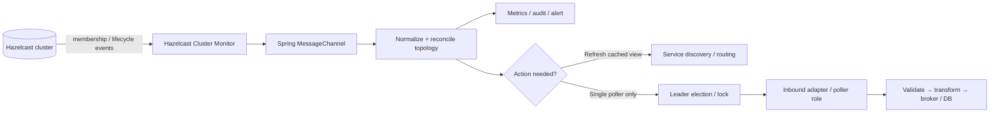
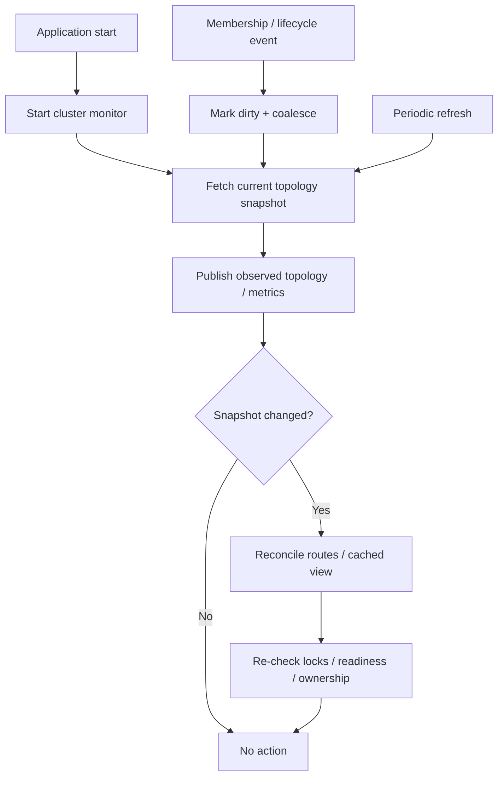
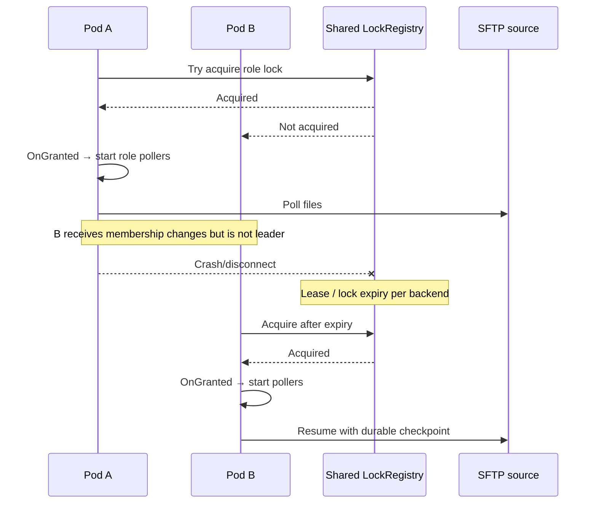
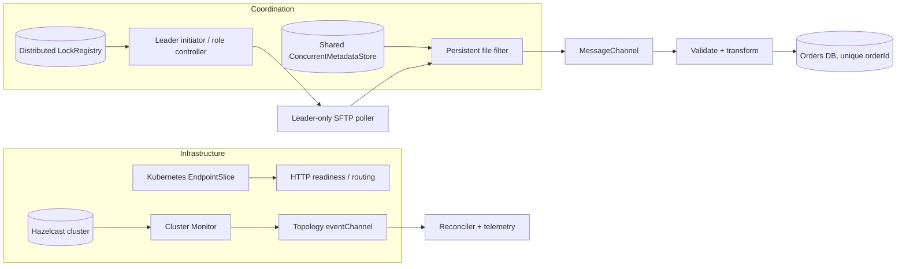

# Cluster membership and topology changes

## 1. Context: cloud membership changes while integration flows keep running

In the **SPRING_INTEGRATION_ADAPTERS** module, Spring Integration connects external systems using inbound/outbound adapters, gateways, pollers, and `MessageChannel`. Flows reading files, SFTP, HTTP, JMS, AMQP, Kafka, or databases often run across multiple processes or Pods for high availability. When an instance starts up, is replaced during a rolling deployment, loses network connectivity, or stops abruptly, the **topology** observed by instances changes even when the flow code remains unchanged.

For example, suppose three replicas process files from an SFTP server while also using Hazelcast as a distributed metadata store:

1. Pods A, B, and C are all running, all see SFTP, and all connect to one Hazelcast cluster.
2. Pod D is added during autoscaling; Hazelcast cluster membership changes if D joins as a Hazelcast member.
3. Pod B loses network connectivity; remaining members detect B leaving the cluster via failure detection.
4. Hazelcast data partitions may be redistributed; file pollers may still compete.
5. If each pod decides "I am the leader" solely from member counts, two pollers could run concurrently and record duplicate orders.

**Cluster membership** answers "which nodes currently belong to a specific cluster?" **Topology change** describes a shift in the node set, connection state, partitioning, or available endpoints. These are *infrastructure signals*, not proof that a business message was processed or that a node received exclusive permission to poll.



### Lesson objectives

After this lesson, you will be able to:

1. Distinguish **membership**, **service discovery**, **health/readiness**, **leader election**, and **message ownership**.
2. Understand Hazelcast `MEMBERSHIP`, `LIFECYCLE`, `MIGRATION`, `CLIENT`, and `DISTRIBUTED_OBJECT` events.
3. Configure `HazelcastClusterMonitorMessageProducer` to feed topology events into Spring Integration.
4. Build flows that receive events, refresh a topology snapshot, and recover from missed events.
5. Combine `SmartLifecycleRoleController`, `LockRegistryLeaderInitiator`, and adapters/pollers when leader-only processing is required.
6. Evaluate race conditions, network partitions, rolling deployments, duplicates, failovers, and backpressure.
7. Test, monitor, and operate topology changes safely in the cloud.

## 2. Concepts to keep separate

### 2.1. Membership vs discovery, readiness, leadership, and ownership

| Concept | Typical source of truth | Question answered | What cannot be inferred |
|---|---|---|---|
| **Cluster membership** | Hazelcast `Cluster.getMembers()`, ZooKeeper/Consul member registry | Who is currently a member of that cluster? | Whether a member succeeded at business processing. |
| **Service discovery** | Kubernetes Service/EndpointSlice, Spring `DiscoveryClient`, Consul | Which instances are registered to serve calls? | Whether an instance has exclusive rights to poll a source. |
| **Readiness** | Health probes, EndpointSlice `ready`/`serving` | Should an endpoint receive new traffic? | Whether it holds a lock or finished processing messages. |
| **Leader election** | Lock/lease/quorum coordination | Who controls leader-only work? | Whether external system transactions committed. |
| **Shard/partition ownership** | Kafka group coordinator, broker, shard coordinator | Which consumer owns a partition? | Who is the leader of the entire application. |
| **Business idempotency** | Unique keys/inbox/outbox/DB transactions | Did the side effect commit or is replay safe? | How many nodes are currently in the topology. |

A new Pod can be marked `Ready` by Kubernetes while **not yet** connected to Hazelcast. Conversely, a Hazelcast member can remain in the cluster while the app's HTTP readiness is already false. The two subsystems have independent lifecycles.

In one system, you may have simultaneously:

- Kubernetes Deployment replicas: `orders-adapter-0`, `orders-adapter-1`, `orders-adapter-2`.
- Hazelcast members: JVMs A, B, and a standalone Hazelcast server; the Spring Boot pods may act strictly as **clients** of this cluster.
- Kafka consumer group: each partition is assigned to a consumer by its own protocol.
- Leader poller: exactly one application instance holding a distributed lease/lock for an SFTP source.

**Note:** if Spring Boot pods run only as **Hazelcast clients**, adding a Pod changes client connection counts **without** emitting a `MembershipEvent` for the Hazelcast server member set. To track Spring Boot service replicas, use the matching discovery/membership source.

### 2.2. Milestones observable during a scale-out

```text
t0: Kubernetes creates Pod D
t1: Container app D starts; Hazelcast client connects to cluster
t2: Pod D passes readiness; EndpointSlice gains new endpoint
t3: DiscoveryClient/client cache updates routing
t4: Pod D's poller may start if auto-start is enabled
t5: Leader/lock coordinator decides who may poll
```

There is no universal guarantee that `t1 < t2 < t3 < t4 < t5` across all systems. Separate control planes and networks manage these steps. Therefore, never treat "spotted a new Pod" as sole authorization to run a job.

### 2.3. An event is a delta; a snapshot is state

Suppose the system receives `MEMBER_REMOVED(B)`. That event indicates B left membership in the publisher's view—it does **not** guarantee:

- B has stopped all threads or side effects.
- All nodes observed the event at the exact same moment.
- The event is durably stored and replayed when listeners restart.
- B finished all in-flight messages.

To know the current member set, read a **snapshot** from the real authority (e.g., `hazelcastInstance.getCluster().getMembers()`); to decide ownership changes, consult a coordinator with an explicit leader/lease contract.

## 3. Spring Integration's Hazelcast Cluster Monitor

Spring Integration provides the **Hazelcast Cluster Monitor Inbound Channel Adapter** in the `spring-integration-hazelcast` module. It registers listeners on `HazelcastInstance` and emits Spring messages whenever Hazelcast emits cluster-related events. This is an **event-driven inbound adapter**; no Spring Integration poller is required to read events.

The official Java API class is:

```java
org.springframework.integration.hazelcast.inbound
    .HazelcastClusterMonitorMessageProducer
```

Supported event groups:

| Monitor type | Event source | Practical meaning |
|---|---|---|
| `MEMBERSHIP` | Member join/leave | Trigger to refresh the Hazelcast member list and alert on cluster size changes. |
| `DISTRIBUTED_OBJECT` | Distributed object create/destroy | Observes data structure lifecycles, **not** individual entry updates. |
| `MIGRATION` | Partition migration | Observes data redistribution; do not assume migration is complete/safe just from a start event. |
| `LIFECYCLE` | Start, stop, reconnect/merge per Hazelcast API | Used to diagnose Hazelcast member/client state transitions. |
| `CLIENT` | Client connection events | Observes client joins/leaves where supported by the Hazelcast instance/type. |

The **XML adapter default** is `MEMBERSHIP` if `monitor-types` is omitted. Specify it explicitly whenever an app relies on multiple event types so readers do not have to guess defaults.

### 3.1. Distinguishing cluster monitor from the Hazelcast cache adapter

These two inbound adapters serve different purposes:

- **Cluster monitor** listens to membership, migration, lifecycle, client, and distributed-object events.
- **Event-driven cache inbound adapter** listens to `ADDED`, `UPDATED`, `REMOVED`, etc., on `IMap`, `ISet`, `IQueue`, and so on.

If your goal is handling key updates in an `IMap`, use the cache event adapter or a Hazelcast entry listener; enabling `MEMBERSHIP` will not substitute. If your goal is tracking Kubernetes Pod joins/leaves, the Hazelcast monitor is neither the only nor always the right source.

### 3.2. Dependency configuration

With Maven and compatible Spring Boot/Spring Integration BOMs:

```xml
<dependency>
    <groupId>org.springframework.integration</groupId>
    <artifactId>spring-integration-hazelcast</artifactId>
</dependency>
```

Without a BOM, declare a matching Spring Integration version and verify compatibility with your Hazelcast version. For example, in Spring Integration 7.1.1 documentation, this artifact carries version `7.1.1`. Never mix arbitrary Spring Integration versions across major/minor lines in the same application.

The Hazelcast backend must be configured as a **real cluster**, including discovery mode, cluster name, authentication/networking, replicas/backups, and proper clients/members. `Hazelcast.newHazelcastInstance()` is convenient for local demos, not a production cluster configuration.

## 4. Java example: routing membership events to a MessageChannel

The example below assumes a properly configured, lifecycle-managed `HazelcastInstance` bean already exists. It uses `DirectChannel` to show the basic path; in production, keep the listener fast and offload heavy reconciliation to a bounded executor or queue.

```java
import com.hazelcast.core.HazelcastInstance;

import org.springframework.beans.factory.annotation.Qualifier;
import org.springframework.context.annotation.Bean;
import org.springframework.context.annotation.Configuration;
import org.springframework.integration.channel.DirectChannel;
import org.springframework.integration.hazelcast.inbound.HazelcastClusterMonitorMessageProducer;
import org.springframework.messaging.MessageChannel;

@Configuration
public class ClusterMonitorConfiguration {

    @Bean
    public MessageChannel clusterEvents() {
        return new DirectChannel();
    }

    @Bean
    public HazelcastClusterMonitorMessageProducer clusterMonitor(
            HazelcastInstance hazelcastInstance,
            @Qualifier("clusterEvents") MessageChannel channel) {

        var producer =
            new HazelcastClusterMonitorMessageProducer(hazelcastInstance);
        producer.setMonitorEventTypes("MEMBERSHIP,LIFECYCLE,MIGRATION");
        producer.setOutputChannel(channel);
        return producer;
    }
}
```

The producer turns raw Hazelcast events into Spring message payloads. The handler receives `Message<?>` and **checks the runtime type** before inspecting fields so it never assumes all event types share the same fields:

```java
import com.hazelcast.cluster.MembershipEvent;
import com.hazelcast.core.HazelcastInstance;

import org.slf4j.Logger;
import org.slf4j.LoggerFactory;
import org.springframework.integration.annotation.ServiceActivator;
import org.springframework.messaging.Message;
import org.springframework.stereotype.Component;

@Component
public class TopologyEventHandler {

    private static final Logger log =
        LoggerFactory.getLogger(TopologyEventHandler.class);

    private final TopologyReconciler reconciler;

    public TopologyEventHandler(TopologyReconciler reconciler) {
        this.reconciler = reconciler;
    }

    @ServiceActivator(inputChannel = "clusterEvents")
    public void handle(Message<?> message) {
        Object event = message.getPayload();

        if (event instanceof MembershipEvent membership) {
            log.info("Hazelcast membership changed: type={}, member={}",
                    membership.getEventType(),
                    membership.getMember().getUuid());
        } else {
            log.debug("Hazelcast cluster event: type={}",
                    event.getClass().getSimpleName());
        }

        // Must be a short signal. Actual reconciliation
        // is coalesced and executed off the callback thread.
        reconciler.requestRefresh();
    }
}
```

`TopologyReconciler` is an **application service you implement yourself** (not a built-in Spring Integration API). It can record events, debounce rapid changes, and reconcile topology from the source of truth. `requestRefresh()` should be fast, never blocking for tens of seconds on HTTP/SFTP/DB calls inside the Hazelcast listener.

**Regarding payloads:** the handler only casts to `MembershipEvent` when that type actually arrives; `LIFECYCLE` and `MIGRATION` groups use different Java event classes. Never cast every event to `MembershipEvent` or assume shared fields.

### 4.1. Equivalent XML

If the project uses XML namespaces:

```xml
<int:channel id="clusterEvents"/>

<int-hazelcast:cm-inbound-channel-adapter
    channel="clusterEvents"
    hazelcast-instance="hazelcastInstance"
    monitor-types="MEMBERSHIP, LIFECYCLE, MIGRATION"/>
```

The XML configuration above requires the `int` and `int-hazelcast` namespaces and schemaLocations in the Spring XML file, along with a declared `hazelcastInstance` bean. Java configuration and XML are alternatives; do not enable two monitors for the same purpose unless duplicate observations are intended.

### 4.2. Event lifecycle and adapter lifecycle

- When the endpoint starts, the producer registers listeners with Hazelcast for the enabled monitor types.
- On stop/shutdown, subscriptions/listeners owned by the producer must be released per component lifecycle.
- A newly registered listener **does not automatically replay** the full history of previously joined nodes.
- A `DirectChannel` with a slow handler exerts backpressure straight onto the callback path; `ExecutorChannel` decouples threads, yet requires capacity bounds, error strategies, and full-queue policies.
- An in-memory Spring `MessageChannel` does not turn Hazelcast events into a durable log.

Applications need a **startup snapshot** and **periodic reconciliation** to recover from missed events or watch reconnects.

## 5. Designing proper topology reconciliation

### 5.1. State convergence algorithm

Each event is a hint that "topology may have changed"; decision-making state must be recomputed from the authority.



Execution steps should be:

1. **Subscribe to the event source** and start receiving notifications.
2. **Fetch an initial snapshot** and record the observation timestamp; do not wait for the next `MEMBER_ADDED` to discover existing nodes.
3. **Each event simply sets a dirty flag** or enqueues a notification. If 50 events arrive in one second, one refresh after a brief debounce window may suffice.
4. **Fetch a fresh snapshot** from the Hazelcast cluster, Kubernetes EndpointSlice, or `DiscoveryClient` as appropriate.
5. **Diff by stable ID and version**; update the cached view idempotently. If an older event arrives late, the current snapshot wins.
6. **Reconcile periodically** even without events to recover from disconnects, dropped notifications, or listener restarts.
7. **Trigger business actions only** after checking leadership, locks, readiness, and dedicated transactions.

A minimal snapshot of Hazelcast members can be retrieved as:

```java
import com.hazelcast.core.HazelcastInstance;

import java.util.List;

public List<String> currentMemberIds(HazelcastInstance instance) {
    return instance.getCluster().getMembers().stream()
        .map(member -> member.getUuid().toString())
        .sorted()
        .toList();
}
```

This list reflects only **Hazelcast members at read time**. It excludes application instances running as Hazelcast clients, does not replace Kubernetes readiness, and is insufficient to establish Kafka partition ownership.

### 5.2. Do not compute state from unbounded deltas

Fragile pattern:

```text
Receive MEMBER_ADDED(A)   → count = count + 1
Receive MEMBER_REMOVED(B) → count = count - 1
```

If a listener restarts, drops an event, or receives a duplicate, in-memory `count` drifts over time. Stronger pattern:

```text
Receive any topology event → requestRefresh()
Snapshot = authority.getCurrentMembers()
newMembers = normalizeAndSort(Snapshot)
if (newMembers != lastMembers):
    recordChange(lastMembers, newMembers)
    lastMembers = newMembers
```

Applying the same topology snapshot twice must have the exact same effect as applying it once: **idempotent reconciliation**.

### 5.3. Detecting freshness and snapshot-vs-event races

Even if you subscribe first and then read a snapshot, an event can still arrive **while** reading the snapshot. A real implementation should:

- Serialize snapshot application inside a single worker/actor or use a version token so older refreshes never overwrite newer ones.
- If a refresh is running when a new event arrives, mark `dirty` to trigger another refresh afterward.
- Track generation/observed-at timestamps for **local bookkeeping**; never treat wall-clock timestamps from nodes as strictly reliable fencing tokens.
- When an API exposes a version/`resourceVersion`, follow its contract rather than inventing a local counter.
- Prefer "full snapshot now" over "replay all deltas" when recovering from disconnects.

In Kubernetes, watchers typically run `LIST → WATCH` by `resourceVersion` and handle expired resource versions by relisting. For ordinary service calls, **Kubernetes Service DNS / Service routing** is usually preferable to maintaining Pod IP lists manually.

## 6. Acting on topology changes: three patterns

### 6.1. Pattern A — Observe only

Use when you want metrics, logs, or alerts whenever the Hazelcast cluster loses members.

```text
Hazelcast MEMBER_REMOVED
     → Spring MessageChannel
     → normalize event
     → metric cluster_members_current / member_changes_total
     → alert when node count drops below threshold
```

Do not start or stop business pollers purely on `memberRemoved`. This is the safe default pattern for monitoring.

### 6.2. Pattern B — Refresh service routing/cache

Use when an adapter calls HTTP services via cached discovery information:

- Kubernetes EndpointSlices or Spring Cloud Kubernetes `DiscoveryClient` is the authority for HTTP service endpoints.
- Hazelcast membership events only matter if the system **actually routes to Hazelcast members**.
- Every routing refresh should filter out non-ready/terminating endpoints per the discovery contract.
- Client retries apply only to safe or idempotency-keyed requests, especially if an endpoint vanishes after a request was dispatched.

For instance, service D is created and then B shuts down: refreshing the cache updates routing, yet a POST already sent to B may be in an **unknown outcome** state. You cannot blindly resend that POST to D without handling duplicate side effects.

### 6.3. Pattern C — Leader-only inbound poller

Use when **only one** instance may poll a shared source (shared file staging, unlocked SFTP feed, scheduled reconciliation). Spring Integration offers:

- `LockRegistryLeaderInitiator` to participate in leader election via a distributed `LockRegistry`.
- `OnGrantedEvent` / `OnRevokedEvent` for leadership transitions.
- `SmartLifecycleRoleController` to start/stop endpoints belonging to a given role.
- `autoStartup=false` so pollers lacking leadership do not start automatically when the Spring context boots.

Example initiator declaration given a properly configured **distributed** `LockRegistry`:

```java
import org.springframework.context.annotation.Bean;
import org.springframework.integration.support.leader.LockRegistryLeaderInitiator;
import org.springframework.integration.support.locks.LockRegistry;

@Bean
public LockRegistryLeaderInitiator leaderInitiator(LockRegistry locks) {
    return new LockRegistryLeaderInitiator(locks);
}
```

**Note:** the `LockRegistry` bean must be a cross-instance shared implementation with proper timeouts/leases and isolation; an instance-local lock registry does not guarantee exclusivity across pods. For the role controller to start/stop endpoints automatically, the `Candidate`'s role name and the endpoint's role must match. Never manually wire `MEMBER_ADDED` straight to `roleController.startLifecyclesInRole(...)`.

In XML endpoints, roles and auto-startup look like:

```xml
<int:inbound-channel-adapter
    id="leaderOnlySource"
    channel="sourceEvents"
    expression="'check-source'"
    role="sftp-pollers"
    auto-startup="false">
    <int:poller fixed-rate="10000"/>
</int:inbound-channel-adapter>
```

This snippet uses a short `expression` source to **illustrate endpoint lifecycle**; for real ingestion, replace it with the appropriate file/SFTP inbound adapter. Configure the leader initiator/`Candidate` with the same `sftp-pollers` role; if relying on defaults, verify the actual default role in your library version.



Leader election reduces contention on a **shared source**, yet does not create exactly-once business processing. If A writes to the DB and crashes before ACK/checkpoint, B can reprocess the same data. Idempotency keys, unique constraints/inboxes/outboxes, or proper transaction boundaries are still required.

## 7. How topology changes affect each adapter

| Adapter / source | When an instance leaves the cluster | Coordination strategy |
|---|---|---|
| **File/SFTP inbound polling** | Must avoid multiple nodes reading/moving the same file or skipping files on crash | Leader-only poller **or** shared `ConcurrentMetadataStore`/persistent filter; business idempotency remains mandatory. |
| **HTTP inbound gateway** | Endpoint leaves load balancer; in-flight requests may remain | Readiness/drain; stateless processing; idempotency for retries. |
| **HTTP outbound gateway** | Cached routes may go stale; requests fail/time out | Service discovery, connection pool refresh, bounded retries/backoff. |
| **JMS/AMQP consumer** | Broker redelivers unacked messages | Broker ACK/redelivery/DLQ; idempotent consumer; never rely on Hazelcast member counts. |
| **Kafka inbound adapter** | Group coordinator rebalances partitions when consumers join/leave | Kafka consumer group/rebalance/offset contract; in-flight handling strategy. |
| **DB/JDBC poller** | Multiple instances polling can duplicate queries | DB-backed claims/transactions/locking, leader-only role, or work-queue pattern. |
| **Hazelcast IMap/IQueue/ITopic** | Membership/migration shifts partitions/connections | Backend consistency, backups/quorum, and each data structure's API contract. |

Topology events are primarily for **observing and triggering reconciliation**; the concrete work-distribution authority (broker, leader initiator, metadata store, or DB) determines execution ownership.

### 7.1. SFTP example: two coordination styles

**Leader-only:** A holds a distributed lock and only A runs an active SFTP poller. If A dies, B wins leadership and polls once stale state is handled.

**Shared file filter:** A and B both poll, using `SftpPersistentAcceptOnceFileListFilter` backed by a shared `ConcurrentMetadataStore` to avoid accepting the same key/mtime twice. Both styles have crash windows. Accepting a file in the filter does not mean business records committed.

Do not conflate leader roles with accept-once filters. You can combine both when duplicate risks are high and source counts are manageable, while accounting for cost and recovery.

### 7.2. Kafka example: cluster topology does not assign partitions

When a Kafka consumer pod leaves, the Kafka group coordinator handles partition reassignment/rebalancing per protocol. A Hazelcast `MembershipEvent` from another cluster **never** replaces Kafka assignment callbacks. If an app also uses Hazelcast for caching, both topologies may change around the same time, yet share no common ordering or transaction.

## 8. Kubernetes topology: Pods, Services, and EndpointSlices

When running on Kubernetes, the authority for HTTP endpoints is typically **Service/EndpointSlice**:

- `EndpointSlice` holds addresses, ports, Pod references, and topology metadata such as zone.
- `ready` indicates eligibility for traffic; `serving` and `terminating` support draining closing endpoints.
- Updates across multiple EndpointSlices are not atomic. One endpoint can temporarily appear in more than one slice; deduplicate by identity and aggregate across all slices of the Service.
- A `Running` Pod is not necessarily a `Ready` endpoint, nor does a discovery endpoint prove Hazelcast cluster membership.

Namespace inspection example (replace `integration` and `orders-adapter` for your environment):

```bash
kubectl get pods -n integration -o wide
kubectl get endpointslices -n integration \
  -l kubernetes.io/service-name=orders-adapter -o wide
```

Inspecting endpoints is purely observational; it does not automatically emit a Spring Integration message.

### 8.1. Spring Cloud Kubernetes DiscoveryClient

Spring Cloud Kubernetes provides discovery integration and a **catalog watch/heartbeat** mechanism for the service catalog depending on config and version. On supported versions with catalog watching and scheduling enabled, the application can observe `HeartbeatEvent` signals tied to discovery state; listeners should diff state across heartbeats **without relying on internal payload structure**.

This belongs to the **Spring Cloud Kubernetes layer**, not `HazelcastClusterMonitorMessageProducer`. Use it when the problem is updating the endpoint/instance list used for Spring Cloud HTTP calls. Check the properties and behavior matching your pinned Spring Cloud Kubernetes version.

If you only need to call an existing Service, standard DNS/service proxies/LoadBalancers can spare you complex watch logic. Application-level monitors are usually needed only when extra reactions are required—such as resetting connection pools, recording audits, or adapting workloads to topology.

## 9. Race conditions and dangerous failure modes

### 9.1. Split-brain and network partitions

Suppose A and B lose connectivity to each other while both keep running business threads:

```text
          Network partition
        ┌─────────────────┐
Zone 1  │ A + SFTP poller │
        └─────────────────┘
               X
        ┌─────────────────┐
Zone 2  │ B + SFTP poller │
        └─────────────────┘
```

Each side may observe the other as having "left the cluster". **A membership event must never be treated as proof that the peer has stopped.** If the lock backend or quorum configuration does not preserve single-holder semantics, both can run simultaneously.

Mitigations:

1. Use a coordination backend with explicit ownership, quorum, and expiry contracts.
2. When using leases, define timeouts, renewals, connectivity loss behavior, and work revocation.
3. Where supported by resources, pass **monotonically increasing fencing tokens from the coordinator** so downstreams reject stale owners. Local Pod timestamps are not fencing.
4. Make business operations idempotent under retries/replays even with leader election.
5. Define a fail-closed/failover policy when the coordinator is unreachable; never let all pollers start automatically.

### 9.2. Crashes at every stage of the pipeline

| Where crash occurs | Question to ask | Recovery action |
|---|---|---|
| After receiving membership event, before refreshing snapshot | Did the view drift? | Periodic reconcile; never rely solely on an in-RAM event log. |
| Refreshing while a newer event arrives | Could an older result overwrite a newer one? | Serialize updates, set dirty flag, and refresh again. |
| Leader A loses lease mid-SFTP poll | Does A still have in-flight side effects? | Bounded stop/drain, fencing where available, downstream idempotency. |
| After file filter accepted, before processing | Marker exists, business DB uncommitted? | Controlled replay/marker reset, inbox/outbox. |
| After DB commit, before broker ACK | Will retry create duplicate records? | Unique business IDs, idempotent consumers. |
| Listener disconnect/reconnect | Which events were missed? | Snapshot + reconcile; health/alerts if stale too long. |

### 9.3. Event storm scenarios

Rolling deployments can generate bursts of join/leave, lifecycle, and migration events simultaneously. Avoid:

- Calling Kubernetes/Hazelcast APIs synchronously on **every** event without rate bounds.
- Recreating all outbound clients on every membership change without draining old clients.
- Forwarding raw events across multiple hops while assuming order is preserved.
- Logging unbounded topology/IP/member metadata with high-cardinality labels.
- Running DB migrations or business partition rebalances simply upon receiving `MEMBER_ADDED`.

Use bounded queues, debouncing/coalescing, rate limits, idempotency, and backoff/jitter for each operation class. If a queue overflows, set `needsFullRefresh=true` and perform a bounded snapshot reconciliation afterward.

## 10. End-to-end illustrative scenario

**Goal:** run two instances of `orders-ingest`, sharing a Hazelcast metadata store, ingesting files from SFTP; across scaling and restarts, neither drop files nor create duplicate orders.

### 10.1. Responsibility boundaries



Explanation:

- Cluster Monitor **observes** membership, lifecycle, and migration, publishing events to `MessageChannel`.
- Reconciler **reconciles actual state**, records metrics/audits, and alerts on disconnects.
- Distributed leader/lock decides which poller runs; `status=leader` must come from the coordinator.
- Persistent filter reduces duplicate fetches by path/mtime, without replacing inbox/business deduplication.
- DB unique keys/idempotency enforce final side-effect correctness.

### 10.2. Timeline when Pod A crashes

| Time | Event | Expected behavior |
|---|---|---|
| `t0` | A holds leadership, processing `order-42.csv` | B keeps its poller stopped. |
| `t1` | A crashes before DB commit | B does not start polling based solely on membership events. |
| `t2` | Hazelcast/coordination detects node loss; monitor emits event | Refresh topology snapshot; increment change metrics; alert if needed. |
| `t3` | A's lock/lease expires; B legitimately acquires leadership | Role controller starts B's poller. |
| `t4` | B picks up the file per recovery policy | Idempotency/inbox determines whether processing is still needed. |
| `t5` | DB commits, checkpoint confirmed | Flow continues; pending metrics return to normal. |

If A dies **after** DB commit but **before** checkpointing, B may encounter `order-42.csv` again. A unique `orderId` or inbox transaction keeps reprocessing safe. Having only one leader at a time is **not enough** to prevent this retry.

## 11. Controlled testing of topology changes

Labs can use two application contexts/processes with a dedicated test Hazelcast cluster; production validation should exercise real deployment topologies rather than just two threads in one JVM.

### 11.1. Minimum test cases

| Test | Action | Expectation |
|---|---|---|
| **Bootstrap snapshot** | Start listener after cluster already has 2 members | View shows 2 members even with no new join event. |
| **Join** | Add member C | Membership signal arrives; snapshot includes A/B/C. |
| **Leave** | Gracefully shut down C | Change observed; snapshot narrows to A/B. |
| **Crash** | Uncleanly kill member C | Snapshot eventually removes C per failure detector after expected delay. |
| **Listener restart** | Stop monitor, change membership, restart | Full reconcile captures new state despite missed events. |
| **Duplicate event** | Submit same refresh signal repeatedly | Only one state transition takes effect. |
| **Out-of-order refresh** | Older snapshot returns after newer snapshot | Newer view is not overwritten by stale result. |
| **Rolling deployment** | Cycle pods sequentially | Never activates multiple leader-only pollers. |
| **Lease expiry** | Leader loses lock mid-processing | Poller stops/drains; stale work cannot commit against ownership policy. |
| **Split network** | Block connection A↔coordination | Two owners cannot cause uncontrolled concurrent side effects. |
| **Backend outage** | Hazelcast/lock backend unreachable | Clear readiness/degradation; never fail open arbitrarily. |
| **Event storm** | Rapid repeated member joins/leaves | No memory leaks or unbounded refresh calls. |
| **Post-commit crash** | DB commits before ACK/checkpoint | Retry produces no duplicate orders. |
| **Client-only scaling** | Add Hazelcast client apps while server members stay fixed | Do not expect `MEMBERSHIP` to count Spring Boot replicas. |

### 11.2. Evaluating results

Place metrics and test assertions at **two distinct layers**:

1. **Topology:** current member/endpoint counts, event→snapshot convergence latency, observer lag, refresh failure rate.
2. **Business:** active poller count, fetches per file, committed DB records, rejected duplicates, jobs needing replay.

A test that only checks "received `MEMBER_REMOVED`" proves nothing about business safety. Tests must verify downstream state before and after crashes.

### 11.3. Self-study exercise

Given a 3-member cluster, two SFTP pollers, and one shared metadata store. Suppose A receives file F and crashes before writing to the DB; B observes A leaving the cluster.

Design:

- Conditions allowing B to run its poller and how B verifies leadership.
- How B re-acquires F if the marker/filter was already updated before the crash.
- Unique keys/idempotency preventing duplicate writes if A had already committed without ACKing.
- How B recovers its view if it loses all membership events for 30 seconds.
- Two metrics distinguishing "node lost" from "order lost".

A complete solution separates **leadership coordination**, **snapshot reconciliation**, **durable recovery/checkpoints**, and **business idempotency**.

## 12. Observability, alerting, and runbooks

### 12.1. Signals to measure

| Metric / log | Meaning |
|---|---|
| `topology_members_current` (gauge) | Number of Hazelcast members **per snapshot**, tagged by cluster/environment. |
| `topology_events_total{type=...}` | Event counts by type showing churn. |
| `topology_reconcile_duration_seconds` | Time to fetch, compute, and apply snapshots. |
| `topology_reconcile_failures_total` | Failed backend/discovery refreshes. |
| `topology_last_success_timestamp` | Detects stale views when the event path goes silent. |
| `leader_state{role=...}` | Whether this node currently holds leadership (cross-check with coordinator). |
| `active_pollers{flow=...}` | Detects zero pollers or unexpected multiple pollers. |
| `business_duplicate_rejected_total` | Evaluates idempotency path during failovers. |
| `inflight_messages` / `unacked_messages` | Tracks draining and retries after topology changes. |

Avoid using member UUIDs, Pod IPs, filenames, or event IDs as metric labels due to high cardinality; keep detailed identifiers in **structured logs** with proper retention and access controls.

### 12.2. Diagnostic sequence when processing stalls

1. Confirm whether the **business sink** actually stopped receiving records or only metrics stopped.
2. Check readiness/replicas and EndpointSlices if Kubernetes Services are involved.
3. Check Hazelcast cluster/client connectivity and actual `getMembers()` output.
4. Verify the monitor is started, along with monitor types, output channel, and handler subscriptions.
5. Compare `last topology event` vs `last successful full reconcile`; trigger a safe refresh if stale.
6. For leader-only flows, inspect owner/lease/lock in the **coordination backend**—never infer ownership from member counts.
7. Check role controller/endpoint `autoStartup` and active poller counts.
8. Inspect metadata markers, pending files, broker ACKs, DB commits, and idempotency keys.
9. Once service recovers, reconcile uncommitted files/records and replay per idempotency policy.
10. Document root cause, disconnect window, failover count, and proof of zero lost/duplicated business data.

### 12.3. Deployment and shutdown

- **Startup:** initialize client/cluster connections; start topology monitor; fetch snapshot; verify coordination backend; only then start pollers per role/ownership.
- **Scale up:** new replicas connect, pass readiness, subscribe to events, and reconcile; do not poll shared sources without leadership.
- **Scale down:** stop accepting new work, revoke/yield leadership per coordinator contract if applicable, drain in-flight work within grace period, and let the backend release locks/leases.
- **Hard crash:** never rely on graceful shutdown; rely on lease expiry, checkpoint recovery, and idempotency.
- **Backend outage:** define a clear degraded mode; if ownership cannot be verified, avoid launching leader-only work.
- **Cross-region:** member sets, network partitions, failover consistency, and write fencing must be designed per region; "two regions saw the same event" does not prove exclusive execution.

## 13. Common design misconceptions

| Misconception | Correct understanding |
|---|---|
| "Receiving `MEMBER_REMOVED` means the node stopped working." | The node may still be running across a network partition or finishing in-flight work. |
| "Cluster Monitor automatically load-balances all adapters." | It emits cluster events; work distribution belongs to brokers, lock coordinators, filters, or applications. |
| "Every new Pod triggers Hazelcast `MEMBER_ADDED`." | Pods may run as Hazelcast clients and stay outside the member set. |
| "Subscribing to join/leave events gives current topology." | Bootstrap snapshots and periodic reconciliation are still required. |
| "Events auto-retry if the message handler crashes." | Event listeners and in-memory `MessageChannel`s are not durable or replayable by default. |
| "Leader election prevents all duplicate business records." | Crashes after commit before ACK still trigger replays; sink idempotency is mandatory. |
| "Kubernetes readiness equals Hazelcast membership." | Two independent subsystems control those two states. |
| "Per-Pod local locks act as cluster-wide leader election." | Locks must be shared and preserve ownership semantics. |
| "Receiving `MIGRATION` lets you reassign Kafka partitions directly." | Kafka ownership is controlled by the Kafka group coordinator. |
| "Refreshing on every single event is always better." | Event storms cause overload; debounce and run bounded periodic full snapshots. |

## 14. Production readiness checklist

- [ ] Specify **which cluster** is observed: Hazelcast members, Kubernetes service endpoints, Kafka consumers, or logical workers.
- [ ] Pin compatible Spring Integration/Hazelcast versions and explicit client/member configurations.
- [ ] Configure required monitor types; confirm default `MEMBERSHIP` and subscription lifecycle.
- [ ] Keep topology event handlers lightweight without blocking Hazelcast event threads.
- [ ] Implement startup snapshots, periodic reconciliation, debouncing, and stale-view detection.
- [ ] Ensure newer snapshots cannot be overwritten by older refresh results.
- [ ] Maintain a separate source of truth for service discovery and readiness.
- [ ] Disable `autoStartup` on leader-only pollers and use distributed election/locks with matching roles.
- [ ] Test lock loss, expiry, network partitions, and failovers.
- [ ] Test file/message re-ingestion after crashes post-accept and post-DB-commit.
- [ ] Verify idempotency keys, unique constraints/inboxes, or replay mechanisms work.
- [ ] Track topology, leadership, and business metrics/logs independently.
- [ ] Test rolling deployments, autoscaling, disconnects/reconnects, and backend outages.
- [ ] Prepare a manual reconciliation and controlled replay runbook.
- [ ] Protect Hazelcast/Kubernetes credentials, TLS, RBAC, and topology query permissions.

## 15. Summary

**Cluster membership and topology changes** provide visibility into infrastructure changes underneath running Spring Integration flows. With Hazelcast, `HazelcastClusterMonitorMessageProducer` is an **event-driven inbound adapter** turning `MEMBERSHIP`, `LIFECYCLE`, `MIGRATION`, `CLIENT`, and `DISTRIBUTED_OBJECT` events into messages entering `MessageChannel`. It is suited for observing and triggering topology refreshes, not for acting as a leader election or work distribution mechanism by itself.

The practical pattern is **event → request refresh → snapshot from authority → idempotent reconcile → conditional action**. For sources allowing only a single polling instance, use distributed leader election and `SmartLifecycleRoleController`; for sources supporting parallel polling, use shared metadata/locks with explicit contracts. In every case, ACKs, transactions, idempotency, and recovery govern business processing reliability.

For **SPRING_INTEGRATION_ADAPTERS**, the top priority is ensuring cluster changes never accidentally start extra SFTP/File pollers, corrupt HTTP routing state, or cause JMS/AMQP/Kafka/database duplicate processing during scaling, restarts, and failovers.

### References

- [Spring Integration — Hazelcast Support (Cluster Monitor Inbound Channel Adapter)](https://docs.spring.io/spring-integration/reference/hazelcast.html)
- [Spring Integration API — HazelcastClusterMonitorMessageProducer](https://docs.spring.io/spring-integration/docs/current/api/org/springframework/integration/hazelcast/inbound/HazelcastClusterMonitorMessageProducer.html)
- [Spring Integration — Leadership Event Handling](https://docs.spring.io/spring-integration/reference/leadership-event-handling.html)
- [Spring Integration — Endpoint Roles](https://docs.spring.io/spring-integration/reference/endpoint-roles.html)
- [Spring Integration — Distributed Locks](https://docs.spring.io/spring-integration/reference/distributed-locks.html)
- [Hazelcast — Cluster Events](https://docs.hazelcast.com/hazelcast/5.7/events/cluster-events)
- [Hazelcast — Listening to Events](https://docs.hazelcast.com/hazelcast/5.4/events/distributed-events)
- [Spring Cloud Kubernetes — DiscoveryClient](https://docs.spring.io/spring-cloud-kubernetes/reference/discovery-client.html)
- [Kubernetes — EndpointSlices](https://kubernetes.io/docs/concepts/services-networking/endpoint-slices/)
- [Kubernetes — Pod Termination](https://kubernetes.io/docs/concepts/workloads/pods/pod-termination/)
