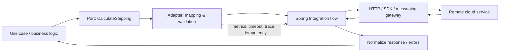
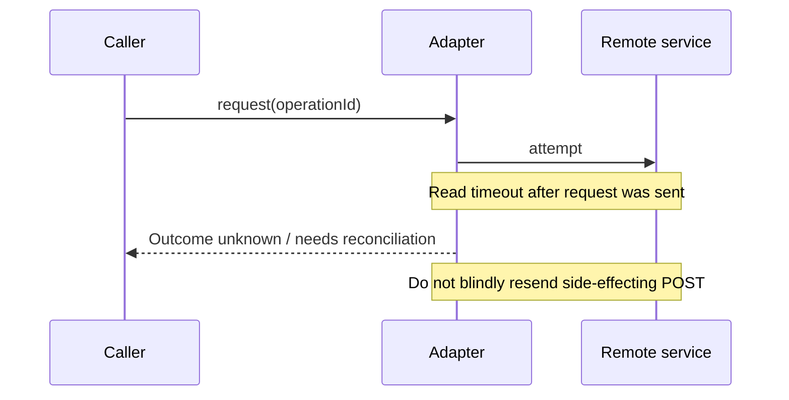
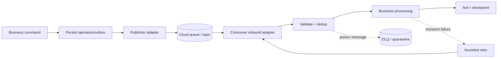

# Remote service adapter boundary in Spring Integration

In a cloud system, an application often has to call services outside its own process: pricing APIs, payment systems, identity verification services, object stores, notification services, or SaaS platforms. The point of contact with these services is called the **remote service adapter boundary**. This is where the application translates internal business contracts into external system protocols while controlling failures, timeouts, authentication, context propagation, and recovery responsibilities.

In the **SPRING_INTEGRATION_ADAPTERS** module, Spring Integration provides inbound/outbound adapters, gateways, pollers, and `MessageChannel` to build that boundary. This topic focuses on **designing and operating the boundary** when integrating cloud/remote services; specific choices like HTTP, SFTP, JMS, AMQP, Kafka, files, or databases are only part of the design.

After this lesson, you should be able to:

- Identify what belongs to business logic, what belongs to integration code, and which state is owned by external systems.
- Choose the right inbound/outbound **adapter** or **gateway** based on a one-way vs request/reply contract.
- Design payloads, headers, identifiers, error mappings, and retry policies that do not duplicate side effects.
- Isolate stable internal contracts from APIs, SDKs, and cloud provider details.
- Configure timeouts, rate limits, observability, and tests suited for synchronous or asynchronous flows.

## 1. What is the remote service boundary really?

Consider a shipping quote capability. The application receives a `CalculateShipping` request with an order ID, destination address, and weight. The shipping provider requires an HTTP `POST /v2/rates`, provider-specific JSON field names, an access token, and a transaction identifier header. If the controller or domain logic knows the provider's URL, HTTP status codes, SDK exceptions, and JSON schema directly, every external change leaks into the core.

The adapter boundary collects those details in one place:

| Inside the application | At the remote service adapter boundary | Outside the application |
|---|---|---|
| `CalculateShipping` command, currency types, business rules | Translates the command into a provider-contract request DTO | JSON, HTTP endpoint, SDK request |
| `orderId`, `operationId`, `correlationId` | Generates/maps outbound allowlisted headers | Request ID, idempotency key, trace context |
| Meaning of `RateUnavailable`, `AddressRejected` | Classifies HTTP statuses, network errors, error responses | 4xx, 5xx, timeouts, rate limits |
| Use-case time budget | Timeouts, conditional retries, circuit breakers, concurrency limits | Remote service latency and quotas |
| Internal monetary units and state | Normalizes responses, enforces invariants | Partner-specific numeric types, units, statuses |

The goal is for business code to invoke a **capability** such as `ShippingRatePort.calculate(...)`, while the adapter handles communicating with a specific partner. The boundary is also a **failure boundary**: a request sent over the network may succeed externally even if the application never receives a reply.

### Responsibility diagram



A single flow can combine `MessageChannel`, transformers, header enrichers, routers, service activators, and handlers accessing remote services. They address different concerns; **no single adapter automatically guarantees cross-network consistency**.

## 2. Identifying connection direction and endpoint type

The terms inbound/outbound are always interpreted **from the perspective of the application running Spring Integration**, not the provider's perspective:

| Need | Suitable component | Characteristics |
|---|---|---|
Receive an HTTP webhook and reply immediately | Inbound gateway | Has both request and reply to the caller
Poll a directory/object store or API for changes | Inbound channel adapter + poller, when supported | Pushes messages into the flow; polling requires checkpoints/dedup
Send an event to a queue/topic or invoke a fire-and-forget API | Outbound channel adapter | Returns no business response on the same call
Call a pricing API and wait for the result | Outbound gateway | Request/reply; the call may wait or fail
SDK lacking an official Spring Integration adapter | Service activator/custom `MessageHandler` or `MessageSource` | Manages SDK, errors, lifecycle, and resource bounds directly

An **inbound adapter** brings data from an external system into a channel. An **outbound adapter** sends data outward, typically one-way. A **gateway** models two-way exchange. For some technologies, the response is a transport-level ACK rather than a business processing outcome. For instance, a queue service accepting a message does not prove a downstream worker has processed the order.

Spring Integration includes HTTP support alongside modules/extensions for other protocols. When integrating AWS, Azure, Google Cloud, or SaaS APIs, check actual integration libraries, versions, and support levels. Do not assume every cloud service has an official adapter in `spring-integration-core`; sometimes the right solution is wrapping an SDK or HTTP client in a dedicated handler.

## 3. Start from the contract, not from the URL

Before building the flow, specify the **boundary contract** in testable terms:

| Decision | Question to answer | Example |
|---|---|---|
Capability | What does the application want to do? | `quoteShipping(command)`
Interaction style | Synchronous, asynchronous, or event emission? | Synchronous, returns `ShippingQuote`
Identifiers | What identifies the request and side effect? | `operationId`, not just message UUID
Payload | Required fields, units, bounds, version? | Weight in grams, currency VND
Outcomes | What constitutes business success? | `APPROVED`, `DECLINED`, `PENDING`
Errors | Which cases are retryable? | Bounded 429/503; never retry 400 invalid data
Timeouts | How long can the caller wait at most? | Total budget 1.5 seconds
Idempotency | Do duplicate requests repeat side effects? | Provider supports `Idempotency-Key`
Operations | Logs, metrics, traces, alerts? | `remote_call_duration` by partner and outcome
Security | Who issues credentials; what data crosses out? | Short-lived tokens, TLS, header filtering

An example provider-independent business contract:

```java
public interface ShippingRatePort {
    ShippingQuote calculate(CalculateShipping command);
}

public record CalculateShipping(
        String operationId,
        String orderId,
        String destinationPostalCode,
        long weightInGrams) {}

public record ShippingQuote(
        String providerReference,
        java.math.BigDecimal amount,
        String currency,
        java.time.Instant expiresAt) {}
```

This is a **port**, not yet an HTTP endpoint. The adapter implements the port and interacts with the partner's data types. Never allow an SDK response class or `HttpStatusCodeException` to become the port's return or thrown contract.

## 4. Distinguishing three commonly confused identifiers

A remote call can traverse multiple messages and retries. Distinguish clearly:

1. **Business ID** (`orderId`, `customerId`): the business entity being acted upon.
2. **Operation/idempotency ID** (`operationId`): a single state-changing intent; stays identical across retries of the same intent, changes for a new intent.
3. **Correlation/trace ID**: links logs and distributed traces; used for observability, not automatically a deduplication key.

Spring Integration's `MessageHeaders.ID` identifies **a specific message instance**. When a message is recreated, its ID can change; never use it as a long-lived idempotency key. A typical layout:

```text
orderId        = ORD-8125
operationId    = SHIP-8125-QUOTE-v1
correlationId  = trace-7c8a...
remoteRequest  = POST /v2/rates
idempotencyKey = SHIP-8125-QUOTE-v1  (if supported by the provider)
```

Internal headers and HTTP headers are two separate namespaces. Do not assume `MessageHeaders` are automatically sent over the wire. On HTTP outbound handlers, configure a `HeaderMapper` for allowlisted custom headers and inspect actual outbound requests. On SDKs or queues, the adapter must explicitly map to the corresponding message attributes or properties.

**Rule:** forward only necessary, approved headers externally. Never leak all Spring message headers, internal bearer tokens, user info, or exception stack traces to external partners.

## 5. Foundational example: read-only outbound HTTP gateway

The example below illustrates a **request/reply** flow fetching product prices from an external catalog service. HTTP `GET` is chosen to highlight the adapter boundary: the query expects a result and reading produces no side effects. For write APIs, add the idempotency policies covered later.

Suppose the provider exposes:

```http
GET /v1/products/SKU-100/price HTTP/1.1
Host: catalog.partner.example
Accept: application/json
```

and responds with JSON:

```json
{
  "sku": "SKU-100",
  "unitPrice": 129000,
  "currencyCode": "VND",
  "priceVersion": "2026-11"
}
```

### 5.1. Dependencies and configuration

Use Spring Boot 3.x matching Spring Integration 6.x, with HTTP integration and JSON converter dependencies. Maven example:

```xml
<dependencies>
    <dependency>
        <groupId>org.springframework.boot</groupId>
        <artifactId>spring-boot-starter-integration</artifactId>
    </dependency>
    <dependency>
        <groupId>org.springframework.integration</groupId>
        <artifactId>spring-integration-http</artifactId>
    </dependency>
    <dependency>
        <groupId>org.springframework.boot</groupId>
        <artifactId>spring-boot-starter-web</artifactId>
    </dependency>
</dependencies>
```

Versions must be managed consistently by the Spring Boot BOM; never pick arbitrary Spring Integration versions for the dependency above.

```yaml
# application.yml
remote:
  catalog:
    base-url: https://catalog.partner.example
```

### 5.2. External DTOs vs internal types

In a real project, place each `public record` in its own Java file. Below, the types are shown together to highlight the boundary:

```java
// Contract owned by the application:
public record PriceQuery(String sku) {}
public record ProductPrice(
        String sku,
        java.math.BigDecimal amount,
        String currency) {}

// DTO coupled to the provider's JSON:
public record PartnerPriceResponse(
        String sku,
        java.math.BigDecimal unitPrice,
        String currencyCode,
        String priceVersion) {}
```

Only `PartnerPriceResponse` may mirror the partner's `unitPrice` and `currencyCode` naming. If the partner switches to `price.amount`, only the boundary mapping changes.

### 5.3. Spring Integration flow

```java
import org.springframework.beans.factory.annotation.Value;
import org.springframework.context.annotation.Bean;
import org.springframework.context.annotation.Configuration;
import org.springframework.http.HttpMethod;
import org.springframework.http.client.ClientHttpRequestFactory;
import org.springframework.http.client.SimpleClientHttpRequestFactory;
import org.springframework.integration.annotation.IntegrationComponentScan;
import org.springframework.integration.config.EnableIntegration;
import org.springframework.integration.dsl.IntegrationFlow;
import org.springframework.integration.http.dsl.Http;
import org.springframework.integration.annotation.MessagingGateway;

@Configuration
@EnableIntegration
@IntegrationComponentScan
class CatalogIntegrationConfig {

    @Bean
    ClientHttpRequestFactory catalogRequestFactory() {
        SimpleClientHttpRequestFactory factory =
                new SimpleClientHttpRequestFactory();
        factory.setConnectTimeout(2_000);
        factory.setReadTimeout(4_000);
        return factory;
    }

    @Bean
    IntegrationFlow catalogPriceFlow(
            @Value("${remote.catalog.base-url}") String baseUrl,
            ClientHttpRequestFactory catalogRequestFactory) {

        return IntegrationFlow.from("catalogPriceRequests")
                .handle(Http.outboundGateway(
                                baseUrl + "/v1/products/{sku}/price")
                        .httpMethod(HttpMethod.GET)
                        .uriVariable("sku", "payload.sku")
                        .expectedResponseType(PartnerPriceResponse.class)
                        .requestFactory(catalogRequestFactory))
                .transform(PartnerPriceResponse.class, remote ->
                        new ProductPrice(
                                remote.sku(),
                                remote.unitPrice(),
                                remote.currencyCode()))
                .get();
    }
}

@MessagingGateway(defaultRequestChannel = "catalogPriceRequests")
interface CatalogPriceGateway {
    ProductPrice findPrice(PriceQuery query);
}
```

Execution flow:

1. `CatalogPriceGateway.findPrice(query)` sends a message to `catalogPriceRequests`.
2. The HTTP outbound gateway invokes a remote `GET`; the expression `payload.sku` binds the URI variable from the payload.
3. The HTTP message converter deserializes JSON into `PartnerPriceResponse`; the JSON and DTO must match, and the response `Content-Type` must be supported by the converter.
4. The transformer converts the external DTO into `ProductPrice`.
5. The gateway returns the result to the caller; connection or HTTP errors can surface as exceptions on the synchronous path.

Usage example in an application service:

```java
@Service
public class PriceApplicationService {
    private final CatalogPriceGateway gateway;

    public PriceApplicationService(CatalogPriceGateway gateway) {
        this.gateway = gateway;
    }

    public ProductPrice priceOf(String sku) {
        if (sku == null || sku.isBlank()) {
            throw new IllegalArgumentException("sku is required");
        }
        return gateway.findPrice(new PriceQuery(sku));
    }
}
```

This is a minimal template illustrating separation of responsibilities. For production, the adapter needs response validation, deliberate error mapping, tracing, security configuration, budget-aligned timeouts, and an appropriate retry policy. `SimpleClientHttpRequestFactory` is used for readability; production HTTP clients and connection pools must be chosen for real load.

> **Version note:** specific Java DSL and HTTP client APIs depend on your Spring Boot/Spring Integration version. When upgrading, check your version's docs, especially for HTTP clients, timeouts, and auto-configuration. Illustrating flow structure does not replace build and test verification in a real project.

## 6. Separating the port-implementing adapter from the technical gateway

The HTTP flow above shows the technical building blocks. In a real codebase, wrap `CatalogPriceGateway` inside a class implementing the business port:

```java
public interface ProductPricePort {
    ProductPrice getPrice(String sku);
}

@Component
public class RemoteCatalogPriceAdapter implements ProductPricePort {
    private final CatalogPriceGateway gateway;

    public RemoteCatalogPriceAdapter(CatalogPriceGateway gateway) {
        this.gateway = gateway;
    }

    @Override
    public ProductPrice getPrice(String sku) {
        try {
            return validate(gateway.findPrice(new PriceQuery(sku)));
        } catch (org.springframework.web.client.HttpClientErrorException.NotFound ex) {
            throw new ProductNotFoundException(sku, ex);
        } catch (org.springframework.web.client.RestClientException ex) {
            throw new RemoteCatalogUnavailableException(ex);
        }
    }

    private ProductPrice validate(ProductPrice price) {
        if (price == null
                || price.amount() == null
                || price.amount().signum() < 0
                || price.currency() == null) {
            throw new InvalidPartnerResponseException();
        }
        return price;
    }
}
```

`ProductNotFoundException`, `RemoteCatalogUnavailableException`, and `InvalidPartnerResponseException` are **application-defined exceptions**. This code illustrates error translation; production code should also distinguish 401/403, 429, 5xx, responses with unsuccessful business status fields, and decoding failures. Never collapse every `RestClientException` into "not found".

Naming it `RemoteCatalogPriceAdapter` keeps provider details outside; use cases depend solely on `ProductPricePort`. When swapping HTTP for an SDK or changing partners, business logic stays largely untouched.

## 7. Message and header structure at the boundary

A Spring Integration message consists of `payload` and `headers`. At the boundary, each serves a distinct purpose:

| Component | Example | Principle |
|---|---|---|
`payload` | `PriceQuery`, `PartnerPriceResponse` | Validated data with explicit serialization/deserialization
`MessageHeaders.ID` | Runtime UUID | Identifies a message instance; never use as a long-lived operation ID
`replyChannel` | Gateway reply channel | Internal routing detail; never expose externally
`errorChannel` | Channel receiving `ErrorMessage` when error-channel publishing is active | Does not automatically catch all synchronous exceptions
`correlationId` | Cross-step/trace ID | Used for observability and reconciliation
`Idempotency-Key` or equivalent | Stable `operationId` across retries | Valuable only when the partner supports and honors the contract
`Content-Type` / `Accept` | `application/json` | Matches codecs and API contracts

**Header mapping is part of the contract.** For instance, when a partner requires `Idempotency-Key`, the adapter must ensure that field becomes an HTTP header with the exact expected name and value. On HTTP outbound endpoints, configure `HeaderMapper` and test outbound requests against a mock HTTP server. On SQS/Kafka/Pub/Sub, map to the corresponding message attributes, keys, or headers; each protocol has different size, serialization, and retention rules.

Header limits to watch:

- Forward `traceparent`/baggage only when observability and security policies allow.
- Never use log/trace IDs as business proof that a transaction executed once.
- Never log full payloads containing PII, tokens, or payment details.
- Check provider header/message size limits; oversized payloads should pass a lifecycle-managed object-storage reference instead.

## 8. Errors must be classified at the boundary

Calling a remote service yields outcomes that do not carry identical meaning:

| Scenario | Meaning | Recommended action |
|---|---|---|
HTTP 2xx, valid payload | Protocol-level success; still must verify business status | Parse, validate, map
HTTP 200 but `status=DECLINED` | Partner processed the request and rejected it on business grounds | Return business rejection; do not retry blindly
HTTP 400/422 | Malformed request or external rule violation | Fix data/contract; usually do not retry
HTTP 401/403 | Authentication/authorization mismatch or missing permissions | Inspect credentials/scopes; avoid infinite retry loops
HTTP 404 | Resource missing; may be a valid domain state depending on API | Map to not-found or domain-specific policy
HTTP 409 | Conflict, possibly duplicate operation or version mismatch | Check partner contract and reconcile
HTTP 429 | Rate limit exceeded | Honor `Retry-After` if present; apply backoff and overall cap
HTTP 502/503/504 | Temporary gateway/service outage | Bounded retry when the operation is retry-safe
Connect timeout | Likely never reached the server | Conditional retry per policy
Read timeout/connection reset after send | **Unknown** whether the partner committed | Reconcile by operation ID before repeating side-effecting calls
Malformed JSON, parse error | Contract drift or corrupted data | Quarantine/alert; never auto-retry endlessly

Even an HTTP 202 Accepted only confirms the external system **accepted** the request under its contract, usually without a final result yet. For payments, invoicing, or resource provisioning, provide status polling by operation ID or confirmation callbacks/events.

### Synchronous errors and `errorChannel`

`DirectChannel` normally invokes handlers on the same thread. With a synchronous outbound gateway, exceptions can propagate straight back to the caller and fail the gateway invocation. `errorChannel` is **not an automatic catch-all** for every flow.

In asynchronous flows (e.g., `ExecutorChannel`, pollers, message-driven endpoints), `ErrorMessage` can route to a configured error channel. Clarify explicitly:

1. Who catches the exception: gateway, advice, error flow, or broker framework/container?
2. When an error occurs, does the message remain on the original queue, move to a DLQ, or get acknowledged?
3. Did the external system succeed while local state persistence failed?
4. When replaying a message, are idempotency keys and checkpoints preserved?

Never treat error logs as a recovery mechanism. Production flows need retry policies, DLQs/quarantine, reconciliation, and controlled replay tooling.

## 9. Timeouts: budgeting the whole request

There are **multiple distinct timeouts**:

- **Connect timeout:** time allowed to establish the network connection.
- **Read/response timeout:** time waiting for data/responses on the HTTP client.
- **Messaging gateway/channel send/reply timeout:** time waiting to send/receive between Spring Integration endpoints; does not replace network timeouts.
- **Use-case deadline:** total time the caller permits, covering queueing, mapping, remote calls, retries, and fallbacks.

For example, suppose a use case targets a 1,500 ms response. If 1,000 ms goes to the remote call, 150 ms to mapping/serialization, and 350 ms to queueing, network jitter, and headroom, then two retries of 1,000 ms each **violate** the deadline. Retries must respect **remaining time**, not just `maxAttempts`.



For HTTP, the timeouts in section 5 are client settings. In practice, also account for connection pool exhaustion, DNS/TLS handshakes, queued requests, and intermediate proxy/load balancer timeouts. Overly short timeouts trigger retry storms; overly long ones pin threads/connections and exhaust application resources.

## 10. Retries, idempotency, and "unknown outcomes"

Keep three terms separate:

- **Retry:** re-attempting after a prior call failed or had an unclear outcome.
- **Idempotency:** executing the same **intent** multiple times yields the same business result without multiplying side effects; enforced where state is owned.
- **Deduplication:** detecting duplicate messages or operations; one mechanism that helps implement idempotency.

Suppose an ordering system calls `POST /payments` and hits a read timeout. At least two possibilities exist: the payment was never recorded, or it was recorded and the response was lost. Retrying with a new ID risks charging twice.

If the remote API supports an idempotency key:

```http
POST /payments HTTP/1.1
Host: payment.partner.example
Content-Type: application/json
Idempotency-Key: ORDER-8125-CAPTURE-1

{"orderId":"ORD-8125","amount":120000,"currency":"VND"}
```

When retrying **the same operation**, preserve the exact key and payload per partner contract. If the API lacks idempotency keys, prefer **read-after-write/lookup by reference**, or build a reconciliation state machine before issuing a new request. Key storage requires retention periods, rules for key reuse with mismatched payloads, and durable backing storage.

A retry policy might start like this (design pseudocode, not an automatic DSL):

```text
if response is permanent business rejection:
    return mapped business result
if response is 429 or transient 503 and operation is retry-safe:
    respect Retry-After if present
    retry with capped exponential backoff + jitter
    stop when deadline or attempt budget is exhausted
if response is timeout after request was sent and operation changes state:
    query by stable operationId or return PENDING_RECONCILIATION
else:
    route to classified failure handling
```

Spring Integration can wrap handlers with retry advice (such as `RequestHandlerRetryAdvice`), backed by Spring Retry when on the classpath. However, **retry advice only decides when to re-invoke the call**; it neither supplies idempotency nor proves an external transaction rolled back. For side-effecting APIs, never enable blanket retries across all exceptions.

## 11. Synchronous vs asynchronous: what changes at the boundary?

A remote service may expose synchronous APIs, event buses, queues, or callbacks. That choice determines where state lives and where recovery happens:

| Criterion | Synchronous HTTP gateway | Outbound queue/event + async processing |
|---|---|---|
Caller response | Can return the result within the same request | Usually returns `ACCEPTED/PENDING`; result arrives later
Impact of remote latency | Tied directly to the caller's deadline | Absorbs spikes via the queue
When remote is down | Immediate error/timeout at caller | Queue accumulates backlog; needs monitoring and bounds
Retries | Within deadline; requires idempotency | Broker/consumer redelivery; still requires idempotency
State | Can act immediately if result is certain | Requires operation state, correlation, and completion events
Load pressure | Needs concurrency limits and connection pools | Needs backpressure, consumer concurrency, and DLQs

Asynchronous flows commonly follow this pattern:



In real systems, the ordering of `persist`, publish, ACK, and commit is central to consistency. To avoid losing messages when DB transactions and message publishing cannot commit atomically, consider a **transactional outbox**. When receiving redeliverable messages, use an **inbox/dedup keyed by operation ID** on the consumer side.

Never equate a queue `ACK` with business completion. With queues using visibility timeouts/redelivery, processing duration must fit within the visibility timeout or use lease renewal; ACK/delete messages only after required state is durably persisted per your chosen strategy.

## 12. Inbound webhooks are remote service boundaries too

With webhooks, the remote service becomes the **caller**. A Spring Integration HTTP inbound gateway or HTTP controller forwarding to a `MessageChannel` can satisfy the request/reply contract, yet the boundary also requires:

- **Source authentication:** HMAC signatures, mTLS, or OAuth per provider docs; use the exact raw body when signature verification requires it.
- **Replay protection:** validate timestamps/nonces and expiration windows; record processed event IDs.
- **Body validation:** enforce size limits, content types, schemas, nesting depth, and rate limits.
- **Meaningful ACKs:** return success only after durably persisting the event or completing work within the provider's SLA.
- **Duplicates and ordering:** many providers deliver at-least-once without ordering guarantees; state machines must reject stale events.

Suppose a remote service delivers `shipment.delivered` before `shipment.in_transit` arrives due to network delays. The adapter must not blindly overwrite state in arrival order; it must compare business versions/timestamps and enforce valid state transitions.

If signature verification fails, never forward the message into business channels. If an event is valid yet business processing is slow, a common pattern is verifying, persisting to a durable queue/store, ACKing per provider SLA, and processing asynchronously. Returning 2xx before durable persistence risks losing the provider's retry window.

## 13. Keep SDKs and cloud providers out of the core

When integrating cloud services, three implementation styles commonly appear:

1. **Matching Spring Integration adapter/module:** leverages inbound/outbound endpoints, header mapping, pollers, and integration lifecycle.
2. **HTTP gateway:** well suited to REST/SaaS or HTTP APIs with clean request/reply contracts.
3. **Custom adapter wrapping an SDK:** when protocols are complex or specific SDK features are needed; keep SDK types inside the integration layer and expose stable channels/ports.

Example responsibilities when wrapping a cloud queue SDK:

```text
Internal event
    -> validate + canonical serialize
    -> cloudQueueOutboundHandler
    -> SDK publish(requestId, attributes, payload)
    -> classify provider exception
    -> emit metric / update operation state
```

When migrating from cloud queue A to B, the internal `Message` may stay the same, yet you must re-evaluate:

| Provider difference | Impact on the boundary |
|---|---|
Message size / attribute limits | Serializers, object-store pointers, schemas
At-least-once delivery | Deduplication/idempotency
Ordering group / partition key | Partition keys and ordered processing
Visibility timeout / lease | When to ACK, renew, or retry
DLQ / retention | Replay capability and incident operations
Authentication / IAM | Credential providers, least privilege, rotation
Throttling / quotas | Rate limiting and backpressure

An **anti-corruption layer** does not mean ignoring provider-specific features; it is where you explicitly decide which features are allowed to shape the application contract. For example, FIFO ordering may be a genuine requirement that should be expressed in the port or policy rather than hidden behind a generic adapter name.

## 14. Splitting error-handling duties between transport and domain

A helpful rule for structuring code:

| Layer | Responsible for | Should NOT absorb |
|---|---|---|
Use case/domain | Business invariants, order state, deciding whether to proceed | HTTP statuses, vendor header names
Port/contract | Meaningful inputs, outputs, and domain-understandable errors | Specific SDK request/response types
Transformer/header mapper | Schema mapping, charsets, units, header allowlists | Complex business decisions
Outbound handler/gateway | Sending requests, receiving responses, managing transport resources | Arbitrary business state mutations
Retry/recovery boundary | Retry policies, deadlines, circuit breakers, error routing | Assuming every operation is idempotent
Ops/reconciliation | Resolving unknown outcomes, DLQs, alerts, replays | Silent data fixes without audit trails

Example: the remote service returns HTTP 409. The adapter must inspect the partner's specific error code. If it says `ALREADY_PROCESSED` and the reference matches the operation ID, it may be treated as idempotent success per contract; if `VERSION_CONFLICT`, handle a business conflict. **Looking only at the HTTP status is insufficient** to decide.

A common mistake is returning `null` or `Optional.empty()` for every HTTP 404, 503, and timeout. That collapses "record does not exist" and "service unavailable" into one value, leading business logic to make wrong decisions. Use classified results/exceptions or an explicit sealed result type.

## 15. Security at the remote service boundary

For outbound cloud adapters:

- **Credentials:** obtained via a secret manager or workload identity; avoid hardcoding, public configs, and logs. Test rotation, TTLs, and retries near token expiration.
- **Network:** TLS, hostname/certificate verification, egress allowlists, environment proxies; never disable TLS verification just to "make it work".
- **Authorization:** least-privilege IAM/API scopes per operation; separate read, write, publish, and delete permissions.
- **URLs and requests:** never let user payloads dictate hosts or protocols without an allowlist, preventing SSRF and internal network probing.
- **Headers:** never automatically forward inbound `Authorization` headers or cookies to another remote service; use dedicated credentials per partner.
- **Data:** scrub PII, tokens, and sensitive fields from logs; manage retention, encryption at rest, and export policies.
- **Webhooks:** verify signatures before parsing/mapping alters the raw representation the signature was computed over.

With mTLS or OAuth, token acquisition can fail independently from the business API. Track authentication failures separately from destination service errors to avoid misdiagnosis.

## 16. Observability, backpressure, and lifecycle

A long-lived boundary must answer: *which operation was sent, how long did it take, did the remote receive it, and if it failed, how can it be recovered?*

### Essential metrics

| Metric (illustrative names) | Controlled labels | Purpose |
|---|---|---|
`remote_requests_total` | `provider`, `operation`, `outcome` | Analyze success/failure rates
`remote_request_duration_seconds` | `provider`, `operation` | Latency, p95/p99, timeout budgets
`remote_retries_total` | `provider`, `reason` | Detect retry storms
`remote_inflight_requests` | `provider` | Warn on connection/thread exhaustion
`integration_queue_backlog` | `channel`/queue name | Backpressure and scaling signals
`integration_dlq_messages` | `flow`, `reason_class` | Events requiring intervention
`reconciliation_pending` | `operation_type` | Unknown outcomes needing reconciliation

Never use `orderId`, `customerId`, email, request ID, or full URLs as **metric labels** due to high cardinality; keep them in controlled logs and traces. Logs should record `operationId`, `correlationId`, provider, attempt, outcome class, elapsed time, and sanitized error codes.

**Backpressure:** for synchronous HTTP, bound concurrent connections/requests and queue lengths. For cloud queues, bound consumer counts, batch sizes, in-flight messages, visibility/leases, and retry rates. If a remote rate limit is 100 rps across 10 instances, each instance sending 100 rps breaches the shared quota; coordinate or use a distributed rate limiter when genuinely required.

**Lifecycle:** endpoints and pollers have start/stop phases; define whether shutdown accepts new messages, how long in-flight work may run, when to ACK, and how to recover unfinished messages. Health checks should not merely check if the app is alive; verify credential validity, connectivity, and backlog depth appropriately without hammering the partner API on every health scrape.

## 17. Testing contracts and deliberate failure modes

The adapter boundary is the ideal place for contract and integration tests using a stub HTTP server, test containers, or a cloud provider sandbox. For the catalog example in section 5, a strong test suite covers:

| Test case | What to verify |
|---|---|
200 + valid JSON | Maps `unitPrice` and `currencyCode` accurately; returns `ProductPrice`
200 + missing field/wrong type | Error is classified; never silently defaults to 0
Contractual 404 | `ProductNotFoundException` or accurate not-found outcome
401/403 | Reports authentication/permission failure; does not retry continuously
429 + `Retry-After` | Bounded retries within deadline
503 | Proper backoff when policy permits retries
Read timeout after server receives POST | Does not duplicate side effects; operation enters reconciliation state
Webhook invalid signature/stale nonce | Never enters business channels
Two messages with same operation ID | Executes only one side effect per idempotency contract
Crash before/after ACK or commit | Messages are not lost and replay safely per design

When using a mock HTTP server, assert the **actual outbound request**: method, path, query encoding, content type, header allowlist, credentials, JSON schema, and timeouts. Simply mocking `CatalogPriceGateway` in a use-case unit test **does not verify** HTTP mapping at the boundary.

For cloud queues, test duplicate deliveries, out-of-order arrivals, consumer crashes, delayed messages, visibility timeout expirations, DLQs, and replays. Providers may offer emulators, yet a small test suite against a real sandbox remains worthwhile to catch authentication, permission, and semantic differences.

## 18. Complete design walkthrough

**Context:** the Order service issues shipment creation commands to a Shipping SaaS. The SaaS exposes `POST /shipments`, `GET /operations/{id}`, and a `shipment.created` webhook. The requirement is never to create two shipments for the same customer request.

**Step 1 — Define the internal contract.**

```text
createShipment(
    operationId: stable business request ID,
    orderId: string,
    destination: Address,
    items: List<Item>
) -> PENDING | CREATED(shipmentId) | REJECTED(reason)
```

**Step 2 — Choose the boundaries.** The application service persists the operation as `PENDING`, the outbound handler sends the request per the provider contract, and the response transformer returns `CREATED` upon a validated success response. An inbound webhook receives late results and updates via valid state transitions.

**Step 3 — Lock down idempotency.** Pass `operationId` as the idempotency key if supported by the SaaS. On timeout after POST, call `GET /operations/{id}` before deciding to resend. If no lookup exists, persist `PENDING_RECONCILIATION` and hand off to reconciliation rather than minting a new ID.

**Step 4 — Handle latency.** Set a total deadline from the use case. If the SaaS fails to respond within the deadline, return `PENDING` once the operation is durably saved; the frontend polls or listens for callbacks to obtain the final outcome.

**Step 5 — Handle the inbound webhook.** Verify the signature, check for duplicate event IDs, durably record the event, and ACK per SLA. If the webhook arrives before the POST response returns, the state machine must accept that order without regressing `CREATED` back to `PENDING`.

**Step 6 — Observability.** Link `orderId` and `operationId` in traces; emit sanitized logs per attempt; monitor `PENDING_RECONCILIATION` rates, delayed webhooks, retries, and overdue stuck operations.

**Step 7 — Fault injection.** Simulate HTTP 503, post-commit timeouts, duplicate webhooks, early-arriving webhooks, crashes during consumer DB writes, and deployments with in-flight messages. Consider the design complete only when replays never produce a second shipment.

### Acceptance criteria

- Use cases never import HTTP, SDK, or cloud provider DTOs.
- Clear distinction between transport ACKs and final business outcomes.
- Every side effect carries a stable operation ID or an alternative reconciliation strategy.
- Error taxonomy, timeout budgets, and retry policies are part of the contract.
- Returned data is validated; headers and credentials cross only via allowlists.
- Tests cover duplicates, unknown-outcome timeouts, and crashes/replays.
- Dashboards and alerts track latency, error rates, backlogs, and reconciliation.

## 19. Common mistakes and fixes

| Mistake | Consequence | Fix |
|---|---|---|
Letting business code call SDK/HTTP APIs directly | Tight coupling to vendor schemas, statuses, and exceptions | Route through port + adapter + mapping
Assuming `HTTP 200 = business success` | Ignores `DECLINED`/`PENDING` | Parse business outcome fields explicitly
Retrying all POSTs after timeouts | Risk of double writes, issuances, or charges | Stable operation IDs, idempotency, or lookups
Using `MessageHeaders.ID` as an idempotency key | Creating a new message changes the key | Use an ID tied to the business intent
Forwarding all internal headers externally | Leaks tokens/PII or breaks contracts | Header allowlists and contract tests
Treating `errorChannel` as a global exception handler | Synchronous errors escape to callers or lose handling | Design catch/advice/error flows per channel
ACKing a queue before committing required state | Loses messages on crash | Persist durably before ACKing per semantics
Skipping duplicate/out-of-order tests | Business state regresses or duplicates | State machine, deduplication, and replay tests
Letting each instance retry unboundedly | Rate-limit storms, thread exhaustion | Retry budgets, jitter, circuit breakers, backpressure
Using per-request IDs as metric labels | Cardinality explosion in telemetry | Low-cardinality labels; keep IDs in traces/logs

## 20. Production launch checklist for a remote service boundary

Before opening live traffic, verify each item:

- [ ] Business port is defined independently of HTTP, SDKs, and providers.
- [ ] Correct inbound/outbound adapter or gateway chosen for direction and interaction pattern.
- [ ] Request/response DTOs specify schema, version, validation, and unit mapping.
- [ ] Business IDs, operation/idempotency IDs, and correlation/trace IDs are distinct.
- [ ] HTTP/message headers are allowlisted; credentials never leak across other boundaries.
- [ ] Connect/read/deadline timeouts and concurrency bounds match load and SLIs.
- [ ] 4xx/5xx/429/timeouts/invalid payloads and business statuses are classified.
- [ ] Retries apply only when safe; handling for **unknown outcomes** is defined.
- [ ] Checkpoints, ACKs, DLQs, deduplication, and replay policies exist for async flows.
- [ ] Tracing, metrics, sanitized logs, and reconciliation workflows cover unresolved operations.
- [ ] Contract tests, fault-injection tests, and API/provider change scenarios exist.
- [ ] Secret rotation, quota/rate limits, graceful shutdown, and rollback plans are ready.

## 21. Self-check questions

1. How do an `OutboundChannelAdapter` and an `OutboundGateway` differ in replies and error handling?
2. Why is `MessageHeaders.ID` a poor idempotency key for payment operations?
3. If `POST /payments` hits a read timeout after sending the request, what else must you know before retrying?
4. Why is `errorChannel` not a universal solution for every error in synchronous flows?
5. For a cloud queue with at-least-once delivery, what must be guaranteed before choosing when to ACK?
6. When switching cloud providers, which characteristics can still force contract changes despite having an adapter?
7. What should you test to prove duplicate and out-of-order webhooks cannot corrupt business state?

**Engineering takeaway:** a good remote service adapter boundary hides transport and provider plumbing while **making critical semantics explicit**: final result vs merely accepted, permanent vs transient error, whether retries are safe, when a transaction's outcome is unknown, and who owns recovery. Spring Integration provides the building blocks to organize flows; correctness across network boundaries comes from the contracts, state machines, and operational policies your system designs.
