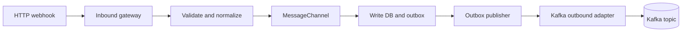

# Choosing the right cloud-native adapter

In Spring Integration, an adapter is the connection point between an external system and the message flow inside your application. The right adapter lets the application receive or send data at the right cadence, preserve the message contract, and handle failures when the network, broker, or target service is temporarily unavailable. When deploying to the cloud, this decision also affects horizontal scaling across multiple instances, recovery after pod restarts, and connection lifecycle management.

Do not pick an adapter solely because the external system uses a familiar product. Start from how data is exchanged: who initiates the interaction, whether an immediate reply is required, whether the data source emits events or must be polled, and what counts as successful processing. Only then choose the protocol, Spring Integration endpoint, and operational model.

## 1. Distinguishing one-way adapters from request-reply gateways

Spring Integration normalizes data from many protocols into the same `Message<?>` model consisting of a payload and headers. Adapters sit at the edge of the flow to translate between internal messages and the external system's format.

| Endpoint | Exchange direction | When suitable |
|---|---|---|
| Inbound channel adapter | External system → `MessageChannel` | The application receives data one-way; the source may be polled or actively push events |
| Outbound channel adapter | `MessageChannel` → external system | The application sends data one-way; no business reply payload is required |
| Inbound gateway | External request → internal flow → external response | The caller needs a processing result within the same request |
| Outbound gateway | Internal message → external request → internal reply | The internal flow calls an external service and needs the returned result |

For example, a partner webhook typically enters via an HTTP inbound gateway because the HTTP client expects a status code or response. If an internal message needs to call a REST API and use the returned JSON for further processing, an outbound gateway is the natural choice. If you only need to publish an event to a broker, an outbound channel adapter usually fits the intent better than a gateway.

Gateways establish a request-reply relationship and usually block the calling thread until a response arrives or a timeout expires. Therefore, do not use a gateway for inherently long-running asynchronous tasks. For such tasks, accept the request, return an acknowledgment code or correlation ID, process asynchronously via channels/brokers, and expose status through a separate API if needed.

## 2. Choose by exchange contract before choosing a protocol

Before configuring an adapter, answer these questions:

1. **Data direction:** does the app read from an external source, write to an external target, or both?
2. **Initiator:** does the source push events to the app, or must the app poll the source on a schedule?
3. **Interaction style:** one-way send, one-way receive, or request-reply?
4. **Durability:** must data survive restarts, network drops, or pod rescheduling?
5. **Confirmation:** does the external system acknowledge on message receipt, on durable storage, or after business completion?
6. **Ordering and load:** must ordering be preserved per customer/order, and how many consumers need to process in parallel?
7. **Transactions:** do database updates and message publishing need to share a transaction boundary?

Two systems using HTTP or using a broker may still require different endpoints because their contracts differ. For instance, an HTTP webhook receiving external requests is an inbound gateway; an HTTP client calling an external service for a response is an outbound gateway. With Kafka, applications usually consume records in a consumer group or produce records to a topic; request-reply fits only when explicit correlation and timeout mechanisms are designed.

## 3. Comparing common adapter groups

| External system | Common Spring Integration endpoints | Choose when | Cloud-environment design considerations |
|---|---|---|---|
| File | File inbound channel adapter; file outbound handler | Batch exchange via directories or shared volumes | Does the path survive pod replacement; how files are locked/claimed; temp files and atomic renames; filtering already-received files |
| SFTP | SFTP inbound/outbound adapters | Exchanging files with partners over an SFTP server | Host keys, auth keys, timeouts, session factory/pool, archive directories, duplicate-prevention filters, and remote deletion policies |
| HTTP/REST | HTTP inbound gateway, outbound gateway, or outbound channel adapter | Webhooks, synchronous API calls, or one-way HTTP sends | TLS, OAuth/tokens, connection pools, timeouts, rate limits, error-code-driven retries, and idempotency keys |
| JMS | Message-driven inbound adapter or polling inbound adapter; outbound adapter/gateway | Integrating JMS systems requiring broker-managed messaging | Acknowledgments, transactions, durable subscriptions, consumer concurrency, prefetch, and dead-letter queues |
| AMQP | AMQP inbound/message-driven adapter; outbound adapter/gateway | Sending/receiving via exchanges, queues, and routing keys, typically with RabbitMQ | Bindings, durable queues, publisher confirms/returns, ack/requeue, DLQs, consumer bounds, and retry policies |
| Kafka | Kafka message-driven channel adapter; Kafka outbound channel adapter | Log-backed event streams with partitions, consumer groups, replay, and high throughput | Partition keys, offset commits, rebalances, consumer groups, schema compatibility, and duplicate record handling |
| Database | Polling JDBC inbound channel adapter; JDBC outbound channel adapter | Scheduled polling of pending records or writing data to tables | Incremental queries, checkpoints, multi-instance locks/leases, transactions, connection pools, and indexes |

### File and SFTP

File adapters fit when source/target systems exchange data through directories. The inbound adapter reads files and emits messages; the outbound handler writes payloads to files. Define clearly when a file is considered complete. A common convention is for senders to write with a temporary extension and rename atomically once finished; receivers read only completed files. Use pattern filters, persistent accept-once filters, and archive directories to avoid duplicate processing.

In containers, a pod's local directory is typically ephemeral. If data must survive pod replacement, use an appropriate persistent volume or a file/object storage service with its own adapter. File adapters target filesystem semantics; do not assume mounting an object store automatically gives full filesystem semantics like atomic renames, locks, and directory listings.

SFTP fits when partners require file transfers over an SFTP server. Beyond directory and pattern configuration, manage host keys, private keys/credentials, timeouts, and concurrent sessions. When multiple replicas read the same remote directory, per-replica in-memory filters cannot prevent two replicas from downloading the same file. Use server-side claim/rename mechanisms, a shared metadata store, or directory partitioning conventions.

### HTTP/REST

HTTP suits APIs and webhooks. Use an inbound gateway when the app receives requests and must return responses; use an outbound gateway when internal flows call an API and need the response body; use an outbound channel adapter when only a one-way send is needed.

HTTP is a request-response protocol, yet it does not guarantee a request executes only once. A client may retry on timeout even after the server completed processing. For creating orders, payments, or status updates, pass an idempotency key and store results under that key. Classify errors before retrying: network errors, `429`, or `5xx` may be transient; many `4xx` responses indicate invalid requests or permission failures requiring config/data fixes. Always set finite connect and response timeouts.

For webhooks, verify the provider's signature or authentication mechanism before feeding payloads into business flows. If processing takes substantial time, acknowledge receipt only after durably persisting the message; do not hold the HTTP connection open throughout long background processing.

### JMS and AMQP

Both JMS and AMQP are commonly used with brokers, though configuration models and capabilities depend on the specific broker. Message-driven adapters receive messages via broker listeners; polling inbound adapters fit when scheduled pulls are needed. Outbound adapters send messages from an internal channel to a destination.

With JMS, define acknowledgment modes, transactions, durable subscriptions, and dead-letter policies. With AMQP, design exchanges, queues, bindings, and routing keys; configure publisher confirms, consumer acks, requeues, and DLQs. Never requeue a message with a deterministic data error infinitely, as it will loop endlessly. Bound retry attempts and route failing messages somewhere they can be inspected, fixed, and replayed.

### Kafka

Kafka fits log-stored event streams, multiple independent consumer groups, and replay needs. Inbound adapters feed topic records into channels; outbound adapters write internal messages as records. Record keys determine partitions, so key by the entity needing ordering—such as `orderId`—rather than randomly whenever events for the same order must be processed sequentially.

Offsets mark how far a consumer has read. If the app commits offsets before business work finishes, mid-flight failures can lose processing. If it commits only after completion, a record may be redelivered after a crash. Thus, consumers still need idempotent handling. Kafka's exactly-once capabilities have specific scopes and prerequisites; they do not automatically make an external JDBC update atomic with Kafka.

### Databases

JDBC inbound channel adapters typically use a poller to query pending rows. Queries must use incremental criteria or explicit processing states alongside checkpoints/leases so multiple instances do not claim the same row. JDBC outbound channel adapters write message data into tables.

Never treat an arbitrary business table as a message queue. When multiple workers pull tasks, design atomic claim operations, `PENDING/PROCESSING/DONE` states, lease expirations, and proper indexes. For updating data and emitting events together, a transactional outbox persists business changes and outbox rows in one transaction; a separate flow reads the outbox and publishes events, paired with duplicate-publish/consumption protections.

### Cloud storage services

Object storage such as S3, Azure Blob, or Google Cloud Storage differs semantically from filesystems: objects are identified by keys, renames are often copy-then-delete operations, and object listing behaves differently. Use a provider-specific integration adapter/module if available, or receive object storage event notifications over a queue/event service and read objects via SDK. This event-driven approach lets the app react promptly and avoids polling entire buckets continuously.

## 4. Choosing a poller vs direct event consumption

Pollers are used when the source does not push messages or when query cadence must be controlled. Files, SFTP, and JDBC queries typically fall here. Configure poll intervals, max messages per poll, and concurrency bounds. Polling too frequently loads external systems; polling too rarely increases latency.

Broker listeners, webhooks, and many event-driven sources push messages into the application without a Spring Integration poller. This lowers latency, yet requires bounding consumer counts and processing capacity to avoid exhausting resources during traffic spikes.

Example configuring a periodic file-reading flow in Java DSL:

```java
@Bean
IntegrationFlow inboundFiles(File inputDirectory) {
    return IntegrationFlow
        .from(Files.inboundAdapter(inputDirectory)
                .autoCreateDirectory(true)
                .patternFilter("*.json"),
            endpoint -> endpoint.poller(
                Pollers.fixedDelay(5_000).maxMessagesPerPoll(100)))
        .transform(Transformers.fileToString())
        .channel("rawFileMessages")
        .get();
}
```

This configuration checks the file source every 5 seconds and emits at most 100 messages per poll. Production values must reflect file size, processing time, I/O limits, and replica counts. In multi-replica deployments, add shared coordination so one file is not processed concurrently by multiple replicas. `autoCreateDirectory` only creates missing directories; it does not turn ephemeral container filesystems into durable storage.

## 5. Designing MessageChannels and message contracts

Adapters only solve crossing the protocol boundary. Inside the application, normalize data into a message contract that downstream steps understand. A message should carry a clearly schema-defined payload and headers for routing, tracing, or deduplication, such as:

| Field | Purpose |
|---|---|
| `messageId` | Identifies the message for logging and duplicate detection |
| `correlationId` | Links requests to replies or groups steps of one transaction |
| `sourceSystem` | Identifies the system that emitted the data |
| `schemaVersion` | Selects how payloads are decoded and transformed |
| `receivedAt` | Timestamp when the application received the message |
| `idempotencyKey` | Business key used to prevent duplicate execution |

Do not propagate every external protocol header unchecked across the entire internal flow. Map only necessary headers, normalize types, and strip sensitive information. When communicating across independent services, prefer explicit schema formats such as JSON, Avro, or Protobuf instead of relying on Java native serialization or internal class names.

The `MessageChannel` type also shapes runtime behavior:

| Channel | Behavior | When to use |
|---|---|---|
| `DirectChannel` | Invokes subscribers on the sender's thread | Simple, synchronous processing; errors can propagate back to the sender |
| `ExecutorChannel` | Hands work to an executor for async processing | Decouples execution threads; requires thread bounds and rejection handling |
| `QueueChannel` | Buffers messages in memory or a configured message store | Buffering between producer and consumer; in-memory queues do not survive restarts |
| `PublishSubscribeChannel` | Broadcasts one message to multiple subscribers | One event must trigger multiple independent processing branches |

Switching from `DirectChannel` to `ExecutorChannel` changes when errors are observed and how flows coordinate. Using an in-memory `QueueChannel` does not give you a durable queue. If messages must survive pod replacement or be consumed across replicas, use a broker or a properly configured persistent message store.

## 6. Error handling, retries, and duplicate messages

In distributed systems, a timeout does not prove the target system failed to perform the operation. A request may have succeeded remotely while the response was lost on the return trip. Consequently, safe designs assume at-least-once delivery and make processing idempotent.

- **Retry transient errors:** use bounded attempts, exponential backoff, and jitter when multiple instances may retry simultaneously. Only retry recoverable failures.
- **Never retry blindly:** authentication failures, invalid schemas, or malformed requests usually need data or configuration fixes. Route them to an error flow for investigation.
- **Dead-letter and replay:** capture payloads, message IDs, sources, timestamps, attempt counts, and failure reasons. Protect sensitive data in logs/DLQs and establish a replay procedure after fixing root causes.
- **Idempotency:** persist the processing key alongside the result or business state within an appropriate transaction boundary. For balance increments or inventory deductions, checking message IDs in memory is not enough.
- **Acknowledge at the right time:** acknowledge or commit offsets only after required processing succeeds per chosen semantics. When DB writes and broker sends must stay consistent, consider outbox/inbox patterns instead of assuming two systems share a transaction.

Spring Integration supports routing errors via error channels and endpoint retry/error handling configuration. Exact mechanics depend on the adapter and channel type. In synchronous flows, exceptions may propagate back to the caller; in async flows, errors typically route to an error channel or endpoint error handler. Verify the exact behavior of your chosen adapter, especially when broker acknowledgments or Kafka offset commits happen.

## 7. Operating adapters in cloud environments

An application can work on a developer laptop yet fail when scaled to multiple replicas. Treat the following as part of choosing an adapter:

**Shared state.** Deduplication markers, poller checkpoints, file read positions, and processing leases must live in shared storage accessible to all replicas whenever work can move across pods. In-memory filters protect only a single process.

**Connections and credentials.** Use lifecycle-managed connection factories/clients; size pools, timeouts, keep-alives, and connection limits to match broker/external capacity. Supply credentials, private keys, and tokens via secret/configuration services with TLS and rotation plans. Never log passwords, tokens, or sensitive payloads.

**Horizontal scaling.** Adding replicas helps only if the source supports parallel load sharing. Kafka parallelism is capped by partitions assigned to the consumer group; JMS/AMQP depend on consumer, queue, and broker settings; File/SFTP/JDBC require claim or lease mechanisms so replicas do not grab the same task. Measure real load before increasing concurrency.

**Backpressure.** Bound in-flight messages, queue sizes, thread counts, and concurrent requests. If consumers fall behind producers, use durable buffering and backlog depth alerts. Unbounded in-memory queues can cause pods to run out of heap when sources outpace processing.

**Lifecycle.** Inbound endpoints and listener containers are lifecycle-managed by Spring. During shutdown, stop accepting new work, let in-flight messages finish within a configured deadline, close sessions/connections, and let the broker redeliver unacknowledged messages. The platform's graceful shutdown window must exceed maximum processing time; otherwise processing must tolerate mid-flight interruption.

**Observability.** Emit structured logs with `messageId`, `correlationId`, endpoint, and processing outcomes; never log secrets. Track ingress/egress rates, processing durations, retry counts, connection failures, DLQ depths, poll lag, and backlogs. Metrics should distinguish a quiet upstream source from a stalled consumer.

## 8. Typical selection patterns

### Order intake webhook

Partners send HTTP requests and need confirmation that the system received them. Use an HTTP inbound gateway to verify signatures, run basic schema checks, and write requests to durable storage or a broker. Return an acceptance response quickly, then process business logic asynchronously. Use the partner's idempotency key to prevent duplicate orders when webhooks are retried.

### File synchronization from a partner

A partner only supports SFTP and drops batch files. Use an SFTP inbound adapter with a poller, a shared-state accept-once filter, completion-file conventions, and archiving. After parsing, normalize records into internal messages. If parallel processing is needed, publish messages to a durable broker rather than having multiple pods scan the same directory directly.

### Publishing events after data updates

An application updates orders in JDBC and must publish `OrderUpdated` to Kafka. Use a transactional outbox: the business transaction writes both the order and an outbox row; a separate `IntegrationFlow` reads unpublished rows and sends events via a Kafka outbound adapter. Downstream consumers must still be idempotent because the relay may resend if stopped after the broker accepts the event but before the outbox row is marked complete.



## 9. Decision workflow

1. Identify the source/target and data direction; choose inbound or outbound.
2. If the caller needs a business response in the same turn, choose a gateway. If sending/receiving one-way, choose a channel adapter.
3. If the source pushes events, use an event-driven endpoint. If it must be queried periodically, use a polling inbound adapter.
4. Pick the adapter matching the protocol the external system actually supports: file/SFTP, HTTP, JMS, AMQP, Kafka, or JDBC; for object storage, check dedicated modules and service semantics.
5. Specify message IDs, correlation IDs, schema versions, idempotency, acknowledgments, retries, DLQs, and replay before going to production.
6. Verify shared state, multi-replica safety, connection limits, backpressure, metrics, and graceful shutdown.

Before finalizing your design, walk through at least three failure scenarios: a message retried after a timeout; a pod dying right after the external system accepted the message; and two replicas starting or polling the same source simultaneously. If data is still processed accurately without loss or duplicate side effects, your adapter choice and operational design satisfy the most critical cloud-native requirements.
