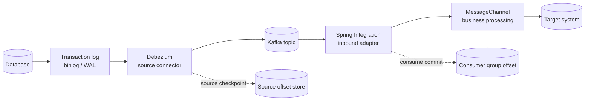
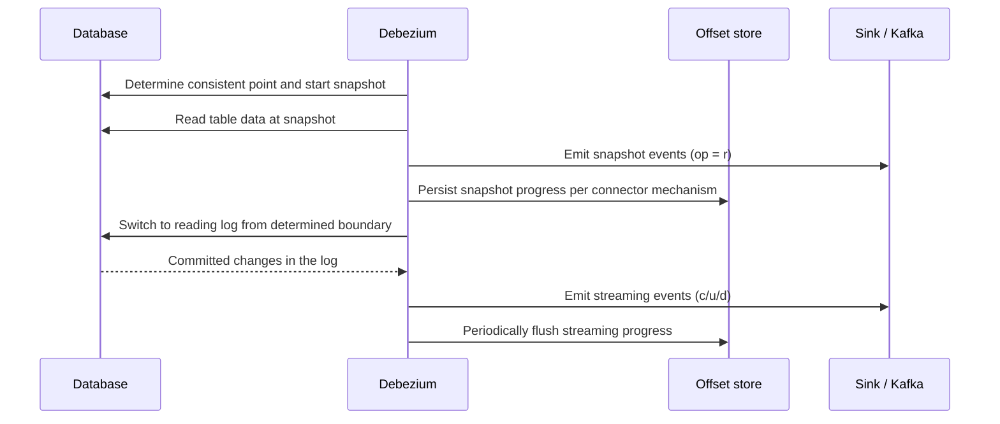

# Offsets and Change Log Positions in Debezium

## 1. The Problem: Where Should CDC Resume Reading?

In a system using **Spring Integration Adapters**, data can flow from a database into a `MessageChannel`, through a `transformer` and `filter`, and finally to a target system. For continuously changing data sources, **Debezium** handles *Change Data Capture* (CDC): reading changes written by the database into its transaction log and emitting event records. The crucial question is that when a connector pauses, fails, or is redeployed, it must know **how far it has read** so it can resume without skipping data.

Two concepts often appear together yet are not identical:

- **Change log position (*log position*)**: the coordinate of a change in the **source database's** transaction log; for example, the binlog filename and byte position pair in MySQL, or the Log Sequence Number (LSN) in PostgreSQL.
- **Debezium offset**: the progress state persisted by the connector so it can resume reading the stream; usually includes the log position plus additional state such as snapshot or transaction metadata. The exact structure depends on the connector and version.

Imagine a transaction updating an order is written at a binlog position. Debezium reads that event and forwards it to the receiving system. If progress is durably persisted, the next run can resume from the recorded point. If the event was sent but the offset was not flushed before the process crashed, the event may reappear. This is a common root cause of **at-least-once delivery (*at-least-once*)**.

### Learning Outcomes

After this lesson, you will be able to:

1. Distinguish log position, Debezium source offset, Kafka topic offset, and consumer group offset.
2. Identify MySQL binlog positions and PostgreSQL WAL/LSNs inside CDC events.
3. Explain how snapshots transition to streaming, how offsets are stored, and how connectors recover after failures.
4. Design Spring Integration flows that process CDC events safely under replay.
5. Diagnose offset skew, purged logs, growing backlogs, and duplicate events.

## 2. Which Progress Layers Does a Change Pass Through?



*This diagram assumes Debezium runs on Kafka Connect and Spring Integration reads from Kafka. When using the embedded Debezium Engine or Debezium Server, offset storage locations and acknowledgment mechanisms are configured differently.*

| Concept | Tied to Which System? | What Does It Express? | Example |
|---|---|---|---|
| **Source log position** | MySQL/PostgreSQL/... | Coordinate of a change in the database transaction log | `mysql-bin.000017:15433`, WAL LSN `0/16B6C50` |
| **Debezium source offset** | Debezium/Kafka Connect | Checkpoint for resuming from the source; may contain log position, snapshot state, and other metadata | `{ "file": "mysql-bin.000017", "pos": 15433, ... }` *(illustrative)* |
| **Kafka topic offset** | Partition of a Kafka topic | Index of a record within a Kafka partition; a position in the intermediary broker | `topic=cdc.orders`, `partition=0`, `offset=872` |
| **Kafka consumer group offset** | Spring Integration consumer group | Position committed by the group while reading Kafka | `group=order-projection`, `offset=873` *(next position)* |

**Never substitute these offsets for one another.** Kafka topic offset `872` does not mean the binlog position is `872`; a committed consumer group offset does not prove the record was successfully applied to the target system if the application committed too early. Nor is a Debezium source offset a sequence column in a business table.

### Source Partition and Source Offset

In the Kafka Connect model, a `SourceRecord` describes its source using two logical components:

- `sourcePartition`: identifies the **source stream** to which the offset applies; this may be the logical server/connector name, database, or other partition info depending on the connector.
- `sourceOffset`: progress **within that stream**; for example, binlog file/position or LSN plus state needed to resume.

A checkpoint is only meaningful alongside its source identifier. Do not treat a standalone `pos`, `lsn`, or `ts_ms` as a globally unique key. In some connectors, multiple row events in the same transaction can share log coordinates; exact replay positioning is managed by the connector via additional fields.

## 3. MySQL Log Position: Binlog File, Position, and GTID

MySQL can record changes in the **binary log (binlog)**. When configured properly for CDC (typically row-based logging), Debezium reads committed row events to build `INSERT`, `UPDATE`, and `DELETE` events.

The MySQL event below is a **simplified example**, not a fixed JSON schema across all Debezium versions or converters:

```json
{
  "before": { "id": 42, "status": "NEW" },
  "after":  { "id": 42, "status": "PAID" },
  "source": {
    "connector": "mysql",
    "name": "orders-cdc",
    "db": "sales",
    "table": "orders",
    "file": "mysql-bin.000017",
    "pos": 15433,
    "row": 0,
    "snapshot": "false"
  },
  "op": "u"
}
```

- `source.file` gives the **binlog filename**, e.g., `mysql-bin.000017`.
- `source.pos` represents the position within that file. You must evaluate the **pair** `(file, pos)`; comparing `pos` numbers across different files is wrong because a position in a newer file can be smaller.
- `source.row` is a helpful extra detail when multiple row events belong to the same change group; do not assume `(file, pos, row)` alone uniquely identifies every event across all connector versions.
- `source.snapshot` helps distinguish whether an event came from a snapshot or log streaming; values and representations depend on schema/converters.
- `source.gtid` may be present when the source uses **Global Transaction Identifiers (GTID)**. GTIDs help track transactions across events like primary failovers, though resumption still depends on connector configuration, log continuity, and available GTID sets.

For example, if MySQL is currently writing at `mysql-bin.000018:500`, an older source offset at `mysql-bin.000017:15433` can only recover if the binlogs spanning that range still exist and the connector has the necessary state. You cannot calculate how many events were missed by subtracting `500 - 15433`.

### How Does a MySQL Binlog Position Differ from an Auto-Increment ID?

`orders.id = 42` is a business record key; `mysql-bin.000017:15433` is the coordinate of a change in the log. The same order can be updated multiple times at different log positions. Conversely, one transaction can modify many rows and tables. Therefore, **you cannot resume CDC by tracking `MAX(id)`**.

## 4. PostgreSQL Log Position: WAL and LSN

PostgreSQL uses the **Write-Ahead Log (WAL)**; Debezium PostgreSQL reads changes via **logical decoding** and a replication slot. A WAL LSN (*Log Sequence Number*) pinpoints a location in the WAL stream, commonly displayed in `X/Y` format, such as `0/16B6C50`.

Partial CDC event example:

```json
{
  "after": { "id": 42, "status": "PAID" },
  "source": {
    "connector": "postgresql",
    "name": "orders-cdc",
    "db": "sales",
    "schema": "public",
    "table": "orders",
    "lsn": 23817296,
    "txId": 701,
    "snapshot": "false"
  },
  "op": "u"
}
```

In this example, `source.lsn` is shown as a decimal integer; PostgreSQL tools may format the same family of values as `X/Y`. **Never compare LSNs across two independent clusters**. `txId` is useful transaction metadata for analysis, not a replacement for the connector's official checkpoint.

A replication slot preserves state needed for logical replication and instructs PostgreSQL to retain WAL segments not yet confirmed sufficiently by the subscriber. When Debezium pauses for a long time, WAL can accumulate; if the slot is dropped, invalidated, or required WAL is gone, an old source offset may fail to resume. Values like `restart_lsn` and `confirmed_flush_lsn` on the slot reflect **database-side replication state**, not when Spring Integration finished applying business effects.

| Criterion | MySQL | PostgreSQL |
|---|---|---|
| Change source | Binary log | WAL via logical decoding |
| Coordinates typically seen in `source` | `file`, `pos`, possibly `row`, `gtid` | `lsn`, possibly `txId` |
| Mechanism to monitor for log retention | Binlog retention and readability after restart | WAL retention, logical replication slot, slot lag |
| Risk if paused too long | Needed binlogs are purged/inaccessible | Retained WAL fills disk, or needed logs disappear and slot becomes unusable |

Other connectors use their own positions: SQL Server uses LSNs in transaction logs/CDC, Oracle typically uses SCNs, and MongoDB uses resume tokens. **Always rely on the running connector's offset contract** instead of forcing everything into a single generic integer.

## 5. Offsets Across Two Phases: Snapshot and Streaming

Debezium often needs to sync records that **existed before CDC was enabled**. With `snapshot.mode=initial` and no valid offset yet, the connector can run an initial snapshot before switching to reading the log. High-level flow:



*This diagram illustrates **logical order** only; consistent snapshot points, locking, isolation levels, offset states, and gap-free handoff mechanisms vary by database, connector, and snapshot mode.*

Common `op` values in a Debezium envelope are `r` (snapshot read), `c` (create), `u` (update), and `d` (delete). Records may include `source.snapshot` to identify snapshot events, and some mark the last snapshot record. Never interpret `op = r` as a newly committed log event at the moment it arrives.

### Why Isn't a Snapshot Offset Always Just a Binlog Position or LSN?

While a snapshot is running, progress may track which table or key range has been processed alongside the log boundary from which streaming must start afterward. With **incremental snapshots**, Debezium also coordinates chunked reads with concurrent streaming events, introducing additional state. If an application manually writes an LSN into the offset store and discards this extra state, the next startup may skip or duplicate changes.

**Principle:** let the connector manage the snapshot-to-streaming transition and checkpoint persistence; downstream applications must tolerate replays and enforce event ordering aligned with business needs.

## 6. Where Are Offsets Stored, and When Are They Considered Committed?

Storage location depends on **how Debezium is deployed**, not just the database engine:

| Debezium Deployment | Common Source Offset Store | Key Takeaway |
|---|---|---|
| Kafka Connect distributed | Kafka internal offset topic configured on Connect workers | Topic must be durable with proper replication and retention; source offset differs from CDC topic offset |
| Kafka Connect standalone | Connect worker offset file | File must reside on persistent storage to survive container/VM replacement |
| Debezium Engine embedded in Java app | Engine-configured offset store, e.g., file/JDBC/Redis/Kafka depending on implementation and libraries | Storage path must survive restarts and align with the engine's acknowledgment mechanism |
| Debezium Server | Offset store configured specifically for Debezium Server | Do not assume Kafka sink implies offsets live in Kafka Connect's internal topic |

In Kafka Connect, workers manage the lifecycle of source records and **flush offsets periodically**. A record emitted to Kafka does not guarantee its corresponding checkpoint was durably flushed at the same instant. Thus, after a crash, a connector can re-read a portion of the log and re-emit previously seen events.

Example properties for a **Kafka Connect distributed worker** (this is worker configuration, not Spring Integration consumer configuration):

```properties
# Kafka Connect worker: illustrative offset store and flush interval
offset.storage.topic=connect-offsets
offset.storage.replication.factor=3
offset.flush.interval.ms=10000
```

`10000` is 10 seconds; adjusting the flush interval affects how much work might replay versus checkpoint write overhead, but **does not create an end-to-end exactly-once guarantee**. Topic names and replication factors are illustrative and must fit your cluster. Beyond source offsets, connectors like MySQL also require **schema history** to interpret log records after schema changes. Schema history and source offsets are **two separate types of state** that must stay compatible during recovery.

### Realistic Failure Timeline

Suppose the durable offset currently corresponds to position `P100`:

1. Debezium reads event `E101` at a position after `P100`.
2. Record `E101` is successfully delivered to Kafka.
3. The process crashes **before** the new offset is flushed to the offset store.
4. The connector restarts from the saved checkpoint and may emit `E101` again.
5. Spring Integration must handle the duplicate `E101` safely.

This scenario is **duplication caused by replay**; to avoid *data loss*, never advance offsets ahead of durable downstream delivery. Across multiple sinks and messaging layers, exactly-once requires an explicit transactional/idempotency design rather than merely turning on Debezium.

## 7. Designing Offset Handling When Connecting Debezium to Spring Integration

Within the **SPRING_INTEGRATION_ADAPTERS** module, keep two responsibilities separate:

- **Debezium source connector** reads logs, manages source checkpoints, and emits CDC events.
- **Spring Integration inbound adapter/gateway and `MessageChannel`** receive events from Kafka or an engine bridge, transform/route them, persist target state, and acknowledge consumption according to the adapter in use.

Example: `sales.orders` emits CDC to Kafka topic `orders-cdc.sales.orders`; a Spring Integration Kafka inbound adapter forwards messages to `ordersChangesChannel`, and a service handler updates a projection table in a reporting database. Event handling can be expressed in pseudocode:

```text
onCdcMessage(event, acknowledgement):
    key = businessKey(event)         # E.g.: orders.id
    changeId = stableChangeId(event) # Custom-designed from source metadata

    transaction:
        if changeId is not yet in processed_change:
            applyToProjection(key, event)
            insert processed_change(changeId)

    acknowledgeConsumerOffset()       # Only after target transaction commits
```

*This is pseudocode illustrating processing order. How acknowledgement is obtained and when Kafka commits depend on the ack mode, container, and Spring Integration adapter configured; do not assume every inbound adapter exposes `acknowledge()` identically.*

Details that determine correctness:

1. **Ensure idempotency:** processing a repeated event must not double-credit money, send duplicate emails, or insert duplicate rows. Use a durable deduplication key, versioned business-key upsert, or a target transactional outbox.
2. **Choose change identifiers carefully:** `orderId` alone cannot distinguish multiple updates; `lsn` alone may not distinguish multiple rows in one transaction. Event keys should rely on available source metadata and connector contracts (source, transaction, table, row/change order), or design targets around final state instead of trying to invent a universal event ID.
3. **Commit consumer offsets at the right time:** if the Kafka consumer commits before writing target data, a crash can skip the event for that consumer group. If target data commits before the offset commit, the event will be redelivered: idempotency handles this case.
4. **Preserve required ordering:** messages sharing a business key should land on the same Kafka partition when per-entity ordering is needed; never assume global ordering across all partitions or tables.
5. **Separate business errors from source errors:** Spring Integration retries/DLQs cannot repair a corrupted source offset; conversely, adjusting a Debezium offset will not fix a failing target handler.

If Debezium is **embedded directly** rather than routed through Kafka, the Debezium Engine's acknowledgment API and marking of processed batches/records must align with downstream completion. When sending asynchronously into a `MessageChannel`, define the handoff guarantee clearly: `send()` returning does not prove the target system has committed.

## 8. Monitoring Progress and Diagnosing Issues

Effective offset monitoring covers **source → connector → message broker → target application**. A connector in `RUNNING` state can still be lagging or stalled on offsets, and low Kafka consumer lag can mask Debezium falling behind the database.

| Symptom | Likely Cause to Check | Resolution Direction |
|---|---|---|
| Debezium restarts and re-emits some events | Offset flush hadn't completed before crash; consumer or sink retry | Maintain idempotency; check flush interval and ack mechanics |
| Connector reports missing binlog/LSN | Source logs were purged; replication slot/WAL unavailable; checkpoint too old | Check retention, slot, downtime, and run controlled resnapshot |
| PostgreSQL WAL disk usage keeps growing | Slot retaining WAL because connector isn't confirming progress fast enough; slow/stopped connector | Monitor slot lag, `restart_lsn`, `confirmed_flush_lsn`, source and connector throughput |
| Database changes happen with no CDC events | DB/table filters, publication/privileges, connector error, or still snapshotting | Inspect connector logs, snapshot state, filters, and changes on tracked tables |
| Kafka topic grows while reports update slowly | Spring Integration consumer group lagging or slow target handler | Check Kafka consumer lag, throughput, retries/DLQ, and target transactions |
| Many `op=r` records appear after deleting offsets | Connector started a fresh snapshot per snapshot mode | Assess sink impact, deduplication, and initial/incremental snapshot strategy |

### Heartbeats and Quiet Periods

When captured tables see little activity, a connector may lack opportunities to emit messages and update progress even while unrelated database traffic advances the transaction log. Debezium supports **heartbeats** in many connectors to signal liveness and advance offsets. Depending on the connector, setting `heartbeat.interval.ms` alone may not solve all PostgreSQL WAL-retention cases; sometimes an action query that generates actual tracked DB writes is needed. Verify configuration against your connector version and database permissions.

To measure CDC latency, compare the source change timestamp against processing time (`ts_ms` or equivalent fields), keeping in mind timestamp semantics, clock skew, and snapshot phases. **Never use timestamps to replace log positions**, and never estimate exact pending event counts from timestamp differences alone.

### Safe Procedure When Suspecting Lost Checkpoints

1. Record connector/task status, incident time, stored source partition/offset, binlog or replication slot state, and relevant snapshot/retention settings.
2. Check how far target data has been applied and identify potential duplicates or gaps; separate Debezium progress from consumer progress.
3. Verify required source logs still exist before restarting; if logs are gone, plan a controlled re-initialization or resynchronization snapshot.
4. Ensure target sinks are idempotent/deduplicating and have reconciliation and replay-recovery procedures.
5. Modify offsets or schema history only through operational procedures supported for your exact connector version. Back up state and assess impact before acting.

Never arbitrarily edit `lsn`, `file`/`pos`, or delete the offset store to "catch up quickly": the connector could skip unprocessed changes, fail to decode historical schemas, or re-run a snapshot and emit stale data.

## 9. Practice Exercise: Predicting Behavior After Restart

Suppose Debezium MySQL captures changes from `sales.orders` to Kafka, and Spring Integration consumes that topic. The durable source offset is at `mysql-bin.000021:1000`. Next, two transactions occur:

- `T1`: updates `orders.id=42`; event `E1` is sent to Kafka.
- `T2`: updates `orders.id=43`; event `E2` is being processed by the connector.

Debezium stops before the next offset flush; Spring Integration has already written the projection for `E1`, but the consumer group has not yet committed `E1`'s position.

**Questions:**

1. After both Debezium and the consumer restart, where might `E1` appear again?
2. Why shouldn't you manually set the source offset to `E2`'s Kafka offset?
3. If MySQL already purged `mysql-bin.000021`, does a simple restart guarantee resuming from the old checkpoint?
4. What evidence should be persisted at the projection so receiving `E1` again is safe?

<details>
<summary>Solution Hints</summary>

1. Debezium may emit `E1` again as a **new record in Kafka** because the source offset wasn't flushed. The consumer group may also re-read the **existing Kafka record** because it hadn't committed. Distinguish source replay from consumer re-reading.
2. Kafka offsets count records within a Kafka partition; source offsets track MySQL binlog checkpoints and extra connector state. They cannot be converted directly.
3. No. The connector needs the corresponding logs to read; purged binlogs can cause resumption to fail and require controlled recovery/resnapshot.
4. An idempotently updatable business state or a `processed_change` marker table keyed by a reliable change identifier; applying the projection and recording the marker should occur in the same transaction.

</details>

## 10. Production Readiness Checklist for CDC

- [ ] Identify the **exact connector** (MySQL, PostgreSQL, etc.) and its real source position/offset format.
- [ ] Place the offset store on durable infrastructure; back up and monitor access permissions.
- [ ] Verify binlog/WAL retention, replication slots, and maximum recoverable downtime.
- [ ] Understand snapshot modes, snapshot resumability, and replay conditions.
- [ ] Separate Debezium checkpoints, Kafka topic offsets, and Spring Integration consumer commits.
- [ ] Design idempotency, retries/DLQ, and offset commits after target persistence succeeds.
- [ ] Monitor connector lag, slot/binlog retention, task errors, broker lag, and sink write progress.
- [ ] Rehearse mid-processing restarts, event replays, and recovery when source logs are gone.

**Key Takeaway:** *Log position* answers "where is the change in the source log?", while *Debezium offset* answers "what state does the connector need to resume reading accurately?". In Spring Integration, **confirming downstream processing** is yet another separate responsibility. Good designs connect all three with durable checkpoints, replay strategies, and idempotent handling.
