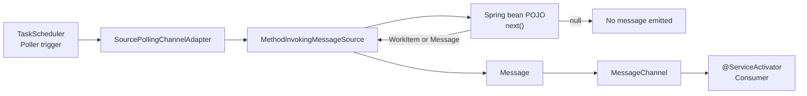
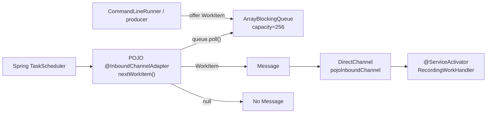
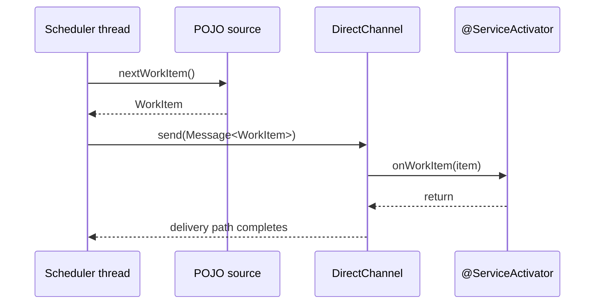
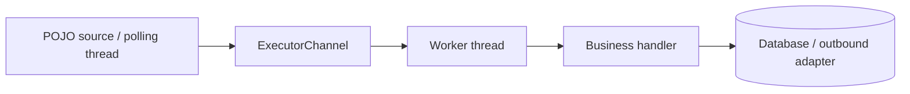
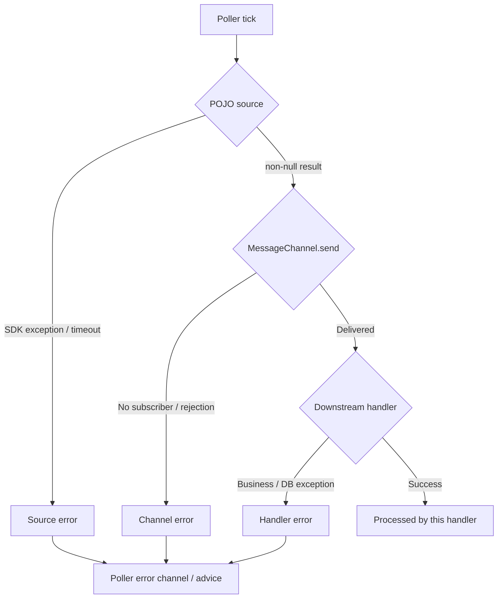
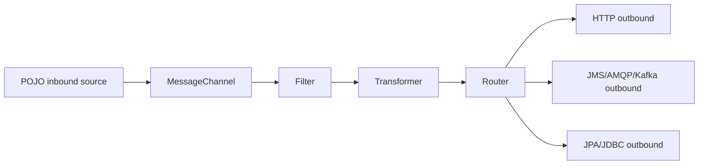

# POJO inbound channel adapter

## 1. Background and objectives

In the **SPRING_INTEGRATION_ADAPTERS** module, Spring Integration is used to connect external systems with the application through inbound/outbound adapters, gateways, pollers, and `MessageChannel`. Common sources include files, SFTP, HTTP, JMS, AMQP, Kafka, and databases. However, not every data source has a dedicated adapter out of the box: sometimes a system already has an **ordinary Java Spring bean** that knows how to read state, fetch work from an internal queue, or invoke a legacy library.

A **POJO inbound channel adapter** lets you use a method of that bean directly as the **input of a Spring Integration Flow**. The framework invokes the method on a schedule, wraps the result into a Spring Message when needed, and sends it to a `MessageChannel`. The POJO does not need to implement `MessageSource` or call `channel.send(...)` directly inside business methods.

This lesson belongs to the **Adapter POJO** chapter. After completing it, you will be able to:

- Explain POJO, inbound channel adapter, `MethodInvokingMessageSource`, `SourcePollingChannelAdapter`, and `MessageChannel`.
- Distinguish a **polled source method** from a **consumer method that receives messages**.
- Write `@InboundChannelAdapter` on a no-argument method returning a payload or `Message<?>`.
- Understand why **`null` = no message**, whereas `0`, `false`, an empty string, and a non-empty `List` are all valid payloads.
- Configure `@Poller`/`Pollers` with `fixedDelay`, `fixedRate`, cron, and `maxMessagesPerPoll`.
- Distinguish a **poll tick**, a **source method invocation**, a **Spring Message**, and a **business record**.
- Build an example with Spring Boot 3.x, Spring Integration 6.x, Java 17+, a POJO source backed by a bounded queue, and a `@ServiceActivator` handler.
- Use Java DSL `IntegrationFlow.fromSupplier(...)` and XML `<int:inbound-channel-adapter>` as alternatives.
- Set headers/correlation IDs when the method returns `Message<?>` instead of just a payload.
- Design start/stop state, error channels, retry, and backpressure.
- Understand the limits of in-memory sources; choose file/SFTP/JDBC/JPA/JMS/AMQP/Kafka adapters when durability and transport ACK are required.
- Write direct method tests and integration tests for the scheduler, empty source behavior, and consumer failures.

> **Key principle:** A POJO inbound channel adapter is a **polling integration endpoint**. It does not turn an arbitrary Java method into a durable broker, does not automatically provide transactions, does not save checkpoints on its own, and does not guarantee exactly-once delivery.

## 2. What is a POJO inbound channel adapter?

A **POJO (Plain Old Java Object)** is a plain Java object that does not have to implement a Spring Integration-specific interface to hold its logic. For example:

```java
public class LegacyWorkProvider {

    public WorkItem next() {
        // Read one work item from the business source.
        // Return null if there is temporarily no data.
        return ...;
    }
}
```

If `LegacyWorkProvider` is a Spring bean and the `next()` method satisfies the method-invoking source contract, Spring Integration can invoke it every 250 ms:



**At the architectural layer:**

1. `TaskScheduler` triggers a poll cycle.
2. `SourcePollingChannelAdapter` performs the poll.
3. `MethodInvokingMessageSource` invokes the POJO's no-argument method.
4. If the method returns `null`, there is no message to send for that `receive()`.
5. If it returns a non-`Message` object, the framework creates a `Message` containing that object as its payload.
6. If it returns `Message<?>`, that message can carry custom headers.
7. The message is sent to the output channel and downstream handlers run according to the channel semantics.

This is a **push into the channel driven by a pull at the source**: the framework actively polls the source and publishes the result into the Integration Flow.

### 2.1. Why isn't every inbound adapter a POJO?

Dedicated adapters provide many capabilities that are not present in a plain POJO method:

| Adapter | Source | Transport-specific capabilities |
| --- | --- | --- |
| POJO inbound | Spring bean method | Scheduled method invocation, converting result to message |
| File inbound | Filesystem | Directory scan, file filters, locking/duplicate prevention |
| SFTP inbound | Remote SFTP server | Session factory, remote synchronizer, file filters |
| JDBC inbound | Database query | SQL query, row mapping, result-based polling |
| JPA inbound | `EntityManager`/JPQL | Entity query, persistence context, result limits |
| JMS inbound | JMS provider | Session/ACK, adapter-specific listener/polling behavior |
| AMQP/Kafka inbound | Broker | Adapter-specific delivery/offset/ACK/retry semantics |
| HTTP inbound gateway | HTTP request | Request–reply, status/headers, web security |

**POJO inbound fits well** when you already have a callable Java bean/API without needing to build a custom transport adapter. If data actually comes from a broker or remote transport, prefer a dedicated adapter so you do not have to reimplement connections, filtering, retry, acknowledgment, and recovery yourself.

### 2.2. Inbound and outbound are asymmetric at the method level

- **Inbound POJO:** the framework **calls** a bean's no-argument method to **fetch data** and emit a message into a channel.
- **Outbound POJO:** the framework **receives** a message from a channel, then invokes a bean method with the appropriate payload/headers.
- **Service activator:** an endpoint that consumes a Spring Message to execute logic; it can produce a reply if the handler returns a result.

```text
POJO inbound:
  poller → source.next() → Message → channel → handler

POJO outbound:
  channel → Message → target.handle(payload)
```

A POJO source method **must not be confused with** `@ServiceActivator(inputChannel=...)`: one side **produces** messages, while the other **processes** existing messages.

## 3. Related Spring Integration components

| Component | Role |
| --- | --- |
| `@InboundChannelAdapter` | Annotation declaring a polled POJO source method |
| `@Poller` | Polling schedule and limits at the endpoint annotation |
| `MethodInvokingMessageSource` | `MessageSource` that invokes a no-argument POJO method |
| `SourcePollingChannelAdapter` | Endpoint that manages polling and forwards messages to the output channel |
| `TaskScheduler` | Schedules poller triggers |
| `MessageSource<T>` | Pull contract via `receive()` |
| `Message<T>` | Payload along with metadata headers |
| `MessageChannel` | Boundary for passing messages downstream |
| `DirectChannel` | Synchronous send typically on the caller thread |
| `ExecutorChannel` | Dispatches via an executor, creating a thread boundary |
| `QueueChannel` | Buffers messages for a consumer to poll later |
| `@ServiceActivator` | Consumer method that handles messages |
| `IntegrationFlow.fromSupplier(...)` | Java DSL creating a source from a Java `Supplier` |
| `PollerMetadata` | Poller configuration: trigger, advice, limits, executor/error handling |
| `SmartLifecycle` | Controls endpoint startup, stop, and phase |
| `@EndpointId` | Assigns an explicit endpoint name for management/lifecycle |
| `errorChannel` | Destination for `ErrorMessage` when polling/processing fails |

### 3.1. Do you need to implement MessageSource yourself?

**No.** When using `@InboundChannelAdapter` on a no-argument method, the framework creates the appropriate method-invoking source logic.

You can implement `MessageSource<T>` if you need a custom protocol or advanced control over `receive()`:

```java
MessageSource<WorkItem> source = () -> {
    WorkItem item = lookupOneItem();
    return item == null
            ? null
            : MessageBuilder.withPayload(item).build();
};
```

However, the snippet above **is not a POJO method annotation**; it is an explicit way of creating a `MessageSource`. When you only need to invoke an ordinary bean method, `@InboundChannelAdapter` is simpler.

### 3.2. Distinguish SmartLifecycle from the poller schedule

`SmartLifecycle.start()` enables processing capability, but it does **not** mean a message will be emitted immediately upon startup. The poller still has to reach a tick and the source must return a non-null result. `stop()` stops subsequent polls; it does not automatically roll back already-processed work outside the DB or delete data in the source.

## 4. Contract of the @InboundChannelAdapter method

### 4.1. No-argument, non-void method

Per Spring Integration 6.5, method-level annotation:

```java
@Component
public class HeartbeatSource {

    @InboundChannelAdapter(
            channel = "heartbeatChannel",
            poller = @Poller(fixedDelay = "1000"))
    public String nextHeartbeat() {
        return "heartbeat";
    }
}
```

Key requirements:

- The bean is Spring-managed.
- The method is annotated with `@InboundChannelAdapter`.
- **No parameters**.
- Return type **must not be `void`**.
- A valid output channel name is configured.
- A specific poller or a default poller exists in the context.
- With multiple source methods, each endpoint/channel must be intentional to avoid duplicate sources.

A parameterized method `next(String tenantId)` is not directly suitable because **the poller has no request message** to pass per-receive arguments. If you need request payload/headers, use `@MessagingGateway`/retrieving outbound gateway or design a server-controlled parameter source.

### 4.2. Return value and message emission outcome

| Return value | Source behavior |
| --- | --- |
| `null` | No Spring Message emitted for that receive |
| `new WorkItem(...)` | Framework wraps into `Message<WorkItem>` |
| `"hello"` | Emits `Message<String>` |
| `0` | Emits `Message<Integer>`; zero does not mean "no data" |
| `false` | Emits `Message<Boolean>` |
| `""` | Emits a message with an empty string payload |
| `List<WorkItem>` | **One message** whose payload is the List, not one message per item |
| `Message<WorkItem>` | Emits the message with the declared payload and headers |
| `Optional.empty()` | This is a **non-null object**, not the "no message" convention |
| An exception | Poll cycle fails and follows the error-handling policy |

**Exact rule:** Spring Integration uses **`null`** as the signal that the source has no data on that poll. Do not use `false`, `0`, or `Optional.empty()` to signal no data unless you intentionally want downstream to receive them as business payloads.

### 4.3. Returning Message when headers are needed

```java
@InboundChannelAdapter(
        channel = "workItemsChannel",
        poller = @Poller(fixedDelay = "1000"))
public Message<WorkItem> nextWithHeaders() {
    WorkItem work = legacyProvider.next();

    if (work == null) {
        return null;
    }

    return MessageBuilder.withPayload(work)
            .setHeader("sourceSystem", "legacy-work-provider")
            .setHeader("correlationId", work.id())
            .build();
}
```

This is an **alternative variant** for the demo source method below; do not register it alongside another source polling the same queue unless you intentionally want competing consumers.

Notes:

- `MessageBuilder.withPayload(...)` does not accept a null payload; check `work==null` first.
- `MessageHeaders` can be added for downstream filter/router/tracing.
- The `sourceSystem` header is set by a **server-defined source**; if copying headers from external input, verify trustworthiness before using them for authorization.
- Do not use message headers to carry a raw JPA `EntityManager`, transactions, or secrets.

### 4.4. Do not return void

```java
@InboundChannelAdapter(
        channel = "workItemsChannel",
        poller = @Poller(fixedDelay = "1000"))
public void tick() {
    // Contract violation: there is no payload to emit.
}
```

If the goal is only to run a periodic task without emitting messages, `@Scheduled` or a business scheduler may be more appropriate. If the goal is **feeding data into an Integration Flow**, the method must return a non-void result when data is available.

### 4.5. Do not try to read payload/headers in the source method

```java
public WorkItem next(Message<String> request) {
    // Invalid for @InboundChannelAdapter: method has a parameter.
}
```

At the time the source is polled, there is no user-submitted input Spring Message. The method uses fields/dependencies injected into the bean, reads DB/queue/cache/remote API **under server authority**, and produces a result. Headers are only created **after** a payload exists or by returning `Message<?>` directly.

## 5. Poller: fixedDelay, fixedRate, cron, and maxMessagesPerPoll

### 5.1. One tick does not equal one record

Example:

```java
@InboundChannelAdapter(
        channel = "workItemsChannel",
        poller = @Poller(
                fixedDelay = "1000",
                maxMessagesPerPoll = "5"))
public WorkItem next() {
    return queue.poll();
}
```

In a single poll cycle, the adapter may invoke the source method **at most 5 times**, stopping early when the source returns null:

```text
tick #1
  next() → WorkItem A  → Message A
  next() → WorkItem B  → Message B
  next() → null        → stop cycle

tick #2 (per schedule)
  next() → WorkItem C  → Message C
  ...
```

If the source returns `List<WorkItem>` each time, `maxMessagesPerPoll=5` counts **at most 5 receive invocations/messages**, **not a total of 5 WorkItems**. A List of 1000 records is one large payload and requires separate bounding.

### 5.2. Default maxMessagesPerPoll of an inbound source is 1

This is an easy difference to overlook:

- `SourcePollingChannelAdapter` defaults to `maxMessagesPerPoll=1` if unconfigured.
- A `PollingConsumer` pulling messages from a `PollableChannel` may use a different default (traditionally `-1`), so do not mechanically apply the same rule.
- A value of `0` in Spring Integration 5.5+ can be used to **pause calling `MessageSource.receive()`** without necessarily stopping the whole endpoint.
- Negative values like `-1` allow continuous polling until the source returns null; **very dangerous** if the source always returns non-null and cannot be interrupted cleanly.
- Positive value N caps the number of receive calls within a single poll cycle.

**Prefer a positive, bounded limit** when starting out. Only use `-1` when you have proven the source has a clear draining condition, regularly returns null, and the endpoint can be stopped safely.

### 5.3. fixedDelay and fixedRate

| Trigger | General behavior | Use when |
| --- | --- | --- |
| `fixedDelay = "1000"` | Waits ~1 second after the previous run finishes | Polling sources with uneven processing times |
| `fixedRate = "1000"` | Schedules on an ~1 second cadence | Relatively steady cadence is needed and concurrency is controlled |
| `cron = "0 */5 * * * *"` | Every 5 minutes (Spring cron includes seconds) | Time-of-day or business-schedule jobs |
| `maxMessagesPerPoll = "5"` | Limits receive calls per tick | Basic backpressure |
| `errorChannel = "pollingErrors"` | Specifies error channel in polling configuration | Observing source/handler errors |
| `autoStartup = "false"` | Endpoint does not auto-start | Waiting for external systems to be ready |
| `phase` | Relative lifecycle ordering | Infrastructure-dependent startup/shutdown |

In Spring Integration 6.2+, delay/rate settings also support ISO 8601 Duration strings where documented, such as `PT10S`. These examples use milliseconds for readability and Spring Integration 6.x compatibility.

### 5.4. Do not treat fixedDelay as a hard SLA

`fixedDelay(1000)` **does not guarantee** every event is processed within exactly 1 second. Latency also depends on scheduler threads, source execution time, DirectChannel handlers, backlog, GC, DB/network I/O, and trigger policy.

With a synchronous DirectChannel, if a handler takes 5 seconds, the tick is prolonged; since fixedDelay applies after completion, the interval between triggers also increases. With an async channel, the poller can continue pulling faster than downstream processes, growing backlog if the queue/executor is unbounded.

### 5.5. receiveTimeout differs from the POJO method's wait time

`@Poller.receiveTimeout` primarily applies to a **PollingConsumer** receiving messages from a `PollableChannel`. For a POJO inbound source, whether the poller blocks depends on the **implementation of the source method itself**.

- `queue.poll()` does not wait → fast method, returns null when empty.
- `queue.take()` waits indefinitely → can tie up the polling thread, hard to stop.
- HTTP client call without timeout → poller thread can hang for a long time.
- `maxMessagesPerPoll` does not automatically enforce a timeout on network/DB methods.

Prefer a **non-blocking or bounded-timeout source method**, and configure socket/query timeouts on the underlying client.

## 6. When should you use POJO inbound?

### 6.1. Suitable scenarios

- You have a legacy library with a `nextEvent()` or `pollChanges()` method.
- Reading from an in-memory bounded queue populated by another component in the same JVM.
- Polling data from a service/library that has no official Spring Integration adapter.
- Periodically reading internal status/counters to emit into an EIP flow.
- Adapting a custom SDK that returns Java objects from a no-argument method.
- Prototyping or learning inbound polling, MessageChannel, and consumers.

### 6.2. Scenarios where a dedicated adapter is better

- **Kafka/JMS/AMQP:** need ACK/offset/consumer groups/DLQ; use the corresponding inbound adapter/listener.
- **SFTP/FTP/File:** need atomic file transfer, filters, seen-file metadata, remote session management; use file adapters.
- **JDBC/JPA:** need queries, mapping, transactions, and concurrency handling; use JDBC/JPA inbound adapters.
- **HTTP request:** need status codes, authentication, headers, and request–reply; use an HTTP inbound gateway.
- **R2DBC/reactive stream:** if the source is truly reactive/backpressure-aware, consider reactive integration instead of a blocking poller.

A POJO method can call those APIs, but writing it yourself means **re-creating** transport semantics and recovery that dedicated adapters already provide.

### 6.3. POJO inbound vs. @Scheduled

You could write:

```java
@Scheduled(fixedDelay = 1000)
public void pollManually() {
    WorkItem item = source.next();
    if (item != null) {
        channel.send(MessageBuilder.withPayload(item).build());
    }
}
```

However, with `@InboundChannelAdapter`, the framework provides the polling endpoint, message conversion, lifecycle, transaction advice, and integration metadata directly. `@Scheduled` is useful for tasks that do not need a message flow, whereas when integrating into an EIP pipeline, the adapter is usually more consistent.

**Do not simultaneously configure** `@Scheduled` calling `source.next()` and `@InboundChannelAdapter` polling the same source, because the two schedulers will compete for data.

## 7. Hands-on practice: POJO source from a bounded in-memory queue

### 7.1. Requirements

We will build a demo application:

1. A component that can `submit(WorkItem)` into a bounded queue of 256 elements.
2. A POJO method `nextWorkItem()` returning **one** `WorkItem` or `null` when the queue is empty.
3. `@InboundChannelAdapter` polling every 250 ms, up to 5 receives per cycle.
4. The method automatically wires into channel `pojoInboundChannel`.
5. `@ServiceActivator` receives the `WorkItem` payload and stores it in an in-memory recorder.
6. A `CommandLineRunner` seeds several items to observe logs.
7. An integration test submits a new item and waits with a bounded timeout until the handler processes it.
8. A test verifies `null` means an empty source, not a message.
9. This demo does not use a DB/broker; **do not** treat it as a durable queue or guaranteed redelivery.



### 7.2. Maven dependencies

Use Java 17+, Spring Boot 3.x, Spring Integration 6.x:

```xml
<dependencies>
    <dependency>
        <groupId>org.springframework.boot</groupId>
        <artifactId>spring-boot-starter</artifactId>
    </dependency>
    <dependency>
        <groupId>org.springframework.boot</groupId>
        <artifactId>spring-boot-starter-integration</artifactId>
    </dependency>
    <dependency>
        <groupId>org.springframework.boot</groupId>
        <artifactId>spring-boot-starter-test</artifactId>
        <scope>test</scope>
    </dependency>
</dependencies>
```

The Spring Boot parent/BOM manages Spring Framework and Spring Integration versions. You do not need `spring-integration-jpa` or a database just to practice POJO inbound. Later examples mentioning JPA/SFTP/Kafka are **extended designs**, not part of this runnable demo.

### 7.3. WorkItem record

File `WorkItem.java`, package `com.example.pojoinbound`:

```java
package com.example.pojoinbound;

import java.time.Instant;
import java.util.Objects;

public record WorkItem(
        String id,
        String source,
        Instant createdAt) {

    public WorkItem {
        Objects.requireNonNull(id, "id");
        Objects.requireNonNull(source, "source");
        Objects.requireNonNull(createdAt, "createdAt");

        if (id.isBlank() || source.isBlank()) {
            throw new IllegalArgumentException(
                    "id and source must not be blank");
        }
    }
}
```

A `record` gives the payload immutable value semantics at the field-reference level. `Instant` is immutable, so this record is simple enough to pass across handlers in the same JVM. If a payload contains a mutable `List` or arrays, create defensive copies.

### 7.4. POJO source as a Spring bean

File `WorkItemSource.java`:

```java
package com.example.pojoinbound;

import java.util.Objects;
import java.util.concurrent.ArrayBlockingQueue;
import java.util.concurrent.BlockingQueue;

import org.springframework.integration.annotation.InboundChannelAdapter;
import org.springframework.integration.annotation.Poller;
import org.springframework.stereotype.Component;

@Component
public class WorkItemSource {

    private final BlockingQueue<WorkItem> queue =
            new ArrayBlockingQueue<>(256);

    public boolean submit(WorkItem item) {
        return queue.offer(Objects.requireNonNull(item));
    }

    @InboundChannelAdapter(
            channel = "pojoInboundChannel",
            poller = @Poller(
                    fixedDelay = "250",
                    maxMessagesPerPoll = "5"))
    public WorkItem nextWorkItem() {
        return queue.poll();
    }

    public int bufferedCount() {
        return queue.size();
    }
}
```

Reading the code in sequence:

- `@Component` registers the POJO in the Spring context.
- `submit` is called by the producer; `ArrayBlockingQueue` bounds capacity to 256 items.
- `offer` **does not wait**; it returns `false` if the queue is full. Callers must handle that case instead of silently dropping items.
- `@InboundChannelAdapter` marks the no-argument source method.
- `queue.poll()` returns a `WorkItem` if available, or `null` when empty.
- Spring Integration automatically wraps `WorkItem` into `Message<WorkItem>` and sends it to `pojoInboundChannel`.
- `maxMessagesPerPoll=5` allows up to 5 items per tick because each `nextWorkItem` call returns at most one item.
- The queue is **in-memory**: a restart loses buffered items; if the handler fails after `poll()`, the item has already left the queue and does not automatically reappear.

**Important:** the last bullet is an intentional limitation for learning the architecture. Do not take this `ArrayBlockingQueue` demo into production to store orders, payments, or data requiring guaranteed delivery without a durable store/ACK/retry.

### 7.5. MessageChannel configuration

File `PojoInboundConfiguration.java`:

```java
package com.example.pojoinbound;

import org.springframework.context.annotation.Bean;
import org.springframework.context.annotation.Configuration;
import org.springframework.integration.channel.DirectChannel;
import org.springframework.integration.config.EnableIntegration;
import org.springframework.messaging.MessageChannel;

@Configuration
@EnableIntegration
public class PojoInboundConfiguration {

    @Bean
    MessageChannel pojoInboundChannel() {
        return new DirectChannel();
    }
}
```

`@EnableIntegration` enables the integration infrastructure and corresponding annotation processing. The channel bean is named after the `pojoInboundChannel` method to match `channel = "pojoInboundChannel"` on the POJO source.

### 7.6. POJO consumer with @ServiceActivator

File `RecordingWorkHandler.java`:

```java
package com.example.pojoinbound;

import java.util.concurrent.ConcurrentHashMap;
import java.util.concurrent.ConcurrentMap;
import java.util.concurrent.atomic.AtomicInteger;

import org.slf4j.Logger;
import org.slf4j.LoggerFactory;
import org.springframework.integration.annotation.ServiceActivator;
import org.springframework.stereotype.Component;

@Component
public class RecordingWorkHandler {

    private static final Logger log =
            LoggerFactory.getLogger(RecordingWorkHandler.class);

    private final ConcurrentMap<String, WorkItem> received =
            new ConcurrentHashMap<>();

    private final AtomicInteger deliveryAttempts =
            new AtomicInteger();

    @ServiceActivator(inputChannel = "pojoInboundChannel")
    public void onWorkItem(WorkItem item) {
        deliveryAttempts.incrementAndGet();
        received.putIfAbsent(item.id(), item);

        log.info("POJO inbound delivered work id={}, source={}",
                item.id(), item.source());
    }

    public boolean hasReceived(String id) {
        return received.containsKey(id);
    }

    public int receivedUniqueCount() {
        return received.size();
    }

    public int deliveryAttempts() {
        return deliveryAttempts.get();
    }
}
```

`@ServiceActivator` is the **consumer** side, receiving the `WorkItem` payload from the Spring Message. `putIfAbsent` prevents the demo recorder from adding two entries with the same ID, but it is **not** durable idempotency across restarts or multiple nodes; all state resides in the JVM heap.

### 7.7. Spring Boot application and seeding

File `PojoInboundApplication.java`:

```java
package com.example.pojoinbound;

import java.time.Instant;
import java.util.List;

import org.springframework.boot.CommandLineRunner;
import org.springframework.boot.SpringApplication;
import org.springframework.boot.autoconfigure.SpringBootApplication;
import org.springframework.context.annotation.Bean;

@SpringBootApplication
public class PojoInboundApplication {

    public static void main(String[] args) {
        SpringApplication.run(
                PojoInboundApplication.class, args);
    }

    @Bean
    CommandLineRunner seedWork(WorkItemSource source) {
        return args -> {
            List<WorkItem> items = List.of(
                    new WorkItem(
                            "job-101", "demo", Instant.now()),
                    new WorkItem(
                            "job-102", "demo", Instant.now()),
                    new WorkItem(
                            "job-103", "demo", Instant.now()));

            for (WorkItem item : items) {
                if (!source.submit(item)) {
                    throw new IllegalStateException(
                            "Demo queue is full");
                }
            }
        };
    }
}
```

File `application.properties`:

```properties
spring.main.web-application-type=none
logging.level.org.springframework.integration=INFO
logging.level.com.example.pojoinbound=INFO
```

**Expected outcome:** after the Spring context starts and the poller runs, the handler logs items `job-101`, `job-102`, `job-103`. Relative ordering in a single-source/single-synchronous-handler demo follows the FIFO queue; do not take this demo as proof of global ordering when switching to multi-threaded executors, multiple instances, or a broker.

### 7.8. Why shouldn't you call channel.send manually inside the source?

The `nextWorkItem()` method only returns `WorkItem`. The `@InboundChannelAdapter` infrastructure is responsible for wrapping it into a `Message` and sending it. If the method both calls `channel.send(Message)` and returns the item, a work item can be emitted **twice**.

Correct:

```java
public WorkItem nextWorkItem() {
    return queue.poll();
}
```

Incorrect:

```java
public WorkItem nextWorkItem() {
    WorkItem item = queue.poll();
    if (item != null) {
        channel.send(MessageBuilder.withPayload(item).build());
    }
    return item; // The adapter emits another message!
}
```

The POJO source should **supply data**, without manually orchestrating channel sends.

## 8. Testing the POJO method and the real scheduler

### 8.1. Unit testing the source method without Spring

Because `WorkItemSource` is a POJO, we can test the queue behavior directly:

File `WorkItemSourceTest.java`:

```java
package com.example.pojoinbound;

import static org.assertj.core.api.Assertions.assertThat;

import java.time.Instant;

import org.junit.jupiter.api.Test;

class WorkItemSourceTest {

    @Test
    void returnsNullWhenNoWorkItem() {
        WorkItemSource source = new WorkItemSource();

        assertThat(source.nextWorkItem()).isNull();
        assertThat(source.bufferedCount()).isZero();
    }

    @Test
    void returnsOneItemPerMethodInvocation() {
        WorkItemSource source = new WorkItemSource();

        WorkItem first =
                new WorkItem("one", "unit-test", Instant.now());

        WorkItem second =
                new WorkItem("two", "unit-test", Instant.now());

        assertThat(source.submit(first)).isTrue();
        assertThat(source.submit(second)).isTrue();

        assertThat(source.nextWorkItem()).isEqualTo(first);
        assertThat(source.nextWorkItem()).isEqualTo(second);
        assertThat(source.nextWorkItem()).isNull();
    }

    @Test
    void queueRejectsWhenCapacityReached() {
        WorkItemSource source = new WorkItemSource();

        for (int i = 0; i < 256; i++) {
            boolean accepted = source.submit(
                    new WorkItem(
                            "job-" + i, "unit-test", Instant.now()));

            assertThat(accepted).isTrue();
        }

        assertThat(source.bufferedCount()).isEqualTo(256);

        assertThat(source.submit(
                new WorkItem("overflow", "unit-test", Instant.now())))
                .isFalse();
    }
}
```

These are **unit tests for method logic**; they do not prove that Spring registered the polling endpoint or converted objects into Messages. Because the unit test calls the Java method directly, `@InboundChannelAdapter` does not trigger any scheduler in that test.

### 8.2. SpringBootTest: poller → channel → handler integration

File `PojoInboundIntegrationTest.java`:

```java
package com.example.pojoinbound;

import static org.assertj.core.api.Assertions.assertThat;

import java.time.Duration;
import java.time.Instant;
import java.util.UUID;

import org.junit.jupiter.api.Test;
import org.springframework.beans.factory.annotation.Autowired;
import org.springframework.boot.test.context.SpringBootTest;

@SpringBootTest
class PojoInboundIntegrationTest {

    @Autowired
    WorkItemSource source;

    @Autowired
    RecordingWorkHandler handler;

    @Test
    void eventuallyDeliversSubmittedWork()
            throws InterruptedException {

        String id = "integration-" + UUID.randomUUID();
        WorkItem item =
                new WorkItem(id, "integration-test", Instant.now());

        assertThat(source.submit(item)).isTrue();

        long deadline = System.nanoTime()
                + Duration.ofSeconds(10).toNanos();

        while (!handler.hasReceived(id)
                && System.nanoTime() < deadline) {
            Thread.sleep(25);
        }

        assertThat(handler.hasReceived(id)).isTrue();
    }

    @Test
    void eventuallyDeliversSeveralItems()
            throws InterruptedException {

        String prefix = UUID.randomUUID().toString();

        for (int i = 0; i < 8; i++) {
            assertThat(source.submit(
                    new WorkItem(
                            prefix + "-" + i,
                            "integration-test",
                            Instant.now())))
                    .isTrue();
        }

        long deadline = System.nanoTime()
                + Duration.ofSeconds(10).toNanos();

        while (System.nanoTime() < deadline) {
            boolean allPresent = true;

            for (int i = 0; i < 8; i++) {
                if (!handler.hasReceived(prefix + "-" + i)) {
                    allPresent = false;
                    break;
                }
            }

            if (allPresent) {
                break;
            }

            Thread.sleep(25);
        }

        for (int i = 0; i < 8; i++) {
            assertThat(handler.hasReceived(prefix + "-" + i))
                    .isTrue();
        }
    }
}
```

The tests do not rely on `Thread.sleep(250)` and asserting immediately: schedulers and CI can be slow. A finite deadline reduces flakiness without waiting forever.

**Characteristics:**

- Tests submit random IDs that do not collide with seeded `job-101`/`job-102`/`job-103`.
- `WorkItemSource` is a singleton Spring bean, so the queue might contain items from other tests if run concurrently; assertions check **specific IDs**, not the context-wide total count.
- `RecordingWorkHandler` uses `ConcurrentHashMap`, so checking `hasReceived(id)` is safe across the scheduler thread and test thread.
- `maxMessagesPerPoll=5` does not necessarily mean 8 items will be processed in exactly two ticks: scheduler timing or other producers can affect it.
- They only prove **eventual delivery within a normally running JVM**, not retry or durable acknowledgment.

### 8.3. How to test the "no message" state

Do not write an integration test waiting for the framework to send `Message<null>` or a message containing a sentinel. An empty source returns `null`, and the framework **does not emit a message** for that receive.

You can test separately by:

- Unit testing `source.nextWorkItem()==null` when the queue is empty.
- An integration test measuring counts before and after an idle interval in an isolated context without producers; avoid interference from seeding or parallel tests.
- Instrumenting poll count (source method invocations) and delivered-message count to distinguish "the scheduler is still running" from "a message arrived".

Do not write a rigid test asserting "no event in exactly 250 ms", because scheduler timing is not a hard real-time clock.

### 8.4. Tests must not invoke @InboundChannelAdapter as a second scheduler

`@InboundChannelAdapter` is metadata processed when the Spring context creates the bean. A direct Java call `source.nextWorkItem()` **bypasses** the scheduler and pops an item from the queue. If an integration test has a running poller, calling the method manually can race with the poller for items.

Therefore:

- **Unit test:** instantiate `new WorkItemSource()` with no Spring context.
- **Integration test:** inject the bean and only call `submit(...)`, letting the framework call `nextWorkItem()`.
- **Deterministic endpoint test:** if you need tick-by-tick control, configure `autoStartup=false`/named endpoint and invoke via the appropriate APIs instead of "faking the scheduler" while it is still running.

## 9. When the source returns Message instead of payload

If downstream needs certain headers (correlation, source, verified tenant scope), the source can return `Message<WorkItem>`.

### 9.1. Illustrative code variant

```java
@Component
public class HeaderEnrichedWorkSource {

    private final BlockingQueue<WorkItem> queue =
            new ArrayBlockingQueue<>(256);

    public boolean submit(WorkItem item) {
        return queue.offer(item);
    }

    @InboundChannelAdapter(
            channel = "pojoInboundChannel",
            poller = @Poller(
                    fixedDelay = "250",
                    maxMessagesPerPoll = "5"))
    public Message<WorkItem> nextWithHeaders() {
        WorkItem item = queue.poll();

        if (item == null) {
            return null;
        }

        return MessageBuilder.withPayload(item)
                .setHeader("origin", "pojo-adapter")
                .setHeader("correlationId", item.id())
                .build();
    }
}
```

This snippet requires imports for `BlockingQueue`, `ArrayBlockingQueue`, `Message`, `MessageBuilder`, `@Component`, `@InboundChannelAdapter`, and `@Poller`. This is an **alternative approach**; do not add this class into the running demo package unless you disable the old source or use a different output channel. If both sources operate on the same channel, they will both produce messages — likely unintended for this exercise.

### 9.2. Reading headers in the consumer

```java
@ServiceActivator(inputChannel = "pojoInboundChannel")
public void handle(
        WorkItem item,
        @Header("correlationId") String correlationId) {

    // Use correlationId for logs/tracing, do not treat as an ACL.
}
```

If another source sends to the same channel without setting `correlationId`, the method may fail due to the missing header. Handle optional headers with `@Header(required=false)`/`@Headers` or standardize the contract. Avoid letting consumers depend on a self-declared header from an arbitrary source as proof of authorization.

### 9.3. Headers are not part of business data by default

A `WorkItem` payload can flow from POJO inbound to:

```text
POJO source
  → Message<WorkItem>{correlationId, origin}
  → Filter/Router/Transformer
  → HTTP/JMS/Kafka outbound adapter
```

Each outbound adapter decides how headers map to the protocol and does not necessarily preserve every custom header across process boundaries. Sensitive headers like authentication tokens must be controlled/stripped, never serialized arbitrarily.

### 9.4. MessageBuilder and null

```java
WorkItem item = queue.poll();
if (item == null) {
    return null;
}
return MessageBuilder.withPayload(item).build();
```

Do not write `MessageBuilder.withPayload(null)` to represent an "empty poll". The Spring Message contract does not treat a null payload as a normal business message in this example.

## 10. Java DSL configuration equivalent to @InboundChannelAdapter

### 10.1. IntegrationFlow.fromSupplier

The Java DSL provides the `IntegrationFlow.fromSupplier(...)` factory, suitable when the source is a method reference or a Java `Supplier`.

**Alternative to the POJO annotation in section 7:**

```java
package com.example.pojoinbound;

import java.time.Duration;

import org.springframework.context.annotation.Bean;
import org.springframework.context.annotation.Configuration;
import org.springframework.integration.dsl.IntegrationFlow;
import org.springframework.integration.dsl.Pollers;

@Configuration
public class WorkItemSupplierFlowConfiguration {

    @Bean
    IntegrationFlow workItemSupplierFlow(WorkItemSource source) {
        return IntegrationFlow
                .fromSupplier(
                        source::nextWorkItem,
                        endpoint -> endpoint.poller(
                                Pollers.fixedDelay(
                                        Duration.ofMillis(250))
                                        .maxMessagesPerPoll(5)))
                .channel("pojoInboundChannel")
                .get();
    }
}
```

**Do not simultaneously register** this `workItemSupplierFlow` with `@InboundChannelAdapter` on `WorkItemSource.nextWorkItem()`. If using the Java DSL variant, **remove the `@InboundChannelAdapter` annotation** from the source method while keeping the POJO/queue/handler as before. Otherwise, two endpoints will poll the same queue, making processing rate and ordering unpredictable.

### 10.2. Why can fromSupplier use a POJO method reference?

`source::nextWorkItem` is a `Supplier<WorkItem>` under Java's contract—taking no arguments and returning a result. The framework:

1. Registers a supplier-based message source.
2. Creates a polling endpoint for that source.
3. On trigger, calls `Supplier.get()`, i.e. `source.nextWorkItem()`.
4. Creates a Spring Message when the result is non-null.
5. Sends the message to `pojoInboundChannel`.

This is a Java DSL equivalent in terms of **message flow**, not a byte-for-byte identical bean graph to the annotation-driven setup. For complex sources, `IntegrationFlow.from(MessageSource<?> source, ...)` is a more explicit variant.

### 10.3. When the source is already a MessageSource<?>

```java
@Bean
MessageSource<WorkItem> workItemsMessageSource(
        WorkItemSource source) {

    return () -> {
        WorkItem item = source.nextWorkItem();

        return item == null
                ? null
                : MessageBuilder.withPayload(item).build();
    };
}

@Bean
IntegrationFlow workItemsFromMessageSource(
        MessageSource<WorkItem> workItemsMessageSource) {

    return IntegrationFlow.from(
                    workItemsMessageSource,
                    endpoint -> endpoint.poller(
                            Pollers.fixedDelay(
                                    Duration.ofMillis(250))
                                    .maxMessagesPerPoll(5)))
            .channel("pojoInboundChannel")
            .get();
}
```

Requires imports for `MessageSource`, `MessageBuilder`, `Duration`, `IntegrationFlow`, `Pollers`, and `@Bean`.

This is also an **alternative configuration**; do not enable it concurrently with the annotation source or `fromSupplier`. It lets the source construct `Message<?>` and headers freely; when that control is unnecessary, `fromSupplier` is more concise.

### 10.4. A Supplier returning a List is still one Message

```java
Supplier<List<WorkItem>> batchSource =
        () -> legacyProvider.nextBatch(50);
```

A non-null result is typically wrapped into **one message containing the List**, not automatically split per item. If you need one message per item, add a `Splitter` in the flow and account for partial failures/transactions:

```java
IntegrationFlow.fromSupplier(
                batchSource,
                e -> e.poller(Pollers.fixedDelay(1000)))
        .split()
        .channel("pojoInboundChannel")
        .get();
```

When there is no data, the source should return `null` rather than always returning `List.of()` if the semantics are **no message**. An empty List is a non-null payload object; depending on the downstream splitter, the flow may emit no business items, yet upstream still created a source message.

## 11. XML: method-invoking inbound-channel-adapter

If a legacy application uses XML, the same POJO is configured in the **core Spring Integration namespace**:

```xml
<int:channel id="pojoInboundChannel"/>

<bean id="workItemSource"
      class="com.example.pojoinbound.WorkItemSource"/>

<int:inbound-channel-adapter
        id="pojoWorkInbound"
        ref="workItemSource"
        method="nextWorkItem"
        channel="pojoInboundChannel">

    <int:poller
            fixed-delay="250"
            max-messages-per-poll="5"/>
</int:inbound-channel-adapter>

<int:service-activator
        input-channel="pojoInboundChannel"
        ref="recordingWorkHandler"
        method="onWorkItem"/>
```

**Requirements to run XML:**

- Have the `beans` root and corresponding Spring Integration `int` namespace/schema.
- `recordingWorkHandler` is declared as a Spring bean (via component scan or `<bean>`).
- `WorkItemSource` has a no-argument `nextWorkItem()` method.
- If using the XML variant, do not keep `@InboundChannelAdapter` on the source method to avoid double polling.
- If `RecordingWorkHandler.onWorkItem` is also registered via `@ServiceActivator`, do not simultaneously register the XML handler without a clear purpose.
- Avoid declaring two `workItemSource` beans with the same name via both XML and `@Component` if the application both component-scans and imports XML.

### 11.1. ref and method are the core elements

`ref="workItemSource"` is the bean name; `method="nextWorkItem"` specifies a method on that bean. The framework calls the method on schedule without modifying the source into a framework-specific class.

### 11.2. XML with expression

An expression-based inbound source can be used:

```xml
<int:inbound-channel-adapter
        id="expressionSource"
        channel="pojoInboundChannel"
        expression="@workItemSource.nextWorkItem()">

    <int:poller
            fixed-delay="250"
            max-messages-per-poll="5"/>
</int:inbound-channel-adapter>
```

This is an **alternative variant to XML ref/method**; do not declare both for the same source unless you intentionally want multiple pollers. SpEL executes at the source boundary where **there is no input Message yet**, so there is no request `payload`/`headers` like in a transformer or service activator.

Do not accept raw SpEL expressions from untrusted clients and evaluate them on the server.

### 11.3. When to choose XML?

- Legacy applications already using XML namespaces.
- Need to change wiring configuration without editing the POJO class.
- Want to reuse a legacy bean that cannot be annotated.
- Need an explicit endpoint/channel diagram for operations.

Modern Java DSL and annotations are usually more convenient when the codebase is primarily Java configuration. **The three approaches are alternatives**, not three sources to enable simultaneously.

## 12. @Bean + @InboundChannelAdapter returning Supplier

Spring Integration also supports placing the annotation on a `@Bean` factory method returning `Supplier<?>` to use the supplier bean as the source.

```java
@Configuration
@EnableIntegration
public class SupplierBeanConfiguration {

    @Bean
    @InboundChannelAdapter(
            channel = "pojoInboundChannel",
            poller = @Poller(
                    fixedDelay = "250",
                    maxMessagesPerPoll = "5"))
    public Supplier<WorkItem> workItemSupplier(
            WorkItemSource source) {

        return source::nextWorkItem;
    }
}
```

This is an **alternative configuration**, not to be used at the same time as `@InboundChannelAdapter` on `WorkItemSource.nextWorkItem()` or Java DSL `fromSupplier`.

**Distinguish the two cases:**

1. `@InboundChannelAdapter` on POJO instance method `nextWorkItem()`: a no-argument method is polled.
2. `@Bean @InboundChannelAdapter` on a factory method returning `Supplier<WorkItem>`: the factory method can accept Spring dependencies, but **`Supplier.get()` is the no-argument source function called on schedule**.

Do not infer that "a source method annotation can take arbitrary request arguments" just because a `@Bean` factory method accepts dependencies to build a Supplier.

## 13. Endpoint lifecycle, auto-startup, and endpoint names

### 13.1. Why control start/stop?

A POJO source may depend on:

- A legacy SDK that has not logged in yet.
- A database undergoing migration.
- A remote API not ready yet.
- A leader election/shard lease.
- Business hours or maintenance windows.
- Credentials/tokens not yet issued.
- Downstream backpressure.

If the poller runs before infrastructure is ready, each tick can throw errors, causing a log storm and retry storm. `SmartLifecycle` allows controlling when the endpoint is active.

### 13.2. @EndpointId and autoStartup

A method annotation configuration:

```java
@EndpointId("pojoWorkPoller")
@InboundChannelAdapter(
        channel = "pojoInboundChannel",
        autoStartup = "false",
        poller = @Poller(
                fixedDelay = "1000",
                maxMessagesPerPoll = "1"))
public WorkItem nextWorkItem() {
    return queue.poll();
}
```

Here:

- `@EndpointId("pojoWorkPoller")` assigns an explicit identity to the source polling endpoint.
- `autoStartup="false"` prevents the endpoint from starting automatically when the context starts.
- Once dependencies are ready, the application can call `start()` on the endpoint via the appropriate bean/Control Bus.
- `stop()` halts future polls, but does not return items already removed from the queue.

Illustrative management bean example:

```java
@Component
public class PollerAdmin {

    private final SmartLifecycle endpoint;

    public PollerAdmin(
            @Qualifier("pojoWorkPoller")
            SmartLifecycle endpoint) {
        this.endpoint = endpoint;
    }

    public void startAfterReady() {
        endpoint.start();
    }

    public void stopForMaintenance() {
        endpoint.stop();
    }
}
```

This management bean requires imports for `SmartLifecycle`, `@Qualifier`, `@Component`, and the exact endpoint ID in the application context. **Do not add it to the basic demo without intentionally changing the source to `autoStartup=false`**: its purpose is to illustrate lifecycle when managing dependencies.

### 13.3. SmartLifecycle phase

`phase` controls the relative start/stop order among `SmartLifecycle` beans. Do not treat phase as a guarantee that an external broker/database is "healthy": you need an explicit readiness check or leader election before enabling the poller.

### 13.4. Pausing via maxMessagesPerPoll=0

In Spring Integration 5.5+, `maxMessagesPerPoll=0` can be used to skip `MessageSource.receive()` during a poll cycle until changed to another value via an appropriate management mechanism. This is a different operational capability from calling `stop()` on the endpoint; test how dynamic updates behave on your current framework version.

### 13.5. Multiple instances do not automatically distribute work

If three Spring Boot instances are deployed, each instance has a `WorkItemSource` with **its own queue**. There is no work sharing across queues unless producers/clients explicitly route to specific instances. If all instances poll **the same remote legacy API**, they may read duplicate data unless the API supports atomic claim/offset/lease. Endpoint phase and SmartLifecycle do not provide distributed locking.

## 14. Threading and channel boundaries

### 14.1. DirectChannel: synchronous on the poller thread



With `DirectChannel`, `RecordingWorkHandler` in the demo runs synchronously on the regular poller thread. This has consequences:

- A slow handler lengthens the poll cycle.
- A handler exception can propagate inside the poll task and trigger error handling.
- There is no separate dispatch buffer between source and consumer.
- If a poller transaction advice is configured, synchronous downstream **may participate** in the same transaction, depending on the transaction manager/bean call path.
- Do not assume a DB commit succeeded merely because the handler method returned while an outer transaction is still open.

### 14.2. ExecutorChannel: asynchronous



If `DirectChannel` is replaced with `ExecutorChannel`:

- The poller typically hands the task to the executor and moves on.
- Source-side transaction/thread-local state **does not automatically propagate to the worker**.
- Subsequent handler errors may **not return to the poller** as synchronous exceptions.
- Requires a bounded executor/queue/rejection policy, error channel, and consumer transaction.
- Do not share non-thread-safe mutable Java objects or `EntityManager` across threads.

### 14.3. QueueChannel: decoupling send and receive times

```text
POJO source → QueueChannel → PollingConsumer → downstream
```

`QueueChannel` has an internal buffer (in-memory or persistent message store depending on design). The producer/source can enqueue into the channel before the consumer processes it. An in-memory queue **has no durability across restarts by default**.

Unlike `DirectChannel`, `QueueChannel` requires a consumer poller to receive messages, and consumer errors occur in a separate invocation/transaction.

### 14.4. PublishSubscribeChannel

A `PublishSubscribeChannel` can invoke subscribers synchronously or asynchronously if configured with an executor. When broadcasting the same Java payload object to multiple subscribers, handlers may share **one mutable reference** and cause data races. Use immutable DTOs/records or defensive copies for collections.

### 14.5. Do not let the source hold a transaction across long remote calls

If a POJO source queries the DB and then calls HTTP/Kafka/SFTP within the same poller transaction, the transaction can hold connections/locks for a long time. Separate them:

1. Read/claim in a short transaction, commit.
2. Pass DTO/ID.
3. Consumer executes external side effect.
4. Commit outcome/ACK per workflow.

Only do this after designing idempotency and recovery; splitting transactions does not automatically yield atomic delivery.

## 15. Error handling: source, channel, and handler

### 15.1. Three distinct failure points



Actual propagation behavior depends on `DirectChannel` vs. async and how the error handler is configured. Do not assume every exception routes to the same place in all topologies.

### 15.2. Poller annotation errorChannel

A source variant:

```java
@InboundChannelAdapter(
        channel = "pojoInboundChannel",
        poller = @Poller(
                fixedDelay = "1000",
                maxMessagesPerPoll = "1",
                errorChannel = "pojoPollErrors"))
public WorkItem nextWorkItem() {
    return legacyProvider.next();
}
```

`@Poller(errorChannel="pojoPollErrors")` selects the poller's error channel in cases managed by Spring Integration. To handle it, declare the channel bean and an error handler; for example:

```java
@Bean
MessageChannel pojoPollErrors() {
    return new PublishSubscribeChannel();
}

@ServiceActivator(inputChannel = "pojoPollErrors")
public void onPollError(ErrorMessage error) {
    Throwable failure = error.getPayload();

    // Log only masked/traced data; do not swallow errors
    // and pretend a broker ACK succeeded.
}
```

These snippets are **additional configuration samples**, requiring imports for `PublishSubscribeChannel`, `MessageChannel`, `ErrorMessage`, annotations, and appropriate beans. On your specific topology, test which errors are actually published and whether they propagate, retry, or are considered handled.

### 15.3. No durable redelivery in the demo

With `ArrayBlockingQueue`:

```java
WorkItem item = queue.poll(); // Item is removed from the queue.
```

If the downstream `@ServiceActivator` throws an error, the item **does not automatically return** to the queue. Even with `@Transactional` on the handler's database write, a DB rollback does not undo `queue.poll()`.

You must decide:

- Should it be requeued? Who owns the in-flight item?
- Can it be retried without causing duplicate side effects?
- Are there attempt limits and backoff?
- Must poison messages be quarantined?
- Does an app restart lose in-memory items?
- If there is an external broker, is the ACK/NACK/offset policy correct?

**Do not promise at-least-once delivery merely because `@Poller(errorChannel=...)` is set.**

### 15.4. Do not blindly retry a non-idempotent POJO method

A source with side effects:

```java
public WorkItem next() {
    WorkItem item = legacyRemoteApi.takeAndDelete();
    return item;
}
```

If the remote API already deleted the item and downstream fails, retrying `next()` may fetch the **next item**, not return the old one. Retrying the message source is not the same as retrying **processing of an already-received item**.

When the API supports:

- `peek/claim` → process → `ack`.
- `leaseUntil`/owner → retry when lease expires.
- Stable `eventId` → dedup.
- Durable inbox/outbox/checkpoint.

Use those mechanisms instead of destructive reads without recovery.

### 15.5. Classifying retries

| Failure | Handling direction |
| --- | --- |
| Remote API timeout before reading | Bounded retry + timeout/backoff |
| DB unavailable | Retry new transaction per policy |
| Consumer business validation fail | Quarantine/DLQ, do not retry indefinitely |
| Duplicate event | Idempotency/reconcile outcome |
| Source lost credentials | Alert/reauth, stop or back off poller |
| Executor queue full | Reject/backpressure; source must have a way to retry item |
| Handler exception after destructive poll | Recovery depends on source ACK/lease, not automatic |
| Broker ACK timeout | Idempotency/unknown outcome handling |
| Poison message always throws | Attempts budget + durable quarantine |

An error channel only provides an **error routing mechanism**, not a durable dead-letter queue by itself. A DLQ/quarantine needs its own store and retry semantics.

## 16. Transactions: POJO source and database rollback

### 16.1. Transaction advice on the poller

Java DSL for a POJO source can attach transaction advice:

```java
@Bean
IntegrationFlow transactionalPojoSourceFlow(
        WorkItemSource source) {

    return IntegrationFlow.fromSupplier(
                    source::nextWorkItem,
                    endpoint -> endpoint.poller(
                            Pollers.fixedDelay(
                                    Duration.ofSeconds(1))
                                    .maxMessagesPerPoll(1)
                                    .transactional()))
            .channel("pojoInboundChannel")
            .get();
}
```

This is an **alternative variant** that only runs when the context has an appropriate transaction manager. In the `ArrayBlockingQueue` demo there is no database, so you do not need and should not add a dummy transaction manager just to make the code run.

If the source reads from a DB via JPA/JDBC and a DirectChannel handler writes to the DB synchronously on the same thread/transaction manager, the poller transaction can wrap **receive + forward**.

### 16.2. @Transactional on the POJO source method is insufficient for the whole flow

```java
@Transactional
public WorkItem nextWorkItem() {
    return repository.claimNext();
}
```

If the transaction is actually applied via a Spring proxy, it may wrap only the **source method call**, completing before the downstream handler runs. Verify proxy/self-invocation/call paths. To have a transaction wrap both reading and a synchronous handler, place transaction advice on the **poller** or an explicit orchestration service.

If the source claims a job and commits before the handler, that can be a valid design, but it requires **lease/retry/idempotency** to recover when the handler fails.

### 16.3. Async boundaries do not propagate transactions

```text
Poller transaction (Thread A)
   → source.poll()
   → ExecutorChannel
Consumer Thread B
   → @Transactional service (separate TX B)
```

Thread-bound transactions do not automatically follow a Message across `ExecutorChannel`/`QueueChannel`. A JPA entity fetched from the source and sent across an async boundary becomes detached; do not use lazy proxies in the consumer—send IDs/DTOs and reload inside the consumer transaction when needed.

### 16.4. Rollback does not undo ArrayBlockingQueue.poll

In the demo:

```text
BEGIN DB TX
  queue.poll() → Item A removed from heap queue
  JPA INSERT A
  constraint violation
ROLLBACK DB TX
```

The database row rolls back, but the queue has already lost item A. This is a counterexample to the misconception that "Spring Integration transactions roll back all side effects." A transaction only rolls back resources managed by the transaction manager and properly enlisted.

### 16.5. Transactional store for durable work

When you must guarantee no lost work:

- Store work in a table with state `NEW/CLAIMED/DONE/RETRYABLE`.
- Atomic conditional claim and transaction commit.
- Worker processes using a stable ID.
- Update outcome or outbox record.
- Recover based on lease/attemptCount.
- Deduplicate by idempotency key.

When work already lives in Kafka/JMS/AMQP, use the dedicated adapter's ACK/offset and retry/DLQ mechanisms rather than simulating them with a `POJO queue.poll()`.

## 17. Backpressure, throughput, and concurrency

### 17.1. A bounded queue is only one line of defense

The demo uses `new ArrayBlockingQueue<>(256)`. It prevents a JVM from holding unbounded WorkItems, yet:

- `submit` can return `false` → the producer must decide on retry/HTTP 429/503/backoff.
- The queue loses data on process restart.
- A non-full queue does not imply downstream is healthy or the DB is healthy.
- If `WorkItem` has a large payload/graph, 256 items can still consume significant heap.
- There is no distributed coordination across multiple application instances.

### 17.2. Source limits and downstream limits are two different things

| Parameter | Limit |
| --- | --- |
| Queue capacity 256 | Max items buffered in the demo JVM |
| `maxMessagesPerPoll=5` | Max 5 source/receive calls per poll cycle |
| `fixedDelay=250ms` | Poller schedule, not a throughput guarantee |
| `DirectChannel` | Synchronous consumer slows the poller down alongside it |
| `ExecutorChannel` with bounded pool | Number of tasks/threads, plus queue/rejection policy |
| Business batch size | Number of records in one Message if source returns a List |
| DB connection pool | Number of concurrent database operations |
| Remote SDK rate limit | Allowed API call rate |
| Broker consumer concurrency | Parallel partitions/sessions/handlers |

Size limits across the **entire pipeline** rather than only increasing `maxMessagesPerPoll`. A poller pulling faster than consumers can process creates backlogs or retry storms.

### 17.3. Measuring actual throughput

With one item per invocation and up to 5 receives/cycle, the *theoretical* messages per tick is at most 5. Do not infer steady-state throughput solely from `5 / 0.25 s`: the scheduler can lag, handlers can block the poller, an empty source returns null, the SDK may rate-limit, and the executor can saturate.

Measure:

- Items accepted into the source.
- Poll cycles and receive attempts.
- Non-null payloads.
- Messages delivered/processed.
- Handler failures and retries.
- Queue depth.
- Oldest pending item age.
- p95/p99 end-to-end latency.

### 17.4. TaskExecutor on the poller can change concurrency

If `@Poller(taskExecutor="...")` or a DSL poller has a task executor, invoking the source and/or dispatching may run on the executor with non-default concurrency. If the source is not thread-safe, duplicate reads or race conditions can occur.

`ArrayBlockingQueue` is thread-safe for `offer/poll`, yet **that does not guarantee exactly-once business execution** across two nodes or when a handler fails. Remote SDK/source methods must be evaluated separately for thread-safety and reentrancy.

### 17.5. Overload control strategies

- Use bounded queues/executors and explicit rejection handling.
- Throttle the poll interval or cap `maxMessagesPerPoll`.
- Set timeouts on remote I/O.
- Monitor queue depth, oldest-item age, and consumer latency.
- Reduce concurrency when the DB/broker is overloaded.
- Use a durable broker if persistence is required instead of in-memory queues.
- Avoid spawning an unbounded thread per poll source/tenant.
- Provide pause/stop controls when dependencies are unavailable.

## 18. Integrating a legacy SDK: from POJO polling to a durable source

### 18.1. Example of an internal API without a Spring adapter

Suppose an older SDK has the contract:

```java
interface LegacyWorkClient {
    LegacyWorkPage readPending(String cursor, int limit);
    void acknowledge(String eventId);
}

record LegacyWorkPage(
        String nextCursor,
        List<WorkItem> items) {
}
```

This is a **hypothetical interface** for design discussion, not a built-in Spring Integration API. The adapter author's job is to ensure work items are delivered without loss or excessive duplication beyond acceptable bounds.

A naive attempt:

```java
public WorkItem next() {
    LegacyWorkPage page =
            client.readPending(cursor, 100);
    cursor = page.nextCursor();

    return page.items().isEmpty()
            ? null
            : page.items().get(0);
}
```

**Wrong business semantics** if the page contains multiple items: the code only returns the first item, yet the cursor has already jumped past the whole page. The remaining items can be permanently skipped.

### 18.2. Separating fetch-page and emit-one

A source can maintain a local buffer for the page:

```text
readPending(cursor, limit=100)
   → validate page
   → enqueue all items into bounded local buffer
   → emit ONE item per receive()
   → advance cursor/checkpoint only per the proper contract
```

**Do not auto-commit the cursor merely because the buffer received the page.** If the process crashes after emitting 10/100 items, an advanced cursor could lose the remaining 90 items if the SDK does not allow replay. Even when the API supports replay from a cursor, you still need stable event IDs and consumer-side idempotency.

### 18.3. Checkpoint semantics

Determine:

- Does the cursor represent **page fetched**, **item emitted**, or **item successfully processed**?
- Is the cursor replayable? What is the API TTL?
- Does the API provide consistent paginated snapshots, or do pages shift between requests?
- Is acknowledgment per item or only per page?
- If one consumer fails, can the rest of the page still be processed?
- Can multiple workers shard work?
- If the last ACK succeeded on the server but the ACK response was lost, is retrying ACK idempotent?
- Must the cursor be persisted in the database within the same business transaction?

A reliable design often uses **durable staging/inbox** to move pages from the SDK into a DB, then reads from there using claim/lease workers. POJO inbound is only the **bridge layer**, not the owner of the entire consistency protocol.

### 18.4. Polling status values vs. polling work

If `next()` returns a **metric snapshot** such as CPU usage or a counter, lacking exactly-once is rarely as severe as for payments/jobs. For heartbeats, occasional duplicates or dropped samples can be acceptable.

If returning **payment commands**, durability, idempotency, and authorization requirements are far stricter. Choose the solution based on **business consequences**, not simply because the class is a POJO.

## 19. Connecting a POJO source to other adapters

### 19.1. POJO → Filter → Transformer → Router → Outbound



Once the POJO source emits a message, downstream can use standard Enterprise Integration Patterns. A Java DSL example **attaching to the channel** created by the annotation:

```java
@Bean
IntegrationFlow workProcessingFlow() {
    return IntegrationFlow.from("pojoInboundChannel")
            .filter(WorkItem.class,
                    item -> !item.source().isBlank())
            .transform(WorkItem.class,
                    item -> item.id())
            .handle(
                    String.class,
                    (id, headers) -> {
                        // Illustrating an internal side effect only.
                        System.out.println("Processing id=" + id);
                        return null;
                    })
            .get();
}
```

This is an **alternative variant to `RecordingWorkHandler`** in the demo: do not register it concurrently with the annotation consumer on the same `DirectChannel` if the goal is for every item to go through one specific handler. `DirectChannel` with multiple subscribers normally load-balances dispatch, **not broadcast**.

If you need multiple subscribers to each receive every message, use `PublishSubscribeChannel` and evaluate fan-out/error/concurrency semantics.

### 19.2. When connecting to JPA/JDBC

If the POJO method returns a JPA entity or command:

- Do not pass raw managed entities across async channels/brokers.
- Use immutable DTOs/IDs with sufficient tenant/business scope.
- Write to DB in a `@Transactional` service or appropriate JPA/JDBC endpoint transaction advice.
- If a batch hits a constraint violation, DB rollback does not restore the item already removed by `queue.poll()`.
- If using a JPA inbound adapter to read the DB directly, you usually do not need a POJO wrapper just to call `repository.findAll()`.
- With multiple nodes, use atomic claim/lease or broker concurrency controls.

Example of a more durable architecture:

```text
POJO source → validated WorkItem
   → inbox row (durable; unique eventId)
   → committed DB transaction
   → worker claim/process
   → outbox row (same business TX)
   → Kafka/JMS publisher
```

This approach still has redelivery; the consumer/outbox publisher needs idempotency.

### 19.3. When connecting to Kafka/JMS/AMQP

```text
POJO source → Message<WorkItem> → Kafka outbound
```

**Do not** treat `MessageChannel.send()==true` as a broker ACK. A Kafka producer may succeed or fail asynchronously in a future callback; JMS/AMQP have their own session/confirm/ACK semantics.

If the source deletes an item before Kafka publication is confirmed, the item can be lost. For reliability requirements, use **outbox** or a durable source with claim/retry rather than relying on an in-memory POJO queue.

### 19.4. When connecting to HTTP/WebSocket

Outbound HTTP or WebSocket calls can fail/timeout or suffer peer disconnects; a database transaction cannot automatically roll back external side effects that already happened. Messages should carry:

- Event/command ID.
- Correlation ID.
- Schema version.
- Approved fields (avoid sending internal entity graphs or unnecessary PII).
- Timeout/retry policy.
- Idempotency key if supported by the remote API.

Some HTTP calls are non-idempotent; **do not blindly retry** on timeout because the server may have processed the request while the response was lost.

### 19.5. POJO and file/SFTP polling

If a POJO method lists files on SFTP itself, it has to solve: remote session lifecycle, file filters, partial downloads, atomic rename, checksums, seen-file metadata, and reconnects. Spring Integration SFTP/File inbound adapters already provide many of these tools. Only use a POJO wrapper when you truly need to adapt a proprietary SDK/mechanism, rather than rebuilding a complex adapter with an unrecoverable `next()`.

## 20. Security, multi-tenancy, and message contracts

### 20.1. A poller is not an HTTP request

`@InboundChannelAdapter` has no input request Message. Consequently:

- There is no HTTP request user principal available.
- There are no client request payload/headers to inspect in the annotated method.
- Pollers typically run under a **service identity**.
- If calling a remote SDK, credentials must be securely configured (secrets manager, rotation, least privilege).
- If polling jobs per tenant, tenant scope must be selected/authorized by server-side policy, not forged headers.

### 20.2. Avoid creating unbounded pollers per tenant

A multi-tenant system with thousands of tenants should not necessarily create thousands of POJO inbound endpoints, each with its own thread/timer/remote connection. You can use a scheduled work coordinator selecting tenants/shards and emitting messages with bounded concurrency and fairness.

However, **fairness** must also be designed: one tenant with a huge backlog must not starve poll slots, rate limits, or database connections of other tenants when SLAs require fair distribution.

### 20.3. Data from SDKs must still be validated

A POJO method reading from an "internal" SDK does not mean data is always valid. Before sending downstream:

- Validate null/empty/length/schema.
- Validate event ID/idempotency key.
- Validate tenant authorization/resource ownership.
- Limit payload size and records per batch.
- Avoid putting raw Java serialization blobs into messages.
- Separate invalid data (quarantine) from network timeout errors (retry).
- Do not log tokens, passwords, or raw PII.

### 20.4. Do not accept SpEL source expressions from untrusted input

XML `expression="@workItemSource.nextWorkItem()"` is developer-managed configuration. If a client can specify expression text for Spring to evaluate, it could access unauthorized beans/methods. Never turn a source expression into an arbitrary client-supplied "query API".

### 20.5. Message headers are not inherently trustworthy

`MessageHeaders` may contain `correlationId`, `sourceSystem`, or a tenant token. If headers are copied from remote data, downstream must enforce a trust boundary. A field named `authenticatedTenant` does not replace actor verification.

Use a server-created immutable authorized context/command after ACL checks. Do not forward a Spring Security principal, session, or access token directly to external brokers without a clear security policy.

## 21. Observability: is the active poller actually processing data?

### 21.1. Metrics worth observing

| Suggested metric | Question |
| --- | --- |
| `pojo_poll_ticks_total` | How many scheduler cycles occurred? |
| `pojo_source_invocations_total` | How many times was the source method called? |
| `pojo_source_empty_polls_total` | How many times did it return `null`? |
| `pojo_source_messages_total` | How many non-null messages were emitted? |
| `pojo_source_errors_total` | How many SDK/POJO source errors occurred? |
| `pojo_handler_attempts_total` | How many times did the downstream handler attempt processing? |
| `pojo_handler_success_total` | How many items succeeded per business contract? |
| `pojo_handler_errors_total` | How many times did the handler fail? |
| `pojo_queue_depth` | How many buffered items remain in the JVM? |
| `pojo_queue_rejected_total` | How many submits were rejected because full? |
| `pojo_oldest_pending_age_seconds` | How long have old items been waiting? |
| `pojo_poll_duration_seconds` | How long does one poll task take? |
| `pojo_handler_duration_seconds` | Is the consumer processing slowly? |
| `pojo_last_success_age_seconds` | How long since the last successful processing? |
| `pojo_retry_backlog` | How many items are awaiting durable retry? |
| `outbox_pending_events` | How many outbox events are unpublished? |
| `sdk_request_failures_total` | How many remote dependency errors occurred? |

These are **recommended metrics**, not all built-in by default in Micrometer. Spring Integration provides its own instrumentation/management depending on version and configuration; for business metrics, create controlled counters/timers/gauges.

### 21.2. Do not confuse "idle poller" with "dead poller"

A `queue.poll()` source returning `null` when empty is a **valid idle state**. If a dashboard shows "0 messages in 10 minutes", there may simply be no work rather than a broken poller.

To distinguish:

- Are poll ticks/invocations still increasing?
- Is the last poll timestamp recent?
- Is queue depth equal to 0?
- Is the dependency SDK timing out repeatedly?
- Are there items in the remote source that are not being fetched?
- Are error counts/retries/queue rejections rising?

### 21.3. Logs must not implicitly invoke sensitive getters

If the payload is a JPA entity/lazy proxy or contains PII, `logger.info("payload={}", payload)` can trigger complex `toString()`, leak data, or throw lazy-initialization exceptions. Log **event ID, source type, outcome, trace ID**, with appropriate masking and retention policies.

### 21.4. Meaningful alerts

- Queue depth approaches capacity or submit rejections rise.
- Oldest item age grows while poll ticks remain active.
- Empty-poll ratio increases while the remote source reports backlog.
- Source errors/SDK timeouts increase continuously.
- Handler failures/retry backlog grow.
- Time spent in DirectChannel handler degrades polling throughput.
- Source endpoints are stopped outside maintenance windows.
- Outbox publisher stalls after DB commit.

### 21.5. Avoid high-cardinality metric labels

Do not use `workItem.id()`, `eventId`, email, or tenant ID directly as metric labels. Use bounded-cardinality labels such as `sourceType`, `status`, `errorCategory`; put correlation IDs in controlled tracing/logs.

## 22. Troubleshooting: common issues

| Symptom | Possible cause | How to check |
| --- | --- | --- |
| Annotated method is never called | Bean not scanned, missing `@EnableIntegration`, endpoint not started | Check context, lifecycle, annotations |
| Startup error about method signature | Method takes parameters or returns `void` | Use a no-arg non-void method |
| No messages seen when queue is empty | `queue.poll()` returns null | Normal idle behavior |
| Source returns 0 yet a message arrives | `0` is not null | Use `null` for no-data |
| `Optional.empty()` reaches handler | Optional is a payload object | Use `null` or explicit Optional handling |
| Returns List of 10 items but consumer gets 1 message | One List is one payload | Use a splitter if item-level messages are needed |
| `maxMessagesPerPoll=5` but fewer than 5 messages appear | Source returns null early or handler fails | Measure invocation/delivery counts |
| Poller never stops when queue is empty | Source always returns non-null or bad wait loop | Return null; avoid unbounded `maxMessagesPerPoll=-1` |
| Poller thread hangs | `queue.take()` or SDK request without timeout | Non-blocking/bounded source + timeout |
| Java DSL and annotation run together | Double registration of source | Pick a single configuration |
| XML method not found | Wrong `ref`/`method` or visibility/signature | Check bean name/method |
| Handler does not receive payload | Channel name mismatch or no subscriber | Check bean names, `@ServiceActivator` |
| Two handlers receive messages alternately | `DirectChannel` load-balances subscribers | Use PublishSubscribeChannel if broadcast is needed |
| Source calls `channel.send` then returns item | Double-send | Only return payload/Message |
| Handler fails and item is lost | `queue.poll()` is a destructive read | Durable source/claim/retry |
| Duplicate processing after restart | Redelivery without idempotency | Stable event ID, inbox/dedup |
| Source polled by multiple nodes | No distributed ownership | Sharding/leader election/lease |
| Queue fills up despite short fixedDelay | Slow consumer or busy scheduler | Monitor queue/rejections, increase capacity boundedly |
| Async consumer fails reading JPA lazy entity | Detached entity / thread boundary | DTO/ID, reload in separate transaction |
| `@Transactional` on producer but DB handler fails | Consumer runs on a different thread | Transaction advice on consumer side |
| ErrorMessage emitted yet DB does not roll back | Error handler swallows exception | Test real rollback/error routing |
| Error handler sees no errors | Channel/advice not configured or async difference | Check poller/errorChannel policy |
| Kafka send succeeds yet DB is out of sync | Dual-write transaction gap | Outbox/idempotency |
| Endpoint with `autoStartup=false` does not run | Not started yet | Start via lifecycle/Control Bus |
| Missing channel bean at init | Annotation bean creation order | Declare channel bean explicitly, check late binding |
| JSON serialization fails on external adapter | Payload contains graph/proxy | Typed DTO/event schema |

### 22.1. Step-by-step diagnostic checklist

1. Is the POJO bean Spring-managed/scanned?
2. Is `@InboundChannelAdapter` placed on a **no-arg non-void method**?
3. Is the poller configured with `fixedDelay/fixedRate/cron` properly?
4. Does the endpoint have `autoStartup=true` or has `start()` been called?
5. Does the output channel name match the channel bean/consumer?
6. Is the source actually returning `null`, a List, an Optional, or a single payload?
7. Is `maxMessagesPerPoll` set to `1`, `5`, `0`, or `-1`?
8. Are two endpoints polling the same source due to annotation + Java DSL/XML overlap?
9. Is the source blocked by I/O, `take()`, or a remote SDK without timeout?
10. Is the message sent over `DirectChannel` or an async channel?
11. Did the handler throw an exception after an item was destructively polled?
12. Does the error channel actually receive failures on the expected thread/transaction?
13. Does the producer handle queue full/rejection?
14. Are idempotency/checkpoint/lease mechanisms in place for crashes or multi-node runs?
15. Do business metrics distinguish empty polls from delivery successes?

## 23. Production testing matrix

| Scenario | What it proves |
| --- | --- |
| Empty source returns null | No business message emitted |
| Source returns `WorkItem` | Message created with exact payload |
| Source returns `Message<WorkItem>` | Headers preserved per flow contract |
| Source returns `0`/`false`/`""` | Still treated as non-null payload |
| Source returns `List<WorkItem>` | Single message, not auto-split |
| `maxMessagesPerPoll=1` | At most one receive per tick |
| `maxMessagesPerPoll=5` | Bounded receives per cycle |
| `maxMessagesPerPoll=0` | Pauses source receive per framework semantics |
| `maxMessagesPerPoll=-1` with non-empty source | Exposes infinite poll loop risk |
| FixedDelay vs FixedRate | Different scheduling and slow-handler behavior |
| @Bean Supplier vs @Inbound annotation | No duplicate sources created |
| XML ref/method | Bean method invoked properly |
| autoStartup=false | Does not poll before enabled |
| Endpoint stop/start | Lifecycle takes effect |
| Queue capacity reached | `submit` rejects controllably |
| DirectChannel consumer fails | Error path can propagate |
| ExecutorChannel consumer fails | Error handling executes on worker |
| Destructive `queue.poll()` + handler fails | No automatic requeue |
| Remote SDK timeout | Bounded retries, scheduler does not hang |
| Source always returns null | No log storm/busy spin |
| Multiple sources on same channel | Correct dispatch/reply behavior |
| Multiple app instances poll shared remote source | Claim/shard/lease prevents duplicates |
| JPA handler transaction fails | DB rolls back while source ACK policy holds |
| Kafka/JMS outbound failure | Recovery/outbox/idempotency |
| Multi-tenant WorkItem | Never exceeds authorized scope |
| Load testing under realistic traffic | Backpressure, CPU/heap/p95 latency |

### 23.1. Do not use mocks to prove the scheduler works

A unit test calling `source.nextWorkItem()` proves POJO logic, not that `@InboundChannelAdapter` is registered or that `TaskScheduler` triggers it. At least one `@SpringBootTest` must submit input and observe the handler receiving the message over the configured channel.

### 23.2. Fail-fast tests for invalid configurations

In an isolated test module or controlled configuration:

- Annotate a parameterized method to verify startup/config failure.
- Annotate a `void` method to verify the contract is rejected.
- Use a nonexistent channel name to verify error visibility.
- Register two consumers on DirectChannel to observe dispatch rather than expecting broadcast.
- Use a slow handler to measure fixedDelay/throughput.
- Use a test-only injected clock/queue to avoid relying on exact sleeps.

Do not put intentionally broken configurations into the main demo application at once, as they will prevent the entire context from starting.

## 24. Hands-on exercises

### Exercise A — Basic POJO source

Build `WorkItemSource` using `ArrayBlockingQueue` and `@InboundChannelAdapter` polling every 250 ms. Write a `@ServiceActivator` receiving `WorkItem`. The empty case must return `null`; when two items are submitted, the handler eventually receives both.

Explain why the POJO does not need to implement `MessageSource` or call `MessageChannel.send` directly.

### Exercise B — maxMessagesPerPoll and List payloads

Try `maxMessagesPerPoll=1`, `5`, and `0`. Observe the count of method invocations/messages, not just business items. Change the source to return `List<WorkItem>` and explain why a List does not automatically produce multiple Spring Messages. Add a splitter if each item needs separate processing.

### Exercise C — Message headers and routing

Change the source method to return `Message<WorkItem>`, attaching `sourceSystem` and `correlationId`. Write a filter/router based on source type, without using unverified headers for tenant authorization. Test headers in the consumer and the missing-header case.

### Exercise D — Java DSL, XML, and lifecycle

Replace the annotation source with `IntegrationFlow.fromSupplier(...)`, then with XML `<int:inbound-channel-adapter ref="..." method="...">`. Enable only **one** approach at a time. Attach `@EndpointId`, `autoStartup=false`, and test stop/start via `SmartLifecycle`.

### Exercise E — Failure after queue.poll and retry

Create a handler that intentionally throws an exception for a `WorkItem`. Prove that the item has already left `ArrayBlockingQueue` so neither DB rollback nor `errorChannel` requeues it. Propose a durable inbox/claim/lease design with event IDs, bounded retries, dead-lettering, and idempotency. Compare with dedicated Kafka/JMS/AMQP adapters.

### Exercise F — Legacy SDK POJO → JPA/outbox → Kafka

Assume an SDK with `readPending(cursor,limit)` and `ack(eventId)`. Design a POJO source that processes a page without dropping items when the cursor advances. Persist data inside a JPA transaction with an outbox row, commit, and publish to Kafka. Test crashes before/after commit, ACK timeout, duplicate events, full queue, and multi-node workers. Define authorization, metrics, and recovery.

**Pass criteria:** learners can explain the POJO source/no-arg method contract, `null` semantics, poller scheduling/`maxMessagesPerPoll`, message conversion, and channel boundaries; and never confuse an in-memory source with a queue providing ACK/transactions/durability.

## 25. Summary

- A **POJO inbound channel adapter** turns the return value of a no-argument Java method into a Spring Message and sends it to a `MessageChannel` on a schedule.
- `@InboundChannelAdapter` is processed into a `MethodInvokingMessageSource` and `SourcePollingChannelAdapter`.
- The method must **take no parameters** and **not return void**; a `null` result means no message.
- Non-null payloads like `0`, `false`, `""`, `Optional.empty()`, or `List` are not automatically "no data".
- Return `Message<?>` when headers/correlation are needed; if returning a POJO, the framework wraps it in a message.
- `@Poller`/`Pollers` define the schedule and receive limits; `SourcePollingChannelAdapter` defaults to `maxMessagesPerPoll=1`.
- `maxMessagesPerPoll` counts **receives**, not business records inside a List.
- `fixedDelay`, `fixedRate`, and cron are scheduling choices, not millisecond-exact SLA guarantees.
- `IntegrationFlow.fromSupplier(...)` and XML `ref/method` are alternative configuration styles to annotations.
- Do not enable multiple sources polling the same queue due to overlapping annotation/DSL/XML configs.
- `@ServiceActivator` is a message consumer, **not** a POJO source method.
- `DirectChannel` is usually synchronous; `ExecutorChannel`/`QueueChannel` create different thread, transaction, and error-handling boundaries.
- `SmartLifecycle`/`@EndpointId` let you start/stop/pause an endpoint; they do not provide distributed leader election.
- `ArrayBlockingQueue.poll()` removes the item from memory; a database rollback or error channel does not put it back.
- Bounded queues/backpressure and source I/O timeouts are necessary to keep the poller from hanging or overloading.
- When work must be durable, use dedicated transport adapters or durable inbox/claim/lease/ACK/idempotency/outbox.
- Measure poll ticks, source invocations, non-null messages, handler successes, and backlog **separately**.
- Integration tests must verify the real scheduler, not just call the Java method directly.

## References

- [Spring Integration 6.5 — Channel Adapter (POJO method-invoking)](https://docs.spring.io/spring-integration/reference/6.5/channel-adapter.html)
- [Spring Integration 6.5 — Annotation Support](https://docs.spring.io/spring-integration/reference/6.5/configuration/annotations.html)
- [Spring Integration 6.5 — Java DSL](https://docs.spring.io/spring-integration/reference/6.5/dsl.html)
- [Spring Integration 6.5 — Poller and Polling Consumer](https://docs.spring.io/spring-integration/reference/6.5/polling-consumer.html)
- [Spring Integration 6.5 — Messaging Channels](https://docs.spring.io/spring-integration/reference/6.5/channel.html)
- [Spring Integration 6.5 — Error Handling](https://docs.spring.io/spring-integration/reference/6.5/error-handling.html)
- [Spring Integration 6.5 — Transaction Support](https://docs.spring.io/spring-integration/reference/6.5/transactions.html)
- [Spring Integration 6.5 API — InboundChannelAdapter](https://docs.spring.io/spring-integration/docs/6.5.0/api/org/springframework/integration/annotation/InboundChannelAdapter.html)
- [Spring Integration 6.5 API — Poller](https://docs.spring.io/spring-integration/docs/6.5.0/api/org/springframework/integration/annotation/Poller.html)
- [Spring Integration 6.5 API — MethodInvokingMessageSource](https://docs.spring.io/spring-integration/docs/6.5.0/api/org/springframework/integration/endpoint/MethodInvokingMessageSource.html)
- [Spring Integration 6.5 API — SourcePollingChannelAdapter](https://docs.spring.io/spring-integration/docs/6.5.0/api/org/springframework/integration/endpoint/SourcePollingChannelAdapter.html)
- [Spring Integration 6.5 API — MessageSource](https://docs.spring.io/spring-integration/docs/6.5.0/api/org/springframework/integration/core/MessageSource.html)
- [Spring Framework — Task Scheduling](https://docs.spring.io/spring-framework/reference/integration/scheduling.html)
- [Spring Framework — Transaction Management](https://docs.spring.io/spring-framework/reference/data-access/transaction.html)
