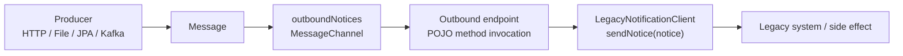
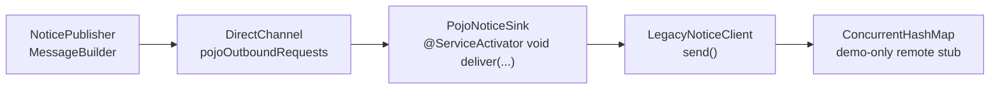
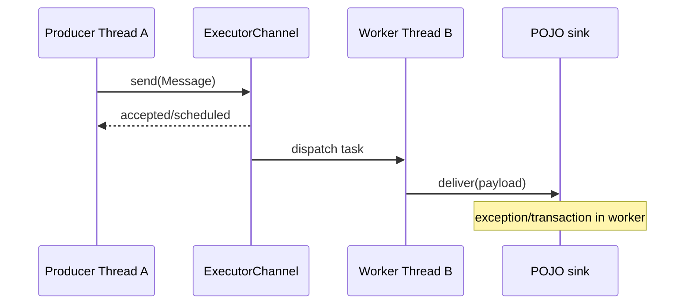
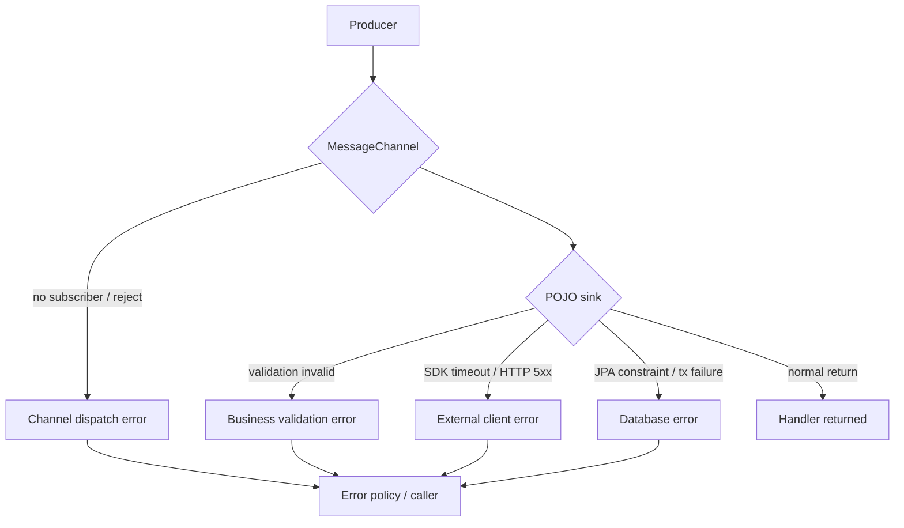
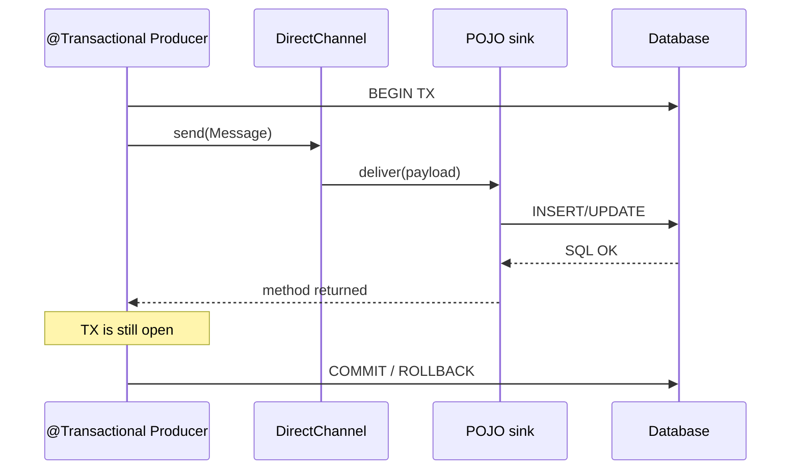
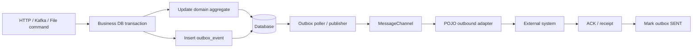

# POJO outbound channel adapter

## 1. Background and objectives

In the **SPRING_INTEGRATION_ADAPTERS** module, applications connect external systems via inbound/outbound adapters, gateways, pollers, and `MessageChannel`. Integration channels can exchange data with files, SFTP, HTTP, JMS, AMQP, Kafka, and databases. However, many applications already have an **ordinary Java bean** to call an internal SDK, write logs/audit records, update a legacy system, or send a notification without expecting response data.

A **POJO outbound channel adapter** connects a `MessageChannel` to a **consuming method** of that Java object. When a message enters the channel, Spring Integration extracts the payload or parts of the message, invokes the configured method, and ends the **one-way** flow.

The **POJO outbound channel adapter** lesson belongs to the **Adapter POJO** chapter. Objectives:

- Explain POJO, `MessageChannel`, message handler, `@ServiceActivator`, and outbound adapter.
- Distinguish **inbound POJO** (a no-argument method polled to create messages) from **outbound POJO** (a method invoked when a message arrives).
- Distinguish a **one-way outbound channel adapter** from a **request–reply gateway/service activator that produces a result**.
- Write a POJO consumer with typed payload, `Message<?>`, or `@Header` parameters.
- Configure via annotations, Java DSL `.handle(pojo, "method")`, and XML `<int:outbound-channel-adapter>`.
- Understand how `DirectChannel`, `ExecutorChannel`, `QueueChannel`, and `PublishSubscribeChannel` affect threading, execution timing, and errors.
- Practice with Spring Boot 3.x, Spring Integration 6.x, and Java 17+ using an `OutboundNotice` data model, a pure Java client, and a `@ServiceActivator` sink.
- Test synchronous invocation, exception propagation, duplicate IDs, and the `void` return contract.
- Know when consumer-side transactions, bounded retries, idempotency, outbox, ACK, and DLQ are needed.
- Avoid confusing `channel.send() == true` with confirmation from a remote API or broker.
- Choose dedicated adapters for HTTP/JMS/AMQP/Kafka/JPA/SFTP when protocol-specific acknowledgments and recovery are required.

**Key takeaway:** A POJO outbound channel adapter is a **message-consuming endpoint**; successfully invoking a method does not automatically provide durable delivery, exactly-once semantics, or an atomic commit with another system.

## 2. What is a POJO outbound channel adapter?

An ordinary POJO:

```java
public class LegacyNotificationClient {

    public void sendNotice(OutboundNotice notice) {
        // Perform side effect on the legacy system.
    }
}
```

If this bean is wired to a channel named `outboundNotices`, messages sent to the channel trigger `sendNotice`:



Spring Integration handles **translating messages into Java method invocations**. The business method does not need to implement `MessageHandler`, does not need to know which source adapter produced the message, and generally does not need to call `MessageChannel.receive()`.

### 2.1. What does "outbound" mean?

**Outbound** is understood from the perspective of a **Spring Integration Flow**: data leaves *the message pipeline* to reach a consuming service, object, or system.

| Endpoint type | Processing direction | Example |
| --- | --- | --- |
| POJO inbound channel adapter | POJO method → Spring Message → channel | `nextEvent()` returns `WorkItem` per poller |
| **POJO outbound channel adapter** | Channel → Spring Message → POJO method | `deliver(OutboundNotice)` performs a side effect |
| Service activator with reply | Channel → method → reply channel | `calculatePrice(cmd)` returns `PriceResult` |
| Messaging gateway (caller) | Java invocation → request message → reply/exception | `pricingGateway.quote(cmd)` |
| HTTP/JMS/Kafka outbound adapter | Channel → protocol-specific handler | HTTP POST, JMS send, Kafka publish |

**Do not misunderstand:** "Outbound" does not mean the method must call a network API. A method writing a local file, updating a counter, or saving an internal audit record can also be an outbound endpoint if it consumes a message and terminates the flow.

### 2.2. Why does the documentation use @ServiceActivator?

In Spring Integration, a **service activator** is the general-purpose endpoint that connects a Spring-managed object to an input channel. A POJO outbound channel adapter is a **one-way** case of this wiring:

- Java annotation: `@ServiceActivator(inputChannel = "...")` on a `void` method.
- Java DSL: `IntegrationFlow.from("...").handle(pojo, "method").get()`.
- XML: `<int:outbound-channel-adapter channel="..." ref="..." method="..."/>`.

If you want the method to return a result for further processing, that is a **request–reply service activator**, no longer *one-way* in business semantics.

### 2.3. An outbound adapter is not a scheduler

With a `SubscribableChannel` such as `DirectChannel`, the outbound method is invoked **when a message is sent to the channel**, not on a fixed schedule.

Only when the input is a `PollableChannel` like `QueueChannel` does the consumer endpoint require a **poller** to pull messages and invoke the method. Do not put `@Poller` on an outbound adapter simply because the inbound POJO lesson always had a poller.

## 3. From Message to POJO method invocation

A Spring Message consists of:

```text
Message<OutboundNotice>
  payload:
    id = "notice-101"
    kind = "STATUS"
    content = "Order approved"
  headers:
    id = ...
    timestamp = ...
    correlationId = "trace-001"
```

The framework decides how to inject arguments based on method parameter types and annotations.

### 3.1. Typed payload method

```java
@ServiceActivator(inputChannel = "outboundNotices")
public void deliver(OutboundNotice notice) {
    legacyClient.sendNotice(notice);
}
```

`OutboundNotice` is extracted from the message payload. The method **does not** need to accept `Message<OutboundNotice>` if it only uses the business object; this option is simple and easy to unit test.

### 3.2. Receiving the full Message<?> when headers are needed

```java
@ServiceActivator(inputChannel = "outboundNotices")
public void deliverMessage(Message<OutboundNotice> message) {
    OutboundNotice notice = message.getPayload();
    Object correlation = message.getHeaders().get("correlationId");

    legacyClient.sendNotice(notice);
}
```

This example is an **alternative configuration**; do not use it concurrently with another handler on a `DirectChannel` if you want every message processed by one specific consumer.

### 3.3. Payload combined with @Header

```java
@ServiceActivator(inputChannel = "outboundNotices")
public void deliver(
        OutboundNotice notice,
        @Header(value = "correlationId", required = false)
        String correlationId) {

    log.info("Delivering notice id={}, trace={}",
            notice.id(), correlationId);

    legacyClient.sendNotice(notice);
}
```

Required imports:

```java
import org.springframework.integration.annotation.ServiceActivator;
import org.springframework.messaging.handler.annotation.Header;
```

`@Header(required=false)` allows a missing header without failing method resolution. For **required** headers, use `required=true` (the default) and verify which producer is responsible for setting the header.

### 3.4. Using @Headers or @Payload

```java
public void consume(
        @Payload OutboundNotice notice,
        @Headers Map<String, Object> headers) {
    // Process payload and framework-supplied metadata.
}
```

Imports:

```java
import org.springframework.messaging.handler.annotation.Headers;
import org.springframework.messaging.handler.annotation.Payload;
```

This is an example of a **POJO method signature**, which becomes an endpoint only when paired with appropriate annotations or wiring. When a method only needs the payload, avoid accepting all headers to reduce coupling.

### 3.5. Avoid ambiguous signatures

A class with multiple overloads:

```java
public void handle(String value) { ... }
public void handle(OutboundNotice value) { ... }
public void handle(Object value) { ... }
```

Spring Integration can select a method based on payload type, annotations, and metadata; however, if the configuration is ambiguous, method resolution errors can occur at runtime.

**Recommendation:** use **explicit method names** like `deliverNotice`, clear typed arguments, and declare one handler per command contract. If you need to dispatch multiple payload types, use a `Router`/`Filter` or separate flows before the POJO sink.

### 3.6. Do not use unverified headers for access control

Headers such as `tenantId`, `actor`, or `sourceSystem` may be supplied by an external producer. An outbound POJO receiving a header does not turn it into an authorized identity. The service must verify the authenticated tenant/ACL before performing sensitive actions, or use a server-verified scoped command DTO.

## 4. One-way semantics: when to use void?

### 4.1. A void method is the natural contract

```java
public void deliver(OutboundNotice notice) {
    legacyClient.sendNotice(notice);
}
```

The method returns no business result. If execution finishes normally, the endpoint completes; if it throws an exception, the error path/transaction policy applies.

**No reply message exists** merely because a void method ran. The following are **not** automatically produced:

- HTTP 200/201 from an external API.
- Kafka broker ACK.
- JMS/AMQP consumer acknowledgment.
- Transaction commit of another database.
- Confirmation that a remote consumer applied the side effect.
- A reply to a `@MessagingGateway` waiting for a result.

### 4.2. What if the method returns a value?

```java
public ReceiptResult deliver(OutboundNotice notice) {
    return legacyClient.sendAndGetReceipt(notice);
}
```

If the goal is **to produce a reply**, configure a service activator with an output channel or use a request–reply `@MessagingGateway` with appropriate timeouts and correlation:

```java
@ServiceActivator(
        inputChannel = "noticeRequests",
        outputChannel = "noticeReplies")
public ReceiptResult deliverWithReply(OutboundNotice notice) {
    return legacyClient.sendAndGetReceipt(notice);
}
```

This is a **hypothetical variant**, not part of the runnable demo; it requires its own `ReceiptResult` class and client API. With a service activator, a non-null result can be sent to the output channel or the `replyChannel` header. To end the flow and discard a reply, `nullChannel` can be used appropriately; however, `void` is best for side effects with no reply.

### 4.3. MessageChannel.send() is not a receipt

```java
boolean accepted = outboundNotices.send(message);
```

With a `DirectChannel` and a synchronous handler, `send` usually returns only after the handler method completes. However:

- If a remote client dispatches a request asynchronously and returns before ACK, `send()` does not wait for that ACK.
- If the channel is an `ExecutorChannel`/`QueueChannel`, `send()` may return as soon as the message is accepted or buffered.
- If an outer transaction has not yet committed, handler return does not mean the DB committed.
- If the consumer fails later, the producer may not receive an exception on its call stack.

Only say "successfully processed" when the business contract defines what point constitutes success (method return, remote ACK, DB commit, durable outbox, etc.).

### 4.4. Clear distinction between a one-way adapter and a Gateway

| Characteristic | One-way POJO outbound | Request–reply gateway |
| --- | --- | --- |
| Sink method | Usually `void` | Returns a result or reply message |
| Goal | Side effect, fire-and-forget per transport semantics | Request → result |
| Reply channel | Not needed | Present or framework creates a temporary one via messaging gateway |
| Result timeout | Not applicable at void method level | Can have a reply timeout |
| Error propagation | Per channel/transaction/thread | Via reply/error path per configuration |
| Examples | Write audit, send notification | Check inventory, fetch pricing calculation |
| When remote is async | Needs separate callback/status/reconciliation | Gateway only waits for a designed reply, cannot automatically wait for arbitrary remote ACKs |

**Design mistake:** sending from a gateway expecting a return value into a void outbound method and waiting indefinitely for a result. If the application needs a response, choose a request–reply contract from the start.

## 5. Choosing between POJO outbound and a dedicated adapter

POJO outbound is suitable when Java code already performs the side effect:

- Calling a custom SDK for an internal service.
- Writing audit logs to an enterprise library.
- Emitting events to a legacy abstraction.
- Writing to an in-process collector.
- Calling another Java service without needing a reply.
- Adapting an API that lacks a Spring Integration adapter.

| Actual requirement | Typically suitable choice |
| --- | --- |
| Send to Kafka with partition/key/producer ACK | Spring Integration Kafka outbound |
| Send to JMS/AMQP with broker-specific transactions/confirms | JMS/AMQP outbound |
| HTTP POST needing status, headers, timeout | HTTP outbound gateway/adapter |
| Write file/SFTP with atomic file/remote session | File/SFTP outbound |
| Persist JPA entity with flush/merge/transaction | JPA outbound adapter/gateway |
| SQL UPDATE with affected row count | JDBC/JPA outbound gateway |
| Legacy POJO SDK with only `sendNotice(Notice)` | **POJO outbound channel adapter** |

A POJO sink can invoke those SDKs, but **must implement all transport-specific guarantees itself** if not using a dedicated adapter. Do not rewrite JMS acknowledgments or Kafka transactions inside a simple `void send(Object)` when the business requires durable guarantees.

## 6. Demo architecture: one-way adapter calling a Java client

### 6.1. Scenario

An application creates an `OutboundNotice` event, sends it into `DirectChannel` `pojoOutboundRequests`, and a POJO consumer `@ServiceActivator` invokes the Java client `LegacyNoticeClient.send(...)`.

To make behavior observable without real network calls, the demo client stores notices in a `ConcurrentHashMap` and throws an error when the content is `"FAIL"`.



Constraints:

1. `OutboundNotice` uses a record with a fixed ID, kind, content, and creation timestamp.
2. `LegacyNoticeClient` is an **ordinary Java bean** that does not implement `MessageHandler`.
3. `PojoNoticeSink` receives the typed payload and calls the client.
4. `NoticePublisher` sends a message with the `correlationId` header.
5. `DirectChannel` invokes the consumer synchronously; errors can propagate.
6. Resending the same ID with the same payload does not create an extra record in the demo; if the ID matches with a different payload, the client reports a conflict.
7. There are no database/broker transactions; "receipts" in `ConcurrentHashMap` are lost on restart.
8. Tests must verify that messages actually flow through the Spring channel rather than only calling the client directly.

### 6.2. Maven dependencies

Use **Java 17+**, Spring Boot 3.x, and Spring Integration 6.x with Spring Boot BOM managing versions:

```xml
<dependencies>
    <dependency>
        <groupId>org.springframework.boot</groupId>
        <artifactId>spring-boot-starter</artifactId>
    </dependency>
    <dependency>
        <groupId>org.springframework.boot</groupId>
        <artifactId>spring-boot-starter-integration</artifactId>
    </dependency>
    <dependency>
        <groupId>org.springframework.boot</groupId>
        <artifactId>spring-boot-starter-test</artifactId>
        <scope>test</scope>
    </dependency>
</dependencies>
```

You do not need `spring-boot-starter-web` or JPA/Kafka dependencies to run the demo. Examples mentioning JPA/brokers in later sections **must not be assumed to be present in this demo**.

### 6.3. Package layout

```text
com.example.pojooutbound
    OutboundNotice.java
    LegacyNoticeClient.java
    PojoNoticeSink.java
    NoticePublisher.java
    PojoOutboundConfiguration.java
    PojoOutboundApplication.java
```

Each code block in the following sections is the content of a Java file in the same package.

## 7. OutboundNotice record: message contract

File `OutboundNotice.java`:

```java
package com.example.pojooutbound;

import java.time.Instant;
import java.util.Objects;

public record OutboundNotice(
        String id,
        String kind,
        String content,
        Instant createdAt) {

    public OutboundNotice {
        Objects.requireNonNull(id, "id");
        Objects.requireNonNull(kind, "kind");
        Objects.requireNonNull(content, "content");
        Objects.requireNonNull(createdAt, "createdAt");

        if (id.isBlank() || id.length() > 80) {
            throw new IllegalArgumentException("Invalid id");
        }
        if (kind.isBlank() || kind.length() > 40) {
            throw new IllegalArgumentException("Invalid kind");
        }
        if (content.isBlank() || content.length() > 500) {
            throw new IllegalArgumentException("Invalid content");
        }
    }
}
```

**Why use a record?**

- Fields are immutable references.
- `String` and `Instant` are both immutable, so the message payload cannot be mutated after sending.
- Provides value-based `equals/hashCode`, useful for demo deduplication.
- No JPA lazy proxies, Hibernate sessions, transaction objects, or raw network clients in the payload.

Here `id` is the **business event ID**, not the framework-generated `MessageHeaders.ID` header. Do not use `MessageHeaders.ID` as an external idempotency key if a message can be recreated during retry/redelivery.

## 8. LegacyNoticeClient: Java POJO performing the side effect

File `LegacyNoticeClient.java`:

```java
package com.example.pojooutbound;

import java.util.concurrent.ConcurrentHashMap;
import java.util.concurrent.ConcurrentMap;
import java.util.concurrent.atomic.AtomicInteger;

import org.springframework.stereotype.Component;

@Component
public class LegacyNoticeClient {

    private final ConcurrentMap<String, OutboundNotice> deliveries =
            new ConcurrentHashMap<>();

    private final AtomicInteger attempts = new AtomicInteger();

    public void send(OutboundNotice notice) {
        attempts.incrementAndGet();

        if ("FAIL".equals(notice.content())) {
            throw new IllegalStateException(
                    "Simulated legacy delivery failure");
        }

        OutboundNotice previous =
                deliveries.putIfAbsent(notice.id(), notice);

        if (previous != null && !previous.equals(notice)) {
            throw new IllegalStateException(
                    "Conflicting payload for same notice ID");
        }
    }

    public boolean hasDelivered(String id) {
        return deliveries.containsKey(id);
    }

    public int deliveredUniqueCount() {
        return deliveries.size();
    }

    public int attempts() {
        return attempts.get();
    }
}
```

This is an **in-memory stub** of an external client:

- The `send` method does not accept a Spring `Message`, only the Java record.
- `attempts` counts invocations, including failures.
- `deliveries` stores successful distinct IDs.
- Same ID + same record is a **simulated replay**; no new entry is added.
- Same ID + different payload is a conflict; the old entry is not overwritten.
- `"FAIL"` throws an error to test exception propagation.
- Everything disappears on app restart; **not a durable inbox, broker ACK, or distributed idempotency**.

If a real client uses HTTP/JMS/Kafka, `send` must obey that protocol's timeout, retry, rate limit, authentication, and response/ACK semantics. Do not treat a void method return as a remote system commit.

## 9. POJO outbound sink using @ServiceActivator

File `PojoNoticeSink.java`:

```java
package com.example.pojooutbound;

import org.slf4j.Logger;
import org.slf4j.LoggerFactory;
import org.springframework.integration.annotation.ServiceActivator;
import org.springframework.messaging.handler.annotation.Header;
import org.springframework.stereotype.Component;

@Component
public class PojoNoticeSink {

    private static final Logger log =
            LoggerFactory.getLogger(PojoNoticeSink.class);

    private final LegacyNoticeClient client;

    public PojoNoticeSink(LegacyNoticeClient client) {
        this.client = client;
    }

    @ServiceActivator(inputChannel = "pojoOutboundRequests")
    public void deliver(
            OutboundNotice notice,
            @Header(
                    value = "correlationId",
                    required = false)
            String correlationId) {

        log.info("Deliver notice id={}, type={}, trace={}",
                notice.id(), notice.kind(), correlationId);

        client.send(notice);
    }
}
```

### 9.1. Why is this a POJO outbound channel adapter?

- `@Component` manages the bean.
- `@ServiceActivator(inputChannel="pojoOutboundRequests")` creates an endpoint that **consumes** messages from the channel.
- The `deliver` method is **void**, so it produces no business reply.
- `OutboundNotice` is injected by the framework from the message payload.
- `@Header(required=false)` extracts the correlation header if present.
- The actual side effect lives in the POJO client `send(OutboundNotice)`.
- `PojoNoticeSink` does not need to implement `MessageHandler` or call `channel.receive()`.

The Spring Integration reference identifies `@ServiceActivator` as the Java configuration style for a POJO outbound channel adapter. Using `@OutboundChannelAdapter` would be the **wrong API**: there is no equivalent standard Spring Integration annotation used that way for this consumer. The adapter name indicates the consumption direction; the proper annotation is `@ServiceActivator`.

### 9.2. Why not add @Poller?

`pojoOutboundRequests` in the demo is a `DirectChannel`, i.e., a **SubscribableChannel**. When the producer calls `send`, the handler runs synchronously right away without waiting for a poller. `@Poller` is only needed if the outbound consumer's input channel is a `PollableChannel`, such as `QueueChannel`.

### 9.3. What if you want a Java object with zero integration annotations?

`LegacyNoticeClient` is pure business Java; it only has `@Component` for Spring injection and imports nothing from Spring Integration. With Java DSL or XML, you can wire it directly:

```java
.handle(legacyNoticeClient, "send")
```

That is also a **POJO outbound channel adapter**, without needing `PojoNoticeSink`. In the annotation demo, the sink acts as a bridge for header logging and method dispatch.

## 10. Declaring DirectChannel and the producer

### 10.1. Spring configuration

File `PojoOutboundConfiguration.java`:

```java
package com.example.pojooutbound;

import org.springframework.context.annotation.Bean;
import org.springframework.context.annotation.Configuration;
import org.springframework.integration.channel.DirectChannel;
import org.springframework.integration.config.EnableIntegration;
import org.springframework.messaging.MessageChannel;

@Configuration
@EnableIntegration
public class PojoOutboundConfiguration {

    @Bean
    MessageChannel pojoOutboundRequests() {
        return new DirectChannel();
    }
}
```

The bean name `pojoOutboundRequests` matches `inputChannel` on `PojoNoticeSink`. Do not create two beans with the same name or register multiple competing handlers accidentally.

### 10.2. Producer sending to MessageChannel

File `NoticePublisher.java`:

```java
package com.example.pojooutbound;

import java.util.Objects;

import org.springframework.beans.factory.annotation.Qualifier;
import org.springframework.messaging.MessageChannel;
import org.springframework.messaging.support.MessageBuilder;
import org.springframework.stereotype.Component;

@Component
public class NoticePublisher {

    private final MessageChannel outboundChannel;

    public NoticePublisher(
            @Qualifier("pojoOutboundRequests")
            MessageChannel outboundChannel) {
        this.outboundChannel = outboundChannel;
    }

    public void publish(OutboundNotice notice) {
        Objects.requireNonNull(notice, "notice");

        boolean accepted = outboundChannel.send(
                MessageBuilder.withPayload(notice)
                        .setHeader("correlationId", notice.id())
                        .build());

        if (!accepted) {
            throw new IllegalStateException(
                    "Outbound channel did not accept message");
        }
    }
}
```

**Important:** `publish()` is only an API to send into the Spring channel. Because the current channel is a `DirectChannel` and the sink handles synchronously, the method returns normally after the handler finishes. However, do not name it `publishAndWaitForRemoteAck()` when a real client does not guarantee waiting for ACK; if switched to an async channel, the contract becomes "accepted", not "processed".

### 10.3. Runnable application

File `PojoOutboundApplication.java`:

```java
package com.example.pojooutbound;

import java.time.Instant;

import org.springframework.boot.CommandLineRunner;
import org.springframework.boot.SpringApplication;
import org.springframework.boot.autoconfigure.SpringBootApplication;
import org.springframework.context.annotation.Bean;

@SpringBootApplication
public class PojoOutboundApplication {

    public static void main(String[] args) {
        SpringApplication.run(
                PojoOutboundApplication.class, args);
    }

    @Bean
    CommandLineRunner demo(
            NoticePublisher publisher,
            LegacyNoticeClient client) {

        return args -> {
            publisher.publish(new OutboundNotice(
                    "notice-101",
                    "STATUS",
                    "Order approved",
                    Instant.now()));

            publisher.publish(new OutboundNotice(
                    "notice-102",
                    "AUDIT",
                    "Action recorded",
                    Instant.now()));

            System.out.println(
                    "Unique notices: "
                            + client.deliveredUniqueCount());
        };
    }
}
```

File `application.properties`:

```properties
spring.main.web-application-type=none
logging.level.org.springframework.integration=INFO
logging.level.com.example.pojooutbound=INFO
```

Illustrative log and output example:

```text
Deliver notice id=notice-101, type=STATUS, trace=notice-101
Deliver notice id=notice-102, type=AUDIT, trace=notice-102
Unique notices: 2
```

There is no database or remote broker in the demo, so the count `2` is merely the number of records stored in the Java stub. Do not infer durability or delivery guarantees from this output.

### 10.4. Do not create two outbound consumers for the same DirectChannel

If you add Java DSL `.handle(client, "send")` **while keeping `@ServiceActivator` on `PojoNoticeSink`**, `DirectChannel` can have two subscribers and pick one subscriber per message according to its dispatch/load-balancing policy. You might see half the messages logged at the sink and the other half going directly to the client.

**This is not broadcast.** Enable only **one adapter configuration** when working with the same output channel. If you want multiple subscribers to each receive an event, use `PublishSubscribeChannel` and explicitly design failure and concurrency semantics.

## 11. Unit testing the POJO client and the one-way contract

### 11.1. Client tests without a Spring context

Because `LegacyNoticeClient` is an in-memory stateful Java class, its logic can be tested independently:

File `LegacyNoticeClientTest.java`:

```java
package com.example.pojooutbound;

import static org.assertj.core.api.Assertions.assertThat;
import static org.assertj.core.api.Assertions.assertThatThrownBy;

import java.time.Instant;

import org.junit.jupiter.api.Test;

class LegacyNoticeClientTest {

    @Test
    void recordsFirstDelivery() {
        LegacyNoticeClient client = new LegacyNoticeClient();

        OutboundNotice notice = new OutboundNotice(
                "unit-101", "AUDIT", "Accepted", Instant.now());

        client.send(notice);

        assertThat(client.hasDelivered("unit-101")).isTrue();
        assertThat(client.deliveredUniqueCount()).isEqualTo(1);
        assertThat(client.attempts()).isEqualTo(1);
    }

    @Test
    void exactReplayDoesNotCreateAnotherStoredEntry() {
        LegacyNoticeClient client = new LegacyNoticeClient();

        OutboundNotice notice = new OutboundNotice(
                "unit-102", "AUDIT", "Accepted", Instant.now());

        client.send(notice);
        client.send(notice);

        assertThat(client.deliveredUniqueCount()).isEqualTo(1);
        assertThat(client.attempts()).isEqualTo(2);
    }

    @Test
    void conflictingReplayIsRejected() {
        LegacyNoticeClient client = new LegacyNoticeClient();

        Instant timestamp = Instant.now();

        client.send(new OutboundNotice(
                "unit-103", "STATUS", "Accepted", timestamp));

        assertThatThrownBy(() ->
                client.send(new OutboundNotice(
                        "unit-103", "STATUS",
                        "Different content", timestamp)))
                .isInstanceOf(IllegalStateException.class);

        assertThat(client.deliveredUniqueCount()).isEqualTo(1);
    }

    @Test
    void simulatedFailureHasNoStoredDelivery() {
        LegacyNoticeClient client = new LegacyNoticeClient();

        assertThatThrownBy(() ->
                client.send(new OutboundNotice(
                        "unit-104", "TEST", "FAIL",
                        Instant.now())))
                .isInstanceOf(IllegalStateException.class);

        assertThat(client.hasDelivered("unit-104")).isFalse();
    }
}
```

These tests only prove the Java method handles logic correctly; **they do not prove `@ServiceActivator` was registered by Spring** or that channel dispatch works properly.

### 11.2. What unit tests cannot conclude

- They do not verify bean scanning or annotation processing.
- They do not verify `DirectChannel`/`QueueChannel` semantics.
- They do not verify Spring Messaging exception mapping.
- There are no real transactions or remote ACKs.
- They do not verify whether the producer sends the right payload and headers.
- They do not verify event recovery after a process restart.

A real integration test with an ApplicationContext is required to evaluate the full flow.

## 12. @SpringBootTest: producer → channel → POJO sink

File `PojoOutboundIntegrationTest.java`:

```java
package com.example.pojooutbound;

import static org.assertj.core.api.Assertions.assertThat;
import static org.assertj.core.api.Assertions.assertThatThrownBy;

import java.time.Instant;
import java.util.UUID;

import org.junit.jupiter.api.Test;
import org.springframework.beans.factory.annotation.Autowired;
import org.springframework.boot.test.context.SpringBootTest;

@SpringBootTest
class PojoOutboundIntegrationTest {

    @Autowired
    NoticePublisher publisher;

    @Autowired
    LegacyNoticeClient client;

    @Test
    void invokesPojoConsumerSynchronously() {
        String id = "integration-" + UUID.randomUUID();

        publisher.publish(new OutboundNotice(
                id, "STATUS", "Ready", Instant.now()));

        // With DirectChannel + synchronous handler,
        // client.send() has returned by the time publisher.publish() returns.
        assertThat(client.hasDelivered(id)).isTrue();
    }

    @Test
    void exactReplayDoesNotCreateAnotherRecord() {
        String id = "replay-" + UUID.randomUUID();

        OutboundNotice notice = new OutboundNotice(
                id, "AUDIT", "Accepted", Instant.now());

        publisher.publish(notice);
        publisher.publish(notice);

        assertThat(client.hasDelivered(id)).isTrue();
    }

    @Test
    void downstreamFailurePropagatesOnDirectChannel() {
        String id = "failure-" + UUID.randomUUID();

        assertThatThrownBy(() ->
                publisher.publish(new OutboundNotice(
                        id, "TEST", "FAIL", Instant.now())))
                .isInstanceOf(RuntimeException.class);

        assertThat(client.hasDelivered(id)).isFalse();
    }

    @Test
    void cannotOverwriteSameIdWithDifferentPayload() {
        String id = "conflict-" + UUID.randomUUID();
        Instant timestamp = Instant.now();

        publisher.publish(new OutboundNotice(
                id, "STATUS", "First", timestamp));

        assertThatThrownBy(() ->
                publisher.publish(new OutboundNotice(
                        id, "STATUS", "Second", timestamp)))
                .isInstanceOf(RuntimeException.class);

        assertThat(client.hasDelivered(id)).isTrue();
    }
}
```

**Note on exceptions:** on a `DirectChannel`, exceptions from a POJO sink may be wrapped by the framework in a `MessagingException`/`MessageHandlingException` (depending on endpoint and version). The test asserts `RuntimeException` per the general contract without locking to a wrapper class unnecessarily.

**Note on test state:** each test uses a `UUID` ID so it does not collide with `CommandLineRunner` seed data. `LegacyNoticeClient` is a singleton in the context, so do not assert absolute counts of 0 or 1 across the suite when tests may execute in any order.

### 12.1. Why can the test assert immediately?

Because the demo uses `DirectChannel`: `publisher.publish(...)` invokes the handler synchronously. When switched to `ExecutorChannel` or `QueueChannel`, asserting immediately after `publish` is no longer valid; you must use eventual assertions with a finite timeout, or a barrier/observable event from the consumer.

### 12.2. Using tests to verify the header contract

If you want to verify `correlationId` is correct, you can add a test-only collector in `PojoNoticeSink` or write a unit test calling the method with a header argument. Do not add a second consumer to the same `DirectChannel` expecting it to **also** receive the message for inspection: `DirectChannel` does not broadcast.

A unit test example for header mapping would call `sink.deliver(notice, "trace-123")` to verify logging/delegation; however, only an integration test over the message channel proves Spring binds `@Header` properly. When exact assertions are needed, use a client/spy that can observe correlation metadata or Spring Integration testing facilities.

## 13. Java DSL .handle(pojo, "method")

In a Java-configured codebase, you can wire a POJO method to a channel **without adding `@ServiceActivator` to the method**.

### 13.1. Flow calling the Java client directly

**Alternative configuration** to `PojoNoticeSink` in section 9:

```java
package com.example.pojooutbound;

import org.springframework.context.annotation.Bean;
import org.springframework.context.annotation.Configuration;
import org.springframework.integration.dsl.IntegrationFlow;

@Configuration
public class PurePojoOutboundFlowConfiguration {

    @Bean
    IntegrationFlow purePojoOutboundFlow(
            LegacyNoticeClient legacyNoticeClient) {

        return IntegrationFlow
                .from("pojoOutboundRequests")
                .handle(legacyNoticeClient, "send")
                .get();
    }
}
```

**Steps when switching from the annotation demo to Java DSL:**

1. Keep `OutboundNotice`, `LegacyNoticeClient`, `NoticePublisher`, `DirectChannel`, and Application.
2. **Remove `@ServiceActivator` from `PojoNoticeSink`** or exclude the sink bean from component scanning.
3. Register `PurePojoOutboundFlowConfiguration`.
4. Ensure only **one** consumer exists on `pojoOutboundRequests` if every message should invoke one specific client.
5. `LegacyNoticeClient.send(OutboundNotice)` stays pure Java; Spring Integration creates a message handler backed by a method-invoking adapter.

This matches the exact Java DSL pattern in the official documentation:

```java
IntegrationFlow.from("inputChannel")
        .handle(myPojo, "handle")
        .get();
```

### 13.2. .handle(pojo, "method") vs. .handle(MessageHandler)

In Java DSL:

```java
.handle(legacyNoticeClient, "send")
```

asks the framework to invoke an ordinary Java method. Meanwhile:

```java
.handle((MessageHandler) message -> {
    // Handle Spring Message directly.
})
```

provides a `MessageHandler` that already knows the messaging contract.

Both consume messages; the **POJO option** is useful when you want to keep business classes independent of Spring Messaging.

### 13.3. .handle with GenericHandler

Another alternative flow:

```java
@Bean
IntegrationFlow explicitHandlerFlow(
        LegacyNoticeClient client) {

    return IntegrationFlow
            .from("pojoOutboundRequests")
            .handle(
                    OutboundNotice.class,
                    (notice, headers) -> {
                        client.send(notice);
                        return null;
                    })
            .get();
}
```

This is a `GenericHandler` lambda: `return null` means no reply is created. It is equivalent in terms of ending the flow, though not a pure **method-invoking POJO adapter** because the logic lives inside an Integration DSL lambda.

Choose `.handle(client, "send")` when the goal is reusing an existing POJO method. Choose the lambda when you need quick payload/header adjustments while keeping code easy to test.

### 13.4. A flow can preprocess before calling outbound

```java
@Bean
IntegrationFlow validatedOutboundFlow(
        LegacyNoticeClient client) {

    return IntegrationFlow
            .from("validatedOutboundRequests")
            .filter(
                    OutboundNotice.class,
                    notice -> !notice.content().isBlank())
            .handle(client, "send")
            .get();
}
```

`validatedOutboundRequests` needs its own channel/source/producer if run; the example does not directly replace the demo's `pojoOutboundRequests` bean. `filter` drops messages failing the predicate, so decide whether to route discarded/errored messages to another channel to avoid losing business data.

**Do not treat a filter as authorization**: if a client is not allowed to send notices to another tenant, authorization must verify identity, permissions, and resource scope.

### 13.5. Do not enable multiple configurations at once

The `@ServiceActivator` annotation, DSL `.handle(client, "send")`, and XML `<int:outbound-channel-adapter>` are **alternatives**. When learning, enable only one configuration at a time to verify exact semantics without multiple consumers silently competing on a `DirectChannel`.

## 14. XML <int:outbound-channel-adapter>

### 14.1. ref/method configuration

Spring Integration's XML namespace has a dedicated element for POJO outbound:

```xml
<int:channel id="pojoOutboundRequests"/>

<beans:bean
        id="legacyNoticeClient"
        class="com.example.pojooutbound.LegacyNoticeClient"/>

<int:outbound-channel-adapter
        id="pojoNoticeOutbound"
        channel="pojoOutboundRequests"
        ref="legacyNoticeClient"
        method="send"/>
```

This is an **XML fragment**. An XML-driven application requires a root `beans` element, appropriate `int`/`beans` namespaces/schemas, and proper component wiring. When using the XML variant, **do not** simultaneously register `LegacyNoticeClient` via `@Component` with the same bean name unless intended. Also remove the annotated `PojoNoticeSink` consumer so there are not two handlers.

### 14.2. ref + method enables POJO reuse

- `ref` points to the Spring bean.
- `method` specifies the method invoked when a message enters the channel.
- `channel` specifies the input message channel.
- `id` is the endpoint identity for management/lifecycle.
- `send(OutboundNotice)` is a void method accepting a typed payload.

You **do not need** to modify `LegacyNoticeClient` to import Spring Messaging or implement any special interface.

### 14.3. Inner bean instead of ref

If the POJO is used in only one place:

```xml
<int:outbound-channel-adapter
        id="inlineNoticeOutbound"
        channel="pojoOutboundRequests"
        method="send">

    <beans:bean
            class="com.example.pojooutbound.LegacyNoticeClient"/>
</int:outbound-channel-adapter>
```

**Do not use both `ref` and an inner `<bean>` in the same `outbound-channel-adapter`**, as that configuration is ambiguous and rejected by the framework per the documentation.

### 14.4. channel can be omitted if id is present

Per Spring Integration XML channel adapter conventions, if `channel` is omitted, the framework can implicitly create a `DirectChannel` named after the adapter's `id`. However, declaring the channel **explicitly** is usually clearer and easier to control, especially when adding monitoring, transaction advice, or switching to a queue.

### 14.5. Expression-based outbound adapter

Another variant uses a SpEL expression to invoke a bean method:

```xml
<int:outbound-channel-adapter
        id="expressionNoticeOutbound"
        channel="pojoOutboundRequests"
        expression="@legacyNoticeClient.send(payload)"/>
```

This is an **alternative** to `ref/method`; do not enable both concurrently. An outbound expression should correspond to a side-effecting call that **produces no reply**. Here `payload` is the payload of an **existing message** (unlike a POJO inbound source polled when there is no input message).

The SpEL expression must be developer-controlled configuration—**never** accept arbitrary expression text from an HTTP client or broker message.

### 14.6. Java DSL, annotation, and XML: which to choose?

| Approach | Strengths | Caveats |
| --- | --- | --- |
| `@ServiceActivator` | Very concise, close to POJO consumer | Consumer carries Spring Integration annotation |
| DSL `.handle(bean, "method")` | Keeps business bean decoupled from framework | Must manage a single flow handler |
| XML `ref/method` | Fits legacy codebases, rewire without editing class | Must declare namespaces and bean names accurately |
| DSL `GenericHandler` lambda | Flexible payload + headers handling | Logic may couple into flow configuration |
| Custom `MessageHandler` | Direct control over messaging | Higher framework coupling |

## 15. QueueChannel: outbound consumer needs a poller

### 15.1. DirectChannel and QueueChannel differ

With `DirectChannel`:

```text
Producer send()
    → POJO outbound handler runs synchronously
    → producer returns or receives exception
```

With `QueueChannel`:

```text
Producer send()
    → QueueChannel buffer
    → Producer can return
                  ...
    → PollingConsumer scheduled receive()
    → POJO outbound handler
```

Therefore, **`@Poller` on a POJO outbound consumer is only needed when the input channel is a PollableChannel**; it has no role pulling data from the POJO itself as in the inbound lesson.

### 15.2. Java annotation + QueueChannel

**Alternative variant** to the `DirectChannel` demo:

```java
@Bean
MessageChannel pojoOutboundRequests() {
    return new QueueChannel(128);
}
```

Then on the consumer:

```java
@ServiceActivator(
        inputChannel = "pojoOutboundRequests",
        poller = @Poller(
                fixedDelay = "500",
                maxMessagesPerPoll = "5"))
public void deliver(OutboundNotice notice) {
    client.send(notice);
}
```

Requires imports for `QueueChannel` and `@Poller`. Do not keep a `DirectChannel` bean with the same name in the context when enabling `QueueChannel`. A `QueueChannel(128)` configured this way is a bounded **in-memory buffer**; it is not durable across app restarts.

### 15.3. maxMessagesPerPoll counts Messages received from the queue

If the queue holds 20 messages and `maxMessagesPerPoll="5"`, one polling cycle pulls at most 5 messages (barring errors/timeouts/concurrency changes). **Do not** interpret that as the total number of business records if each message payload contains a `List`.

Default `maxMessagesPerPoll` values can differ across polling endpoint types, so configure an explicit value to avoid confusion when moving from `SourcePollingChannelAdapter` to `PollingConsumer`.

### 15.4. XML poller for PollableChannel

```xml
<int:queue
        id="pojoOutboundRequests"
        capacity="128"/>

<int:outbound-channel-adapter
        id="queuedPojoOutbound"
        channel="pojoOutboundRequests"
        ref="legacyNoticeClient"
        method="send">

    <int:poller
            fixed-delay="500"
            max-messages-per-poll="5"/>
</int:outbound-channel-adapter>
```

This is an XML alternative; do not enable alongside annotation/DSL consumers. With `DirectChannel`, no `<int:poller>` is needed.

### 15.5. Failure after dequeuing from the queue

Once a consumer pulls a message from an **in-memory QueueChannel**, if `client.send(...)` throws an exception:

- There is no default durable redelivery.
- There is no default rollback of removing the message from the queue.
- A DB transaction in the handler does not make `QueueChannel` restore the message.
- The poller/error handler may report the error, yet items can be lost if the process crashes.

If durable replay is required, use a persistent `MessageStore` with proper transaction semantics or a broker adapter with ACK/retry, paired with consumer idempotency. Do not treat a plain `QueueChannel` as a durable work queue.

### 15.6. Receive timeout is not remote timeout

A poller reading a `QueueChannel` may specify `receiveTimeout` when no message is available. However, once a message is received, `LegacyNoticeClient.send(...)` can block on network I/O. Configure timeouts on the underlying SDK/HTTP/JDBC client; `receiveTimeout` does not cap side-effect duration.

## 16. ExecutorChannel and PublishSubscribeChannel

### 16.1. ExecutorChannel hands off to a worker thread



- The producer can return before the handler runs.
- Handler exceptions may not propagate back onto the producer's call stack.
- Thread-bound transaction/security/request contexts of the producer **do not automatically travel with the Message**.
- The worker pool/queue can saturate or reject tasks.
- If a result is required, design a gateway/reply/correlation mechanism rather than waiting on a void method.

### 16.2. Using a bounded executor

An **alternative configuration** example; do not enable alongside the existing `DirectChannel` bean of the same name:

```java
@Bean
ThreadPoolTaskExecutor outboundExecutor() {
    ThreadPoolTaskExecutor executor = new ThreadPoolTaskExecutor();
    executor.setCorePoolSize(2);
    executor.setMaxPoolSize(4);
    executor.setQueueCapacity(64);
    executor.setThreadNamePrefix("pojo-outbound-");
    return executor;
}

@Bean
MessageChannel pojoOutboundRequests(
        ThreadPoolTaskExecutor outboundExecutor) {
    return new ExecutorChannel(outboundExecutor);
}
```

Spring manages the lifecycle/initialization of `ThreadPoolTaskExecutor` as a bean. Requires imports for `ThreadPoolTaskExecutor`, `ExecutorChannel`, `MessageChannel`, and `@Bean`.

With a bounded executor, there must be a **rejection/backpressure policy** at the producer. A successful `send()` may only prove the task was scheduled, **not** that remote delivery succeeded.

### 16.3. PublishSubscribeChannel is not DirectChannel

If multiple side effects (audit + notification) must process the same message:

```text
PublishSubscribeChannel
    ├─ Audit POJO outbound
    └─ Notification POJO outbound
```

With a synchronous `PublishSubscribeChannel`, subscribers are usually invoked on the sending thread; an exception may affect other subscribers depending on configuration. With an executor, subscribers can run concurrently; errors, transactions, and shared mutable payloads must be designed explicitly.

**Do not** switch `DirectChannel` to `PublishSubscribeChannel` assuming "an event must succeed in both consumers" is automatically atomic. Two side effects do not share a transaction by default, especially when calling external systems.

### 16.4. A message payload can be mutated

If a mutable Java object is sent to multiple subscribers, subscribers can modify its fields concurrently:

```java
class MutableNotice {
    String status;
}
```

With async fan-out, this creates data races. Use immutable records/DTOs, `List.copyOf` for collections, and have each consumer manage its own state.

## 17. Exception propagation and error channels

### 17.1. Where failures can occur



A `@ServiceActivator` method can throw unchecked exceptions. The framework may wrap exceptions in `MessagingException`/`MessageHandlingException`, especially when the adapter attaches the failed message context.

### 17.2. DirectChannel: synchronous failure

In the demo:

```java
publisher.publish(new OutboundNotice(
        "notice-bad", "TEST", "FAIL", Instant.now()));
```

`LegacyNoticeClient.send` throws `IllegalStateException`, the POJO sink does not catch it, so the producer calling `DirectChannel.send` receives the exception on the synchronous call path. Do not turn errors into business successes.

### 17.3. Async error handling

With `ExecutorChannel` or a polling consumer reading a `QueueChannel`, errors can arise on a worker/poller thread and be routed to an `ErrorMessage`/`errorChannel` per configuration. An error handler can receive the `Throwable` and failed message details:

```java
@ServiceActivator(inputChannel = "pojoOutboundErrors")
public void reportOutboundError(ErrorMessage error) {
    Throwable failure = error.getPayload();
    // Log sanitized category, correlation ID, retry policy.
}
```

This is a **fragment**; you must declare the `MessageChannel pojoOutboundErrors` bean, imports, and error publisher/poller/executor configuration matching your topology. **There is no guarantee** that merely creating a channel with this name will automatically route every exception from every async executor to it.

### 17.4. An error channel is not a durable DLQ

An `ErrorMessage` is a Spring Message describing a failure. It does not automatically:

- Requeue a message already pulled from `QueueChannel`.
- Roll back an HTTP request already sent.
- Undo a successful Kafka publish.
- ACK/NACK a JMS session per business policy.
- Persist items into durable dead-letter storage.
- Prevent downstream duplicate processing.

When a DLQ/quarantine is needed, design **durable storage + retry count + error classification + operations**. An error channel can serve as the entry point to an error-handling flow, not as a substitute for durable lifecycle management.

### 17.5. What if you want to retry the method call?

Only retry after distinguishing:

- **Transient:** timeout before response, temporary connection drop, DB lock timeout.
- **Permanent:** validation error, invalid tenant, unsupported payload.
- **Unknown outcome:** request was sent, but response/ACK was lost.
- **Duplicate:** same event ID already committed previously, or with a different payload.
- **Conflict:** same business key with incompatible data.

A timeout error does not prove the external system **did not** process the request. Blindly retrying a non-idempotent operation can cause double charges or duplicate notifications. Use idempotency keys and reconciliation whenever possible.

## 18. Transaction boundaries: why @Transactional is not enough

### 18.1. DirectChannel can share the caller's transaction



If the producer and a JPA consumer run on the same `DirectChannel` thread, `@Transactional` on the producer **can** encompass the handler when invoked properly through a proxy with the same transaction manager.

However, that does not mean:

- An external HTTP/Kafka call will roll back alongside the DB.
- Handler return means the DB has already committed.
- Context will cross `ExecutorChannel` or `QueueChannel`.
- `@Transactional` on a self-invoked method takes effect by default.

### 18.2. Transaction inside the sink's business service

For a DB writer, a common pattern is:

```java
@Component
public class DatabaseOutboundSink {

    private final TransactionalNoticeService service;

    public DatabaseOutboundSink(
            TransactionalNoticeService service) {
        this.service = service;
    }

    @ServiceActivator(inputChannel = "dbNoticeRequests")
    public void deliver(OutboundNotice notice) {
        service.storeNotice(notice);
    }
}
```

In a separate bean:

```java
@Service
public class TransactionalNoticeService {

    @Transactional
    public void storeNotice(OutboundNotice notice) {
        // repository.save(...), validate, update outbox...
        // Repository/entity classes are an extension
        // to define in an application with a database.
    }
}
```

This is an **architectural pattern**, not a standalone runnable JPA module inside the database-free demo. `DatabaseOutboundSink` receives a message and calls a Spring transactional service proxy, giving clearer boundaries than annotating a method and self-invoking within the same bean.

### 18.3. Flush differs from commit

If the handler uses Hibernate/JPA:

```java
repository.save(entity);
entityManager.flush();
```

`flush` can send INSERT/UPDATE statements to the DB without **committing**. Constraint errors may surface at `flush` or `commit`, depending on the provider/DB. Do not emit an external "saved" event before the transaction proxy commits successfully if that is the business contract.

### 18.4. Rollback does not undo external side effects

```text
BEGIN DB TX
  INSERT payment
  POJO sink calls externalClient.send(...)
  Remote API completes
  DB COMMIT fails
ROLLBACK DB
```

The remote API **does not automatically undo** just because the DB rolled back. A Java method call inside `@Transactional` does not put external non-DB side effects under the transaction manager's control.

When you need atomic business state + intent to send a message, consider a transactional outbox. If the external system supports idempotency keys, use a stable event ID and reconcile after unknown outcomes.

### 18.5. Consumer-side transactions with Queue/Executor

```text
Producer TX Thread A
  → Queue/Executor
Consumer Thread B
  → service @Transactional
  → DB write
```

Producer transactions do not automatically cross thread boundaries. The consumer must open its own transaction; the producer may already have returned/ACKed before the consumer fails. An in-memory `QueueChannel` does not replace broker transactions, and `ExecutorChannel` does not replace a durable work queue.

## 19. Idempotency and duplicate processing

### 19.1. Delivery attempts are not unique deliveries

A message may be redelivered due to:

- Producer retry after timeout.
- Kafka/JMS redelivery.
- HTTP client retry.
- SFTP file re-scan.
- Outbox publisher crashing after publish but before marking SENT.
- User clicking a button twice.
- Two workers claiming the same work item.

In the demo:

```text
client.attempts() = 3
client.deliveredUniqueCount() = 1
```

is completely valid when the same notice is sent 3 times and the stub recognizes exact replays. **Do not equate one method call with one distinct business effect.**

### 19.2. Stable event ID

`OutboundNotice.id()` is created once by the producer for the business event. When retrying that same event, **keep the same event ID**—do not generate a new UUID on every attempt. Generating a new ID prevents downstream from distinguishing a retry from a brand-new notice.

### 19.3. Same ID with a different payload must be a conflict

The demo stub calls:

```java
deliveries.putIfAbsent(notice.id(), notice);
```

and compares record `equals` when the key already exists. Production systems typically use a durable table:

```text
event_id UNIQUE
canonical_payload_hash
status = PROCESSING | COMPLETED | FAILED
processed_at
external_receipt_id
```

When receiving a duplicate:

1. Compare event ID and payload hash.
2. If exact and completed, return the prior outcome per policy.
3. If same ID with different payload, raise conflict/audit.
4. If processing/unknown, reconcile or perform bounded retry.
5. Never swallow all UNIQUE violations and report success.

### 19.4. Atomic idempotency in the database

Do not rely on:

```java
if (!repository.existsById(eventId)) {
    repository.save(event);
}
```

as the sole mechanism: two workers can both observe `false`. Use a unique constraint / atomic insert/claim and handle duplicates after transaction rollback in a new transaction.

### 19.5. Durable side effects are part of the receiver's contract

If a remote SDK does not provide idempotency, saving the event ID in the app before calling the external API still leaves failure windows. For example:

```text
DB records "sent"
  → app crashes before external send
  → notification can be lost

External send succeeds
  → app crashes before DB marks DONE
  → may resend and duplicate
```

You must choose an outbox, a remote idempotency key, reconciliation, or accept at-least-once semantics per business rules. **End-to-end exactly-once** is not an automatic feature of a POJO outbound adapter.

## 20. Transactional outbox: DB commit and outbound POJO

When an outbound message originates from a database update, an outbox prevents losing the **intent to send**.

### 20.1. Architectural pattern



Flow:

1. Authenticate and validate the business command.
2. Within **one DB transaction**, update domain state and INSERT the outbox record.
3. Commit.
4. Publisher polls/claims outbox rows in a separate transaction.
5. Build `Message<OutboundNotice>` with a stable `eventId`.
6. POJO sink invokes the external client per timeout/idempotency policy.
7. If there is a remote ACK, mark outbox SENT **after ACK per contract**.
8. If a crash happens after ACK but before marking SENT, it may be resent; the remote side needs idempotency or reconciliation.

### 20.2. Why not treat handler return as ACK?

An SDK might implement:

```java
public void send(OutboundNotice notice) {
    asyncClient.submit(notice); // only enqueues internally
}
```

A void method return only indicates the SDK accepted the request into its buffer, **not that the remote system received it**. If the outbox publisher marks SENT at this moment, the notice can be lost if the client process crashes.

With an async SDK, use callbacks/`Future`/completion stages, timeouts, and properly timed state transitions. A one-way POJO adapter can be upgraded to an outbound gateway/async flow if the business needs to observe completion.

### 20.3. Separating responsibilities

| Component | Responsibility |
| --- | --- |
| Business service | Update domain + insert outbox record in DB transaction |
| Outbox publisher | Durably poll/claim/retry events |
| POJO outbound adapter | Invoke client method per contract |
| External client | Network/SDK communication, timeouts, ACK mapping |
| External consumer | Idempotent application, accurate ACK |
| Outcome tracker | Mark SENT/RETRYABLE/FAILED and audit |
| Error flow | Bounded retry, DLQ/quarantine, alerting |

Do not cram all responsibilities into a single `void deliver(OutboundNotice)` method.

## 21. Security, multi-tenancy, and message contracts

### 21.1. POJO outbound does not authenticate callers automatically

`@ServiceActivator` receives a Spring Message from a channel. The message could originate from HTTP, file, SFTP, JMS, Kafka, or another Java component. A message reaching the channel **does not prove** the producer is authorized to call the remote service or write data for the specified tenant.

Separate clearly:

1. Authenticate the actor/source at the inbound boundary.
2. Check the actor's permissions for the tenant/resource.
3. Create a typed command containing only permitted fields.
4. Set scope server-side; do not trust a client-supplied `tenantId` header.
5. Use server-side credentials for the external SDK; do not pass arbitrary access tokens in payloads.
6. Enforce an allowlist of destinations/event types.
7. Configure quotas/rate limits, timeouts, and auditing.

### 21.2. Do not expose bean/method/SpEL selection

**Never** accept JSON like:

```json
{
  "bean": "someBean",
  "method": "deleteAll",
  "arguments": ["TENANT-B"]
}
```

and let clients pick beans, methods, or SpEL expressions for the framework to invoke. Method names in XML/DSL are **developer-controlled configuration**. If multiple command types are needed, use a router, DTOs, and explicit service authorization.

### 21.3. Do not send JPA entities/proxies directly

```text
Message<ManagedJpaEntity>
    → ExecutorChannel
    → POJO outbound serializer
    → LazyInitializationException / PII leak
```

JPA entities can carry lazy associations, mutable state, and internal fields. Across thread, process, or network boundaries, use immutable DTOs/IDs and map fields inside an appropriate transaction.

### 21.4. Headers are not an ACL

`correlationId`, `sourceSystem`, and `tenantId` aid tracing/routing, yet if copied from an untrusted producer, downstream must verify them. A header named `authenticatedTenant` does not grant access by itself.

### 21.5. Logging and sensitive data

**Avoid:**

```java
log.error("Outbound failed: {}", message, exception);
```

because `message` may contain PII, headers, or secrets.

**Prefer:**

```java
log.error(
        "Notice delivery failed: id={}, kind={}, trace={}",
        notice.id(), notice.kind(), correlationId, exception);
```

IDs and logs still require masking, access control, and retention policies. Do not put event IDs or customer IDs into high-cardinality metric labels.

## 22. Observability: accepted, invoked, and ACK are three different milestones

### 22.1. Measurement points diagram


A void method return does not prove remote processing succeeded. Do not collapse every milestone into a single `outbound_success_total` metric when the SDK does not provide a real ACK.

### 22.2. Suggested metrics

| Metric | Meaning |
| --- | --- |
| `pojo_outbound_messages_submitted_total` | Producer sent to channel |
| `pojo_outbound_channel_accepted_total` | Channel accepted message |
| `pojo_outbound_handler_invocations_total` | POJO method invoked |
| `pojo_outbound_handler_completed_total` | Method returned normally |
| `pojo_outbound_handler_failed_total` | Method threw an error |
| `pojo_outbound_handler_duration_seconds` | Handler duration |
| `pojo_outbound_remote_ack_total` | Remote ACK confirmed |
| `pojo_outbound_unknown_outcomes_total` | Timeouts / unknown completions |
| `pojo_outbound_exact_replay_total` | Reconciled duplicates |
| `pojo_outbound_business_conflict_total` | Same ID with different payload |
| `pojo_outbound_queue_depth` | `QueueChannel`/worker buffer backlog |
| `pojo_outbound_executor_rejections_total` | Executor out of capacity |
| `pojo_outbound_retry_attempts_total` | Policy-driven retries |
| `pojo_outbound_dlq_backlog` | Quarantine/DLQ count |
| `outbox_pending_events` | Unpublished outbox events |

These are **suggested metric names**, not all built in by default via Spring Boot/Micrometer. Instrument business outcomes explicitly and cross-check framework metrics for your version.

### 22.3. Types of IDs

- **Event ID:** stable across retries of the same business event, used for idempotency.
- **Correlation ID:** links logs/traces across components; does not have to equal event ID.
- **Spring Message ID:** identifies a single message instance; can change if a new message is built.
- **Remote receipt ID:** issued by the target when it actually receives or applies the side effect.

If you only log the Spring Message ID, delivery attempts of the same event may split into separate traces after retries.

### 22.4. Risk-based alerts

- Sudden spike in handler errors or latency.
- Executor/`QueueChannel` buffer full, producer rejections occurring.
- Growing outbox backlog and oldest pending age.
- Fewer remote ACKs than method invocations.
- Retry storm on permanent errors.
- Endpoint stopped outside maintenance windows.
- Wrong tenant/destination or abnormal payload size spikes.

Do not alert solely on "void method returned" when the external SDK runs asynchronously.

## 23. Lifecycle and operational configuration

### 23.1. Service activator endpoints have a lifecycle

`@ServiceActivator` supports `autoStartup`, `phase`, and `poller`. **Alternative variant** example:

```java
@ServiceActivator(
        inputChannel = "pojoOutboundRequests",
        autoStartup = "false",
        phase = "100")
public void deliver(OutboundNotice notice) {
    client.send(notice);
}
```

With `autoStartup=false`, the endpoint does not auto-subscribe/poll on startup; an administrator must start it via `SmartLifecycle`/Control Bus or an appropriate management mechanism. `phase` adjusts relative start/stop order; it does **not** check whether the remote SDK is healthy.

### 23.2. Stopping the endpoint does not revoke external side effects

If `LegacyNoticeClient.send` has already initiated an HTTP request or sent a Kafka record, calling `stop()` does not cancel that side effect. During maintenance or shutdown, you need to:

- Stop accepting new messages.
- Drain in-flight work when required by the contract.
- Wait for calls to finish with a timeout.
- Persist retryable state/checkpoints.
- Close upstream listeners/ACKs in the proper order.
- Ensure restarts tolerate redelivery.

### 23.3. requiresReply=true conflicts with a void method

`@ServiceActivator` does not require a non-null reply by default. The following **intentionally invalid** configuration:

```java
@ServiceActivator(
        inputChannel = "pojoOutboundRequests",
        requiresReply = "true")
public void deliver(OutboundNotice notice) {
    client.send(notice);
}
```

can throw `ReplyRequiredException` because a void method produces no result. For a one-way adapter, keep the method void and do not enable `requiresReply=true`. If a reply is needed, design a service activator or gateway with a typed return value.

### 23.4. What is a poller used for on outbound?

`@InboundChannelAdapter(poller=...)` polls a method to **produce** messages. Conversely, `@ServiceActivator(poller=...)` when the input is a `QueueChannel` polls the queue to **consume** messages.

```text
POJO inbound:
  poller → source method → channel

POJO outbound from QueueChannel:
  channel → poller → consumer method
```

### 23.5. Multiple application instances

Three instances have three separate consumer endpoints. If all three receive the same event, the POJO adapter does not coordinate ownership. You need broker partitions/consumer groups, atomic claims/leases, or idempotency on the target system.

## 24. Failure windows and partial success

### 24.1. Completion milestones

```text
Producer creates event
    ↓
A. MessageChannel accepts
    ↓
B. POJO handler invoked
    ↓
C. SDK accepts request
    ↓
D. Remote system applies side effect
    ↓
E. Remote ACK observed
    ↓
F. Durable local outcome marked DONE
```

| Failure point | Consequence | Required mechanism |
| --- | --- | --- |
| Before A | Message not yet sent | Producer retry/idempotency |
| After A, before B (in-memory QueueChannel) | Crash can lose buffered message | Durable queue/broker |
| After B, before C | Handler fails before remote send | Retry from durable source |
| After C, before D | SDK-buffered request lost | Proper-level ACK/receipt |
| After D, before E | Remote processed, caller timed out | Idempotency key/reconciliation |
| After E, before F | ACKed then app crashed; may resend | Durable state + idempotent consumer |
| After F, before source ACK | Broker redelivery | Inbox/dedup |
| DB rollback after remote send | Remote side effect does not roll back | Outbox/compensation |
| Error flow only logs, does not requeue | Item can be lost | Durable retry/DLQ |
| Multiple consumers on same ID | Duplicate side effects | Claim/partition/idempotency |

### 24.2. A timeout is an unknown outcome

A timeout from `client.send(...)` does not guarantee the remote system **has not** processed the request. For payments, bookings, or notifications, retries must retain the stable event ID and reconcile with the remote system if the API supports it.

### 24.3. Partial success in a batch

```java
public void sendBatch(List<OutboundNotice> notices) {
    for (OutboundNotice notice : notices) {
        client.send(notice);
    }
}
```

If item 67 of 100 fails, items 1–66 may already have been sent. Framework exceptions do not roll back external sends. Use per-item status and idempotency instead of blindly retrying the entire batch.

### 24.4. NullChannel to intentionally discard a reply

With a non-void service activator, `outputChannel="nullChannel"` can be used to drop the result. However, if the business requires confirmation, discarding a reply without recording the outcome hides failures. For one-way POJOs, a void method is a much clearer expression.

## 25. Troubleshooting by symptom

| Symptom | Common cause | How to check and fix |
| --- | --- | --- |
| POJO method is never called | Bean not scanned, wrong channel, endpoint not started | Check `@ServiceActivator`, Spring context/lifecycle |
| Method is called twice | Both annotation, DSL, XML registered, or producer retry | Enable only one handler; inspect event ID |
| Two consumers on DirectChannel do not both receive | DirectChannel dispatches/load-balances, does not broadcast | Use PublishSubscribeChannel if fan-out is needed |
| Handler receives wrong argument type | Payload does not match method signature | Typed DTO, transformer, or accept `Message<?>` |
| Required `@Header` is missing | Producer did not set metadata | Enforce header contract or use `required=false` |
| Non-null return causes reply routing error | Service activator tries to send reply | Use void or declare output/reply channel |
| `ReplyRequiredException` | `requiresReply=true` with void/null method | Fix the contract |
| `MessageHandlingException` | POJO throws error, framework wraps it | Inspect cause chain |
| `channel.send()==true` yet remote never received | Async SDK/Executor/Queue buffering | Measure remote ACK/receipt |
| Producer does not catch consumer exception | Async channel/thread boundary | Worker-side error handling |
| QueueChannel does not consume | No poller / no default poller | Declare `@Poller` or DSL/XML poller |
| Adding poller to DirectChannel causes confusion | Confusing inbound source with outbound consumer | Use subscribing handler |
| Timeout causes duplicate resends | Unknown remote outcome | Idempotency key + reconcile |
| Queue is full | Slow consumer or executor saturation | Bounded retry/backpressure/telemetry |
| Handler fails and item is lost | In-memory queue already dequeued | Durable message store/broker |
| Java DSL cannot find method | Wrong name/signature/bean | Check `.handle(bean,"method")` |
| XML ref + inner bean | Ambiguous configuration | Pick only one way to declare the bean |
| `@Transactional` has no effect | Self-invocation or different consumer thread | Call via proxy, consumer-side transaction |
| DB rolled back yet external notification sent | Dual-write gap | Transactional outbox/compensation |
| Same event ID with different payload treated as duplicate | Comparing only ID | Compare canonical hash/outcome, raise conflict |
| Infinite Kafka/JMS redelivery | Permanent error, missing DLQ | Bounded retry + quarantine |
| JPA lazy exception in consumer | Detached entity across async boundary | DTO/ID and separate transaction |
| Restart loses pending messages | In-memory QueueChannel | Broker/persistent message store |
| Multi-tenant data sent to wrong target | Trusting client-supplied headers | Auth/ACL at business boundary |
| ErrorMessage emitted yet no rollback | Error handler suppressed exception | Test real transaction/error routing |
| Batch partially sent then fails | POJO loops over external sends | Per-item status/idempotency |

### 25.1. Step-by-step diagnostic checklist

1. Is the method a **POJO source** or a **POJO consumer**?
2. Does `@ServiceActivator(inputChannel=...)` point to the right channel?
3. Was the Spring bean created and did annotation processing run?
4. Do two annotation/Java DSL/XML configurations create duplicate consumers?
5. Is the channel a `DirectChannel`, `ExecutorChannel`, `QueueChannel`, or PubSub?
6. If it is a PollableChannel, are a poller and `maxMessagesPerPoll` configured properly?
7. Does the payload Java type match the POJO method parameter?
8. Are required headers present and trustworthy?
9. Is the method `void`, or does it return a result needing a reply?
10. Does `requiresReply` conflict with the return type?
11. Does the exception occur on the producer thread or an async worker?
12. Is the transaction opened at the producer or consumer, and through a Spring proxy?
13. Does SDK `send` success mean queued, sent, ACKed, or committed?
14. Can events be redelivered? Is the stable business event ID preserved?
15. Do metrics distinguish submitted, handler invoked, remote ACK, and durable outcome?

## 26. Advanced testing matrix

| Test | What to prove |
| --- | --- |
| Unit test `LegacyNoticeClient.send` | Java logic and error behavior |
| `@SpringBootTest` publisher → DirectChannel → sink | Endpoint wiring |
| Typed payload argument | Method receives exact `OutboundNotice` |
| `@Header(required=false)` | Optional header does not fail |
| Required header missing | Contract fails clearly |
| Handler receives `Message<OutboundNotice>` | Reads payload and headers |
| `void` method | Produces no business reply |
| `requiresReply=true` with `void` | Invalid reply contract |
| Java DSL `.handle(client,"send")` | POJO needs no Integration annotations |
| XML `ref/method` | Method-invoking adapter works |
| XML ref + inner bean | Configuration rejected due to ambiguity |
| DirectChannel with multiple consumers | Dispatch is not broadcast |
| PublishSubscribeChannel with two sinks | Correct fan-out topology |
| QueueChannel with poller | Scheduled consumption |
| QueueChannel crash before consumer | In-memory buffer is not durable |
| ExecutorChannel with slow handler | Producer can return before completion |
| Executor rejection | Backpressure policy |
| DirectChannel handler exception | Caller receives error |
| Async handler exception | Worker-side error flow |
| Exact replay with same event ID | Produces no new business effect |
| Same event ID with different content | Conflict, no overwrite |
| SDK timeout after remote apply | Reconcile, avoid duplicates |
| DB commit fails after external call | Outbox/compensation policy |
| Outbox crash after ACK before mark SENT | Downstream idempotency |
| LAZY JPA entity across async boundary | DTO/ID instead of detached entity |
| Unauthorized multi-tenant command | Rejected before side effect |
| Batch 100 items, item 67 fails | Partial success handled |
| Restart with durable queue | State recovery |
| Multiple apps publishing concurrently | Claim/idempotency protection |

**Do not just mock the client and conclude the Spring Integration adapter is registered.** At least one integration test must run a real Spring context, send through the actual `MessageChannel`, and observe the Java method invocation.

### 26.1. A Java stub cannot verify remote ACKs

The demo uses `ConcurrentHashMap` with no broker/HTTP/database, so it **cannot prove**:

- Kafka producer ACK/partition mapping.
- JMS/AMQP broker transactions/confirms.
- HTTP status and retry-after handling.
- JPA commit/rollback timing.
- Recovery across process restarts and system-wide exactly-once.

To verify those properties, add integration tests against the target broker/DB (e.g., with Testcontainers), fault injection, and a durable idempotency store.

### 26.2. Testing concurrency via invariants

With `ExecutorChannel`, do not assert a specific thread execution order. Instead verify: event ID outcomes are accurate, conflicts never overwrite, all tasks settle/retry per policy, queues are bounded, no tenant leakage occurs, and handler success is never confused with external ACK.

## 27. Hands-on exercises

### Exercise A — One-way POJO outbound

Run `PojoOutboundApplication` with `DirectChannel` and `@ServiceActivator`. Send an `OutboundNotice` and verify `LegacyNoticeClient.send` was called. Change `content="FAIL"` and inspect the exception at the producer. Explain why `void` produces no reply message.

### Exercise B — Annotation, Java DSL, and XML

Remove `@ServiceActivator` and use `IntegrationFlow.from("pojoOutboundRequests").handle(client,"send")`. Then replace it with XML `<int:outbound-channel-adapter ref="..." method="..."/>`. Enable only **one** configuration at a time; compare framework coupling and observability.

### Exercise C — Payload, headers, and typed dispatch

Use `MessageBuilder` to attach `correlationId`, test a method accepting `OutboundNotice` + `@Header(required=false)`, then test a method accepting `Message<OutboundNotice>`. Test a missing required header. Do not use unverified headers for tenant authorization.

### Exercise D — DirectChannel, QueueChannel, and ExecutorChannel

Switch `DirectChannel` to `QueueChannel` with `@Poller(fixedDelay="500",maxMessagesPerPoll="5")` and verify the producer returns before the handler runs. Try a bounded `ExecutorChannel` with a slow handler, observing retries, error channels, and worker-side transactions.

### Exercise E — Idempotency on remote timeout

Simulate an external SDK that already received the event while the response timed out. Retry with the **same event ID**, never generating a new UUID. Distinguish exact replay from same ID/different payload. Design a durable idempotency table, bounded retries, backoff, quarantine, and reconciliation.

### Exercise F — HTTP/JPA → outbox → POJO → Kafka/JMS/SFTP

From an HTTP request or SFTP file, process the business command in a DB transaction, write an outbox record, and commit. An outbox publisher sends `OutboundNotice` through a POJO outbound adapter calling a custom SDK. Simulate crashes before commit, after commit before dispatch, after remote ACK before marking SENT, and broker redelivery. Design authorization, backpressure, retries, and metrics.

**Pass criteria:** learners recognize outbound POJO as a **one-way consumer**, configure annotation/DSL/XML accurately, distinguish PollableChannel from SubscribableChannel, and never assume a `void` method return equals a remote business ACK.

## 28. Summary

- A POJO outbound channel adapter connects a `MessageChannel` to a Java bean's consuming method.
- Java annotations use **`@ServiceActivator(inputChannel=...)`**; there is no separate standard `@OutboundChannelAdapter` annotation for this case.
- Java DSL uses `.handle(pojo, "method")`; XML uses `<int:outbound-channel-adapter channel="..." ref="..." method="..."/>`.
- Methods can accept a typed payload, `Message<?>`, or payload combined with `@Header`/`@Headers`.
- A `void` method is the explicit contract for a one-way side effect. A non-null return activates the service activator's reply semantics.
- `requiresReply=true` conflicts with void/null-returning methods.
- `DirectChannel` normally invokes the handler synchronously and **does not need a poller**.
- `QueueChannel` is a `PollableChannel`, so consumers need a poller; an in-memory queue is not durable.
- `ExecutorChannel` creates a thread boundary; producer-side transactions and exceptions do not cross to workers automatically.
- `PublishSubscribeChannel` supports fan-out, but does not make multi-subscriber side effects atomic.
- `MessageChannel.send()==true` does not prove a remote ACK, DB commit, or business effect.
- Do not enable multiple annotation/Java DSL/XML adapters on the same channel when you want one specific consumer to receive every message.
- Synchronous errors can propagate; async requires consumer-side error handling and transactions.
- Database rollbacks do not undo external HTTP/Kafka/JMS/SFTP side effects.
- Exact replay differs from a business conflict; use stable event IDs, durable idempotency, and reconciliation.
- A transactional outbox protects publishing intent after a DB commit, but still requires downstream idempotency.
- Security must check tenant/ACL before side effects; message headers do not prove authorization.
- Metrics must distinguish channel accepted, method invoked, remote ACK, and durable outcome.
- POJO unit tests do not replace Spring channel integration tests or fault injection.

## References

- [Spring Integration 6.5 — Channel Adapter: Outbound](https://docs.spring.io/spring-integration/reference/6.5/channel-adapter.html)
- [Spring Integration 6.5 — Service Activator](https://docs.spring.io/spring-integration/reference/6.5/service-activator.html)
- [Spring Integration 6.5 — Annotation Support](https://docs.spring.io/spring-integration/reference/6.5/configuration/annotations.html)
- [Spring Integration 6.5 — Java DSL](https://docs.spring.io/spring-integration/reference/6.5/dsl.html)
- [Spring Integration 6.5 — Messaging Channels](https://docs.spring.io/spring-integration/reference/6.5/channel.html)
- [Spring Integration 6.5 — Polling Consumer](https://docs.spring.io/spring-integration/reference/6.5/polling-consumer.html)
- [Spring Integration 6.5 — Error Handling](https://docs.spring.io/spring-integration/reference/6.5/error-handling.html)
- [Spring Integration 6.5 — Transaction Support](https://docs.spring.io/spring-integration/reference/6.5/transactions.html)
- [Spring Integration 6.5 API — ServiceActivator](https://docs.spring.io/spring-integration/docs/6.5.0/api/org/springframework/integration/annotation/ServiceActivator.html)
- [Spring Integration 6.5 API — Poller](https://docs.spring.io/spring-integration/docs/6.5.0/api/org/springframework/integration/annotation/Poller.html)
- [Spring Integration 6.5 API — DirectChannel](https://docs.spring.io/spring-integration/docs/6.5.0/api/org/springframework/integration/channel/DirectChannel.html)
- [Spring Integration 6.5 API — QueueChannel](https://docs.spring.io/spring-integration/docs/6.5.0/api/org/springframework/integration/channel/QueueChannel.html)
- [Spring Framework — Declarative Transactions](https://docs.spring.io/spring-framework/reference/data-access/transaction/declarative/annotations.html)
- [Spring Framework — Task Execution and Scheduling](https://docs.spring.io/spring-framework/reference/integration/scheduling.html)
