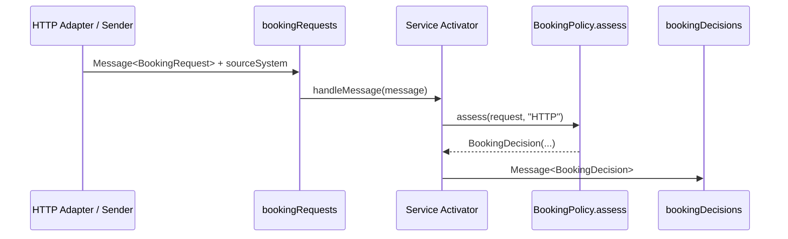

# MethodInvokingMessageProcessor: invoking a POJO method to process a message

## 1. Why do we need `MethodInvokingMessageProcessor`?

In a Java application, we often already have business classes such as `BookingPolicy`, `PaymentValidator`, or `InventoryService`. These classes operate on Java objects and do not necessarily know anything about `MessageChannel` or Spring Integration. When messages arrive from HTTP, JMS, AMQP, Kafka, file, or database adapters, how do we turn the **message payload and headers** into arguments to invoke those existing methods?

Spring Integration provides a helper component named **`MethodInvokingMessageProcessor<T>`** in the `org.springframework.integration.handler` package. This component implements `MessageProcessor<T>`: it takes a `Message<?>`, invokes the configured method on a POJO, and returns the invocation result. It bridges the messaging contract to a Java method contract.

In the **`SPRING_INTEGRATION_ADAPTERS`** module, this lesson focuses on the intersection between adapters, gateways, `MessageChannel`, and POJO business logic: messages brought into a flow by adapters are processed by a Java method, and the result can become a reply for downstream channels or adapters. This is the key link that keeps business logic independent of integration protocols.

After this lesson, you will be able to:

- Accurately describe the roles of `MethodInvokingMessageProcessor` and `MessageProcessor<T>`.
- Distinguish a message processor from a message source, endpoint, handler, transformer, and poller.
- Use `@ServiceActivator` or Java DSL `.handle(bean, "method")` to connect a POJO into a flow.
- Accept payloads, headers, or the full `Message<?>` in methods; understand `null`, `void`, and `Message<?>` replies.
- Diagnose and resolve common issues with method signatures, reply routing, exceptions, and reliability.

## 2. Position in the message path

`MethodInvokingMessageProcessor` is a **method-invocation processing strategy**. It is not a protocol adapter, not a `MessageChannel`, and not a self-running endpoint. A higher-level `MessageHandler`/endpoint, such as a **service activator**, uses this method-invocation mechanism to process messages moving through the flow.

```mermaid
flowchart LR
    A[Inbound Adapter / Gateway] --> C1[Input MessageChannel]
    C1 --> H[Service Activator / MessageHandler]
    H -->|processMessage(message)| P[MethodInvokingMessageProcessor]
    P -->|Bind payload and headers| B[POJO method]
    B -->|Result or null| P
    P -->|Return value| H
    H -->|Reply if any| C2[Output / replyChannel]
    C2 --> D[Handler / Outbound Adapter]
```

The right mental model separates two layers of responsibility:

1. **Inside the processor:** receive `Message<?>`, locate the target method, map arguments, and invoke the Java method.
2. **Outside the processor:** the handler decides how to use the return value: send a reply, transform the payload, route, split, or emit nothing further. The processor **does not pick channels itself** or enforce router/transformer semantics.

### Comparing easily confused components

| Component | Input | Responsibility | Output / behavior |
|---|---|---|---|
| `MethodInvokingMessageSource` | No input message; `receive()` call | Invokes a source method, usually no-argument | New message or `null`; usually triggered by a poller |
| **`MethodInvokingMessageProcessor<T>`** | An existing `Message<?>` | Invokes a POJO method based on message contents | Value `T`, `Message<?>`, or `null` returned to caller |
| `ServiceActivatingHandler` | Message received from a channel | Coordinates service invocation and, if applicable, sends a reply | A reply message or no reply |
| Transformer | Input message | Applies payload/message transformation semantics | Transformed message sent onward |
| Router | Input message | Chooses where to forward | One or more target channels per configuration |
| Poller | Schedule triggering a polling endpoint | Asks the endpoint to pull messages from a pollable source/channel | Does not map POJO method parameters |

**Point to remember:** with `DirectChannel`, the handler can execute immediately on the sending thread. `MethodInvokingMessageProcessor` does not need a poller once messages are pushed onto a `DirectChannel`. If an endpoint reads a `PollableChannel`, the poller belongs to the **receiving endpoint**, not as an intrinsic feature of the processor.

## 3. The `MessageProcessor<T>` contract and class API

The core contract can be visualized via this interface:

```java
// Spring Integration API concept:
public interface MessageProcessor<T> {
    T processMessage(org.springframework.messaging.Message<?> message);
}
```

`MethodInvokingMessageProcessor<T>` implements this contract and calls a method on a **target object**. Common ways to select the method:

| Method selection style | Meaning |
|---|---|
| `new MethodInvokingMessageProcessor<>(target, "methodName")` | Specifies the target object and method name. If overloaded, candidate selection relies on the message and method resolution rules. |
| `new MethodInvokingMessageProcessor<>(target, method)` | Uses `java.lang.reflect.Method` directly, explicitly pinning one signature. |
| `new MethodInvokingMessageProcessor<>(target, AnnotationType.class)` | Filters candidate methods by the supplied annotation. |

This is a **support API** used internally by Spring Integration message-handling components. In normal applications, declaring `@ServiceActivator` or `.handle(pojo, "method")` is easier to maintain than manually assembling a processor with a handler and channel.

### Low-level processor invocation example

To see the `processMessage(...)` contract directly, consider a small POJO:

```java
import org.springframework.integration.handler.MethodInvokingMessageProcessor;
import org.springframework.messaging.support.GenericMessage;

class PriceCalculator {
    public long doublePrice(long amount) {
        return amount * 2;
    }
}

class ProcessorDemo {
    public static void main(String[] args) throws Exception {
        MethodInvokingMessageProcessor<Long> processor =
                new MethodInvokingMessageProcessor<>(
                        new PriceCalculator(), "doublePrice");

        // When instantiated outside a Spring container, run bean initialization manually.
        processor.afterPropertiesSet();

        Long result = processor.processMessage(new GenericMessage<>(100L));
        System.out.println(result); // 200
    }
}
```

In this example, `GenericMessage<>(100L)` carries payload `100L`. The processor resolves `doublePrice(long)`, passes the payload into the method, and returns `200L` to the caller. **No `MessageChannel` or reply message is created from this snippet alone**: routing the result is the responsibility of a higher-level handler/flow.

In real environments, Spring manages bean lifecycles, argument resolvers, and conversion services. Direct invocation above is suited for understanding or testing the core mechanism; when building integration flows, use framework-managed endpoints.

## 4. How Spring maps `Message<?>` to Java parameters

A message has two main parts:

```text
Message<BookingRequest>
  payload = BookingRequest(bookingId="B-100", guests=3)
  headers = {sourceSystem="HTTP", correlationId="trace-123", ...}
```

Spring Integration can map that data to a POJO method using signatures and Spring Messaging annotations:

| Method signature | Data passed in | Use case |
|---|---|---|
| `Decision decide(BookingRequest request)` | Message payload | Most common; keeps business logic pure Java |
| `Decision decide(@Payload BookingRequest request)` | Payload, stated explicitly | When the method also accepts headers or metadata |
| `Decision decide(Message<BookingRequest> message)` | Entire message | When you need active access to both payload and multiple headers |
| `Decision decide(@Payload BookingRequest req, @Header("sourceSystem") String source)` | Payload and one header | Processing that depends on source system |
| `void audit(@Headers Map<String, Object> headers)` | Headers map | Selective logging/auditing |
| `Decision decide(@Header(value = "sourceSystem", required = false) String source, @Payload BookingRequest req)` | Optional header and payload | Source does not always send metadata |

Annotations are typically imported from `org.springframework.messaging.handler.annotation`, such as `@Payload`, `@Header`, and `@Headers`. `@ServiceActivator` belongs to `org.springframework.integration.annotation`.

When a required header is missing or the payload type is incompatible without a suitable converter, argument resolution can fail **before** entering the method body. Therefore, agree on a payload/header contract between the inbound adapter and the POJO. Do not assume Spring can convert any arbitrary JSON string into a Java record solely from the method signature: decoding/type conversion must be configured properly.

### Use the full message when genuinely needed

Alternative to separate parameters:

```java
import org.springframework.messaging.Message;

public BookingDecision decide(Message<BookingRequest> message) {
    BookingRequest request = message.getPayload();
    Object source = message.getHeaders().get("sourceSystem");

    return new BookingDecision(
            request.bookingId(),
            request.guests() > 0,
            String.valueOf(source),
            "checked");
}
```

When a method needs little metadata, declaring `@Payload` and `@Header` is usually easier to read and test. If a method has multiple same-named overloads, method selection may depend on payload types; avoid ambiguous overloads and specify the intended method clearly.

## 5. Complete example: receiving a booking request and invoking a POJO

Example using **Java 17+, Spring Boot 3.x, Spring Integration 6.x**. The system assumes an incoming request from an upstream adapter (HTTP/JMS/Kafka can all feed into a shared channel), then calls a business policy checking guest count. To focus on method invocation, the test example **sends a message directly to the channel**.

Add starters to the Spring Boot project:

```groovy
dependencies {
    implementation 'org.springframework.boot:spring-boot-starter-integration'
    testImplementation 'org.springframework.boot:spring-boot-starter-test'
}
```

All Java files below reside in package `com.example.booking`.

### 5.1. Application bootstrap and domain models

```java
// BookingApplication.java
package com.example.booking;

import org.springframework.boot.SpringApplication;
import org.springframework.boot.autoconfigure.SpringBootApplication;
import org.springframework.integration.config.EnableIntegration;

@SpringBootApplication
@EnableIntegration
public class BookingApplication {
    public static void main(String[] args) {
        SpringApplication.run(BookingApplication.class, args);
    }
}
```

```java
// BookingModels.java
package com.example.booking;

record BookingRequest(String bookingId, int guests) { }

record BookingDecision(
        String bookingId,
        boolean accepted,
        String sourceSystem,
        String reason) { }
```

Both records purely represent data. `BookingPolicy` holds the decision logic without knowing any inbound/outbound protocol details.

### 5.2. Creating input and output channels

```java
// BookingChannels.java
package com.example.booking;

import org.springframework.context.annotation.Bean;
import org.springframework.context.annotation.Configuration;
import org.springframework.integration.channel.DirectChannel;
import org.springframework.integration.channel.QueueChannel;
import org.springframework.messaging.MessageChannel;
import org.springframework.messaging.PollableChannel;

@Configuration
public class BookingChannels {
    @Bean
    MessageChannel bookingRequests() {
        return new DirectChannel();
    }

    @Bean
    PollableChannel bookingDecisions() {
        return new QueueChannel();
    }
}
```

- `bookingRequests` is a `DirectChannel`: messages sent into it are handled synchronously by the service activator if subscribed.
- `bookingDecisions` is a `QueueChannel`: lets the demo/test call `receive()` to retrieve the reply. In production, an output channel usually connects to a downstream adapter/gateway.

### 5.3. Registering the POJO method as a service activator

```java
// BookingPolicy.java
package com.example.booking;

import org.springframework.integration.annotation.ServiceActivator;
import org.springframework.messaging.handler.annotation.Header;
import org.springframework.messaging.handler.annotation.Payload;
import org.springframework.stereotype.Component;

@Component
public class BookingPolicy {

    @ServiceActivator(
            inputChannel = "bookingRequests",
            outputChannel = "bookingDecisions")
    public BookingDecision assess(
            @Payload BookingRequest request,
            @Header(value = "sourceSystem", required = false) String sourceSystem) {

        String source = sourceSystem == null ? "unknown" : sourceSystem;

        boolean accepted = request.bookingId() != null
                && !request.bookingId().isBlank()
                && request.guests() > 0
                && request.guests() <= 8;

        return new BookingDecision(
                request.bookingId(),
                accepted,
                source,
                accepted ? "ACCEPTED" : "INVALID_REQUEST");
    }
}
```

When a message enters `bookingRequests`, the endpoint calls `assess(...)` with `BookingRequest` from the payload and `sourceSystem` from the header. Because the return value is `BookingDecision`, the **service activator** creates a reply message and sends it to `bookingDecisions`.

`MethodInvokingMessageProcessor`'s job in this diagram is **to invoke the right method and return `BookingDecision`** to the handler. `ServiceActivatingHandler` and the `outputChannel` setting decide where the reply goes.

### 5.4. Sending a test message

For example, another component in the same application sends:

```java
import org.springframework.messaging.MessageChannel;
import org.springframework.messaging.support.MessageBuilder;

// Injected from bean named "bookingRequests":
void submitBooking(MessageChannel bookingRequests) {
    bookingRequests.send(
            MessageBuilder.withPayload(new BookingRequest("B-100", 3))
                    .setHeader("sourceSystem", "HTTP")
                    .setHeader("correlationId", "trace-123")
                    .build());
}
```

The flow proceeds as:



The send snippet above merely illustrates a caller. With an HTTP inbound gateway, Kafka inbound adapter, or JMS inbound adapter, the upstream flow passes payload/headers into the corresponding channel per your adapter configuration. `BookingPolicy` does not need to change simply because the source protocol changed.

## 6. Alternative: registering with Java DSL `.handle(...)`

If you prefer not to place Spring Integration annotations inside business classes, keep `BookingPolicy` as a POJO bean with pure Java methods:

```java
// Do not put @ServiceActivator on the method in the DSL approach.
public BookingDecision assess(
        @Payload BookingRequest request,
        @Header(value = "sourceSystem", required = false) String sourceSystem) {
    // Same logic as section 5.3.
}
```

Then declare the flow:

```java
package com.example.booking;

import org.springframework.context.annotation.Bean;
import org.springframework.context.annotation.Configuration;
import org.springframework.integration.dsl.IntegrationFlow;

@Configuration
public class BookingIntegrationFlow {

    @Bean
    IntegrationFlow bookingFlow(BookingPolicy bookingPolicy) {
        return IntegrationFlow.from("bookingRequests")
                .handle(bookingPolicy, "assess")
                .channel("bookingDecisions")
                .get();
    }
}
```

`.handle(bookingPolicy, "assess")` is the service activator in Java DSL: the framework sets up method invocation on the `bookingPolicy` bean, captures the result, and forwards the reply to the next step in the flow. `channel("bookingDecisions")` specifies the target channel for the outgoing message.

**The two approaches in sections 5 and 6 are mutually exclusive alternatives.** If you keep both `@ServiceActivator(inputChannel = "bookingRequests")` and `IntegrationFlow.from("bookingRequests").handle(...)` for the same logic, `DirectChannel` may distribute messages across different subscribers, no longer representing the intended single pipeline.

When chaining multiple flow steps, the DSL is convenient:

```java
return IntegrationFlow.from("bookingRequests")
        .handle(bookingPolicy, "assess")
        .filter(BookingDecision.class, BookingDecision::accepted)
        .channel("approvedBookings")
        .get();
```

In this example, `handle` produces `BookingDecision`; `filter` is what decides whether to keep or drop the message by condition; `channel` specifies where to send next. The method-invoking processor **does not replace** the responsibility of a filter or router.

## 7. Return values: payload, `Message<?>`, `null`, `void`

`MethodInvokingMessageProcessor` returns the **method's return value**. The endpoint uses that value according to its own semantics. For a **service activator**:

| Method returns | What happens in the service activator |
|---|---|
| `BookingDecision` | Handler builds a reply message with `BookingDecision` as payload and sends it to `outputChannel` or the appropriate reply destination. |
| `Message<BookingDecision>` | Handler uses the returned message as the reply; input message headers can also be copied onto the reply per header propagation rules. |
| `null` | By default no reply is emitted; if the handler is configured with `requiresReply = true`, `ReplyRequiredException` is thrown. |
| `void` | Suitable for side effects like audit logging or state updates; no reply comes from the invocation. |
| `List<BookingDecision>` | With a standard service activator, the list is **one payload containing a List**; to fan out per element, use an explicit splitter. |

### 7.1. Returning a full message to add headers

Instead of returning only `BookingDecision`, the POJO can return `Message<BookingDecision>`:

```java
import org.springframework.messaging.Message;
import org.springframework.messaging.support.MessageBuilder;

public Message<BookingDecision> assessWithHeaders(BookingRequest request) {
    BookingDecision result = new BookingDecision(
            request.bookingId(), true, "internal", "ACCEPTED");

    return MessageBuilder.withPayload(result)
            .setHeader("validationVersion", "v2")
            .setHeader("bookingKey", request.bookingId())
            .build();
}
```

With a **service activator**, headers from the request that are absent on the reply may still be copied over to the reply; returning a new `Message<?>` does not automatically strip all prior headers. To remove sensitive headers or enforce a whitelist, use `HeaderFilter` or a transformation step designed for that purpose. When passing messages through HTTP/JMS/Kafka, each adapter also applies its own header-mapping policy.

### 7.2. Where does the reply go if `outputChannel` is omitted?

If the service activator produces a non-`null` result, the basic order for determining the reply destination is:

1. Use `outputChannel` if configured on the endpoint.
2. Otherwise, check the `replyChannel` header on the **request message**.
3. In some cases returning a full `Message<?>`, the framework may also inspect `replyChannel` on the reply message when the request lacked a return address.

Example sending a request with a reply channel:

```java
import org.springframework.integration.channel.QueueChannel;
import org.springframework.messaging.Message;
import org.springframework.messaging.support.MessageBuilder;

QueueChannel replies = new QueueChannel();

Message<?> request = MessageBuilder.withPayload(new BookingRequest("B-200", 2))
        .setReplyChannel(replies)
        .build();

// Send the request to a service activator that does NOT define outputChannel.
// When the method returns a result, the handler forwards the reply to replies.
```

If the method actually returns a value while having neither `outputChannel` **nor** a valid return address, the handler has nowhere to send the reply and can throw `DestinationResolutionException`. If the flow intentionally discards the result, route to `nullChannel` (a special framework-provided channel), or change the method to `void` if the business contract needs no reply.

### 7.3. Do not use `null` to mask source failures

`null` means **emit no reply** in a service activator context. It differs from an exception and does not mean the input message was never received. If booking validation fails because the database is unreachable, throw a meaningful exception so error handling can record it; do not return `null` and leave the system silent as if no data existed.

## 8. Method selection, type conversion, and SpEL

When configuring `MethodInvokingMessageProcessor(target, "assess")`, the method name is only part of the contract. The framework also inspects candidate methods, payload types, annotations, and argument resolvers. Example:

```java
class BookingPolicy {
    public String assess(BookingRequest request) { return "BOOKING"; }
    public String assess(String requestId)       { return "ID"; }
}
```

Given a message with payload `BookingRequest`, the method accepting `BookingRequest` typically matches. However, complex overloads (closely related types, nullability, converters, generic methods) can cause ambiguity or unexpected calls. To keep flows predictable:

- Use distinct, `public` method names with clear signatures; overload only when genuinely needed.
- Specify `@Payload` and `@Header` explicitly on methods with mixed parameter types.
- Use the `Method` constructor when configuring directly and needing to pin a single signature.
- Normalize payload types at the adapter/transformer, e.g., converting JSON into a record before calling the POJO.
- Add tests when upgrading framework versions or changing type-conversion mechanisms.

Since Spring Integration 5.x, most POJO invocations can use Spring Messaging's `InvocableHandlerMethod`; certain cases, such as accessing property paths via annotation expressions, may use SpEL. Exact invocation optimization details depend on the Spring Integration version; this lesson focuses on the **message and method contract**, without requiring manual SpEL expressions.

## 9. Errors and reliability in integration flows

A POJO method may throw exceptions, make slow database calls, perform side effects, or mutate data before returning a reply. `MethodInvokingMessageProcessor` **does not automatically guarantee** transactions, retries, dead-letter queues, or exactly-once processing; those policies belong to endpoints, channels, adapters, and business design.

| Issue | What happens | Handling direction |
|---|---|---|
| Method throws exception | Message processing fails; may be wrapped in a messaging exception. | Define retry, recoverer, error channel, and error monitoring at the endpoint. |
| Required header missing | Cannot resolve `@Header` parameter; method may never be invoked. | Define the header contract; add `required = false` when genuinely optional. |
| Incompatible payload | Method mismatch or type conversion failure. | Validate schema/version; add an explicit transformer or converter. |
| Method unexpectedly returns `null` | Service activator emits no reply by default; caller may wait and time out. | Return an explicit result object or require a reply on the handler where appropriate. |
| Side effect completed yet reply failed | Resending the message may execute business logic again. | Idempotency keys, proper transactions/ACKs, and adapter-appropriate retry policies. |
| Slow handler processing | With `DirectChannel`, latency directly stalls the upstream `send()`. | Measure latency, optimize I/O, and consider controlled async channels/schedulers. |

Example integrating with JMS/AMQP/Kafka: if the upstream consumer redelivers messages, `chargePayment(...)` can be invoked **multiple times** for the same message. Retry policies on a broker or channel adapter do not make the payment operation idempotent by themselves. You need business keys (`paymentId`, `bookingId`, `eventId`) and mechanisms to prevent reapplying side effects.

### Choosing where to handle exceptions

- With synchronous `DirectChannel`, exceptions in the method normally propagate to the sending thread unless handled by advice or special handlers.
- With polling endpoints or async channels, errors can be routed through `errorChannel` and its error-handling policy.
- With inbound adapters supporting acknowledgments or transactions, how ack/rollback behaves on error depends on the specific adapter and cannot be inferred from `MethodInvokingMessageProcessor` alone.

Do not silently swallow exceptions and return `null` just to keep the flow running, as failure information is lost. To distinguish business outcomes (e.g., `REJECTED`) from system errors (e.g., database timeout), use explicit result types or exceptions.

## 10. Testing the method and integration flow

Testing should cover two layers:

1. **POJO unit tests:** test `BookingPolicy.assess(...)` with valid data, invalid data, and optional headers; no Spring context required.
2. **Integration tests:** send a `Message<BookingRequest>` through the input channel and verify the handler invokes the right method and emits the expected payload/headers on the output channel.

### 10.1. Unit testing business logic

```java
package com.example.booking;

import static org.junit.jupiter.api.Assertions.*;

import org.junit.jupiter.api.Test;

class BookingPolicyTest {
    @Test
    void rejectsInvalidGuestCount() {
        BookingPolicy policy = new BookingPolicy();
        BookingDecision decision =
                policy.assess(new BookingRequest("B-300", 0), "JMS");

        assertFalse(decision.accepted());
        assertEquals("JMS", decision.sourceSystem());
        assertEquals("INVALID_REQUEST", decision.reason());
    }
}
```

### 10.2. Integration testing with `DirectChannel` and `QueueChannel`

```java
package com.example.booking;

import static org.junit.jupiter.api.Assertions.*;

import org.junit.jupiter.api.Test;
import org.springframework.beans.factory.annotation.Autowired;
import org.springframework.beans.factory.annotation.Qualifier;
import org.springframework.boot.test.context.SpringBootTest;
import org.springframework.messaging.Message;
import org.springframework.messaging.MessageChannel;
import org.springframework.messaging.PollableChannel;
import org.springframework.messaging.support.MessageBuilder;

@SpringBootTest
class BookingFlowTest {

    @Autowired
    @Qualifier("bookingRequests")
    MessageChannel requests;

    @Autowired
    @Qualifier("bookingDecisions")
    PollableChannel decisions;

    @Test
    void invokesPojoMethodAndEmitsReply() {
        boolean sent = requests.send(
                MessageBuilder.withPayload(new BookingRequest("B-400", 4))
                        .setHeader("sourceSystem", "HTTP")
                        .build());
        assertTrue(sent);

        Message<?> reply = decisions.receive(1000);
        assertNotNull(reply);
        assertInstanceOf(BookingDecision.class, reply.getPayload());

        BookingDecision result = (BookingDecision) reply.getPayload();
        assertEquals("B-400", result.bookingId());
        assertTrue(result.accepted());
        assertEquals("HTTP", result.sourceSystem());
    }
}
```

`DirectChannel` executes the handler synchronously; `QueueChannel` holds the reply so the test can read it via `receive(1000)` (millisecond timeout), avoiding `Thread.sleep()`. This test verifies both method argument mapping and reply routing. To test real adapters, add the corresponding infrastructure or test fixtures for HTTP/JMS/Kafka and realistic failure cases.

### Debugging checklist

| Symptom | What to check first |
|---|---|
| `assess(...)` never runs | Was the bean scanned by Spring? Are messages reaching the input channel? Is `@ServiceActivator` or `.handle(...)` declared properly? |
| Error finding method | Do method name, visibility, overloads, and payload type match? |
| Header parameter error | Does the header exist with the exact name/type? Is `required = false` needed? |
| Method runs but no reply appears | Did the method return `null`/`void`? Is an output channel or `replyChannel` configured? |
| Reply goes to the wrong place | Are both `outputChannel` and `replyChannel` set? Which output channel takes precedence on the handler endpoint? |
| Duplicate executions | Are both annotation and DSL registered for the same input? Does the adapter retry/redeliver? |
| Wanted separate records but received a `List` | Was a splitter added after the handler? |

## 11. Hands-on exercises

1. Use `@ServiceActivator` on `calculateFee(@Payload BookingRequest request, @Header("region") String region)`. Send a message with `region` and observe the reply.
2. Convert the same flow to Java DSL `.handle(bookingPolicy, "assess")`. Verify only one endpoint handles `bookingRequests`.
3. Remove `outputChannel` from the service activator, send a request with a `replyChannel` header pointing to a `QueueChannel`, and read the result from that queue.
4. Create a method returning `null` when a booking is invalid. Explain what problems a caller/gateway waiting for a reply might face; propose a `BookingDecision` contract that always has an explicit status.
5. Have the method accept `Message<BookingRequest>` to read `sourceSystem` and `correlationId`, then return a `Message<BookingDecision>` adding `validationVersion`; verify service activator header propagation.
6. Simulate a database failure and retry the same message. Write a unit test proving `bookingId` acts as an idempotency key so updates do not apply twice.

## 12. Key takeaways

- `MethodInvokingMessageProcessor<T>` is the **method-invocation engine** operating on an existing `Message<?>`; its primary API is `processMessage(message)`.
- Payloads map to method parameters by type; `@Payload`, `@Header`, `@Headers`, or `Message<?>` express what data the contract expects.
- `@ServiceActivator` and Java DSL `.handle(pojo, "method")` are the two common ways to use POJO invocation inside a Spring-managed flow.
- **The processor does not send replies itself**: the service activator/handler decides the reply channel and handles `null`/`void` results.
- Reliability when integrating HTTP, JMS, AMQP, Kafka, or databases depends on ack policies, retries, transactions, error handling, and idempotency outside the processor.

### References

- [Spring Integration API — `MethodInvokingMessageProcessor<T>`](https://docs.spring.io/spring-integration/docs/6.2.0-M2/api/org/springframework/integration/handler/MethodInvokingMessageProcessor.html)
- [Spring Integration API — `MessageProcessor<T>`](https://docs.spring.io/spring-integration/docs/latest-ga/api/org/springframework/integration/handler/MessageProcessor.html)
- [Spring Integration Reference — Service Activator](https://docs.spring.io/spring-integration/reference/service-activator.html)
- [Spring Integration Reference — POJO Method Invocation](https://docs.spring.io/spring-integration/docs/6.1.8/reference/html/index-single.html)
