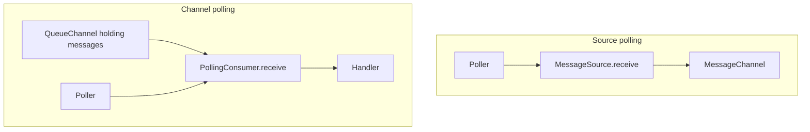

# MessageSource polling method: invoking a data-fetching method on a schedule

## 1. Problem and objectives

Suppose a legacy system exposes a `nextOrder()` method returning **one** pending order. There is no webhook, message broker, or callback to push notifications when a new order arrives. The application can only ask the system periodically: "Is there a next order?" We want to bring the result of that Java method into a Spring Integration flow to forward it through `MessageChannel`, apply business checks, or send it to JMS, AMQP, Kafka, and other systems.

In the **`SPRING_INTEGRATION_ADAPTERS`** module, inbound/outbound adapters, gateways, pollers, and `MessageChannel` connect files, SFTP, HTTP, JMS, AMQP, Kafka, databases, and existing Java APIs. The **MessageSource polling method** topic focuses on one specific scenario: **a Java method invoked repeatedly on a schedule to produce inbound messages**. Understanding this mechanism helps you design message contracts, manage load, detect failures, and control connection lifecycles when the external source does not support push events.

After this lesson, you will be able to:

1. Explain how `MessageSource.receive()`, `SourcePollingChannelAdapter`, and the poller coordinate.
2. Write a polled POJO method using `@InboundChannelAdapter` or implement `MessageSource<T>` explicitly.
3. Configure `fixedDelay`, `fixedRate`, `maxMessagesPerPoll`, handle `null` results, and tune polling cadence.
4. Distinguish polling a *source* from polling a `PollableChannel` on the consumer side.
5. Test polling sources and flows; recognize risks of data loss, duplication, I/O errors, and concurrent execution.

## 2. Participating components and a message's path

`MessageSource<T>` lives in the `org.springframework.integration.core` package. Its core contract is a no-argument method:

```java
public interface MessageSource<T> {
    Message<T> receive(); // Returns a Message or null when no data is available yet.
}
```

*The snippet above illustrates the interface's primary signature; version-specific annotations and auxiliary details are omitted.*

A `MessageSource<T>` object only knows how to **fetch a message when someone calls `receive()`**. It does not start a timer by itself. The **`SourcePollingChannelAdapter`** endpoint component uses a poller to invoke `receive()` and send non-`null` messages to a channel.

```mermaid
flowchart LR
    TIMER[TaskScheduler / Poller] --> ENDPOINT[SourcePollingChannelAdapter]
    ENDPOINT -->|receive()| SOURCE[MessageSource]
    SOURCE -->|invokes fetch method| POJO[POJO or legacy API]
    POJO -->|object or null| SOURCE
    SOURCE -->|Message or null| ENDPOINT
    ENDPOINT -->|non-null Message| CHANNEL[MessageChannel]
    CHANNEL --> HANDLER[Service Activator / Transform / Outbound Adapter]
```

| Component | Primary responsibility | What it does not handle |
|---|---|---|
| **POJO method** | Returns a data item or `null` when temporarily out of data. | Knows nothing about polling schedules or channels. |
| **`MessageSource<T>`** | Represents the `Message<T>` pull operation via `receive()`. | Does not emit messages over time on its own. |
| **`SourcePollingChannelAdapter`** | Creates the inbound endpoint, invokes the source per the poller, and sends messages to the channel. | Does not decide how the source system is queried. |
| **Poller / `TaskScheduler`** | Controls timing, period, and read count per cycle. | Does not convert a Java API into business data by itself. |
| **`MessageChannel`** | Transfers messages to downstream components. | Does not call the source's `receive()` if it is merely a `DirectChannel`. |
| **Consumer / outbound adapter** | Processes or forwards messages to the next system. | Does not guarantee the source is polled only once if multiple endpoints are configured. |

### Two forms of "polling" to distinguish

**Source polling (`SourcePollingChannelAdapter`)**: periodically calls `MessageSource.receive()` to *produce* inbound messages. Examples include scanning files, SFTP, staging tables, or a legacy library's `nextOrder()` method.

**Channel polling (`PollingConsumer`)**: periodically calls `receive()` on a `PollableChannel` like `QueueChannel` to *consume messages already sitting in the channel*. The polled target differs, even though both use a poller and trigger schedule.



This distinction avoids the mistake of seeing the word `poller` and assuming every message-handling method must be called on a schedule. Handlers attached to a `DirectChannel` are typically invoked immediately when the channel receives a message; only polling endpoints use pollers.

## 3. Contract of the polled method

The simplest way to declare a POJO method as a source is `@InboundChannelAdapter`. In this configuration, Spring Integration creates a **`MethodInvokingMessageSource`** to call the method and a **`SourcePollingChannelAdapter`** to schedule polling.

The target method must satisfy these conditions:

- **No input parameters.** There is no incoming request message for the framework to extract payloads from and pass into a source method, because this method itself produces the request message.
- **Non-`void` return type.** It must return a result to construct a message; the return type can be a POJO or `Message<?>`.
- **Return `null` when no data is available.** `null` signals no message should be emitted for that receive; it is not a valid payload.
- **One call yields one result.** Returning `List<Order>` creates one message whose payload is the list; to turn each order into its own message, return individual `Order`s or add a downstream splitter.
- **Method must safeguard source state.** When the method removes an item from a queue, marks a row read, or consumes an entry, that behavior must be accounted for in retries and downstream failures.
- **Must not block indefinitely.** A method hanging on I/O can tie up the scheduler thread; timeouts must be configured on the external system call rather than relying solely on `fixedDelay`.

Example with a pure Java POJO:

```java
import java.util.Queue;
import java.util.concurrent.ConcurrentLinkedQueue;

public final class LegacyOrderInbox {
    private final Queue<String> waitingIds = new ConcurrentLinkedQueue<>();

    public void submit(String orderId) {
        waitingIds.add(orderId);
    }

    public String nextOrderId() {
        return waitingIds.poll(); // Null if the queue is empty.
    }
}
```

`ConcurrentLinkedQueue.poll()` retrieves and removes one element in a thread-safe operation within the JVM. This is a simple test source, **not a durable persistence solution**: if the process stops or the handler fails after polling an element, data can be lost.

## 4. Execution model of a poll cycle

Suppose the source holds three orders `ORD-01`, `ORD-02`, `ORD-03`, the poller runs every 2 seconds, and allows at most 2 messages per poll:

```text
T0:       poll cycle #1
          receive() -> ORD-01 -> send to channel
          receive() -> ORD-02 -> send to channel
          reached maxMessagesPerPoll = 2 => end cycle

T0+2s*:   poll cycle #2
          receive() -> ORD-03 -> send to channel
          receive() -> null   -> stop receiving in this cycle

T0+4s*:   poll cycle #3
          receive() -> null   -> no message sent
```

`*` Timestamps are illustrative: with `fixedDelay`, the wait begins after the previous polling task finishes; actual timing also depends on processing time, the scheduler, and resources.

A conceptual loop can be described as:

```java
// Pseudocode: illustrates the idea, not framework source code.
void runOnePoll(int maxMessagesPerPoll) {
    for (int i = 0; i < maxMessagesPerPoll; i++) {
        Message<?> message = messageSource.receive();
        if (message == null) {
            break; // Out of data at this moment.
        }
        outputChannel.send(message);
    }
}
```

Three insights follow from this pseudocode: **trigger schedule**, **read count per trigger**, and **the source's ability to return `null`** are independent factors. Fast polling with `maxMessagesPerPoll = 1` behaves differently from slow polling that reads multiple elements per cycle. If downstream processing is synchronous and slow, the time spent sending a message also extends the polling task's completion time.

## 5. Complete example with `@InboundChannelAdapter`

Example using Java 17+, Spring Boot 3.x, and Spring Integration 6.x. The application holds a queue of pending orders. Every 2 seconds, the framework calls `takeNext()`, forwards non-`null` results into `orderInputChannel`, and a service activator records the received order.

In a Gradle project:

```groovy
dependencies {
    implementation 'org.springframework.boot:spring-boot-starter-integration'
    testImplementation 'org.springframework.boot:spring-boot-starter-test'
}
```

### 5.1. Defining the application, data model, and queue

The Java files below share package `com.example.polling`.

```java
// PollingApplication.java
package com.example.polling;

import org.springframework.boot.SpringApplication;
import org.springframework.boot.autoconfigure.SpringBootApplication;
import org.springframework.context.annotation.Bean;
import org.springframework.integration.channel.DirectChannel;
import org.springframework.integration.config.EnableIntegration;
import org.springframework.messaging.MessageChannel;

import java.util.Queue;
import java.util.concurrent.ConcurrentLinkedQueue;

@SpringBootApplication
@EnableIntegration
public class PollingApplication {

    public static void main(String[] args) {
        SpringApplication.run(PollingApplication.class, args);
    }

    @Bean
    PendingOrderQueue pendingOrderQueue() {
        PendingOrderQueue queue = new PendingOrderQueue();
        queue.offer(new Order("ORD-01", 120_000));
        queue.offer(new Order("ORD-02", 180_000));
        queue.offer(new Order("ORD-03", 240_000));
        return queue;
    }

    @Bean
    MessageChannel orderInputChannel() {
        return new DirectChannel();
    }
}

record Order(String id, long totalVnd) { }

final class PendingOrderQueue {
    private final Queue<Order> orders = new ConcurrentLinkedQueue<>();

    void offer(Order order) {
        orders.add(order);
    }

    Order takeNext() {
        return orders.poll();
    }
}
```

`Order` is the business payload; `PendingOrderQueue` is the data source class; `orderInputChannel` is where messages are sent **after** polling. The queue initially holds three orders so you can observe the difference between receive cycles and emitted message counts.

### 5.2. Marking the method as a polling source

```java
// OrderPollingSource.java
package com.example.polling;

import org.springframework.integration.annotation.InboundChannelAdapter;
import org.springframework.integration.annotation.Poller;
import org.springframework.stereotype.Component;

@Component
public class OrderPollingSource {
    private final PendingOrderQueue queue;

    public OrderPollingSource(PendingOrderQueue queue) {
        this.queue = queue;
    }

    @InboundChannelAdapter(
            channel = "orderInputChannel",
            poller = @Poller(fixedDelay = "2000", maxMessagesPerPoll = "2")
    )
    public Order takeNext() {
        return queue.takeNext();
    }
}
```

In this snippet:

- `@Component` lets Spring manage the object containing the method.
- `@InboundChannelAdapter` registers an inbound endpoint targeting output channel `orderInputChannel`.
- `@Poller(fixedDelay = "2000", maxMessagesPerPoll = "2")` configures a polling cycle with a 2,000 ms delay and up to two non-`null` message receives per cycle.
- `takeNext()` takes no arguments and returns `Order`; Spring Integration builds a message with the returned object as payload. When the queue is empty and the result is `null`, no new message is sent.

The annotation is a concise declaration for the two architectural tasks: **invoking the POJO method** and **scheduling the inbound endpoint**. You do not need to manually spawn a `Thread`, `Timer`, or `while(true)` loop to invoke the method.

### 5.3. Receiving messages on the consumer side

```java
// OrderConsumer.java
package com.example.polling;

import org.springframework.integration.annotation.ServiceActivator;
import org.springframework.context.annotation.Profile;
import org.springframework.stereotype.Component;

@Component
@Profile("!test")
public class OrderConsumer {
    @ServiceActivator(inputChannel = "orderInputChannel")
    public void accept(Order order) {
        System.out.printf("Received %s: %,d VND%n", order.id(), order.totalVnd());
    }
}
```

When running the application, you will see all three orders recorded—typically two in the first cycle and one in the next. Subsequent cycles keep polling the source without creating messages while the queue is empty. `DirectChannel` executes the consumer synchronously on the sending path, so if `accept()` is slow, the polling task duration grows accordingly.

### 5.4. Returning `Message<?>` to add headers

If metadata must be attached, **replace** `takeNext()` in section 5.2 with a version returning `Message<Order>`:

```java
import org.springframework.messaging.Message;
import org.springframework.messaging.support.MessageBuilder;

@InboundChannelAdapter(
        channel = "orderInputChannel",
        poller = @Poller(fixedDelay = "2000", maxMessagesPerPoll = "2")
)
public Message<Order> takeNextMessage() {
    Order order = queue.takeNext();
    if (order == null) {
        return null;
    }

    return MessageBuilder.withPayload(order)
            .setHeader("sourceSystem", "legacy-order-inbox")
            .setHeader("orderKey", order.id())
            .build();
}
```

Do not leave both `takeNext()` and `takeNextMessage()` annotated with `@InboundChannelAdapter` on **the same queue**, as the two endpoints would compete for data. When the consumer needs the header, write:

```java
@ServiceActivator(inputChannel = "orderInputChannel")
public void accept(
        Order order,
        @org.springframework.messaging.handler.annotation.Header("orderKey") String key) {
    System.out.printf("Received %s: %,d VND%n", key, order.totalVnd());
}
```

Here `orderKey` is a business key for tracing orders. It is useful for idempotency; a Spring Integration message's `id` header does not substitute for a durable business identifier.

## 6. Writing `MessageSource<T>` manually and scheduling with Java DSL

When you cannot edit a legacy library's POJO, or want to separate the polling schedule from business code, you can implement `MessageSource<T>` directly. An important difference from an `@InboundChannelAdapter` method is that **`MessageSource.receive()` must return `Message<T>` or `null`**, not a raw POJO.

The following example is an **alternative configuration** to section 5, reusing `PendingOrderQueue` while **omitting** `OrderPollingSource`/`OrderConsumer` on the same source to avoid two competing endpoints:

```java
// OrderPollingFlow.java
package com.example.polling;

import org.springframework.context.annotation.Bean;
import org.springframework.context.annotation.Configuration;
import org.springframework.integration.core.MessageSource;
import org.springframework.integration.dsl.IntegrationFlow;
import org.springframework.integration.dsl.Pollers;
import org.springframework.messaging.support.MessageBuilder;

@Configuration
public class OrderPollingFlow {

    @Bean
    MessageSource<Order> orderMessageSource(PendingOrderQueue queue) {
        return () -> {
            Order order = queue.takeNext();
            if (order == null) {
                return null;
            }
            return MessageBuilder.withPayload(order)
                    .setHeader("sourceSystem", "legacy-order-inbox")
                    .build();
        };
    }

    @Bean
    IntegrationFlow orderPollingIntegrationFlow(MessageSource<Order> orderMessageSource) {
        return IntegrationFlow
                .from(orderMessageSource,
                        endpoint -> endpoint.poller(
                                Pollers.fixedDelay(2000).maxMessagesPerPoll(2)))
                .handle(message -> System.out.println(
                        "Order polled: " + message.getPayload()))
                .get();
    }
}
```

Here:

1. The `() -> { ... }` lambda implements the single `Message<T>` receive method required by `MessageSource<T>`.
2. `IntegrationFlow.from(orderMessageSource, ...)` creates the inbound source endpoint.
3. `Pollers.fixedDelay(2000).maxMessagesPerPoll(2)` sets the polling cadence and max receives per cycle.
4. `.handle(...)` processes messages emitted into the flow. In a real application, replace it with `.channel("orderInputChannel")`, `.transform(...)`, `.route(...)`, or an appropriate outbound adapter.

**Merely defining a `MessageSource<T>` bean is not enough for the source to run automatically.** You need `SourcePollingChannelAdapter` or `IntegrationFlow.from(..., endpoint -> endpoint.poller(...))` to create a scheduler-driven endpoint. Calling `source.receive()` manually in a test retrieves a single message, not a schedule.

### A variant: `@Bean` returning `MessageSource<T>`

Spring Integration also supports annotating a `@Bean` returning `MessageSource<T>` with `@InboundChannelAdapter`:

```java
@Bean
@InboundChannelAdapter(
        channel = "orderInputChannel",
        poller = @Poller(fixedDelay = "2000", maxMessagesPerPoll = "2")
)
MessageSource<Order> annotatedOrderSource(PendingOrderQueue queue) {
    return () -> {
        Order order = queue.takeNext();
        return order == null ? null : MessageBuilder.withPayload(order).build();
    };
}
```

With this `@Bean` style, the annotation registers polling for an **already constructed `MessageSource`**; whereas placing the annotation directly on a method returning `Order` in section 5 causes the framework to use `MethodInvokingMessageSource` to call that method. Both output messages to `orderInputChannel`. These are also **alternative implementations**—do not register them concurrently on one source unless you intentionally want multiple independent consumers with proper synchronization.

If you just want to declare a POJO-producing function, a `@Bean` returning `Supplier<Order>` is also supported in modern Spring Integration versions, provided you choose a consistent configuration and verify bean lifecycles.

## 7. Poller: choosing the schedule and message limit

Without proper poller settings, even a functionally correct method can overload the source system or introduce high latency. For `SourcePollingChannelAdapter`, the following parameters are especially important:

| Configuration | Meaning | Example use case |
|---|---|---|
| `fixedDelay = "2000"` | Waits ~2 seconds after the previous polling task **finishes** before triggering the next cycle. | Database-backed sources with variable response times. |
| `fixedRate = "2000"` | Schedules on an expected 2-second cadence; actual timing depends on the scheduler and task duration. | Cheap sources requiring a relatively steady probe interval. |
| `cron = "0 */5 * * * *"` | Polls at the start of every 5 minutes using Spring's 6-field cron expression. | Periodic table sync instead of continuous checking. |
| `maxMessagesPerPoll = "1"` | At most one message received per trigger. | Limiting load and cycle duration. |
| `maxMessagesPerPoll = "20"` | Can call `receive()` consecutively up to 20 messages per cycle, stopping early on `null`. | Backlogs that tend to arrive in bursts. |
| `maxMessagesPerPoll = "0"` | Skips `MessageSource.receive()` calls in a cycle; can be used for dynamic pausing. | Temporarily pausing source reads while keeping the endpoint. |
| `maxMessagesPerPoll = "-1"` | Keeps receiving until the source returns `null` in that cycle. | Use only if the source drains cleanly and returns `null` in finite time. |

**Important default value:** for **`SourcePollingChannelAdapter`**, if `maxMessagesPerPoll` is omitted, the default is **1**. This differs from `PollingConsumer`, which may default to `-1` when polling a channel. Never assume omitting this parameter automatically drains the entire source queue in a single poll.

With `maxMessagesPerPoll = -1`, if the source always returns non-`null` values (e.g., an incrementing sequence generator), the task can loop forever inside one cycle, tying up the scheduler thread and resisting stop commands. For sources without guaranteed exhaustion, a **positive bound** is far easier to control.

### How does `fixedRate` differ from `fixedDelay`?

Suppose a poll cycle takes 800 ms:

```text
fixedDelay = 2000 ms (illustrative)
poll #1: [work 800ms] -------- wait 2000ms -------- poll #2

fixedRate = 2000 ms (illustrative)
poll #1: [work 800ms] ---- reach 2000ms mark ---- poll #2
```

`fixedRate` does not guarantee slow invocations run concurrently: that also depends on the `TaskScheduler`, thread pool, and endpoint configuration. When throttling load on an external API, `fixedDelay` is usually more predictable. If you need true quota-based rate limiting (e.g., 100 requests/minute), you still need a rate limiter or backoff strategy; a simple poll schedule does not provide distributed rate limiting.

### Estimating expected throughput

In the simple case where the source always has data, processing is very fast, and the scheduler has ample resources, `fixedRate = 2000` with `maxMessagesPerPoll = 5` yields **at most roughly 5 messages per 2 seconds** (~2.5 messages/second). This is only an approximate ceiling for the polling task: source call duration, channel dispatch, `null` polls, consumer count, and errors reduce real throughput. With `fixedDelay`, the actual period equals processing time plus delay, so you cannot treat `maxMessagesPerPoll / fixedDelay` as a strict guarantee.

### Does the poller have a timeout?

`receiveTimeout` on some polling endpoints/channels configures wait time when receiving in that specific context; it is **not** a general timeout that aborts arbitrary `MessageSource.receive()` methods. If `nextOrder()` calls JDBC, HTTP, or SFTP, configure timeouts on the JDBC driver, HTTP client, or source session/adapter. A method hung on I/O cannot be rescued simply by shortening `fixedDelay`.

## 8. Distinguishing `null`, empty payloads, and lists

| Method return value | Polling source behavior |
|---|---|
| `new Order("ORD-01", ...)` | Framework creates a message with an `Order` payload. |
| `MessageBuilder.withPayload(order).build()` | Framework uses the supplied message, including its payload and declared headers. |
| `null` | No message created; terminates remaining receives in the current `maxMessagesPerPoll` cycle early. |
| `List<Order>` | One message carrying `List<Order>` as payload; does not auto-fan-out elements. |
| `Optional.empty()` | Still a non-`null` Java object; do not use it to represent the source's "no data" signal. |
| Exception | Source execution failure; requires proper observation, handling, or recovery. |

Note: a Spring message requires a non-`null` payload. Let the source method return `null` when no record is available rather than trying to build a `Message` with a `null` payload. If you must represent an "empty" business event, define an explicit payload type (e.g., `NoNewOrdersEvent`) and emit it intentionally—**not** on every idle poll cycle if downstream only cares about real orders.

## 9. Reliability: errors, retries, transactions, and idempotency

Polling only governs **when to read**. It does not automatically guarantee **exactly-once** delivery, cross-system transactions, or loss prevention.

### 9.1. Why is `Queue.poll()` for demos only?

Consider a sequence of events:

```text
1. receive() calls queue.poll(), removing ORD-01 from the queue.
2. SourcePollingChannelAdapter creates and sends message ORD-01.
3. Handler calls the database and fails.
4. ORD-01 is already gone from the in-memory queue.
```

The result is a risk of **losing the order**, because pulling from the source is not transactionally tied to downstream processing. For real data, consider one or more of these mechanisms:

1. **Durable source:** store orders in a database or broker instead of a volatile JVM queue.
2. **Claim/lease/ack:** mark records `NEW → PROCESSING → DONE`; if a worker dies, an expired lease allows re-reading.
3. **Idempotency:** the handler uses a unique `orderId` to avoid recording or charging twice on redelivery.
4. **Appropriate transactions:** if source and destination share a transaction manager, use a transaction boundary; across separate systems, use outbox/inbox or application-level acknowledgments instead of assuming distributed transactions.
5. **Bounded retries:** retry only transient failures; invalid data should move to a correction/dead-letter workflow rather than looping infinitely.

### 9.2. Handling exceptions from the polled method

If the method throws `DataAccessException` or an HTTP client timeout, the failure occurs during the polling endpoint's `receive()`. Depending on the scheduler, error handler, advice, and `errorChannel` configuration, the failure may be logged, routed as an error message, or trigger another policy. **Never assume a failed poll will automatically retry to success.**

Distinguish clearly:

- **Legitimately out of data:** method returns `null`; log at low verbosity if needed for observability.
- **Source temporarily unreachable:** method throws an exception; apply timeouts, backoff, and error metrics.
- **Contract-violating record:** use a dedicated reject/quarantine policy; do not conflate with "no data left".

Conceptual error-handling snippet in the source method:

```java
public Order nextOrder() {
    try {
        return repository.claimNextPendingOrder();
    } catch (TransientDataAccessResourceException ex) {
        // Tell the endpoint the source failed rather than pretending no data exists.
        throw ex;
    }
}
```

`repository.claimNextPendingOrder()` is an illustrative API you must implement for your real data store; `TransientDataAccessResourceException` is from Spring DAO and does not replace retry/recovery mechanisms. This snippet simply highlights the difference between `null` and an error.

### 9.3. Concurrency, partitioning, and multiple application instances

A `ConcurrentLinkedQueue` is safe within **one JVM**, but it does not solve two pods calling the same API or scanning the same table. When deploying multiple instances, coordinate the source via database row locking (`SELECT ... FOR UPDATE SKIP LOCKED` where supported), leases, partitioning, distributed locks, or a dedicated adapter built for concurrent polling.

Do not blindly increase the `TaskScheduler` pool size assuming every POJO method is safe under concurrent calls. Thread-safety depends on the underlying source API and endpoint setup. When pausing reads for maintenance, prefer endpoint lifecycle controls or managed polling parameters; `maxMessagesPerPoll = 0` skips calling the source while keeping the endpoint scheduled.

### 9.4. Backpressure and observability

If the source produces faster than downstream consumes, queues build up or processing degrades. Measure metrics such as messages per cycle, `null`-poll rate, `receive()` latency, channel send duration, error count, retry count, oldest pending record age, and backlog size. With `DirectChannel`, handler duration adds to the send task; with async channels, enforce capacity bounds and full-queue policies.

## 10. Lifecycle of a polling endpoint

`SourcePollingChannelAdapter` is a Spring-managed endpoint following start/stop lifecycle semantics. When the endpoint is **started**, the poller calls the source on schedule; when **stopped**, no new poll cycles begin. Stopping the endpoint **does not delete source data** and does not automatically roll back reads already performed.

Lifecycle design guidelines:

- On application startup, check whether the source (DB, SFTP, API) is ready. Methods need timeouts and clear error signals.
- During rolling deployments, prevent two versions from claiming the same record unless the source supports it.
- On shutdown, account for in-flight work and checkpoints; decide whether to drain current messages or hand off to retry.
- To toggle polling at runtime, manage the endpoint lifecycle via beans/Control Bus by design rather than tearing down the entire Spring context.

## 11. Testing the source and endpoint

Separate testing **data-fetching logic** from testing **scheduling**. If testing business logic forces you to wait seconds for a poller, tests become slow and failure causes become harder to isolate.

### 11.1. Unit testing `MessageSource.receive()` without a scheduler

For the DSL approach in section 6, a `MessageSource<T>` can be invoked directly:

```java
package com.example.polling;

import static org.junit.jupiter.api.Assertions.*;

import org.junit.jupiter.api.Test;
import org.springframework.integration.core.MessageSource;
import org.springframework.messaging.Message;
import org.springframework.messaging.support.MessageBuilder;

class OrderMessageSourceTest {
    @Test
    void returnsOneMessageAndThenNull() {
        PendingOrderQueue queue = new PendingOrderQueue();
        queue.offer(new Order("TEST-01", 75_000));

        MessageSource<Order> source = () -> {
            Order order = queue.takeNext();
            return order == null
                    ? null
                    : MessageBuilder.withPayload(order).build();
        };

        Message<Order> first = source.receive();
        assertNotNull(first);
        assertEquals("TEST-01", first.getPayload().id());
        assertNull(source.receive());
    }
}
```

This test proves `receive()` obeys the contract: one message when data exists, `null` when empty. It **does not test** the scheduler, channel, lifecycle, or handler—that belongs in integration tests.

### 11.2. Integration testing polling without fixed `Thread.sleep()`

With the annotation configuration in section 5, you can create a consumer active only under the `test` profile that stores payloads into a `BlockingQueue` and awaits via `poll(timeout)`. `OrderConsumer` in section 5.3 already carries `@Profile("!test")`, so activating `test` leaves `DirectChannel` with just the single test subscriber:

```java
// CapturingOrderConsumer.java (placed in src/test/java/com/example/polling)
package com.example.polling;

import org.springframework.context.annotation.Profile;
import org.springframework.integration.annotation.ServiceActivator;
import org.springframework.stereotype.Component;

@Component
@Profile("test")
class CapturingOrderConsumer {
    final java.util.concurrent.BlockingQueue<Order> received =
            new java.util.concurrent.LinkedBlockingQueue<>();

    @ServiceActivator(inputChannel = "orderInputChannel")
    public void accept(Order order) {
        received.add(order);
    }
}
```

An integration test running against a context with this consumer can assert:

```java
package com.example.polling;

import static org.junit.jupiter.api.Assertions.*;

import org.junit.jupiter.api.Test;
import org.springframework.beans.factory.annotation.Autowired;
import org.springframework.boot.test.context.SpringBootTest;
import org.springframework.test.context.ActiveProfiles;

@ActiveProfiles("test")
@SpringBootTest
class OrderPollingIntegrationTest {
    @Autowired
    CapturingOrderConsumer consumer;

    @Test
    void pollsAndSendsOrders() throws Exception {
        Order first = consumer.received.poll(5, java.util.concurrent.TimeUnit.SECONDS);
        assertNotNull(first);
        assertEquals("ORD-01", first.id());
    }
}
```

`@ActiveProfiles("test")` enables the capturing consumer and disables the demo consumer. Thus the test receives `ORD-01` from the queue initialized in section 5.1 without competing subscribers. To verify multiple cycles accurately, control poller timing/configuration in the test context and record receive timestamps rather than relying on arbitrary test-runner sleeps.

### Minimum scenarios to test

| Scenario | Expected outcome |
|---|---|
| Source has one item | `receive()` produces one message with exact payload type and value. |
| Source is empty | `receive()` returns `null`; downstream is not called. |
| Three items, `maxMessagesPerPoll = 2` | First cycle emits at most two messages; next cycle continues fetching remaining items. |
| Source returns `List<Order>` | One message containing the List; only a Splitter fans out elements. |
| Source throws an exception | Failure is observable/handled at endpoint level; never equated with `null`. |
| Handler fails after data was claimed | Retry/recovery handles it, with business-key deduplication. |
| Stop endpoint | No new poll cycles start; verify in-flight handling per config. |
| Two instances running | No duplicate order processing when proper locking/lease/idempotency exists. |

## 12. Common implementation pitfalls

| Symptom | Possible cause | Resolution |
|---|---|---|
| Method is never invoked | Bean not scanned; missing `@InboundChannelAdapter`, endpoint not started, or missing poller. | Check component scanning, endpoint/poller setup, and lifecycle state. |
| Error creating inbound endpoint | Annotated method takes parameters or returns `void`. | Use a no-argument method returning an object or `Message<?>`. |
| Polling logs appear yet no messages arrive | Source always returns `null`, wrong output channel, or no subscribed handler. | Inspect source data, method return, channel name, and consumer. |
| Only one message every few seconds despite full queue | `SourcePollingChannelAdapter` defaults to `maxMessagesPerPoll = 1`. | Increase the limit if downstream can handle the load. |
| Cycle never ends, scheduler thread stuck | Negative `maxMessagesPerPoll` with non-null source, or hanging I/O method. | Use a positive bound, timeouts, and backoff. |
| `List<Order>` not split into separate messages | A list is a single payload. | Return individual items or add an explicit Splitter. |
| Message lost when handler fails | Source already `poll()`ed/deleted data before downstream succeeded. | Use a durable source, claim/ack/retry, and idempotency. |
| Duplicate messages across multiple instances | Two pollers grab the same record or source replays on retry. | Add locking/lease/partitioning and consumer business keys. |
| Changing `fixedRate` does not improve throughput | Bottleneck is in source, handler, scheduler pool, or other resources. | Measure each stage and address the real bottleneck. |

## 13. Self-practice exercises

1. Run the section 5 example with `maxMessagesPerPoll = "1"`. Predict how many cycles are needed for three orders, then change it to `"2"` and observe the difference.
2. Change the source method to return `Message<Order>` with headers `sourceSystem` and `orderKey`. Read the business key in the consumer using `@Header("orderKey")`.
3. Implement `MessageSource<Order>` via the DSL in section 6, removing the annotation endpoint from the prior approach. Verify `receive()` returns `null` when the queue is empty.
4. Create a method that always returns `new Order("CONSTANT", 1)` and set `maxMessagesPerPoll = -1` in an isolated demo with a safe shutdown mechanism. Explain the risk of an unending poll cycle; **never** run this unbounded configuration in a real system.
5. Simulate temporary database unavailability. Adjust the method to throw an exception, add failure observability, and define a retry/backoff policy.
6. Replace the in-memory queue with a `pending_order` table having statuses `NEW`, `PROCESSING`, `DONE`; design claiming and record recovery when a worker dies.
7. Run two simulated instances reading a shared source, testing idempotency by `orderId` so each order is recorded only once in business state.

## 14. Key principles to remember

- **`MessageSource.receive()`** returns a `Message<T>` or `null`. It supplies data when called; it holds no schedule itself.
- **`SourcePollingChannelAdapter`** is the inbound endpoint that polls on a schedule and sends received messages to a channel.
- With `@InboundChannelAdapter` on a POJO method, the framework creates `MethodInvokingMessageSource` to call the no-arg method and convert results into messages.
- **`maxMessagesPerPoll` defaults to 1 for `SourcePollingChannelAdapter`**. `0` skips reading; negative values keep reading until the source returns `null`.
- `null` means no message currently; a list is one payload; exceptions are failures that must remain observable.
- Polling fits pull-only sources. For push/event-capable sources, prefer the matching inbound adapter/listener to avoid constant probing.
- Reliability requires durable sources, checkpoints/acks, timeouts, retries, idempotency, and concurrency controls tailored to the specific adapter.

### References

- [Spring Integration Reference — Channel Adapter: configuring an inbound channel adapter](https://docs.spring.io/spring-integration/reference/channel-adapter.html)
- [Spring Integration Reference — Message Endpoints: polling and global default poller](https://docs.spring.io/spring-integration/reference/endpoint.html)
- [Spring Integration Reference — Annotation Support: `@InboundChannelAdapter`](https://docs.spring.io/spring-integration/reference/configuration/annotations.html)
- [Spring Integration Reference — Messaging Meta-Annotations: `MessageSource` bean and `Supplier`](https://docs.spring.io/spring-integration/reference/configuration/meta-annotations.html)
