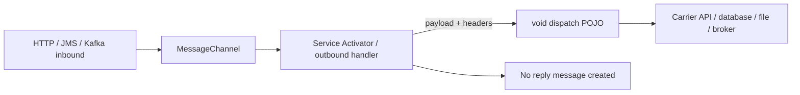
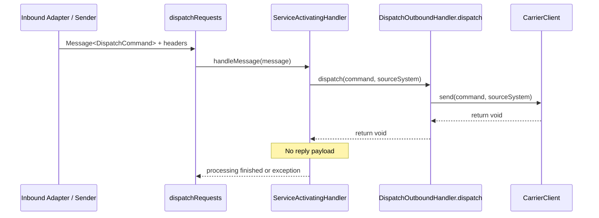

# Void method for an outbound handler in Spring Integration

## 1. Problem: ending a message flow with a POJO method

Suppose an application receives a delivery request from HTTP, JMS, AMQP, or Kafka. The message has been validated and routed to the final step: calling `carrierClient.send(...)` to submit the request to the shipping system. The existing API only provides a Java method returning `void`:

```java
public void send(DispatchCommand command) {
    // Submit the request to the shipping system.
}
```

We do not need to produce a new payload after sending, yet we still need Spring Integration to **receive the message, map parameters, invoke the right method, and handle errors**. This is the classic **one-way outbound handler** scenario: a message enters an endpoint, the endpoint performs a side effect, and the processing branch ends.

In the **`SPRING_INTEGRATION_ADAPTERS`** module, learners work with inbound/outbound adapters, gateways, pollers, and `MessageChannel` to integrate files, SFTP, HTTP, JMS, AMQP, Kafka, databases, and other systems. The **"Void method for an outbound handler"** topic belongs to the **Adapter POJO** group: using an existing Java method as the final send/processing step of an integration flow without bringing Spring Messaging APIs into business classes.

After this lesson, you will be able to:

1. Explain the meaning of a `void` method in `@ServiceActivator` or Java DSL `.handle(...)`.
2. Distinguish a one-way outbound handler from a reply-producing outbound gateway and from an inbound `MessageSource`.
3. Pass payload/headers into a POJO method, configure the input channel, and handle missing parameters.
4. Recognize why no message is forwarded after a `void` handler, even when the side effect succeeds.
5. Design error handling, retries, idempotency, transactions, and tests for outbound endpoints in real environments.

## 2. What is an outbound handler?

Spring Integration uses `Message<?>` as the unit of exchange between components. An **inbound adapter** brings data *into* the flow; an **outbound adapter** or a terminal handler pushes data *out* to another system or invokes business logic to execute a side effect.

At the POJO level, a `@ServiceActivator` with a `void` method is a very natural way to express receiving a message and executing a one-way side effect. Spring Integration creates the corresponding endpoint/handler, extracts data from the message, and invokes the Java method.



A POJO outbound handler does not necessarily open network connections itself. It commonly **delegates** to a dedicated client or service (`CarrierClient`, `InvoiceRepository`, `NotificationSender`, etc.). This keeps business-processing classes as plain Java and easy to test.

### Easily confused layers of responsibility

| Component | Role | Does it necessarily produce a reply? |
|---|---|---|
| `MessageSource` / inbound adapter | Pulls data from a source and injects it into the flow. | No; it **produces** inbound messages. |
| `MessageChannel` | Transports messages between endpoints. | No; channels do not decide business behavior. |
| `@ServiceActivator` with `void` method | Receives a message and runs logic, usually ending the flow branch. | **No** reply is created from a return value since the method returns nothing. |
| `@ServiceActivator` with DTO-returning method | Runs logic and produces a value for the next step. | Usually emits a reply if the result is non-`null`. |
| Protocol outbound channel adapter | Pushes messages to JMS, Kafka, HTTP, files, etc., per configuration. | Typically a one-way interaction at the flow boundary. |
| Outbound gateway | Sends a request and receives a response. | Designed for request/reply; requires an appropriate response contract. |

**`void` describes the Java method's return type, not a delivery guarantee from an external system.** A `void` method can run synchronously for a long time and throw exceptions. Nor does normal return by itself prove the receiving system durably persisted the data.

## 3. Processing contract: `void`, `null`, and replies

A service activator receives a `Message<?>`, invokes the matching method, and inspects the return value:

```text
Input message
  |
  v
ServiceActivatingHandler
  |
  +--> POJO method returns DTO/Message --> may emit a reply
  |
  +--> POJO method returns null -------> emits no reply by default
  |
  +--> POJO method is void ------------> no value to emit a reply
  |
  +--> POJO method throws exception ---> follows error-handling mechanism
```

| Method signature | Typical interpretation in a service activator |
|---|---|
| `void dispatch(DispatchCommand c)` | Performs a side effect; after invocation there is no returned object to build a reply. |
| `Void dispatch(DispatchCommand c)` returning `null` | Emits no reply by default; differs from Java's `void` type, yet yields the same messaging result. |
| `DispatchReceipt dispatch(DispatchCommand c)` | If a non-`null` DTO is returned, the handler can build a reply carrying `DispatchReceipt`. |
| `Message<DispatchReceipt> dispatch(...)` | Returns a message with explicit payload and headers for the handler to send as a reply. |
| `DispatchReceipt dispatch(...)` that actually does `return null` | Emits no reply by default; can fail if the endpoint sets `requiresReply = true`. |

### 3.1. The `replyChannel` header does not turn `void` into a reply

A request message may carry a `replyChannel` header, and a service activator may configure `outputChannel`. Those settings **only matter when the handler has a reply to send**. A `void` method creates no reply, so an endpoint at the end of a branch will not automatically send an acknowledgment message merely because the request included `replyChannel`.

This is especially important when upstream is an **inbound gateway** or a Java method via `@MessagingGateway` awaiting a return value. If the terminal downstream handler is `void`, a gateway expecting a response may receive `null`, wait until timeout, or fail depending on endpoint and gateway configuration. Design an explicit contract:

- Only need to issue a command or write data: use a one-way flow and `void` method, expecting no response payload.
- Need to know whether business accepted/rejected: return a confirmation DTO (`DispatchReceipt`, `Result`) and use a proper request/reply flow.
- Need a result from an external API: use an outbound gateway or result-returning service instead of calling an asynchronous `void` API and interpreting it as success.

### 3.2. When is `void` a good choice?

Suitable for **end-of-flow endpoints** responsible for:

- Writing audits or metrics without producing a business response.
- Sending notifications to a client that already manages delivery and errors.
- Saving entities to a repository or sending commands to an external system.
- Triggering tasks where callers are designed to need only message-dispatch confirmation.

Not suitable if a subsequent step in the **same reply flow branch** needs a payload produced by the method. A `void` handler provides no value for `.transform(...)` or `.channel("next")` downstream in reply-based chaining.

## 4. Mapping payload and headers to method parameters

A `Message<?>` has a **payload** (primary data) and **headers** (metadata). Spring Integration uses Spring Messaging's parameter-binding mechanism to invoke POJO methods.

```text
Message<DispatchCommand>
    payload = DispatchCommand(dispatchId="D-100", destination="HN", packages=2)
    headers = { sourceSystem="HTTP", correlationId="flow-123", ... }
```

Common signature declarations:

```java
// Only payload needed:
public void dispatch(DispatchCommand command) { ... }

// Explicit payload and reading one header:
public void dispatch(
        @Payload DispatchCommand command,
        @Header("sourceSystem") String sourceSystem) { ... }

// Allowing an optional header:
public void dispatch(
        @Payload DispatchCommand command,
        @Header(value = "sourceSystem", required = false) String sourceSystem) { ... }

// Need the full message:
public void dispatch(Message<DispatchCommand> message) { ... }

// Reading metadata only:
public void audit(@Headers Map<String, Object> headers) { ... }
```

These annotations belong to `org.springframework.messaging.handler.annotation`: `@Payload`, `@Header`, and `@Headers`. `Message` belongs to `org.springframework.messaging`. When mixing payload and headers, explicit annotations help the framework bind the right arguments and make the contract clear to readers.

**Limit to keep in mind:** if `@Header("sourceSystem")` is required and the message lacks that header, argument resolution can fail before entering the method. If inbound HTTP delivers JSON as a `String` or `byte[]`, do not assume a method accepting `DispatchCommand` automatically decodes JSON in every configuration: an appropriate converter or transformer must sit at the adapter boundary.

### When should you accept the full `Message<?>`?

Accepting `Message<DispatchCommand>` gives the method flexible access to multiple headers:

```java
public void dispatch(Message<DispatchCommand> message) {
    DispatchCommand command = message.getPayload();
    String trace = (String) message.getHeaders().get("correlationId");
    carrierClient.send(command, trace);
}
```

Still, when a business class does not need to know about messaging internals, prefer POJO/DTO parameters and pass only the metadata actually needed. Do not pass the whole `Message<?>` into a business client just to extract one `dispatchId` field.

## 5. Complete example: outbound handler calling a shipping API

Example illustrating Java 17+, Spring Boot 3.x, and Spring Integration 6.x. The flow is configured **one-way**: a `DirectChannel` receives requests, and a `void` service activator forwards them to `CarrierClient`. To run standalone without network dependencies, an in-memory client stands in for a real HTTP/Kafka adapter.

In a Gradle project:

```groovy
dependencies {
    implementation 'org.springframework.boot:spring-boot-starter-integration'
    testImplementation 'org.springframework.boot:spring-boot-starter-test'
}
```

The classes below share package `com.example.dispatch` and belong in their respective Java files.

### 5.1. Bootstrapping Spring Integration and the input channel

```java
// DispatchApplication.java
package com.example.dispatch;

import org.springframework.boot.SpringApplication;
import org.springframework.boot.autoconfigure.SpringBootApplication;
import org.springframework.context.annotation.Bean;
import org.springframework.integration.channel.DirectChannel;
import org.springframework.integration.config.EnableIntegration;
import org.springframework.messaging.MessageChannel;

@SpringBootApplication
@EnableIntegration
public class DispatchApplication {

    public static void main(String[] args) {
        SpringApplication.run(DispatchApplication.class, args);
    }

    @Bean
    MessageChannel dispatchRequests() {
        return new DirectChannel();
    }
}
```

`dispatchRequests` receives `Message<DispatchCommand>`. `DirectChannel` delivers messages to its subscriber synchronously: when a thread calls `send(...)`, the handler typically runs right on that thread. No poller is needed here because messages are **pushed into the channel** by upstream components.

### 5.2. Defining the payload and external system port

```java
// DispatchCommand.java
package com.example.dispatch;

public record DispatchCommand(
        String dispatchId,
        String destination,
        int packages) { }
```

```java
// CarrierClient.java
package com.example.dispatch;

public interface CarrierClient {
    void send(DispatchCommand command, String sourceSystem);
}
```

In practice, `CarrierClient` might use an HTTP client, message broker producer, or carrier SDK. To keep the example self-contained, implement a fake client storing commands by `dispatchId`:

```java
// InMemoryCarrierClient.java
package com.example.dispatch;

import java.util.Map;
import java.util.concurrent.ConcurrentHashMap;
import org.springframework.stereotype.Component;

@Component
public class InMemoryCarrierClient implements CarrierClient {
    private final Map<String, DispatchCommand> submitted =
            new ConcurrentHashMap<>();

    @Override
    public void send(DispatchCommand command, String sourceSystem) {
        // Simulates idempotency only within a single running process.
        DispatchCommand previous =
                submitted.putIfAbsent(command.dispatchId(), command);
        if (previous == null) {
            System.out.printf("Sent %s to %s from %s%n",
                    command.dispatchId(), command.destination(), sourceSystem);
        }
    }

    public boolean contains(String dispatchId) {
        return submitted.containsKey(dispatchId);
    }
}
```

This is a fake client for learning purposes. `ConcurrentHashMap` does not replace a database, survive restarts, or enforce idempotency across multiple instances. In real integrations, deduplication must occur at the source or target using durable business keys.

### 5.3. Implementing the outbound handler with a `void` method

```java
// DispatchOutboundHandler.java
package com.example.dispatch;

import org.springframework.integration.annotation.ServiceActivator;
import org.springframework.messaging.handler.annotation.Header;
import org.springframework.messaging.handler.annotation.Payload;
import org.springframework.stereotype.Component;

@Component
public class DispatchOutboundHandler {
    private final CarrierClient carrierClient;

    public DispatchOutboundHandler(CarrierClient carrierClient) {
        this.carrierClient = carrierClient;
    }

    @ServiceActivator(inputChannel = "dispatchRequests")
    public void dispatch(
            @Payload DispatchCommand command,
            @Header(value = "sourceSystem", required = false) String sourceSystem) {

        if (command.dispatchId() == null || command.dispatchId().isBlank()) {
            throw new IllegalArgumentException("dispatchId must not be blank");
        }
        if (command.packages() <= 0) {
            throw new IllegalArgumentException("packages must be positive");
        }

        carrierClient.send(command,
                sourceSystem == null ? "unspecified" : sourceSystem);
    }
}
```

Spring Integration registers a service activator consuming messages from `dispatchRequests`. When a message arrives, the framework binds the payload to `command`, binds the `sourceSystem` header to the second parameter, and invokes `dispatch(...)`.

Because the method returns `void`, **there is no reply message** from the handler to pass to a subsequent channel. No `outputChannel` is needed for this one-way endpoint. If `carrierClient.send(...)` throws an exception, the failure does not disappear simply because the method is declared `void`.

### 5.4. Sending a test message from upstream

An HTTP inbound adapter, Kafka consumer, or JMS adapter can send normalized data into the channel. To test manually without external connections:

```java
import org.springframework.messaging.MessageChannel;
import org.springframework.messaging.support.MessageBuilder;

void publish(MessageChannel dispatchRequests) {
    boolean acceptedByChannel = dispatchRequests.send(
            MessageBuilder.withPayload(
                            new DispatchCommand("D-100", "Hanoi", 2))
                    .setHeader("sourceSystem", "HTTP")
                    .setHeader("correlationId", "flow-123")
                    .build());

    System.out.println("Accepted by channel: " + acceptedByChannel);
}
```

With `DirectChannel` having a subscriber and no errors, `dispatch(...)` runs synchronously before `send(...)` returns. The fake client records `D-100`; the console may print:

```text
Sent D-100 to Hanoi from HTTP
Accepted by channel: true
```

**Interpreting the `send(...)` result accurately:** `true` indicates the channel accepted/dispatched the message per the channel contract; it is not itself a delivery receipt from an external system. With the mock client, the record lives only in RAM. With real HTTP or brokers, what level of confirmation "success" implies depends on the protocol, acknowledgments, and client configuration.

### 5.5. Sequence diagram



The diagram depicts synchronous success. If the client throws an error, the exception path follows the channel/endpoint policy rather than producing a success reply.

## 6. Alternative: Java DSL `.handle(pojo, "method")`

When you want to keep all Spring Integration configuration outside business classes, you can use **Java DSL**. Keep `DispatchOutboundHandler` as a `@Component` like in section 5.3, **remove `@ServiceActivator`** from `dispatch(...)`, and declare the flow:

```java
// DispatchIntegrationFlow.java
package com.example.dispatch;

import org.springframework.context.annotation.Bean;
import org.springframework.context.annotation.Configuration;
import org.springframework.integration.dsl.IntegrationFlow;

@Configuration
public class DispatchIntegrationFlow {
    @Bean
    IntegrationFlow dispatchFlow(DispatchOutboundHandler outboundHandler) {
        return IntegrationFlow.from("dispatchRequests")
                .handle(outboundHandler, "dispatch")
                .get();
    }
}
```

`.handle(outboundHandler, "dispatch")` registers a service activator that invokes the POJO method on incoming messages. The `void` signature still means no reply is emitted, so this flow ends at the handler.

**The `@ServiceActivator` and DSL approaches are mutually exclusive alternatives.** Do not leave the annotation in place while also creating `IntegrationFlow.from("dispatchRequests")` for the same logic. `DirectChannel` dispatches to a single subscriber per message, so having two similar subscribers means a command may go to one endpoint or the other, not reliably to both.

### Using `MessageHandler` directly

If you want to handle messages via the framework contract instead of a POJO method, Java DSL also allows a handler lambda receiving the raw `Message<?>`:

```java
@Bean
IntegrationFlow directHandlerFlow(CarrierClient carrierClient) {
    return IntegrationFlow.from("dispatchRequests")
            .handle(message -> {
                DispatchCommand command = (DispatchCommand) message.getPayload();
                String source = (String) message.getHeaders()
                        .getOrDefault("sourceSystem", "unspecified");
                carrierClient.send(command, source);
            })
            .get();
}
```

This is a **third option**, replacing the previous two. The `MessageHandler` lambda implements `void handleMessage(Message<?> message)`; it receives the full message and performs the side effect. The advantage of a POJO method is concise parameter binding and easy reuse; the advantage of `MessageHandler` is direct control over the message structure when genuinely needed.

## 7. Why can't `void` continue a flow expecting a reply?

Suppose we configure:

```java
IntegrationFlow.from("dispatchRequests")
        .handle(outboundHandler, "dispatch") // Method returns void.
        .channel("afterDispatch")             // Receives no reply from the handler.
        .get();
```

Even though the DSL chain includes `.channel("afterDispatch")`, the preceding endpoint returns no value and therefore **emits no reply** for the next step to receive. In a standard service activator, `null`/`void` means no reply is produced; it is not a signal to automatically forward the original message onward.

If the business requirement is "send the command and then continue processing the same payload," write a handler **that returns a result** or use an appropriate side branch:

```java
@Bean
IntegrationFlow dispatchThenContinue(CarrierClient carrierClient) {
    return IntegrationFlow.from("dispatchRequests")
            .handle(DispatchCommand.class, (command, headers) -> {
                String source = (String) headers.getOrDefault(
                        "sourceSystem", "unspecified");
                carrierClient.send(command, source);
                return command; // Explicitly produces a reply payload for the next step.
            })
            .channel("afterDispatch")
            .get();
}
```

This snippet is also an **alternative approach**; do not run it alongside the flow in section 6. Returning `command` gives the service activator a payload for the next step. If the API returns an actual receipt (`DispatchReceipt`), returning that receipt is clearer than returning the original command. To audit a copy of a message while preserving the main path, consider `wireTap` with an appropriate branch channel.

### Comparing designs

| Requirement | Recommendation |
|---|---|
| Only log or send a one-way command | `void` method at the end of the flow. |
| Send and pass the original payload to another step | Handler returns payload or uses a properly designed side branch (`wireTap`). |
| Need a real receipt from the target system | Use a request/reply contract with a gateway or a method returning `Receipt`. |
| Send command asynchronously and track later | Design response events/acks, correlation IDs, and durable processing states. |

## 8. Handling exceptions from an outbound handler

A `void` return type **does not suppress exceptions**. If validation fails or the client hits a connection error, an exception is thrown during message handling. Its path depends on the channel and endpoint.

### `DirectChannel`: errors typically return to the sender

With the section 5 configuration, `DirectChannel` calls the handler synchronously. If `carrierClient.send(...)` throws an error, it normally propagates back to the `dispatchRequests.send(...)` call, possibly wrapped by Spring Messaging in a `MessagingException` or similar exception type. The sender or source adapter must define a policy for handling it.

Example (conceptual illustration when using a real client):

```java
public void dispatch(DispatchCommand command) {
    try {
        carrierClient.send(command, "HTTP");
    } catch (CarrierUnavailableException ex) {
        // Distinguish temporary infrastructure unavailability from invalid commands.
        throw ex;
    }
}
```

`CarrierUnavailableException` is an illustrative application-defined exception. The key rule is **never swallow errors and pretend success**. If an error is swallowed, neither downstream nor upstream knows the operation failed so it can retry or route to a dead-letter queue.

### `ExecutorChannel`, `QueueChannel`, and transactional adapters

With `ExecutorChannel` or a polling consumer reading from `QueueChannel`, execution typically happens on another thread or poll cycle. The `send(...)` caller may already have returned before the `void` method runs; exceptions no longer reliably return to the original caller. Inspect `errorChannel`, error handlers, advice, and endpoint monitoring.

With JMS, AMQP, or Kafka inbound adapters, whether a failure triggers redelivery, commit/rollback, ack, or dead-letter routing depends on **adapter type, acknowledgment mode, transactions, and retry policies**. You cannot infer exact retry behavior merely from having a `void` `@ServiceActivator` at the end of a flow.

### `void` return with partial send failure

Suppose an HTTP client sends a request to a carrier, the carrier creates the shipment, and the connection drops before the client reads the HTTP response. The method may throw a timeout even though the remote side created the order. If the upstream adapter redelivers, the command may be sent again. Therefore, you need an **idempotency key** like `dispatchId`, remote status checks, or durable confirmation mechanisms; naive retries can cause duplicates.

## 9. Delivery guarantees, transactions, and idempotency

A `void` outbound handler may be invoked **multiple times** for the same business event due to retries or redeliveries. For operations that cannot be safely reapplied (payments, shipments, inventory deductions), design deduplication using business keys.

| Issue | Risk | Design approach |
|---|---|---|
| Upstream sends duplicate messages | Calls target API twice. | Use `dispatchId`/`eventId` as an idempotency key; persist processing state durably. |
| Handler finishes side effect then fails to record checkpoint | Message redelivered even though side effect occurred. | Combine idempotency, outbox/inbox, or proper checkpoints. |
| Internal operation and external API call span two systems | No single default transaction guarantees atomicity. | Use outbox, sagas, or compensating workflows when needed. |
| Method returns `void` after only enqueuing asynchronously | Upstream assumes delivery to target succeeded. | Distinguish "accepted", "dispatched", and "completed"; use events/receipts if needed. |
| Slow handler processing | Blocks `DirectChannel` thread or builds queue backlog. | Set I/O timeouts, bound concurrency, capacity, backpressure, and latency metrics. |
| Multiple instances process the same command | In-JVM locks are insufficient. | Design durable locking/coordination in the database, broker, or target service. |

The fake client in section 5 uses `putIfAbsent(dispatchId, command)`, skipping duplicates **inside one running JVM**. In production, that is only a simulation. Across two pods or restarts, the map loses effect; idempotency must live where state is durably persisted or in the carrier API itself.

### Where do transactions belong?

If the service activator writes to a database managed by a transaction manager, transactions can be structured at the service layer, endpoint, or upstream adapter depending on the architecture. `@Transactional` only works when transaction management is configured and calls pass through a proper proxy; it **does not automatically include an external HTTP/Kafka call inside the database transaction**. For updating a database and emitting an event, a transactional outbox usually prevents gaps between data commit and message emission.

### Should you retry on a `void` method?

Yes, when appropriate—but do not apply retries to every error. Transient failures like timeouts can be retried with bounds and backoff. Contract errors (blank `dispatchId`, wrong payload type) usually belong in rejection or inspection flows. Every retry can re-execute the side effect, so retries must pair with idempotency and state observability.

## 10. Observing and operating the endpoint

A one-way outbound handler is hard to monitor if you only check for "no exceptions." Record the following in accordance with security policies:

- `dispatchId` or business key for tracing; avoid exposing personal data from payloads in logs.
- `sourceSystem`, `correlationId`, or trace ID to correlate with upstream messages.
- Counts of received messages, successful sends, errors by category, client call latency, and upstream backlog.
- Retry/redelivery rates, rejected commands, and items awaiting retry.

Endpoint lifecycle ties into Spring Integration configuration: a service activator attached to `DirectChannel` normally triggers whenever the channel receives a message and the endpoint is active. It **does not need a poller**. If the source sits in a `QueueChannel` or a polling inbound adapter, the poller belongs to the component reading that source/queue, not to the `void` handler method itself.

For maintenance, you can stop the adapter/upstream or endpoint via lifecycle controls. Stopping does not automatically recall an already-completed network call, nor does it clear backlog waiting in a broker or queue.

## 11. Testing from POJO to message flow

Two complementary test levels apply: **unit tests** verifying the `void` method's business logic, and **integration tests** verifying Spring Integration binds the message and invokes the handler. They serve different purposes.

### 11.1. Unit testing the outbound handler

No Spring context is needed to prove the method validates input and delegates to the client. Example using the fake client from section 5:

```java
// DispatchOutboundHandlerTest.java
package com.example.dispatch;

import static org.junit.jupiter.api.Assertions.*;
import org.junit.jupiter.api.Test;

class DispatchOutboundHandlerTest {

    @Test
    void delegatesAValidCommandToClient() {
        InMemoryCarrierClient client = new InMemoryCarrierClient();
        DispatchOutboundHandler handler = new DispatchOutboundHandler(client);

        handler.dispatch(new DispatchCommand("UNIT-001", "Hanoi", 2), "JMS");

        assertTrue(client.contains("UNIT-001"));
    }

    @Test
    void rejectsInvalidPackageCountBeforeSending() {
        InMemoryCarrierClient client = new InMemoryCarrierClient();
        DispatchOutboundHandler handler = new DispatchOutboundHandler(client);

        assertThrows(IllegalArgumentException.class,
                () -> handler.dispatch(
                        new DispatchCommand("UNIT-002", "Hanoi", 0), "JMS"));
        assertFalse(client.contains("UNIT-002"));
    }
}
```

This test verifies POJO logic. It does not verify channel wiring or header/payload binding.

### 11.2. Integration testing the `void` service activator

Using a Spring Boot test context with `DispatchApplication`, `DispatchOutboundHandler`, and `InMemoryCarrierClient` from section 5:

```java
// DispatchFlowTest.java
package com.example.dispatch;

import static org.junit.jupiter.api.Assertions.*;

import org.junit.jupiter.api.Test;
import org.springframework.beans.factory.annotation.Autowired;
import org.springframework.beans.factory.annotation.Qualifier;
import org.springframework.boot.test.context.SpringBootTest;
import org.springframework.integration.channel.QueueChannel;
import org.springframework.messaging.MessageChannel;
import org.springframework.messaging.support.MessageBuilder;

@SpringBootTest
class DispatchFlowTest {

    @Autowired
    @Qualifier("dispatchRequests")
    MessageChannel requests;

    @Autowired
    InMemoryCarrierClient carrierClient;

    @Test
    void callsVoidHandlerWithoutProducingReply() {
        QueueChannel replies = new QueueChannel();

        boolean sent = requests.send(
                MessageBuilder.withPayload(
                                new DispatchCommand("FLOW-001", "Da Nang", 1))
                        .setHeader("sourceSystem", "HTTP")
                        .setReplyChannel(replies)
                        .build());

        assertTrue(sent);
        assertTrue(carrierClient.contains("FLOW-001"));
        assertNull(replies.receive(0));
    }
}
```

With `DirectChannel`, the handler runs synchronously; by the time `send(...)` returns successfully, the fake client has received the command. `replies.receive(0)` confirms **no reply message** was produced by the `void` handler, even though the request had a `replyChannel`. The test requires no `Thread.sleep()` and no external connections.

To test the failure path, swap the client for a test double throwing an exception and assert behavior at the channel/adapter. For async handlers, never assume the thread calling `send(...)` will catch the exception; inspect the error channel or error-tracking mechanism configured for that endpoint.

## 12. Common implementation pitfalls

| Symptom | Causes to check | Resolution |
|---|---|---|
| `void` method does not run | Bean not scanned, wrong channel name, unregistered endpoint, or no subscriber. | Check `@Component`, `@ServiceActivator(inputChannel=...)`, application context state, and message dispatch. |
| Parameter binding error | Wrong payload type or missing required `@Header`. | Verify adapter contract; add converter/transformer or `required = false` if header is optional. |
| Method ran yet flow does not reach next step | `void` handler produces no reply. | Return a DTO/payload if continuation is needed, or configure a dedicated side-effect branch. |
| Inbound gateway times out or returns empty | Caller expects a reply, but terminal downstream is `void`. | Use a one-way contract or return an explicit confirmation result. |
| Request reaches wrong handler | Duplicate annotation and DSL endpoints on the same `DirectChannel`. | Keep only one endpoint configuration for the flow. |
| `send(...)` reports success yet target lacks data | Async side effect, no durable ack, or error occurred after call. | Define acknowledgment level, timeouts, retries, and reconcile target state. |
| Duplicate sends after retry | Remote API received it, caller timed out, broker redelivered. | Idempotency key and durable state tracking. |
| Errors appear only in another thread's logs | Async channel/endpoint prevents exceptions returning to caller. | Configure `errorChannel`, monitoring, and dead-letter handling. |
| System slows down as message volume grows | Synchronous `DirectChannel` with slow I/O API. | Measure latency, set timeouts, and introduce bounded buffering/concurrency as needed. |

## 13. Hands-on exercises

1. Write `EmailNotificationSender` with `void send(@Payload EmailCommand command)` and configure `@ServiceActivator(inputChannel = "emailCommands")`. Send a message and confirm the fake client receives the right payload.
2. Add `@Header(value = "sourceSystem", required = false)` to the method; test both when the header is present and when absent.
3. Migrate the annotation setup to `IntegrationFlow.from("emailCommands").handle(sender, "send")`. Ensure no annotation endpoint still listens on the same channel.
4. Attach `replyChannel` to a request sent to the `void` handler and confirm no reply arrives; then change the method to return `DispatchReceipt` and observe the difference.
5. Add `.channel("afterDispatch")` after the `void` handler. Explain why this channel receives no message; fix it by returning an appropriate payload or receipt.
6. Simulate the carrier client timing out **after already recording the command**. Retry with the same `dispatchId` and design a durable idempotency mechanism to avoid creating duplicate shipments.
7. Replace `DirectChannel` with an asynchronous option, measure the difference between when `send(...)` returns and when the real client is invoked; add error and backlog controls.

## 14. Takeaways

- **A `void` method in `@ServiceActivator` fits a one-way outbound handler**: receive a message, execute business logic, and end the branch.
- **`void` produces no reply**. Having a `replyChannel` header or declaring a subsequent DSL step does not cause Spring Integration to forward the original message automatically.
- **`@Payload`, `@Header`, `@Headers`, and `Message<?>`** are the ways a POJO method receives data from a message.
- **`@ServiceActivator(inputChannel = "...")`** and **Java DSL `.handle(pojo, "method")`** are two alternative configurations for the same purpose.
- **No poller is needed** if the handler receives from a `DirectChannel` or upstream message push; pollers belong on endpoints reading sources/channels when polling is actually required.
- **A `void` result does not guarantee delivery**. Timeouts, acks, retries, transactions, idempotency, async errors, and lifecycle must be designed at the appropriate adapter/client boundaries.

### References

- [Spring Integration Reference — Service Activator](https://docs.spring.io/spring-integration/reference/service-activator.html)
- [Spring Integration Reference — Channel Adapter](https://docs.spring.io/spring-integration/reference/channel-adapter.html)
- [Spring Integration Reference — Java DSL](https://docs.spring.io/spring-integration/reference/dsl.html)
- [Spring Integration Reference — Message Endpoints](https://docs.spring.io/spring-integration/reference/endpoint.html)
- [Spring Integration Reference — Error Handling](https://docs.spring.io/spring-integration/reference/error-handling.html)
